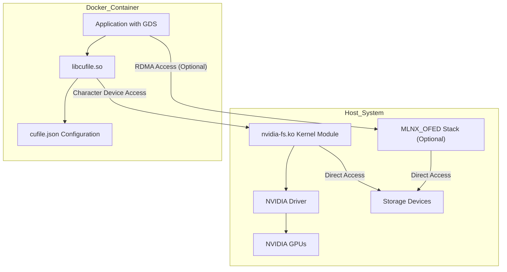
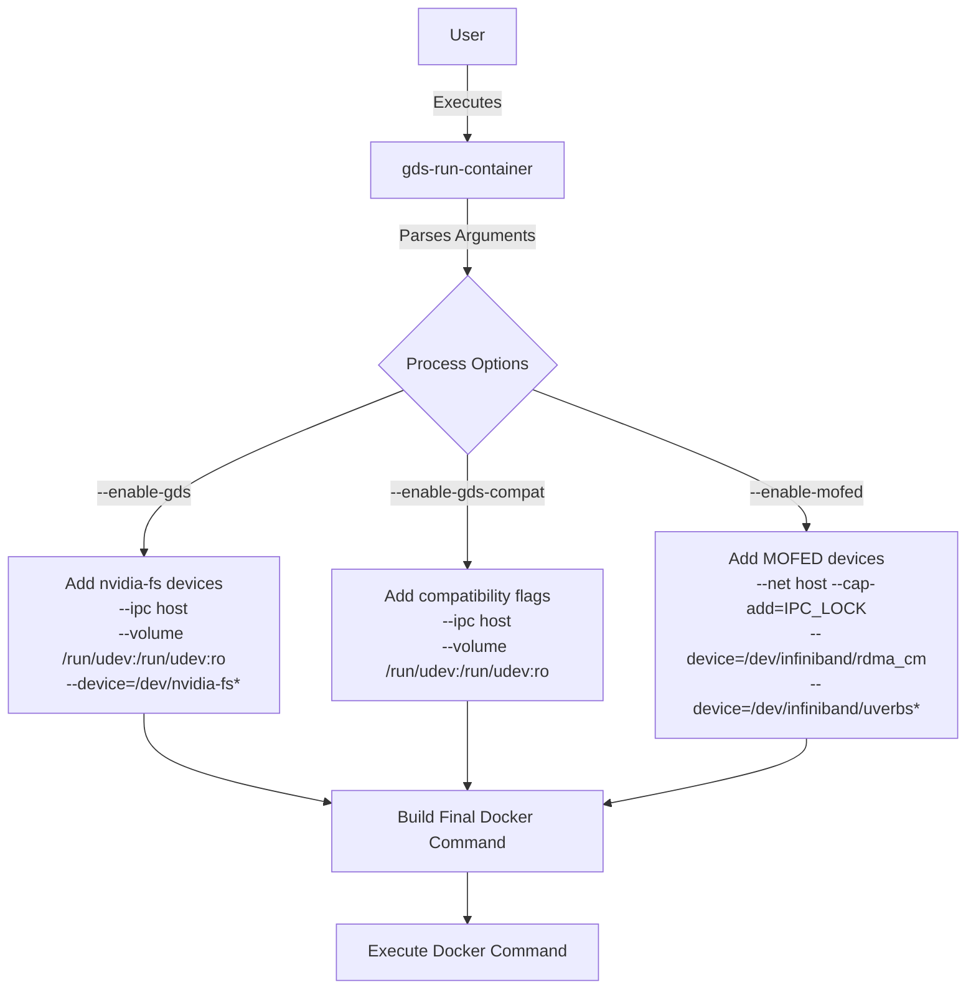
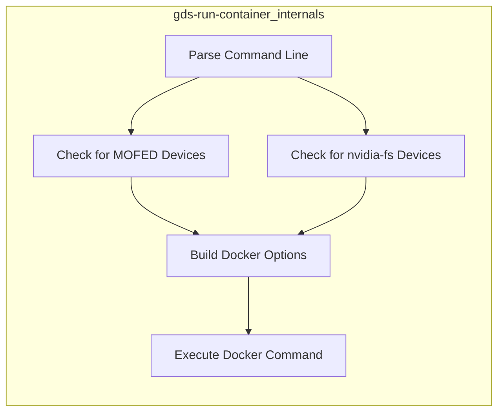

<!-- source: DeepWiki mcp.deepwiki.com · repo NVIDIA/MagnumIO · page 8 Docker Integration · fetched 2026-10-26 -->

# Docker Integration

<details>
<summary>Relevant source files</summary>

The following files were used as context for generating this wiki page:

- [gds/docker/README.md](gds/docker/README.md)
- [gds/docker/gds-run-container](gds/docker/gds-run-container)

</details>


## Purpose and Overview

This document describes how to integrate NVIDIA GPUDirect Storage (GDS) with Docker containers using the provided utilities in MagnumIO. GDS requires access to specific system resources and character devices, which need special configuration when running in containerized environments. The tools and methods covered here enable developers to easily deploy GDS-enabled applications in Docker containers.

For information on the general GDS architecture and capabilities, see [GPU Direct Storage (GDS)](#3).

## Architecture of GDS in Docker

When running GDS in Docker containers, specific system resources must be exposed to the container for proper operation. The following diagram illustrates how GDS works within a containerized environment:



Sources: [gds/docker/README.md:1-3]()

## The gds-run-container Script

MagnumIO provides a wrapper script `gds-run-container` that simplifies running Docker containers with GDS support. This script automatically adds all the necessary Docker flags and device mounts required for GDS to function properly.

### Workflow of the Script

The following diagram illustrates how the `gds-run-container` script processes options and builds the Docker command:



Sources: [gds/docker/gds-run-container:1-90]()

### Script Options

The script supports the following GDS-specific options:

| Option | Purpose |
|--------|---------|
| `--enable-gds` | Enables full GDS support by adding necessary flags and devices |
| `--enable-gds-compat` | Enables GDS in compatibility mode only (CPU fallback) |
| `--enable-mofed` | Adds flags for MLNX_OFED support with RDMA |

All other Docker options are passed through directly to the Docker command.

Sources: [gds/docker/gds-run-container:10-42](), [gds/docker/README.md:64-67]()

## Security Considerations

When running GDS in Docker containers, the container requires specific permissions and access to system resources. The following table outlines these requirements:

| Docker Option | Purpose |
|---------------|---------|
| `--gpus=all` | Enable NVIDIA GPUs |
| `--ipc host` | For GDS stats using shared memory |
| `--volume /run/udev:/run/udev:ro` | To allow detection of block devices and GPUs |
| `/dev/nvidia*`, `/dev/nvidia-caps*` | Access to GPU character devices (provided by `--gpus`) |
| `/proc/driver/` | Access to nvidia-fs stats (exposed by default) |
| `/sys/class/` | sysfs paths for udev devices (exposed by default) |
| `--net host --cap-add=IPC_LOCK --device=/dev/infiniband/rdma_cm` | For MOFED stack using RDMA connection manager |
| `--device=/dev/infiniband/uverbs*` | Access to uverbs API from userspace for WekaFS and GPFS |
| `--device=/dev/nvidia-fs*` | Access to nvidia-fs kernel module character devices |

Sources: [gds/docker/README.md:6-55]()

## Usage Examples

### Running a GDS Test Container with MLNX_OFED Support

```bash
WORK_DIR=/opt/gds
GDS_VOLUME=/GDS_MOUNT
IMAGE="gds-partner:1.0.0-cuda-11.2-mlnx-5.1-2.5.8.0"

$ gds-run-container run --rm --gpus=all --enable-mofed --enable-gds \
                      --volume ${GDS_VOLUME}:/data:rw \
                      --workdir ${WORK_DIR} \
                      -it ${IMAGE} /usr/local/gds/tools/gdscheck -p
```

Sources: [gds/docker/README.md:99-110]()

### Running a GDS Test Container without MLNX_OFED Support

```bash
WORK_DIR=/opt/gds
GDS_VOLUME=/GDS_MOUNT
IMAGE="gds-partner:1.0.0-cuda-11.2-mlnx-5.1-2.5.8.0"

$ gds-run-container run --rm --gpus=all --enable-gds \
                      --volume ${GDS_VOLUME}:/data:rw \
                      --workdir ${WORK_DIR} \
                      -it ${IMAGE} /usr/local/gds/tools/gdscheck -p
```

Sources: [gds/docker/README.md:112-122]()

### Running a GDS Test Container in Compatibility Mode

```bash
WORK_DIR=/opt/gds
GDS_VOLUME=/GDS_MOUNT
IMAGE="gds-partner:1.0.0-cuda-11.2-mlnx-5.1-2.5.8.0"

$ gds-run-container run --rm --gpus=all --enable-gds-compat \
                      --volume ${GDS_VOLUME}:/data:rw \
                      --workdir ${WORK_DIR} \
                      -it ${IMAGE} /usr/local/gds/tools/gdscheck -p
```

Sources: [gds/docker/README.md:123-133]()

### Running a PyTorch GDS Container

```bash
WORK_DIR=/opt/gds
GDS_VOLUME=/GDS_MOUNT
IMAGE="pytorch-gds"

$ gds-run-container run --rm --gpus=all --enable-mofed --enable-gds \
                      --volume ${GDS_VOLUME}:/data:rw \
                      --workdir ${WORK_DIR} \
                      -it ${IMAGE} bash
```

Sources: [gds/docker/README.md:135-145]()

### Using Other Docker Commands

Since `gds-run-container` is a wrapper around the Docker command, it can be used for any Docker commands, not just `run`:

```bash
$ gds-run-container image ls

REPOSITORY            TAG                          IMAGE ID       CREATED        SIZE
gds-partner           1.0.0-cuda-11.2              e8319f254587   39 hours ago   5.36GB
nvcr.io/nvidia/cuda   11.2.1-devel-ubuntu20.04     6f43d7321de0   8 weeks ago    4.2GB
```

Sources: [gds/docker/README.md:88-97]()

## Configuration

### cufile.json Configuration

Each container using GDS needs a `cufile.json` configuration file. By default, `libcufile.so` looks for this file at `/etc/cufile.json`. You can specify a different path using the `CUFILE_ENV_PATH_JSON` environment variable:

```bash
WORK_DIR=/opt/gds
GDS_VOLUME=/GDS_MOUNT
IMAGE="pytorch-gds"

$ gds-run-container run --rm --gpus=all --enable-mofed --enable-gds \
                      -e CUFILE_ENV_PATH_JSON=/opt/gds/cufile.json \
                      --volume ${GDS_VOLUME}:/data:rw \
                      --workdir ${WORK_DIR} \
                      -it ${IMAGE} bash
```

For details on the configuration file contents, refer to the GPUDirect Storage documentation.

Sources: [gds/docker/README.md:147-164]()

## Implementation Details

The script implementation detects available devices on the host system and dynamically builds the appropriate Docker command with the required flags. For MOFED support, it looks for `/dev/infiniband/uverbs*` devices, and for GDS support, it checks for `/dev/nvidia-fs*` devices.

If the required devices are not found, the script will print an appropriate message and exit.



Sources: [gds/docker/gds-run-container:44-72]()

## Limitations and Requirements

- GDS Docker integration requires that the host system has the NVIDIA driver and GDS driver (`nvidia-fs.ko`) installed and loaded
- For MOFED support, the host must have the Mellanox OFED drivers installed
- The `--gpus=all` flag requires the NVIDIA Container Runtime to be installed on the host system
- The script must be run with sufficient permissions to access the required devices

Sources: [gds/docker/README.md:5-55]()