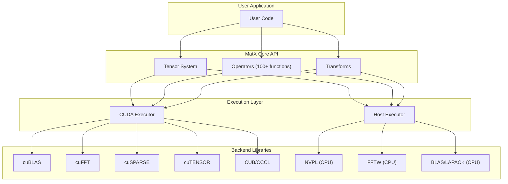
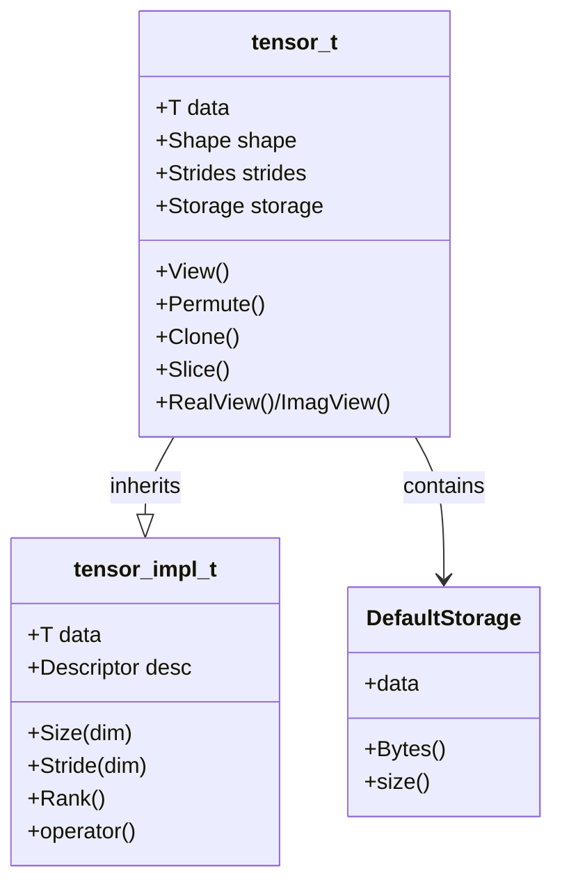
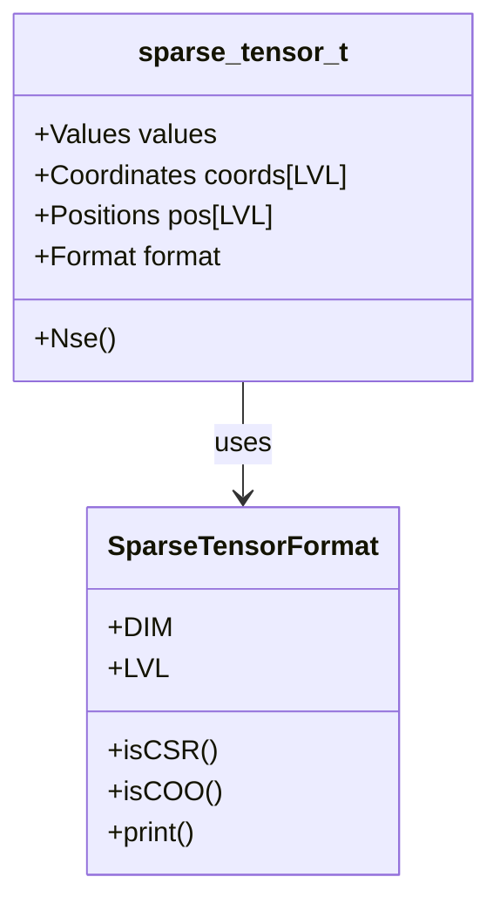
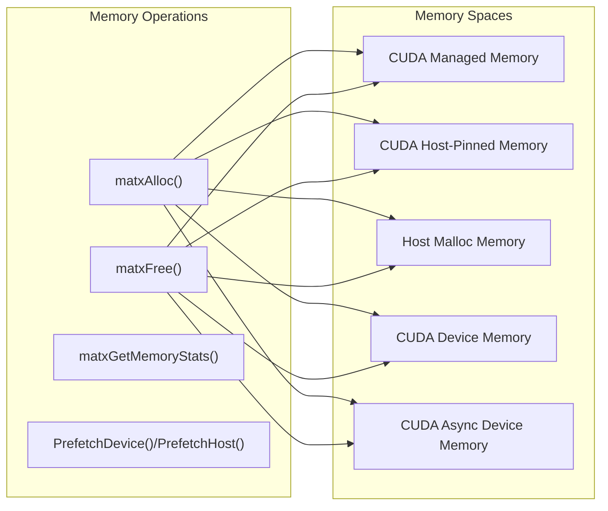
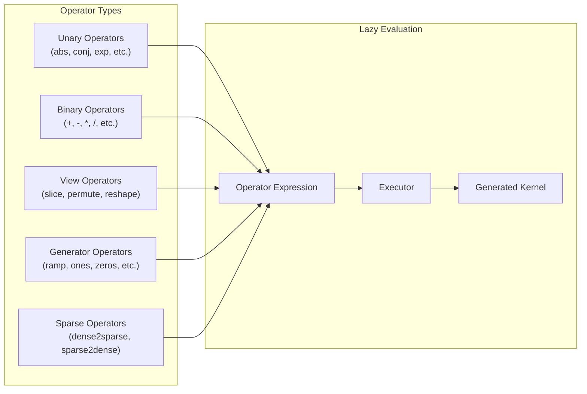
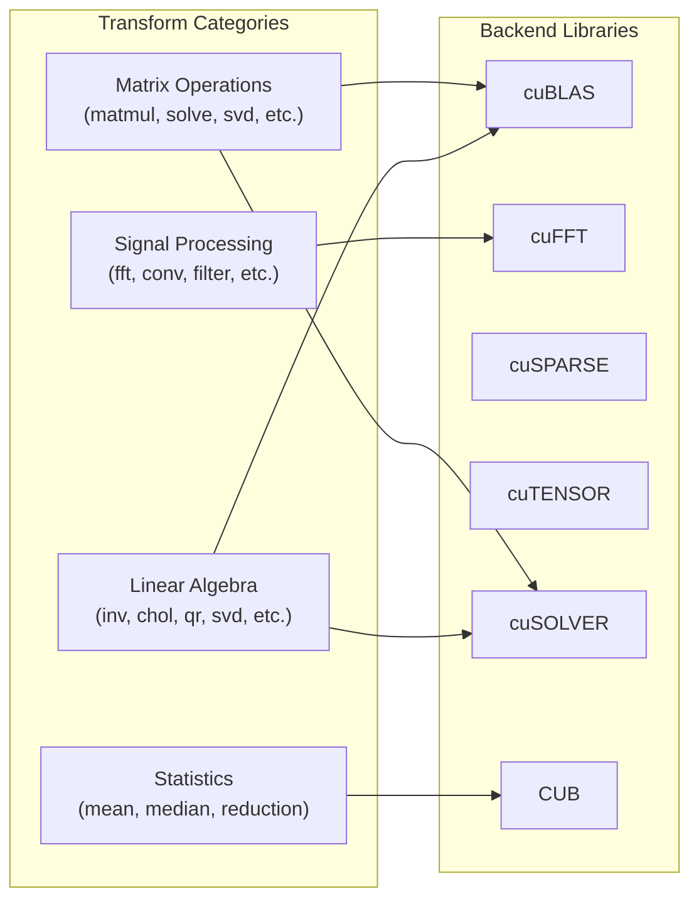
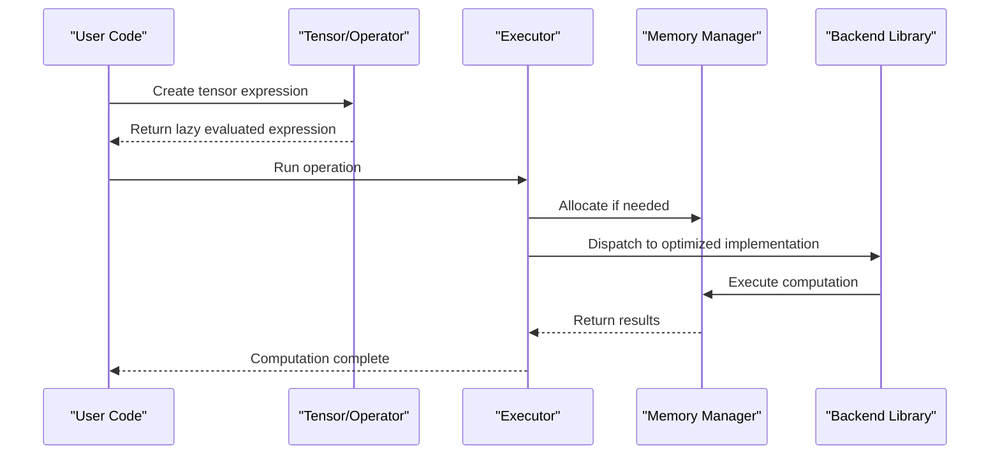

<!-- source: DeepWiki mcp.deepwiki.com · repo NVIDIA/MatX · page 1 MatX: Overview · fetched 2026-10-26 -->

# MatX: Overview

<details>
<summary>Relevant source files</summary>

The following files were used as context for generating this wiki page:

- [CMakeLists.txt](CMakeLists.txt)
- [README.md](README.md)
- [cmake/FindcuDSS.cmake](cmake/FindcuDSS.cmake)
- [docs_input/basics/memory.rst](docs_input/basics/memory.rst)
- [docs_input/basics/nvtx.rst](docs_input/basics/nvtx.rst)
- [docs_input/basics/sparse_tensor.rst](docs_input/basics/sparse_tensor.rst)
- [docs_input/build.rst](docs_input/build.rst)
- [examples/sparse_tensor.cu](examples/sparse_tensor.cu)
- [include/matx/core/allocator.h](include/matx/core/allocator.h)
- [include/matx/core/error.h](include/matx/core/error.h)
- [include/matx/core/make_sparse_tensor.h](include/matx/core/make_sparse_tensor.h)
- [include/matx/core/nvtx.h](include/matx/core/nvtx.h)
- [include/matx/core/print.h](include/matx/core/print.h)
- [include/matx/core/sparse_tensor.h](include/matx/core/sparse_tensor.h)
- [include/matx/core/sparse_tensor_format.h](include/matx/core/sparse_tensor_format.h)
- [include/matx/core/tensor.h](include/matx/core/tensor.h)
- [include/matx/core/tensor_impl.h](include/matx/core/tensor_impl.h)
- [include/matx/core/tensor_utils.h](include/matx/core/tensor_utils.h)
- [include/matx/executors/kernel.h](include/matx/executors/kernel.h)
- [include/matx/operators/dense2sparse.h](include/matx/operators/dense2sparse.h)
- [include/matx/operators/operators.h](include/matx/operators/operators.h)
- [include/matx/operators/sparse2sparse.h](include/matx/operators/sparse2sparse.h)
- [include/matx/transforms/convert/sparse2sparse_cusparse.h](include/matx/transforms/convert/sparse2sparse_cusparse.h)
- [test/00_tensor/BasicTensorTests.cu](test/00_tensor/BasicTensorTests.cu)

</details>


MatX is a modern C++ library for numerical computing on NVIDIA GPUs and CPUs. It provides near-native performance while using a simple syntax inspired by higher-level languages such as Python and MATLAB. This document introduces the core concepts, architecture, and components of the MatX library.

## Purpose and Scope

MatX enables developers to write GPU-accelerated numerical computing code with minimal effort, providing a familiar syntax while achieving performance comparable to hand-optimized CUDA code. The library is designed to serve as a high-performance alternative to Python numerical libraries like NumPy and SciPy, but in a C++ environment with direct access to GPU acceleration.

This overview explains the high-level architecture and key components of MatX. For details about specific components, please refer to the dedicated pages on the [Core Tensor System](#2), [Operators](#3), [Transforms](#4), and [Execution Model](#5).

## Key Features

- **High Performance**: MatX leverages optimized backend libraries (cuBLAS, cuFFT, etc.) for maximum performance
- **Intuitive Syntax**: Python-like API makes code readable and familiar to data scientists
- **Seamless Integration**: Easily integrates with existing CUDA libraries and C++ code
- **Visualization**: Built-in data visualization capabilities through web browsers
- **I/O Capabilities**: Read and write data from various file formats
- **CPU Support**: Support for both GPU and CPU execution with optimized backends
- **Experimental Sparse Tensor Support**: Sparse matrix operations with common formats like COO, CSR, and CSC

Sources: [README.md:8-34](), [CMakeLists.txt:46-51]()

## High-Level Architecture

MatX is architected as a layered system with tensor abstractions at its core, operators and transforms for manipulating data, and backend acceleration libraries for performance.



Sources: [CMakeLists.txt:32-36](), [CMakeLists.txt:214-258](), [include/matx/operators/operators.h:33-130]()

## Tensor System

The central data structure in MatX is the tensor, which represents a multi-dimensional array. MatX supports both dense and sparse tensors.

### Dense Tensors

Dense tensors are the primary way to store and manipulate data in MatX. The `tensor_t` class provides a view-based interface to multi-dimensional data with various operations.



Dense tensors in MatX support:
- N-dimensional arrays (0D to 4D+ tensors)
- Multiple data types (integers, floating-point, complex)
- Various memory spaces (device, host, managed)
- View operations (slicing, permuting, reshaping)
- Lazy evaluation for efficient operations

Sources: [include/matx/core/tensor.h:73-842](), [include/matx/core/tensor_impl.h:88-569]()

### Sparse Tensors (Experimental)

MatX provides experimental support for sparse tensors through a Universal Sparse Tensor (UST) format, enabling representation of common sparse formats like COO, CSR, and CSC.



Sparse tensor operations include:
- Conversion between sparse and dense formats
- Sparse matrix multiplication
- Sparse linear system solving
- Conversion between different sparse formats

Sources: [include/matx/core/sparse_tensor.h:75-183](), [include/matx/core/sparse_tensor_format.h:46-340](), [include/matx/core/make_sparse_tensor.h:69-186]()

### Memory Management

MatX handles memory allocation and management through a flexible storage system that supports various memory spaces:



Memory spaces available in MatX:
- `MATX_MANAGED_MEMORY`: CUDA unified memory, accessible from both host and device
- `MATX_HOST_MEMORY`: Pinned host memory for faster transfers
- `MATX_HOST_MALLOC_MEMORY`: Regular host memory from malloc
- `MATX_DEVICE_MEMORY`: CUDA device memory
- `MATX_ASYNC_DEVICE_MEMORY`: Asynchronous device memory tied to a CUDA stream

Sources: [include/matx/core/allocator.h:56-62](), [include/matx/core/tensor.h:738-763]()

## Operators and Transforms

MatX provides a rich set of operators and transforms for manipulating tensors.

### Operators

Operators are functions that perform element-wise operations on tensors, creating views, or manipulating tensor data without performing actual computation until execution.



MatX includes over 100 different operators for various purposes, including:
- Mathematical functions (trigonometric, logarithmic, etc.)
- Comparison operators
- Tensor manipulation (slicing, concatenation, permutation)
- Type conversion
- Random number generation
- Conditional operations

Sources: [include/matx/operators/operators.h:33-130]()

### Transforms

Transforms are higher-level operations that typically involve more complex algorithms and often leverage optimized backend libraries like cuBLAS, cuFFT, and cuSPARSE.



Key transforms include:
- Matrix multiplication (matmul)
- FFT operations
- Reductions (sum, min, max)
- Matrix decompositions (SVD, QR, LU)
- Linear system solvers
- Convolution and filtering

Sources: [include/matx/operators/operators.h:33-130]()

## Execution Model

MatX uses an executor-based model to control where and how operations are executed.



### CUDA Executor

The CUDA executor runs operations on NVIDIA GPUs using CUDA kernels and libraries:
- Automatic kernel generation for custom operations
- Integration with cuBLAS, cuFFT, cuSPARSE, and other CUDA libraries
- Stream-based execution for overlap and concurrency
- Support for CUDA graphs

### Host Executor

The host executor runs operations on the CPU:
- Support for various CPU math libraries (NVPL, FFTW, OpenBLAS, BLIS)
- Multi-threaded execution with OpenMP
- Fallback for systems without GPUs or for debugging

Sources: [docs_input/build.rst:43-67](), [CMakeLists.txt:214-258]()

## System Requirements and Compatibility

MatX has specific system requirements to ensure optimal performance:

- **CUDA**: Version 11.8+ or 12.2.1+ (note: 12.0.0-12.2.0 have compiler issues)
- **Host Compiler**: g++9+, nvc++ 24.5+, or clang 17+
- **GPU Architectures**: Pascal, Turing, Volta, Ampere, Ada, and Hopper (compute capability 6.0+)
- **Operating System**: Currently Linux only
- **CMake**: 3.23.1+ (for building tests, examples, etc.)
- **Optional Libraries**: cuTENSOR, cuDSS for specific functionality

Sources: [README.md:50-62](), [docs_input/build.rst:19-40]()

## Data Types

MatX supports a wide range of data types:

| Category | Supported Types |
|----------|----------------|
| Integer | int8_t, uint8_t, int16_t, uint16_t, int32_t, uint32_t, int64_t, uint64_t |
| Floating Point | matxFp16 (fp16), matxBf16 (bfloat16), float, double |
| Complex | matxFp16Complex, matxBf16Complex, cuda::std::complex<float>, cuda::std::complex<double> |
| Boolean | bool |

Special half-precision types (matxFp16, matxBf16) are provided for host compatibility, since CUDA half types don't support all C++ operators on the host.

Sources: [README.md:160-171]()

## Getting Started Example

Below is a simplified example showing basic MatX usage:

```cpp
#include "matx.h"

using namespace matx;

int main() {
  // Create a 2D tensor
  auto a = make_tensor<float>({2, 3});
  
  // Initialize with values
  a.SetVals({{1, 2, 3}, {4, 5, 6}});
  
  // Create another tensor
  auto b = make_tensor<float>({3, 2});
  b.SetVals({{7, 8}, {9, 10}, {11, 12}});
  
  // Output tensor for matrix multiplication
  auto c = make_tensor<float>({2, 2});
  
  // Execute matrix multiplication using CUDA
  cudaStream_t stream = 0;
  cudaExecutor exec{stream};
  (c = matmul(a, b)).run(exec);
  
  // Print the result
  print(c);
  
  return 0;
}
```

This example demonstrates creating tensors, initializing them, performing a matrix multiplication transform, and executing it on a GPU using the CUDA executor.

Sources: [README.md:17-20](), [README.md:196-200]()

## Conclusion

MatX provides a powerful, high-performance tensor library for GPU-accelerated computing with an intuitive Python-like syntax. Its layered architecture allows for efficient execution while maintaining a simple API for users. From basic tensor manipulations to complex transforms using optimized backend libraries, MatX offers a comprehensive solution for numerical computing on NVIDIA GPUs and CPUs.

By combining the performance of optimized CUDA libraries with a familiar syntax, MatX bridges the gap between ease of use and high performance, enabling efficient development of GPU-accelerated applications.

---

