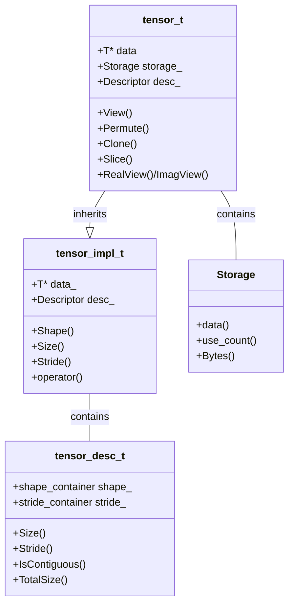
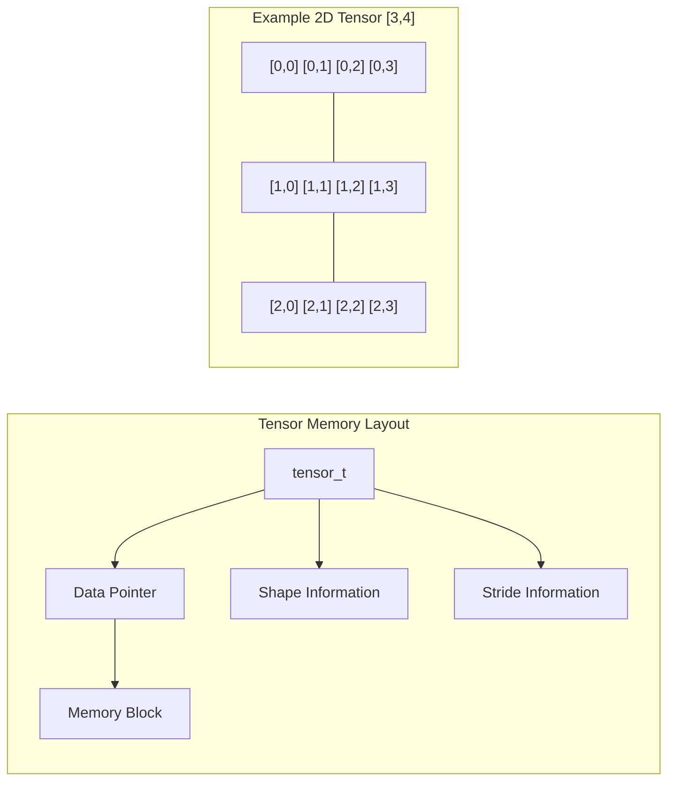
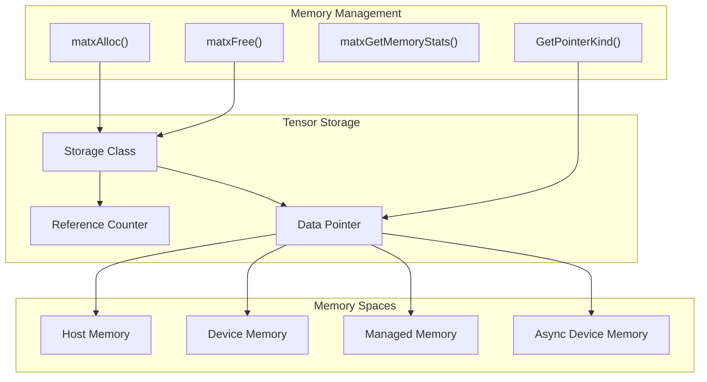
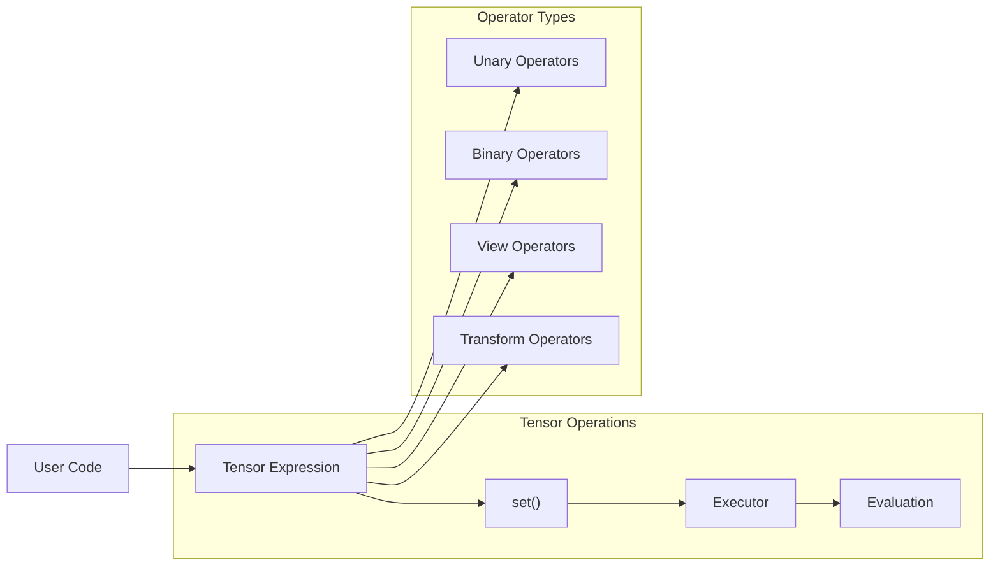
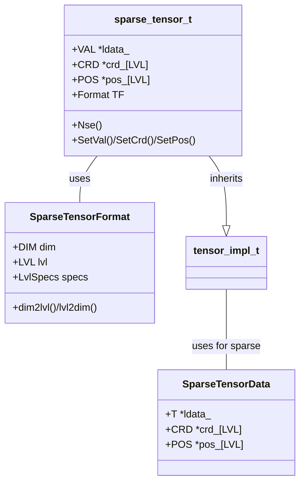
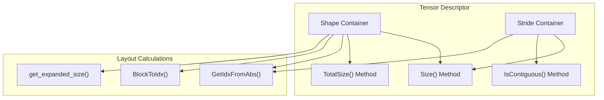
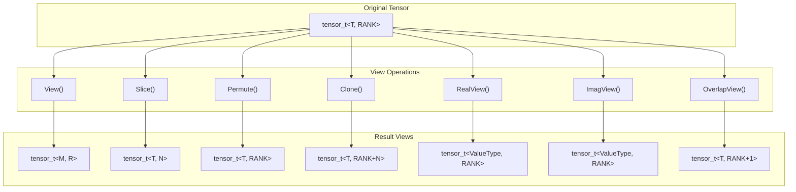
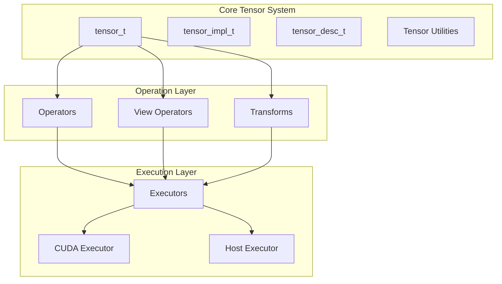

<!-- source: DeepWiki mcp.deepwiki.com · repo NVIDIA/MatX · page 2 Core Tensor System · fetched 2026-10-26 -->

# Core Tensor System

<details>
<summary>Relevant source files</summary>

The following files were used as context for generating this wiki page:

- [bench/00_operators/reduction.cu](bench/00_operators/reduction.cu)
- [bench/00_transform/conv.cu](bench/00_transform/conv.cu)
- [bench/00_transform/qr.cu](bench/00_transform/qr.cu)
- [bench/00_transform/svd_power.cu](bench/00_transform/svd_power.cu)
- [docs_input/basics/nvtx.rst](docs_input/basics/nvtx.rst)
- [docs_input/basics/sparse_tensor.rst](docs_input/basics/sparse_tensor.rst)
- [examples/sparse_tensor.cu](examples/sparse_tensor.cu)
- [include/matx/core/defines.h](include/matx/core/defines.h)
- [include/matx/core/error.h](include/matx/core/error.h)
- [include/matx/core/get_grid_dims.h](include/matx/core/get_grid_dims.h)
- [include/matx/core/make_sparse_tensor.h](include/matx/core/make_sparse_tensor.h)
- [include/matx/core/nvtx.h](include/matx/core/nvtx.h)
- [include/matx/core/print.h](include/matx/core/print.h)
- [include/matx/core/sparse_tensor.h](include/matx/core/sparse_tensor.h)
- [include/matx/core/sparse_tensor_format.h](include/matx/core/sparse_tensor_format.h)
- [include/matx/core/tensor.h](include/matx/core/tensor.h)
- [include/matx/core/tensor_desc.h](include/matx/core/tensor_desc.h)
- [include/matx/core/tensor_impl.h](include/matx/core/tensor_impl.h)
- [include/matx/core/tensor_utils.h](include/matx/core/tensor_utils.h)
- [include/matx/executors/kernel.h](include/matx/executors/kernel.h)
- [include/matx/kernels/channelize_poly.cuh](include/matx/kernels/channelize_poly.cuh)
- [include/matx/operators/dense2sparse.h](include/matx/operators/dense2sparse.h)
- [include/matx/operators/operators.h](include/matx/operators/operators.h)
- [include/matx/operators/sparse2sparse.h](include/matx/operators/sparse2sparse.h)
- [include/matx/transforms/convert/sparse2sparse_cusparse.h](include/matx/transforms/convert/sparse2sparse_cusparse.h)
- [test/00_tensor/BasicTensorTests.cu](test/00_tensor/BasicTensorTests.cu)

</details>


The Core Tensor System forms the foundation of MatX, providing the fundamental tensor abstractions and data structures upon which all other components are built. This system defines how tensors are represented, stored, and manipulated in memory, enabling efficient computation on both CPU and GPU.

For information about specific tensor types, see [Dense Tensors](#2.1) and [Sparse Tensors](#2.2). For details on memory management, see [Memory Management](#2.3).

## Overview of the Tensor System

The MatX tensor system is designed to provide a flexible, high-performance framework for tensor computations. It follows a layered architecture where tensor objects serve as the primary interface for users, while internal implementation details handle memory management, storage, and computation.



Sources: [include/matx/core/tensor.h:73-131](). [include/matx/core/tensor_impl.h:88-134](). [include/matx/core/tensor_desc.h:51-75]().

## Core Tensor Classes and Hierarchy

The tensor system is built upon a hierarchical class structure that separates interface from implementation:

1. **`tensor_impl_t`**: The base implementation class that provides core tensor functionality
2. **`tensor_t`**: The main tensor class that users interact with, adding storage management and more advanced operations
3. **`tensor_desc_t`**: Descriptor class that manages tensor shape and stride information

```mermaid
flowchart TD
    subgraph "User Interface"
        tensor_t["tensor_t&lt;T, RANK, Storage, Desc&gt;"]
    end

    subgraph "Implementation Layer"
        tensor_impl["tensor_impl_t&lt;T, RANK, Desc, Data&gt;"]
        sparse_impl["SparseTensorData"]
        dense_impl["DenseTensorData"]
    end

    subgraph "Descriptor Layer"
        desc["tensor_desc_t&lt;ShapeContainer, StrideContainer, RANK&gt;"]
        default_desc["DefaultDescriptor&lt;RANK&gt;"]
    end

    subgraph "Storage Layer"
        storage["Storage"]
        default_storage["DefaultStorage&lt;T&gt;"]
    end

    tensor_t --> tensor_impl : inherits from
    tensor_impl --> desc : contains
    tensor_impl --> dense_impl : uses for dense tensors
    tensor_impl --> sparse_impl : uses for sparse tensors
    desc --> default_desc : specializes as
    tensor_t --> storage : manages
    storage --> default_storage : specializes as
```

Sources: [include/matx/core/tensor.h:73-94](). [include/matx/core/tensor_impl.h:88-103](). [include/matx/core/tensor_desc.h:51-75]().

## Tensor Representation and Memory Layout

Tensors in MatX are represented as multi-dimensional arrays with shape and stride information that determines their memory layout. Every tensor has:

1. **Shape**: Defines the size of each dimension
2. **Strides**: Define the step size (in elements) between consecutive indices in each dimension
3. **Storage**: Manages the underlying memory allocation and reference counting



Sources: [include/matx/core/tensor_desc.h:234-242](). [include/matx/core/tensor_utils.h:72-87](). [include/matx/core/tensor_impl.h:642-652]().

## Tensor Creation and Management

MatX provides several ways to create and manipulate tensors:

| Operation | Description | Example Use Case |
|-----------|-------------|------------------|
| Constructor | Create a new tensor with specified shape | `tensor_t<float, 2> t2{{20, 10}}` |
| View | Create a view of existing data with a new shape | `auto v = t.View({5, 4})` |
| Slice | Create a subset view of a tensor | `auto s = t.Slice({0,0}, {5,5})` |
| Permute | Change the order of dimensions | `auto p = t.Permute({1, 0})` |
| Clone | Replicate a tensor into a higher dimension | `auto c = t.Clone({2, matxKeepDim})` |

Sources: [include/matx/core/tensor.h:638-657](). [include/matx/core/tensor.h:845-865](). [include/matx/core/tensor_impl.h:654-739]().

## Memory Management

Tensor memory is managed through a storage abstraction that provides:

1. **Reference Counting**: Automatically tracks usage and frees memory when no longer needed
2. **Memory Space Awareness**: Handles allocations in different memory spaces (host, device, managed)
3. **View Semantics**: Multiple views can share the same underlying data



Sources: [include/matx/core/tensor.h:807-808](). [include/matx/core/tensor.h:738-763](). [include/matx/core/tensor.h:995-998]().

## Tensor Operators and Access

MatX tensors provide a rich set of operator overloads for element-wise operations, including:

1. **Arithmetic Operators**: `+`, `-`, `*`, `/`, etc.
2. **Bitwise Operators**: `&`, `|`, `^`, etc.
3. **Subscript Operator**: `operator()` for element access
4. **Assignment Operators**: `=`, `+=`, `-=`, etc.

These operators are implemented using lazy evaluation, allowing the library to optimize execution when operations are combined.



Sources: [include/matx/core/tensor.h:259-276](). [include/matx/core/tensor.h:290-344](). [include/matx/core/tensor_impl.h:294-314]().

## Sparse Tensor Support

In addition to dense tensors, MatX provides experimental support for sparse tensors through the `sparse_tensor_t` class, which follows the Universal Sparse Tensor (UST) format specification.



Sources: [include/matx/core/sparse_tensor.h:80-186](). [include/matx/core/sparse_tensor_format.h:131-216](). [include/matx/core/tensor_impl.h:59-70]().

## Type System and Tensor Traits

MatX uses type traits to provide compile-time information about tensors and their properties:

| Trait | Purpose | Example |
|-------|---------|---------|
| `is_tensor_view_v<T>` | Determines if a type is a tensor view | Used for template specialization |
| `is_matx_op<T>` | Checks if a type is a MatX operator | Used for expression templates |
| `is_matx_descriptor_v<T>` | Identifies descriptor types | Used for constructor overloads |
| `is_complex_v<T>` | Checks if a type is complex | Used for specialized operations |

The type system allows for seamless integration between tensors of different ranks and types, supporting efficient broadcasting and type promotion.

Sources: [include/matx/core/tensor.h:80-87](). [include/matx/core/tensor_utils.h:295-318](). [include/matx/core/tensor_desc.h:54-61]().

## Implementation Details

### Tensor Descriptor Implementation

The tensor descriptor (`tensor_desc_t`) manages shape and stride information, providing methods to:

1. Calculate the total size of the tensor
2. Check if a tensor's memory layout is contiguous
3. Convert between indices and memory offsets
4. Support permutation and reshaping operations



Sources: [include/matx/core/tensor_desc.h:213-225](). [include/matx/core/tensor_desc.h:234-242](). [include/matx/core/tensor_utils.h:117-178]().

### Reference Counting and Storage

The tensor storage system provides automatic memory management through reference counting:

1. When a tensor is copied, the reference count is incremented
2. When a tensor goes out of scope, the reference count is decremented
3. When the reference count reaches zero, memory is automatically freed

This allows for efficient creation of tensor views without unnecessary copies while ensuring memory is properly managed.

Sources: [include/matx/core/tensor.h:995-998](). [include/matx/core/tensor.h:109-120](). [include/matx/core/tensor.h:148-157]().

## Tensor Manipulation and Views

MatX tensors support several powerful view operations that allow for efficient data manipulation without copying:

### View Operations

1. **View**: Create a new tensor with different shape/type but the same data
2. **Slice**: Extract a subset of a tensor
3. **Permute**: Rearrange the dimensions of a tensor
4. **RealView/ImagView**: Extract real or imaginary parts of complex tensors
5. **OverlapView**: Create overlapping windows of data



Sources: [include/matx/core/tensor.h:638-716](). [include/matx/core/tensor.h:774-842](). [include/matx/core/tensor.h:859-907](). [include/matx/core/tensor_impl.h:654-739]().

## Tensor System Integration

The Core Tensor System is integrated with the rest of MatX through a set of interfaces:

1. **Operators**: Algebraic and functional operations on tensors
2. **Transforms**: Advanced mathematical operations (FFT, convolution, etc.)
3. **Executors**: Systems that schedule and execute tensor operations



Sources: [include/matx/operators/operators.h:35-118](). [include/matx/core/tensor.h:259-600](). [include/matx/executors/kernel.h:32-37]().

## Summary

The Core Tensor System in MatX provides a flexible and efficient foundation for tensor operations with the following key features:

1. A hierarchical tensor class structure with separation of interface and implementation
2. Efficient memory management with reference counting
3. Powerful view operations for non-copying data manipulation
4. Support for both dense and sparse tensor formats
5. Integration with operators, transforms, and execution systems

This design allows MatX to provide Python-like syntax for GPU tensor operations while maintaining high performance.

---

