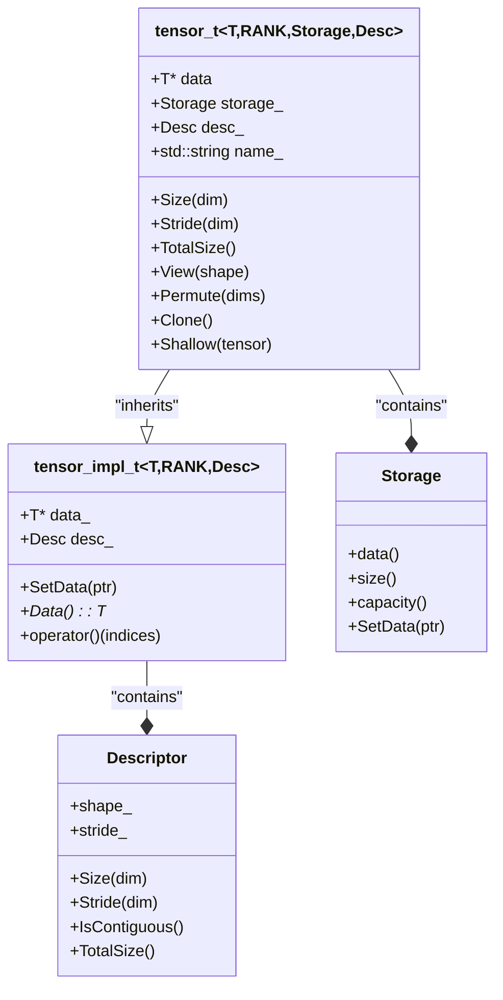
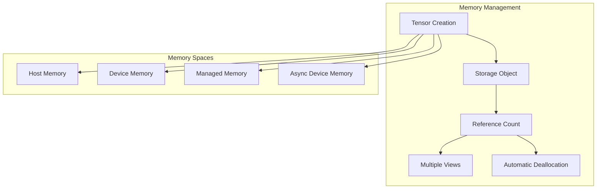
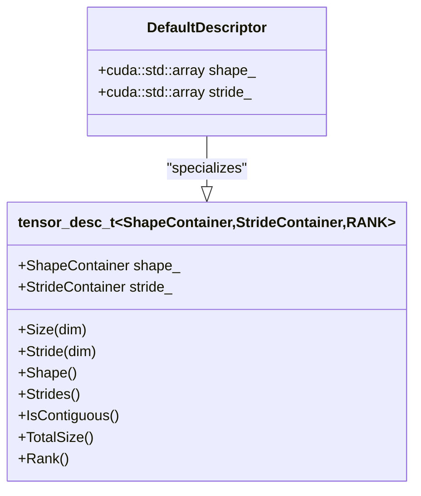

<!-- source: DeepWiki mcp.deepwiki.com · repo NVIDIA/MatX · page 2.1 Dense Tensors · fetched 2026-10-26 -->

# Dense Tensors

<details>
<summary>Relevant source files</summary>

The following files were used as context for generating this wiki page:

- [bench/00_operators/reduction.cu](bench/00_operators/reduction.cu)
- [bench/00_transform/conv.cu](bench/00_transform/conv.cu)
- [bench/00_transform/qr.cu](bench/00_transform/qr.cu)
- [bench/00_transform/svd_power.cu](bench/00_transform/svd_power.cu)
- [docs_input/api/creation/tensors/make.rst](docs_input/api/creation/tensors/make.rst)
- [docs_input/api/math/misc/abs2.rst](docs_input/api/math/misc/abs2.rst)
- [docs_input/basics/nvtx.rst](docs_input/basics/nvtx.rst)
- [include/matx/core/defines.h](include/matx/core/defines.h)
- [include/matx/core/error.h](include/matx/core/error.h)
- [include/matx/core/get_grid_dims.h](include/matx/core/get_grid_dims.h)
- [include/matx/core/half.h](include/matx/core/half.h)
- [include/matx/core/half_complex.h](include/matx/core/half_complex.h)
- [include/matx/core/iterator.h](include/matx/core/iterator.h)
- [include/matx/core/make_tensor.h](include/matx/core/make_tensor.h)
- [include/matx/core/nvtx.h](include/matx/core/nvtx.h)
- [include/matx/core/operator_utils.h](include/matx/core/operator_utils.h)
- [include/matx/core/storage.h](include/matx/core/storage.h)
- [include/matx/core/tensor.h](include/matx/core/tensor.h)
- [include/matx/core/tensor_desc.h](include/matx/core/tensor_desc.h)
- [include/matx/core/tensor_utils.h](include/matx/core/tensor_utils.h)
- [include/matx/executors/kernel.h](include/matx/executors/kernel.h)
- [include/matx/kernels/channelize_poly.cuh](include/matx/kernels/channelize_poly.cuh)
- [include/matx/operators/binary_operators.h](include/matx/operators/binary_operators.h)
- [include/matx/operators/scalar_ops.h](include/matx/operators/scalar_ops.h)
- [include/matx/operators/unary_operators.h](include/matx/operators/unary_operators.h)
- [test/00_tensor/BasicTensorTests.cu](test/00_tensor/BasicTensorTests.cu)

</details>


Dense tensors are the fundamental data structure in MatX, representing multi-dimensional arrays that efficiently store and manipulate numerical data. The implementation provides a Python-like syntax with C++ performance optimized for NVIDIA GPUs. This page covers the core tensor class, creation methods, memory management, and common operations.

For information about sparse tensor storage, see [Sparse Tensors](#2.2).

## Core Tensor Structure

Dense tensors in MatX are implemented as multi-dimensional arrays with contiguous or strided memory layouts. The primary class is `tensor_t`, which provides a flexible yet efficient interface for creating and manipulating tensor data.



The tensor class is heavily templated to support a variety of use cases:

- `T`: The data type stored in the tensor (float, double, complex, etc.)
- `RANK`: The number of dimensions (0-N)
- `Storage`: The storage backend (raw pointers, smart pointers, etc.)
- `Desc`: The descriptor containing shape and stride information

Sources: [include/matx/core/tensor.h:73-987](), [include/matx/core/tensor_desc.h:50-500](), [include/matx/core/storage.h:48-570]()

## Creating Tensors

MatX provides multiple ways to create tensors, primarily through constructors or the `make_tensor` function family which offers a concise interface.

### Using `tensor_t` Constructors

```cpp
// Rank-0 (scalar) tensor
tensor_t<float, 0> t0{{}};

// Rank-1 (vector) tensor of size 10
tensor_t<float, 1> t1{{10}};

// Rank-2 (matrix) tensor of size 20×10
tensor_t<float, 2> t2{{20, 10}};

// Rank-3 tensor
tensor_t<float, 3> t3{{30, 20, 10}};
```

### Using `make_tensor` Functions

The `make_tensor` family provides a more flexible and future-proof way to create tensors:

```cpp
// Create a 3D tensor with shape [5,10,20]
auto t = make_tensor<float>({5, 10, 20});

// Create a tensor in device memory
auto t_dev = make_tensor<float>({5, 10, 20}, MATX_DEVICE_MEMORY);

// Create a tensor with a stream for async allocation
auto t_async = make_tensor<float>({5, 10, 20}, MATX_ASYNC_DEVICE_MEMORY, stream);
```

Sources: [include/matx/core/tensor.h:98-114](), [include/matx/core/make_tensor.h:50-172](), [test/00_tensor/BasicTensorTests.cu:44-53]()

## Memory Model and Management

MatX tensors employ reference counting to manage memory efficiently. This ensures that memory is properly deallocated when all references to a tensor are gone.



### Reference Counting

```cpp
// Original tensor has ref count of 1
tensor_t<float, 2> tmp{{10,4}};
ASSERT_EQ(tmp.GetRefCount(), 1);

// Copying increases ref count to 2
tensor_t<float, 2> tmp2{tmp};
ASSERT_EQ(tmp.GetRefCount(), 2);
ASSERT_EQ(tmp2.GetRefCount(), 2);

// Creating a shallow copy increases ref count to 3
tensor_t<float, 2> tmp3{{10,4}};
tmp3.Shallow(tmp2);  
ASSERT_EQ(tmp.GetRefCount(), 3);
```

### Memory Spaces

MatX supports different memory spaces:

| Memory Space | Description |
|--------------|-------------|
| `MATX_HOST_MALLOC_MEMORY` | Memory allocated on the host using malloc |
| `MATX_DEVICE_MEMORY` | Memory allocated on the GPU device |
| `MATX_MANAGED_MEMORY` | Unified memory accessible from both host and device |
| `MATX_ASYNC_DEVICE_MEMORY` | Asynchronously allocated device memory |

### Prefetching

For managed memory, you can prefetch data to either the device or host:

```cpp
// Prefetch to device
tensor.PrefetchDevice(stream);

// Prefetch to host
tensor.PrefetchHost(stream);
```

Sources: [include/matx/core/tensor.h:738-763](), [test/00_tensor/BasicTensorTests.cu:166-197](), [include/matx/core/storage.h:48-326]()

## Tensor Descriptors

Each tensor contains a descriptor that provides information about its shape and memory layout. This descriptor includes:

- Shape: The size of each dimension
- Strides: The memory distance between consecutive elements in each dimension



### Shape and Strides

The shape defines the dimensions of the tensor, while strides define the memory layout:

```cpp
// A 3D tensor with shape [30, 20, 10]
tensor_t<float, 3> t3{{30, 20, 10}};

// Size of dimension 0 is 30
auto size0 = t3.Size(0);  // Returns 30

// Total number of elements is 30*20*10 = 6000
auto total = t3.TotalSize();  // Returns 6000

// Stride of dimension 0 is 20*10 = 200
auto stride0 = t3.Stride(0);  // Returns 200
```

Sources: [include/matx/core/tensor_desc.h:50-266](), [include/matx/core/tensor_desc.h:347-440](), [test/00_tensor/BasicTensorTests.cu:100-226]()

## Tensor Operations

MatX provides a rich set of operations on tensors, including element-wise operations, reductions, and linear algebra functions.

### Element-wise Operations

```cpp
// Element-wise operations with lazy evaluation
(t_result = t1 + t2).run(exec);  // Addition
(t_result = t1 - t2).run(exec);  // Subtraction
(t_result = t1 * t2).run(exec);  // Multiplication
(t_result = t1 / t2).run(exec);  // Division
```

### Compound Assignment

```cpp
// Compound assignments
(t += 5).run(exec);     // Add 5 to each element
(t *= 2).run(exec);     // Multiply each element by 2
(t /= tensor).run(exec); // Element-wise division
```

### Lazy Evaluation

Operations on tensors in MatX are lazily evaluated, which means they are not executed immediately but only when `.run()` is called. This allows for optimizations like kernel fusion.

```cpp
// Define operations without executing them
auto expr = t1 + t2 * 5;

// Execute the operations
(result = expr).run(exec);
```

Sources: [include/matx/core/tensor.h:258-600](), [include/matx/operators/scalar_ops.h:395-530](), [test/00_tensor/BasicTensorTests.cu:228-355]()

## Tensor Views and Transformations

MatX provides a variety of ways to create different views of tensor data without copying the underlying memory.

### View

The `View()` method allows creating a tensor with a different shape using the same data:

```cpp
// Create a 2D tensor
tensor_t<float, 2> t2{{20, 10}};  // 20×10 tensor

// Create a 1D view of the same data
auto t1v = t2.View<float, 1>({200});  // 200 = 20*10

// Create a 3D view
auto t3v = t2.View<float, 3>({5, 4, 10});  // 5*4*10 = 200
```

### Permute

The `Permute()` method reorders the dimensions of a tensor:

```cpp
// Create a 3D tensor
tensor_t<float, 3> t3{{30, 20, 10}};

// Permute the dimensions (2,1,0) = transpose of (0,1,2)
auto t3p = t3.Permute({2, 1, 0});
// Now t3p has shape [10, 20, 30]
```

### Real and Imaginary Views

For complex-valued tensors, you can create views of just the real or imaginary parts:

```cpp
// Complex tensor
tensor_t<cuda::std::complex<float>, 2> tc{{20, 10}};

// Create view of real components
auto treal = tc.RealView();

// Create view of imaginary components
auto timag = tc.ImagView();
```

Sources: [include/matx/core/tensor.h:637-843](), [test/00_tensor/BasicTensorTests.cu:357-431]()

## Best Practices

### Creating Tensors

- Use `make_tensor` instead of direct `tensor_t` construction when possible for better future compatibility
- Consider memory space requirements when creating tensors based on your access patterns

### Memory Management

- Be aware of reference counting when sharing tensor data
- Use `Shallow()` to create a shared view of existing tensor data
- Use `Clone()` when you need a deep copy
- Be cautious with manual memory management using `Reset()`

### Performance Optimization

- Use lazy evaluation to allow the library to optimize operations
- Prefer contiguous memory layouts when possible
- Align your access patterns to tensor strides for better memory access patterns
- Use appropriate memory spaces (managed vs. device) based on your access patterns

### Tensor Manipulation

- Use `View()` and `Permute()` to create different views of the same data without copying
- Be aware that operations on views affect the original data

Sources: [include/matx/core/tensor.h:1-1000](), [include/matx/core/make_tensor.h:50-200](), [test/00_tensor/BasicTensorTests.cu:100-500]()

---

