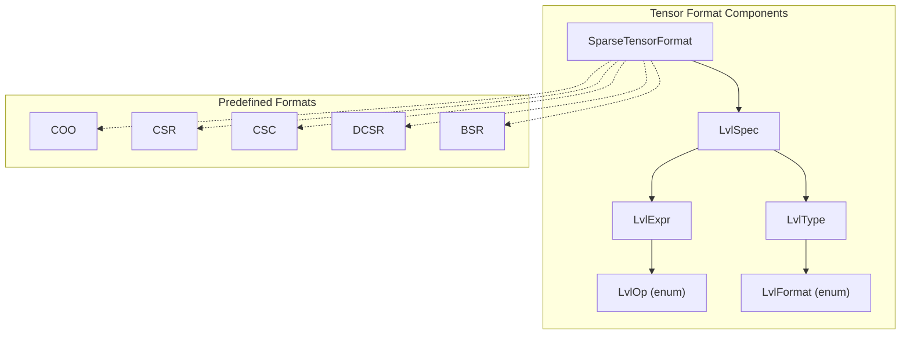
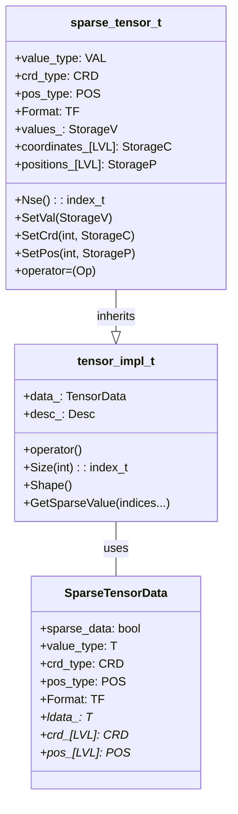
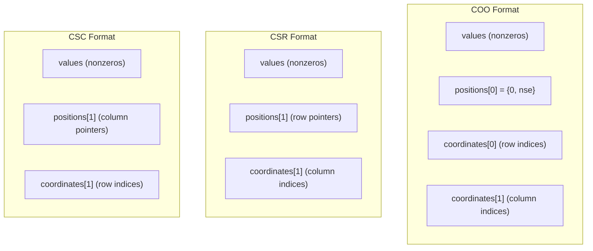
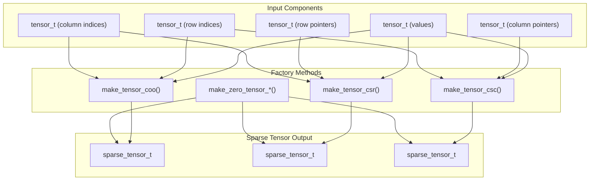
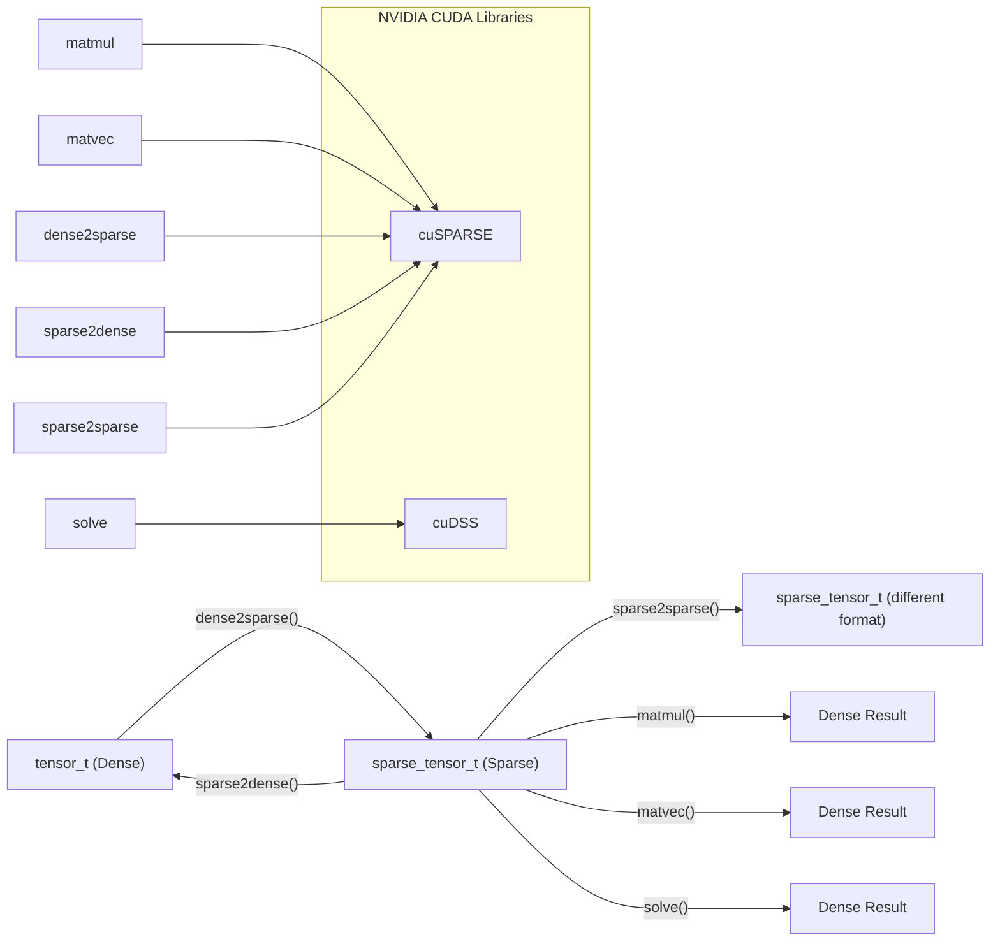

<!-- source: DeepWiki mcp.deepwiki.com · repo NVIDIA/MatX · page 2.2 Sparse Tensors · fetched 2026-10-26 -->

# Sparse Tensors

<details>
<summary>Relevant source files</summary>

The following files were used as context for generating this wiki page:

- [docs_input/basics/sparse_tensor.rst](docs_input/basics/sparse_tensor.rst)
- [examples/sparse_tensor.cu](examples/sparse_tensor.cu)
- [include/matx/core/make_sparse_tensor.h](include/matx/core/make_sparse_tensor.h)
- [include/matx/core/print.h](include/matx/core/print.h)
- [include/matx/core/sparse_tensor.h](include/matx/core/sparse_tensor.h)
- [include/matx/core/sparse_tensor_format.h](include/matx/core/sparse_tensor_format.h)
- [include/matx/core/tensor_impl.h](include/matx/core/tensor_impl.h)
- [include/matx/operators/dense2sparse.h](include/matx/operators/dense2sparse.h)
- [include/matx/operators/operators.h](include/matx/operators/operators.h)
- [include/matx/operators/solve.h](include/matx/operators/solve.h)
- [include/matx/operators/sparse2dense.h](include/matx/operators/sparse2dense.h)
- [include/matx/operators/sparse2sparse.h](include/matx/operators/sparse2sparse.h)
- [include/matx/transforms/convert/dense2sparse_cusparse.h](include/matx/transforms/convert/dense2sparse_cusparse.h)
- [include/matx/transforms/convert/sparse2dense_cusparse.h](include/matx/transforms/convert/sparse2dense_cusparse.h)
- [include/matx/transforms/convert/sparse2sparse_cusparse.h](include/matx/transforms/convert/sparse2sparse_cusparse.h)
- [include/matx/transforms/matmul/matmul_cusparse.h](include/matx/transforms/matmul/matmul_cusparse.h)
- [include/matx/transforms/solve/solve_cudss.h](include/matx/transforms/solve/solve_cudss.h)
- [test/00_sparse/Convert.cu](test/00_sparse/Convert.cu)
- [test/00_sparse/Matmul.cu](test/00_sparse/Matmul.cu)
- [test/00_sparse/Matvec.cu](test/00_sparse/Matvec.cu)
- [test/00_sparse/Solve.cu](test/00_sparse/Solve.cu)
- [test/include/test_types.h](test/include/test_types.h)

</details>


MatX provides experimental support for sparse tensors through a Universal Sparse Tensor (UST) type that efficiently represents and manipulates tensors with many zero elements. This page documents the sparse tensor system in MatX, including its storage formats, creation methods, supported operations, and performance considerations.

For information about dense tensors, see [Dense Tensors](#2.1).

## Universal Sparse Tensor Concept

MatX uses a Tensor Format Domain Specific Language (DSL) to describe a vast space of storage formats for sparse tensors. This approach provides flexibility while maintaining high performance by dispatching to optimized backend libraries like cuSPARSE and cuDSS.

**Sparse Tensor Format System**



Sources: [include/matx/core/sparse_tensor_format.h:31-340](), [docs_input/basics/sparse_tensor.rst:6-102]()

### Level Types and Formats

The DSL uses the concept of levels (physical storage axes) to represent dimensions (logical tensor axes):

- **Level Format Types:**
  - `Dense`: Level is fully populated, entries are linearized
  - `Compressed`: Level is sparse, only nonzeros are stored with positions and coordinates
  - `Singleton`: A specialized compressed format for when coordinates have no siblings

- **Level Properties:**
  - `unique`/`non-unique`: Whether duplicates are allowed at a level
  - `ordered`/`unordered`: Whether coordinates are sorted at a level

Sources: [include/matx/core/sparse_tensor_format.h:71-94]()

### Common Sparse Formats

MatX provides predefined formats for common sparse representations:

| Format | Description | Internal Representation |
|--------|-------------|-------------------------|
| COO | Coordinate format | Stores row indices, column indices, and values |
| CSR | Compressed Sparse Row | Compresses row indices using row pointers |
| CSC | Compressed Sparse Column | Compresses column indices using column pointers |
| DCSR | Doubly Compressed Sparse Row | Both dimensions are compressed |
| BSR | Block Sparse Row | Stores dense blocks in a sparse pattern |

Sources: [include/matx/core/sparse_tensor_format.h:268-337](), [examples/sparse_tensor.cu:52-60]()

## Sparse Tensor Structure

The `sparse_tensor_t` class inherits from `tensor_impl_t` but uses specialized data storage for sparse elements.

**Sparse Tensor Internal Structure**



Sources: [include/matx/core/sparse_tensor.h:75-183](), [include/matx/core/tensor_impl.h:59-71]()

### Internal Buffer Structure

Sparse tensors consist of:

1. **Primary Storage**: The `values_` buffer containing nonzero elements
2. **Secondary Storage**:
   - `coordinates_[LVL]` arrays storing indices of nonzeros
   - `positions_[LVL]` arrays storing pointers into coordinate arrays

The exact structure varies by format:

**Format-Specific Buffer Organization**



Sources: [include/matx/core/sparse_tensor.h:172-182](), [include/matx/core/make_sparse_tensor.h:92-99](), [include/matx/core/make_sparse_tensor.h:131-134](), [include/matx/core/make_sparse_tensor.h:167-170]()

## Creating Sparse Tensors

MatX provides factory methods to create sparse tensors in common formats:

**Sparse Tensor Creation Workflow**



Sources: [include/matx/core/make_sparse_tensor.h:76-186](), [examples/sparse_tensor.cu:80-88]()

### Factory Method Examples

```cpp
// Create a COO matrix
auto vals = make_tensor<float>({5});
auto rowIdx = make_tensor<int>({5});
auto colIdx = make_tensor<int>({5});
vals.SetVals({1, 2, 3, 4, 5});
rowIdx.SetVals({0, 0, 3, 3, 3});
colIdx.SetVals({0, 1, 2, 3, 5});
auto Acoo = experimental::make_tensor_coo(vals, rowIdx, colIdx, {4, 8});

// Create an empty CSR matrix
auto Acsr = experimental::make_zero_tensor_csr<float, int, int>({4, 8});
```

Sources: [examples/sparse_tensor.cu:80-88](), [examples/sparse_tensor.cu:174]()

## Sparse Tensor Operations

MatX supports several operations for sparse tensors, including conversions and linear algebra operations.

**Sparse Tensor Operations**



Sources: [include/matx/operators/operators.h:54-104](), [include/matx/transforms/matmul/matmul_cusparse.h:271-335](), [include/matx/transforms/solve/solve_cudss.h:272-336]()

### Conversion Operations

- **`dense2sparse`**: Converts a dense tensor to a sparse tensor
  ```cpp
  auto A = make_tensor<float>({4, 8});
  auto S = experimental::make_zero_tensor_coo<float, int>({4, 8});
  (S = dense2sparse(A)).run(exec);
  ```

- **`sparse2dense`**: Converts a sparse tensor to a dense tensor
  ```cpp
  auto A = make_tensor<float>({4, 8});
  (A = sparse2dense(S)).run(exec);
  ```

- **`sparse2sparse`**: Converts between different sparse formats
  ```cpp
  auto Acsr = experimental::make_zero_tensor_csr<float, int, int>({4, 8});
  (Acsr = sparse2sparse(Acoo)).run(exec);
  ```

Sources: [include/matx/operators/dense2sparse.h:42-103](), [include/matx/operators/sparse2dense.h:42-173](), [include/matx/operators/sparse2sparse.h:43-107](), [examples/sparse_tensor.cu:113-176]()

### Linear Algebra Operations

- **`matmul`**: Matrix-matrix multiplication with a sparse matrix
  ```cpp
  auto B = make_tensor<float, 2>({8, 4});
  auto C = make_tensor<float>({4, 4});
  (C = matmul(Acoo, B)).run(exec);
  ```

- **`matvec`**: Matrix-vector multiplication with a sparse matrix
  ```cpp
  auto v = make_tensor<float>({8});
  auto r = make_tensor<float>({4});
  (r = matvec(Acoo, v)).run(exec);
  ```

- **`solve`**: Solves a linear system with a sparse coefficient matrix
  ```cpp
  auto X = make_tensor<float>({4, 2});
  auto Y = make_tensor<float>({4, 2});
  (X = solve(Acsr, Y)).run(exec);
  ```

Sources: [include/matx/transforms/matmul/matmul_cusparse.h:271-335](), [include/matx/transforms/solve/solve_cudss.h:272-336](), [examples/sparse_tensor.cu:126-127](), [examples/sparse_tensor.cu:148-150]()

## Performance Considerations

When working with sparse tensors in MatX, keep these considerations in mind:

1. **Avoid Using `operator()` in Performance-Critical Code**: The indexing operator performs an expensive search through the sparse data structure and should only be used for debugging or testing.
   ```cpp
   // Inefficient way to convert sparse to dense
   for (index_t i = 0; i < m; i++) {
     for (index_t j = 0; j < n; j++) {
       A(i, j) = S(i, j);  // Expensive!
     }
   }
   
   // Efficient way
   (A = sparse2dense(S)).run(exec);  // Use optimized kernels
   ```

2. **Format Selection**: Different formats have different performance characteristics:
   - CSR: Efficient for row-wise operations
   - CSC: Efficient for column-wise operations
   - COO: Good for construction and format conversion

3. **Memory Sharing**: Some operations like `sparse2sparse` may share memory between input and output tensors for efficiency.

4. **Backend Acceleration**: MatX uses GPU libraries like cuSPARSE and cuDSS for performance. Ensure these are available for optimal performance.

Sources: [examples/sparse_tensor.cu:92-99](), [examples/sparse_tensor.cu:113-116](), [include/matx/transforms/convert/sparse2sparse_cusparse.h:100-108]()

## Implementation Status

The sparse tensor support in MatX is marked as experimental, meaning:

- The API may change in future releases
- Not all operations are supported for all formats
- Performance optimizations are ongoing

Currently supported:
- Formats: COO, CSR, CSC
- Operations: conversions, matmul, matvec, solve

Sources: [examples/sparse_tensor.cu:35](), [docs_input/basics/sparse_tensor.rst:6-11]()

## Debugging and Inspection

MatX provides printing support for sparse tensors:

```cpp
print(Acoo);

// Sample output:
// tensor_impl_2_f32: SparseTensor{float} Rank: 2, Sizes:[4, 8], Levels:[4, 8]
// format = ( d0, d1 ) -> ( d0 : compressed(non-unique), d1 : singleton )
// space  = CUDA managed memory
// nse    = 5
// pos[0] = ( 0  5 )
// crd[0] = ( 0  0  3  3  3 )
// crd[1] = ( 0  1  2  3  5 )
// values = ( 1.0000e+00  2.0000e+00  3.0000e+00  4.0000e+00  5.0000e+00 )
```

Sources: [include/matx/core/print.h:144-170](), [examples/sparse_tensor.cu:87-88]()

---

