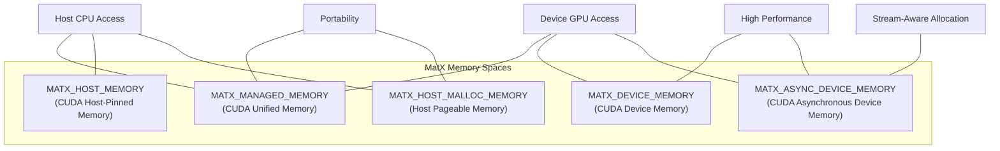
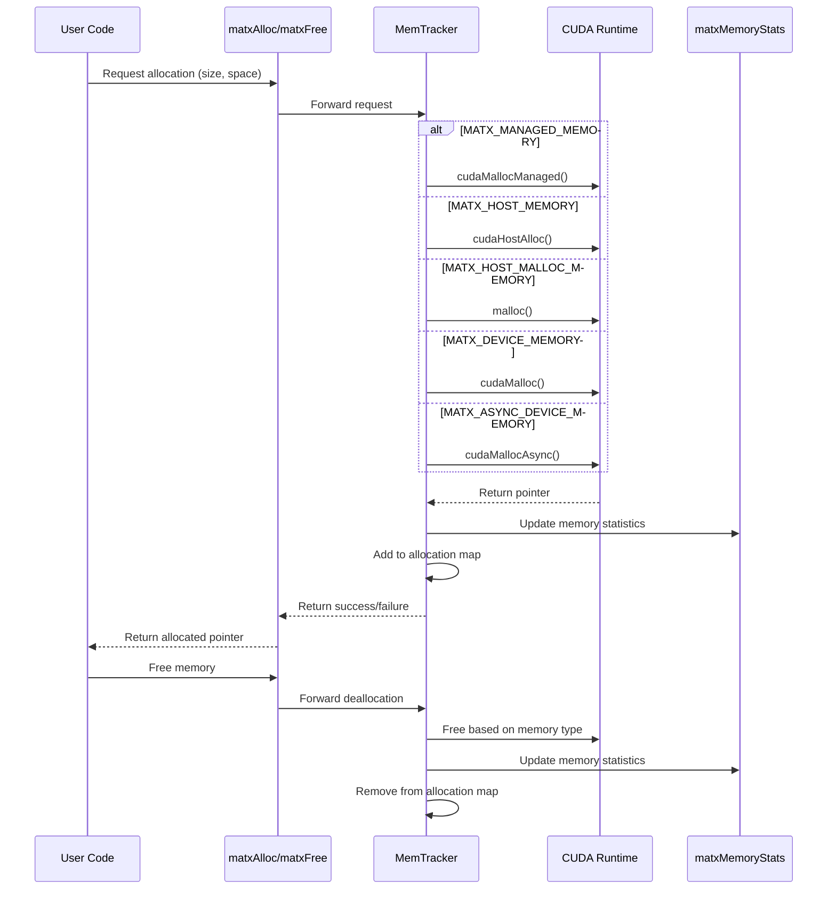
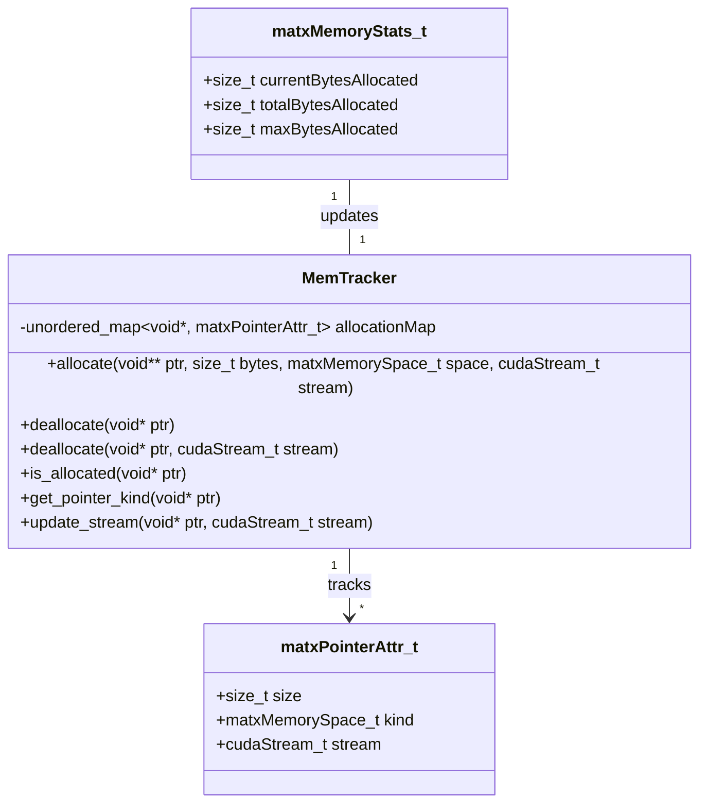
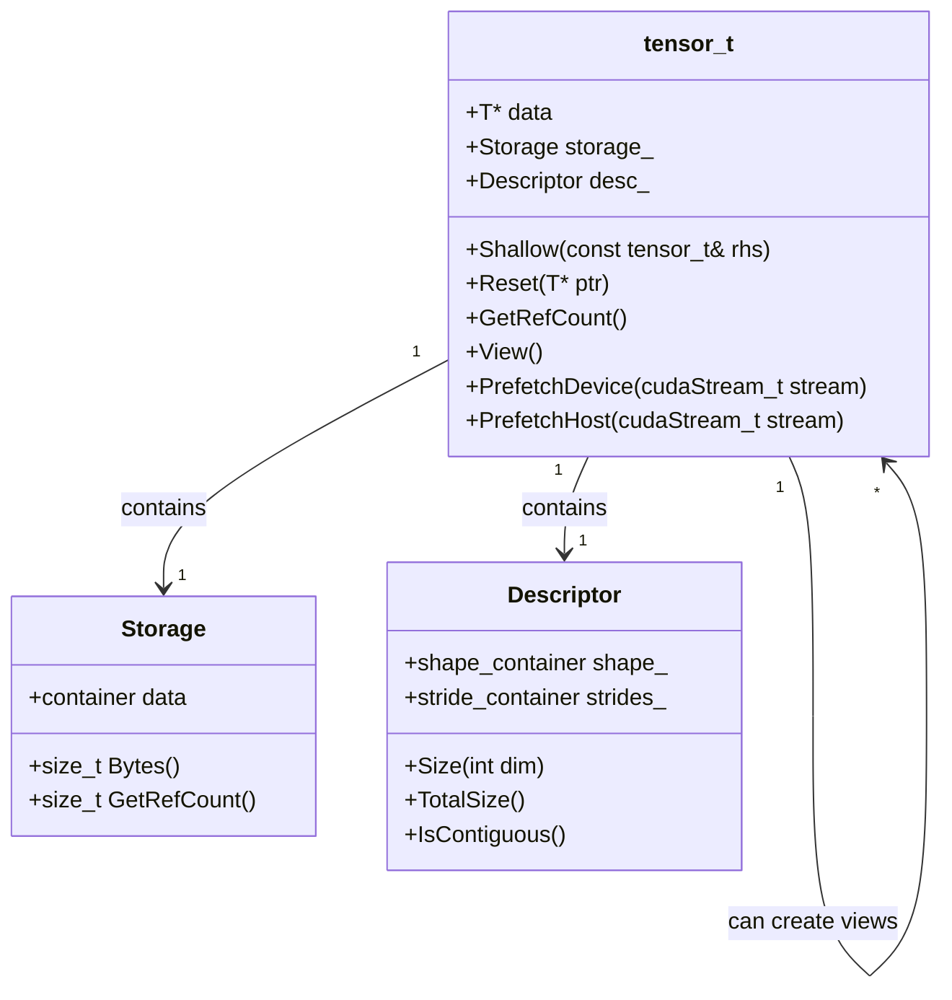
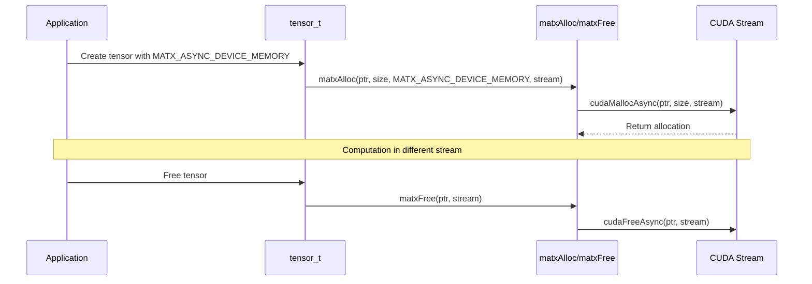
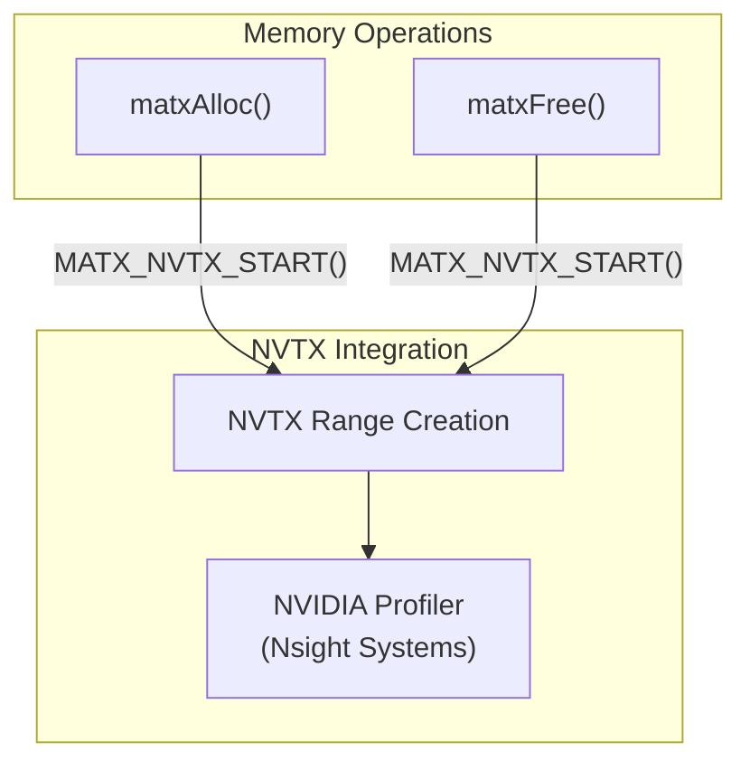

<!-- source: DeepWiki mcp.deepwiki.com · repo NVIDIA/MatX · page 2.3 Memory Management · fetched 2026-10-26 -->

# Memory Management

Relevant source files

The following files were used as context for generating this wiki page:

- [CMakeLists.txt](CMakeLists.txt)
- [README.md](README.md)
- [cmake/FindcuDSS.cmake](cmake/FindcuDSS.cmake)
- [docs_input/basics/memory.rst](docs_input/basics/memory.rst)
- [docs_input/basics/nvtx.rst](docs_input/basics/nvtx.rst)
- [docs_input/build.rst](docs_input/build.rst)
- [include/matx/core/allocator.h](include/matx/core/allocator.h)
- [include/matx/core/error.h](include/matx/core/error.h)
- [include/matx/core/nvtx.h](include/matx/core/nvtx.h)
- [include/matx/core/tensor.h](include/matx/core/tensor.h)
- [include/matx/core/tensor_utils.h](include/matx/core/tensor_utils.h)
- [include/matx/executors/kernel.h](include/matx/executors/kernel.h)
- [test/00_tensor/BasicTensorTests.cu](test/00_tensor/BasicTensorTests.cu)

This page documents the memory management system in MatX, detailing how memory is allocated, tracked, and managed for tensor operations across different memory spaces. The memory management system is a core component of MatX that enables efficient tensor operations on both CPU and GPU.

MatX provides a flexible memory management system that abstracts away the complexities of managing GPU and CPU memory allocations. This system handles different memory spaces, tracks allocations, and implements reference counting for automatic cleanup.

## Memory Spaces

MatX supports different memory spaces to provide flexibility in how and where data is stored. The choice of memory space affects performance, accessibility, and behavior across different hardware configurations.

The memory spaces each have distinct characteristics:

1. **MATX_MANAGED_MEMORY**: CUDA Unified Memory (UM) accessible from both CPU and GPU, with automatic page migration between host and device. Created with `cudaMallocManaged`.

2. **MATX_HOST_MEMORY**: Page-locked (pinned) host memory allocated with `cudaHostAlloc`. Faster transfer speeds to/from GPU but uses non-pageable system memory.

3. **MATX_HOST_MALLOC_MEMORY**: Regular pageable host memory allocated with `malloc`. Standard CPU memory that may be slower to transfer to/from GPU.

4. **MATX_DEVICE_MEMORY**: GPU device memory allocated with `cudaMalloc`. Only accessible from GPU code.

5. **MATX_ASYNC_DEVICE_MEMORY**: Stream-ordered device memory allocated with `cudaMallocAsync`, which can improve performance by enabling allocation/deallocation to occur within CUDA streams.

Sources: [include/matx/core/allocator.h:56-62](), [docs_input/basics/memory.rst:1-20]()

## Memory Allocation System

MatX implements a unified memory allocation system that abstracts away the complexities of different memory spaces and provides tracking capabilities.

The key functions for memory management are:

1. **`matxAlloc`**: Allocates memory of a specified size in the requested memory space. It handles the underlying CUDA allocation call appropriate for the memory space.

2. **`matxFree`**: Frees previously allocated memory, automatically determining the appropriate deallocation method.

3. **`GetPointerKind`**: Identifies which memory space a pointer belongs to.

4. **`IsAllocated`**: Checks if a pointer was allocated through the MatX memory management system.

Sources: [include/matx/core/allocator.h:246-370]()

## Memory Tracking

MatX internally tracks all memory allocations to provide statistics, ensure proper deallocation, and help diagnose memory leaks.

The tracking system provides:

1. **Memory Statistics**: Tracks current, total, and maximum memory allocated through the MatX API, accessible via `matxGetMemoryStats`.

2. **Allocation Map**: Maintains a map of all memory allocations with their sizes, types, and associated CUDA streams.

3. **Safe Deallocation**: Ensures memory is freed with the correct method based on the memory space.

4. **Leak Detection**: The `MemTracker` destructor automatically cleans up any remaining allocations, helping to identify memory leaks.

The tracking system is guarded by a mutex to ensure thread safety when accessing or modifying memory statistics and the allocation map.

Sources: [include/matx/core/allocator.h:87-243](), [include/matx/core/allocator.h:287-336]()

## Tensor Storage and Reference Counting

Tensors in MatX use a smart storage system that implements reference counting to manage tensor data lifetimes.

The storage system provides:

1. **Reference Counting**: Multiple tensor views can share the same underlying data with automatic cleanup when the last reference is dropped.

2. **View Creation**: Tensors can create views of their data with different shapes, strides, or even data types without copying the underlying memory.

3. **Memory Prefetching**: Tensors support prefetching data to device or host memory using `PrefetchDevice` and `PrefetchHost` methods.

4. **Shallow Copy**: The `Shallow` method creates a new tensor that shares the same underlying data and increments the reference count.

When a tensor is created with `make_tensor`, it allocates memory in the specified space. Subsequent operations like `View()`, `Permute()`, or copy construction create new tensors that reference the same underlying memory, incrementing the reference count. The memory is automatically freed when the last tensor referencing it is destroyed.

Sources: [include/matx/core/tensor.h:72-842](), [CMakeLists.txt:46-404]()

## Memory Utilities and Diagnostics

MatX provides several utilities to help monitor and debug memory usage.

### Memory Statistics

Memory statistics can be accessed using these functions:

1. **`matxGetMemoryStats`**: Gets the current, total, and maximum memory allocated.
2. **`matxPrintMemoryStatistics`**: Prints formatted memory statistics to stdout.

These functions help track memory usage during program execution and can be useful for diagnosing memory leaks or optimizing memory usage.

### Memory Space Utilities

Utility functions to work with memory spaces:

1. **`HostPrintable`**: Determines if memory in a specific space is accessible from the host.
2. **`DevicePrintable`**: Determines if memory in a specific space is accessible from the device.
3. **`SpaceString`**: Returns a human-readable string representation of a memory space.

Sources: [include/matx/core/allocator.h:261-425]()

## Best Practices

When working with the MatX memory management system, consider these best practices:

1. **Choose the Right Memory Space**: 
   - Use `MATX_DEVICE_MEMORY` for best performance when data is only needed on the GPU
   - Use `MATX_MANAGED_MEMORY` for ease of use when data needs to be accessed from both CPU and GPU
   - Use `MATX_ASYNC_DEVICE_MEMORY` for better performance with stream-ordered operations

2. **Leverage Reference Counting**: Let MatX handle memory management when possible rather than manually allocating/deallocating.

3. **Monitor Memory Usage**: Use the memory statistics functions to track memory usage during development.

4. **Be Aware of System Limitations**: 
   - On WSL2, CUDA Unified Memory may not be fully supported
   - On Grace-Hopper systems, regular host memory (malloc) can be accessed from the GPU
   - Some memory types might perform differently across different hardware configurations

5. **Use Prefetching**: For managed memory, use `PrefetchDevice` and `PrefetchHost` to optimize data locality before operations.

6. **Stream Awareness**: When using `MATX_ASYNC_DEVICE_MEMORY`, be mindful of stream ordering to ensure correct execution.

Sources: [include/matx/core/allocator.h:246-370](), [docs_input/basics/memory.rst:1-20]()

## Asynchronous Allocation

MatX supports asynchronous memory operations through the `MATX_ASYNC_DEVICE_MEMORY` space and stream-aware APIs. This is particularly useful for overlapping computation and memory operations.

Key features of asynchronous allocation:

1. **Stream-Ordered Allocation**: Memory operations are ordered within their respective CUDA streams.
2. **Overlapping Operations**: Allows memory operations to overlap with computation in different streams.
3. **Stream Updates**: The `update_stream` function allows changing the stream associated with a pointer.

Sources: [include/matx/core/allocator.h:190-195](), [include/matx/core/allocator.h:138-144](), [include/matx/core/allocator.h:377-381]()

## NVTX Profiling Integration

The memory management system is integrated with NVIDIA Tools Extension (NVTX) for profiling when enabled. This helps visualize memory operations within NVIDIA profiling tools like Nsight Systems.

When MatX is compiled with `MATX_NVTX_FLAGS=ON`, memory operations are automatically wrapped in NVTX ranges, making it easier to analyze memory performance using NVIDIA profiling tools.

Sources: [include/matx/core/nvtx.h:1-361](), [include/matx/core/allocator.h:352-353](), [include/matx/core/allocator.h:361-362](), [docs_input/basics/nvtx.rst:1-81]()

---

