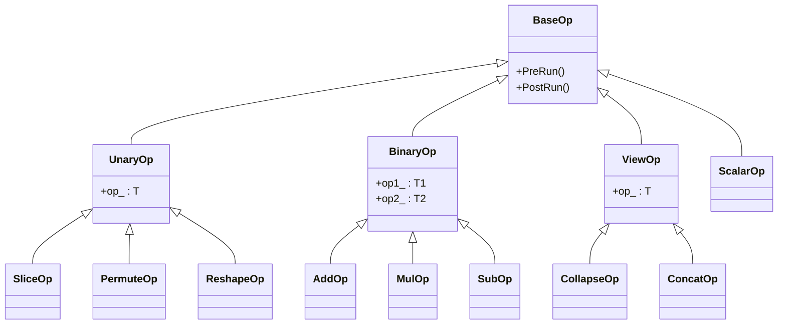
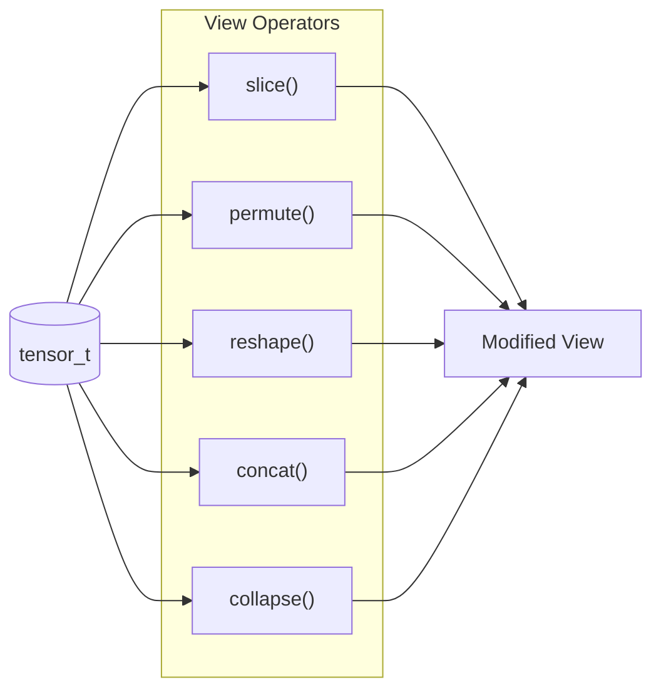
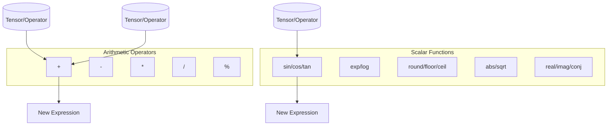
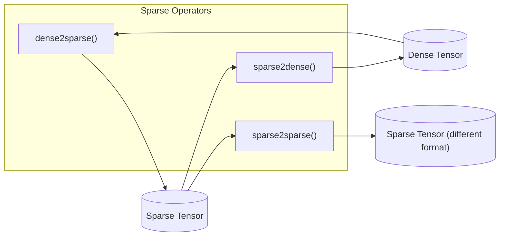
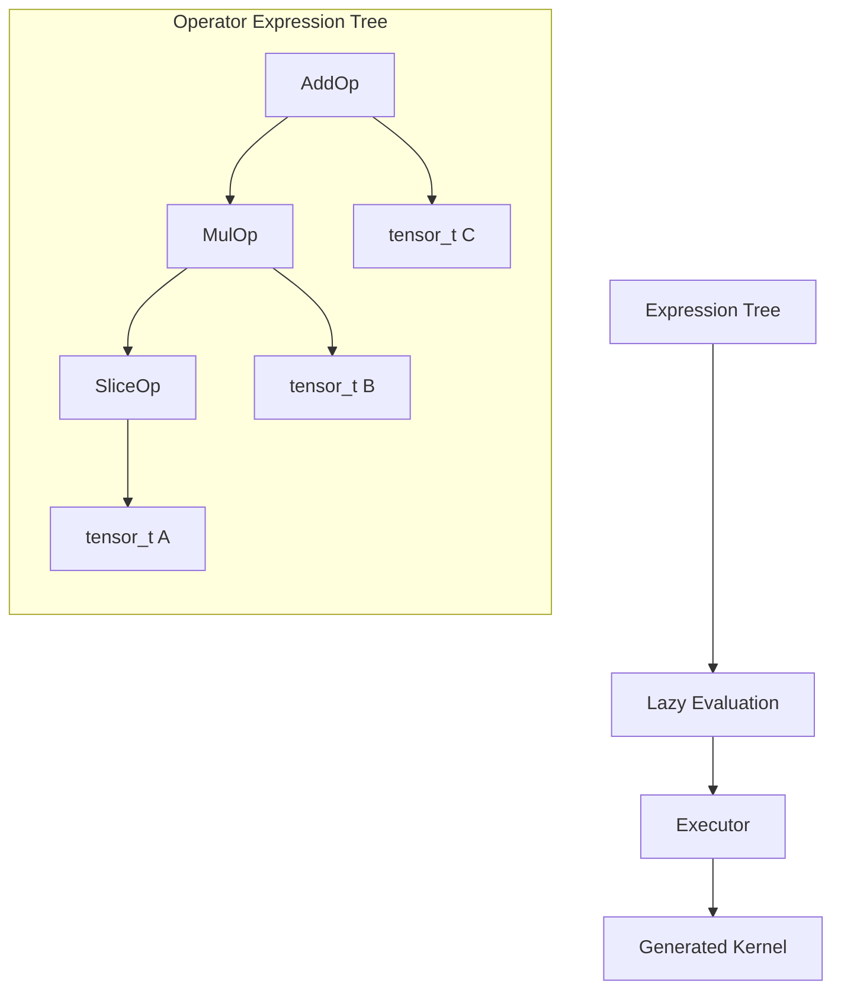
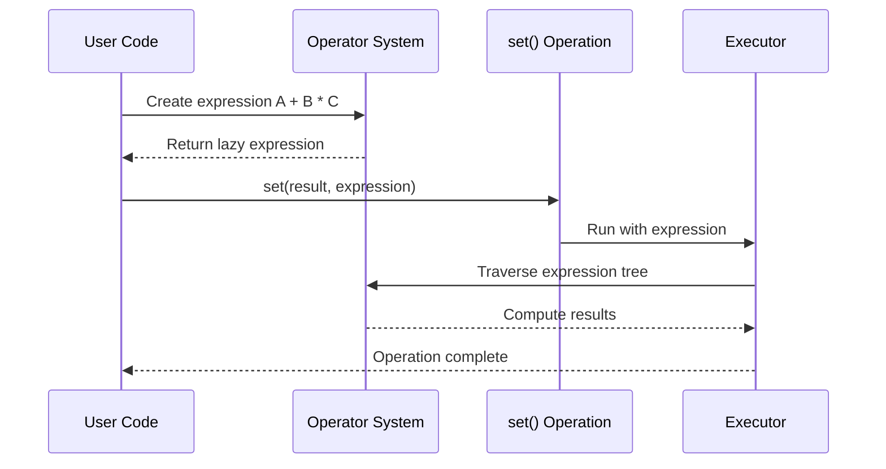

<!-- source: DeepWiki mcp.deepwiki.com · repo NVIDIA/MatX · page 3 Operators · fetched 2026-10-26 -->

# Operators

<details>
<summary>Relevant source files</summary>

The following files were used as context for generating this wiki page:

- [docs_input/api/creation/tensors/make.rst](docs_input/api/creation/tensors/make.rst)
- [docs_input/api/math/misc/abs2.rst](docs_input/api/math/misc/abs2.rst)
- [docs_input/basics/sparse_tensor.rst](docs_input/basics/sparse_tensor.rst)
- [examples/sparse_tensor.cu](examples/sparse_tensor.cu)
- [include/matx/core/half.h](include/matx/core/half.h)
- [include/matx/core/half_complex.h](include/matx/core/half_complex.h)
- [include/matx/core/iterator.h](include/matx/core/iterator.h)
- [include/matx/core/make_sparse_tensor.h](include/matx/core/make_sparse_tensor.h)
- [include/matx/core/make_tensor.h](include/matx/core/make_tensor.h)
- [include/matx/core/operator_utils.h](include/matx/core/operator_utils.h)
- [include/matx/core/print.h](include/matx/core/print.h)
- [include/matx/core/sparse_tensor.h](include/matx/core/sparse_tensor.h)
- [include/matx/core/sparse_tensor_format.h](include/matx/core/sparse_tensor_format.h)
- [include/matx/core/storage.h](include/matx/core/storage.h)
- [include/matx/core/tensor_impl.h](include/matx/core/tensor_impl.h)
- [include/matx/operators/binary_operators.h](include/matx/operators/binary_operators.h)
- [include/matx/operators/collapse.h](include/matx/operators/collapse.h)
- [include/matx/operators/concat.h](include/matx/operators/concat.h)
- [include/matx/operators/dense2sparse.h](include/matx/operators/dense2sparse.h)
- [include/matx/operators/operators.h](include/matx/operators/operators.h)
- [include/matx/operators/permute.h](include/matx/operators/permute.h)
- [include/matx/operators/remap.h](include/matx/operators/remap.h)
- [include/matx/operators/reshape.h](include/matx/operators/reshape.h)
- [include/matx/operators/reverse.h](include/matx/operators/reverse.h)
- [include/matx/operators/scalar_ops.h](include/matx/operators/scalar_ops.h)
- [include/matx/operators/shift.h](include/matx/operators/shift.h)
- [include/matx/operators/slice.h](include/matx/operators/slice.h)
- [include/matx/operators/sparse2sparse.h](include/matx/operators/sparse2sparse.h)
- [include/matx/operators/stack.h](include/matx/operators/stack.h)
- [include/matx/operators/unary_operators.h](include/matx/operators/unary_operators.h)
- [include/matx/transforms/convert/sparse2sparse_cusparse.h](include/matx/transforms/convert/sparse2sparse_cusparse.h)

</details>


Operators in MatX are fundamental components that enable tensor manipulation through user-friendly, Python-like syntax while achieving GPU-accelerated performance. They provide a wide range of operations from basic tensor views and arithmetic to complex tensor manipulations.

This page focuses on the foundational operator system, its architecture, and the primary types of operators available in MatX. For information about higher-level mathematical transforms, see [Transforms](#4).

## Operator Architecture

Operators in MatX follow a lazy evaluation model, where operations are defined but not executed until explicitly requested. This allows for optimized execution and memory usage.



Sources: [include/matx/operators/unary_operators.h:54-169](), [include/matx/operators/binary_operators.h](), [include/matx/operators/scalar_ops.h:87-131]()

All operators in MatX derive from a common base class, `BaseOp`. This inheritance hierarchy allows for consistent behavior and composability of operators.

## Operator Categories

MatX provides several categories of operators to manipulate tensors in different ways:

### View Operators

View operators create alternative ways to access tensor data without copying data. They include:



Sources: [include/matx/operators/slice.h:213-282](). [include/matx/operators/permute.h:162-199](). [include/matx/operators/reshape.h:46-132](). [include/matx/operators/concat.h:48-233](). [include/matx/operators/collapse.h:42-182]()

- **Slice**: Extracts a subsection of a tensor along specified dimensions
- **Permute**: Reorders tensor dimensions
- **Reshape**: Changes the logical shape of the tensor while preserving total size
- **Concat**: Combines multiple tensors along a specified dimension
- **Collapse**: Combines multiple dimensions into a single dimension

### Scalar and Arithmetic Operators

MatX provides comprehensive support for element-wise arithmetic operations and scalar functions:



Sources: [include/matx/operators/scalar_ops.h:132-227](). [include/matx/operators/scalar_ops.h:399-530](). [include/matx/operators/unary_operators.h:52-91]()

These operators enable complex mathematical expressions with a clean, intuitive syntax. They support various data types including floating-point, integer, and complex numbers.

### Sparse Tensor Operators

MatX provides specialized operators for working with sparse tensors:



Sources: [include/matx/operators/dense2sparse.h](), [include/matx/operators/sparse2dense.h](), [include/matx/operators/sparse2sparse.h]()

These operators allow conversion between dense and sparse tensor formats as well as between different sparse formats (like COO, CSR, CSC).

## Operator Framework Implementation

Operators in MatX are implemented using template metaprogramming to enable compile-time optimizations:



Sources: [include/matx/operators/binary_operators.h](), [include/matx/operators/unary_operators.h]()

Each operator defines:
- **Value type**: The output data type of the operation
- **Rank**: The dimensionality of the result
- **Sizes**: The shape of the resulting tensor
- **Evaluation method**: The core functionality that computes values

### Operator Base Classes

MatX defines several base operator types:

#### Unary Operators

Unary operators take a single tensor/operator and produce a transformed result:

```cpp
template <class I1, class Op>
class matxUnaryOp : public BaseOp<matxUnaryOp<I1,Op>>
{
private:
  typename detail::base_type_t<I1> in1_;
  typename detail::base_type_t<Op> op_;
  // ...
public:
  // ...
  template <typename... Is>
  __MATX_INLINE__ __MATX_DEVICE__ __MATX_HOST__ auto operator()(Is... indices) const
  {
    return op_.op(get_value(in1_, indices...));
  }
  // ...
};
```

Sources: [include/matx/operators/unary_operators.h:57-113]()

#### Binary Operators

Binary operators combine two tensors/operators:

```cpp
template <class I1, class I2, class Op>
class matxBinaryOp : public BaseOp<matxBinaryOp<I1,I2,Op>>
{
private:
  typename detail::base_type_t<I1> in1_;
  typename detail::base_type_t<I2> in2_;
  typename detail::base_type_t<Op> op_;
  // ...
public:
  // ...
  template <typename... Is>
  __MATX_INLINE__ __MATX_DEVICE__ __MATX_HOST__ auto operator()(Is... indices) const
  {
    return op_.op(get_value(in1_, indices...), get_value(in2_, indices...));
  }
  // ...
};
```

Sources: [include/matx/operators/binary_operators.h]()

## View Operator Examples

### Slice Operator

The `slice` operator extracts a portion of a tensor along specified dimensions:

```cpp
// Creating a slice from dimensions 2 to 5 on the first dimension
// and 3 to 6 on the second dimension
auto sliced = slice(tensor, {2, 3}, {5, 6});
```

Sources: [include/matx/operators/slice.h:213-282]()

### Permute Operator

The `permute` operator reorders tensor dimensions:

```cpp
// Swapping the first and second dimensions of a 2D tensor
auto permuted = permute(tensor, {1, 0});
```

Sources: [include/matx/operators/permute.h:162-199]()

### Reshape Operator

The `reshape` operator changes the tensor shape while preserving the total number of elements:

```cpp
// Reshaping a 4x5 tensor to 2x10
auto reshaped = reshape<2>(tensor, {2, 10});
```

Sources: [include/matx/operators/reshape.h:231-264]()

## Lazy Evaluation and Execution

Operators in MatX follow a lazy evaluation model. Operations are not immediately executed but instead build an expression tree:



Sources: [include/matx/core/tensor_impl.h:294-442](). [include/matx/operators/set.h]()

This lazy evaluation allows:
1. **Fusing operations**: Multiple operations can be combined into a single kernel
2. **Memory optimization**: Intermediate results don't need to be stored
3. **Performance tuning**: The execution can be optimized based on the entire expression

## Operator Assignment

MatX provides operator-assignment operations (`+=`, `-=`, etc.) through the `set` operator:

```cpp
// These are equivalent operations
result = A + B;           // Using operator=
result += A;              // Using operator+=
set(result, A + B);       // Using explicit set()
```

Sources: [include/matx/core/tensor_impl.h:294-442]()

The `set` operator creates an assignment operation that is executed when run on an executor.

## Extensibility

The MatX operator system is designed to be extensible. New operators can be created by:

1. Defining a new operator class that inherits from `BaseOp`
2. Implementing the required methods (`operator()`, `Size()`, etc.)
3. Creating a factory function for user-friendly syntax

Sources: [include/matx/operators/operators.h:33-130]()

## Summary

MatX operators provide a flexible, efficient way to manipulate tensors with minimal syntax. They form the foundation for higher-level operations and transforms while enabling GPU-accelerated performance. The lazy evaluation model allows for optimized execution and memory usage.

For more specialized mathematical operations, see [Transforms](#4). For tensor creation and management, see [Core Tensor System](#2).

---

