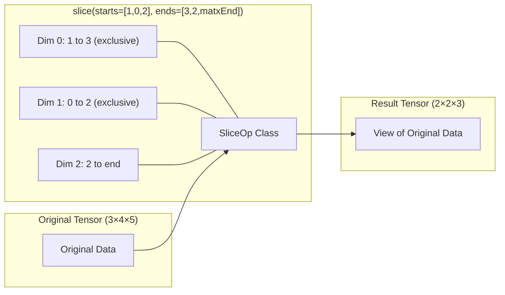
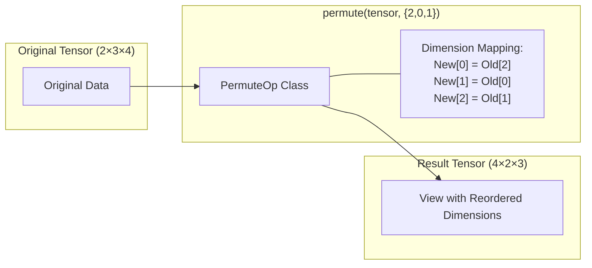
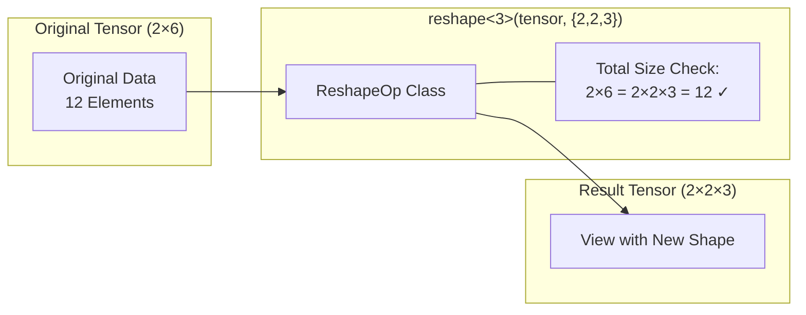
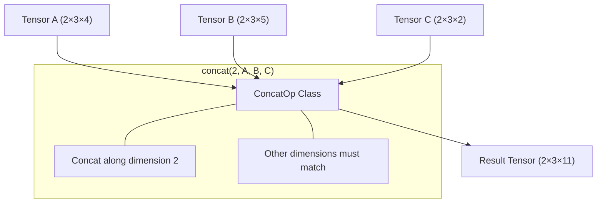
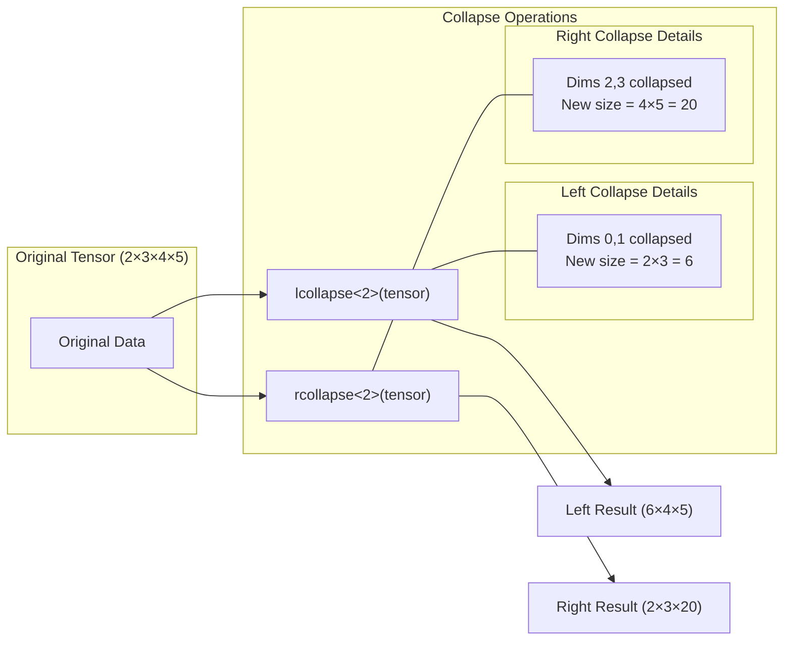
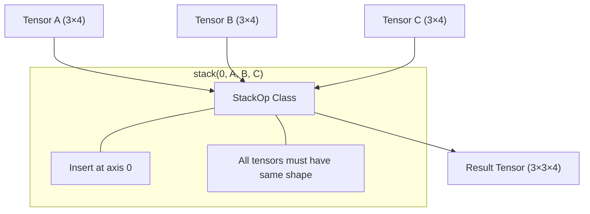
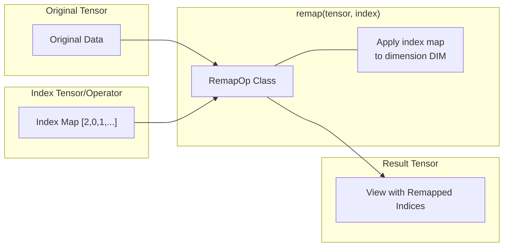
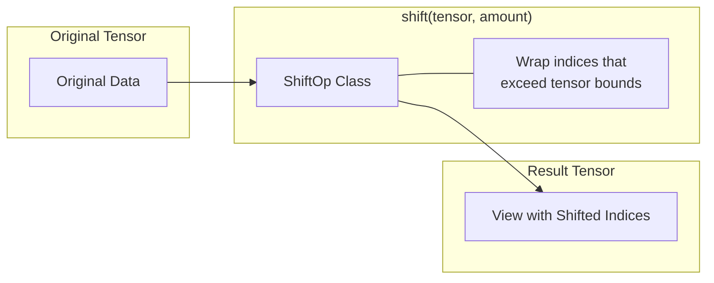

<!-- source: DeepWiki mcp.deepwiki.com · repo NVIDIA/MatX · page 3.1 View Operators · fetched 2026-10-26 -->

# View Operators

<details>
<summary>Relevant source files</summary>

The following files were used as context for generating this wiki page:

- [include/matx/operators/collapse.h](include/matx/operators/collapse.h)
- [include/matx/operators/concat.h](include/matx/operators/concat.h)
- [include/matx/operators/permute.h](include/matx/operators/permute.h)
- [include/matx/operators/remap.h](include/matx/operators/remap.h)
- [include/matx/operators/reshape.h](include/matx/operators/reshape.h)
- [include/matx/operators/reverse.h](include/matx/operators/reverse.h)
- [include/matx/operators/shift.h](include/matx/operators/shift.h)
- [include/matx/operators/slice.h](include/matx/operators/slice.h)
- [include/matx/operators/stack.h](include/matx/operators/stack.h)

</details>


View operators in MatX allow you to create alternate views of tensors without copying the underlying data. These operators enable efficient tensor manipulation by changing how the data is accessed rather than modifying the data itself. View operators can be used as both rvalues (read operations) and lvalues (write operations).

This page covers operators that modify the structure or access pattern of tensors. For operators that perform element-wise operations and tensor generation, see [Scalar and Generator Operators](#3.2).

## Overview of View Operators

```mermaid
flowchart LR
    subgraph "Tensor or Operator"
        Data["Original Data"]
    end
    
    subgraph "View Operators"
        direction TB
        Slice["slice()"]
        Concat["concat()"]
        Permute["permute()"]
        Reshape["reshape()"]
        Collapse["lcollapse()/rcollapse()"]
        Remap["remap()"]
        Shift["shift()"]
        Stack["stack()"]
        Reverse["reverse()/flipud()/fliplr()"]
    end
    
    subgraph "Result"
        View["Modified View\n(No Data Copy)"]
    end
    
    Data --> View Operators --> View
```

Sources: [include/matx/operators/slice.h](), [include/matx/operators/concat.h](), [include/matx/operators/permute.h](), [include/matx/operators/reshape.h](), [include/matx/operators/collapse.h](), [include/matx/operators/remap.h](), [include/matx/operators/shift.h](), [include/matx/operators/stack.h](), [include/matx/operators/reverse.h]()

## Common Characteristics

All view operators in MatX share these features:

- Create a view without allocating new memory for the result
- Can be used as both rvalues and lvalues
- Derived from the `BaseOp` class
- Follow a consistent operator pattern
- Support lazy evaluation

## Slice Operator

The slice operator extracts a subset of a tensor by specifying start and end indices for each dimension, with optional strides.



Sources: [include/matx/operators/slice.h:42-198]()

### Slice API

```cpp
// Basic slice with start and end indices
auto view = slice(tensor, starts, ends);

// Slice with explicit strides
auto view = slice(tensor, starts, ends, strides);

// Slice with explicit output rank
auto view = slice<N>(tensor, starts, ends);
```

The slice operator supports several special index values:
- `matxEnd`: Include all elements to the end of that dimension
- `matxDropDim`: Remove this dimension from the result (reduces rank)

### Examples

Extracting a subtensor:
```cpp
// Extract a 2×3 slice from a matrix
tensor_t<float, 2> A({4, 5});
auto B = slice(A, {1, 1}, {3, 4});  // Result is 2×3
```

Slicing with reduced rank:
```cpp
// Extract a vector (rank 1) from a matrix (rank 2)
tensor_t<float, 2> A({4, 5});
auto row = slice<1>(A, {2, 0}, {3, matxEnd});  // Extract row 2
```

Sources: [include/matx/operators/slice.h:200-382]()

## Permute Operator

The permute operator reorders the dimensions of a tensor. Each dimension must appear exactly once in the permutation.



Sources: [include/matx/operators/permute.h:44-161]()

### Permute API

```cpp
// Permute dimensions according to the given order
auto view = permute(tensor, dims);
```

Where `dims` specifies the new order of dimensions.

### Examples

Transposing a matrix:
```cpp
// Transpose a 2D matrix
tensor_t<float, 2> A({4, 5});
auto AT = permute(A, {1, 0});  // Result is 5×4
```

Permuting a 3D tensor:
```cpp
// Reorder dimensions of a 3D tensor
tensor_t<float, 3> A({2, 3, 4});
auto B = permute(A, {2, 0, 1});  // Result is 4×2×3
```

Sources: [include/matx/operators/permute.h:163-204]()

## Reshape Operator

The reshape operator changes the shape of a tensor while preserving the total number of elements. The new shape is specified as an array of sizes.



Sources: [include/matx/operators/reshape.h:41-157]()

### Reshape API

```cpp
// Reshape tensor to new dimensions
template <int RANK>
auto view = reshape(tensor, new_shape);
```

The total size of the tensor must remain unchanged after reshaping.

### Examples

Reshaping a vector to a matrix:
```cpp
// Reshape a vector into a 2D matrix
tensor_t<float, 1> v({12});
auto M = reshape<2>(v, {3, 4});  // Result is 3×4
```

Reshaping a matrix to a 3D tensor:
```cpp
// Reshape a matrix into a 3D tensor
tensor_t<float, 2> A({6, 4});
auto B = reshape<3>(A, {2, 3, 4});  // Result is 2×3×4
```

Sources: [include/matx/operators/reshape.h:159-193]()

## Concat Operator

The concat operator combines multiple tensors along a specified dimension. The sizes of the tensors in all other dimensions must be the same.



Sources: [include/matx/operators/concat.h:41-234]()

### Concat API

```cpp
// Concatenate tensors along specified axis
auto view = concat(axis, tensor1, tensor2, ...);
```

### Examples

Concatenating matrices:
```cpp
// Concatenate two matrices along dimension 0
tensor_t<float, 2> A({3, 4});
tensor_t<float, 2> B({2, 4});
auto C = concat(0, A, B);  // Result is 5×4
```

Concatenating along higher dimensions:
```cpp
// Concatenate 3D tensors along dimension 2
tensor_t<float, 3> A({2, 3, 4});
tensor_t<float, 3> B({2, 3, 5});
auto C = concat(2, A, B);  // Result is 2×3×9
```

Sources: [include/matx/operators/concat.h:236-253]()

## Collapse Operators

The collapse operators reduce the rank of a tensor by combining multiple dimensions into a single dimension. MatX provides two variants:
- `lcollapse`: Collapses the leftmost dimensions
- `rcollapse`: Collapses the rightmost dimensions



Sources: [include/matx/operators/collapse.h:41-154](), [include/matx/operators/collapse.h:183-324]()

### Collapse API

```cpp
// Collapse leftmost DIM dimensions
auto view = lcollapse<DIM>(tensor);

// Collapse rightmost DIM dimensions
auto view = rcollapse<DIM>(tensor);
```

### Examples

Collapsing dimensions in a 4D tensor:
```cpp
// Collapse first two dimensions of a 4D tensor
tensor_t<float, 4> A({2, 3, 4, 5});
auto B = lcollapse<2>(A);  // Result is 6×4×5

// Collapse last two dimensions of a 4D tensor
auto C = rcollapse<2>(A);  // Result is 2×3×20
```

Sources: [include/matx/operators/collapse.h:156-181](), [include/matx/operators/collapse.h:299-324]()

## Stack Operator

The stack operator combines multiple tensors along a new dimension. All input tensors must have the same rank and dimensions.



Sources: [include/matx/operators/stack.h:47-190]()

### Stack API

```cpp
// Stack tensors along new dimension at specified axis
auto view = stack(axis, tensor1, tensor2, ...);
```

### Examples

Stacking matrices:
```cpp
// Stack three matrices along a new dimension at axis 0
tensor_t<float, 2> A({3, 4});
tensor_t<float, 2> B({3, 4});
tensor_t<float, 2> C({3, 4});
auto D = stack(0, A, B, C);  // Result is 3×3×4
```

Stacking along a different axis:
```cpp
// Stack matrices along a new dimension at axis 1
auto E = stack(1, A, B, C);  // Result is 3×3×4
```

Sources: [include/matx/operators/stack.h:192-209]()

## Reverse Operator

The reverse operator flips the order of elements along specified dimensions. MatX also provides specialized versions:
- `flipud`: Flip along vertical axis (useful for 2D tensors)
- `fliplr`: Flip along horizontal axis (useful for 2D tensors)

```mermaid
flowchart LR
    subgraph "Original Tensor (3×4)"
        Original["Original Data"]
    end
    
    subgraph "Reverse Operations"
        direction TB
        Rev0["reverse<0>(tensor)"]
        Rev1["reverse<1>(tensor)"]
        FlipUD["flipud(tensor)"]
        FlipLR["fliplr(tensor)"]
        
        Rev0 -.-> "Reverses rows"
        Rev1 -.-> "Reverses columns"
        FlipUD -.-> "Same as reverse<0>"
        FlipLR -.-> "Same as reverse<1>"
    end
    
    Result0["Result with rows reversed"]
    Result1["Result with columns reversed"]
    
    Original --> Rev0 --> Result0
    Original --> Rev1 --> Result1
```

Sources: [include/matx/operators/reverse.h:49-131]()

### Reverse API

```cpp
// Reverse along a single dimension
auto view = reverse<DIM>(tensor);

// Reverse along multiple dimensions
auto view = reverse<DIM1, DIM2, ...>(tensor);

// Flip vertical axis (typically dimension 0)
auto view = flipud(tensor);

// Flip horizontal axis (typically dimension rank-1)
auto view = fliplr(tensor);
```

### Examples

Reversing a vector:
```cpp
// Reverse a vector
tensor_t<float, 1> v({5});
auto vr = reverse<0>(v);  // Result has reversed elements
```

Reversing a matrix along multiple dimensions:
```cpp
// Reverse a matrix along both dimensions
tensor_t<float, 2> A({3, 4});
auto Ar = reverse<0, 1>(A);  // Result has both dimensions reversed
```

Sources: [include/matx/operators/reverse.h:133-193]()

## Remap Operator

The remap operator applies an indexing function to a specific dimension, allowing for arbitrary reordering of elements.



Sources: [include/matx/operators/remap.h:44-148]()

### Remap API

```cpp
// Remap indices along a single dimension
auto view = remap<DIM>(tensor, index_op);

// Remap indices along multiple dimensions
auto view = remap<DIM1, DIM2, ...>(tensor, index_op1, index_op2, ...);
```

### Examples

Remapping indices in a vector:
```cpp
// Remap a vector using an index tensor
tensor_t<float, 1> v({5});
tensor_t<int, 1> idx({5});  // Contains index mapping
auto vr = remap<0>(v, idx);  // Result has remapped elements
```

Sources: [include/matx/operators/remap.h:150-210]()

## Shift Operator

The shift operator adjusts indices by a given amount, effectively "shifting" the view of the tensor. Indices that would go beyond the tensor size wrap around.



Sources: [include/matx/operators/shift.h:52-158]()

### Shift API

```cpp
// Shift indices along a single dimension
auto view = shift<DIM>(tensor, amount);

// Shift indices along multiple dimensions
auto view = shift<DIM1, DIM2, ...>(tensor, amount1, amount2, ...);
```

### Examples

Circular shift of a vector:
```cpp
// Shift all elements of a vector by 2 positions
tensor_t<float, 1> v({5});
auto vs = shift<0>(v, 2);  // Elements wrap around
```

Sources: [include/matx/operators/shift.h:160-225]()

## View Operators as Lvalues

All view operators in MatX can be used as lvalues (on the left side of an assignment), allowing direct writing to the transformed view:

```cpp
// Using a slice as an lvalue
tensor_t<float, 2> A({4, 5});
slice(A, {1, 1}, {3, 4}) = 0.0f;  // Set the sliced region to zero

// Using permute as an lvalue
tensor_t<float, 2> B({3, 4});
permute(B, {1, 0}) = 1.0f;  // Set the transposed view to ones
```

## Performance Considerations

View operators in MatX follow these performance principles:

1. **No Memory Allocation**: View operators don't allocate new memory, making them very efficient
2. **Lazy Evaluation**: Operations are only performed when needed
3. **GPU Acceleration**: All view operations work efficiently on NVIDIA GPUs
4. **Zero-Cost Abstraction**: Many view operations are optimized away during compilation

## View Operator Summary

| Operator | Purpose | Example |
|----------|---------|---------|
| `slice` | Extract a subset of elements | `slice(A, {1,0}, {3,4})` |
| `concat` | Join tensors along a dimension | `concat(0, A, B)` |
| `permute` | Reorder dimensions | `permute(A, {1,0})` |
| `reshape` | Change tensor shape | `reshape<3>(A, {2,3,4})` |
| `lcollapse` | Collapse leftmost dimensions | `lcollapse<2>(A)` |
| `rcollapse` | Collapse rightmost dimensions | `rcollapse<2>(A)` |
| `remap` | Remap indices | `remap<0>(A, idx)` |
| `shift` | Shift indices | `shift<0>(A, 2)` |
| `stack` | Stack tensors along new axis | `stack(0, A, B, C)` |
| `reverse` | Reverse indices | `reverse<0>(A)` |
| `flipud` | Flip vertical axis | `flipud(A)` |
| `fliplr` | Flip horizontal axis | `fliplr(A)` |

Sources: All operators files

---

