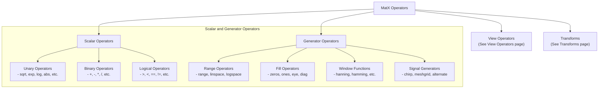
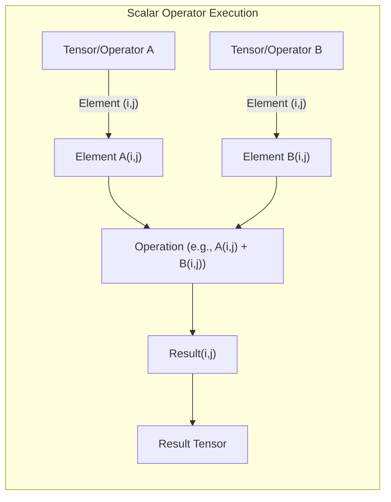
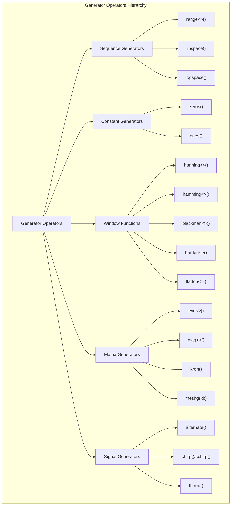
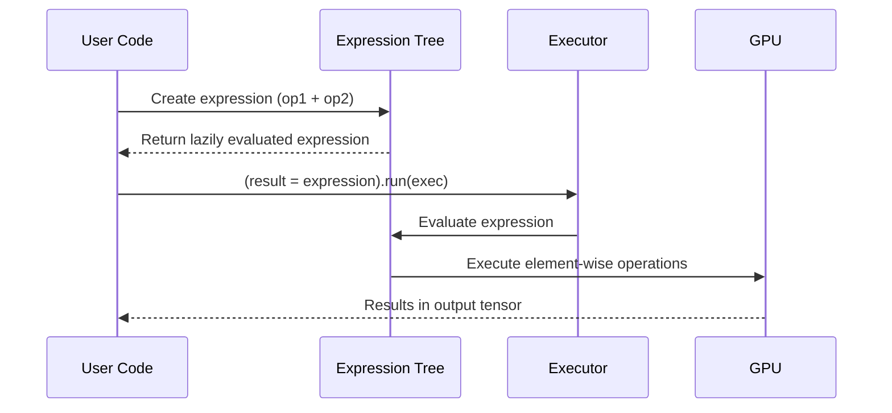

<!-- source: DeepWiki mcp.deepwiki.com · repo NVIDIA/MatX · page 3.2 Scalar and Generator Operators · fetched 2026-10-26 -->

# Scalar and Generator Operators

<details>
<summary>Relevant source files</summary>

The following files were used as context for generating this wiki page:

- [docs_input/api/creation/operators/linspace.rst](docs_input/api/creation/operators/linspace.rst)
- [docs_input/api/creation/tensors/make.rst](docs_input/api/creation/tensors/make.rst)
- [docs_input/api/math/misc/abs2.rst](docs_input/api/math/misc/abs2.rst)
- [include/matx/core/half.h](include/matx/core/half.h)
- [include/matx/core/half_complex.h](include/matx/core/half_complex.h)
- [include/matx/core/iterator.h](include/matx/core/iterator.h)
- [include/matx/core/make_tensor.h](include/matx/core/make_tensor.h)
- [include/matx/core/operator_utils.h](include/matx/core/operator_utils.h)
- [include/matx/core/storage.h](include/matx/core/storage.h)
- [include/matx/generators/chirp.h](include/matx/generators/chirp.h)
- [include/matx/generators/linspace.h](include/matx/generators/linspace.h)
- [include/matx/operators/binary_operators.h](include/matx/operators/binary_operators.h)
- [include/matx/operators/scalar_ops.h](include/matx/operators/scalar_ops.h)
- [include/matx/operators/unary_operators.h](include/matx/operators/unary_operators.h)
- [test/00_operators/GeneratorTests.cu](test/00_operators/GeneratorTests.cu)
- [test/00_operators/legendre_test.cu](test/00_operators/legendre_test.cu)
- [test/00_operators/overlap_test.cu](test/00_operators/overlap_test.cu)
- [test/00_operators/slice_and_reduce_test.cu](test/00_operators/slice_and_reduce_test.cu)
- [test/00_operators/slice_and_reshape_test.cu](test/00_operators/slice_and_reshape_test.cu)
- [test/00_operators/slice_test.cu](test/00_operators/slice_test.cu)

</details>


This page documents the scalar operators (element-wise operations on tensors) and generator operators (functions that create tensors with specific patterns) in the MatX library. Scalar operators perform element-wise mathematical operations, while generator operators create tensors with predefined patterns. For transform operations that involve multiple elements, see [Transforms](#4).

## Overview

MatX provides a rich set of operators that follow a consistent design pattern, allowing for intuitive and expressive tensor manipulation. These operators can be combined to create complex expressions that are evaluated lazily when executed.



Sources: [include/matx/operators/scalar_ops.h:38-757](include/matx/operators/scalar_ops.h:38-757), [test/00_operators/GeneratorTests.cu:40-780](test/00_operators/GeneratorTests.cu:40-780)

## Scalar Operators

Scalar operators work element by element on tensor data. They can be unary (operating on one tensor) or binary (operating on two tensors).



Sources: [include/matx/operators/scalar_ops.h:87-115](include/matx/operators/scalar_ops.h:87-115), [include/matx/operators/unary_operators.h:54-118](include/matx/operators/unary_operators.h:54-118)

### Unary Scalar Operators

Unary operators take a single input tensor or operator and apply an element-wise function to it. MatX provides an extensive set of unary operators for common mathematical operations:

| Category | Operators |
|----------|-----------|
| Arithmetic | `-` (negate) |
| Exponential/Logarithmic | `exp`, `log`, `log10`, `log2` |
| Root/Power | `sqrt`, `rsqrt`, `csqrt` |
| Trigonometric | `sin`, `cos`, `tan`, `asin`, `acos`, `atan` |
| Hyperbolic | `sinh`, `cosh`, `tanh`, `asinh`, `acosh`, `atanh` |
| Complex | `conj`, `real`, `imag`, `abs`, `abs2`, `angle` |
| Rounding | `floor`, `ceil`, `round` |
| Statistical | `normcdf` |
| Logical | `!` (not), `isnan`, `isinf` |

Example usage:

```cpp
// Create tensor t with values
auto t = make_tensor<float>({100});
// Fill with values from 0 to 99
(t = linspace(0.0f, 99.0f, 100)).run(exec);

// Apply unary operators
auto t_sqrt = sqrt(t);     // Square root of each element
auto t_exp = exp(t);       // e^x for each element
auto t_abs = abs(t);       // Absolute value of each element

// Execute operations
(t = t_sqrt).run(exec);
```

Sources: [include/matx/operators/scalar_ops.h:133-368](include/matx/operators/scalar_ops.h:133-368), [include/matx/operators/unary_operators.h:371-438](include/matx/operators/unary_operators.h:371-438)

### Binary Scalar Operators

Binary operators take two inputs (tensor/operator, tensor/operator, or tensor/scalar) and apply an element-wise binary function:

| Category | Operators |
|----------|-----------|
| Arithmetic | `+`, `-`, `*`, `/`, `%` (modulo) |
| Power/Root | `pow` |
| Comparison | `maximum`, `minimum`, `fmod` |
| Logical | `<`, `>`, `<=`, `>=`, `==`, `!=`, `&&`, `\|\|` |
| Bitwise | `&`, `\|`, `^` |
| Angle | `atan2` |

Example usage:

```cpp
// Create two tensors
auto t1 = make_tensor<float>({100});
auto t2 = make_tensor<float>({100});

// Fill tensors
(t1 = linspace(0.0f, 9.9f, 100)).run(exec);
(t2 = linspace(10.0f, 19.9f, 100)).run(exec);

// Apply binary operators
auto t_sum = t1 + t2;         // Element-wise addition
auto t_product = t1 * t2;     // Element-wise multiplication
auto t_max = maximum(t1, t2); // Element-wise maximum

// Execute operations
auto result = make_tensor<float>({100});
(result = t_sum).run(exec);
```

Scalar operators also work with scalar values (constants):

```cpp
auto t = make_tensor<float>({100});
(t = linspace(0.0f, 99.0f, 100)).run(exec);

// Scalar operations
auto t_plus_5 = t + 5.0f;     // Add 5 to each element
auto t_times_2 = t * 2.0f;    // Multiply each element by 2
```

Sources: [include/matx/operators/scalar_ops.h:399-757](include/matx/operators/scalar_ops.h:399-757), [include/matx/operators/binary_operators.h:63-497](include/matx/operators/binary_operators.h:63-497)

## Generator Operators

Generator operators create tensors with predefined patterns. These operators are evaluated lazily and materialized when assigned to a tensor and executed.



Sources: [test/00_operators/GeneratorTests.cu:90-354](test/00_operators/GeneratorTests.cu:90-354), [include/matx/generators/linspace.h:38-196](include/matx/generators/linspace.h:38-196)

### Sequence Generators

Sequence generators create tensors with regular sequences of values:

#### range

The `range` operator creates a sequence with a specified start value, step size, and count:

```cpp
// Example: Generate a sequence of 100 numbers starting at 1 and spaced by 1
index_t count = 100;
tensor_t<float, 1> t1{{count}};
(t1 = range<0>(t1.Shape(), 1, 1)).run(exec);
// Result: t1 = [1, 2, 3, ..., 100]
```

Sources: [test/00_operators/GeneratorTests.cu:412-470](test/00_operators/GeneratorTests.cu:412-470)

#### linspace

The `linspace` operator creates a linearly spaced sequence between a start and end value:

```cpp
// Create a set of linearly-spaced numbers starting at 1, ending at 100, with count points in between
index_t count = 100;
auto t1 = make_tensor<float>({count});
(t1 = linspace(1.0f, 100.0f, count)).run(exec);
// Result: t1 = [1, 2, 3, ..., 100]

// 2D version with different start/stop per column
const float starts[] = {0.0f, 1.0f};
const float stops[] = {1.0f, 3.0f};
// Create a 2D operator with 10 rows and 2 columns with linearly-spaced columns
auto ls = linspace(starts, stops, count);
```

Sources: [test/00_operators/GeneratorTests.cu:472-529](test/00_operators/GeneratorTests.cu:472-529), [include/matx/generators/linspace.h:47-143](include/matx/generators/linspace.h:47-143)

#### logspace

The `logspace` operator creates a logarithmically spaced sequence:

```cpp
// Create a logarithmically-spaced sequence of numbers and assign to tensor "t1"
index_t count = 20;
tensor_t<float, 1> t1{{count}};
auto s = t1.Shape();
(t1 = logspace<0>(s, 1.0f, 2.0f)).run(exec);
// Result: t1 = [10^1, ..., 10^2] (20 logarithmically spaced points)
```

Sources: [test/00_operators/GeneratorTests.cu:571-616](test/00_operators/GeneratorTests.cu:571-616)

### Constant Generators

#### zeros & ones

Create tensors filled with zeros or ones respectively:

```cpp
// Create tensor filled with zeros
index_t count = 100;
cuda::std::array<index_t, 1> s({count});
auto t1 = make_tensor<float>(s);
(t1 = zeros()).run(exec);
// Result: t1 = [0, 0, 0, ..., 0]

// Create tensor filled with ones
(t1 = ones()).run(exec);
// Result: t1 = [1, 1, 1, ..., 1]

// Can also specify shape explicitly
(t1 = ones({2, 2})).run(exec);
```

Sources: [test/00_operators/GeneratorTests.cu:357-410](test/00_operators/GeneratorTests.cu:357-410)

### Matrix Generators

#### eye

Creates an identity matrix (or identity-like tensor of higher dimensions):

```cpp
// Create identity matrices (or higher-dimension equivalents)
index_t count = 10;
auto t2 = make_tensor<float>({count, count});
auto t3 = make_tensor<float>({count, count, count});
auto t4 = make_tensor<float>({count, count, count, count});

auto eye_op = eye<float>();

// For each tensor, the values on the diagonal where all indices are the same are 1, and 0 elsewhere
(t2 = eye_op).run(exec);
(t3 = eye_op).run(exec);
(t4 = eye_op).run(exec);
```

Sources: [test/00_operators/GeneratorTests.cu:619-681](test/00_operators/GeneratorTests.cu:619-681)

#### diag

There are two forms of the `diag` operator:
1. Generator form: Creates a tensor with specified values on the diagonal
2. Extractor form: Extracts diagonal elements from a tensor

Generator form:
```cpp
// Create a 2D, 3D, and 4D tensor and make only their diagonal elements set to `c`
index_t count = 10;
TestType c = 5.0f;
auto t2 = make_tensor<float>({count, count});
auto diag2 = diag<float>({count, count}, c);
(t2 = diag2).run(exec);
// Result: t2 has c on the diagonal and 0 elsewhere
```

Extractor form:
```cpp
// The generator form of `diag()` with a >= 2D input takes an operator input 
// and returns only the diagonal elements as output
auto tc = make_tensor<float>({10, 10});
auto td = make_tensor<float>({10});

// Initialize the diagonal elements of `tc`
/* ... initialization code ... */

// Assign the diagonal elements of `tc` to `td`.
(td = diag(tc)).run(exec);
```

Sources: [test/00_operators/GeneratorTests.cu:139-229](test/00_operators/GeneratorTests.cu:139-229), [test/00_operators/GeneratorTests.cu:683-744](test/00_operators/GeneratorTests.cu:683-744)

#### kron

Computes the Kronecker product of two tensors:

```cpp
auto bv = make_tensor<int>({2, 2});
auto ov = make_tensor<int>({8, 8});
bv.SetVals({{1, -1}, {-1, 1}});

(ov = kron(eye({4, 4}), bv)).run(exec);
```

Sources: [test/00_operators/GeneratorTests.cu:254-286](test/00_operators/GeneratorTests.cu:254-286)

#### meshgrid

Creates coordinate matrices from two vectors:

```cpp
auto xv = make_tensor<int>({yd, xd});
auto yv = make_tensor<int>({yd, xd});

auto x = linspace(1, xd, xd);
auto y = linspace(1, yd, yd);

// Create a mesh grid with "x" as x extents and "y" as y extents and assign it to "xv"/"yv"
auto [xx, yy] = meshgrid(x, y);

(xv = xx).run(exec);
(yv = yy).run(exec);
```

Sources: [test/00_operators/GeneratorTests.cu:288-318](test/00_operators/GeneratorTests.cu:288-318)

### Window Function Generators

These operators create window functions commonly used in signal processing:

```cpp
const index_t win_size = 100;
auto ov = make_tensor<float>(shape({win_size}));

// Assign a Hanning window of size `win_size` to `ov`
(ov = hanning<0>({win_size})).run(exec);

// Assign a Hamming window of size `win_size` to `ov`
(ov = hamming<0>({win_size})).run(exec);

// Assign a bartlett window of size `win_size` to `ov`
(ov = bartlett<0>({win_size})).run(exec);

// Assign a blackman window of size `win_size` to `ov`
(ov = blackman<0>({win_size})).run(exec);

// Assign a flattop window of size `win_size` to `ov`
(ov = flattop<0>({win_size})).run(exec);
```

Sources: [test/00_operators/GeneratorTests.cu:90-137](test/00_operators/GeneratorTests.cu:90-137)

### Signal Processing Generators

#### alternate

Creates a sequence of alternating values (1, -1, 1, -1, ...):

```cpp
auto td = make_tensor<float>({10});

// td contains the sequence 1, -1, 1, -1, 1, -1, 1, -1, 1, -1
(td = alternate(10)).run(exec);
```

Sources: [test/00_operators/GeneratorTests.cu:231-252](test/00_operators/GeneratorTests.cu:231-252)

#### fftfreq

Generates frequencies for FFT results:

```cpp
auto t1 = make_tensor<float>({100});
// Generate FFT frequencies using the length of the "t1" tensor and assign to t1
(t1 = fftfreq(t1.Size(0))).run(exec);

// Generate FFT frequencies with a sample spacing of 0.5
(t1 = fftfreq(t1.Size(0), 0.5)).run(exec);
```

Sources: [test/00_operators/GeneratorTests.cu:320-354](test/00_operators/GeneratorTests.cu:320-354)

#### chirp / cchirp

Generates a chirp signal (swept-frequency cosine) or complex chirp:

```cpp
auto t1 = make_tensor<float>({count});
// Create a chirp of length "count" and assign it to tensor "t1"
(t1 = chirp(count, end, f0, end, f1)).run(exec);

auto t1c = make_tensor<cuda::std::complex<float>>({count});
// Create a complex chirp of length "count" and assign it to tensor "t1"
(t1c = cchirp(count, end, f0, end, f1, ChirpMethod::CHIRP_METHOD_LINEAR)).run(exec);
```

Sources: [test/00_operators/GeneratorTests.cu:746-778](test/00_operators/GeneratorTests.cu:746-778), [include/matx/generators/chirp.h:47-213](include/matx/generators/chirp.h:47-213)

## Execution Model and Lazy Evaluation

The scalar and generator operators in MatX are lazily evaluated, meaning they don't perform any computation until explicitly executed with a `.run()` call.



Sources: [include/matx/core/operator_utils.h:40-153](include/matx/core/operator_utils.h:40-153), [include/matx/core/iterator.h:38-568](include/matx/core/iterator.h:38-568)

## Memory Management

When using generator operators, the memory for the target tensor must be allocated before the operation is executed. This is usually done with `make_tensor()`:

```cpp
// Allocate memory for the result
auto result = make_tensor<float>({100});
// Perform operation and store in result
(result = linspace(0.0f, 99.0f, 100)).run(exec);
```

Sources: [include/matx/core/make_tensor.h:33-634](include/matx/core/make_tensor.h:33-634), [include/matx/core/storage.h:40-634](include/matx/core/storage.h:40-634)

## Type Handling

MatX supports a variety of numeric types, including:

- Basic floating-point types: `float`, `double`
- Half-precision types: `__half`, `__nv_bfloat16` (through `matxHalf` wrapper)
- Complex types: `cuda::std::complex<T>` and `matxHalfComplex<T>` (for half-precision complex)
- Integer types: `int`, `long`, etc.

Each operator handles type conversion automatically, ensuring that operations between different types produce the expected results.

Sources: [include/matx/core/half.h:44-1147](include/matx/core/half.h:44-1147), [include/matx/core/half_complex.h:44-500](include/matx/core/half_complex.h:44-500)

---

