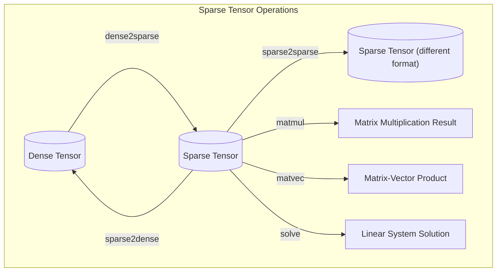
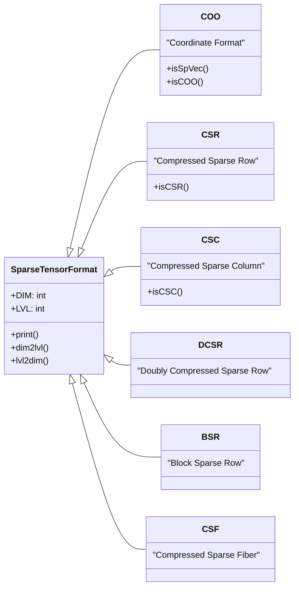
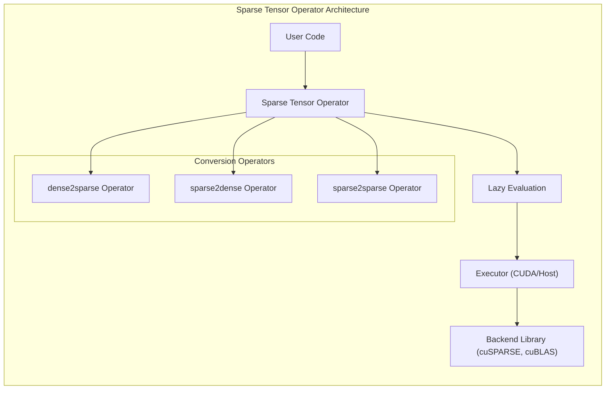
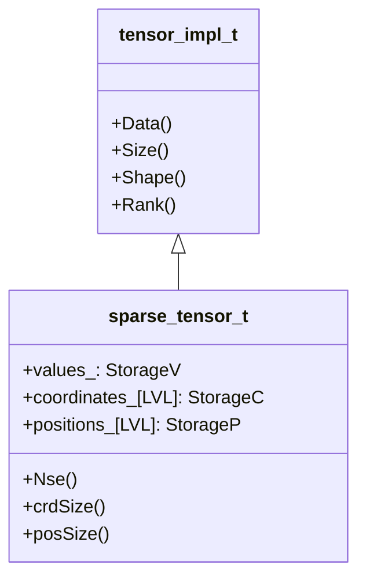
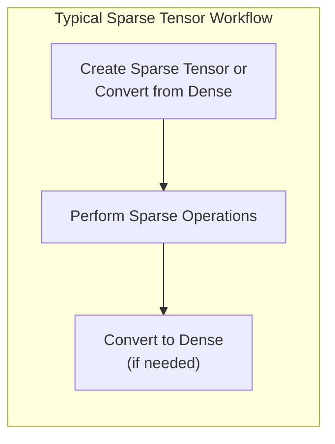

<!-- source: DeepWiki mcp.deepwiki.com · repo NVIDIA/MatX · page 3.3 Sparse Tensor Operators · fetched 2026-10-26 -->

# Sparse Tensor Operators

<details>
<summary>Relevant source files</summary>

The following files were used as context for generating this wiki page:

- [docs_input/basics/sparse_tensor.rst](docs_input/basics/sparse_tensor.rst)
- [examples/sparse_tensor.cu](examples/sparse_tensor.cu)
- [include/matx/core/make_sparse_tensor.h](include/matx/core/make_sparse_tensor.h)
- [include/matx/core/print.h](include/matx/core/print.h)
- [include/matx/core/sparse_tensor.h](include/matx/core/sparse_tensor.h)
- [include/matx/core/sparse_tensor_format.h](include/matx/core/sparse_tensor_format.h)
- [include/matx/core/tensor_impl.h](include/matx/core/tensor_impl.h)
- [include/matx/operators/dense2sparse.h](include/matx/operators/dense2sparse.h)
- [include/matx/operators/operators.h](include/matx/operators/operators.h)
- [include/matx/operators/sparse2sparse.h](include/matx/operators/sparse2sparse.h)
- [include/matx/transforms/convert/sparse2sparse_cusparse.h](include/matx/transforms/convert/sparse2sparse_cusparse.h)
- [test/00_sparse/Convert.cu](test/00_sparse/Convert.cu)
- [test/00_sparse/Matmul.cu](test/00_sparse/Matmul.cu)
- [test/00_sparse/Matvec.cu](test/00_sparse/Matvec.cu)
- [test/00_sparse/Solve.cu](test/00_sparse/Solve.cu)
- [test/include/test_types.h](test/include/test_types.h)

</details>


This page documents the various operators specifically designed for sparse tensors in the MatX library. Sparse tensors store only non-zero elements and their indices, which makes them memory-efficient for matrices and tensors with many zero elements. MatX provides operators for converting between dense and sparse tensor formats, as well as operators for performing computations with sparse tensors.

For information about sparse tensor types and formats, see [Sparse Tensors](#2.2).
For information about matrix multiplication and other transforms with sparse tensors, see [Matrix Multiplication](#4.1).

## Sparse Tensor Operator Overview

MatX's sparse tensor support is experimental and focuses on providing efficient operators for common sparse tensor operations. The library implements a universal sparse tensor type that can represent various sparse storage formats (COO, CSR, CSC, etc.) through a tensor format DSL.



Sources: 
- [include/matx/operators/operators.h:55-104]()
- [include/matx/operators/dense2sparse.h:33-103]()
- [include/matx/operators/sparse2sparse.h:33-107]()
- [examples/sparse_tensor.cu:43-89]()
- [examples/sparse_tensor.cu:113-176]()

## Supported Sparse Tensor Formats

MatX supports several sparse tensor formats through its tensor format DSL. Each format has specific characteristics that make it suitable for different types of sparse data and operations.



Sources:
- [include/matx/core/sparse_tensor_format.h:41-248]()
- [include/matx/core/sparse_tensor_format.h:249-338]()
- [examples/sparse_tensor.cu:52-60]()

## Conversion Operators

### dense2sparse

The `dense2sparse` operator converts a dense tensor into a sparse tensor. The output format is determined by the type of the target sparse tensor.

```cpp
// Convert dense tensor A to sparse tensor S in COO format
auto S = experimental::make_zero_tensor_coo<TestType, int>({m, n});
(S = dense2sparse(A)).run(exec);
```

The implementation is architecture-aware and uses GPU-accelerated libraries when available.

Sources:
- [include/matx/operators/dense2sparse.h:42-101]() 
- [examples/sparse_tensor.cu:113-115]()
- [test/00_sparse/Convert.cu:84-88]()

### sparse2dense

The `sparse2dense` operator converts a sparse tensor back to a dense tensor. This is useful when you need to perform operations that are not optimized for sparse tensors or to visualize the results.

```cpp
// Convert sparse tensor S back to dense tensor D
auto D = make_tensor<float>({m, n});
(D = sparse2dense(S)).run(exec);
```

Sources:
- [examples/sparse_tensor.cu:113-115]()
- [test/00_sparse/Convert.cu:103-105]()

### sparse2sparse

The `sparse2sparse` operator converts a sparse tensor from one format to another (e.g., COO to CSR). For efficiency, the output tensor may share some of the underlying allocated memory with the input tensor.

```cpp
// Convert sparse COO tensor to CSR format
auto Acsr = experimental::make_zero_tensor_csr<TestType, int, int>({m, n});
(Acsr = sparse2sparse(Acoo)).run(exec);
```

Currently, only COO to CSR conversion is fully supported.

Sources:
- [include/matx/operators/sparse2sparse.h:43-105]()
- [include/matx/transforms/convert/sparse2sparse_cusparse.h:46-157]()
- [examples/sparse_tensor.cu:175-176]()
- [test/00_sparse/Convert.cu:115-117]()

## Implementation Details

The sparse tensor operators in MatX are designed to work efficiently with large sparse tensors by leveraging GPU acceleration when available.



### Storage Format Representation

Sparse tensors in MatX use a specialized storage format to efficiently represent non-zero elements. The storage consists of:

1. **Primary storage**: The values of non-zero elements (`values_`)
2. **Secondary storage**: Coordinates and positions arrays to locate the elements



Sources:
- [include/matx/core/sparse_tensor.h:75-183]()
- [include/matx/core/tensor_impl.h:88-108]()

### Key Implementation Details

1. **Lazy Evaluation**: Like other MatX operators, sparse tensor operators use lazy evaluation to defer execution until explicitly requested via `.run(exec)`.

2. **Memory Sharing**: For efficiency, some conversion operators (especially `sparse2sparse`) may share memory buffers between input and output.

3. **Backend Acceleration**: The operators use GPU-accelerated libraries like cuSPARSE when available.

4. **Limited Random Access**: Unlike dense tensors, sparse tensors do not provide efficient random access to elements. The library provides the `()` operator primarily for testing and debugging, not for performance-critical code.

Sources:
- [include/matx/core/sparse_tensor.h:155-160]()
- [include/matx/core/tensor_impl.h:955-976]()
- [include/matx/transforms/convert/sparse2sparse_cusparse.h:193-228]()

## Usage Patterns

The recommended pattern for working with sparse tensors in MatX is:

1. Create a sparse tensor or convert from dense using appropriate factory methods and operators
2. Perform operations using specialized sparse operators (`matmul`, `matvec`, `solve`)
3. Convert back to dense format if needed for further dense operations



### Performance Considerations

When working with sparse tensors, consider the following:

1. **Avoid Random Access**: Never use the `()` operator in performance-critical code since it requires searching through compressed levels.

2. **Use Specialized Operators**: Always use the specialized sparse operators (`matmul`, `matvec`, `solve`) instead of generic ones designed for dense tensors.

3. **Format Selection**: Choose the appropriate sparse format for your specific workload:
   - **COO**: Good for construction and easy to understand
   - **CSR**: Efficient for row-oriented operations
   - **CSC**: Efficient for column-oriented operations

4. **Memory Usage**: Be aware that conversion between formats may temporarily increase memory usage.

Sources:
- [examples/sparse_tensor.cu:90-106]()
- [docs_input/basics/sparse_tensor.rst:67-82]()
- [docs_input/basics/sparse_tensor.rst:91-98]()

## Summary

MatX provides a comprehensive set of operators for working with sparse tensors, including conversion operators (`dense2sparse`, `sparse2dense`, `sparse2sparse`) and computational operators (`matmul`, `matvec`, `solve`). These operators leverage GPU acceleration when available and follow the MatX design philosophy of lazy evaluation and efficient execution.

The sparse tensor support is experimental but already provides efficient solutions for common sparse matrix operations. The universal sparse tensor type, with its flexible format DSL, allows for representing various sparse formats and easily extending to new ones in the future.

---

