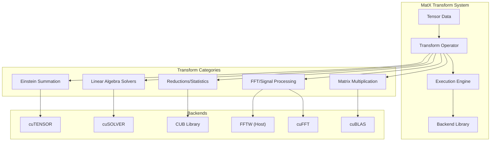
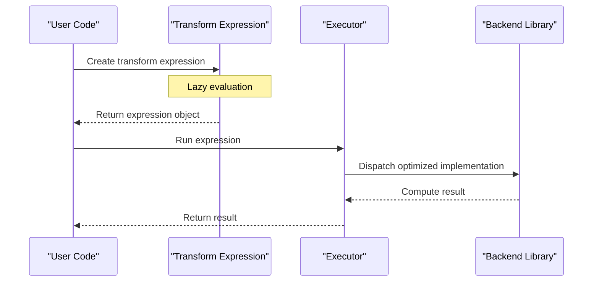
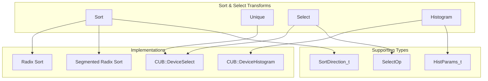
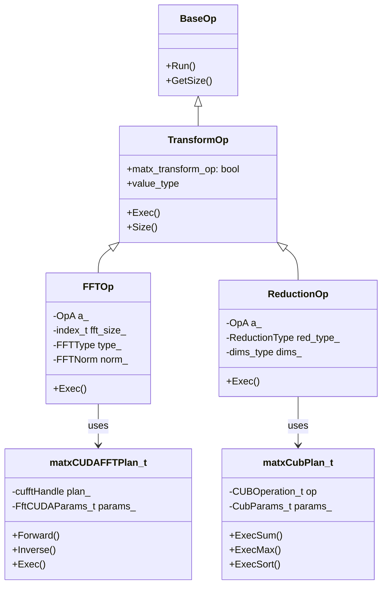
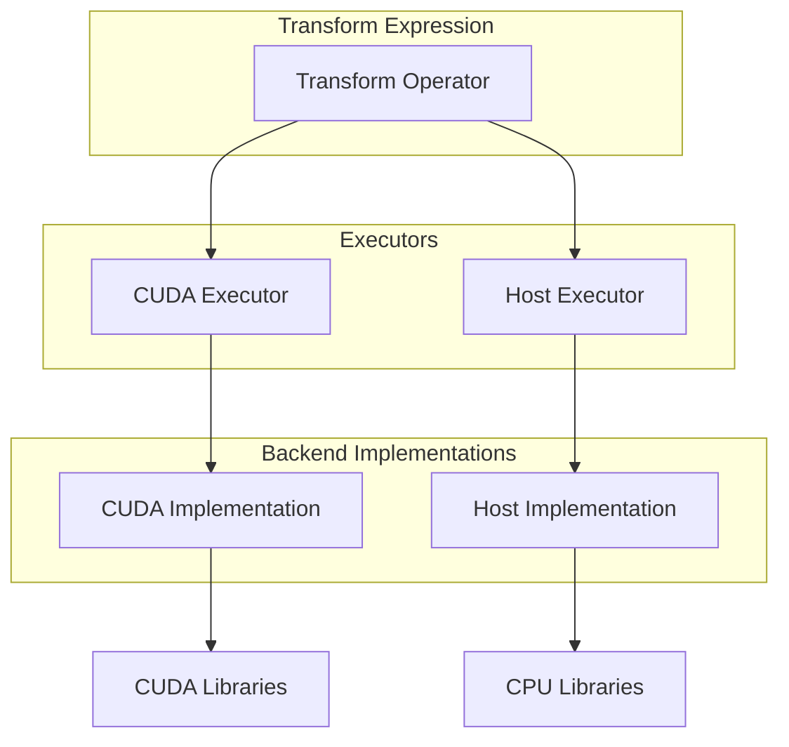

<!-- source: DeepWiki mcp.deepwiki.com · repo NVIDIA/MatX · page 4 Transforms · fetched 2026-10-26 -->

# Transforms

<details>
<summary>Relevant source files</summary>

The following files were used as context for generating this wiki page:

- [include/matx/core/type_utils.h](include/matx/core/type_utils.h)
- [include/matx/operators/fft.h](include/matx/operators/fft.h)
- [include/matx/transforms/cov.h](include/matx/transforms/cov.h)
- [include/matx/transforms/cub.h](include/matx/transforms/cub.h)
- [include/matx/transforms/fft/fft_common.h](include/matx/transforms/fft/fft_common.h)
- [include/matx/transforms/fft/fft_cuda.h](include/matx/transforms/fft/fft_cuda.h)
- [include/matx/transforms/fft/fft_fftw.h](include/matx/transforms/fft/fft_fftw.h)
- [include/matx/transforms/reduce.h](include/matx/transforms/reduce.h)
- [test/00_operators/ReductionTests.cu](test/00_operators/ReductionTests.cu)
- [test/00_tensor/CUBTests.cu](test/00_tensor/CUBTests.cu)
- [test/00_transform/Cov.cu](test/00_transform/Cov.cu)
- [test/00_transform/FFT.cu](test/00_transform/FFT.cu)
- [test/00_transform/MatMul.cu](test/00_transform/MatMul.cu)
- [test/include/utilities.h](test/include/utilities.h)
- [test/test_vectors/generators/00_transforms.py](test/test_vectors/generators/00_transforms.py)

</details>


Transforms in MatX are high-level operations that perform complex computations on tensors, leveraging accelerated backends such as cuBLAS, cuFFT, and CUB. Unlike basic operators that typically work element-wise, transforms implement sophisticated algorithms that often map to specialized hardware-accelerated libraries.

This page describes the fundamental transform operations available in MatX, their interfaces, and how they integrate with the MatX tensor framework. For information about basic operators, see [Operators](#3). For details about the tensor system that transforms operate on, see [Core Tensor System](#2).

## Transform Architecture

Transforms in MatX are implemented as operations that can be applied to tensors through a consistent interface. They are designed to work with MatX's lazy evaluation model, allowing for optimization before execution.



Sources: [include/matx/core/type_utils.h:167-180](include/matx/core/type_utils.h:167-180), [include/matx/operators/fft.h:45-70](include/matx/operators/fft.h:45-70)

## Transform Execution Model



All transforms follow a consistent execution pattern:

1. Create a tensor expression using the transform function
2. Apply the expression to output tensor(s) using the assignment operator
3. Run the expression with a supported executor

Sources: [include/matx/transforms/fft/fft_cuda.h:127-190](include/matx/transforms/fft/fft_cuda.h:127-190), [include/matx/operators/fft.h:148-159](include/matx/operators/fft.h:148-159)

## Matrix Multiplication

Matrix multiplication (matmul) is a fundamental transform that computes the product of two tensors. The implementation leverages cuBLAS for GPU execution.

### Key Features

- Supports both standard matrix multiplication and batched operations
- Handles various tensor ranks (2D through higher dimensions)
- Provides automatic transpose support through `PermuteMatrix()`
- Supports mixed precision (e.g., complex and real type combinations)

### Example Usage

```cpp
tensor_t<float, 2> a({m, k});  // m x k matrix
tensor_t<float, 2> b({k, n});  // k x n matrix
tensor_t<float, 2> c({m, n});  // m x n result

// Perform the GEMM C = A*B
(c = matmul(a, b)).run(exec);

// With transpose: C = A^T * B
auto at = a.PermuteMatrix();
(c = matmul(at, b)).run(exec);

// Batched multiplication
tensor_t<float, 3> a_batch({batches, m, k});
tensor_t<float, 3> b_batch({batches, k, n});
tensor_t<float, 3> c_batch({batches, m, n});

// Perform batched GEMM
(c_batch = matmul(a_batch, b_batch)).run(exec);
```

Sources: [test/00_transform/MatMul.cu:132-134](test/00_transform/MatMul.cu:132-134), [test/00_transform/MatMul.cu:162-165](test/00_transform/MatMul.cu:162-165), [test/00_transform/MatMul.cu:370-388](test/00_transform/MatMul.cu:370-388)

## Reductions

Reduction transforms condense tensor data along one or more dimensions, producing results with fewer dimensions. These operations leverage NVIDIA's CUB library for efficient parallel reduction.

### Common Reduction Operations

| Operation | Description | Example Usage |
|-----------|-------------|---------------|
| `sum` | Sum of elements | `(result = sum(tensor)).run(exec)` |
| `prod` | Product of elements | `(result = prod(tensor)).run(exec)` |
| `min` | Minimum value | `(result = min(tensor)).run(exec)` |
| `max` | Maximum value | `(result = max(tensor)).run(exec)` |
| `mean` | Average value | `(result = mean(tensor)).run(exec)` |
| `var` | Variance | `(result = var(tensor)).run(exec)` |
| `stdd` | Standard deviation | `(result = stdd(tensor)).run(exec)` |
| `all` | True if all elements are true | `(result = all(tensor)).run(exec)` |
| `any` | True if any elements are true | `(result = any(tensor)).run(exec)` |

### Reduction Across Dimensions

Reductions can operate across specific dimensions using the dimension parameter:

```cpp
// Reduce a 4D tensor to a 0D tensor (single value)
(t0 = sum(t4)).run(exec);

// Reduce a 3D tensor into a 2D by taking the sum of the last dimension
(b = sum(a, {2})).run(exec);

// Reduce a 4D tensor to a 1D tensor by reducing dimensions 1, 2, and 3
(t1 = sum(t4, {1, 2, 3})).run(exec);
```

### Index-Returning Reductions

Some reductions, like `argmin` and `argmax`, return both values and indices:

```cpp
// Reduce a 4D tensor into a 2D tensor by collapsing the inner two dimensions
(mtie(t2a, t2ai) = argmax(t4, {0,1})).run(exec);
```

Sources: [test/00_operators/ReductionTests.cu:202-205](test/00_operators/ReductionTests.cu:202-205), [test/00_operators/ReductionTests.cu:223-224](test/00_operators/ReductionTests.cu:223-224), [test/00_operators/ReductionTests.cu:251-252](test/00_operators/ReductionTests.cu:251-252), [test/00_operators/ReductionTests.cu:466-467](test/00_operators/ReductionTests.cu:466-467)

## FFT and Signal Processing

MatX provides comprehensive Fast Fourier Transform capabilities through the `fft` and `ifft` functions. These transforms leverage cuFFT on CUDA devices and FFTW on host executors.

### Key Features

- 1D, 2D, and batch FFT operations
- Real-to-complex and complex-to-complex transforms
- Support for normalization options (forward, backward, orthogonal)
- Multi-dimensional transforms along specified axes

### FFT Example Usage

```cpp
// 1D FFT
tensor_t<complex<float>, 1> av({fft_dim});
tensor_t<complex<float>, 1> avo({fft_dim});
(avo = fft(av)).run(exec);

// 1D FFT with orthogonal normalization (1/sqrt(N))
(avo = fft(av, fft_dim, FFTNorm::ORTHO)).run(exec);

// Batched FFT along specific axis
(out2 = fft(in, {1})).run(exec);

// 1D IFFT
(out1 = ifft(in)).run(exec);
```

### Signal Processing

Other signal processing transforms include:

- Convolution (`conv1d`, `conv2d`)
- Correlation
- Spectral operations

Sources: [test/00_transform/FFT.cu:106-110](test/00_transform/FFT.cu:106-110), [test/00_transform/FFT.cu:137-138](test/00_transform/FFT.cu:137-138), [test/00_transform/FFT.cu:215-216](test/00_transform/FFT.cu:215-216), [test/00_transform/FFT.cu:232-233](test/00_transform/FFT.cu:232-233)

## Statistical Transforms

MatX provides various statistical transforms beyond basic reductions:

### Covariance

Computes the covariance matrix from input data:

```cpp
tensor_t<float, 2> a({rows, cols});
tensor_t<float, 2> c({cols, cols});
(c = cov(a)).run(exec);
```

### Percentile and Statistics

```cpp
// Find the 50th percentile using linear interpolation
(t0 = percentile(data, 50, PercentileMethod::LINEAR)).run(exec);

// Compute variance (unbiased)
(t0 = var(t1)).run(exec);

// Compute standard deviation
(t0 = stdd(t1)).run(exec);

// Compute softmax
(t1_out = softmax(t1)).run(exec);
```

Sources: [test/00_transform/Cov.cu:83-84](test/00_transform/Cov.cu:83-84), [test/00_operators/ReductionTests.cu:139-140](test/00_operators/ReductionTests.cu:139-140), [test/00_operators/ReductionTests.cu:147-148](test/00_operators/ReductionTests.cu:147-148), [test/00_operators/ReductionTests.cu:329-330](test/00_operators/ReductionTests.cu:329-330), [test/00_operators/ReductionTests.cu:719-720](test/00_operators/ReductionTests.cu:719-720)

## Advanced Sort and Select Operations

MatX provides sort and select transforms through the CUB backend:



The transforms include:

- Sorting (`sort`, with direction control)
- Histogram computation
- Selection operations (filtering elements based on criteria)
- Unique element extraction

Sources: [include/matx/transforms/cub.h:57-116](include/matx/transforms/cub.h:57-116), [include/matx/transforms/cub.h:429-545](include/matx/transforms/cub.h:429-545), [test/00_tensor/CUBTests.cu:110-166](test/00_tensor/CUBTests.cu:110-166)

## Transform Implementation Architecture

Transforms in MatX follow a consistent implementation pattern that bridges the gap between the tensor system and backend libraries.



Each transform typically consists of:

1. A high-level operator that provides a clean interface for the user
2. An executor-specific implementation (CUDA or host)
3. A backend plan/handle that interfaces with the underlying library

Sources: [include/matx/operators/fft.h:46-70](include/matx/operators/fft.h:46-70), [include/matx/transforms/fft/fft_cuda.h:92-190](include/matx/transforms/fft/fft_cuda.h:92-190), [include/matx/transforms/cub.h:120-247](include/matx/transforms/cub.h:120-247)

## Operator Type Detection

MatX distinguishes transforms from other operators using type traits system:

```cpp
// Detecting transform operators
template <typename T> constexpr bool is_matx_transform_op()
{
  return detail::is_matx_transform_op_impl<typename remove_cvref<T>::type>::value;
}
```

This allows the library to route operations to the correct backend based on operator type.

Sources: [include/matx/core/type_utils.h:167-190](include/matx/core/type_utils.h:167-190)

## Integration with Executors

Transforms integrate with MatX's executor system to enable both GPU and CPU execution. Each transform implementation provides specialized execution paths for different executor types.



The executor selection determines which backend implementation is used:

- CUDA executor routes to GPU libraries (cuBLAS, cuFFT, CUB)
- Host executor routes to CPU implementations (FFTW, etc.)

Sources: [include/matx/transforms/fft/fft_cuda.h:127-190](include/matx/transforms/fft/fft_cuda.h:127-190), [include/matx/transforms/fft/fft_fftw.h:175-240](include/matx/transforms/fft/fft_fftw.h:175-240), [include/matx/operators/fft.h:148-159](include/matx/operators/fft.h:148-159)

## Performance Considerations

When using transforms, consider the following performance aspects:

- Memory layout affects transform performance (row vs. column major)
- Transforms typically work best on contiguous memory
- Batch operations often offer better performance than multiple individual operations
- Some transforms have size restrictions (power of 2 sizes for FFT, etc.)
- For maximum performance, align tensor sizes to backend requirements

## Summary

MatX transforms provide a powerful set of high-level operations that leverage optimized backend libraries for high-performance tensor computations. The transform system integrates seamlessly with the tensor and operator frameworks, allowing for complex operations to be expressed concisely with a Python-like syntax while achieving near-native GPU performance.

The transforms system provides a comprehensive set of operations ranging from basic statistical reductions to advanced signal processing and linear algebra operations, all with a consistent interface that works across different executor types.

---

