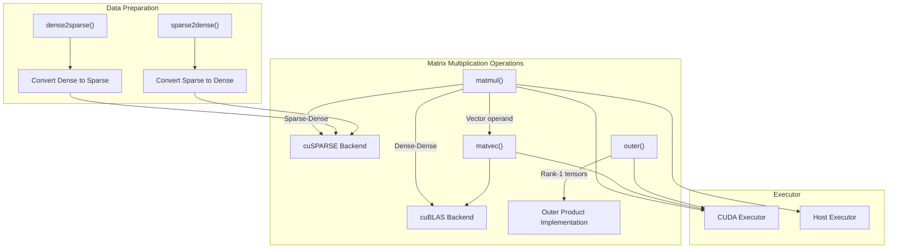
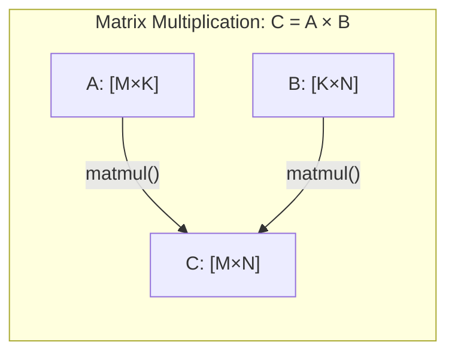
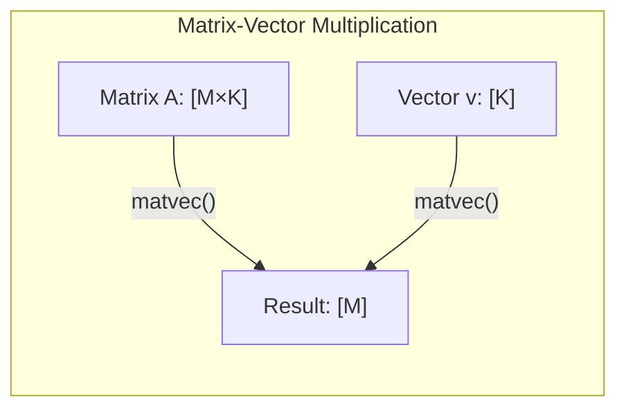
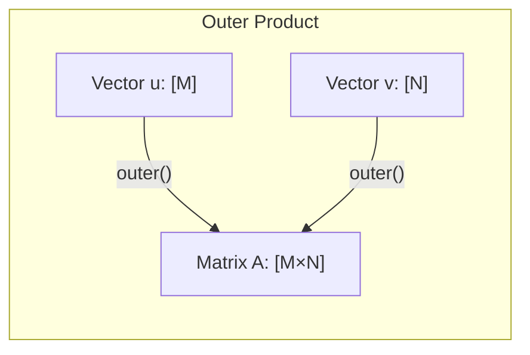
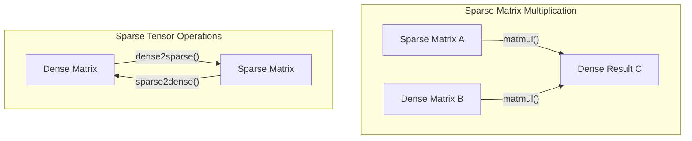
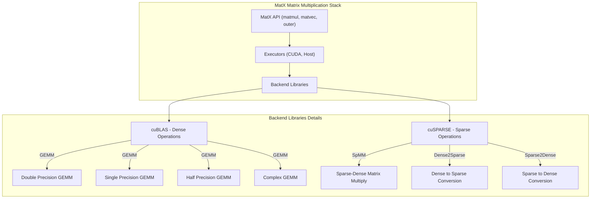

<!-- source: DeepWiki mcp.deepwiki.com · repo NVIDIA/MatX · page 4.1 Matrix Multiplication · fetched 2026-10-26 -->

# Matrix Multiplication

<details>
<summary>Relevant source files</summary>

The following files were used as context for generating this wiki page:

- [include/matx/operators/solve.h](include/matx/operators/solve.h)
- [include/matx/operators/sparse2dense.h](include/matx/operators/sparse2dense.h)
- [include/matx/transforms/convert/dense2sparse_cusparse.h](include/matx/transforms/convert/dense2sparse_cusparse.h)
- [include/matx/transforms/convert/sparse2dense_cusparse.h](include/matx/transforms/convert/sparse2dense_cusparse.h)
- [include/matx/transforms/cov.h](include/matx/transforms/cov.h)
- [include/matx/transforms/matmul/matmul_cusparse.h](include/matx/transforms/matmul/matmul_cusparse.h)
- [include/matx/transforms/solve/solve_cudss.h](include/matx/transforms/solve/solve_cudss.h)
- [test/00_transform/Cov.cu](test/00_transform/Cov.cu)
- [test/00_transform/MatMul.cu](test/00_transform/MatMul.cu)
- [test/include/utilities.h](test/include/utilities.h)
- [test/test_vectors/generators/00_transforms.py](test/test_vectors/generators/00_transforms.py)

</details>


This page documents the matrix multiplication operations in MatX, including dense and sparse matrix multiplication, matrix-vector multiplication, and outer products. Matrix multiplication is a core operation in many numerical algorithms and machine learning applications, providing efficient tensor contraction capabilities across various tensor shapes and sizes.

For related linear algebra transforms, see [Linear Algebra Solvers](#4.4) and for tensor contraction operations, see [Einstein Summation (einsum)](#4.5).

## Overview

MatX provides a high-performance implementation of matrix multiplication operations that closely resembles NumPy's syntax while leveraging GPU acceleration. The implementation supports:

- Dense matrix-matrix multiplication via cuBLAS
- Sparse matrix multiplication via cuSPARSE
- Matrix-vector multiplication as an optimized special case
- Outer products
- Batched operations across multiple dimensions
- Automatic handling of transposed operands



Sources:
- [test/00_transform/MatMul.cu:132-134]()
- [test/00_transform/MatMul.cu:163-165]()
- [test/00_transform/MatMul.cu:194-196]()
- [test/00_transform/MatMul.cu:387-388]()
- [test/00_transform/MatMul.cu:889-890]()
- [test/00_transform/MatMul.cu:1036-1037]()
- [include/matx/transforms/matmul/matmul_cusparse.h:274-285]()

## Basic Usage

The most basic form of matrix multiplication in MatX is performed using the `matmul()` function, which multiplies two tensors and produces a result with appropriate dimensions:



### Dense Matrix Multiplication

For dense matrix multiplication, the syntax is straightforward:

```cpp
// Create tensors
tensor_t<float, 2> a{{m, k}};  // m×k matrix
tensor_t<float, 2> b{{k, n}};  // k×n matrix
tensor_t<float, 2> c{{m, n}};  // m×n result matrix

// Perform the multiplication
(c = matmul(a, b)).run(exec);
```

The dimensions must satisfy the following requirements:
- For 2D matrices: if A is m×k and B is k×n, then the result C is m×n
- The inner dimensions must match (k in the example above)

Sources:
- [test/00_transform/MatMul.cu:121-134]()

### Matrix Multiplication with Transposition

MatX supports matrix multiplication with transposed operands:

```cpp
// Transposed A: C = A^T × B
auto at = a.PermuteMatrix();
(c = matmul(at, b)).run(exec);

// Transposed B: C = A × B^T
auto bt = b.PermuteMatrix();
(c = matmul(a, bt)).run(exec);
```

The `PermuteMatrix()` method is a convenience function that creates a transposed view of the matrix without copying the data.

Sources:
- [test/00_transform/MatMul.cu:152-166]()
- [test/00_transform/MatMul.cu:182-196]()

## Batched Operations

MatX efficiently handles batched matrix multiplication operations across multiple dimensions.

### Basic Batched Matrix Multiplication

For batched matrix multiplication, tensors with higher dimensions are used:

```cpp
// Create batched tensors
tensor_t<float, 3> a{{batches, m, k}};  // batches×m×k tensor
tensor_t<float, 3> b{{batches, k, n}};  // batches×k×n tensor
tensor_t<float, 3> c{{batches, m, n}};  // batches×m×n result tensor

// Perform batched matrix multiplication
(c = matmul(a, b)).run(exec);
```

This performs `batches` separate matrix multiplications, with each slice of A and B multiplied independently.

Sources:
- [test/00_transform/MatMul.cu:371-388]()

### N-Dimensional Batched Matrix Multiplication

Matrix multiplication can be batched across multiple dimensions:

```cpp
// Create tensors with multiple batch dimensions
auto a = make_tensor<float>({3, 4, 5, 128, 256});  // 3×4×5 batches of 128×256 matrices
auto b = make_tensor<float>({3, 4, 5, 256, 512});  // 3×4×5 batches of 256×512 matrices
auto c = make_tensor<float>({3, 4, 5, 128, 512});  // 3×4×5 batches of 128×512 result matrices

// Perform N-dimensional batched matrix multiplication
(c = matmul(a, b)).run(exec);
```

MatX automatically handles the broadcasting and batching across all dimensions except the last two, which are treated as the matrix dimensions.

Sources:
- [test/00_transform/MatMul.cu:565-576]()
- [test/00_transform/MatMul.cu:591-617]()

### Strided Batched Matrix Multiplication

MatX also supports strided batch operations, which allow operating on a subset of batches:

```cpp
// Create regular batched tensors
tensor_t<float, 3> a{{batches, m, k}};
tensor_t<float, 3> b{{batches, k, n}};

// Create strided views of the tensors
auto as = slice(a, {0, 0, 0}, {matxEnd, matxEnd, matxEnd}, {2, 1, 1});
auto bs = slice(b, {0, 0, 0}, {matxEnd, matxEnd, matxEnd}, {2, 1, 1});
tensor_t<float, 3> cs{{batches/2, m, n}};

// Perform strided batched matrix multiplication
(cs = matmul(as, bs)).run(exec);
```

This performs matrix multiplication on every other batch in the original tensors.

Sources:
- [test/00_transform/MatMul.cu:492-514]()

## Matrix-Vector Multiplication

As a special case of matrix multiplication, MatX provides the `matvec()` function for efficient matrix-vector operations:



The `matvec()` function is optimized for the case where the second operand is a vector:

```cpp
// Matrix-vector multiplication
tensor_t<float, 2> a{{m, k}};  // m×k matrix
tensor_t<float, 1> b{{k}};     // k-element vector
tensor_t<float, 1> c{{m}};     // m-element result vector

// Perform matrix-vector multiplication
(c = matvec(a, b)).run(exec);
```

Matrix-vector multiplication also supports batching across any number of dimensions.

Sources:
- [test/00_transform/MatMul.cu:886-890]()
- [test/00_transform/MatMul.cu:901-907]()
- [test/00_transform/MatMul.cu:913-927]()

## Outer Product

MatX also supports outer product operations through the `outer()` function:



The outer product of two vectors produces a matrix:

```cpp
// Outer product of two vectors
tensor_t<float, 1> a{{m}};  // m-element vector
tensor_t<float, 1> b{{n}};  // n-element vector
tensor_t<float, 2> c{{m, n}};  // m×n result matrix

// Perform outer product
(c = outer(a, b)).run(exec);
```

Outer products can also be batched across multiple dimensions.

Sources:
- [test/00_transform/MatMul.cu:1026-1037]()
- [test/00_transform/MatMul.cu:1042-1051]()

## Sparse Matrix Multiplication

MatX supports sparse matrix operations through integration with cuSPARSE. The sparse matrix multiplication is performed using the same `matmul()` function, but with a sparse tensor as one of the operands:



### Dense to Sparse Conversion

To convert a dense tensor to a sparse format:

```cpp
// Create a dense tensor
tensor_t<float, 2> a{{m, n}};

// Create a sparse tensor (in CSR format)
sparse_tensor_t<float, int32_t, int32_t, 2, detail::CSRFormat> a_sparse({m, n});

// Convert dense to sparse
dense2sparse_impl(a_sparse, a, exec);
```

### Sparse Matrix Multiplication

Once you have a sparse tensor, you can use it in matrix multiplication:

```cpp
// Create a sparse matrix A (in CSR format)
sparse_tensor_t<float, int32_t, int32_t, 2, detail::CSRFormat> a_sparse({m, k});

// Create a dense matrix B
tensor_t<float, 2> b{{k, n}};

// Create the result matrix C
tensor_t<float, 2> c{{m, n}};

// Perform sparse-dense matrix multiplication
sparse_matmul_impl(c, a_sparse, b, exec);
```

Note that MatX currently only supports certain sparse formats and data types for sparse matrix operations, with CSR, CSC, and COO formats being the primary supported formats.

Sources:
- [include/matx/transforms/matmul/matmul_cusparse.h:274-334]()
- [include/matx/transforms/convert/dense2sparse_cusparse.h:270-314]()
- [include/matx/transforms/convert/sparse2dense_cusparse.h:223-270]()

## Advanced Features

### Axis-Specified Matrix Multiplication

MatX allows specifying which dimensions to use for matrix multiplication through the optional `axis` parameter:

```cpp
// Create tensors
tensor_t<float, 3> a{{b, m, k}};
tensor_t<float, 3> b{{b, k, n}};
tensor_t<float, 3> c{{b, m, n}};

// Perform matrix multiplication on dimensions 1 and 2
const int axis[2] = {1, 2};
(c = matmul(a, b, axis)).run(exec);

// Transpose inner dimensions for multiplication
const int axis_transposed[2] = {2, 1};
tensor_t<float, 3> a_transposed{{b, k, m}};
tensor_t<float, 3> b_transposed{{b, n, k}};
tensor_t<float, 3> c_transposed{{b, n, m}};
(c_transposed = matmul(a_transposed, b_transposed, axis_transposed)).run(exec);
```

This allows for flexible tensor contraction along specified dimensions.

Sources:
- [test/00_transform/MatMul.cu:652-674]()
- [test/00_transform/MatMul.cu:677-696]()

### Broadcasting in Matrix Multiplication

MatX supports broadcasting in matrix multiplication, allowing a smaller tensor to be "broadcasted" to match the shape of a larger tensor:

```cpp
// Create a 2D identity matrix
tensor_t<float, 2> eye2{{n, n}};
(eye2 = 2.0f*eye<float>({n, n})).run(exec);

// Create a 5D tensor
tensor_t<float, 5> a5{{x, y, b, n, n}};
tensor_t<float, 5> c5{{x, y, b, n, n}};

// Broadcast eye2 across the batch dimensions of a5
(c5 = matmul(eye2, a5)).run(exec);
```

This performs matrix multiplication between the 2D identity matrix and each n×n slice of the 5D tensor, effectively scaling each value by the corresponding value in the identity matrix.

Sources:
- [test/00_transform/MatMul.cu:823-844]()

## Implementation Details

### Backend Integration

MatX's matrix multiplication operations are implemented using NVIDIA's highly optimized libraries:



- **Dense Matrix Operations**: Implemented using cuBLAS, which provides highly optimized GEMM (General Matrix Multiply) operations for various data types
- **Sparse Matrix Operations**: Implemented using cuSPARSE, which provides efficient sparse matrix operations

### Caching Mechanism

To improve performance, MatX employs a caching mechanism that reuses plans for matrix operations with the same parameters:

1. When a matrix multiplication is requested, MatX computes a hash of the operation parameters
2. It checks if a plan with matching parameters exists in the cache
3. If found, the cached plan is used; otherwise, a new plan is created and cached
4. This significantly reduces overhead for repeated operations with the same shapes

Sources:
- [include/matx/transforms/matmul/matmul_cusparse.h:218-254]()
- [include/matx/transforms/convert/dense2sparse_cusparse.h:229-254]()
- [include/matx/transforms/convert/sparse2dense_cusparse.h:182-207]()

## Performance Considerations

For optimal matrix multiplication performance in MatX, consider the following:

1. **Data Layout**: The innermost dimension should have contiguous memory (stride 1) for best performance
2. **Batch Size**: Larger batch sizes generally provide better performance due to increased parallelism
3. **Data Types**: Lower precision types (half, bfloat16) can provide faster computation on supported hardware
4. **Transposition**: Avoid unnecessary transpositions, as they can introduce additional memory operations
5. **Memory Allocation**: Pre-allocate output tensors when possible to avoid allocation overhead during computation

The following operations might impact performance:
- Multiple small matrix multiplications (consider batching)
- Frequent conversions between sparse and dense formats
- Operations requiring tensor reshaping or permutation

Sources:
- [include/matx/transforms/matmul/matmul_cusparse.h:255-267]()
- [include/matx/transforms/convert/dense2sparse_cusparse.h:255-265]()
- [include/matx/transforms/convert/sparse2dense_cusparse.h:209-219]()

## Related Operations

Matrix multiplication is closely related to other operations in MatX:

1. **Covariance Matrix Calculation**: Uses matrix multiplication internally (see `cov()` function)
2. **Linear System Solving**: For systems of linear equations (see `solve()` function)
3. **Einstein Summation**: For more general tensor contractions (see `einsum()` function)

Sources:
- [include/matx/transforms/cov.h:151-153]()
- [include/matx/operators/solve.h:95-96]()

---

