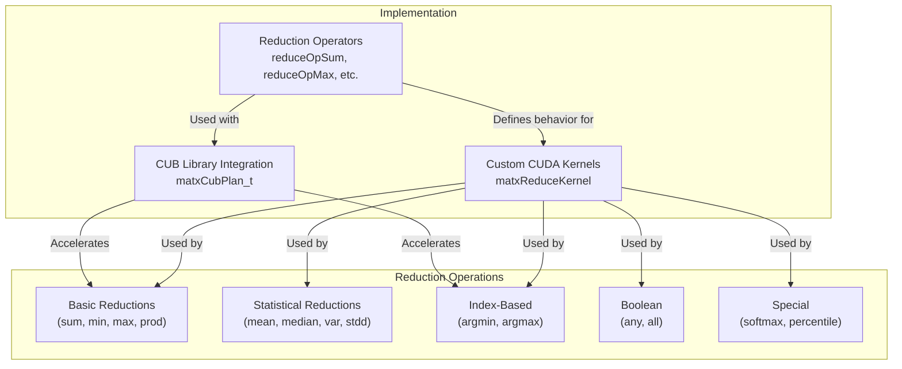
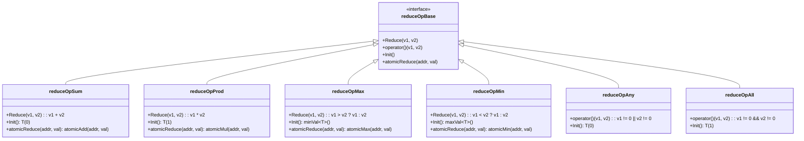
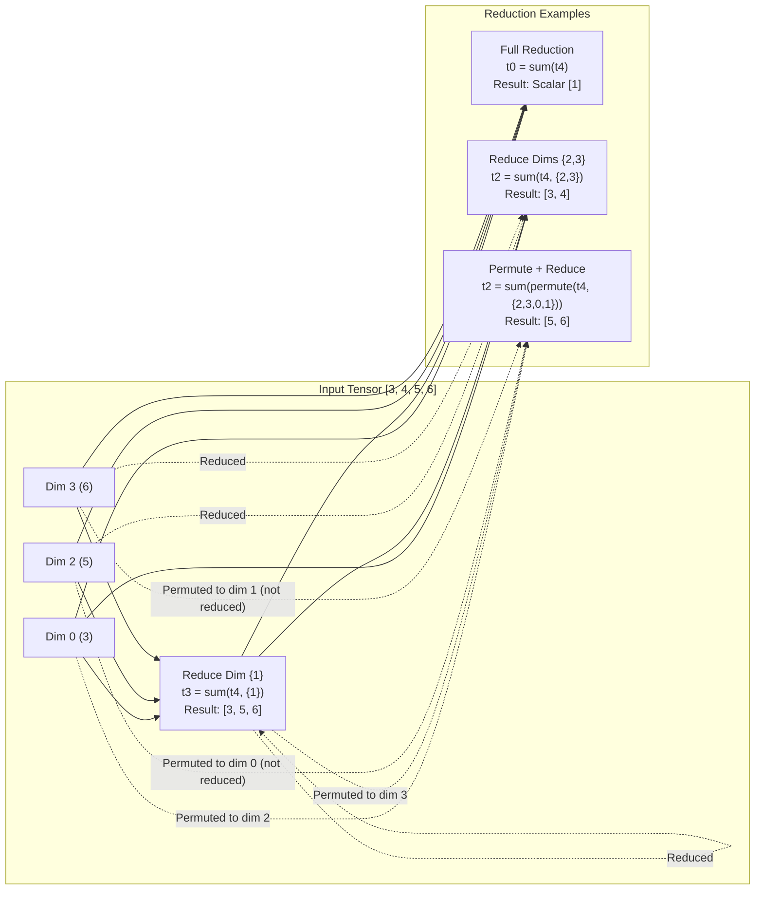
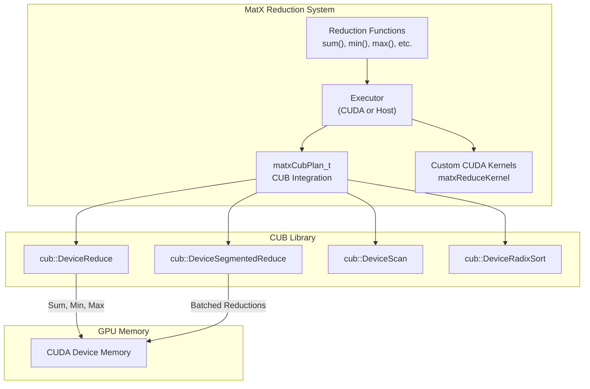

<!-- source: DeepWiki mcp.deepwiki.com · repo NVIDIA/MatX · page 4.2 Reductions · fetched 2026-10-26 -->

# Reductions

<details>
<summary>Relevant source files</summary>

The following files were used as context for generating this wiki page:

- [include/matx/core/type_utils.h](include/matx/core/type_utils.h)
- [include/matx/transforms/cub.h](include/matx/transforms/cub.h)
- [include/matx/transforms/reduce.h](include/matx/transforms/reduce.h)
- [test/00_operators/ReductionTests.cu](test/00_operators/ReductionTests.cu)
- [test/00_tensor/CUBTests.cu](test/00_tensor/CUBTests.cu)

</details>


Reductions in MatX are operations that compress tensor data along one or more dimensions. The MatX library provides a wide range of reduction operations that can be performed efficiently on NVIDIA GPUs using both custom CUDA kernels and NVIDIA's CUB library. These operations include common mathematical reductions (sum, min, max), statistical functions (mean, median, variance), and specialized operations for machine learning applications (softmax).

## Architecture Overview



Sources: [include/matx/transforms/cub.h:120-131](). [include/matx/transforms/reduce.h:736-797]().

The reduction system in MatX is built upon two main implementation mechanisms:

1. **CUB Integration**: For highly optimized performance, MatX integrates with NVIDIA's CUB library for operations like sum, min, max, and sorted reductions.

2. **Custom CUDA Kernels**: For more complex reductions or those not available in CUB, MatX provides custom kernels with optimizations such as warp-level reductions.

This dual approach ensures both performance and flexibility across the wide range of reduction operations.

## Core Reduction Operators

At the heart of MatX reductions are the reduction operator classes that define the behavior of each reduction type:



Sources: [include/matx/transforms/reduce.h:736-828]().

These operators define:

- The operation to apply when combining two elements
- The initial value for the reduction
- How to perform atomic operations for parallel reductions

## Basic Reduction Operations

### Sum, Min, Max, Product

These are the fundamental reduction operations that work on numeric tensors:

#### Sum

The `sum` operation adds all elements along specified dimensions:

```cpp
// Reduce a 4D tensor into a 0D by taking the sum of all elements
(t0 = sum(t4)).run(exec);

// Reduce a 3D tensor into a 2D by taking the sum of the last dimension
(b = sum(a, {2})).run(exec);
```

Sources: [test/00_operators/ReductionTests.cu:201-206](). [test/00_operators/ReductionTests.cu:184-204]().

#### Min/Max

The `min` and `max` operations find the minimum and maximum values along specified dimensions:

```cpp
// Reduce all inputs in "t1o" into "t0" by the minimum of all elements
(t0 = min(t1o)).run(exec);

// Reduce all inputs in "t1o" into "t0" by the maximum of all elements
(t0 = max(t1o)).run(exec);

// Reduce a 4D tensor into a 2D tensor by collapsing the inner two dimensions
(t2a = max(permute(t4,{2,3,0,1}))).run(exec);
(t2b = max(t4, {0,1})).run(exec);
```

Sources: [test/00_operators/ReductionTests.cu:897-899](). [test/00_operators/ReductionTests.cu:870-874](). [test/00_operators/ReductionTests.cu:428-432]().

#### Product

The `prod` operation multiplies all elements along specified dimensions (not shown in the code examples, but follows the same pattern as other reductions).

### Statistical Reductions

MatX provides several statistical reductions for data analysis:

#### Mean

Calculates the arithmetic mean along specified dimensions:

```cpp
// Compute the mean over all dimensions in "t4" and store the result in "t0"
(t0 = mean(t4)).run(exec);
```

Sources: [test/00_operators/ReductionTests.cu:1155-1159]().

#### Variance and Standard Deviation

Calculate the variance and standard deviation along specified dimensions:

```cpp
// Calculate unbiased variance
(t0 = var(t1)).run(exec);

// Calculate maximum likelihood variance
(t0 = var(t1, 0)).run(exec);

// Calculate standard deviation
(t0 = stdd(t1)).run(exec);
```

Sources: [test/00_operators/ReductionTests.cu:138-148]().

#### Median

Calculates the median value along specified dimensions:

```cpp
// Compute media over all elements in "t1e" and store result in "t0"
(t0 = median(t1e)).run(exec);
```

Sources: [test/00_operators/ReductionTests.cu:796-798]().

#### Percentile

Calculates the p-th percentile along specified dimensions with different interpolation methods:

```cpp
// Find the 50th percentile value in `t1e` using linear interpolation between midpoints
(t0 = percentile(t1e, 50, PercentileMethod::LINEAR)).run(exec);
```

Sources: [test/00_operators/ReductionTests.cu:718-720]().

## Index-Based Reductions

MatX also provides index-based reductions that return both the reduced values and the corresponding indices:

### argmin and argmax

Find the minimum or maximum values and their indices:

```cpp
// Find minimum value and its index
(mtie(t0, t0i) = argmin(t1o)).run(exec);

// Find maximum value and its index
(mtie(t0, t0i) = argmax(t1o)).run(exec);

// Reduce a 4D tensor into a 2D tensor by collapsing the inner two dimensions
(mtie(t2a, t2ai) = argmax(permute(t4,{2,3,0,1}))).run(exec);
(mtie(t2b, t2bi) = argmax(t4, {0,1})).run(exec);
```

Sources: [test/00_operators/ReductionTests.cu:992-995](). [test/00_operators/ReductionTests.cu:923-924](). [test/00_operators/ReductionTests.cu:466-468]().

### argminmax

Find both minimum and maximum values and their indices in a single operation:

```cpp
// Find both minimum and maximum values and their indices
(mtie(t0min, t0mini, t0max, t0maxi) = argminmax(t1o)).run(exec);

// For higher-dimensional tensors with dimension reduction
(matx::mtie(t_c, t_ci, t_b, t_bi) = matx::argminmax(t_a, {1,2})).run(exec);
```

Sources: [test/00_operators/ReductionTests.cu:1066-1068](). [test/00_operators/ReductionTests.cu:1126-1128]().

## Boolean Reductions

These reductions operate on boolean conditions across the tensor:

### any and all

Determine if any or all elements satisfy a condition:

```cpp
// Reduce a 4D tensor into a single output (0D) tensor indicating whether any values were 
// convertible to "true"
(t0 = any(t4)).run(exec);

// Reduce a 4D tensor into a 0D tensor where the 0D is "true" if all values in "t4"
// convert to "true", or "false" otherwise
(t0 = all(t4)).run(exec);

// Reduce a 4D tensor into a 2D tensor by collapsing the inner two dimensions
(t2a = any(permute(t4,{2,3,0,1}))).run(exec);
(t2b = any(t4, {0,1})).run(exec);
```

Sources: [test/00_operators/ReductionTests.cu:595-597](). [test/00_operators/ReductionTests.cu:675-677](). [test/00_operators/ReductionTests.cu:506-508]().

### allclose

Check if two tensors are element-wise close within a tolerance:

```cpp
// Check if tensors A and B are element-wise close within specified tolerances
auto A = make_tensor<TestType>({5, 5, 5});
auto B = make_tensor<TestType>({5, 5, 5});
auto C = make_tensor<int>({});

(A = ones<TestType>(A.Shape())).run(exec);
(B = ones<TestType>(B.Shape())).run(exec);
allclose(C, A, B, 1e-5, 1e-8, exec);
```

Sources: [test/00_operators/ReductionTests.cu:626-633]().

## Special Reductions

### Softmax

Calculate the softmax function along specified dimensions:

```cpp
// Apply softmax on a 1D tensor
(t1_out = softmax(t1)).run(exec);

// Apply softmax on a 3D tensor along dimension 2
(t3_out = softmax(t3, {2})).run(exec);
```

Sources: [test/00_operators/ReductionTests.cu:329-330](). [test/00_operators/ReductionTests.cu:338-339]().

## Reduction Dimensions

A key feature of MatX reductions is the ability to specify which dimensions to reduce over:



Sources: [test/00_operators/ReductionTests.cu:225-224](). [test/00_operators/ReductionTests.cu:287-304](). [test/00_operators/ReductionTests.cu:251-279](). [test/00_operators/ReductionTests.cu:363-389]().

The reduction dimensions parameter allows flexible control over which dimensions to collapse:

1. **Full Reduction**: When no dimensions are specified, the reduction is applied across all dimensions, resulting in a scalar (0D tensor).

2. **Dimension-Specific Reduction**: When specific dimensions are provided, only those dimensions are reduced. The result tensor has those dimensions removed.

3. **Permute + Reduce**: Dimensions can be permuted before reduction, allowing for complex reduction patterns.

## Implementation Details

### CUB Integration for Performance

MatX uses NVIDIA's CUB library for high-performance reductions on GPUs:



Sources: [include/matx/transforms/cub.h:120-197](). [include/matx/transforms/cub.h:765-845]().

The CUB integration provides:

1. **Optimized Algorithms**: CUB contains highly optimized algorithms for common reduction operations
2. **Memory Management**: Automatic temporary workspace allocation
3. **Batched Processing**: Efficient handling of higher-dimensional reductions through batching

The `matxCubPlan_t` class handles the CUB integration, preparing the input data and launching the appropriate CUB functions:

```cpp
// Inside matxCubPlan_t, CUB operations are launched for various reduction types
// For sum:
cub::DeviceReduce::Sum(d_temp, temp_storage_bytes, in, out, 
                       static_cast<int>(TotalSize(in_base)), stream);

// For segmented reductions:
cub::DeviceSegmentedReduce::Sum(d_temp, temp_storage_bytes, in, out, 
                               static_cast<int>(TotalSize(out_base)), begin, end, stream);
```

Sources: [include/matx/transforms/cub.h:787-792]().

### Custom CUDA Kernels

For operations not covered by CUB or requiring special handling, MatX provides custom CUDA kernels:

- Warp-level and block-level reduction techniques for efficiency
- Support for complex data types
- Specialized operations like percentile and softmax

The main reduction kernel (`matxReduceKernel`) handles different tensor ranks and data types, using shared memory and warp-level reductions for performance:

```cpp
template <typename OutType, typename InType, typename ReduceOp>
__global__ void matxReduceKernel(OutType dest, const InType in, 
                                ReduceOp red, [[maybe_unused]] index_t mult)
```

Sources: [include/matx/transforms/reduce.h:1033-1036]().

## Type System for Reductions

MatX uses type traits to define reduction behavior and optimize implementation:

```cpp
// Check if a type is a reduction operator
template <typename T>
inline constexpr bool is_matx_reduction_v = detail::is_matx_reduction_impl<T>::value;

// Check if a type supports index-based reductions like argmin/argmax
template <typename T>
inline constexpr bool is_matx_index_reduction_v = detail::is_matx_idx_reduction_impl<T>::value;

// Check if a type shouldn't use CUB for reductions
template <typename T>
inline constexpr bool is_matx_no_cub_reduction_v = detail::is_matx_no_cub_reduction_impl<T>::value;
```

Sources: [include/matx/core/type_utils.h:371-409]().

These type traits enable:

1. **Compile-time Selection**: Choose between CUB or custom kernels
2. **Specialized Code Paths**: Optimize for different data types
3. **Type Safety**: Ensure reductions are used with compatible types

## Summary

MatX provides a comprehensive set of reduction operations with a flexible and high-performance implementation. The library supports:

- Basic mathematical reductions (sum, min, max, product)
- Statistical reductions (mean, median, variance, standard deviation, percentile)
- Index-based reductions (argmin, argmax, argminmax)
- Boolean reductions (any, all, allclose)
- Special reductions (softmax)

Reductions can be performed across all dimensions or specific dimensions, with support for permuting dimensions before reduction. The implementation leverages both NVIDIA's CUB library and custom CUDA kernels for optimal performance across different reduction types and data types.

---

