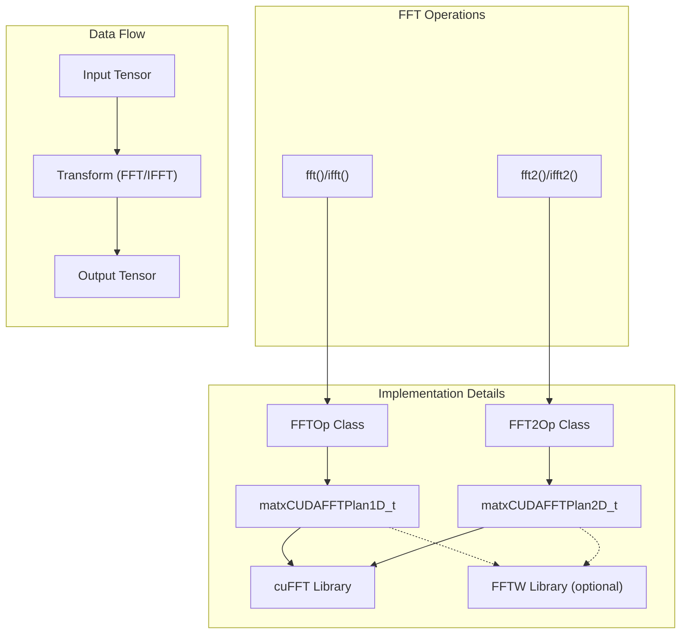
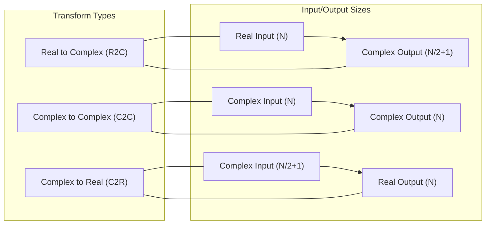
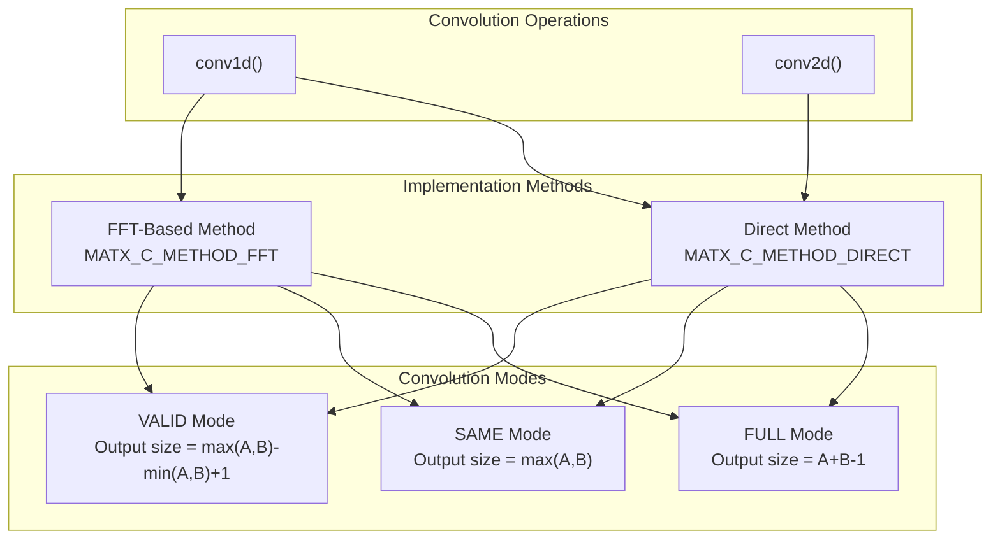
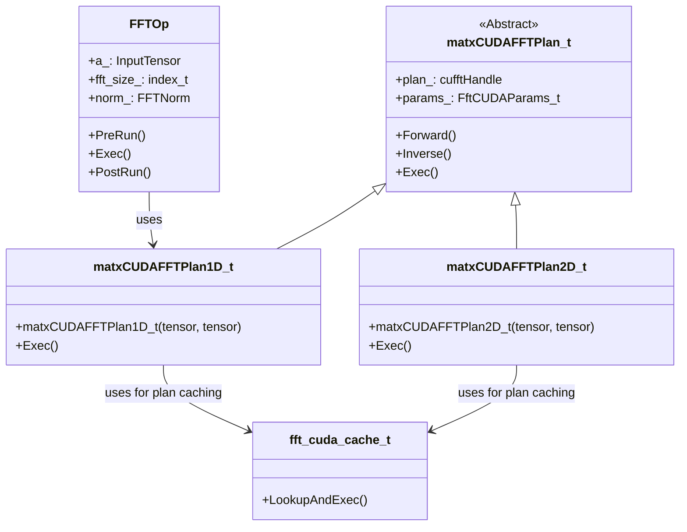
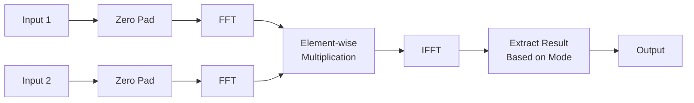

<!-- source: DeepWiki mcp.deepwiki.com · repo NVIDIA/MatX · page 4.3 FFT and Signal Processing · fetched 2026-10-26 -->

# FFT and Signal Processing

<details>
<summary>Relevant source files</summary>

The following files were used as context for generating this wiki page:

- [bench/00_transform/matmul.cu](bench/00_transform/matmul.cu)
- [examples/conv2d.cu](examples/conv2d.cu)
- [include/matx/core/utils.h](include/matx/core/utils.h)
- [include/matx/kernels/conv.cuh](include/matx/kernels/conv.cuh)
- [include/matx/operators/conv.h](include/matx/operators/conv.h)
- [include/matx/operators/corr.h](include/matx/operators/corr.h)
- [include/matx/operators/fft.h](include/matx/operators/fft.h)
- [include/matx/operators/filter.h](include/matx/operators/filter.h)
- [include/matx/transforms/conv.h](include/matx/transforms/conv.h)
- [include/matx/transforms/corr.h](include/matx/transforms/corr.h)
- [include/matx/transforms/fft/fft_common.h](include/matx/transforms/fft/fft_common.h)
- [include/matx/transforms/fft/fft_cuda.h](include/matx/transforms/fft/fft_cuda.h)
- [include/matx/transforms/fft/fft_fftw.h](include/matx/transforms/fft/fft_fftw.h)
- [include/matx/transforms/filter.h](include/matx/transforms/filter.h)
- [test/00_transform/ConvCorr.cu](test/00_transform/ConvCorr.cu)
- [test/00_transform/FFT.cu](test/00_transform/FFT.cu)

</details>


This document describes MatX's Fast Fourier Transform (FFT) and signal processing capabilities, including convolution, correlation, and filtering operations. These features are built on NVIDIA's high-performance libraries like cuFFT and provide a Python-like syntax for common signal processing tasks while achieving near-native GPU performance.

## Core FFT Functionality

MatX provides comprehensive FFT capabilities through a set of intuitive functions that wrap NVIDIA's cuFFT library. Both one-dimensional and two-dimensional transforms are supported with various configuration options.



Sources: [include/matx/operators/fft.h:217-221](include/matx/operators/fft.h:217-221), [include/matx/transforms/fft/fft_cuda.h:359-470](include/matx/transforms/fft/fft_cuda.h:359-470)

### One-Dimensional FFT

MatX provides simple functions for performing 1D FFTs on tensors:

- `fft()`: Performs forward FFT
- `ifft()`: Performs inverse FFT

Each function supports different normalization modes:
- `FFTNorm::BACKWARD`: Forward FFT is unscaled, inverse FFT is scaled by 1/N (default)
- `FFTNorm::FORWARD`: Forward FFT is scaled by 1/N, inverse FFT is unscaled
- `FFTNorm::ORTHO`: Both forward and inverse FFTs are scaled by 1/sqrt(N)

```cpp
// Perform a 1D FFT from input av into output avo
(avo = fft(av)).run(exec);

// Perform a 1D FFT with FORWARD scaling (1/N)
(avo = fft(av, fft_dim, FFTNorm::FORWARD)).run(exec);

// Perform a 1D IFFT with ORTHO scaling (1/sqrt(N))
(avo = ifft(av, fft_dim, FFTNorm::ORTHO)).run(exec);
```

You can also specify the transform size to perform zero-padding or truncation:

```cpp
// Specify the FFT size as bigger than av (zero-padding)
(avo = fft(av, fft_dim * 2)).run(exec);
```

Sources: [test/00_transform/FFT.cu:106-110](test/00_transform/FFT.cu:106-110), [test/00_transform/FFT.cu:137-138](test/00_transform/FFT.cu:137-138), [test/00_transform/FFT.cu:165-166](test/00_transform/FFT.cu:165-166), [test/00_transform/FFT.cu:543-544](test/00_transform/FFT.cu:543-544)

### Multi-Dimensional FFT

MatX supports FFTs along any axis of a tensor:

```cpp
// Perform a batched 1D FFT on a 3D tensor across axis 2
(out1 = fft(in)).run(exec);
(out2 = fft(in, {2})).run(exec);

// Perform a batched 1D FFT on a 3D tensor across axis 1
(out1.Permute({0,2,1}) = fft(in.Permute({0,2,1}))).run(exec);
(out2 = fft(in, {1})).run(exec);
```

For 2D FFTs, the library provides dedicated functions:

```cpp
// Perform a 2D FFT from 3D tensor "in" into "out1"
(out1 = fft2(in)).run(exec);
(out2 = fft2(in, {1,2})).run(exec);

// Perform a 2D FFT across dimensions 2, 0
(out1.Permute({1,2,0}) = fft2(in.Permute({1,2,0}))).run(exec);
(out2 = fft2(in, {2,0})).run(exec);
```

Sources: [test/00_transform/FFT.cu:198-199](test/00_transform/FFT.cu:198-199), [test/00_transform/FFT.cu:215-216](test/00_transform/FFT.cu:215-216), [test/00_transform/FFT.cu:317-318](test/00_transform/FFT.cu:317-318), [test/00_transform/FFT.cu:333-334](test/00_transform/FFT.cu:333-334)

### Real and Complex Transforms

MatX supports both complex-to-complex (C2C) and real-to-complex (R2C) transforms. When performing an FFT on real data, the output is a complex tensor with size N/2+1 (for a length-N input) due to symmetry properties:



Sources: [include/matx/transforms/fft/fft_common.h:84-156](include/matx/transforms/fft/fft_common.h:84-156), [include/matx/operators/fft.h:84-113](include/matx/operators/fft.h:84-113)

## Signal Processing Operations

MatX provides several signal processing operations built on top of the FFT functionality.

### Convolution

The library supports both 1D and 2D convolution with multiple implementation methods:



#### 1D Convolution

```cpp
// 1D convolution in FULL mode
(cv = conv1d(av, bv, MATX_C_MODE_FULL)).run(exec);

// 1D convolution in SAME mode with FFT method
(cv_same = conv1d(av, bv_odd, MATX_C_MODE_SAME, MATX_C_METHOD_FFT)).run(exec);
```

The FFT-based method is automatically used for larger filter sizes, while the direct method is used for smaller filters for better performance.

Sources: [test/00_transform/ConvCorr.cu:247-248](test/00_transform/ConvCorr.cu:247-248), [test/00_transform/ConvCorr.cu:472-473](test/00_transform/ConvCorr.cu:472-473)

#### 2D Convolution

```cpp
// 2D convolution in SAME mode
(cv_same = conv2d(av, bv_even, MATX_C_MODE_SAME)).run(exec);
```

Sources: [test/00_transform/ConvCorr.cu:357-358](test/00_transform/ConvCorr.cu:357-358)

### Correlation

Correlation is similar to convolution but without flipping the kernel. MatX implements correlation using convolution with a reversed kernel:

```cpp
// Correlation using FULL mode
(cv = corr(av, bv, MATX_C_MODE_FULL)).run(exec);
```

Behind the scenes, correlation is implemented by taking the complex conjugate and reversing one of the inputs before passing to the convolution function.

Sources: [include/matx/transforms/corr.h:61-70](include/matx/transforms/corr.h:61-70)

### Filtering

MatX supports both Finite Impulse Response (FIR) and Infinite Impulse Response (IIR) filters:

```cpp
// FIR filter with non-recursive coefficients only
(output = filter(input, {}, nonrecursive_coefficients)).run(exec);

// IIR filter with both recursive and non-recursive coefficients
(output = filter(input, recursive_coefficients, nonrecursive_coefficients)).run(exec);
```

For FIR filters with only non-recursive coefficients, the implementation uses convolution. IIR filters with recursive coefficients require a more specialized implementation.

Sources: [include/matx/transforms/filter.h:175-185](include/matx/transforms/filter.h:175-185), [include/matx/operators/filter.h:128-132](include/matx/operators/filter.h:128-132)

## Implementation Details

### FFT Backend Architecture

The MatX FFT system is built on a layered architecture:



The implementation uses cuFFT under the hood, wrapped in MatX's caching and memory management system:

1. User code calls `fft()` or related functions, creating an `FFTOp` operator
2. When executed, the operator creates or retrieves a cached FFT plan
3. The plan executes the transform using cuFFT
4. Results are normalized according to the specified mode

Sources: [include/matx/transforms/fft/fft_cuda.h:106-337](include/matx/transforms/fft/fft_cuda.h:106-337), [include/matx/operators/fft.h:46-195](include/matx/operators/fft.h:46-195)

### Plan Caching

MatX caches FFT plans to avoid the overhead of recreating them for repeated transforms with the same parameters:

```cpp
// Cache lookup and execution for FFT plans
detail::GetCache().LookupAndExec<detail::fft_cuda_cache_t>(
  detail::GetCacheIdFromType<detail::fft_cuda_cache_t>(),
  params,
  [&]() {
    return std::make_shared<cache_val_type>(out, in, stream);
  },
  [&](std::shared_ptr<cache_val_type> ctype) {
    ctype->Forward(out, in, stream, norm);
  }
);
```

The cache uses parameters like transform size, batch size, strides, and data types as keys to look up existing plans.

Sources: [include/matx/transforms/fft/fft_cuda.h:719-728](include/matx/transforms/fft/fft_cuda.h:719-728), [include/matx/transforms/fft/fft_cuda.h:626-636](include/matx/transforms/fft/fft_cuda.h:626-636)

### FFT-Based Convolution Implementation

The FFT-based convolution method works by:

1. Zero-padding both input signals to a size equal to the sum of their lengths minus one
2. Computing the FFT of both inputs
3. Multiplying the FFTs element-wise
4. Computing the inverse FFT of the result
5. Extracting the relevant portion based on the convolution mode



The implementation handles both real and complex data types appropriately.

Sources: [include/matx/transforms/conv.h:50-169](include/matx/transforms/conv.h:50-169)

## Performance Considerations

### FFT Size Selection

For optimal performance:

1. **Power of two sizes**: FFT performance is generally best when the size is a power of two
2. **Half-precision restrictions**: For half-precision types, only power of two transform sizes are supported

```cpp
if constexpr (is_complex_half_v<T1> || is_half_v<T1>) {
  if ((params.n[0] & (params.n[0] - 1)) != 0 ||
      (params.n[1] & (params.n[1] - 1)) != 0) {
    MATX_THROW(matxInvalidDim,
              "Half precision only supports power of two transforms");
  }
}
```

Sources: [include/matx/transforms/fft/fft_cuda.h:268-273](include/matx/transforms/fft/fft_cuda.h:268-273), [include/matx/transforms/fft/fft_cuda.h:242-246](include/matx/transforms/fft/fft_cuda.h:242-246)

### Convolution Method Selection

MatX automatically selects between direct and FFT-based convolution methods:

- **Direct method**: Better for small filter sizes (generally < 1024 elements)
- **FFT method**: Better for large filter sizes

```cpp
// Direct convolution is limited to smaller filters
MATX_ASSERT_STR(method == MATX_C_METHOD_FFT || min_axis <= MAX_MIN_DIMENSION_DIRECT, 
               matxInvalidSize, "Dimension too large for direct convolution");
```

You can also explicitly specify which method to use when calling the convolution functions.

Sources: [include/matx/operators/conv.h:130-131](include/matx/operators/conv.h:130-131)

### Memory Layout Considerations

For optimal FFT performance, tensors should be properly laid out in memory:

- For 2D FFTs, MatX checks if the tensor is contiguous in the right dimensions
- If not, it creates a temporary tensor with the right layout

```cpp
auto support_func = [&]() {
  if constexpr (is_tensor_view_v<Op>) {
    if (in.Stride(Op::Rank()-2) != in.Stride(Op::Rank()-1) * in.Size(Op::Rank()-1)) {
      return false;
    } else if constexpr (Op::Rank() > 2) {
      if(in.Stride(Op::Rank()-3) != in.Size(Op::Rank()-2) * in.Stride(Op::Rank()-2)) {
        return false;
      }
    }
    return true;
  }
  else {
    return true;
  }
};
```

Sources: [include/matx/transforms/fft/fft_cuda.h:670-686](include/matx/transforms/fft/fft_cuda.h:670-686)

## Related Features

For information about other transforms in MatX:

- Matrix multiplication: See [Matrix Multiplication](#4.1)
- Reductions (sum, min, max): See [Reductions](#4.2)
- Linear algebra solvers: See [Linear Algebra Solvers](#4.4)
- Einstein summation: See [Einstein Summation (einsum)](#4.5)

For signal processing examples and use cases, refer to [Signal Processing Examples](#7.1).

---

