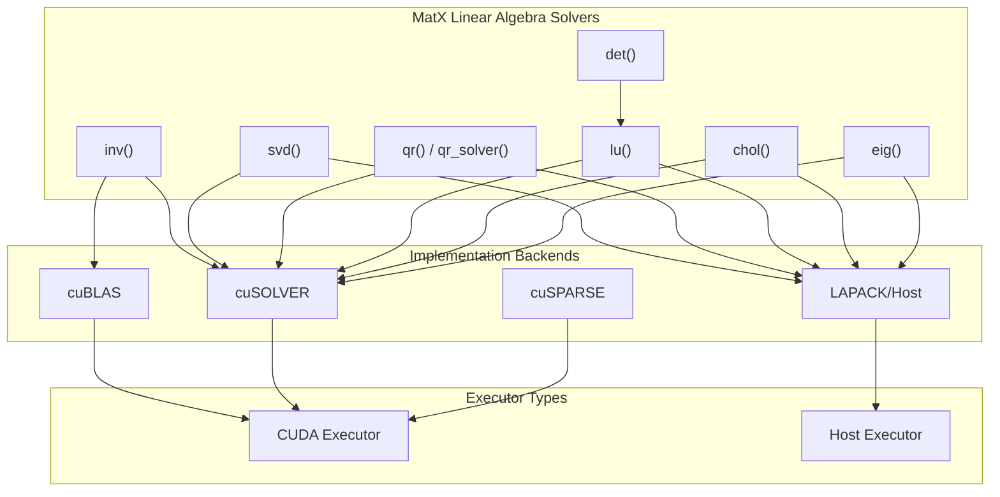
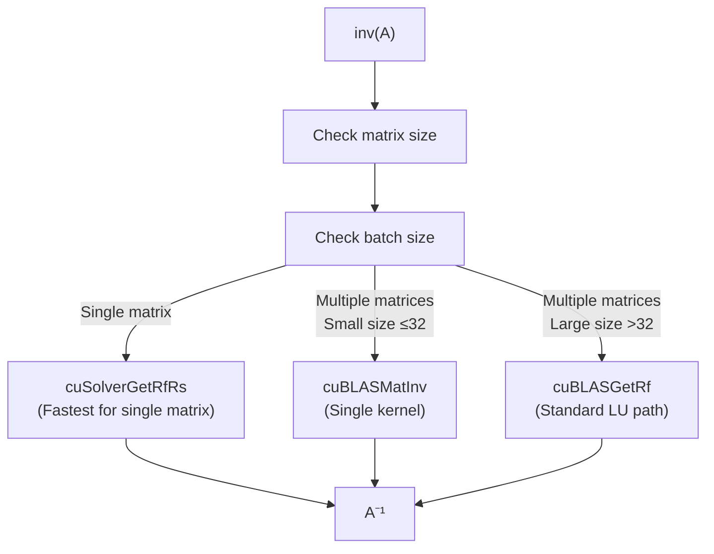
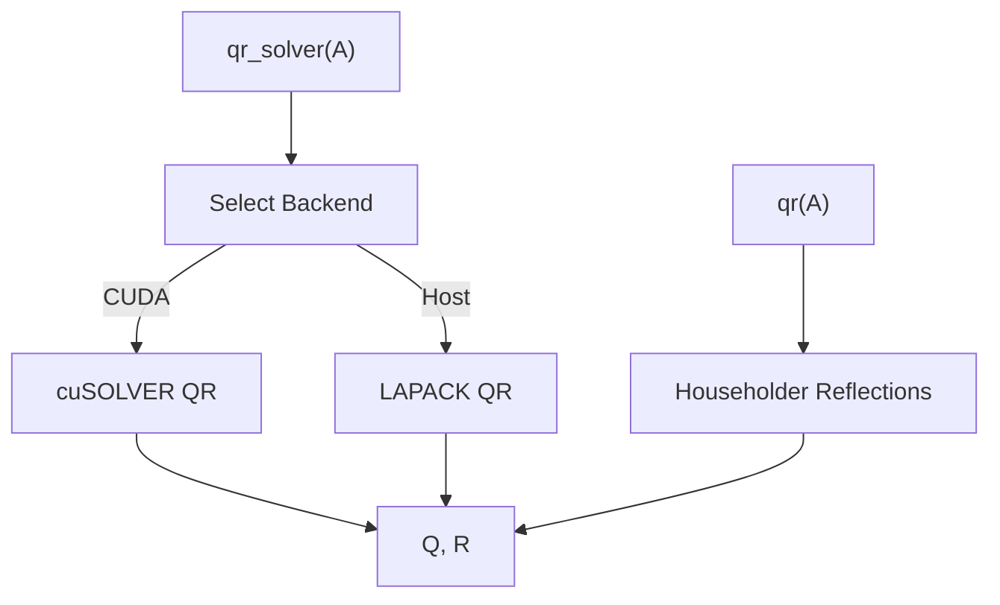
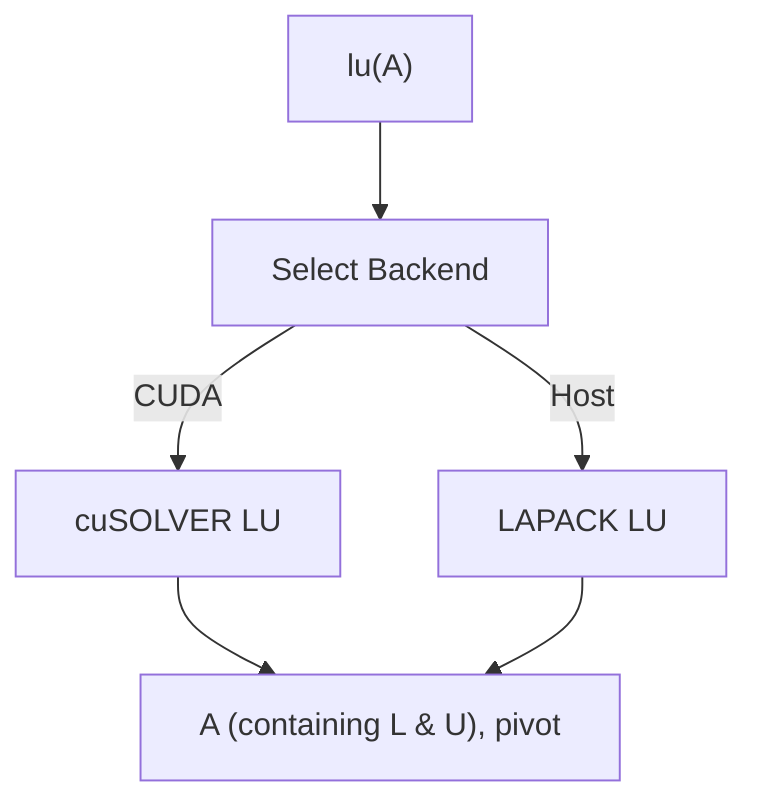
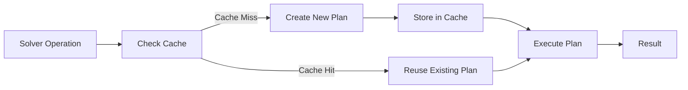

<!-- source: DeepWiki mcp.deepwiki.com · repo NVIDIA/MatX · page 4.4 Linear Algebra Solvers · fetched 2026-10-26 -->

# Linear Algebra Solvers

<details>
<summary>Relevant source files</summary>

The following files were used as context for generating this wiki page:

- [include/matx/transforms/chol/chol_cuda.h](include/matx/transforms/chol/chol_cuda.h)
- [include/matx/transforms/chol/chol_lapack.h](include/matx/transforms/chol/chol_lapack.h)
- [include/matx/transforms/eig/eig_cuda.h](include/matx/transforms/eig/eig_cuda.h)
- [include/matx/transforms/eig/eig_lapack.h](include/matx/transforms/eig/eig_lapack.h)
- [include/matx/transforms/inverse.h](include/matx/transforms/inverse.h)
- [include/matx/transforms/lu/lu_cuda.h](include/matx/transforms/lu/lu_cuda.h)
- [include/matx/transforms/lu/lu_lapack.h](include/matx/transforms/lu/lu_lapack.h)
- [include/matx/transforms/qr/qr_cuda.h](include/matx/transforms/qr/qr_cuda.h)
- [include/matx/transforms/qr/qr_lapack.h](include/matx/transforms/qr/qr_lapack.h)
- [include/matx/transforms/solver_common.h](include/matx/transforms/solver_common.h)
- [include/matx/transforms/svd/svd_cuda.h](include/matx/transforms/svd/svd_cuda.h)
- [include/matx/transforms/svd/svd_lapack.h](include/matx/transforms/svd/svd_lapack.h)
- [test/00_solver/Cholesky.cu](test/00_solver/Cholesky.cu)
- [test/00_solver/Det.cu](test/00_solver/Det.cu)
- [test/00_solver/Inverse.cu](test/00_solver/Inverse.cu)
- [test/00_solver/LU.cu](test/00_solver/LU.cu)
- [test/00_solver/QR.cu](test/00_solver/QR.cu)
- [test/test_vectors/generators/00_solver.py](test/test_vectors/generators/00_solver.py)

</details>


This page documents the linear algebra solvers available in MatX, covering matrix inversions, matrix decompositions (SVD, QR, LU, Cholesky), eigenvalue solutions, and determinant calculations. For information about matrix multiplication operations, see [Matrix Multiplication](#4.1).

## Overview

MatX provides a comprehensive set of linear algebra solvers optimized for GPU execution with fallback to CPU when needed. These solvers offer a Python-like API while leveraging NVIDIA's high-performance libraries such as cuBLAS, cuSOLVER, and LAPACK.



Sources: [include/matx/transforms/inverse.h:42-617](), [include/matx/transforms/svd/svd_cuda.h:51-58](), [include/matx/transforms/qr/qr_cuda.h:215-228](), [include/matx/transforms/solver_common.h:60-91]()

## Common Architecture

MatX's linear algebra solvers share a common architecture:

```mermaid
classDiagram
    class "Solver Function" {
        +InvokeImplementation()
    }
    class "Implementation Function" {
        +GetCache()
        +CreatePlan()
        +ExecutePlan()
    }
    class "Plan Object" {
        +AllocateWorkspace()
        +GetWorkspaceSize()
        +Exec()
    }
    class "Backend Library" {
        +CUDA Functions
        +Host Functions
    }
    
    "Solver Function" --> "Implementation Function" : calls
    "Implementation Function" --> "Plan Object" : creates/manages
    "Plan Object" --> "Backend Library" : invokes
```

Sources: [include/matx/transforms/inverse.h:594-614](), [include/matx/transforms/solver_common.h:155-210]()

The general pattern for all solvers involves:

1. A user-facing API function (e.g., `inv()`, `svd()`)
2. An implementation function that selects the appropriate backend
3. A plan object that manages resources and executes the operation
4. Integration with a backend library (cuSOLVER, cuBLAS, or LAPACK)

## Matrix Inverse

The `inv()` function computes the inverse of a square matrix, supporting both single matrices and batched operations. Internally, it selects from different backend algorithms based on matrix size and batch size.



### Usage Example

```cpp
// Create matrices
auto A = make_tensor<float>({4, 4});      // Input matrix
auto Ainv = make_tensor<float>({4, 4});   // Will hold the inverse

// Compute inverse
(Ainv = inv(A)).run(exec);
```

Sources: [include/matx/transforms/inverse.h:78-86](), [include/matx/transforms/inverse.h:127-185](), [test/00_solver/Inverse.cu:77-80]()

## Singular Value Decomposition (SVD)

SVD decomposes a matrix A into the product U·S·Vᵀ, where U and V are orthogonal matrices and S is a diagonal matrix of singular values.

MatX provides multiple SVD implementations:

| Method | Description | Best For |
|--------|-------------|----------|
| GESVD | Standard SVD algorithm | General matrices, non-batched operations |
| GESVDJ_BATCHED | Jacobi-based SVD | Small matrices (≤32×32) with batching |
| POW_ITER | Power iteration SVD | Cases with large batch dimensions |

### Usage Example

```cpp
// Create tensors for SVD components
auto A = make_tensor<float>({m, n});   // Input matrix
auto U = make_tensor<float>({m, m});   // Left singular vectors
auto S = make_tensor<float>({min(m,n)});  // Singular values
auto VT = make_tensor<float>({n, n});  // Right singular vectors transposed

// Perform SVD
(mtie(U, S, VT) = svd(A)).run(exec);
```

Sources: [include/matx/transforms/svd/svd_cuda.h:53-577](), [include/matx/transforms/svd/svd_lapack.h:52-369]()

## QR Decomposition

QR decomposition factors a matrix A into the product Q·R, where Q is an orthogonal matrix and R is an upper triangular matrix.

MatX offers two QR implementations:

1. `qr()` - Implements Householder reflections directly on the GPU
2. `qr_solver()` - Uses cuSOLVER or LAPACK backend (for CUDA or host execution respectively)



### Usage Example

```cpp
// Create tensors
auto A = make_tensor<float>({m, n});  // Input matrix
auto tau = make_tensor<float>({min(m,n)});  // Reflection factors

// Perform QR decomposition
(mtie(A, tau) = qr_solver(A)).run(exec);
```

Sources: [include/matx/transforms/qr/qr_cuda.h:215-491](), [include/matx/transforms/qr/qr_lapack.h:52-375](), [test/00_solver/QR.cu:92-94]()

## LU Decomposition

LU decomposition factors a matrix A into the product L·U, where L is a lower triangular matrix and U is an upper triangular matrix, often with a permutation matrix P such that P·A = L·U.



### Usage Example

```cpp
// Create tensors
auto A = make_tensor<float>({m, n});  // Input matrix
auto pivot = make_tensor<int64_t>({min(m,n)});  // Pivot indices

// Perform LU decomposition
(mtie(A, pivot) = lu(A)).run(exec);
```

Sources: [include/matx/transforms/lu/lu_cuda.h:51-374](), [include/matx/transforms/lu/lu_lapack.h:51-354](), [test/00_solver/LU.cu:94-95]()

## Cholesky Decomposition

Cholesky decomposition factors a Hermitian positive-definite matrix A into the product L·Lᵀ or U·Uᵀ, where L is a lower triangular matrix and U is an upper triangular matrix.

### Usage Example

```cpp
// Create a positive-definite matrix
auto A = make_tensor<float>({n, n});

// Perform Cholesky decomposition (lower triangular)
(A = chol(A, SolverFillMode::LOWER)).run(exec);
```

Sources: [include/matx/transforms/chol/chol_cuda.h:51-318](), [include/matx/transforms/chol/chol_lapack.h:51-365](), [test/00_solver/Cholesky.cu:96-97]()

## Eigenvalue Decomposition

Eigenvalue decomposition finds the eigenvalues and eigenvectors of a square matrix A such that A·V = V·Λ, where V is a matrix of eigenvectors and Λ is a diagonal matrix of eigenvalues.

MatX supports eigenvalue decomposition for Hermitian (or real symmetric) matrices.

### Usage Example

```cpp
// Create tensors
auto A = make_tensor<float>({n, n});   // Input matrix (symmetric)
auto V = make_tensor<float>({n, n});   // Eigenvectors
auto w = make_tensor<float>({n});      // Eigenvalues

// Compute eigenvalues and eigenvectors
(mtie(V, w) = eig(A)).run(exec);
```

Sources: [include/matx/transforms/eig/eig_cuda.h:51-321](), [include/matx/transforms/eig/eig_lapack.h:51-354]()

## Determinant Calculation

The `det()` function computes the determinant of a square matrix. Internally, it uses LU decomposition.

### Usage Example

```cpp
// Create a square matrix
auto A = make_tensor<float>({n, n});
auto determinant = make_tensor<float>({});  // Scalar tensor for result

// Compute determinant
(determinant = det(A)).run(exec);
```

Sources: [test/00_solver/Det.cu:97-98]()

## Caching Mechanism

MatX implements a caching mechanism for solver plans to improve performance when repeatedly performing the same operation. The cache stores solver plans based on their parameters, reusing them for subsequent operations with the same configuration.



Sources: [include/matx/transforms/inverse.h:550-577](), [include/matx/transforms/inverse.h:602-613]()

## Backend Selection

MatX automatically selects the appropriate backend based on:

1. Matrix dimensions
2. Data type
3. Executor type (CUDA vs Host)
4. Batch size

For CUDA execution, MatX uses NVIDIA libraries like cuBLAS and cuSOLVER. For host execution, it uses LAPACK.

## Performance Considerations

- **Matrix Size**: Different algorithms are used based on matrix dimensions
- **Batching**: Specialized batched implementations for multiple small matrices
- **Memory Layout**: Column-major layout is used internally to match BLAS/LAPACK conventions
- **Plan Caching**: Reuses solver configurations for repeated operations
- **Workspace Management**: Pre-allocates and manages workspace memory needed by solvers

Sources: [include/matx/transforms/inverse.h:127-185](), [include/matx/transforms/svd/svd_cuda.h:549-577](), [include/matx/transforms/solver_common.h:258-287]()

## Error Handling

MatX provides detailed error checking and validation, including:

- Input tensor dimension validation
- Ensuring matrices have appropriate properties (e.g., square, positive-definite)
- Checking that backend library calls complete successfully
- Propagating error information from numerical algorithms

Sources: [include/matx/transforms/inverse.h:415-425](), [include/matx/transforms/inverse.h:459-465](), [include/matx/transforms/inverse.h:489-497]()

---

