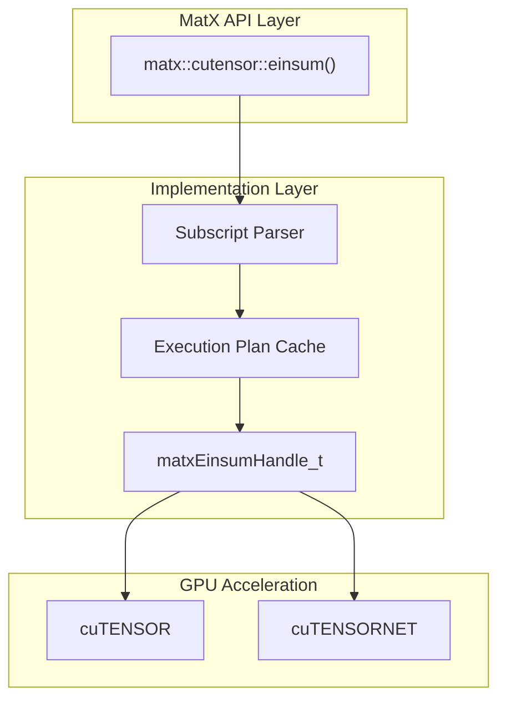
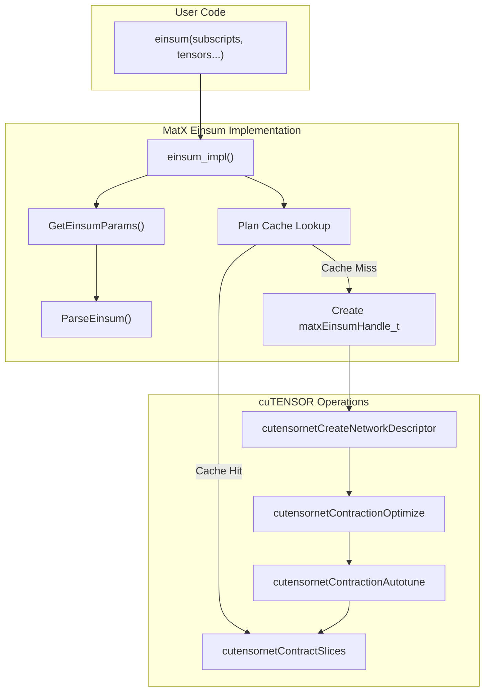
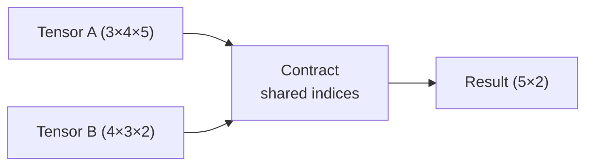
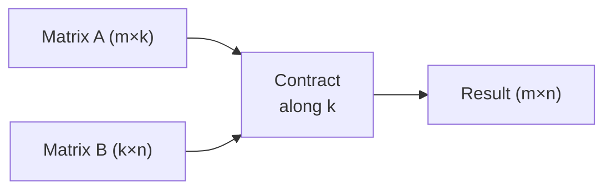
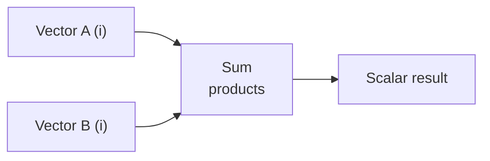
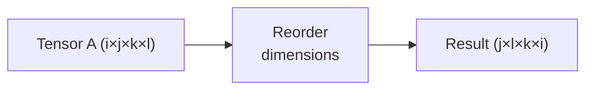
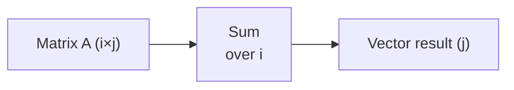
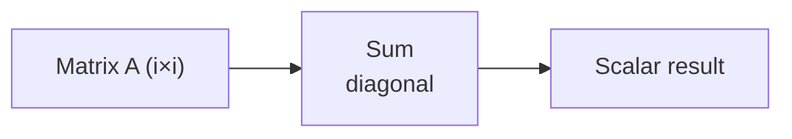
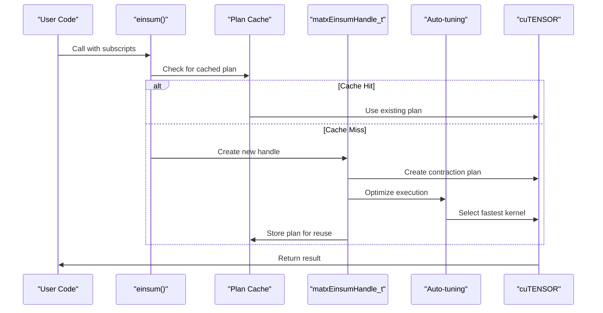
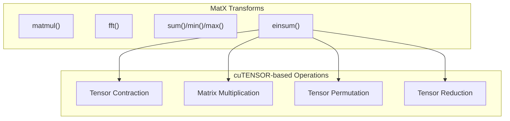

<!-- source: DeepWiki mcp.deepwiki.com · repo NVIDIA/MatX · page 4.5 Einstein Summation (einsum) · fetched 2026-10-26 -->

# Einstein Summation (einsum)

<details>
<summary>Relevant source files</summary>

The following files were used as context for generating this wiki page:

- [bench/00_transform/einsum.cu](bench/00_transform/einsum.cu)
- [include/matx/transforms/einsum.h](include/matx/transforms/einsum.h)
- [test/00_tensor/EinsumTests.cu](test/00_tensor/EinsumTests.cu)

</details>


Einstein Summation notation (einsum) provides a concise and powerful way to express a wide range of tensor operations in MatX. This page documents the implementation and usage of the `einsum` transform, which allows for operations such as tensor contractions, matrix multiplications, dot products, permutations, reductions, and trace calculations with a unified interface.

## Overview

The `einsum` implementation in MatX is built on top of NVIDIA's cuTENSOR library, providing GPU-accelerated tensor operations with a Python-like interface. The implementation follows a syntax similar to NumPy's einsum, making it easy to port code between the two libraries while achieving high performance on NVIDIA GPUs.



Sources: [include/matx/transforms/einsum.h:478-553]()

## Einstein Notation in MatX

Einstein notation in MatX follows these conventions:

- Letters represent tensor dimensions (indices)
- Repeated indices across tensors indicate summation (contraction) over those dimensions
- The arrow operator `->` separates input and output indices
- Output indices specify the dimensions in the result tensor

### Notation Format

```
einsum("input_indices1,input_indices2,...->output_indices", tensor1, tensor2, ...)
```

For example, `"ij,jk->ik"` represents matrix multiplication where `j` is the contracted dimension.

Sources: [include/matx/transforms/einsum.h:478-502](), [test/00_tensor/EinsumTests.cu:121-123]()

## Supported Operations

The `einsum` transform supports a variety of operations:

| Operation | Notation | Description |
|-----------|----------|-------------|
| Tensor Contraction | `"ijk,jil->kl"` | Contracts tensors along shared dimensions |
| Matrix Multiplication | `"mk,kn->mn"` | Multiplies matrices (special case of contraction) |
| Dot Product | `"i,i->"` | Computes inner product of vectors |
| Permutation | `"ijkl->jlki"` | Reorders tensor dimensions |
| Reduction (Sum) | `"ij->j"` | Sums over specified dimensions |
| Trace | `"ii->"` | Sums diagonal elements |

Sources: [test/00_tensor/EinsumTests.cu:100-329]()

## Implementation Architecture



Sources: [include/matx/transforms/einsum.h:89-425](), [include/matx/transforms/einsum.h:502-550]()

## Usage Examples

### Tensor Contraction

Tensor contraction is a generalization of matrix multiplication to higher dimensions, summing products over shared indices.



Example code:

```cpp
auto a = a1.View({3,4,5});
auto b = b1.View({4,3,2});
(c2 = cutensor::einsum("ijk,jil->kl", a, b)).run(exec);
```

Sources: [test/00_tensor/EinsumTests.cu:111-123]()

### Matrix Multiplication (GEMM)

Matrix multiplication is a special case of tensor contraction:



Example code:

```cpp
auto a2 = make_tensor<TestType>({10,20});
auto b2 = make_tensor<TestType>({20,10});
auto c2 = make_tensor<TestType>({10,10});
(c2 = cutensor::einsum("mk,kn->mn", a2, b2)).run(exec);
```

Sources: [test/00_tensor/EinsumTests.cu:191-200]()

### Transposed Matrix Multiplication

Transposing the result of a matrix multiplication is straightforward with einsum by changing the output indices:

```cpp
// Perform a GEMM and store results transposed
(c2 = cutensor::einsum("mk,kn->nm", a2, b2)).run(exec);
```

Sources: [test/00_tensor/EinsumTests.cu:229]()

### Dot Product

Dot product (inner product) of two vectors:



Example code:

```cpp
auto a1 = make_tensor<TestType>({60});
auto b1 = make_tensor<TestType>({60});
auto c0 = make_tensor<TestType>({});
(c0 = cutensor::einsum("i,i->", a1, b1)).run(exec);
```

Sources: [test/00_tensor/EinsumTests.cu:165-174]()

### Permutation (Transpose)

Einsum provides an efficient way to permute tensor dimensions:



Example code:

```cpp
auto a = make_tensor<TestType>({5,20,4,3});
auto b = make_tensor<TestType>({20,3,4,5});
// Permute a 4D tensor
(b = cutensor::einsum("ijkl->jlki", a)).run(exec);
```

Sources: [test/00_tensor/EinsumTests.cu:250-259]()

### Reduction (Sum)

Summing over specific dimensions:



Example code:

```cpp
auto a = make_tensor<TestType>({2, 3});
auto b = make_tensor<TestType>({3});
// Sum the columns of matrix "a"
(b = matx::cutensor::einsum("ij->j", a)).run(exec);
```

Sources: [test/00_tensor/EinsumTests.cu:281-291]()

### Matrix Trace

Computing the trace (sum of diagonal elements) of a matrix:



Example code:

```cpp
auto a2 = make_tensor<TestType>({10,10});
auto c0_0 = make_tensor<TestType>({});
(c0_0 = cutensor::einsum("ii->", a2)).run(exec);
```

Sources: [test/00_tensor/EinsumTests.cu:313-320]()

## Performance Considerations

The MatX implementation of `einsum` employs several optimizations for high performance:



Key performance features:

1. **Plan Caching**: Reuses execution plans for similar operations
2. **Auto-tuning**: Automatically selects optimal kernels for the given tensors
3. **Memory Management**: Efficiently allocates workspace memory
4. **Contraction Path Optimization**: Optimizes the order of operations for multi-tensor contractions

Sources: [include/matx/transforms/einsum.h:235-265](), [include/matx/transforms/einsum.h:514-546]()

## Limitations

- Requires cuTENSOR library (`MATX_EN_CUTENSOR=ON`)
- Ellipsis notation (`...`) is not supported
- The output operator (`->`) is required in all expressions
- Some NumPy einsum features may not be fully implemented

Sources: [include/matx/transforms/einsum.h:547-548]()

## API Reference

```cpp
template <typename OutputType, typename... InT>
void einsum_impl(OutputType &out, const std::string &subscripts, 
                cudaStream_t stream, InT... tensors)
```

Parameters:
- `out`: Output tensor where the result will be stored
- `subscripts`: String containing Einstein notation
- `stream`: CUDA stream for execution
- `tensors`: Input tensors for the operation

Sources: [include/matx/transforms/einsum.h:502-550]()

## Integration with MatX

The `einsum` transform is part of the Transforms layer in the MatX architecture, providing advanced tensor operations. It complements other transforms like matrix multiplication, FFT, and reductions, but with a more flexible interface capable of expressing many different operations.



Sources: [include/matx/transforms/einsum.h:34-36]()

---

