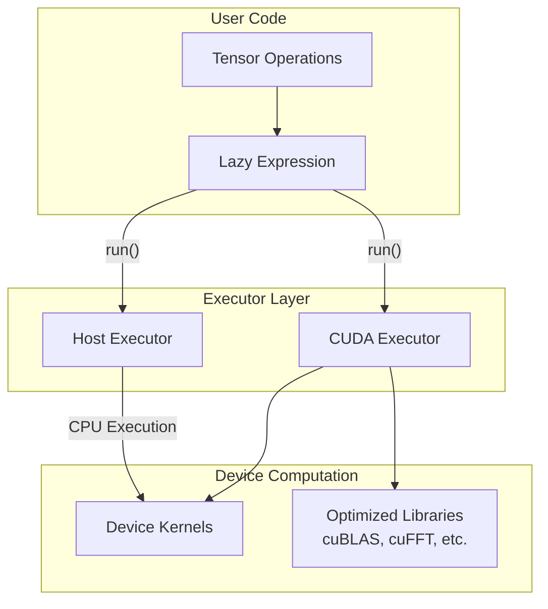
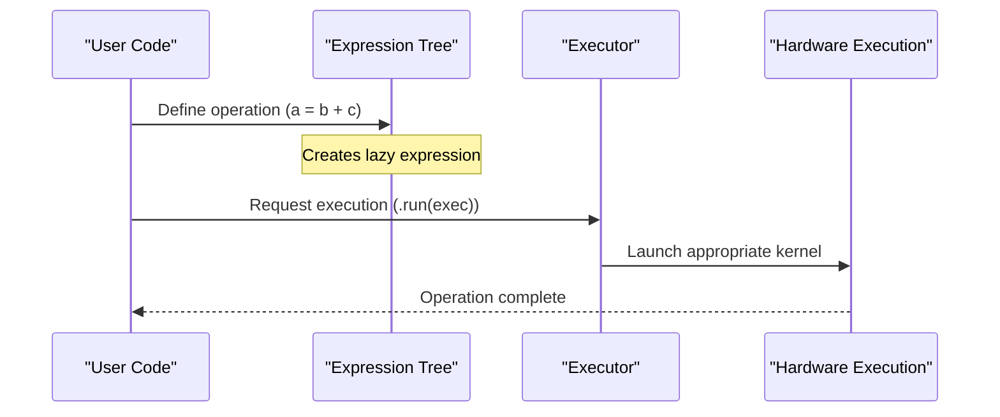
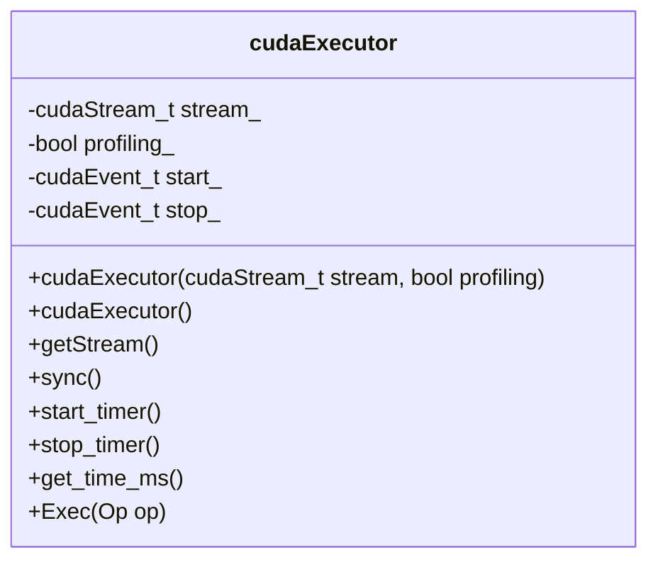
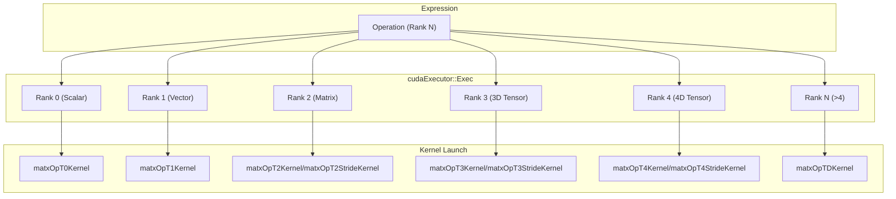
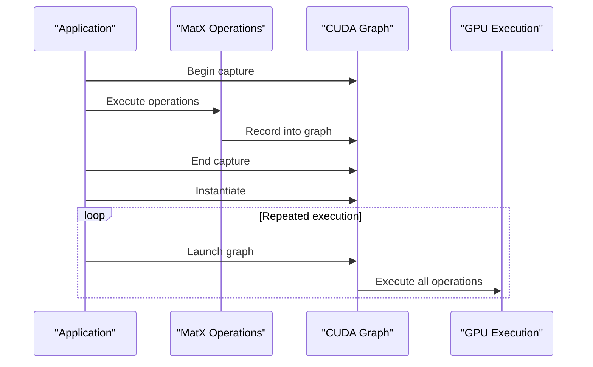
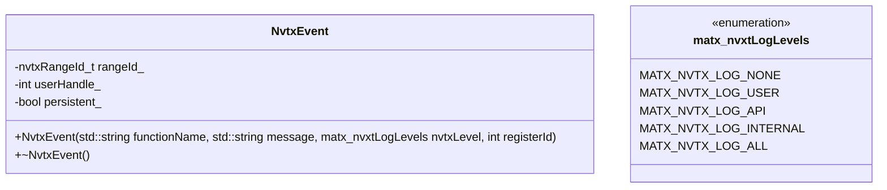
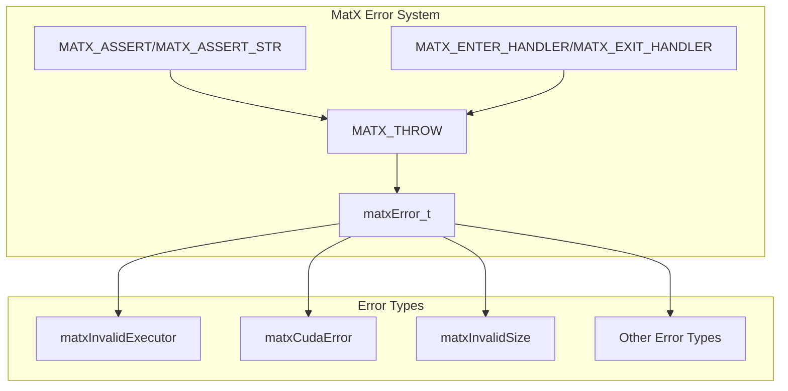

<!-- source: DeepWiki mcp.deepwiki.com · repo NVIDIA/MatX · page 5 Execution Model · fetched 2026-10-26 -->

# Execution Model

<details>
<summary>Relevant source files</summary>

The following files were used as context for generating this wiki page:

- [docs_input/basics/nvtx.rst](docs_input/basics/nvtx.rst)
- [docs_input/basics/profiling.rst](docs_input/basics/profiling.rst)
- [examples/spectrogram.cu](examples/spectrogram.cu)
- [examples/spectrogram_graph.cu](examples/spectrogram_graph.cu)
- [include/matx/core/error.h](include/matx/core/error.h)
- [include/matx/core/nvtx.h](include/matx/core/nvtx.h)
- [include/matx/core/tensor.h](include/matx/core/tensor.h)
- [include/matx/core/tensor_utils.h](include/matx/core/tensor_utils.h)
- [include/matx/executors/cuda.h](include/matx/executors/cuda.h)
- [include/matx/executors/kernel.h](include/matx/executors/kernel.h)
- [test/00_tensor/BasicTensorTests.cu](test/00_tensor/BasicTensorTests.cu)

</details>


This page explains the execution model of MatX, which defines how tensor operations are evaluated and executed on computational devices. The execution model bridges the gap between the high-level tensor expressions and the low-level hardware implementations, enabling efficient execution on both CPU and GPU. For information about specific execution methods like CUDA execution and profiling, see [CUDA Execution](#5.1) and [Profiling and Performance](#5.2).

## Overview of the Execution Model

MatX uses a lazy evaluation approach combined with specialized executor objects to run tensor operations efficiently. Operations are defined as expressions, which are then passed to executors that handle the actual computation on the target device.



Sources: [include/matx/executors/cuda.h:42-194](), [include/matx/core/tensor.h:248-600]()

## Lazy Evaluation

MatX uses lazy evaluation, which means operations are not immediately executed when defined. Instead, they are captured as expressions and only evaluated when explicitly requested.



Sources: [include/matx/core/tensor.h:248-300](), [test/00_tensor/BasicTensorTests.cu:228-262]()

When you write a tensor operation in MatX, it returns a lazily evaluated expression:

1. Operators like `=`, `+=`, `-=` create a "set" object for deferred execution
2. The expression is only evaluated when the `.run()` method is called with an executor
3. This allows for expression optimization before execution

Example from test code:
```
(t2c = this->t2).run(this->exec);
```

Sources: [test/00_tensor/BasicTensorTests.cu:243-244]()

## Executor Types

MatX provides two primary executor types:

| Executor Type | Purpose | Primary Usage |
|---------------|---------|---------------|
| CUDA Executor | Executes operations on NVIDIA GPUs | High-performance parallel computing |
| Host Executor | Executes operations on CPU | Debugging or when GPU is unavailable |

### CUDA Executor

The CUDA executor is defined in the `cudaExecutor` class and is designed to run tensor operations on NVIDIA GPUs. It handles mapping MatX operations to appropriate CUDA kernels or library calls.



Sources: [include/matx/executors/cuda.h:48-191]()

Key features:
- Can use a custom CUDA stream or the default stream
- Optional built-in profiling capabilities
- Supports synchronization with `sync()` method
- Maps operations to specialized kernels based on tensor rank

### Host Executor

The Host Executor runs operations on the CPU, which is useful for debugging or when a GPU is not available. It follows the same interface as the CUDA executor but executes code on the CPU instead.

Sources: [include/matx/executors/host.h]()

## Kernel Execution

When an operation is executed, the executor selects an appropriate kernel based on the tensor's rank and launches it on the target device.



Sources: [include/matx/executors/cuda.h:129-184](), [include/matx/executors/kernel.h:42-224]()

For tensors of different ranks, different specialized kernel templates are used:
- Rank 0 (scalar): `matxOpT0Kernel`
- Rank 1 (vector): `matxOpT1Kernel`
- Rank 2 (matrix): `matxOpT2Kernel` or `matxOpT2StrideKernel`
- Rank 3 (3D tensor): `matxOpT3Kernel` or `matxOpT3StrideKernel`
- Rank 4 (4D tensor): `matxOpT4Kernel` or `matxOpT4StrideKernel`
- Rank > 4: `matxOpTDKernel`

The stride variants of kernels are used for larger tensors where grid dimensions need to be managed carefully.

Sources: [include/matx/executors/kernel.h:42-224]()

## Running Operations

Operations are executed by calling the `run()` method on an expression, passing an executor object. This pattern is consistent across different operation types.

Example execution pattern:
```cpp
// Define an operation
auto operation = tensorA + tensorB;

// Execute it with a CUDA executor
operation.run(cudaExec);

// Or with a host executor
operation.run(hostExec);
```

Sources: [examples/spectrogram.cu:88-99](), [examples/spectrogram_graph.cu:89-100]()

### Stream Management

CUDA executors support stream-based asynchronous execution. When creating a CUDA executor, you can specify a CUDA stream to use:

```cpp
// Create a stream
cudaStream_t stream;
cudaStreamCreate(&stream);

// Create an executor with that stream
cudaExecutor exec{stream};

// Execute operations in that stream
(operation).run(exec);
```

The executor will launch all kernels in the specified stream, allowing for asynchronous execution and overlapping with other operations.

Sources: [examples/spectrogram.cu:61-63](), [examples/spectrogram_graph.cu:62-65]()

## CUDA Graph Support

For performance optimization, MatX supports CUDA Graphs which allow capturing a sequence of operations and executing them repeatedly with reduced overhead.



Sources: [examples/spectrogram_graph.cu:102-140]()

The process for using CUDA Graphs:
1. Begin graph capture: `cudaStreamBeginCapture(stream, cudaStreamCaptureModeGlobal)`
2. Execute MatX operations normally
3. End graph capture: `cudaStreamEndCapture(stream, &graph)`
4. Instantiate the graph: `cudaGraphInstantiate(&instance, graph, NULL, NULL, 0)`
5. Launch the graph: `cudaGraphLaunch(instance, stream)`

Sources: [examples/spectrogram_graph.cu:104-147]()

## Profiling and Performance Monitoring

MatX provides built-in profiling capabilities through the executor interface and NVTX integration.

### Built-in Timing

Executors have built-in timing methods for measuring performance:

```cpp
// Create executor with profiling enabled
cudaExecutor exec{stream, true};

// Start timer
exec.start_timer();

// Execute operations
(operation).run(exec);

// Stop timer
exec.stop_timer();

// Get elapsed time in milliseconds
float time_ms = exec.get_time_ms();
```

Sources: [include/matx/executors/cuda.h:56-121](), [examples/spectrogram.cu:102-143]()

### NVTX Profiling

MatX includes NVTX (NVIDIA Tools Extension) integration for detailed profiling in tools like NVIDIA Nsight Systems.



Sources: [include/matx/core/nvtx.h:46-358](), [docs_input/basics/nvtx.rst:1-81]()

NVTX profiling can be enabled at compile time with the `MATX_NVTX_FLAGS=ON` option. The MatX API automatically creates NVTX ranges for significant operations, and users can create their own ranges:

```cpp
// Automatic NVTX range for the current scope
MATX_NVTX_START("Operation name");

// Manual NVTX range
int rangeId = MATX_NVTX_START_RANGE("Range name");
// ... operations ...
MATX_NVTX_END_RANGE(rangeId);
```

Sources: [docs_input/basics/nvtx.rst:17-65]()

## Error Handling

MatX provides error handling mechanisms to help diagnose execution issues. 



Sources: [include/matx/core/error.h:43-255]()

Key error handling related to execution:
- `matxInvalidExecutor`: Indicates a problem with the executor
- `matxCudaError`: Encapsulates CUDA runtime errors
- Error handling macros: `MATX_THROW`, `MATX_ASSERT`, `MATX_ASSERT_STR`
- Try/catch pattern: `MATX_ENTER_HANDLER()` and `MATX_EXIT_HANDLER()`

Sources: [include/matx/core/error.h:51-69](), [include/matx/core/error.h:150-161]()

## Summary

The MatX execution model provides:
1. Lazy evaluation for expression optimization
2. Multiple executor types for different hardware targets
3. Stream-based asynchronous execution
4. CUDA Graph support for optimized repeated execution
5. Built-in profiling and performance monitoring
6. Comprehensive error handling

This model allows for efficient execution of tensor operations on both CPU and GPU hardware while providing a consistent programming interface.

---

