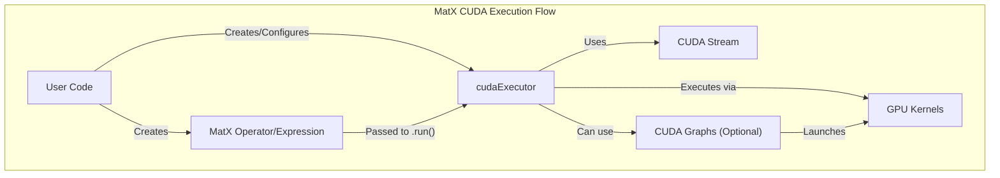
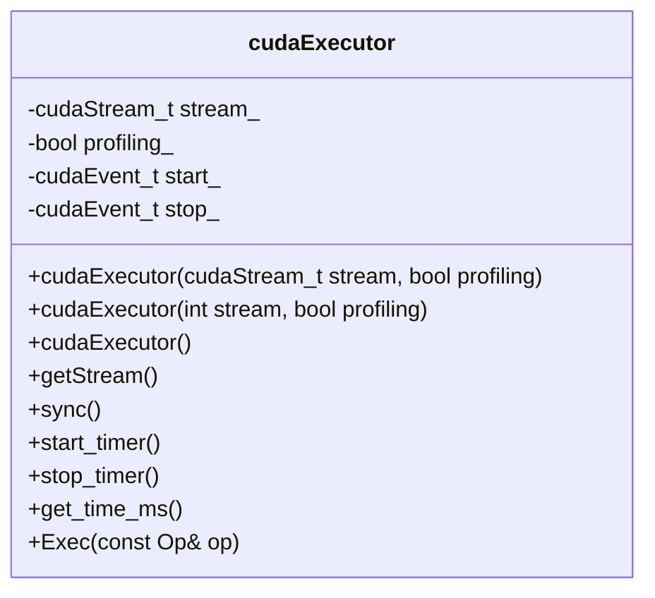
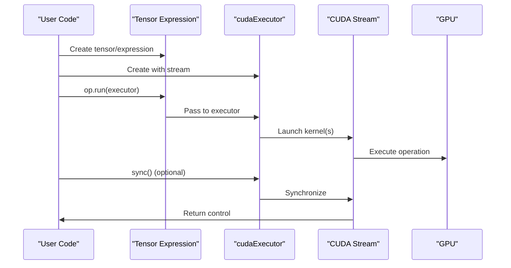
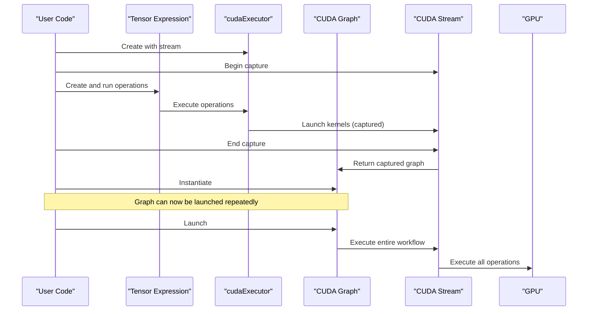
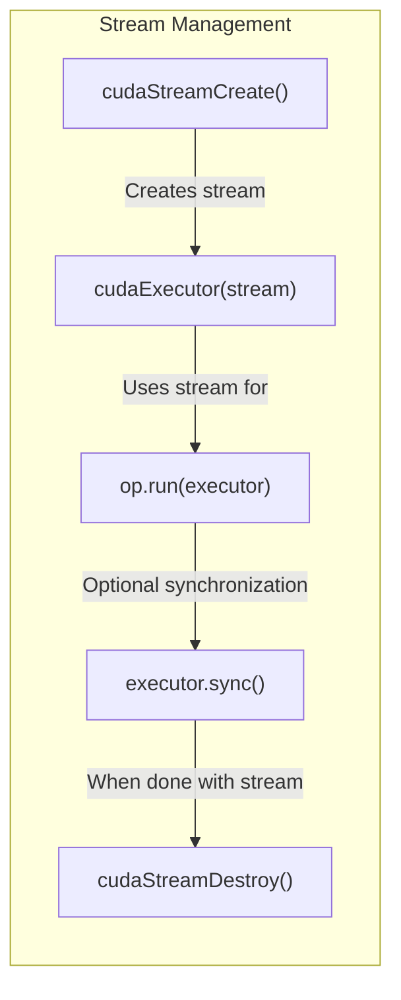
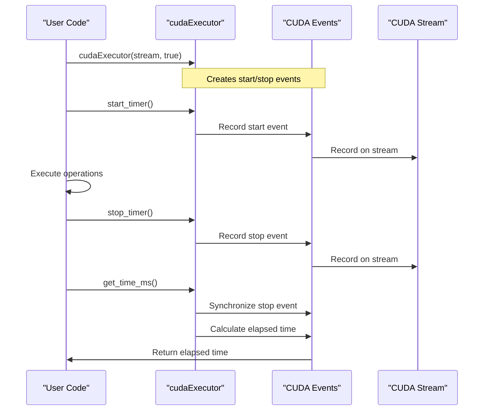
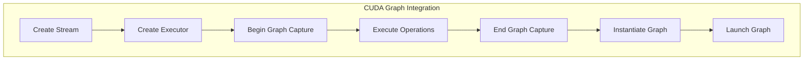
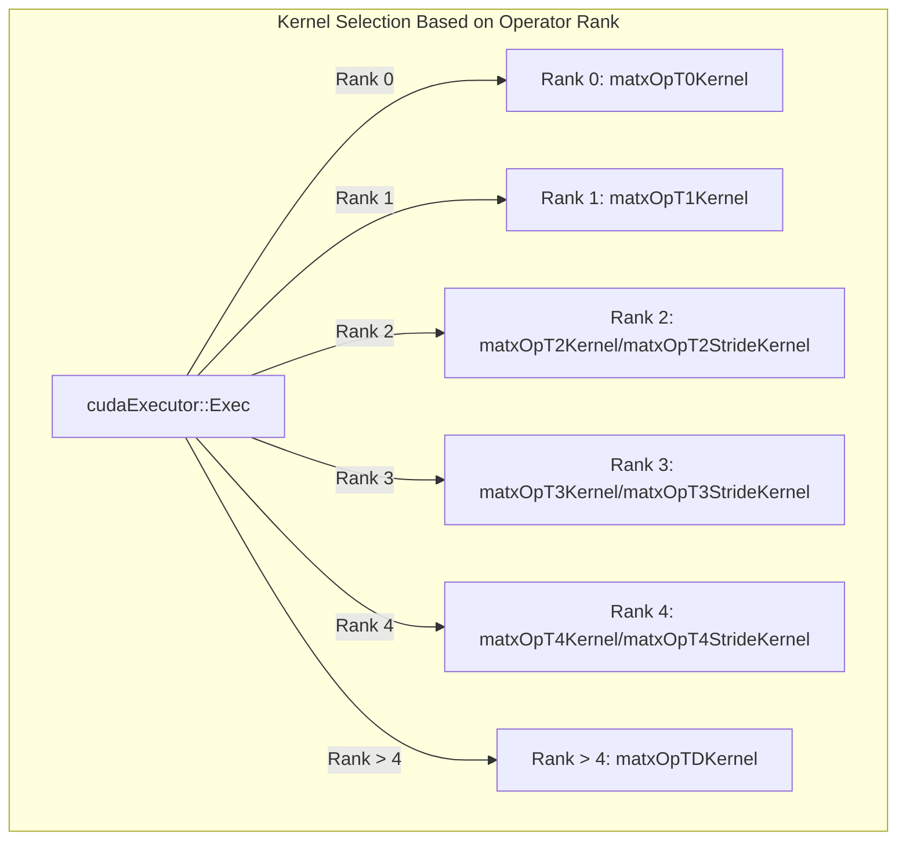

<!-- source: DeepWiki mcp.deepwiki.com · repo NVIDIA/MatX · page 5.1 CUDA Execution · fetched 2026-10-26 -->

# CUDA Execution

<details>
<summary>Relevant source files</summary>

The following files were used as context for generating this wiki page:

- [docs_input/basics/profiling.rst](docs_input/basics/profiling.rst)
- [examples/spectrogram.cu](examples/spectrogram.cu)
- [examples/spectrogram_graph.cu](examples/spectrogram_graph.cu)
- [include/matx/executors/cuda.h](include/matx/executors/cuda.h)

</details>


This document details MatX's CUDA execution model, which enables tensor operations to be executed efficiently on NVIDIA GPUs. The CUDA execution capabilities include direct kernel execution, stream management, CUDA graph integration, and performance profiling. For information about host (CPU) execution, see [Execution Model](#5) and for profiling details see [Profiling and Performance](#5.2).

## Overview of CUDA Execution in MatX

MatX provides a CUDA execution model through the `cudaExecutor` class, which serves as the primary interface for launching tensor operations on NVIDIA GPUs. This execution model leverages CUDA streams for asynchronous operation and supports performance optimization techniques like CUDA graphs.



Sources: [include/matx/executors/cuda.h:42-51](include/matx/executors/cuda.h:42-51), [examples/spectrogram.cu:63-64](examples/spectrogram.cu:63-64), [examples/spectrogram_graph.cu:65-66](examples/spectrogram_graph.cu:65-66)

## cudaExecutor Class

The `cudaExecutor` class is the central component responsible for executing tensor operations on NVIDIA GPUs. It manages CUDA stream-based execution and provides methods for synchronization and performance measurement.

### Construction and Configuration



The `cudaExecutor` can be constructed in three ways:
- With a specific CUDA stream and optional profiling flag
- With a stream ID and optional profiling flag
- Without parameters (uses default stream without profiling)

Sources: [include/matx/executors/cuda.h:48-81](include/matx/executors/cuda.h:48-81)

### Core Methods

| Method | Description |
|--------|-------------|
| `getStream()` | Returns the CUDA stream associated with the executor |
| `sync()` | Synchronizes the CUDA stream |
| `start_timer()` | Starts a timer for profiling (requires profiling enabled) |
| `stop_timer()` | Stops the timer for profiling |
| `get_time_ms()` | Returns elapsed time in milliseconds between timer start and stop |
| `Exec<Op>(op)` | Internal method that executes an operator on the device |

Sources: [include/matx/executors/cuda.h:92-184](include/matx/executors/cuda.h:92-184)

## Execution Models

MatX supports two primary execution models for CUDA operations: direct kernel execution and CUDA graph-based execution.

### Direct Kernel Execution

In the direct execution model, operations are launched directly through CUDA kernels on the stream associated with the executor.



Sources: [examples/spectrogram.cu:101-136](examples/spectrogram.cu:101-136), [include/matx/executors/cuda.h:129-184](include/matx/executors/cuda.h:129-184)

### CUDA Graph-Based Execution

For repeated execution of the same operations, MatX can leverage CUDA graphs to reduce CPU overhead and improve performance.



Sources: [examples/spectrogram_graph.cu:102-140](examples/spectrogram_graph.cu:102-140), [examples/spectrogram_graph.cu:143-148](examples/spectrogram_graph.cu:143-148)

## Stream Management

CUDA streams are a crucial aspect of the MatX execution model, enabling asynchronous operation and concurrency.



Key points about stream management:
- Streams can be created externally and passed to the executor
- Multiple executors can use different streams for concurrent execution
- The executor's `sync()` method synchronizes only its own stream
- Streams must be explicitly destroyed when no longer needed

Sources: [examples/spectrogram.cu:61-63](examples/spectrogram.cu:61-63), [examples/spectrogram.cu:146](examples/spectrogram.cu:146), [examples/spectrogram_graph.cu:62-65](examples/spectrogram_graph.cu:62-65), [examples/spectrogram_graph.cu:156](examples/spectrogram_graph.cu:156)

## Profiling with cudaExecutor

The `cudaExecutor` provides built-in profiling capabilities to measure the execution time of GPU operations.



To use profiling:
1. Create the executor with profiling enabled (`true` as second parameter)
2. Call `start_timer()` before operations to be measured
3. Call `stop_timer()` after operations to be measured
4. Call `get_time_ms()` to retrieve the elapsed time in milliseconds

Sources: [include/matx/executors/cuda.h:58-69](include/matx/executors/cuda.h:58-69), [include/matx/executors/cuda.h:104-121](include/matx/executors/cuda.h:104-121), [docs_input/basics/profiling.rst:6-39](docs_input/basics/profiling.rst:6-39), [examples/spectrogram.cu:102-140](examples/spectrogram.cu:102-140)

## Example Usage Patterns

### Basic Usage

```cpp
// Create a CUDA stream
cudaStream_t stream;
cudaStreamCreate(&stream);

// Create an executor with profiling enabled
cudaExecutor exec{stream, true};

// Create and initialize tensors
auto a = make_tensor<float>({100});
auto b = make_tensor<float>({100});

// Execute operations
(a = random<float>({100})).run(exec);
(b = 2.0f * a).run(exec);

// Synchronize to ensure completion
exec.sync();

// Clean up
cudaStreamDestroy(stream);
```

Sources: [examples/spectrogram.cu:61-64](examples/spectrogram.cu:61-64), [examples/spectrogram.cu:76-84](examples/spectrogram.cu:76-84)

### CUDA Graph Integration

For workloads that are executed repeatedly with the same operations, CUDA graphs can significantly improve performance by reducing CPU overhead.



The basic workflow for using CUDA graphs:
1. Create a stream and executor
2. Begin graph capture on the stream
3. Execute the operations to be captured
4. End graph capture
5. Instantiate the captured graph
6. Launch the graph repeatedly for execution

Sources: [examples/spectrogram_graph.cu:102-140](examples/spectrogram_graph.cu:102-140), [examples/spectrogram_graph.cu:143-148](examples/spectrogram_graph.cu:143-148)

## Performance Considerations

When using CUDA execution in MatX, consider the following performance tips:

1. **Stream Management**: Use separate streams for independent operations to enable concurrency
2. **Synchronization**: Minimize synchronization points to maintain asynchronous execution
3. **CUDA Graphs**: Use CUDA graphs for repeated execution patterns to reduce CPU overhead
4. **Profiling**: Use the built-in profiling to identify bottlenecks in your application

Sources: [examples/spectrogram.cu:142-143](examples/spectrogram.cu:142-143), [examples/spectrogram_graph.cu:153-154](examples/spectrogram_graph.cu:153-154), [docs_input/basics/profiling.rst:35-39](docs_input/basics/profiling.rst:35-39)

## Kernel Execution Details

The `cudaExecutor` internally uses specialized kernels based on the rank (dimensionality) of the operator being executed.



The kernel selection process:
- For rank-0 (scalar) operators, a single thread is used
- For rank 1-4, specialized kernels are selected based on dimensionality
- For ranks above 4, a generic strided kernel is used
- For 2D and higher dimensions, strided kernels may be used for better memory access patterns

Sources: [include/matx/executors/cuda.h:129-184](include/matx/executors/cuda.h:129-184)

---

