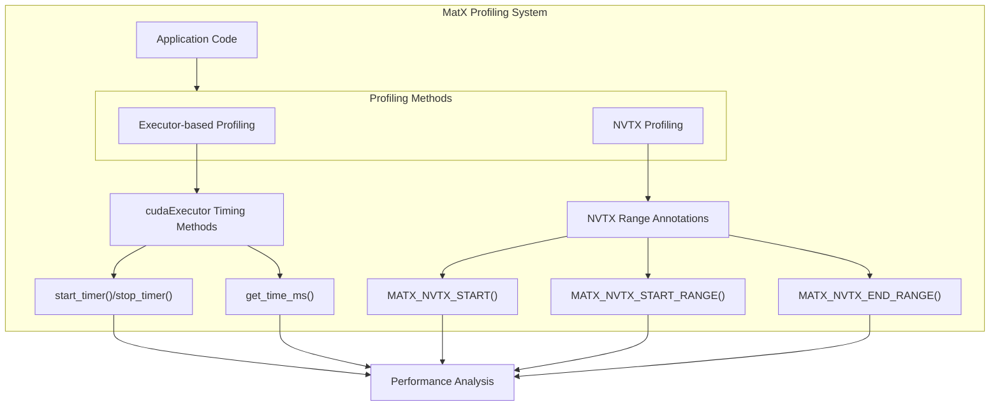
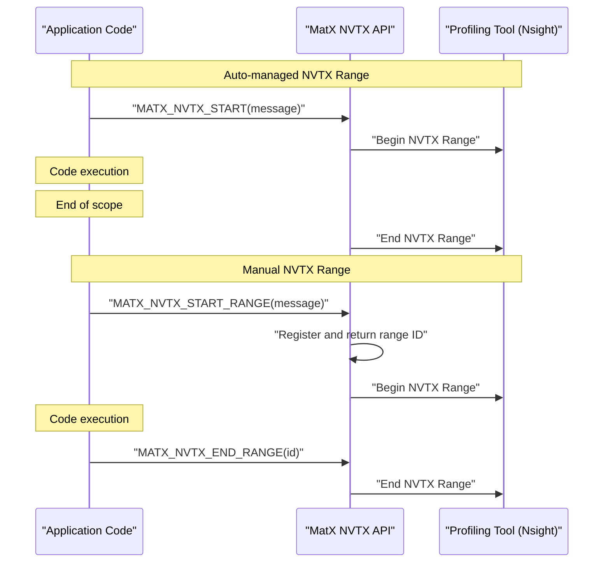
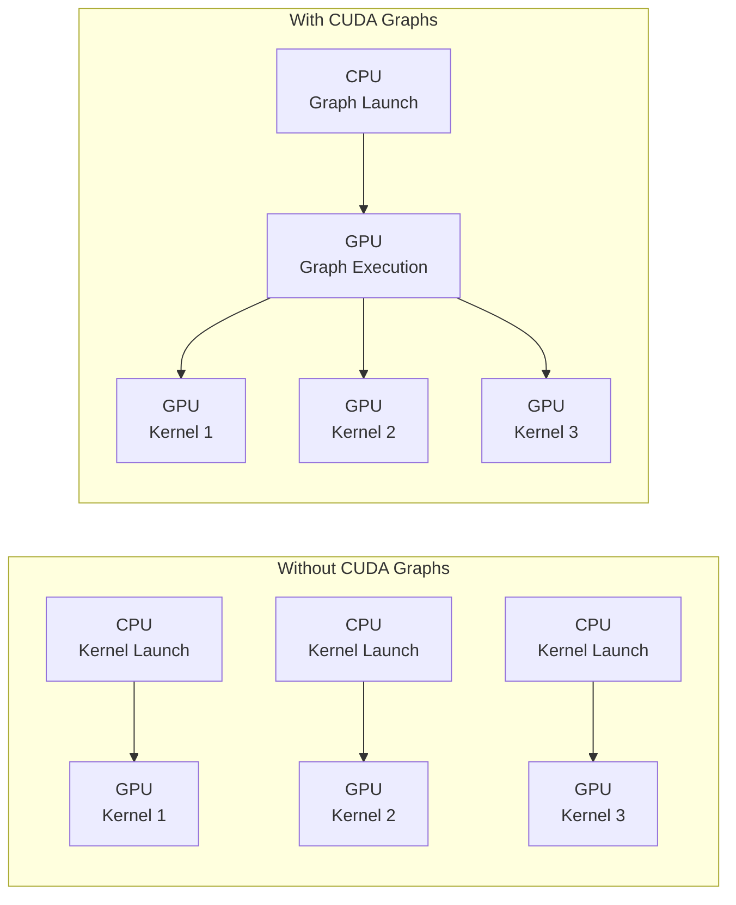
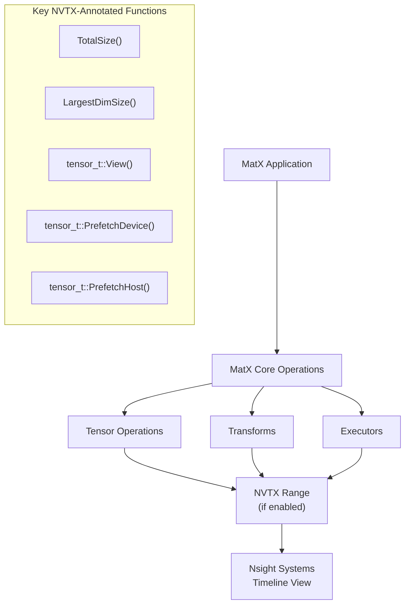

<!-- source: DeepWiki mcp.deepwiki.com · repo NVIDIA/MatX · page 5.2 Profiling and Performance · fetched 2026-10-26 -->

# Profiling and Performance

<details>
<summary>Relevant source files</summary>

The following files were used as context for generating this wiki page:

- [docs_input/basics/nvtx.rst](docs_input/basics/nvtx.rst)
- [docs_input/basics/profiling.rst](docs_input/basics/profiling.rst)
- [examples/spectrogram.cu](examples/spectrogram.cu)
- [examples/spectrogram_graph.cu](examples/spectrogram_graph.cu)
- [include/matx/core/error.h](include/matx/core/error.h)
- [include/matx/core/nvtx.h](include/matx/core/nvtx.h)
- [include/matx/core/tensor.h](include/matx/core/tensor.h)
- [include/matx/core/tensor_utils.h](include/matx/core/tensor_utils.h)
- [include/matx/executors/cuda.h](include/matx/executors/cuda.h)
- [include/matx/executors/kernel.h](include/matx/executors/kernel.h)
- [test/00_tensor/BasicTensorTests.cu](test/00_tensor/BasicTensorTests.cu)

</details>


This document provides a comprehensive guide to profiling and performance optimization techniques in the MatX library. It covers how to measure execution time, use NVIDIA Tools Extension (NVTX) for visual profiling, and implement best practices for achieving optimal performance in your MatX applications. For information about the specific execution models in MatX, see [CUDA Execution](#5.1).

## Profiling Architecture

MatX provides two main approaches to profiling your applications:

1. **Executor-based Profiling**: Simple timing measurements using executor methods
2. **NVTX Profiling**: Detailed profiling using NVIDIA Tools Extension (NVTX) for visualization in tools like NVIDIA Nsight Systems



Sources: [include/matx/executors/cuda.h:63-121](), [include/matx/core/nvtx.h:46-359]()

## Executor-Based Profiling

Executor-based profiling is a straightforward way to measure the execution time of MatX operations. It leverages the timing capabilities of the executor being used (e.g., CUDA events for GPU workloads).

### Enabling Profiling in Executors

Profiling is disabled by default due to the overhead it introduces. To enable profiling, pass `true` as the second parameter when creating an executor:

```cpp
cudaExecutor exec{stream, true}; // Enable profiling
```

### Timing Methods

Once profiling is enabled, you can use the following methods to measure execution time:

| Method | Description |
|--------|-------------|
| `start_timer()` | Start timing measurement |
| `stop_timer()` | Stop timing measurement |
| `get_time_ms()` | Retrieve elapsed time in milliseconds |

### Usage Example

```cpp
// Enable profiling when creating the executor
cudaExecutor exec{stream, true};

// Start timing
exec.start_timer();

// Execute operations to be measured
(fftStackedMatrix = fft(stackedMatrix)).run(exec);
(fftStackedMatrix = conj(fftStackedMatrix) * fftStackedMatrix).run(exec);

// Stop timing
exec.stop_timer();

// Retrieve and display the execution time
exec.sync(); // Ensure operations are complete
float time_ms = exec.get_time_ms();
printf("Execution time: %.2f ms\n", time_ms);
```

Sources: [include/matx/executors/cuda.h:63-121](), [examples/spectrogram.cu:63-140]()

## NVTX Profiling

NVTX (NVIDIA Tools Extension) profiling provides more detailed insights by annotating code with named ranges that can be visualized in tools like NVIDIA Nsight Systems. MatX offers a convenient API for NVTX profiling.



Sources: [include/matx/core/nvtx.h:46-359](), [docs_input/basics/nvtx.rst:1-81]()

### Enabling NVTX Profiling

To enable NVTX profiling, compile your project with the `MATX_NVTX_FLAGS=ON` CMake option:

```bash
cmake .. -DMATX_NVTX_FLAGS=ON
```

### NVTX Log Levels

MatX provides different logging levels to control the verbosity of NVTX annotations:

| Log Level | Value | Description |
|-----------|-------|-------------|
| `MATX_NVTX_LOG_NONE` | 0 | No NVTX annotations |
| `MATX_NVTX_LOG_USER` | 1 | User-defined annotations only |
| `MATX_NVTX_LOG_API` | 2 | MatX API calls (default) |
| `MATX_NVTX_LOG_INTERNAL` | 3 | MatX internal functions |
| `MATX_NVTX_LOG_ALL` | 0xFFFFFF | All possible annotations |

You can change the log level at runtime:

```cpp
MATX_NVTX_SET_LOG_LEVEL(matx::MATX_NVTX_LOG_USER);
```

### NVTX Macros

MatX provides two types of NVTX range annotations:

1. **Auto-managed Ranges**: These ranges automatically end when the current scope ends
2. **Manual Ranges**: These ranges require explicit start and end calls

#### Auto-Managed Ranges

```cpp
// Basic range with function name
MATX_NVTX_START("");

// Named range
MATX_NVTX_START("Matrix Multiplication");

// Named range with specific log level
MATX_NVTX_START("Matrix Multiplication", matx::MATX_NVTX_LOG_API);
```

#### Manual Ranges

```cpp
// Start a range and get auto-generated ID
int range_id = MATX_NVTX_START_RANGE("Data Loading");

// Code to profile
// ...

// End the range
MATX_NVTX_END_RANGE(range_id);

// Or use a custom ID
MATX_NVTX_START_RANGE("Computation", matx::MATX_NVTX_LOG_USER, 42);
// ...
MATX_NVTX_END_RANGE(42);
```

Sources: [include/matx/core/nvtx.h:96-170](), [docs_input/basics/nvtx.rst:28-65]()

## Performance Optimization with CUDA Graphs

For repetitive workloads, CUDA Graphs can significantly improve performance by capturing and replaying kernel launches, eliminating the CPU overhead of launching individual kernels.



### Implementing CUDA Graphs in MatX

MatX supports CUDA Graph capture for operations executed within a stream:

1. Begin graph capture with `cudaStreamBeginCapture`
2. Execute MatX operations
3. End capture with `cudaStreamEndCapture`
4. Instantiate the graph
5. Launch the graph for repeated execution

```cpp
// Begin graph capture
cudaStreamBeginCapture(stream, cudaStreamCaptureModeGlobal);

// Execute MatX operations that will be captured
(freqs = (1.0 / (static_cast<float>(nfft) * 1 / fs)) *
           linspace(0.0f, static_cast<float>(nfft) / 2.0f, nfft / 2 + 1))
    .run(exec);
auto stackedMatrix = overlap(x, {nperseg}, {nstep});
(fftStackedMatrix = fft(stackedMatrix)).run(exec);

// End capture and instantiate graph
cudaStreamEndCapture(stream, &graph);
cudaGraphInstantiate(&instance, graph, NULL, NULL, 0);

// Launch the graph repeatedly for optimal performance
for (uint32_t i = 0; i < iterations; i++) {
    cudaGraphLaunch(instance, stream);
}
```

Sources: [examples/spectrogram_graph.cu:63-154]()

## Performance Measurement: CUDA Graphs vs. Standard Execution

The MatX examples include spectrogram calculations with and without CUDA Graphs, demonstrating the performance benefits of graph-based execution.

### Without CUDA Graphs

In the standard approach, each kernel is launched individually from the CPU:

```cpp
for (uint32_t i = 0; i < num_iterations; i++) {
    // DFT Sample Frequencies
    (freqs = (1.0f / (static_cast<float>(nfft) * 1.f / fs)) *
               linspace(0.0f, static_cast<float>(nfft) / 2.0f, nfft / 2 + 1))
        .run(exec);
    
    // Create overlapping matrix and FFT
    auto stackedMatrix = overlap(x, {nperseg}, {nstep});
    (fftStackedMatrix = fft(stackedMatrix)).run(exec);
    
    // Post-processing
    (fftStackedMatrix = conj(fftStackedMatrix) * fftStackedMatrix).run(exec);
}
```

Sources: [examples/spectrogram.cu:101-126]()

### With CUDA Graphs

With CUDA Graphs, the entire workflow is captured once and replayed:

```cpp
// Capture graph
cudaStreamBeginCapture(stream, cudaStreamCaptureModeGlobal);
// ... MatX operations ...
cudaStreamEndCapture(stream, &graph);
cudaGraphInstantiate(&instance, graph, NULL, NULL, 0);

// Replay graph
for (uint32_t i = 0; i < num_iterations; i++) {
    cudaGraphLaunch(instance, stream);
}
```

### Performance Comparison

The spectrogram examples demonstrate significant performance improvements with CUDA Graphs:

| Method | Performance |
|--------|-------------|
| Without CUDA Graphs | Baseline performance |
| With CUDA Graphs | Up to 3-5x improvement for repetitive workloads |

Sources: [examples/spectrogram_graph.cu:142-154](), [examples/spectrogram.cu:138-143]()

## NVTX Integration in MatX Core Operations

Many core operations in MatX are automatically annotated with NVTX ranges when `MATX_NVTX_FLAGS=ON` is enabled, providing detailed profiling information without additional code.



Sources: [include/matx/core/tensor_utils.h:72-106](), [include/matx/core/tensor.h:639-762]()

## Best Practices for Performance

Here are some best practices to optimize performance in MatX applications:

1. **Use CUDA Graphs** for repetitive workloads
2. **Minimize Host-Device Transfers**
   - Use `PrefetchDevice()` and `PrefetchHost()` methods
   - Keep data on the device as long as possible
3. **Optimize Tensor Layout**
   - Use contiguous tensor layouts when possible
   - Consider transposing tensors if it improves memory access patterns
4. **Profile with NVTX**
   - Identify bottlenecks with detailed NVTX annotations
   - Focus optimization efforts on the most time-consuming operations
5. **Executor Synchronization**
   - Only call `sync()` when necessary
   - Group operations to minimize synchronization points
6. **Use Appropriate Data Types**
   - Lower precision types (like half precision) when accuracy allows
   - Match data types to avoid unnecessary conversions

Sources: [include/matx/core/tensor.h:738-762](), [include/matx/executors/cuda.h:99]()

## Conclusion

MatX provides powerful tools for profiling and optimizing the performance of your applications. By leveraging executor-based profiling, NVTX annotations, and CUDA Graphs, you can identify bottlenecks and significantly improve execution time, especially for repetitive workloads.

For more complex applications, combining these techniques provides comprehensive insights into performance characteristics, helping you achieve optimal execution efficiency on NVIDIA GPUs.

---

