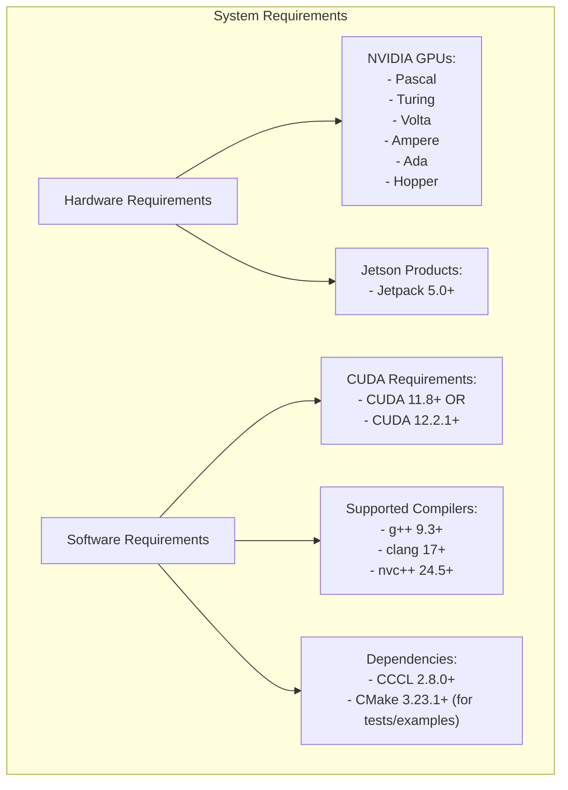
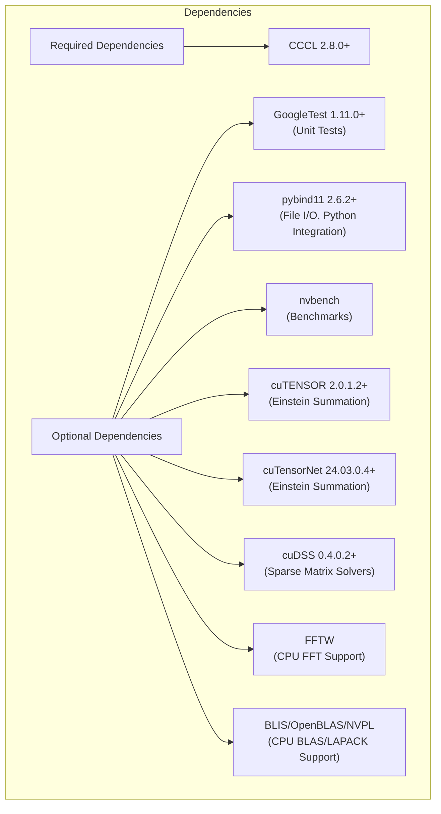
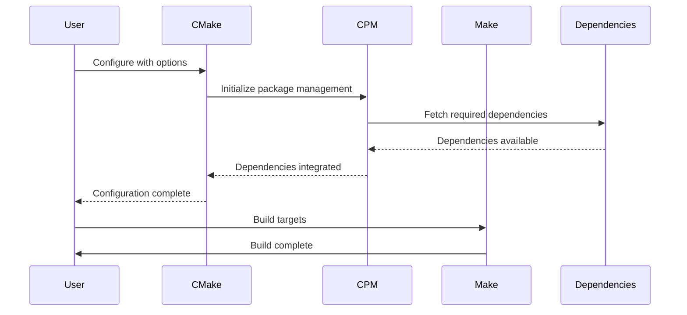
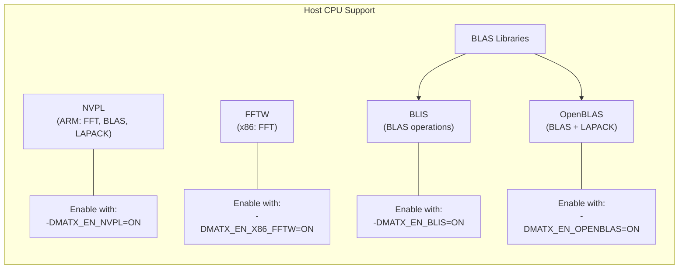
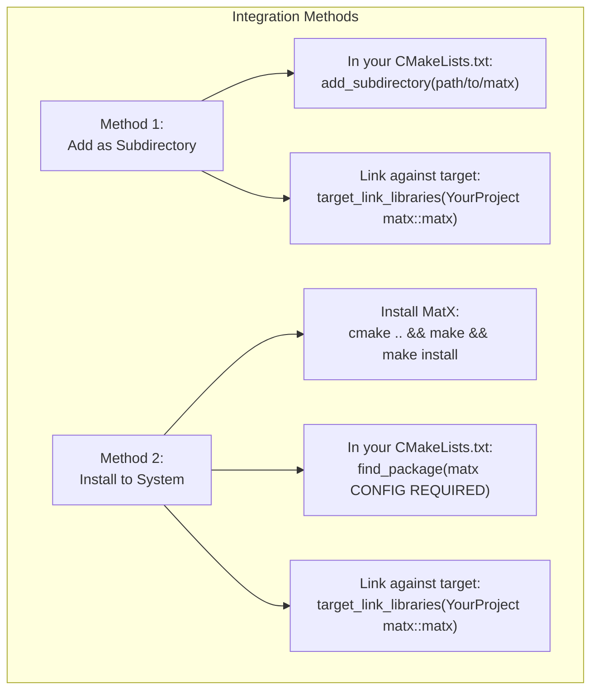
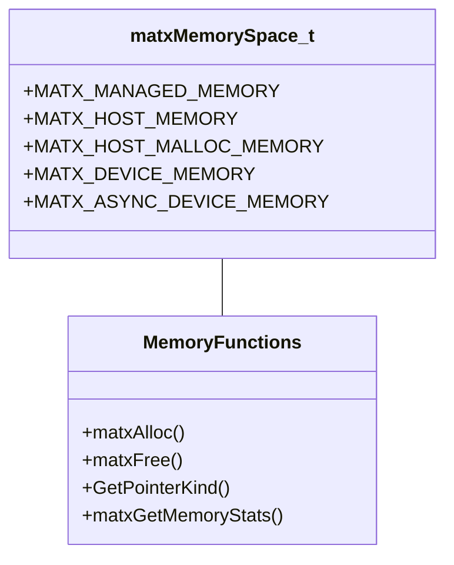
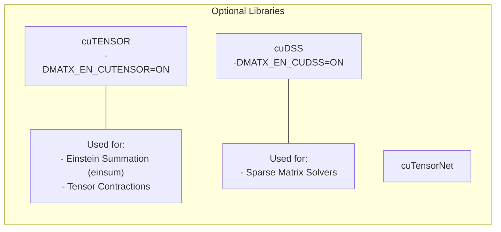

<!-- source: DeepWiki mcp.deepwiki.com · repo NVIDIA/MatX · page 6 Building and Integration · fetched 2026-10-26 -->

# Building and Integration

<details>
<summary>Relevant source files</summary>

The following files were used as context for generating this wiki page:

- [CMakeLists.txt](CMakeLists.txt)
- [README.md](README.md)
- [bench/00_sparse/SpMM.cu](bench/00_sparse/SpMM.cu)
- [bench/00_transform/cub.cu](bench/00_transform/cub.cu)
- [bench/CMakeLists.txt](bench/CMakeLists.txt)
- [cmake/FindcuDSS.cmake](cmake/FindcuDSS.cmake)
- [docs_input/basics/matlabpython.rst](docs_input/basics/matlabpython.rst)
- [docs_input/basics/memory.rst](docs_input/basics/memory.rst)
- [docs_input/build.rst](docs_input/build.rst)
- [examples/CMakeLists.txt](examples/CMakeLists.txt)
- [examples/eigenExample.cu](examples/eigenExample.cu)
- [examples/test_host.cpp](examples/test_host.cpp)
- [include/matx/core/allocator.h](include/matx/core/allocator.h)
- [test/00_sparse/Basic.cu](test/00_sparse/Basic.cu)
- [test/CMakeLists.txt](test/CMakeLists.txt)

</details>


This page provides detailed information about building the MatX library from source and integrating it into your projects. MatX is a header-only C++ library for numerical computing on NVIDIA GPUs, so there's no need to compile the library itself for basic usage. However, building may be necessary for running unit tests, examples, or benchmarks. 

For information about the core tensor system and operations, see [Core Tensor System](#2), and for details about specific execution models, see [Execution Model](#5).

## System Requirements

MatX has specific hardware and software requirements to ensure optimal performance and compatibility.



Sources: [README.md:50-62](), [CMakeLists.txt:99-107](), [docs_input/build.rst:20-26]()

### Required Dependencies

MatX requires specific dependencies for both core functionality and optional features.



Sources: [docs_input/build.rst:27-41](), [CMakeLists.txt:60-78]()

## Build Options and Targets

MatX provides several build options that can be configured using CMake. These options control which components are built and how they function.

```mermaid
classDiagram
    class "CMake Options" {
        +MATX_BUILD_TESTS (OFF)
        +MATX_BUILD_BENCHMARKS (OFF)
        +MATX_BUILD_EXAMPLES (OFF)
        +MATX_BUILD_DOCS (OFF)
        +MATX_NVTX_FLAGS (OFF)
        +MATX_BUILD_32_BIT (OFF)
        +MATX_MULTI_GPU (OFF)
        +MATX_EN_VISUALIZATION (OFF)
        +MATX_EN_CUTENSOR (OFF)
        +MATX_EN_CUDSS (OFF)
        +MATX_EN_FILEIO (OFF)
        +MATX_EN_PYBIND11 (OFF)
        +MATX_EN_X86_FFTW (OFF)
        +MATX_EN_NVPL (OFF)
        +MATX_EN_BLIS (OFF)
        +MATX_EN_OPENBLAS (OFF)
    }
```

This table shows the main build targets and their corresponding CMake options:

| Target | CMake Option | Purpose |
|--------|--------------|---------|
| Unit Tests | `-DMATX_BUILD_TESTS=ON` | Build unit tests using Google Test framework |
| Benchmarks | `-DMATX_BUILD_BENCHMARKS=ON` | Build performance benchmarks using NVBench |
| Examples | `-DMATX_BUILD_EXAMPLES=ON` | Build example applications |
| Documentation | `-DMATX_BUILD_DOCS=ON` | Build documentation using Doxygen and Sphinx |

Sources: [CMakeLists.txt:60-80](), [docs_input/build.rst:69-87]()

## Building MatX

### Basic Build Process

Building MatX follows the standard CMake workflow. Here's how the build process works:



Sources: [README.md:72-86](), [CMakeLists.txt:30-43]()

### Building Basic MatX Project

To build MatX with examples, tests, and benchmarks:

```bash
mkdir build && cd build
cmake -DMATX_BUILD_TESTS=ON -DMATX_BUILD_BENCHMARKS=ON -DMATX_BUILD_EXAMPLES=ON ..
make -j
```

By default, CMake will target the GPU architecture(s) of the system you're compiling on. If you wish to target other architectures:

```bash
cmake .. -DCMAKE_CUDA_ARCHITECTURES="80;90"
```

Sources: [README.md:72-86](), [CMakeLists.txt:53-56]()

### Building with Host CPU Support

MatX provides CPU execution support through various backend libraries:



To enable CPU support, use one of the following CMake options:

```bash
# For ARM CPU support with NVPL
cmake .. -DMATX_EN_NVPL=ON

# For x86 FFT support with FFTW
cmake .. -DMATX_EN_X86_FFTW=ON

# For BLAS operations with BLIS
cmake .. -DMATX_EN_BLIS=ON

# For BLAS and LAPACK operations with OpenBLAS
cmake .. -DMATX_EN_OPENBLAS=ON
```

Sources: [docs_input/build.rst:43-67](), [CMakeLists.txt:206-258]()

### Build in Offline Environments

MatX can be built in environments without internet access by using CPM's caching capabilities:

1. Clone MatX on an internet-connected system:
```bash
git clone https://github.com/NVIDIA/MatX.git
```

2. Set up CPM source cache and build once to download dependencies:
```bash
export CPM_SOURCE_CACHE=$HOME/matx_cpm_cache
mkdir build && cd build
cmake ..
```

3. Transfer the source code and cache to the offline system:
```bash
tar -czvf matx_cache.tar.gz $HOME/matx_cpm_cache
# Transfer to offline system
```

4. On the offline system, extract and use the cache:
```bash
tar -xvf matx_cache.tar.gz -C $HOME
export CPM_SOURCE_CACHE=$HOME/matx_cpm_cache
mkdir build && cd build
cmake ..
make
```

Sources: [docs_input/build.rst:251-296](), [README.md:64-65]()

## Integrating MatX with Other Projects

There are two primary methods for integrating MatX into your projects:



Sources: [README.md:104-145](), [CMakeLists.txt:359-389]()

### Method 1: Adding MatX as a Subdirectory

This method is useful when you include the MatX source directly in your project's directory structure.

1. Add MatX as a subdirectory in your CMakeLists.txt:
```cmake
add_subdirectory(path/to/matx)
```

2. Link your target against the MatX library:
```cmake
target_link_libraries(your_project matx::matx)
```

Sources: [README.md:110-118]()

### Method 2: Installing MatX to the System

This method installs MatX to your system and uses CMake's `find_package` mechanism.

1. Install MatX:
```bash
cd /path/to/matx
mkdir build && cd build
cmake ..
make && make install
```

2. In your project's CMakeLists.txt:
```cmake
find_package(matx CONFIG REQUIRED)
target_link_libraries(your_project matx::matx)
```

The `matx::matx` target includes all necessary compiler flags, include directories, and library dependencies.

Sources: [README.md:120-145](), [CMakeLists.txt:359-389]()

### Example Integration

Below is a simple example showing how to integrate MatX into a project:

```cmake
cmake_minimum_required(VERSION 3.23)
project(MyMatXProject LANGUAGES CXX CUDA)

# Option 1: Add as subdirectory
add_subdirectory(external/matx)

# Option 2: Find installed package
# find_package(matx CONFIG REQUIRED)

# Create your executable
add_executable(my_app main.cu)

# Link against MatX
target_link_libraries(my_app PRIVATE matx::matx)
```

Sources: [examples/CMakeLists.txt:1-71](), [README.md:110-145]()

## Memory Management

MatX provides a flexible memory management system that supports different memory spaces. This is important to understand when integrating MatX into your applications.



The memory space is specified when creating tensors with `make_tensor`:

```cpp
// Create a tensor in managed memory (default)
auto tensor1 = matx::make_tensor<float>({100, 100});

// Create a tensor in device memory
auto tensor2 = matx::make_tensor<float>({100, 100}, MATX_DEVICE_MEMORY);

// Create a tensor in host-pinned memory
auto tensor3 = matx::make_tensor<float>({100, 100}, MATX_HOST_MEMORY);
```

Sources: [include/matx/core/allocator.h:56-63](), [docs_input/basics/memory.rst:1-19]()

## Advanced Configuration Options

MatX provides several additional build options to control code generation and behavior.

| Option | CMake Flag | Description |
|--------|------------|-------------|
| NVTX Flags | `-DMATX_NVTX_FLAGS=ON` | Enable NVTX profiling support |
| 32-bit Indices | `-DMATX_BUILD_32_BIT=ON` | Use 32-bit indices instead of 64-bit |
| File I/O Support | `-DMATX_EN_FILEIO=ON` | Enable file I/O support |
| Code Coverage | `-DMATX_EN_COVERAGE=ON` | Enable code coverage reporting |
| Complex NaN Checks | `-DMATX_EN_COMPLEX_OP_NAN_CHECKS=ON` | Enable NaN/Inf handling for complex operations |
| CUDA Line Info | `-DMATX_EN_CUDA_LINEINFO=ON` | Enable line information for CUDA kernels |

Sources: [docs_input/build.rst:157-181](), [CMakeLists.txt:60-79]()

### Optional Library Support

MatX can optionally integrate with specialized NVIDIA libraries like cuTENSOR and cuDSS. These libraries are fetched automatically if the corresponding options are enabled:



Sources: [CMakeLists.txt:285-306](), [cmake/FindcuDSS.cmake:1-135]()

## Testing and Benchmarking

MatX includes a comprehensive testing and benchmarking framework.

### Running Tests

To run all unit tests:

```bash
mkdir build && cd build
cmake -DMATX_BUILD_TESTS=ON ..
make -j
test/matx_test
```

To run specific tests:

```bash
cd build/test
./matx_test --gtest_filter="*FFT*"
```

Sources: [test/CMakeLists.txt:1-114](), [docs_input/build.rst:91-112]()

### Running Benchmarks

MatX uses NVBench for benchmarking:

```bash
mkdir build && cd build
cmake -DMATX_BUILD_BENCHMARKS=ON ..
make -j
bench/matx_bench
```

Sources: [bench/CMakeLists.txt:1-49](), [docs_input/build.rst:122-129]()

## Building Documentation

MatX documentation is built using Doxygen, Breathe, and Sphinx:

```bash
mkdir build && cd build
cmake -DMATX_BUILD_DOCS=ON ..
make
```

After building, the documentation is available in `build/docs_input/sphinx/index.html`.

Required packages:
- Breathe 4.31.0
- Doxygen 1.11.0
- Sphinx 4.3.1
- sphinx-book-theme 0.1.7
- libjs-mathjax
- texlive-font-utils

Sources: [docs_input/build.rst:132-156](), [CMakeLists.txt:92-96]()

## Library Visibility and Linking

MatX defaults to hidden visibility due to requirements from pybind11. This means symbols from the C++ linker are hidden, which can affect multi-library projects. Visibility settings can be changed in your build environment, or specific symbols can be enabled through C++ visibility support features.

Sources: [docs_input/build.rst:244-248]()

---

