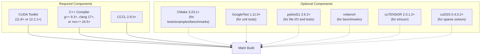
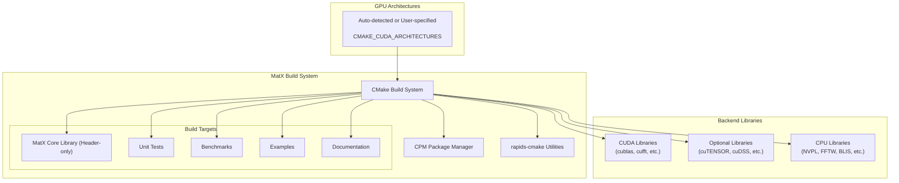

<!-- source: DeepWiki mcp.deepwiki.com · repo NVIDIA/MatX · page 6.1 Building MatX · fetched 2026-10-26 -->

# Building MatX

<details>
<summary>Relevant source files</summary>

The following files were used as context for generating this wiki page:

- [CMakeLists.txt](CMakeLists.txt)
- [README.md](README.md)
- [bench/00_sparse/SpMM.cu](bench/00_sparse/SpMM.cu)
- [bench/00_transform/cub.cu](bench/00_transform/cub.cu)
- [bench/CMakeLists.txt](bench/CMakeLists.txt)
- [cmake/FindcuDSS.cmake](cmake/FindcuDSS.cmake)
- [docs_input/basics/matlabpython.rst](docs_input/basics/matlabpython.rst)
- [docs_input/basics/memory.rst](docs_input/basics/memory.rst)
- [docs_input/build.rst](docs_input/build.rst)
- [examples/CMakeLists.txt](examples/CMakeLists.txt)
- [examples/eigenExample.cu](examples/eigenExample.cu)
- [examples/test_host.cpp](examples/test_host.cpp)
- [include/matx/core/allocator.h](include/matx/core/allocator.h)
- [test/00_sparse/Basic.cu](test/00_sparse/Basic.cu)
- [test/CMakeLists.txt](test/CMakeLists.txt)

</details>


This page explains how to build MatX with different configurations and dependencies. It covers the build system, required dependencies, build options, and how to integrate MatX with other projects. For information about installing and using MatX after building, see [Building and Integration](#6).

## System Requirements

Before building MatX, ensure your system meets the following requirements:



MatX requires:
- **CUDA Toolkit**: Version 11.8, 12.2.1, or higher
- **C++ Compiler**: g++ 9.3+, clang 17+, or nvc++ 24.5+
- **Note**: CUDA 12.0.0 through 12.2.0 have issues that can cause compiler errors or segfaults

Sources: [CMakeLists.txt:89-106](), [README.md:50-65]()

## MatX Build System Overview

MatX uses CMake as its build system with the CPM package manager to handle third-party dependencies.



The MatX build system:
- Uses CMake (minimum version 3.23.1)
- Leverages CPM for dependency management
- Auto-detects GPU architectures or allows manual specification
- Supports building different components through CMake options
- Links against required CUDA libraries and optional extensions

Sources: [CMakeLists.txt:1-43](), [CMakeLists.txt:110-131]()

## Basic Build Process

### Step 1: Clone the Repository
```shell
git clone https://github.com/NVIDIA/MatX.git
cd MatX
```

### Step 2: Create a Build Directory
```shell
mkdir build && cd build
```

### Step 3: Configure with CMake
For a basic build with no components:
```shell
cmake ..
```

For a build with specific components (e.g., tests, examples):
```shell
cmake -DMATX_BUILD_TESTS=ON -DMATX_BUILD_EXAMPLES=ON ..
```

### Step 4: Build
```shell
make -j
```

By default, CMake targets the GPU architecture(s) of your current system. To target specific architectures, specify them with `CMAKE_CUDA_ARCHITECTURES`:

```shell
cmake .. -DCMAKE_CUDA_ARCHITECTURES="80;90"
```

Sources: [README.md:72-86](), [CMakeLists.txt:39-56]()

## Build Components

MatX provides four main build components, each controlled by a separate CMake option:

| Component   | CMake Option            | Description                                  |
|-------------|-------------------------|----------------------------------------------|
| Unit Tests  | `MATX_BUILD_TESTS`      | Builds unit tests using GoogleTest           |
| Benchmarks  | `MATX_BUILD_BENCHMARKS` | Builds benchmarks using nvbench              |
| Examples    | `MATX_BUILD_EXAMPLES`   | Builds example applications                  |
| Documentation | `MATX_BUILD_DOCS`     | Builds documentation using Doxygen and Sphinx|

### Building and Running Unit Tests

To build unit tests:
```shell
cmake -DMATX_BUILD_TESTS=ON ..
make -j
```

To run all tests:
```shell
make test
```

Or to run specific tests:
```shell
cd build/test
./matx_test --gtest_filter="*FFT*"
```

Sources: [README.md:174-192](), [test/CMakeLists.txt:1-114]()

### Building and Running Examples

To build example applications:
```shell
cmake -DMATX_BUILD_EXAMPLES=ON ..
make -j
```

Each example is compiled into a separate executable in the `build/examples` directory.

Sources: [README.md:113-119](), [examples/CMakeLists.txt:1-72]()

### Building and Running Benchmarks

To build benchmarks:
```shell
cmake -DMATX_BUILD_BENCHMARKS=ON ..
make -j
```

Benchmarks can then be run using:
```shell
bench/matx_bench
```

Sources: [README.md:122-127](), [bench/CMakeLists.txt:1-49]()

### Building Documentation

To build documentation:
```shell
cmake -DMATX_BUILD_DOCS=ON ..
make
```

This requires additional dependencies:
- Breathe 4.31.0
- Doxygen 1.11.0
- Sphinx 4.3.1
- sphinx-book-theme 0.1.7
- libjs-mathjax
- texlive-font-utils

The documentation is generated in `build/docs_input/sphinx`.

Sources: [README.md:149-157](), [CMakeLists.txt:93-96]()

## Integrating MatX with Other Projects

MatX can be integrated with other projects in two ways:

```mermaid
flowchart TD
    subgraph "Integration Methods"
        direction TB
        
        subgraph "1. MatX as Subdirectory"
            AddSubdir["add_subdirectory(path/to/matx)"]
            LinkTarget["target_link_libraries(MyProject matx::matx)"]
            AddSubdir --> LinkTarget
        end
        
        subgraph "2. MatX Installed to System"
            Install["make && make install"]
            FindPackage["find_package(matx CONFIG REQUIRED)"]
            LinkTarget2["target_link_libraries(MyProject matx::matx)"]
            Install --> FindPackage
            FindPackage --> LinkTarget2
        end
    end
    
    Project["Your CMake Project"] --> "Integration Methods"
```

### Method 1: Adding MatX as a Subdirectory

If MatX is included in your project directory:

```cmake
add_subdirectory(path/to/matx)
target_link_libraries(MyProject matx::matx)
```

### Method 2: Installing MatX System-Wide

First, install MatX:
```shell
cd /path/to/matx
mkdir build && cd build
cmake ..
make && make install
```

Then in your project's CMakeLists.txt:
```cmake
find_package(matx CONFIG REQUIRED)
target_link_libraries(MyProject matx::matx)
```

Sources: [README.md:104-145](), [CMakeLists.txt:358-389]()

## CPU/Host Support

MatX supports CPU/Host execution through various math libraries. To enable this functionality, use the following CMake options:

| Library | Purpose | CMake Option |
|---------|---------|--------------|
| NVPL | FFT, BLAS, LAPACK on ARM | `-DMATX_EN_NVPL=ON` |
| FFTW | FFT on x86 | `-DMATX_EN_X86_FFTW=ON` |
| BLIS | BLAS operations | `-DMATX_EN_BLIS=ON` |
| OpenBLAS | BLAS and LAPACK operations | `-DMATX_EN_OPENBLAS=ON` |

Note:
- NVPL cannot be used with other CPU libraries simultaneously
- You may need to specify the library directory with `blas_DIR`
- Most host functions (except reductions) support multithreading

Example configuration for ARM CPU support:
```shell
cmake .. -DMATX_EN_NVPL=ON
```

Example configuration for x86 CPU support:
```shell
cmake .. -DMATX_EN_X86_FFTW=ON -DMATX_EN_OPENBLAS=ON
```

Sources: [docs_input/build.rst:43-67](), [CMakeLists.txt:206-258]()

## Additional Build Options

MatX provides several additional build options to control code generation and features:

| Option | CMake Flag | Description |
|--------|------------|-------------|
| NVTX Flags | `-DMATX_NVTX_FLAGS=ON` | Enables NVTX profiling ranges |
| 32-bit Indices | `-DMATX_BUILD_32_BIT=ON` | Uses 32-bit indices instead of 64-bit |
| File I/O Support | `-DMATX_EN_FILEIO=ON` | Enables file I/O capabilities |
| cuTENSOR Support | `-DMATX_EN_CUTENSOR=ON` | Enables cuTENSOR for tensor operations |
| cuDSS Support | `-DMATX_EN_CUDSS=ON` | Enables cuDSS for sparse solvers |
| Code Coverage | `-DMATX_EN_COVERAGE=ON` | Enables code coverage reporting |
| Complex NaN Checks | `-DMATX_EN_COMPLEX_OP_NAN_CHECKS=ON` | Enables NaN/Inf handling for complex ops |
| CUDA Line Info | `-DMATX_EN_CUDA_LINEINFO=ON` | Adds line information for CUDA kernels |

Example:
```shell
cmake .. -DMATX_NVTX_FLAGS=ON -DMATX_EN_FILEIO=ON
```

Sources: [docs_input/build.rst:157-181](), [CMakeLists.txt:61-80](), [CMakeLists.txt:195-272]()

## Memory Management

MatX supports several memory spaces for tensor allocation:

```mermaid
flowchart TB
    subgraph "Memory Spaces (matxMemorySpace_t)"
        MANAGED["MATX_MANAGED_MEMORY
        CUDA managed memory (UM)"]
        HOST_PINNED["MATX_HOST_MEMORY
        CUDA host-pinned memory"]
        HOST_MALLOC["MATX_HOST_MALLOC_MEMORY
        Host-allocated pageable memory"]
        DEVICE["MATX_DEVICE_MEMORY
        CUDA device memory"]
        ASYNC_DEVICE["MATX_ASYNC_DEVICE_MEMORY
        CUDA asynchronous device memory"]
    end
    
    subgraph "Allocation API"
        ALLOC["matxAlloc()"]
        FREE["matxFree()"]
        GET_KIND["GetPointerKind()"]
        STATS["matxGetMemoryStats()"]
    end
    
    ALLOC --> MANAGED
    ALLOC --> HOST_PINNED
    ALLOC --> HOST_MALLOC
    ALLOC --> DEVICE
    ALLOC --> ASYNC_DEVICE
    
    FREE --> "Memory Spaces (matxMemorySpace_t)"
    GET_KIND --> "Memory Spaces (matxMemorySpace_t)"
    STATS --> "Memory Spaces (matxMemorySpace_t)"
```

The memory space is specified when creating a tensor with `make_tensor()`. Different memory spaces affect where the tensor can be accessed:

- `MATX_MANAGED_MEMORY`: Accessible from both CPU and GPU
- `MATX_HOST_MEMORY`: Host-pinned memory accessible from CPU, efficiently transferable to GPU
- `MATX_HOST_MALLOC_MEMORY`: Regular host memory (malloc), only accessible from CPU
- `MATX_DEVICE_MEMORY`: GPU memory, only accessible from GPU
- `MATX_ASYNC_DEVICE_MEMORY`: Stream-ordered GPU memory allocation

Example:
```cpp
// Create a tensor in device memory
auto tensor = matx::make_tensor<float>({100, 100}, MATX_DEVICE_MEMORY);
```

Sources: [include/matx/core/allocator.h:56-62](), [docs_input/basics/memory.rst:1-19]()

## Building in Offline Environments

MatX can be built in air-gapped environments without internet access using CPM's local package cache.

The process involves:
1. Clone MatX on an internet-connected machine
2. Build MatX with `CPM_SOURCE_CACHE` set to create a cache of dependencies
3. Transfer the MatX source code and CPM cache to the offline system
4. Build on the offline system with `CPM_SOURCE_CACHE` pointing to the transferred cache

Example workflow:
```shell
# On Internet-connected system
export CPM_SOURCE_CACHE=$HOME/matx_cpm_cache
git clone https://github.com/NVIDIA/MatX.git
cd MatX
mkdir build && cd build
cmake ..
# Cache is now populated

# Archive for transfer
tar -czvf matx_cache.tar.gz $HOME/matx_cpm_cache

# On Offline system after transfer
tar -xvf matx_cache.tar.gz -C $HOME
export CPM_SOURCE_CACHE=$HOME/matx_cpm_cache
cd MatX
mkdir build && cd build
cmake ..
make -j
```

Sources: [docs_input/build.rst:251-298](), [CMakeLists.txt:15-27]()

## Troubleshooting

### Common Issues

1. **CUDA Compiler Errors**: 
   - MatX requires CUDA 11.8 or CUDA 12.2.1+
   - CUDA 12.0.0 through 12.2.0 are known to have issues with MatX

2. **Missing Dependencies**:
   - If building unit tests, benchmarks, or examples, ensure required dependencies are available
   - Missing dependencies will be reported during the CMake configuration step

3. **Build Performance**:
   - Building tests can take a long time due to template instantiations
   - Use the `-j` flag with `make` to enable parallel compilation

4. **Windows Support**:
   - MatX support is currently limited to Linux
   - Windows support may be added in future releases

Sources: [README.md:50-57](), [README.md:66-71]()

---

