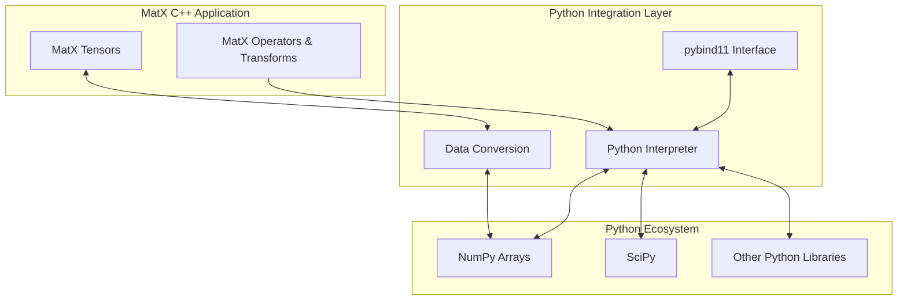
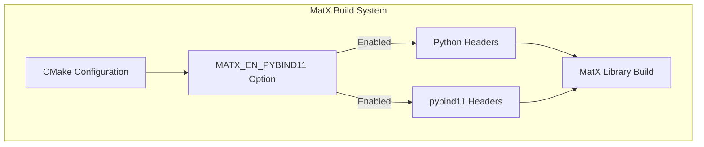
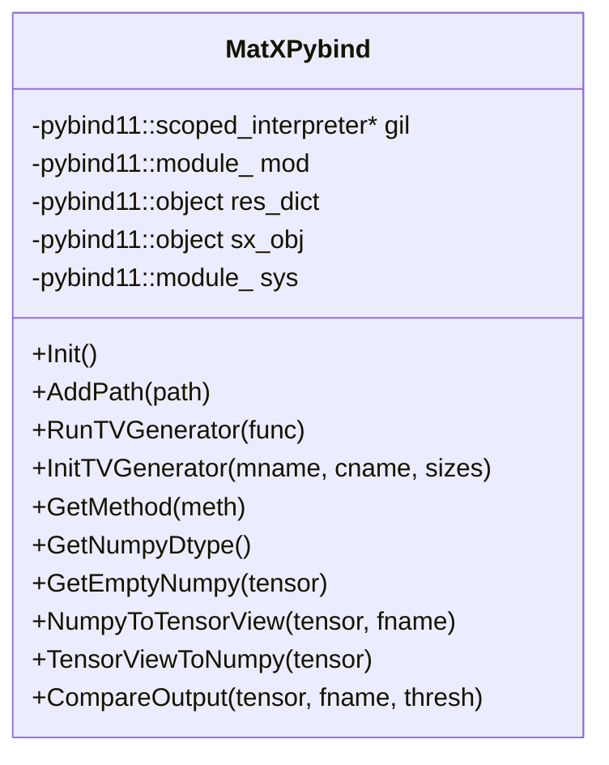
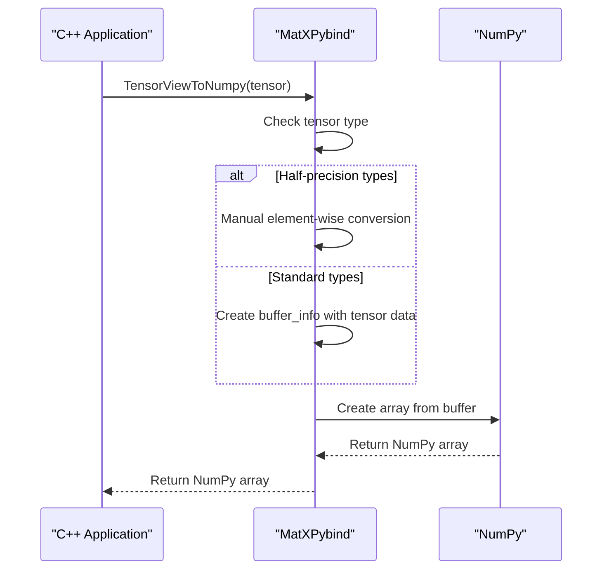
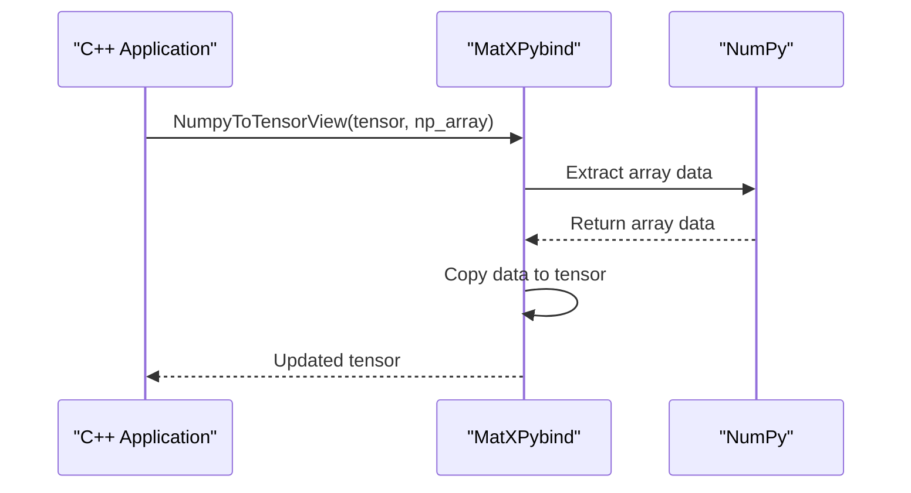
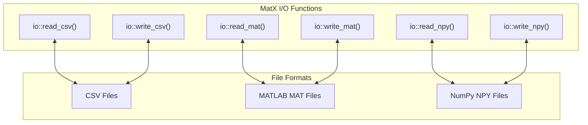
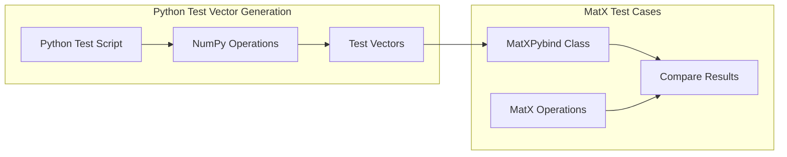
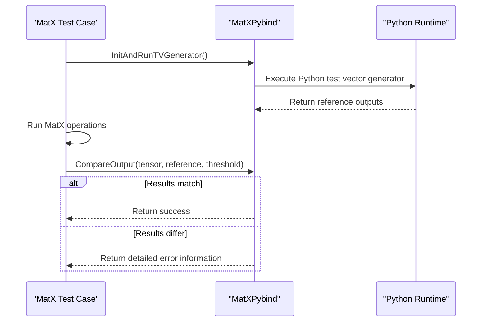
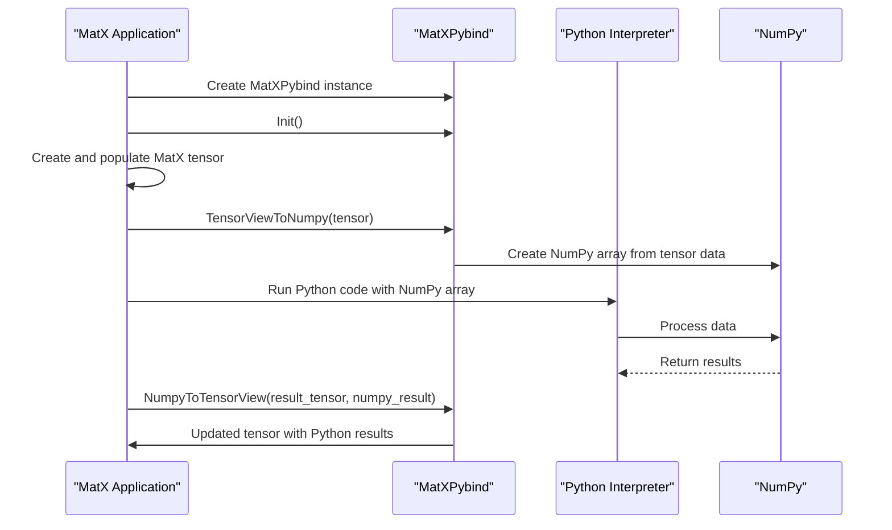
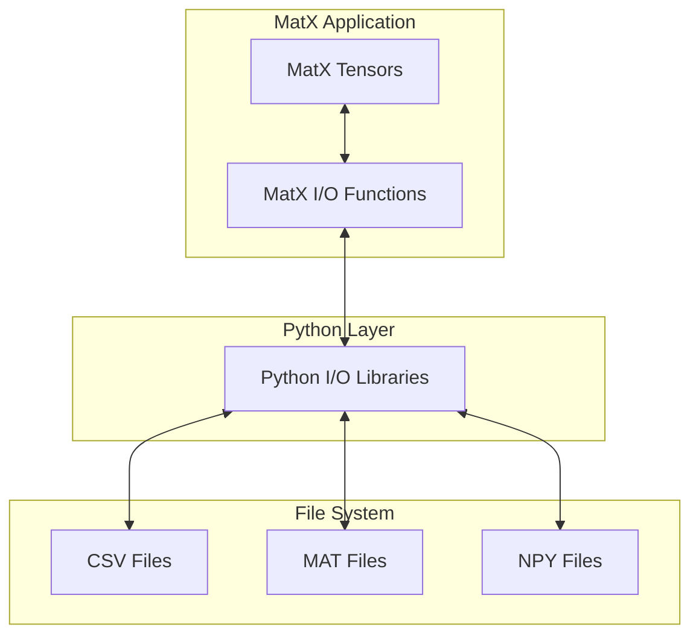

<!-- source: DeepWiki mcp.deepwiki.com · repo NVIDIA/MatX · page 6.2 Python Integration · fetched 2026-10-26 -->

# Python Integration

<details>
<summary>Relevant source files</summary>

The following files were used as context for generating this wiki page:

- [bench/00_sparse/SpMM.cu](bench/00_sparse/SpMM.cu)
- [bench/00_transform/cub.cu](bench/00_transform/cub.cu)
- [bench/CMakeLists.txt](bench/CMakeLists.txt)
- [docs_input/basics/matlabpython.rst](docs_input/basics/matlabpython.rst)
- [examples/CMakeLists.txt](examples/CMakeLists.txt)
- [examples/eigenExample.cu](examples/eigenExample.cu)
- [examples/test_host.cpp](examples/test_host.cpp)
- [include/matx/core/pybind.h](include/matx/core/pybind.h)
- [include/matx/transforms/copy.h](include/matx/transforms/copy.h)
- [test/00_io/FileIOTests.cu](test/00_io/FileIOTests.cu)
- [test/00_io/small_csv_complex_comma_nh.csv](test/00_io/small_csv_complex_comma_nh.csv)
- [test/00_sparse/Basic.cu](test/00_sparse/Basic.cu)
- [test/00_transform/Copy.cu](test/00_transform/Copy.cu)
- [test/CMakeLists.txt](test/CMakeLists.txt)
- [test/test_vectors/generators/00_file_io.py](test/test_vectors/generators/00_file_io.py)
- [test/test_vectors/generators/matx_common.py](test/test_vectors/generators/matx_common.py)

</details>


This document covers the integration of MatX with Python, enabling interoperability between MatX tensors and Python objects (particularly NumPy arrays). It explains how to use Python within MatX applications, convert data between MatX and Python, and leverage Python libraries from within C++ code using the MatX framework.

For information about building MatX, see [Building MatX](#6.1).

## Overview of MatX Python Integration

MatX provides Python integration through [pybind11](https://github.com/pybind/pybind11), allowing for seamless interaction between MatX's GPU-accelerated tensor operations and Python's ecosystem, particularly NumPy. This integration enables:

1. Embedding Python interpreter in MatX applications
2. Converting between MatX tensors and NumPy arrays
3. Executing Python code from within MatX
4. Reading/writing file formats supported by Python libraries
5. Testing and validating MatX operations against Python implementations



Sources: [include/matx/core/pybind.h:37-558](), [test/CMakeLists.txt:85-85](), [examples/CMakeLists.txt:69-71]()

## Integration Mechanisms

### Enabling Python Support in MatX

To use Python integration features, MatX must be built with Python support enabled. This is controlled by the `MATX_EN_PYBIND11` CMake option. When enabled, MatX builds the necessary Python bindings and includes Python integration samples.



Sources: [examples/CMakeLists.txt:69-71](), [test/CMakeLists.txt:85-85](), [bench/CMakeLists.txt:18-19]()

### The MatXPybind Class

The core of Python integration is the `MatXPybind` class, which provides functionality for initializing the Python interpreter, managing Python objects, and converting between MatX tensors and NumPy arrays.



Sources: [include/matx/core/pybind.h:86-553]()

## Data Exchange Between MatX and Python

One of the most important features of MatX's Python integration is the ability to convert data between MatX tensors and NumPy arrays. This allows you to use the extensive Python ecosystem for data processing and visualization while leveraging MatX's GPU acceleration for computation.

### Converting MatX Tensors to NumPy Arrays

The `TensorViewToNumpy` method converts MatX tensors to NumPy arrays, handling type conversion and memory layout differences.



Sources: [include/matx/core/pybind.h:404-470]()

### Converting NumPy Arrays to MatX Tensors

The `NumpyToTensorView` method converts NumPy arrays to MatX tensors.



Sources: [include/matx/core/pybind.h:332-380]()

## File I/O with Python Integration

MatX leverages Python's file I/O capabilities to support various file formats that are commonly used in scientific computing.

### Supported File Formats

MatX supports reading and writing:
- CSV files
- MAT files (MATLAB format)
- NPY files (NumPy binary format)



Sources: [test/00_io/FileIOTests.cu:71-266]()

### Example: Reading and Writing CSV Files

MatX provides functions for reading and writing CSV files, which can be useful for data exchange with other tools and languages.

Sources: [test/00_io/FileIOTests.cu:71-102]()

### Example: Reading and Writing MAT Files

MAT files allow interoperability with MATLAB, enabling data exchange between MatX and MATLAB workflows.

Sources: [test/00_io/FileIOTests.cu:104-140]()

### Example: Reading and Writing NPY Files

NPY files provide efficient binary storage for NumPy arrays, allowing direct data exchange with Python applications.

Sources: [test/00_io/FileIOTests.cu:233-276]()

## Using Python for Testing and Validation

MatX uses Python for testing and validation purposes, leveraging Python's scientific computing ecosystem to generate test vectors and validate results.

### Test Vector Generation

Python scripts in MatX generate test vectors for validating MatX operations. These scripts create reference data that MatX test cases can compare against.



Sources: [test/test_vectors/generators/matx_common.py:1-24](), [test/test_vectors/generators/00_file_io.py:1-18]()

### Output Comparison

The `MatXPybind` class provides methods for comparing MatX tensor outputs with Python-generated reference outputs, ensuring correctness of MatX operations.



Sources: [include/matx/core/pybind.h:473-545]()

## Build System Configuration

To use Python integration in your MatX application, you need to configure your build system correctly.

### CMake Configuration

Here's how to configure CMake to include Python integration:

```cmake
# Find pybind11 and Python
find_package(pybind11 REQUIRED)
find_package(Python COMPONENTS Interpreter Development REQUIRED)

# Add Python includes to your target
target_include_directories(your_target PRIVATE 
    ${pybind11_INCLUDE_DIR} 
    ${PYTHON_INCLUDE_DIRS}
)

# Link Python libraries if needed
target_link_libraries(your_target PRIVATE
    ${PYTHON_LIBRARIES}
)
```

### Dependencies

To use MatX's Python integration, you need:
1. Python development headers and libraries
2. pybind11
3. NumPy (for array conversion)

| Dependency | Version | Purpose |
|------------|---------|---------|
| Python     | 3.6+    | Python runtime and interpreter |
| pybind11   | 2.6.0+  | C++/Python binding layer |
| NumPy      | 1.17.0+ | Array data structure in Python |

Sources: [test/CMakeLists.txt:85-85](), [examples/CMakeLists.txt:27-27](), [bench/CMakeLists.txt:41-41]()

## Practical Examples

### Embedding Python in a MatX Application

The following steps illustrate how to embed Python in your MatX application:

1. Initialize the Python interpreter
2. Convert MatX tensors to NumPy arrays for Python processing
3. Process data with Python libraries
4. Convert results back to MatX tensors



### Using Python for File I/O

MatX leverages Python for reading and writing various file formats:



Sources: [test/00_io/FileIOTests.cu:71-266]()

## Conclusion

Python integration in MatX provides a powerful way to combine MatX's GPU-accelerated tensor operations with Python's extensive ecosystem. By using pybind11, MatX achieves seamless data exchange with Python libraries, enabling workflows that leverage the strengths of both environments.

The integration allows for:
- Converting between MatX tensors and NumPy arrays
- Embedding Python in MatX applications
- Reading and writing various file formats
- Testing and validating MatX operations
- Combining GPU acceleration with Python's scientific computing tools

This flexibility makes MatX a versatile tool for developing high-performance scientific computing applications that can leverage both C++ and Python ecosystems.

---

