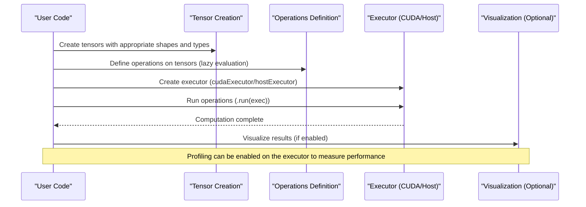
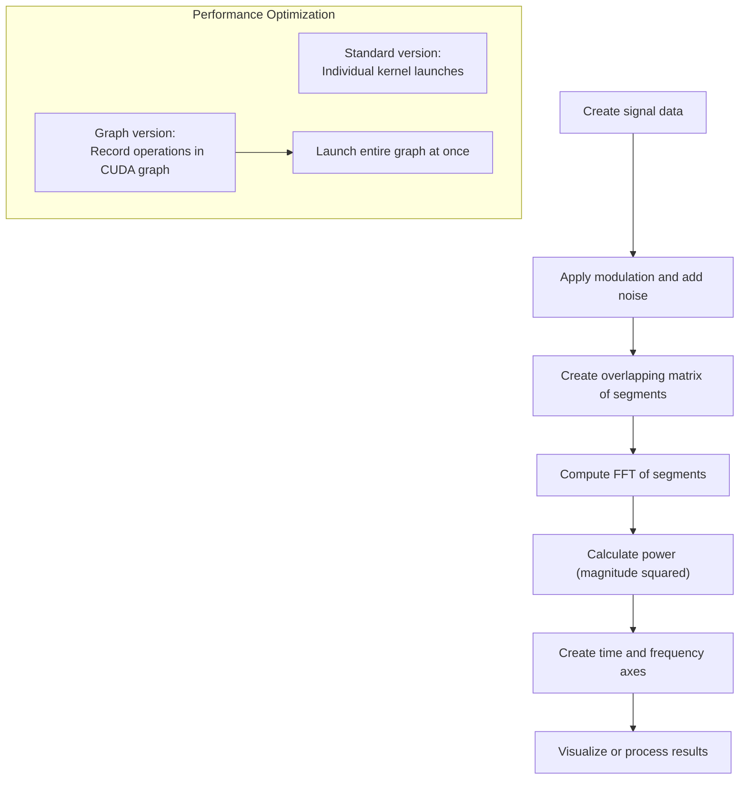
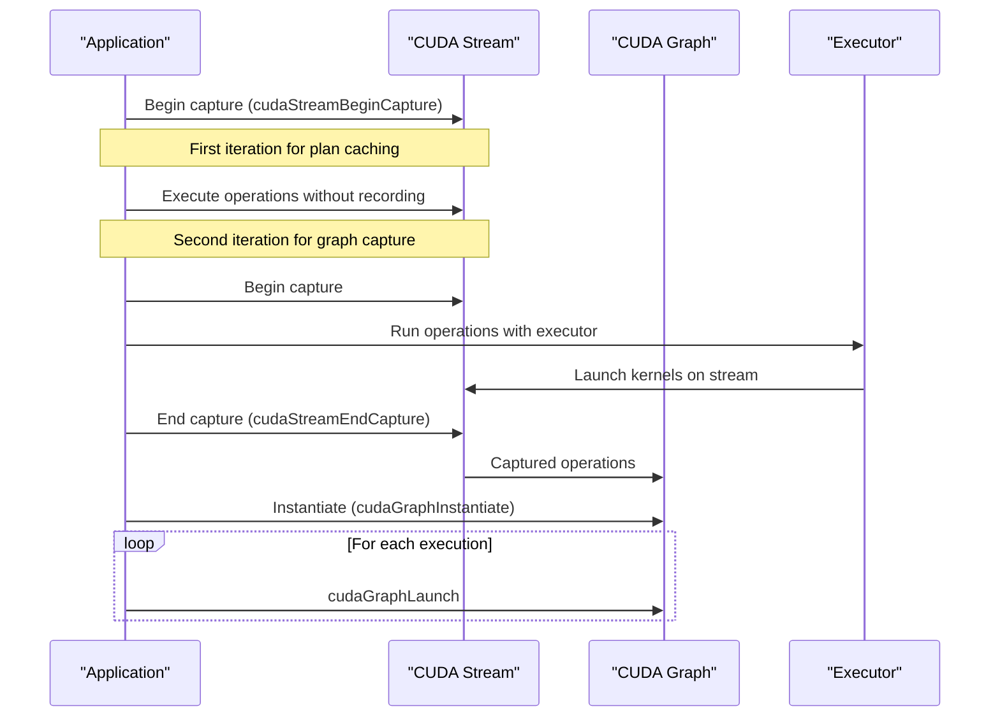
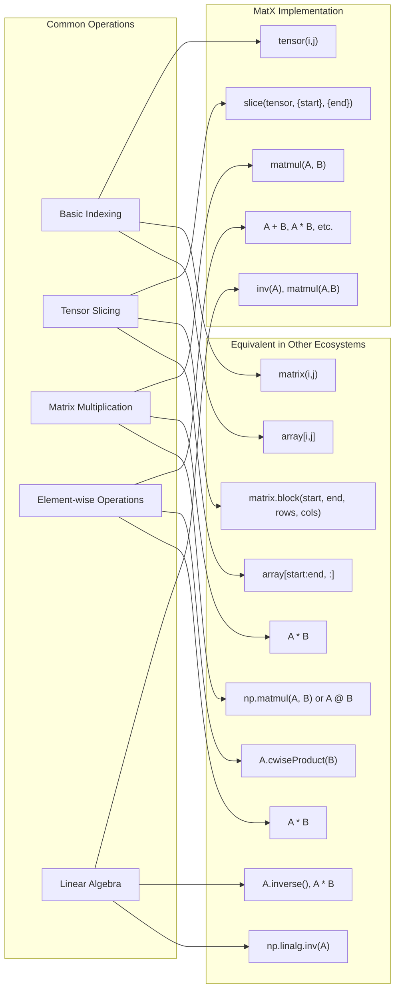
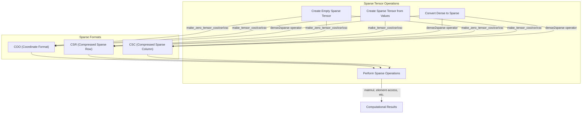

<!-- source: DeepWiki mcp.deepwiki.com · repo NVIDIA/MatX · page 7 Examples and Use Cases · fetched 2026-10-26 -->

# Examples and Use Cases

<details>
<summary>Relevant source files</summary>

The following files were used as context for generating this wiki page:

- [bench/00_sparse/SpMM.cu](bench/00_sparse/SpMM.cu)
- [bench/00_transform/cub.cu](bench/00_transform/cub.cu)
- [bench/CMakeLists.txt](bench/CMakeLists.txt)
- [docs_input/basics/matlabpython.rst](docs_input/basics/matlabpython.rst)
- [docs_input/basics/profiling.rst](docs_input/basics/profiling.rst)
- [examples/CMakeLists.txt](examples/CMakeLists.txt)
- [examples/eigenExample.cu](examples/eigenExample.cu)
- [examples/spectrogram.cu](examples/spectrogram.cu)
- [examples/spectrogram_graph.cu](examples/spectrogram_graph.cu)
- [examples/test_host.cpp](examples/test_host.cpp)
- [include/matx/executors/cuda.h](include/matx/executors/cuda.h)
- [test/00_sparse/Basic.cu](test/00_sparse/Basic.cu)
- [test/CMakeLists.txt](test/CMakeLists.txt)

</details>


This page showcases practical applications and common usage patterns of the MatX library, demonstrating how to utilize its capabilities across various domains. It serves as a resource for understanding how to implement different types of computational workflows using MatX's tensor operations, transforms, and execution models. For details on specific tensor operations and API references, see [Core Tensor System](#2) and [Operators](#3).

## Overview of Examples Structure

MatX provides a rich set of examples that demonstrate its capabilities across various domains. These examples are organized in the `examples/` directory and showcase different usage patterns, from basic tensor operations to complex signal processing pipelines.

```mermaid
flowchart TD
    subgraph "Examples Categories"
        SignalProcessing["Signal Processing Examples"]
        LinearAlgebra["Linear Algebra Examples"]
        RadarProcessing["Radar Processing"]
        PerformanceOpt["Performance Optimization"]
        Integration["Ecosystem Integration"]
        SparseTensors["Sparse Tensor Operations"]
    end

    SignalProcessing --> Spectrogram["spectrogram.cu"]
    SignalProcessing --> SpectrogramGraph["spectrogram_graph.cu"]
    SignalProcessing --> FFTConv["fft_conv.cu"]
    SignalProcessing --> Resample["resample.cu"]
    SignalProcessing --> PWelch["pwelch.cu"]
    
    LinearAlgebra --> SVDPower["svd_power.cu"]
    LinearAlgebra --> QR["qr.cu"]
    LinearAlgebra --> EigenExample["eigenExample.cu"]
    LinearAlgebra --> CGSolve["cgsolve.cu"]
    
    RadarProcessing --> RadarPipeline["simple_radar_pipeline.cu"]
    RadarProcessing --> MVDRBeamformer["mvdr_beamformer.cu"]
    
    PerformanceOpt --> BlackScholes["black_scholes.cu"]
    PerformanceOpt --> SpectrogramGraph
    
    Integration --> PythonIntegration["python_integration_sample"]
    
    SparseTensors --> SparseTensor["sparse_tensor.cu"]
```



Sources: [examples/CMakeLists.txt:1-71](), [test/CMakeLists.txt:1-114]()

## Basic Usage Pattern

Most MatX examples follow a common pattern that includes tensor creation, operation definition, execution, and optional visualization. The following diagram illustrates this workflow:



Sources: [examples/spectrogram.cu:55-149](), [include/matx/executors/cuda.h:48-193]()

## Signal Processing Examples

### Spectrogram Example

The spectrogram example demonstrates signal analysis by creating a time-frequency representation of a signal. MatX provides two variants of this example:

1. Standard implementation ([examples/spectrogram.cu]())
2. CUDA graph-optimized implementation ([examples/spectrogram_graph.cu]())

Both examples follow these steps:



Key implementation details from the spectrogram examples:

1. Signal generation using mathematical operations:
   - Creating a time vector, modulation, carrier, and noise
   - Combining components to create a test signal

2. Signal processing pipeline:
   - Computing frequency bins using `linspace`
   - Creating overlapping segments with the `overlap` operator
   - Computing FFT of segments
   - Computing magnitude squared for power

3. Visualization (when enabled):
   - Using MatX visualization capabilities with `viz::contour`

4. Performance comparison between standard and graph-based execution:
   - Standard version uses regular kernel launches
   - Graph version captures operations in a CUDA graph for faster execution

Sources: [examples/spectrogram.cu:55-149](), [examples/spectrogram_graph.cu:54-159]()

## Performance Optimization Examples

### CUDA Graph Acceleration

MatX supports CUDA Graphs to optimize performance by capturing a sequence of operations and executing them as a single unit. The spectrogram_graph.cu example demonstrates this pattern:



Key performance benefits shown in the example:
- Single launch overhead instead of multiple kernel launches
- Optimized scheduling of operations
- Measurement shows significant performance improvement (microseconds vs. milliseconds)

Sources: [examples/spectrogram_graph.cu:54-159](), [include/matx/executors/cuda.h:90-121]()

### Profiling MatX Operations

MatX provides built-in profiling capabilities through its executors:

1. Create an executor with profiling enabled:
   ```cpp
   cudaExecutor exec{stream, true}; // Second parameter enables profiling
   ```

2. Measure execution time:
   ```cpp
   exec.start_timer();
   // Run operations
   exec.stop_timer();
   float time_ms = exec.get_time_ms();
   ```

This pattern is demonstrated in both spectrogram examples, allowing developers to accurately measure the performance of MatX operations.

Sources: [examples/spectrogram.cu:63-143](), [examples/spectrogram_graph.cu:65-154](), [docs_input/basics/profiling.rst:1-43]()

## Integration with Other Ecosystems

### Comparison with Other Libraries

MatX provides familiar syntax for users migrating from MATLAB, NumPy/SciPy, or Eigen. The eigenExample.cu file demonstrates how to perform equivalent operations between Eigen and MatX:



The example demonstrates key operations like:
- Basic indexing and element access
- Element-wise operations (addition, multiplication, division)
- Tensor slicing and manipulation
- Linear algebra operations (matrix multiplication, inversion)
- Data mapping between libraries

Sources: [examples/eigenExample.cu:44-391](), [docs_input/basics/matlabpython.rst:1-84]()

## Sparse Tensor Examples

MatX supports sparse tensor operations through its experimental sparse tensor functionality. The sparse tensor examples demonstrate:

1. Creating sparse tensors in various formats (COO, CSR, CSC)
2. Converting between dense and sparse formats
3. Performing operations like sparse matrix multiplication (SpMM)

The example in `sparse_tensor.cu` and test cases in `test/00_sparse/Basic.cu` show how to:
- Create empty sparse tensors
- Initialize sparse tensors with specific values
- Perform operations on sparse tensors
- Benchmark sparse operations against dense equivalents



Sources: [test/00_sparse/Basic.cu:47-182](), [bench/00_sparse/SpMM.cu:13-43]()

## Domain-Specific Application Examples

MatX provides examples for various domain-specific applications, with particular emphasis on signal processing and radar applications:

### Radar Processing Examples

The radar processing examples demonstrate how to build signal processing pipelines for radar applications, including:
- Multi-channel radar signal processing
- MVDR beamforming
- Ambiguity function computation

These examples showcase how MatX can be used to implement complex signal processing algorithms efficiently on GPUs, leveraging operations like FFT, matrix multiplication, and specialized radar processing functions.

### Financial Applications

The Black-Scholes example demonstrates how MatX can be used for financial modeling and computation:
- Vector-based option pricing calculations
- Parallel computation of financial derivatives

### Benchmarking Examples

The benchmark directory contains examples that demonstrate performance characteristics of various MatX operations:
- Matrix multiplication (matmul) benchmarks
- FFT performance testing
- Sparse matrix operations benchmarks
- Reduction operation benchmarks

These benchmarks provide insights into the performance characteristics of MatX operations and can help users optimize their applications.

Sources: [test/CMakeLists.txt:40-43](), [examples/CMakeLists.txt:2-21](), [bench/CMakeLists.txt:1-48]()

## Summary

MatX provides a comprehensive set of examples that showcase its capabilities across various domains, from basic tensor operations to complex signal processing pipelines and domain-specific applications. These examples demonstrate how to leverage MatX's Python-like syntax with near-native GPU performance, making it a powerful tool for a wide range of computational tasks.

Key takeaways:
1. MatX examples follow a common pattern of tensor creation, operation definition, and execution
2. Performance optimization techniques like CUDA graphs can significantly improve execution speed
3. MatX provides familiar syntax for users migrating from other libraries like MATLAB, NumPy, or Eigen
4. The library supports a wide range of applications, from signal processing to financial modeling
5. Built-in profiling capabilities help users measure and optimize performance

For more detailed information on specific components, refer to the Core Tensor System (#2), Operators (#3), and Transforms (#4) documentation.

---

