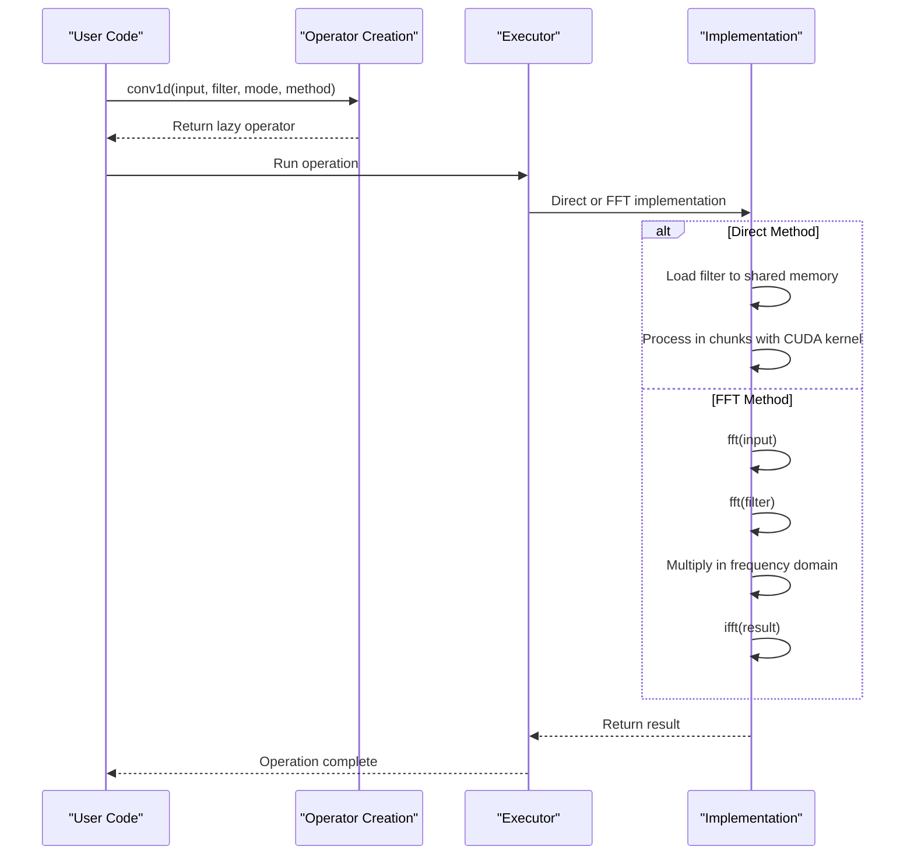
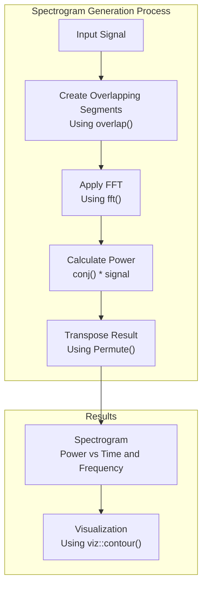

<!-- source: DeepWiki mcp.deepwiki.com · repo NVIDIA/MatX · page 7.1 Signal Processing Examples · fetched 2026-10-26 -->

# Signal Processing Examples

<details>
<summary>Relevant source files</summary>

The following files were used as context for generating this wiki page:

- [bench/00_transform/matmul.cu](bench/00_transform/matmul.cu)
- [docs_input/basics/profiling.rst](docs_input/basics/profiling.rst)
- [examples/conv2d.cu](examples/conv2d.cu)
- [examples/spectrogram.cu](examples/spectrogram.cu)
- [examples/spectrogram_graph.cu](examples/spectrogram_graph.cu)
- [include/matx/core/utils.h](include/matx/core/utils.h)
- [include/matx/executors/cuda.h](include/matx/executors/cuda.h)
- [include/matx/kernels/conv.cuh](include/matx/kernels/conv.cuh)
- [include/matx/operators/conv.h](include/matx/operators/conv.h)
- [include/matx/operators/corr.h](include/matx/operators/corr.h)
- [include/matx/operators/filter.h](include/matx/operators/filter.h)
- [include/matx/transforms/conv.h](include/matx/transforms/conv.h)
- [include/matx/transforms/corr.h](include/matx/transforms/corr.h)
- [include/matx/transforms/filter.h](include/matx/transforms/filter.h)
- [test/00_transform/ConvCorr.cu](test/00_transform/ConvCorr.cu)

</details>


This page provides detailed examples and technical explanations of the signal processing capabilities available in MatX. The examples cover convolution operations, correlation, FFT-based processing, and the creation of spectrograms. For information about linear algebra operations, see [Linear Algebra Solvers](#4.4).

## Signal Processing Operation Overview

The MatX library provides several signal processing operations that follow a consistent workflow pattern while offering high performance on NVIDIA GPUs. These operations include convolutions, correlations, filters, and FFT-based analysis.

```mermaid
graph TD
    subgraph "MatX Signal Processing Operations"
        Conv1D["conv1d()"]
        Conv2D["conv2d()"]
        Corr["corr()"]
        FFT["fft()/ifft()"]
        Overlap["overlap()"]
        Filter["filter()"]
    end
    
    subgraph "Implementation Methods"
        Direct["Direct Method"]
        FFTMethod["FFT-Based Method"]
    end
    
    subgraph "Convolution/Correlation Modes"
        FULL["FULL Mode<br>Output = M+N-1"]
        SAME["SAME Mode<br>Output = max(M,N)"]
        VALID["VALID Mode<br>Output = max(M,N)-min(M,N)+1"]
    end
    
    Conv1D --> Direct
    Conv1D --> FFTMethod
    Conv1D --> FULL
    Conv1D --> SAME
    Conv1D --> VALID
    
    Conv2D --> Direct
    Conv2D --> FULL
    Conv2D --> SAME
    Conv2D --> VALID
    
    Corr --> Direct
    Corr --> FFTMethod
    Corr --> FULL
    Corr --> SAME
    Corr --> VALID
    
    FFT -.-> FFTMethod
    FFT -.-> "Spectrogram Creation"
    
    Filter --> "FIR Filtering"
    Filter --> "IIR Filtering"
    
    Overlap --> "Spectrogram Creation"
```

Sources: 
- [include/matx/transforms/conv.h:1-443]()
- [include/matx/operators/conv.h:1-407]()
- [include/matx/transforms/corr.h:1-75]()

## Convolution Operations

MatX provides both 1D and 2D convolution operations with different modes and implementation methods. These operations are fully GPU-accelerated and can handle both real and complex data types.

### Convolution Operation Flow



Sources:
- [include/matx/transforms/conv.h:49-171]()
- [include/matx/transforms/conv.h:260-307]()
- [include/matx/kernels/conv.cuh:36-193]()

### 1D Convolution Examples

The `conv1d()` function provides 1D convolution with different modes:

- **FULL mode**: Returns full convolution output (length = N + M - 1)
- **SAME mode**: Returns central part of convolution (length = max(N, M))
- **VALID mode**: Returns only the valid part where filter fully overlaps input (length = max(N, M) - min(N, M) + 1)

Methods:
- **Direct method**: Time-domain convolution using shared memory on the GPU
- **FFT method**: Frequency-domain multiplication using FFT

Basic usage:

```cpp
// See test file for complete example
tensor_t<float, 1> input({signal_length});
tensor_t<float, 1> filter({filter_length});
tensor_t<float, 1> output({output_length});

// FULL mode convolution with direct method
(output = conv1d(input, filter, MATX_C_MODE_FULL)).run(exec);

// SAME mode convolution with FFT method
(output = conv1d(input, filter, MATX_C_MODE_SAME, MATX_C_METHOD_FFT)).run(exec);
```

You can also specify which axis to convolve along in multi-dimensional tensors:

```cpp
// Convolve along specific axis (dimension 2) in a 3D tensor
(output = conv1d(input, filter, {2}, MATX_C_MODE_SAME)).run(exec);
```

Sources:
- [test/00_transform/ConvCorr.cu:243-253]()
- [test/00_transform/ConvCorr.cu:644-647]()
- [include/matx/operators/conv.h:213-218]()
- [include/matx/operators/conv.h:232-244]()

### 2D Convolution Examples

The `conv2d()` function provides 2D convolution for image processing and other 2D signal operations:

```cpp
tensor_t<float, 2> image({height, width});
tensor_t<float, 2> kernel({kernel_height, kernel_width});
tensor_t<float, 2> output({output_height, output_width});

// 2D convolution with SAME mode
(output = conv2d(image, kernel, MATX_C_MODE_SAME)).run(exec);
```

Similar to 1D convolution, you can also specify axes for multi-dimensional tensors:

```cpp
// Convolve along specific axes in a higher dimensional tensor
(output = conv2d(input, filter, {1, 2}, MATX_C_MODE_SAME)).run(exec);
```

Sources:
- [test/00_transform/ConvCorr.cu:356-358]()
- [include/matx/operators/conv.h:404-407]()
- [include/matx/operators/conv.h:420-429]()
- [examples/conv2d.cu:49-79]()

## Correlation Operations

Correlation is similar to convolution but without flipping the filter. MatX provides the `corr()` function with modes and methods similar to convolution:

```cpp
// Full correlation mode with direct correlation
(output = corr(input, filter, MATX_C_MODE_FULL, MATX_C_METHOD_DIRECT)).run(exec);

// Full correlation mode with FFT-based correlation
(output = corr(input, filter, MATX_C_MODE_FULL, MATX_C_METHOD_FFT)).run(exec);
```

Internally, correlation is implemented by conjugating and reversing the filter and then using convolution:

```cpp
// From corr.h - internally uses convolution after preprocessing
auto i2r = reverse<In2Type::Rank()-1>(conj(i2));
conv1d_impl(o, i1, i2r, mode, method, exec);
```

Sources:
- [test/00_transform/ConvCorr.cu:584-587]()
- [test/00_transform/ConvCorr.cu:600-603]()
- [include/matx/transforms/corr.h:62-70]()
- [include/matx/operators/corr.h:199-203]()

## Filtering Operations

MatX provides both FIR (Finite Impulse Response) and IIR (Infinite Impulse Response) filtering capabilities:

```mermaid
graph TD
    subgraph "Filtering Operations"
        Filter["filter() function"]
        FIR["FIR Filtering<br>Non-recursive"]
        IIR["IIR Filtering<br>Recursive"]
    end
    
    subgraph "Implementation Methods"
        NonRecImpl["For Non-recursive:<br>Optimized Convolution"]
        RecImpl["For Recursive:<br>Parallel Linear Recurrence Algorithm"]
    end
    
    Filter --> FIR
    Filter --> IIR
    
    FIR --> NonRecImpl
    IIR --> RecImpl
    
    NonRecImpl --> conv1d
    RecImpl --> "matxFilter_t implementation"
```

The `filter()` function takes recursive and non-recursive coefficients:

```cpp
// Define recursive and non-recursive coefficients
cuda::std::array<float, NR> recursive_coeffs;   // For IIR parts (denominator)
cuda::std::array<float, NNR> nonrecursive_coeffs;  // For FIR parts (numerator)

// Apply filter
(output = filter(input, recursive_coeffs, nonrecursive_coeffs)).run(exec);
```

For pure FIR filtering, it's more efficient to use the convolution API directly.

Sources:
- [include/matx/transforms/filter.h:48-294]()
- [include/matx/operators/filter.h:45-167]()
- [include/matx/transforms/filter.h:412-454]()

## Spectrogram Generation

A spectrogram represents signal power versus frequency and time. MatX provides examples of generating spectrograms using FFT and overlapping windows.



### Spectrogram Implementation Example

The following key steps are involved in creating a spectrogram:

1. Create time domain signal
2. Define parameters (window size, overlap, FFT size)
3. Create overlapping segments using `overlap()`
4. Apply FFT to each segment
5. Calculate power (magnitude squared)
6. Transpose the result for visualization

Sources:
- [examples/spectrogram.cu:101-125]()
- [examples/spectrogram_graph.cu:114-121]()

### Spectrogram with and without CUDA Graphs

MatX provides two spectrogram examples:
- Basic implementation ([examples/spectrogram.cu]())
- Optimized implementation using CUDA graphs ([examples/spectrogram_graph.cu]())

The CUDA graphs version captures the entire workflow into a graph that can be replayed multiple times with lower overhead, providing better performance. This is demonstrated by performance measurements in the examples:

```cpp
// From spectrogram_graph.cu - Using CUDA graphs for better performance
cudaGraph_t graph;
cudaGraphExec_t instance;

// Record operations into a CUDA graph
cudaStreamBeginCapture(stream, cudaStreamCaptureModeGlobal);
// [Signal processing operations]
cudaStreamEndCapture(stream, &graph);
cudaGraphInstantiate(&instance, graph, NULL, NULL, 0);

// Execute the graph multiple times with lower overhead
for (uint32_t i = 0; i < 10; i++) {
    cudaGraphLaunch(instance, stream);
}
```

Sources:
- [examples/spectrogram_graph.cu:104-138]()
- [examples/spectrogram_graph.cu:144-154]()
- [examples/spectrogram.cu:100-136]()

## Performance Considerations

### Profiling Signal Processing Operations

MatX provides built-in profiling capabilities through the executor interface:

```cpp
// Enable profiling in the executor
cudaExecutor exec{stream, true};  // Second parameter enables profiling

// Start timing
exec.start_timer();

// Run signal processing operations
(output = conv1d(input, filter, MATX_C_MODE_FULL)).run(exec);

// Stop timing and get results
exec.stop_timer();
float time_ms = exec.get_time_ms();
printf("Execution time: %.2f ms\n", time_ms);
```

This profiling mechanism is used in the spectrogram examples to compare performance with and without CUDA graphs.

Sources:
- [examples/spectrogram.cu:63-145]()
- [examples/spectrogram_graph.cu:65-151]()
- [include/matx/executors/cuda.h:102-121]()
- [docs_input/basics/profiling.rst:9-42]()

### Choosing Between Direct and FFT Methods

- **Direct method**: More efficient for small filter sizes
- **FFT method**: More efficient for large filter sizes due to O(n log n) complexity
- Default is DIRECT for most operations

When filter size exceeds `MAX_MIN_DIMENSION_DIRECT` (1024), MatX will require using the FFT method.

Sources:
- [include/matx/operators/conv.h:59-133]()
- [include/matx/transforms/conv.h:49-169]()

## Practical Examples

### Creating a Signal with Modulation and Noise

The spectrogram examples demonstrate creating a modulated signal with noise:

```cpp
// Time axis
(time = linspace(0.0f, static_cast<float>(N) - 1.0f, N) / fs).run(exec);
// Modulation
(modulation = 500.f * cos(2.f * M_PI * 0.25f * time)).run(exec);
// Carrier with modulation
(carrier = amp * sin(2.f * M_PI * 3000.f * time + modulation)).run(exec);
// Noise with exponential decay
(noise = sqrt(0.01f * fs / 2.f) * random<float>({N}, NORMAL) * exp(-1.0f * time / 5.0f)).run(exec);
// Final signal
(x = carrier + noise).run(exec);
```

### Building a Spectrogram

The complete spectrogram generation workflow:

```cpp
// DFT Sample Frequencies (rfftfreq)
(freqs = (1.0f / (static_cast<float>(nfft) * 1.f / fs)) *
           linspace(0.0f, static_cast<float>(nfft) / 2.0f, nfft / 2 + 1))
    .run(exec);

// Create overlapping matrix of segments
auto stackedMatrix = overlap(x, {nperseg}, {nstep});
// FFT along rows
(fftStackedMatrix = fft(stackedMatrix)).run(exec);
// Absolute value (power)
(fftStackedMatrix = conj(fftStackedMatrix) * fftStackedMatrix).run(exec);
// Get real part and transpose
auto Sxx = fftStackedMatrix.RealView().Permute({1, 0});

// Spectral time axis
(s_time = linspace(static_cast<float>(nperseg) / 2.0f,
                       static_cast<float>(N - nperseg) / 2.0f + 1, (N - noverlap) / nstep) /
            fs)
    .run(exec);
```

Sources:
- [examples/spectrogram.cu:87-125]()
- [examples/spectrogram_graph.cu:88-127]()

---

