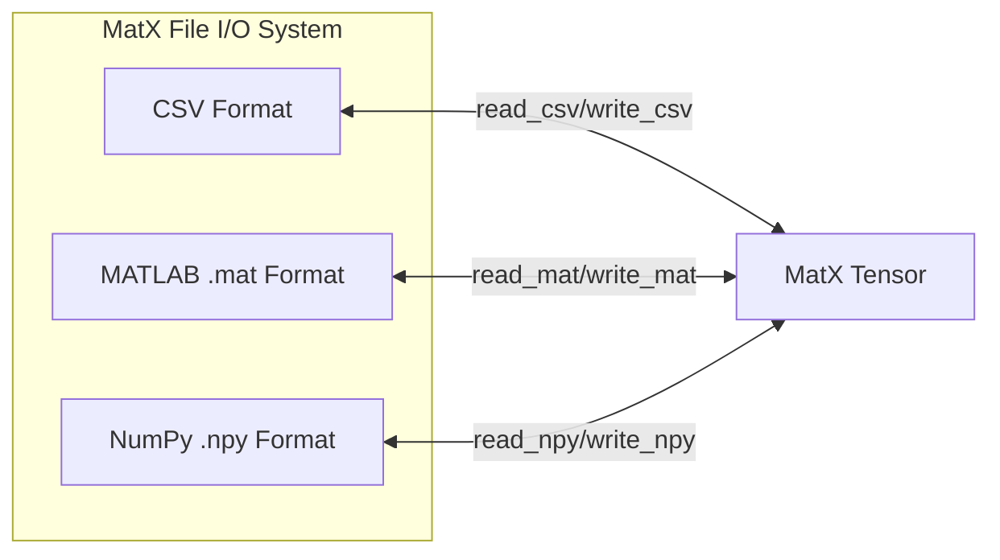
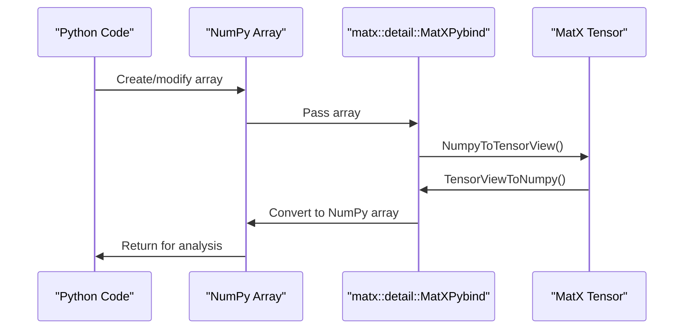
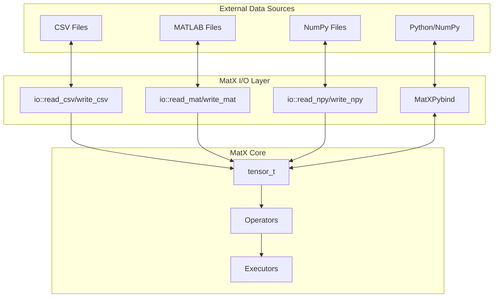

<!-- source: DeepWiki mcp.deepwiki.com · repo NVIDIA/MatX · page 7.2 File I/O and Data Loading · fetched 2026-10-26 -->

# File I/O and Data Loading

<details>
<summary>Relevant source files</summary>

The following files were used as context for generating this wiki page:

- [include/matx/core/pybind.h](include/matx/core/pybind.h)
- [include/matx/transforms/copy.h](include/matx/transforms/copy.h)
- [test/00_io/FileIOTests.cu](test/00_io/FileIOTests.cu)
- [test/00_io/small_csv_complex_comma_nh.csv](test/00_io/small_csv_complex_comma_nh.csv)
- [test/00_transform/Copy.cu](test/00_transform/Copy.cu)
- [test/test_vectors/generators/00_file_io.py](test/test_vectors/generators/00_file_io.py)
- [test/test_vectors/generators/matx_common.py](test/test_vectors/generators/matx_common.py)

</details>


This page documents MatX's file I/O capabilities for loading and saving tensor data from various file formats. The MatX library provides straightforward methods for reading and writing tensor data, supporting common formats used in scientific computing and data analysis.

## Supported File Formats

MatX supports several standard file formats for data exchange:



Sources: [test/00_io/FileIOTests.cu:66-102](), [test/00_io/FileIOTests.cu:104-140](), [test/00_io/FileIOTests.cu:233-276]()

### Format Comparison Table

| Format | Description | Best Used For | Type Support |
|--------|-------------|---------------|--------------|
| CSV | Text-based, comma-separated values | Human-readable data, simple datasets | Basic types, complex numbers |
| MAT | MATLAB binary format | Interoperability with MATLAB | All MatX types, including multi-dimensional tensors |
| NPY | NumPy binary format | Interoperability with Python/NumPy | All MatX types, preserves shape information |

## CSV File Operations

The CSV format is supported through the `read_csv` and `write_csv` functions in the `io` namespace.

### Reading CSV Files

To read data from a CSV file into a tensor:

```cpp
// Read CSV file with comma delimiter into a tensor
io::read_csv(tensor, "path/to/file.csv", ",");
```

The `read_csv` function supports the following parameters:
- Target tensor to load data into
- Path to the CSV file
- Delimiter character (e.g., "," for comma-separated)
- Optional header flag (default: true to skip the first line)

Sources: [test/00_io/FileIOTests.cu:66-76]()

### Writing CSV Files

To write a tensor to a CSV file:

```cpp
// Write tensor to CSV file with comma delimiter
io::write_csv(tensor, "output.csv", ",");
```

The `write_csv` function takes:
- Source tensor containing the data
- Output file path
- Delimiter character

Sources: [test/00_io/FileIOTests.cu:88-102]()

## MATLAB MAT File Operations

For interoperability with MATLAB, MatX provides functions to read and write .mat files.

### Reading MAT Files

The `read_mat` function loads a variable from a .mat file into a tensor:

```cpp
// Read variable "myvar" from MAT file into a tensor
io::read_mat(tensor, "path/to/file.mat", "myvar");
```

Parameters:
- Target tensor to load data into
- Path to the MAT file
- Name of the variable to read

Sources: [test/00_io/FileIOTests.cu:104-117]()

### Writing MAT Files

To save a tensor as a variable in a MAT file:

```cpp
// Write tensor as variable "myvar" to MAT file
io::write_mat(tensor, "output.mat", "myvar");
```

Parameters:
- Source tensor containing the data
- Output file path
- Variable name to use in the MAT file

MatX supports writing tensors of up to rank 5 to MAT files.

Sources: [test/00_io/FileIOTests.cu:118-140](), [test/00_io/FileIOTests.cu:142-170]()

### Alternative Reading Pattern

MatX also supports an alternative pattern for reading MAT files that automatically determines the tensor shape:

```cpp
// Read variable and get tensor with correct shape
tensor_t<float, 3> tensor;
tensor.Shallow(io::read_mat<decltype(tensor)>("file.mat", "myvar"));
```

This approach creates a new tensor with the correct shape and then makes the target tensor a shallow copy of it.

Sources: [test/00_io/FileIOTests.cu:172-200]()

## NumPy NPY File Operations

For Python interoperability, MatX supports NumPy's binary `.npy` format.

### Reading NPY Files

To read data from a NumPy .npy file:

```cpp
// Read NumPy array from NPY file into a tensor
io::read_npy(tensor, "path/to/file.npy");
```

Parameters:
- Target tensor to load data into
- Path to the NPY file

The target tensor must have the correct shape and rank to match the data in the NPY file.

Sources: [test/00_io/FileIOTests.cu:233-253]()

### Writing NPY Files

To save a tensor in NumPy's NPY format:

```cpp
// Write tensor to NPY file
io::write_npy(tensor, "output.npy");
```

Parameters:
- Source tensor containing the data
- Output file path

Sources: [test/00_io/FileIOTests.cu:255-276]()

## Python Integration

MatX includes Python integration capabilities for data exchange with NumPy arrays, particularly useful for testing and data preparation.



Sources: [include/matx/core/pybind.h:325-380](), [include/matx/core/pybind.h:382-402](), [include/matx/core/pybind.h:404-470]()

### Python to MatX Conversion

The `NumpyToTensorView` function converts NumPy arrays to MatX tensors:

```cpp
// Convert NumPy array to MatX tensor
MatXPybind pb;
pb.NumpyToTensorView(tensor, numpy_object);
```

This function handles various data types, including complex numbers and automatically manages data transfer.

Sources: [include/matx/core/pybind.h:325-380]()

### MatX to Python Conversion

Conversely, `TensorViewToNumpy` converts MatX tensors to NumPy arrays:

```cpp
// Convert MatX tensor to NumPy array
auto numpy_array = pb.TensorViewToNumpy(tensor);
```

MatX takes care of memory layout and type conversion during this process.

Sources: [include/matx/core/pybind.h:404-470]()

## Deep Copying Data

While not strictly an I/O operation, deep copying is a related operation for data management. MatX provides the `copy` function for creating deep copies of tensors:

```cpp
// Create a deep copy of a tensor
auto tensor_copy = matx::copy(original_tensor, executor);
```

The copy function creates a new tensor with the same shape and data as the original.

Sources: [include/matx/transforms/copy.h:100-118]()

## Best Practices

1. **Tensor Preparation**: Ensure your target tensor has the correct shape and type before reading data into it. For MAT files with unknown dimensions, use the alternative reading pattern.

2. **Type Compatibility**: Be aware of type conversions between file formats and MatX tensors. For example, half-precision types may require special handling.

3. **Complex Number Support**: MatX handles complex numbers in all supported formats, but may require specific string formatting in CSV files.

4. **Performance Considerations**: For large datasets, binary formats (MAT, NPY) will generally provide better performance than text-based formats (CSV).

5. **Data Validation**: Always validate data after loading, especially when dealing with potentially corrupted or inconsistently formatted files.

## Integration with MatX Ecosystem



Sources: [test/00_io/FileIOTests.cu](), [include/matx/core/pybind.h]()

The file I/O capabilities in MatX are designed to integrate seamlessly with the rest of the MatX ecosystem. Data loaded from files can be immediately used with MatX operators and transforms, and processed data can be easily saved back to files for storage or interoperability with other systems.

---

