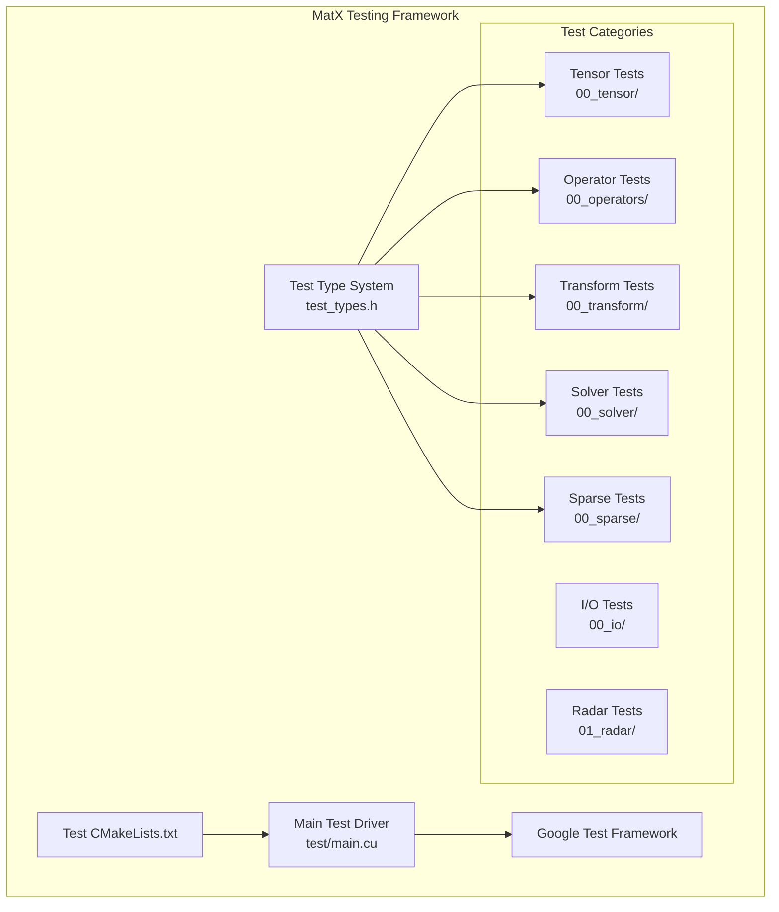
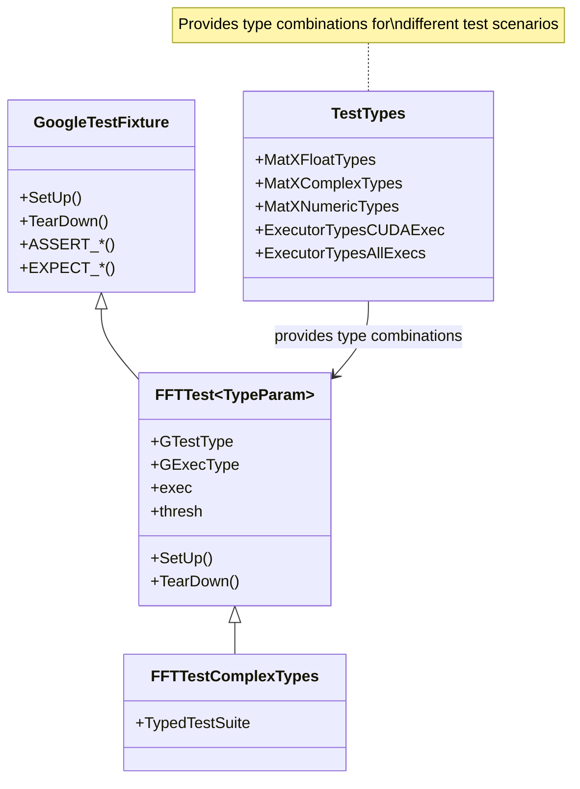
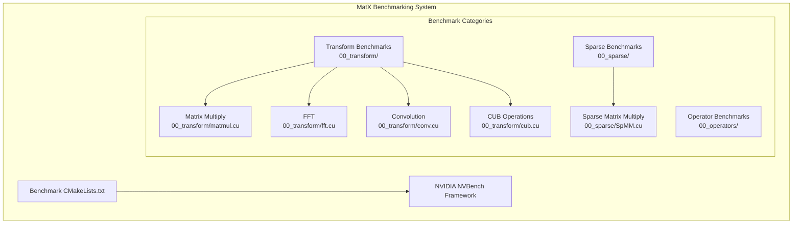
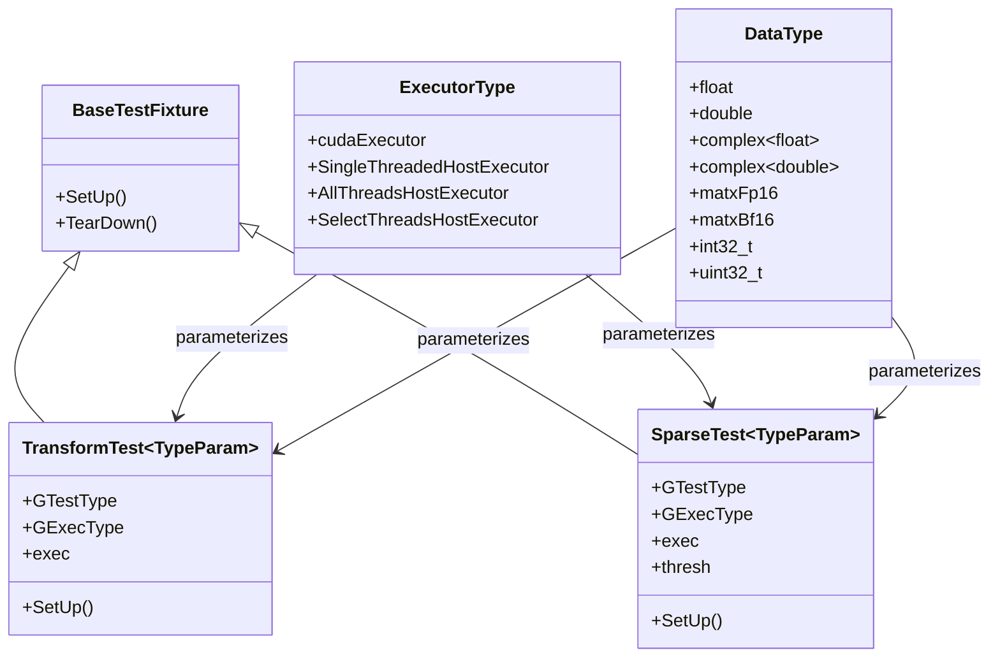

<!-- source: DeepWiki mcp.deepwiki.com · repo NVIDIA/MatX · page 8 Testing and Benchmarking · fetched 2026-10-26 -->

# Testing and Benchmarking

<details>
<summary>Relevant source files</summary>

The following files were used as context for generating this wiki page:

- [bench/00_sparse/SpMM.cu](bench/00_sparse/SpMM.cu)
- [bench/00_transform/cub.cu](bench/00_transform/cub.cu)
- [bench/CMakeLists.txt](bench/CMakeLists.txt)
- [docs_input/basics/matlabpython.rst](docs_input/basics/matlabpython.rst)
- [examples/CMakeLists.txt](examples/CMakeLists.txt)
- [examples/eigenExample.cu](examples/eigenExample.cu)
- [examples/test_host.cpp](examples/test_host.cpp)
- [include/matx/operators/fft.h](include/matx/operators/fft.h)
- [include/matx/transforms/fft/fft_common.h](include/matx/transforms/fft/fft_common.h)
- [include/matx/transforms/fft/fft_cuda.h](include/matx/transforms/fft/fft_cuda.h)
- [include/matx/transforms/fft/fft_fftw.h](include/matx/transforms/fft/fft_fftw.h)
- [test/00_sparse/Basic.cu](test/00_sparse/Basic.cu)
- [test/00_sparse/Convert.cu](test/00_sparse/Convert.cu)
- [test/00_sparse/Matmul.cu](test/00_sparse/Matmul.cu)
- [test/00_sparse/Matvec.cu](test/00_sparse/Matvec.cu)
- [test/00_sparse/Solve.cu](test/00_sparse/Solve.cu)
- [test/00_transform/FFT.cu](test/00_transform/FFT.cu)
- [test/CMakeLists.txt](test/CMakeLists.txt)
- [test/include/test_types.h](test/include/test_types.h)

</details>


This page provides an overview of MatX's testing and benchmarking systems. It covers how tests are structured, how to run them, and how to use the benchmarking capabilities to measure performance. For information about building MatX, see [Building and Integration](#6).

## Testing Overview

MatX employs a comprehensive testing framework based on Google Test to ensure correctness and reliability of all library components. Tests cover tensor operations, transforms, operators, solvers, and sparse tensor functionality across multiple data types and execution environments.



Sources: [test/CMakeLists.txt:3-50](), [test/include/test_types.h:39-171]()

### Test Organization

Tests in MatX are organized in directories corresponding to different components of the library:

| Directory | Description |
|-----------|-------------|
| 00_tensor | Tests for basic tensor operations and views |
| 00_operators | Tests for tensor operators and generators |
| 00_transform | Tests for mathematical transforms (FFT, matrix operations, etc.) |
| 00_solver | Tests for linear algebra solvers |
| 00_io | Tests for input/output operations |
| 00_sparse | Tests for sparse tensor functionality |
| 01_radar | Tests for radar signal processing routines |

Sources: [test/CMakeLists.txt:5-48]()

## Testing Framework

MatX tests use the Google Test framework with typed test fixtures to verify functionality across different data types and execution environments. The type system allows for comprehensive testing of all supported numeric types and execution modes.



Sources: [test/00_transform/FFT.cu:40-87](), [test/include/test_types.h:42-171]()

### Type System for Testing

The test framework uses a comprehensive type system that allows tests to be run against various data types and execution environments. Key type groups include:

- Basic numeric types (float, double, int32_t, etc.)
- Complex types (complex<float>, complex<double>, etc.)
- Half-precision types (matxFp16, matxBf16, etc.)
- Execution environments (CUDA, single-threaded host, multi-threaded host)

Type combinations are created using C++ templates to exhaustively test functionality across supported types.

Sources: [test/include/test_types.h:107-171]()

### Test Fixtures and Typed Tests

Test fixtures are used to set up common test environments and utilities. For example, the FFT test fixture:

```cpp
template <typename T> class FFTTest : public ::testing::Test {
protected:
  using GTestType = cuda::std::tuple_element_t<0, T>;
  using GExecType = cuda::std::tuple_element_t<1, T>;
  GExecType exec{};   
  void SetUp() override
  {
    CheckTestTypeSupport<GTestType>();
    if constexpr (!detail::CheckFFTSupport<GExecType, GTestType>()) {
      GTEST_SKIP();
    }
    // Setup code...
  }
  // More methods...
  float thresh = 0.01f;
};
```

Tests are then defined using Google Test's typed test macros:

```cpp
TYPED_TEST_SUITE(FFTTestComplexTypes, MatXComplexTypesAllExecs);

TYPED_TEST(FFTTestComplexTypes, FFT1D1024C2C)
{
  MATX_ENTER_HANDLER();
  // Test code...
  MATX_EXIT_HANDLER();
}
```

Sources: [test/00_transform/FFT.cu:41-83](), [test/00_transform/FFT.cu:90-115]()

## Running Tests

The test framework is built using CMake and can be executed to validate the MatX installation.

### Building Tests

Tests are built as part of the standard MatX build process or can be built separately:

```bash
# In the MatX build directory
cmake ..
make matx_test
```

Sources: [test/CMakeLists.txt:89-109]()

### Executing Tests

Tests can be run using the `matx_test` executable or through CMake:

```bash
# Direct execution
./test/matx_test

# Through CMake
make test
```

Sources: [test/CMakeLists.txt:111-113]()

## Benchmarking Framework

MatX includes a benchmarking system based on NVIDIA's NVBench framework to measure and compare performance of different operators and algorithms.



Sources: [bench/CMakeLists.txt:1-13](), [bench/00_transform/cub.cu:1-83](), [bench/00_sparse/SpMM.cu:1-44]()

### Benchmark Structure

Benchmarks are organized by category, with each benchmark file containing one or more benchmark functions that test specific operations:

1. **Transform benchmarks** - Performance measurements for FFT, matrix multiplication, convolution, etc.
2. **Operator benchmarks** - Performance tests for basic tensor operations
3. **Sparse benchmarks** - Performance tests for sparse tensor operations like SpMM

Each benchmark uses NVBench to measure performance across different parameter combinations and data types.

Sources: [bench/CMakeLists.txt:1-13]()

### Example Benchmark

The following is an example of an NVBench-based benchmark for the sort operation:

```cpp
template <typename ValueType>
void sort1d(
           nvbench::state &state,
           nvbench::type_list<ValueType>
           )
{
  cudaExecutor exec{0};
  const int dataSize = static_cast<int>(state.get_int64("Tensor Size"));

  auto sortedData = matx::make_tensor<ValueType>({dataSize});
  auto randomData = matx::make_tensor<ValueType>({dataSize});

  sortedData.PrefetchDevice(0);
  randomData.PrefetchDevice(0);
  exec.sync();

  (randomData = random<float>(sortedData.Shape(), NORMAL)).run();

  state.exec( [&sortedData, &randomData](nvbench::launch &launch) { 
    (sortedData = matx::sort(randomData, SORT_DIR_ASC)).run(cudaExecutor(launch.get_stream())); 
  });
}

NVBENCH_BENCH_TYPES(sort1d, NVBENCH_TYPE_AXES(sort_types))
  .add_int64_power_of_two_axis("Tensor Size", nvbench::range(7, 14, 1));
```

Benchmarks can be parameterized across different dimensions, such as tensor size, data type, and algorithm parameters.

Sources: [bench/00_transform/cub.cu:22-47]()

### Running Benchmarks

Benchmarks are built and run separately from tests:

```bash
# Build benchmarks
cmake ..
make matx_bench

# Run benchmarks
./bench/matx_bench
```

Sources: [bench/CMakeLists.txt:23-47]()

## Test Types and Fixtures

The MatX testing framework uses a variety of test fixtures to test different components with different data types and execution environments.



Sources: [test/00_transform/FFT.cu:40-87](), [test/00_sparse/Convert.cu:58-67](), [test/include/test_types.h:75-171]()

### Common Test Patterns

Tests in MatX typically follow these patterns:

1. **Setup phase**: Create tensors and initialize data
2. **Operation phase**: Execute MatX operations
3. **Verification phase**: Check results against expected values

For example, the FFT tests create input tensors, execute FFT operations, and verify results against known outputs:

```cpp
TYPED_TEST(FFTTestComplexTypes, FFT1D1024C2C)
{
  MATX_ENTER_HANDLER();
  using TestType = cuda::std::tuple_element_t<0, TypeParam>;
  using ExecType = cuda::std::tuple_element_t<1, TypeParam>;
  if constexpr (!detail::CheckFFTSupport<ExecType, TestType>()) {
    GTEST_SKIP();
  } else {
    const index_t fft_dim = 1024;
    this->pb->template InitAndRunTVGenerator<TestType>(
        "00_transforms", "fft_operators", "fft_1d", {fft_dim, fft_dim});

    tensor_t<TestType, 1> av{{fft_dim}};
    tensor_t<TestType, 1> avo{{fft_dim}};
    this->pb->NumpyToTensorView(av, "a_in");

    (avo = fft(av)).run(this->exec);
    this->exec.sync();

    MATX_TEST_ASSERT_COMPARE(this->pb, avo, "a_out", this->thresh);
  }
  MATX_EXIT_HANDLER();
}
```

Sources: [test/00_transform/FFT.cu:90-116]()

### Sparse Tensor Tests

MatX includes tests for sparse tensor operations, including creation, conversion, and mathematical operations:

```cpp
TYPED_TEST(ConvertSparseTestsAll, ConvertCOO) {
  MATX_ENTER_HANDLER();
  using TestType = cuda::std::tuple_element_t<0, TypeParam>;
  using ExecType = cuda::std::tuple_element_t<1, TypeParam>;

  ExecType exec{};

  auto D = makeD<TestType>();
  const auto m = D.Size(0);
  const auto n = D.Size(1);

  // Convert dense D to sparse S.
  auto S = experimental::make_zero_tensor_coo<TestType, int>({m, n});
  (S = dense2sparse(D)).run(exec);
  ASSERT_EQ(S.Rank(), 2);
  ASSERT_EQ(S.Size(0), m);
  ASSERT_EQ(S.Size(1), n);
  ASSERT_EQ(S.Nse(), 4);

  // Convert sparse S back to dense D.
  auto O = make_tensor<TestType>({m, n});
  (O = sparse2dense(S)).run(exec);
  
  // Verify results
  exec.sync();
  for (index_t i = 0; i < m; i++) {
    for (index_t j = 0; j < n; j++) {
      ASSERT_EQ(O(i, j), D(i, j));
    }
  }

  MATX_EXIT_HANDLER();
}
```

Sources: [test/00_sparse/Convert.cu:71-113](), [test/00_sparse/Matmul.cu:109-166]()

## Extending Tests and Benchmarks

To add new tests or benchmarks to MatX, follow these patterns:

### Adding New Tests

1. Create a new test file in the appropriate directory (e.g., `test/00_operators/` for operator tests)
2. Define test fixtures and typed tests using Google Test macros
3. Add the test file to the appropriate CMakeLists.txt

For example, to add a new operator test:

```cpp
// test/00_operators/NewOperatorTest.cu
#include "matx.h"
#include "test_types.h"
#include "gtest/gtest.h"

using namespace matx;

template <typename T> class NewOperatorTest : public ::testing::Test {
protected:
  using GTestType = cuda::std::tuple_element_t<0, T>;
  using GExecType = cuda::std::tuple_element_t<1, T>;
  GExecType exec{};
  void SetUp() override {
    CheckTestTypeSupport<GTestType>();
  }
};

template <typename T> class NewOperatorTestAll : public NewOperatorTest<T> {};

TYPED_TEST_SUITE(NewOperatorTestAll, MatXFloatTypesAllExecs);

TYPED_TEST(NewOperatorTestAll, BasicTest) {
  MATX_ENTER_HANDLER();
  // Test code here
  MATX_EXIT_HANDLER();
}
```

Then add to CMakeLists.txt:
```cmake
# test/00_operators/CMakeLists.txt
list(APPEND OPERATOR_TEST_FILES "NewOperatorTest.cu")
```

Sources: [test/CMakeLists.txt:3-13](), [test/00_transform/FFT.cu:40-116]()

### Adding New Benchmarks

1. Create a new benchmark file in the appropriate directory (e.g., `bench/00_transform/` for transform benchmarks)
2. Define benchmark functions using NVBench macros
3. Add the benchmark file to `bench/CMakeLists.txt`

For example, to add a new transform benchmark:

```cpp
// bench/00_transform/new_benchmark.cu
#include "matx.h"
#include <nvbench/nvbench.cuh>

using namespace matx;

using bench_types = nvbench::type_list<float, double>;

template <typename ValueType>
void new_benchmark(
    nvbench::state &state,
    nvbench::type_list<ValueType>
)
{
    cudaExecutor exec{0};
    const int size = static_cast<int>(state.get_int64("Size"));

    auto in = matx::make_tensor<ValueType>({size});
    auto out = matx::make_tensor<ValueType>({size});

    // Setup code...

    state.exec([&in, &out](nvbench::launch &launch) {
        // Benchmark code...
        (out = your_operation(in)).run(cudaExecutor(launch.get_stream()));
    });
}

NVBENCH_BENCH_TYPES(new_benchmark, NVBENCH_TYPE_AXES(bench_types))
    .add_int64_power_of_two_axis("Size", nvbench::range(10, 20, 2));
```

Then add to CMakeLists.txt:
```cmake
# bench/CMakeLists.txt
set (bench_sources
    # existing sources
    00_transform/new_benchmark.cu
)
```

Sources: [bench/CMakeLists.txt:1-13](), [bench/00_transform/cub.cu:22-47]()