# Page: MatX: Overview

# MatX: Overview

<details>
<summary>Relevant source files</summary>

The following files were used as context for generating this wiki page:

- [CMakeLists.txt](CMakeLists.txt)
- [README.md](README.md)
- [cmake/FindcuDSS.cmake](cmake/FindcuDSS.cmake)
- [docs_input/basics/memory.rst](docs_input/basics/memory.rst)
- [docs_input/basics/nvtx.rst](docs_input/basics/nvtx.rst)
- [docs_input/basics/sparse_tensor.rst](docs_input/basics/sparse_tensor.rst)
- [docs_input/build.rst](docs_input/build.rst)
- [examples/sparse_tensor.cu](examples/sparse_tensor.cu)
- [include/matx/core/allocator.h](include/matx/core/allocator.h)
- [include/matx/core/error.h](include/matx/core/error.h)
- [include/matx/core/make_sparse_tensor.h](include/matx/core/make_sparse_tensor.h)
- [include/matx/core/nvtx.h](include/matx/core/nvtx.h)
- [include/matx/core/print.h](include/matx/core/print.h)
- [include/matx/core/sparse_tensor.h](include/matx/core/sparse_tensor.h)
- [include/matx/core/sparse_tensor_format.h](include/matx/core/sparse_tensor_format.h)
- [include/matx/core/tensor.h](include/matx/core/tensor.h)
- [include/matx/core/tensor_impl.h](include/matx/core/tensor_impl.h)
- [include/matx/core/tensor_utils.h](include/matx/core/tensor_utils.h)
- [include/matx/executors/kernel.h](include/matx/executors/kernel.h)
- [include/matx/operators/dense2sparse.h](include/matx/operators/dense2sparse.h)
- [include/matx/operators/operators.h](include/matx/operators/operators.h)
- [include/matx/operators/sparse2sparse.h](include/matx/operators/sparse2sparse.h)
- [include/matx/transforms/convert/sparse2sparse_cusparse.h](include/matx/transforms/convert/sparse2sparse_cusparse.h)
- [test/00_tensor/BasicTensorTests.cu](test/00_tensor/BasicTensorTests.cu)

</details>


MatX is a modern C++ library for numerical computing on NVIDIA GPUs and CPUs. It provides near-native performance while using a simple syntax inspired by higher-level languages such as Python and MATLAB. This document introduces the core concepts, architecture, and components of the MatX library.

## Purpose and Scope

MatX enables developers to write GPU-accelerated numerical computing code with minimal effort, providing a familiar syntax while achieving performance comparable to hand-optimized CUDA code. The library is designed to serve as a high-performance alternative to Python numerical libraries like NumPy and SciPy, but in a C++ environment with direct access to GPU acceleration.

This overview explains the high-level architecture and key components of MatX. For details about specific components, please refer to the dedicated pages on the [Core Tensor System](#2), [Operators](#3), [Transforms](#4), and [Execution Model](#5).

## Key Features

- **High Performance**: MatX leverages optimized backend libraries (cuBLAS, cuFFT, etc.) for maximum performance
- **Intuitive Syntax**: Python-like API makes code readable and familiar to data scientists
- **Seamless Integration**: Easily integrates with existing CUDA libraries and C++ code
- **Visualization**: Built-in data visualization capabilities through web browsers
- **I/O Capabilities**: Read and write data from various file formats
- **CPU Support**: Support for both GPU and CPU execution with optimized backends
- **Experimental Sparse Tensor Support**: Sparse matrix operations with common formats like COO, CSR, and CSC

Sources: [README.md:8-34](), [CMakeLists.txt:46-51]()

## High-Level Architecture

MatX is architected as a layered system with tensor abstractions at its core, operators and transforms for manipulating data, and backend acceleration libraries for performance.

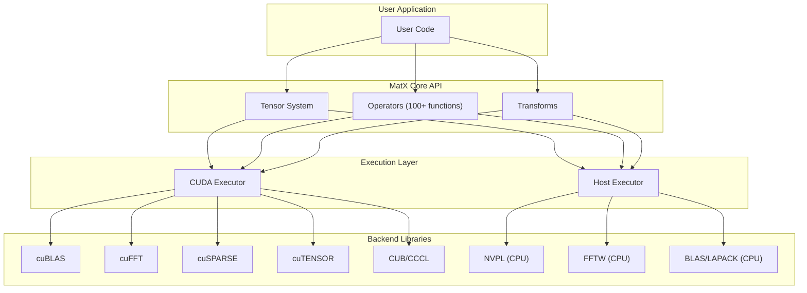

Sources: [CMakeLists.txt:32-36](), [CMakeLists.txt:214-258](), [include/matx/operators/operators.h:33-130]()

## Tensor System

The central data structure in MatX is the tensor, which represents a multi-dimensional array. MatX supports both dense and sparse tensors.

### Dense Tensors

Dense tensors are the primary way to store and manipulate data in MatX. The `tensor_t` class provides a view-based interface to multi-dimensional data with various operations.

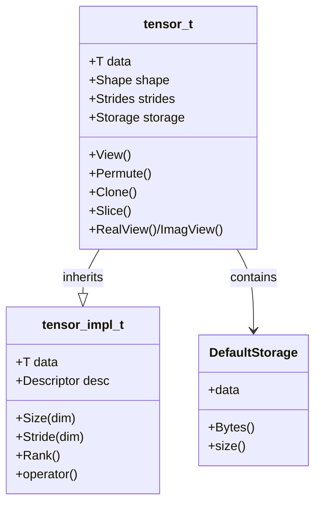

Dense tensors in MatX support:
- N-dimensional arrays (0D to 4D+ tensors)
- Multiple data types (integers, floating-point, complex)
- Various memory spaces (device, host, managed)
- View operations (slicing, permuting, reshaping)
- Lazy evaluation for efficient operations

Sources: [include/matx/core/tensor.h:73-842](), [include/matx/core/tensor_impl.h:88-569]()

### Sparse Tensors (Experimental)

MatX provides experimental support for sparse tensors through a Universal Sparse Tensor (UST) format, enabling representation of common sparse formats like COO, CSR, and CSC.

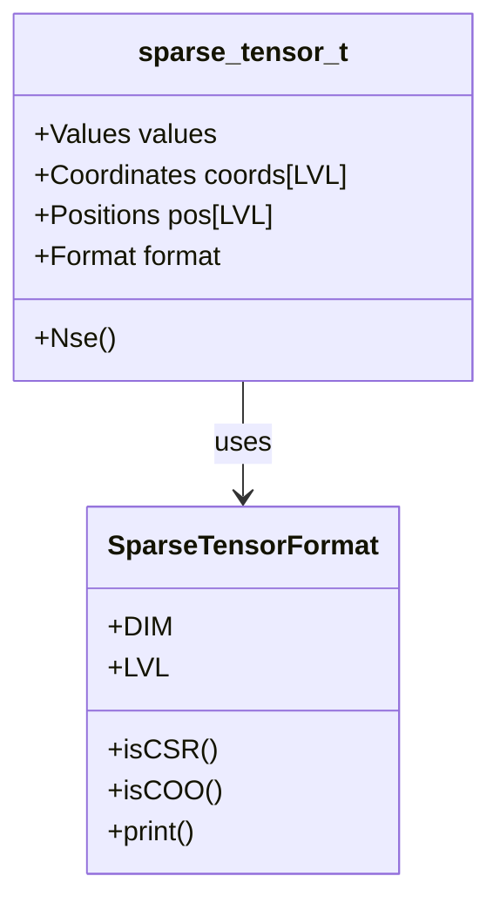

Sparse tensor operations include:
- Conversion between sparse and dense formats
- Sparse matrix multiplication
- Sparse linear system solving
- Conversion between different sparse formats

Sources: [include/matx/core/sparse_tensor.h:75-183](), [include/matx/core/sparse_tensor_format.h:46-340](), [include/matx/core/make_sparse_tensor.h:69-186]()

### Memory Management

MatX handles memory allocation and management through a flexible storage system that supports various memory spaces:

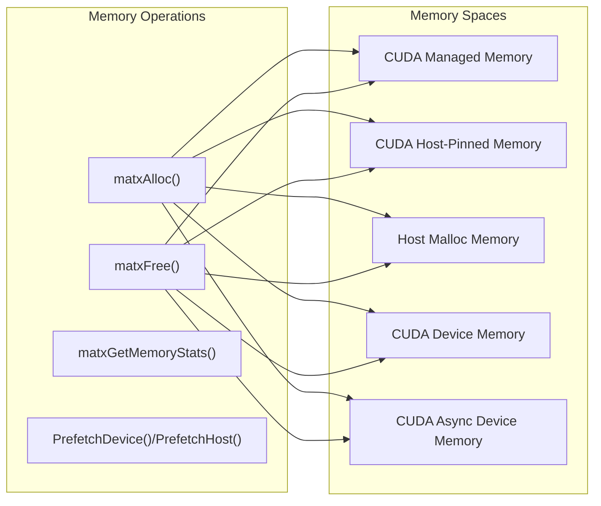

Memory spaces available in MatX:
- `MATX_MANAGED_MEMORY`: CUDA unified memory, accessible from both host and device
- `MATX_HOST_MEMORY`: Pinned host memory for faster transfers
- `MATX_HOST_MALLOC_MEMORY`: Regular host memory from malloc
- `MATX_DEVICE_MEMORY`: CUDA device memory
- `MATX_ASYNC_DEVICE_MEMORY`: Asynchronous device memory tied to a CUDA stream

Sources: [include/matx/core/allocator.h:56-62](), [include/matx/core/tensor.h:738-763]()

## Operators and Transforms

MatX provides a rich set of operators and transforms for manipulating tensors.

### Operators

Operators are functions that perform element-wise operations on tensors, creating views, or manipulating tensor data without performing actual computation until execution.

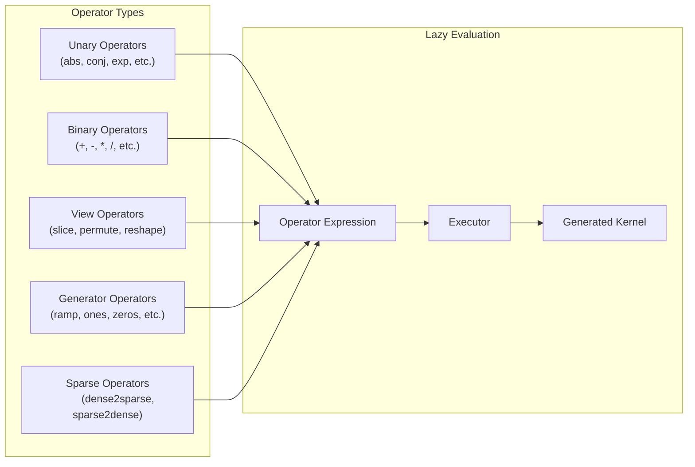

MatX includes over 100 different operators for various purposes, including:
- Mathematical functions (trigonometric, logarithmic, etc.)
- Comparison operators
- Tensor manipulation (slicing, concatenation, permutation)
- Type conversion
- Random number generation
- Conditional operations

Sources: [include/matx/operators/operators.h:33-130]()

### Transforms

Transforms are higher-level operations that typically involve more complex algorithms and often leverage optimized backend libraries like cuBLAS, cuFFT, and cuSPARSE.

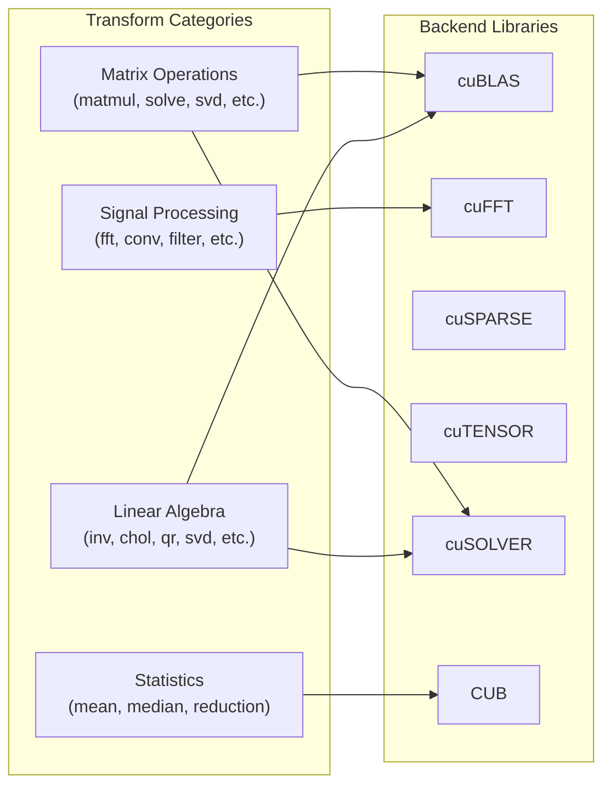

Key transforms include:
- Matrix multiplication (matmul)
- FFT operations
- Reductions (sum, min, max)
- Matrix decompositions (SVD, QR, LU)
- Linear system solvers
- Convolution and filtering

Sources: [include/matx/operators/operators.h:33-130]()

## Execution Model

MatX uses an executor-based model to control where and how operations are executed.

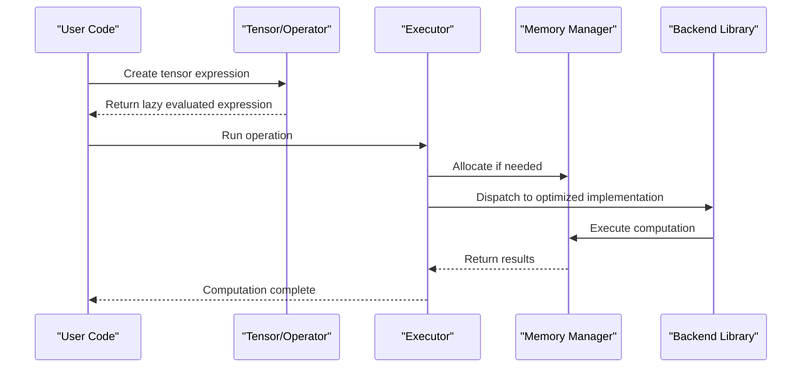

### CUDA Executor

The CUDA executor runs operations on NVIDIA GPUs using CUDA kernels and libraries:
- Automatic kernel generation for custom operations
- Integration with cuBLAS, cuFFT, cuSPARSE, and other CUDA libraries
- Stream-based execution for overlap and concurrency
- Support for CUDA graphs

### Host Executor

The host executor runs operations on the CPU:
- Support for various CPU math libraries (NVPL, FFTW, OpenBLAS, BLIS)
- Multi-threaded execution with OpenMP
- Fallback for systems without GPUs or for debugging

Sources: [docs_input/build.rst:43-67](), [CMakeLists.txt:214-258]()

## System Requirements and Compatibility

MatX has specific system requirements to ensure optimal performance:

- **CUDA**: Version 11.8+ or 12.2.1+ (note: 12.0.0-12.2.0 have compiler issues)
- **Host Compiler**: g++9+, nvc++ 24.5+, or clang 17+
- **GPU Architectures**: Pascal, Turing, Volta, Ampere, Ada, and Hopper (compute capability 6.0+)
- **Operating System**: Currently Linux only
- **CMake**: 3.23.1+ (for building tests, examples, etc.)
- **Optional Libraries**: cuTENSOR, cuDSS for specific functionality

Sources: [README.md:50-62](), [docs_input/build.rst:19-40]()

## Data Types

MatX supports a wide range of data types:

| Category | Supported Types |
|----------|----------------|
| Integer | int8_t, uint8_t, int16_t, uint16_t, int32_t, uint32_t, int64_t, uint64_t |
| Floating Point | matxFp16 (fp16), matxBf16 (bfloat16), float, double |
| Complex | matxFp16Complex, matxBf16Complex, cuda::std::complex<float>, cuda::std::complex<double> |
| Boolean | bool |

Special half-precision types (matxFp16, matxBf16) are provided for host compatibility, since CUDA half types don't support all C++ operators on the host.

Sources: [README.md:160-171]()

## Getting Started Example

Below is a simplified example showing basic MatX usage:

```cpp
#include "matx.h"

using namespace matx;

int main() {
  // Create a 2D tensor
  auto a = make_tensor<float>({2, 3});
  
  // Initialize with values
  a.SetVals({{1, 2, 3}, {4, 5, 6}});
  
  // Create another tensor
  auto b = make_tensor<float>({3, 2});
  b.SetVals({{7, 8}, {9, 10}, {11, 12}});
  
  // Output tensor for matrix multiplication
  auto c = make_tensor<float>({2, 2});
  
  // Execute matrix multiplication using CUDA
  cudaStream_t stream = 0;
  cudaExecutor exec{stream};
  (c = matmul(a, b)).run(exec);
  
  // Print the result
  print(c);
  
  return 0;
}
```

This example demonstrates creating tensors, initializing them, performing a matrix multiplication transform, and executing it on a GPU using the CUDA executor.

Sources: [README.md:17-20](), [README.md:196-200]()

## Conclusion

MatX provides a powerful, high-performance tensor library for GPU-accelerated computing with an intuitive Python-like syntax. Its layered architecture allows for efficient execution while maintaining a simple API for users. From basic tensor manipulations to complex transforms using optimized backend libraries, MatX offers a comprehensive solution for numerical computing on NVIDIA GPUs and CPUs.

By combining the performance of optimized CUDA libraries with a familiar syntax, MatX bridges the gap between ease of use and high performance, enabling efficient development of GPU-accelerated applications.

---

# Page: Core Tensor System

# Core Tensor System

<details>
<summary>Relevant source files</summary>

The following files were used as context for generating this wiki page:

- [bench/00_operators/reduction.cu](bench/00_operators/reduction.cu)
- [bench/00_transform/conv.cu](bench/00_transform/conv.cu)
- [bench/00_transform/qr.cu](bench/00_transform/qr.cu)
- [bench/00_transform/svd_power.cu](bench/00_transform/svd_power.cu)
- [docs_input/basics/nvtx.rst](docs_input/basics/nvtx.rst)
- [docs_input/basics/sparse_tensor.rst](docs_input/basics/sparse_tensor.rst)
- [examples/sparse_tensor.cu](examples/sparse_tensor.cu)
- [include/matx/core/defines.h](include/matx/core/defines.h)
- [include/matx/core/error.h](include/matx/core/error.h)
- [include/matx/core/get_grid_dims.h](include/matx/core/get_grid_dims.h)
- [include/matx/core/make_sparse_tensor.h](include/matx/core/make_sparse_tensor.h)
- [include/matx/core/nvtx.h](include/matx/core/nvtx.h)
- [include/matx/core/print.h](include/matx/core/print.h)
- [include/matx/core/sparse_tensor.h](include/matx/core/sparse_tensor.h)
- [include/matx/core/sparse_tensor_format.h](include/matx/core/sparse_tensor_format.h)
- [include/matx/core/tensor.h](include/matx/core/tensor.h)
- [include/matx/core/tensor_desc.h](include/matx/core/tensor_desc.h)
- [include/matx/core/tensor_impl.h](include/matx/core/tensor_impl.h)
- [include/matx/core/tensor_utils.h](include/matx/core/tensor_utils.h)
- [include/matx/executors/kernel.h](include/matx/executors/kernel.h)
- [include/matx/kernels/channelize_poly.cuh](include/matx/kernels/channelize_poly.cuh)
- [include/matx/operators/dense2sparse.h](include/matx/operators/dense2sparse.h)
- [include/matx/operators/operators.h](include/matx/operators/operators.h)
- [include/matx/operators/sparse2sparse.h](include/matx/operators/sparse2sparse.h)
- [include/matx/transforms/convert/sparse2sparse_cusparse.h](include/matx/transforms/convert/sparse2sparse_cusparse.h)
- [test/00_tensor/BasicTensorTests.cu](test/00_tensor/BasicTensorTests.cu)

</details>


The Core Tensor System forms the foundation of MatX, providing the fundamental tensor abstractions and data structures upon which all other components are built. This system defines how tensors are represented, stored, and manipulated in memory, enabling efficient computation on both CPU and GPU.

For information about specific tensor types, see [Dense Tensors](#2.1) and [Sparse Tensors](#2.2). For details on memory management, see [Memory Management](#2.3).

## Overview of the Tensor System

The MatX tensor system is designed to provide a flexible, high-performance framework for tensor computations. It follows a layered architecture where tensor objects serve as the primary interface for users, while internal implementation details handle memory management, storage, and computation.

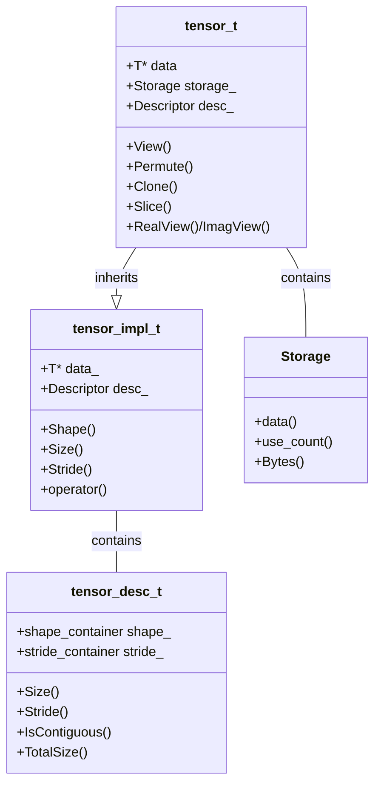

Sources: [include/matx/core/tensor.h:73-131](). [include/matx/core/tensor_impl.h:88-134](). [include/matx/core/tensor_desc.h:51-75]().

## Core Tensor Classes and Hierarchy

The tensor system is built upon a hierarchical class structure that separates interface from implementation:

1. **`tensor_impl_t`**: The base implementation class that provides core tensor functionality
2. **`tensor_t`**: The main tensor class that users interact with, adding storage management and more advanced operations
3. **`tensor_desc_t`**: Descriptor class that manages tensor shape and stride information

```mermaid
flowchart TD
    subgraph "User Interface"
        tensor_t["tensor_t&lt;T, RANK, Storage, Desc&gt;"]
    end

    subgraph "Implementation Layer"
        tensor_impl["tensor_impl_t&lt;T, RANK, Desc, Data&gt;"]
        sparse_impl["SparseTensorData"]
        dense_impl["DenseTensorData"]
    end

    subgraph "Descriptor Layer"
        desc["tensor_desc_t&lt;ShapeContainer, StrideContainer, RANK&gt;"]
        default_desc["DefaultDescriptor&lt;RANK&gt;"]
    end

    subgraph "Storage Layer"
        storage["Storage"]
        default_storage["DefaultStorage&lt;T&gt;"]
    end

    tensor_t --> tensor_impl : inherits from
    tensor_impl --> desc : contains
    tensor_impl --> dense_impl : uses for dense tensors
    tensor_impl --> sparse_impl : uses for sparse tensors
    desc --> default_desc : specializes as
    tensor_t --> storage : manages
    storage --> default_storage : specializes as
```

Sources: [include/matx/core/tensor.h:73-94](). [include/matx/core/tensor_impl.h:88-103](). [include/matx/core/tensor_desc.h:51-75]().

## Tensor Representation and Memory Layout

Tensors in MatX are represented as multi-dimensional arrays with shape and stride information that determines their memory layout. Every tensor has:

1. **Shape**: Defines the size of each dimension
2. **Strides**: Define the step size (in elements) between consecutive indices in each dimension
3. **Storage**: Manages the underlying memory allocation and reference counting

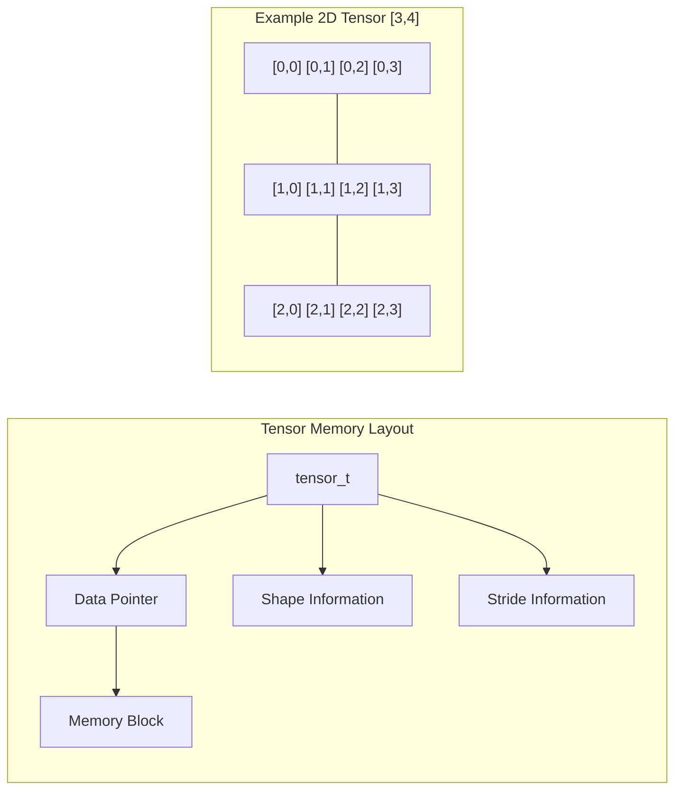

Sources: [include/matx/core/tensor_desc.h:234-242](). [include/matx/core/tensor_utils.h:72-87](). [include/matx/core/tensor_impl.h:642-652]().

## Tensor Creation and Management

MatX provides several ways to create and manipulate tensors:

| Operation | Description | Example Use Case |
|-----------|-------------|------------------|
| Constructor | Create a new tensor with specified shape | `tensor_t<float, 2> t2{{20, 10}}` |
| View | Create a view of existing data with a new shape | `auto v = t.View({5, 4})` |
| Slice | Create a subset view of a tensor | `auto s = t.Slice({0,0}, {5,5})` |
| Permute | Change the order of dimensions | `auto p = t.Permute({1, 0})` |
| Clone | Replicate a tensor into a higher dimension | `auto c = t.Clone({2, matxKeepDim})` |

Sources: [include/matx/core/tensor.h:638-657](). [include/matx/core/tensor.h:845-865](). [include/matx/core/tensor_impl.h:654-739]().

## Memory Management

Tensor memory is managed through a storage abstraction that provides:

1. **Reference Counting**: Automatically tracks usage and frees memory when no longer needed
2. **Memory Space Awareness**: Handles allocations in different memory spaces (host, device, managed)
3. **View Semantics**: Multiple views can share the same underlying data

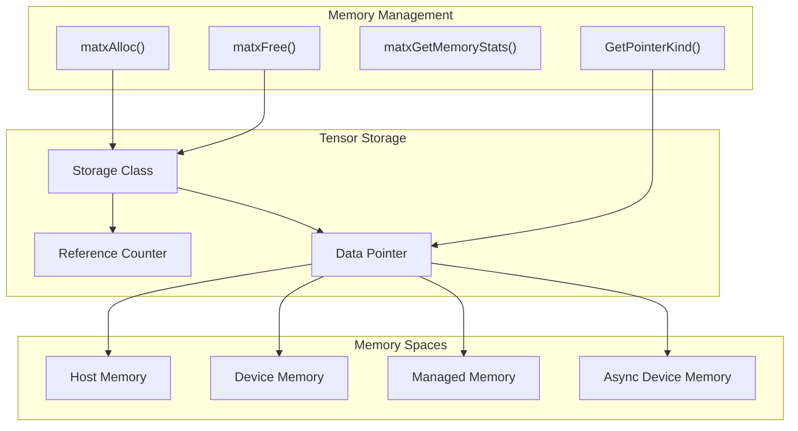

Sources: [include/matx/core/tensor.h:807-808](). [include/matx/core/tensor.h:738-763](). [include/matx/core/tensor.h:995-998]().

## Tensor Operators and Access

MatX tensors provide a rich set of operator overloads for element-wise operations, including:

1. **Arithmetic Operators**: `+`, `-`, `*`, `/`, etc.
2. **Bitwise Operators**: `&`, `|`, `^`, etc.
3. **Subscript Operator**: `operator()` for element access
4. **Assignment Operators**: `=`, `+=`, `-=`, etc.

These operators are implemented using lazy evaluation, allowing the library to optimize execution when operations are combined.

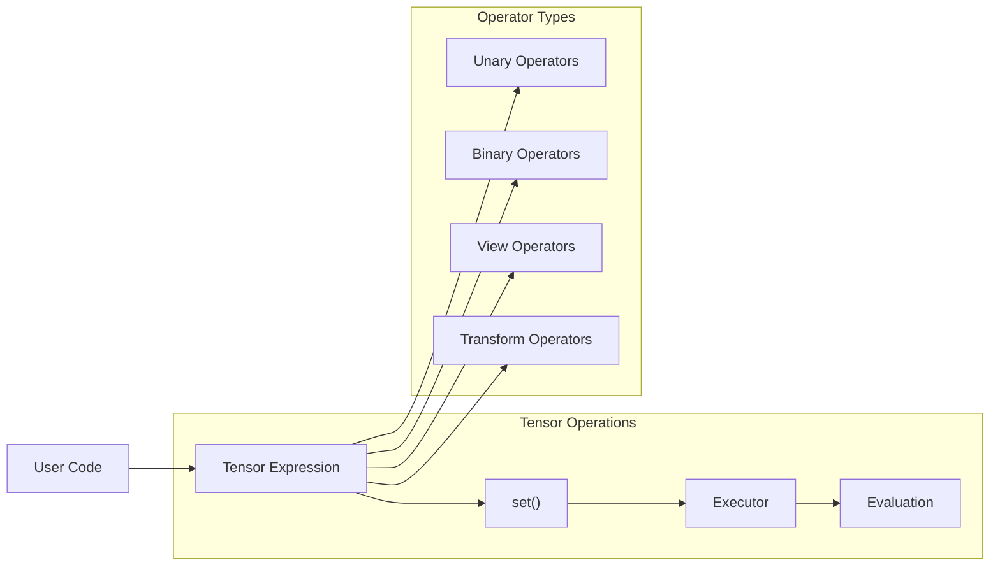

Sources: [include/matx/core/tensor.h:259-276](). [include/matx/core/tensor.h:290-344](). [include/matx/core/tensor_impl.h:294-314]().

## Sparse Tensor Support

In addition to dense tensors, MatX provides experimental support for sparse tensors through the `sparse_tensor_t` class, which follows the Universal Sparse Tensor (UST) format specification.

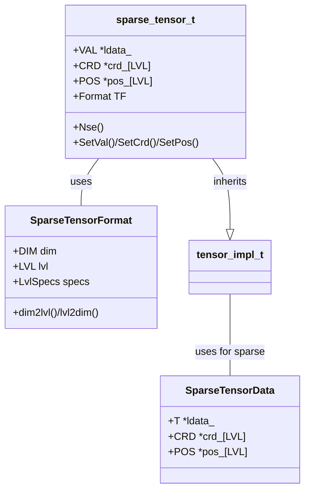

Sources: [include/matx/core/sparse_tensor.h:80-186](). [include/matx/core/sparse_tensor_format.h:131-216](). [include/matx/core/tensor_impl.h:59-70]().

## Type System and Tensor Traits

MatX uses type traits to provide compile-time information about tensors and their properties:

| Trait | Purpose | Example |
|-------|---------|---------|
| `is_tensor_view_v<T>` | Determines if a type is a tensor view | Used for template specialization |
| `is_matx_op<T>` | Checks if a type is a MatX operator | Used for expression templates |
| `is_matx_descriptor_v<T>` | Identifies descriptor types | Used for constructor overloads |
| `is_complex_v<T>` | Checks if a type is complex | Used for specialized operations |

The type system allows for seamless integration between tensors of different ranks and types, supporting efficient broadcasting and type promotion.

Sources: [include/matx/core/tensor.h:80-87](). [include/matx/core/tensor_utils.h:295-318](). [include/matx/core/tensor_desc.h:54-61]().

## Implementation Details

### Tensor Descriptor Implementation

The tensor descriptor (`tensor_desc_t`) manages shape and stride information, providing methods to:

1. Calculate the total size of the tensor
2. Check if a tensor's memory layout is contiguous
3. Convert between indices and memory offsets
4. Support permutation and reshaping operations

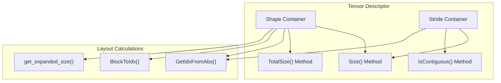

Sources: [include/matx/core/tensor_desc.h:213-225](). [include/matx/core/tensor_desc.h:234-242](). [include/matx/core/tensor_utils.h:117-178]().

### Reference Counting and Storage

The tensor storage system provides automatic memory management through reference counting:

1. When a tensor is copied, the reference count is incremented
2. When a tensor goes out of scope, the reference count is decremented
3. When the reference count reaches zero, memory is automatically freed

This allows for efficient creation of tensor views without unnecessary copies while ensuring memory is properly managed.

Sources: [include/matx/core/tensor.h:995-998](). [include/matx/core/tensor.h:109-120](). [include/matx/core/tensor.h:148-157]().

## Tensor Manipulation and Views

MatX tensors support several powerful view operations that allow for efficient data manipulation without copying:

### View Operations

1. **View**: Create a new tensor with different shape/type but the same data
2. **Slice**: Extract a subset of a tensor
3. **Permute**: Rearrange the dimensions of a tensor
4. **RealView/ImagView**: Extract real or imaginary parts of complex tensors
5. **OverlapView**: Create overlapping windows of data

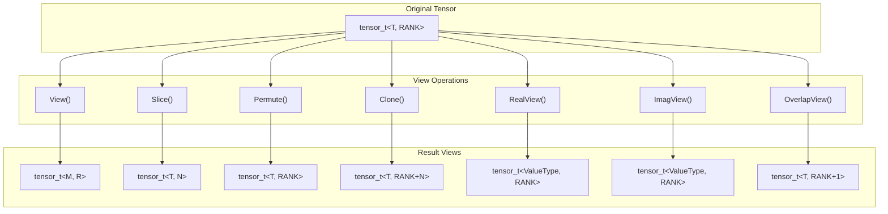

Sources: [include/matx/core/tensor.h:638-716](). [include/matx/core/tensor.h:774-842](). [include/matx/core/tensor.h:859-907](). [include/matx/core/tensor_impl.h:654-739]().

## Tensor System Integration

The Core Tensor System is integrated with the rest of MatX through a set of interfaces:

1. **Operators**: Algebraic and functional operations on tensors
2. **Transforms**: Advanced mathematical operations (FFT, convolution, etc.)
3. **Executors**: Systems that schedule and execute tensor operations

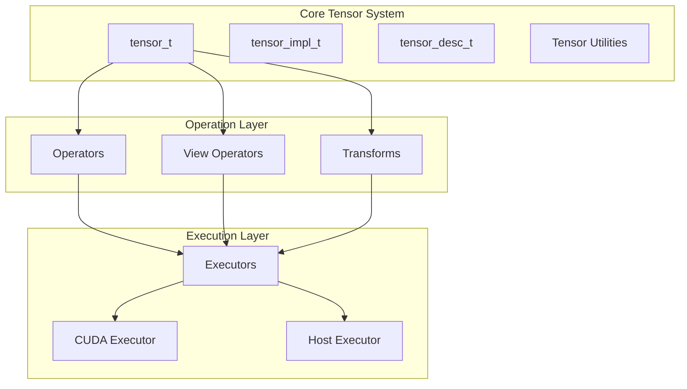

Sources: [include/matx/operators/operators.h:35-118](). [include/matx/core/tensor.h:259-600](). [include/matx/executors/kernel.h:32-37]().

## Summary

The Core Tensor System in MatX provides a flexible and efficient foundation for tensor operations with the following key features:

1. A hierarchical tensor class structure with separation of interface and implementation
2. Efficient memory management with reference counting
3. Powerful view operations for non-copying data manipulation
4. Support for both dense and sparse tensor formats
5. Integration with operators, transforms, and execution systems

This design allows MatX to provide Python-like syntax for GPU tensor operations while maintaining high performance.

---

# Page: Dense Tensors

# Dense Tensors

<details>
<summary>Relevant source files</summary>

The following files were used as context for generating this wiki page:

- [bench/00_operators/reduction.cu](bench/00_operators/reduction.cu)
- [bench/00_transform/conv.cu](bench/00_transform/conv.cu)
- [bench/00_transform/qr.cu](bench/00_transform/qr.cu)
- [bench/00_transform/svd_power.cu](bench/00_transform/svd_power.cu)
- [docs_input/api/creation/tensors/make.rst](docs_input/api/creation/tensors/make.rst)
- [docs_input/api/math/misc/abs2.rst](docs_input/api/math/misc/abs2.rst)
- [docs_input/basics/nvtx.rst](docs_input/basics/nvtx.rst)
- [include/matx/core/defines.h](include/matx/core/defines.h)
- [include/matx/core/error.h](include/matx/core/error.h)
- [include/matx/core/get_grid_dims.h](include/matx/core/get_grid_dims.h)
- [include/matx/core/half.h](include/matx/core/half.h)
- [include/matx/core/half_complex.h](include/matx/core/half_complex.h)
- [include/matx/core/iterator.h](include/matx/core/iterator.h)
- [include/matx/core/make_tensor.h](include/matx/core/make_tensor.h)
- [include/matx/core/nvtx.h](include/matx/core/nvtx.h)
- [include/matx/core/operator_utils.h](include/matx/core/operator_utils.h)
- [include/matx/core/storage.h](include/matx/core/storage.h)
- [include/matx/core/tensor.h](include/matx/core/tensor.h)
- [include/matx/core/tensor_desc.h](include/matx/core/tensor_desc.h)
- [include/matx/core/tensor_utils.h](include/matx/core/tensor_utils.h)
- [include/matx/executors/kernel.h](include/matx/executors/kernel.h)
- [include/matx/kernels/channelize_poly.cuh](include/matx/kernels/channelize_poly.cuh)
- [include/matx/operators/binary_operators.h](include/matx/operators/binary_operators.h)
- [include/matx/operators/scalar_ops.h](include/matx/operators/scalar_ops.h)
- [include/matx/operators/unary_operators.h](include/matx/operators/unary_operators.h)
- [test/00_tensor/BasicTensorTests.cu](test/00_tensor/BasicTensorTests.cu)

</details>


Dense tensors are the fundamental data structure in MatX, representing multi-dimensional arrays that efficiently store and manipulate numerical data. The implementation provides a Python-like syntax with C++ performance optimized for NVIDIA GPUs. This page covers the core tensor class, creation methods, memory management, and common operations.

For information about sparse tensor storage, see [Sparse Tensors](#2.2).

## Core Tensor Structure

Dense tensors in MatX are implemented as multi-dimensional arrays with contiguous or strided memory layouts. The primary class is `tensor_t`, which provides a flexible yet efficient interface for creating and manipulating tensor data.

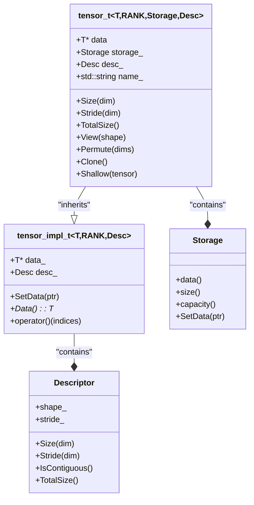

The tensor class is heavily templated to support a variety of use cases:

- `T`: The data type stored in the tensor (float, double, complex, etc.)
- `RANK`: The number of dimensions (0-N)
- `Storage`: The storage backend (raw pointers, smart pointers, etc.)
- `Desc`: The descriptor containing shape and stride information

Sources: [include/matx/core/tensor.h:73-987](), [include/matx/core/tensor_desc.h:50-500](), [include/matx/core/storage.h:48-570]()

## Creating Tensors

MatX provides multiple ways to create tensors, primarily through constructors or the `make_tensor` function family which offers a concise interface.

### Using `tensor_t` Constructors

```cpp
// Rank-0 (scalar) tensor
tensor_t<float, 0> t0{{}};

// Rank-1 (vector) tensor of size 10
tensor_t<float, 1> t1{{10}};

// Rank-2 (matrix) tensor of size 20×10
tensor_t<float, 2> t2{{20, 10}};

// Rank-3 tensor
tensor_t<float, 3> t3{{30, 20, 10}};
```

### Using `make_tensor` Functions

The `make_tensor` family provides a more flexible and future-proof way to create tensors:

```cpp
// Create a 3D tensor with shape [5,10,20]
auto t = make_tensor<float>({5, 10, 20});

// Create a tensor in device memory
auto t_dev = make_tensor<float>({5, 10, 20}, MATX_DEVICE_MEMORY);

// Create a tensor with a stream for async allocation
auto t_async = make_tensor<float>({5, 10, 20}, MATX_ASYNC_DEVICE_MEMORY, stream);
```

Sources: [include/matx/core/tensor.h:98-114](), [include/matx/core/make_tensor.h:50-172](), [test/00_tensor/BasicTensorTests.cu:44-53]()

## Memory Model and Management

MatX tensors employ reference counting to manage memory efficiently. This ensures that memory is properly deallocated when all references to a tensor are gone.

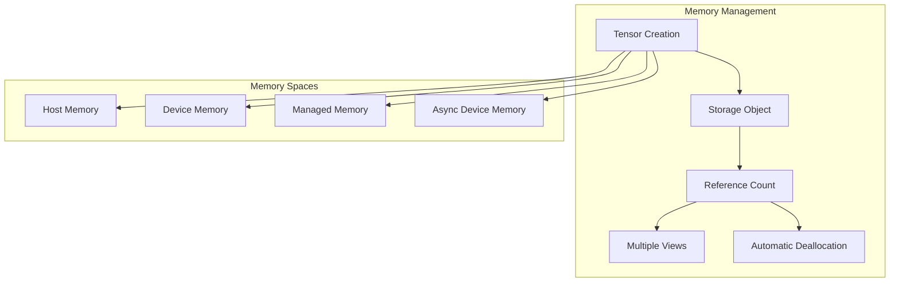

### Reference Counting

```cpp
// Original tensor has ref count of 1
tensor_t<float, 2> tmp{{10,4}};
ASSERT_EQ(tmp.GetRefCount(), 1);

// Copying increases ref count to 2
tensor_t<float, 2> tmp2{tmp};
ASSERT_EQ(tmp.GetRefCount(), 2);
ASSERT_EQ(tmp2.GetRefCount(), 2);

// Creating a shallow copy increases ref count to 3
tensor_t<float, 2> tmp3{{10,4}};
tmp3.Shallow(tmp2);  
ASSERT_EQ(tmp.GetRefCount(), 3);
```

### Memory Spaces

MatX supports different memory spaces:

| Memory Space | Description |
|--------------|-------------|
| `MATX_HOST_MALLOC_MEMORY` | Memory allocated on the host using malloc |
| `MATX_DEVICE_MEMORY` | Memory allocated on the GPU device |
| `MATX_MANAGED_MEMORY` | Unified memory accessible from both host and device |
| `MATX_ASYNC_DEVICE_MEMORY` | Asynchronously allocated device memory |

### Prefetching

For managed memory, you can prefetch data to either the device or host:

```cpp
// Prefetch to device
tensor.PrefetchDevice(stream);

// Prefetch to host
tensor.PrefetchHost(stream);
```

Sources: [include/matx/core/tensor.h:738-763](), [test/00_tensor/BasicTensorTests.cu:166-197](), [include/matx/core/storage.h:48-326]()

## Tensor Descriptors

Each tensor contains a descriptor that provides information about its shape and memory layout. This descriptor includes:

- Shape: The size of each dimension
- Strides: The memory distance between consecutive elements in each dimension

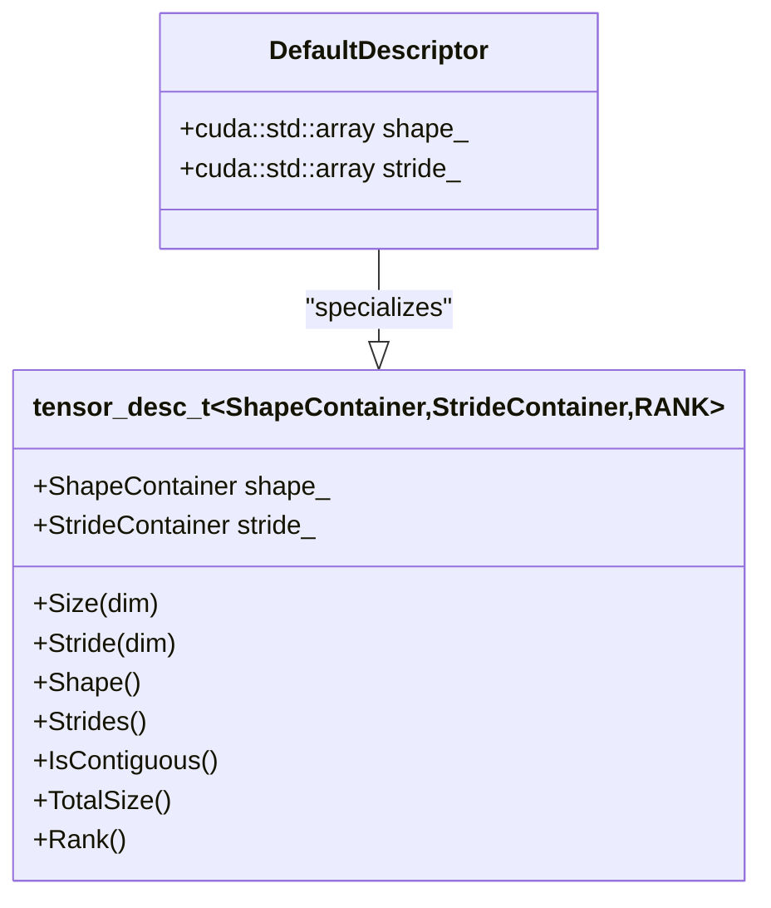

### Shape and Strides

The shape defines the dimensions of the tensor, while strides define the memory layout:

```cpp
// A 3D tensor with shape [30, 20, 10]
tensor_t<float, 3> t3{{30, 20, 10}};

// Size of dimension 0 is 30
auto size0 = t3.Size(0);  // Returns 30

// Total number of elements is 30*20*10 = 6000
auto total = t3.TotalSize();  // Returns 6000

// Stride of dimension 0 is 20*10 = 200
auto stride0 = t3.Stride(0);  // Returns 200
```

Sources: [include/matx/core/tensor_desc.h:50-266](), [include/matx/core/tensor_desc.h:347-440](), [test/00_tensor/BasicTensorTests.cu:100-226]()

## Tensor Operations

MatX provides a rich set of operations on tensors, including element-wise operations, reductions, and linear algebra functions.

### Element-wise Operations

```cpp
// Element-wise operations with lazy evaluation
(t_result = t1 + t2).run(exec);  // Addition
(t_result = t1 - t2).run(exec);  // Subtraction
(t_result = t1 * t2).run(exec);  // Multiplication
(t_result = t1 / t2).run(exec);  // Division
```

### Compound Assignment

```cpp
// Compound assignments
(t += 5).run(exec);     // Add 5 to each element
(t *= 2).run(exec);     // Multiply each element by 2
(t /= tensor).run(exec); // Element-wise division
```

### Lazy Evaluation

Operations on tensors in MatX are lazily evaluated, which means they are not executed immediately but only when `.run()` is called. This allows for optimizations like kernel fusion.

```cpp
// Define operations without executing them
auto expr = t1 + t2 * 5;

// Execute the operations
(result = expr).run(exec);
```

Sources: [include/matx/core/tensor.h:258-600](), [include/matx/operators/scalar_ops.h:395-530](), [test/00_tensor/BasicTensorTests.cu:228-355]()

## Tensor Views and Transformations

MatX provides a variety of ways to create different views of tensor data without copying the underlying memory.

### View

The `View()` method allows creating a tensor with a different shape using the same data:

```cpp
// Create a 2D tensor
tensor_t<float, 2> t2{{20, 10}};  // 20×10 tensor

// Create a 1D view of the same data
auto t1v = t2.View<float, 1>({200});  // 200 = 20*10

// Create a 3D view
auto t3v = t2.View<float, 3>({5, 4, 10});  // 5*4*10 = 200
```

### Permute

The `Permute()` method reorders the dimensions of a tensor:

```cpp
// Create a 3D tensor
tensor_t<float, 3> t3{{30, 20, 10}};

// Permute the dimensions (2,1,0) = transpose of (0,1,2)
auto t3p = t3.Permute({2, 1, 0});
// Now t3p has shape [10, 20, 30]
```

### Real and Imaginary Views

For complex-valued tensors, you can create views of just the real or imaginary parts:

```cpp
// Complex tensor
tensor_t<cuda::std::complex<float>, 2> tc{{20, 10}};

// Create view of real components
auto treal = tc.RealView();

// Create view of imaginary components
auto timag = tc.ImagView();
```

Sources: [include/matx/core/tensor.h:637-843](), [test/00_tensor/BasicTensorTests.cu:357-431]()

## Best Practices

### Creating Tensors

- Use `make_tensor` instead of direct `tensor_t` construction when possible for better future compatibility
- Consider memory space requirements when creating tensors based on your access patterns

### Memory Management

- Be aware of reference counting when sharing tensor data
- Use `Shallow()` to create a shared view of existing tensor data
- Use `Clone()` when you need a deep copy
- Be cautious with manual memory management using `Reset()`

### Performance Optimization

- Use lazy evaluation to allow the library to optimize operations
- Prefer contiguous memory layouts when possible
- Align your access patterns to tensor strides for better memory access patterns
- Use appropriate memory spaces (managed vs. device) based on your access patterns

### Tensor Manipulation

- Use `View()` and `Permute()` to create different views of the same data without copying
- Be aware that operations on views affect the original data

Sources: [include/matx/core/tensor.h:1-1000](), [include/matx/core/make_tensor.h:50-200](), [test/00_tensor/BasicTensorTests.cu:100-500]()

---

# Page: Sparse Tensors

# Sparse Tensors

<details>
<summary>Relevant source files</summary>

The following files were used as context for generating this wiki page:

- [docs_input/basics/sparse_tensor.rst](docs_input/basics/sparse_tensor.rst)
- [examples/sparse_tensor.cu](examples/sparse_tensor.cu)
- [include/matx/core/make_sparse_tensor.h](include/matx/core/make_sparse_tensor.h)
- [include/matx/core/print.h](include/matx/core/print.h)
- [include/matx/core/sparse_tensor.h](include/matx/core/sparse_tensor.h)
- [include/matx/core/sparse_tensor_format.h](include/matx/core/sparse_tensor_format.h)
- [include/matx/core/tensor_impl.h](include/matx/core/tensor_impl.h)
- [include/matx/operators/dense2sparse.h](include/matx/operators/dense2sparse.h)
- [include/matx/operators/operators.h](include/matx/operators/operators.h)
- [include/matx/operators/solve.h](include/matx/operators/solve.h)
- [include/matx/operators/sparse2dense.h](include/matx/operators/sparse2dense.h)
- [include/matx/operators/sparse2sparse.h](include/matx/operators/sparse2sparse.h)
- [include/matx/transforms/convert/dense2sparse_cusparse.h](include/matx/transforms/convert/dense2sparse_cusparse.h)
- [include/matx/transforms/convert/sparse2dense_cusparse.h](include/matx/transforms/convert/sparse2dense_cusparse.h)
- [include/matx/transforms/convert/sparse2sparse_cusparse.h](include/matx/transforms/convert/sparse2sparse_cusparse.h)
- [include/matx/transforms/matmul/matmul_cusparse.h](include/matx/transforms/matmul/matmul_cusparse.h)
- [include/matx/transforms/solve/solve_cudss.h](include/matx/transforms/solve/solve_cudss.h)
- [test/00_sparse/Convert.cu](test/00_sparse/Convert.cu)
- [test/00_sparse/Matmul.cu](test/00_sparse/Matmul.cu)
- [test/00_sparse/Matvec.cu](test/00_sparse/Matvec.cu)
- [test/00_sparse/Solve.cu](test/00_sparse/Solve.cu)
- [test/include/test_types.h](test/include/test_types.h)

</details>


MatX provides experimental support for sparse tensors through a Universal Sparse Tensor (UST) type that efficiently represents and manipulates tensors with many zero elements. This page documents the sparse tensor system in MatX, including its storage formats, creation methods, supported operations, and performance considerations.

For information about dense tensors, see [Dense Tensors](#2.1).

## Universal Sparse Tensor Concept

MatX uses a Tensor Format Domain Specific Language (DSL) to describe a vast space of storage formats for sparse tensors. This approach provides flexibility while maintaining high performance by dispatching to optimized backend libraries like cuSPARSE and cuDSS.

**Sparse Tensor Format System**

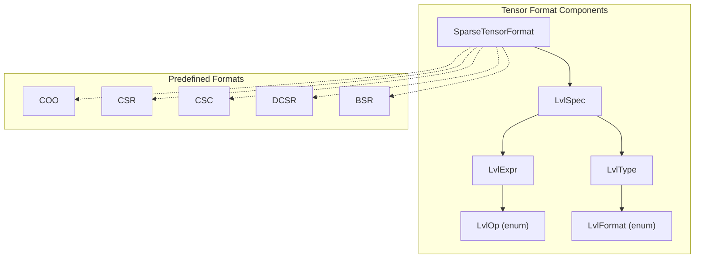

Sources: [include/matx/core/sparse_tensor_format.h:31-340](), [docs_input/basics/sparse_tensor.rst:6-102]()

### Level Types and Formats

The DSL uses the concept of levels (physical storage axes) to represent dimensions (logical tensor axes):

- **Level Format Types:**
  - `Dense`: Level is fully populated, entries are linearized
  - `Compressed`: Level is sparse, only nonzeros are stored with positions and coordinates
  - `Singleton`: A specialized compressed format for when coordinates have no siblings

- **Level Properties:**
  - `unique`/`non-unique`: Whether duplicates are allowed at a level
  - `ordered`/`unordered`: Whether coordinates are sorted at a level

Sources: [include/matx/core/sparse_tensor_format.h:71-94]()

### Common Sparse Formats

MatX provides predefined formats for common sparse representations:

| Format | Description | Internal Representation |
|--------|-------------|-------------------------|
| COO | Coordinate format | Stores row indices, column indices, and values |
| CSR | Compressed Sparse Row | Compresses row indices using row pointers |
| CSC | Compressed Sparse Column | Compresses column indices using column pointers |
| DCSR | Doubly Compressed Sparse Row | Both dimensions are compressed |
| BSR | Block Sparse Row | Stores dense blocks in a sparse pattern |

Sources: [include/matx/core/sparse_tensor_format.h:268-337](), [examples/sparse_tensor.cu:52-60]()

## Sparse Tensor Structure

The `sparse_tensor_t` class inherits from `tensor_impl_t` but uses specialized data storage for sparse elements.

**Sparse Tensor Internal Structure**

```mermaid
classDiagram
    class sparse_tensor_t {
        +value_type: VAL
        +crd_type: CRD
        +pos_type: POS
        +Format: TF
        +values_: StorageV
        +coordinates_[LVL]: StorageC
        +positions_[LVL]: StorageP
        +Nse(): index_t
        +SetVal(StorageV)
        +SetCrd(int, StorageC)
        +SetPos(int, StorageP)
        +operator=(Op)
    }
    
    class SparseTensorData {
        +sparse_data: bool
        +value_type: T  
        +crd_type: CRD
        +pos_type: POS
        +Format: TF
        +ldata_: T*
        +crd_[LVL]: CRD*
        +pos_[LVL]: POS*
    }
    
    class tensor_impl_t {
        +data_: TensorData
        +desc_: Desc
        +operator()
        +Size(int): index_t
        +Shape()
        +GetSparseValue(indices...)
    }
    
    sparse_tensor_t --|> tensor_impl_t: inherits
    tensor_impl_t -- SparseTensorData: uses
```

Sources: [include/matx/core/sparse_tensor.h:75-183](), [include/matx/core/tensor_impl.h:59-71]()

### Internal Buffer Structure

Sparse tensors consist of:

1. **Primary Storage**: The `values_` buffer containing nonzero elements
2. **Secondary Storage**:
   - `coordinates_[LVL]` arrays storing indices of nonzeros
   - `positions_[LVL]` arrays storing pointers into coordinate arrays

The exact structure varies by format:

**Format-Specific Buffer Organization**

```mermaid
graph TD
    subgraph "COO Format"
        coo_val["values (nonzeros)"]
        coo_pos0["positions[0] = {0, nse}"]
        coo_crd0["coordinates[0] (row indices)"]
        coo_crd1["coordinates[1] (column indices)"]
    end
    
    subgraph "CSR Format"
        csr_val["values (nonzeros)"]
        csr_pos1["positions[1] (row pointers)"]
        csr_crd1["coordinates[1] (column indices)"]
    end
    
    subgraph "CSC Format"
        csc_val["values (nonzeros)"]
        csc_pos1["positions[1] (column pointers)"]
        csc_crd1["coordinates[1] (row indices)"]
    end
```

Sources: [include/matx/core/sparse_tensor.h:172-182](), [include/matx/core/make_sparse_tensor.h:92-99](), [include/matx/core/make_sparse_tensor.h:131-134](), [include/matx/core/make_sparse_tensor.h:167-170]()

## Creating Sparse Tensors

MatX provides factory methods to create sparse tensors in common formats:

**Sparse Tensor Creation Workflow**

```mermaid
flowchart TD
    subgraph "Input Components"
        direction LR
        values["tensor_t<VAL, 1> (values)"]
        rowIdx["tensor_t<CRD, 1> (row indices)"]
        colIdx["tensor_t<CRD, 1> (column indices)"]
        rowPtr["tensor_t<POS, 1> (row pointers)"]
        colPtr["tensor_t<POS, 1> (column pointers)"]
    end
    
    subgraph "Factory Methods"
        direction LR
        make_tensor_coo["make_tensor_coo()"]
        make_tensor_csr["make_tensor_csr()"]
        make_tensor_csc["make_tensor_csc()"]
        make_zero_tensor["make_zero_tensor_*()"]
    end
    
    subgraph "Sparse Tensor Output"
        direction LR
        COO["sparse_tensor_t<VAL,CRD,POS,COO>"]
        CSR["sparse_tensor_t<VAL,CRD,POS,CSR>"]
        CSC["sparse_tensor_t<VAL,CRD,POS,CSC>"]
    end
    
    values --> make_tensor_coo
    rowIdx --> make_tensor_coo
    colIdx --> make_tensor_coo
    make_tensor_coo --> COO
    
    values --> make_tensor_csr
    rowPtr --> make_tensor_csr
    colIdx --> make_tensor_csr
    make_tensor_csr --> CSR
    
    values --> make_tensor_csc
    colPtr --> make_tensor_csc
    rowIdx --> make_tensor_csc
    make_tensor_csc --> CSC
    
    make_zero_tensor --> COO
    make_zero_tensor --> CSR
    make_zero_tensor --> CSC
```

Sources: [include/matx/core/make_sparse_tensor.h:76-186](), [examples/sparse_tensor.cu:80-88]()

### Factory Method Examples

```cpp
// Create a COO matrix
auto vals = make_tensor<float>({5});
auto rowIdx = make_tensor<int>({5});
auto colIdx = make_tensor<int>({5});
vals.SetVals({1, 2, 3, 4, 5});
rowIdx.SetVals({0, 0, 3, 3, 3});
colIdx.SetVals({0, 1, 2, 3, 5});
auto Acoo = experimental::make_tensor_coo(vals, rowIdx, colIdx, {4, 8});

// Create an empty CSR matrix
auto Acsr = experimental::make_zero_tensor_csr<float, int, int>({4, 8});
```

Sources: [examples/sparse_tensor.cu:80-88](), [examples/sparse_tensor.cu:174]()

## Sparse Tensor Operations

MatX supports several operations for sparse tensors, including conversions and linear algebra operations.

**Sparse Tensor Operations**

```mermaid
flowchart LR
    Dense["tensor_t (Dense)"] 
    Sparse["sparse_tensor_t (Sparse)"]
    
    Dense -->|"dense2sparse()"| Sparse
    Sparse -->|"sparse2dense()"| Dense
    Sparse -->|"sparse2sparse()"| Sparse2["sparse_tensor_t (different format)"]
    
    Sparse -->|"matmul()"| Result1["Dense Result"]
    Sparse -->|"matvec()"| Result2["Dense Result"]
    Sparse -->|"solve()"| Result3["Dense Result"]
    
    subgraph "NVIDIA CUDA Libraries"
        cuSPARSE["cuSPARSE"]
        cuDSS["cuDSS"]
    end
    
    matmul --> cuSPARSE
    matvec --> cuSPARSE
    solve --> cuDSS
    dense2sparse --> cuSPARSE
    sparse2dense --> cuSPARSE
    sparse2sparse --> cuSPARSE
```

Sources: [include/matx/operators/operators.h:54-104](), [include/matx/transforms/matmul/matmul_cusparse.h:271-335](), [include/matx/transforms/solve/solve_cudss.h:272-336]()

### Conversion Operations

- **`dense2sparse`**: Converts a dense tensor to a sparse tensor
  ```cpp
  auto A = make_tensor<float>({4, 8});
  auto S = experimental::make_zero_tensor_coo<float, int>({4, 8});
  (S = dense2sparse(A)).run(exec);
  ```

- **`sparse2dense`**: Converts a sparse tensor to a dense tensor
  ```cpp
  auto A = make_tensor<float>({4, 8});
  (A = sparse2dense(S)).run(exec);
  ```

- **`sparse2sparse`**: Converts between different sparse formats
  ```cpp
  auto Acsr = experimental::make_zero_tensor_csr<float, int, int>({4, 8});
  (Acsr = sparse2sparse(Acoo)).run(exec);
  ```

Sources: [include/matx/operators/dense2sparse.h:42-103](), [include/matx/operators/sparse2dense.h:42-173](), [include/matx/operators/sparse2sparse.h:43-107](), [examples/sparse_tensor.cu:113-176]()

### Linear Algebra Operations

- **`matmul`**: Matrix-matrix multiplication with a sparse matrix
  ```cpp
  auto B = make_tensor<float, 2>({8, 4});
  auto C = make_tensor<float>({4, 4});
  (C = matmul(Acoo, B)).run(exec);
  ```

- **`matvec`**: Matrix-vector multiplication with a sparse matrix
  ```cpp
  auto v = make_tensor<float>({8});
  auto r = make_tensor<float>({4});
  (r = matvec(Acoo, v)).run(exec);
  ```

- **`solve`**: Solves a linear system with a sparse coefficient matrix
  ```cpp
  auto X = make_tensor<float>({4, 2});
  auto Y = make_tensor<float>({4, 2});
  (X = solve(Acsr, Y)).run(exec);
  ```

Sources: [include/matx/transforms/matmul/matmul_cusparse.h:271-335](), [include/matx/transforms/solve/solve_cudss.h:272-336](), [examples/sparse_tensor.cu:126-127](), [examples/sparse_tensor.cu:148-150]()

## Performance Considerations

When working with sparse tensors in MatX, keep these considerations in mind:

1. **Avoid Using `operator()` in Performance-Critical Code**: The indexing operator performs an expensive search through the sparse data structure and should only be used for debugging or testing.
   ```cpp
   // Inefficient way to convert sparse to dense
   for (index_t i = 0; i < m; i++) {
     for (index_t j = 0; j < n; j++) {
       A(i, j) = S(i, j);  // Expensive!
     }
   }
   
   // Efficient way
   (A = sparse2dense(S)).run(exec);  // Use optimized kernels
   ```

2. **Format Selection**: Different formats have different performance characteristics:
   - CSR: Efficient for row-wise operations
   - CSC: Efficient for column-wise operations
   - COO: Good for construction and format conversion

3. **Memory Sharing**: Some operations like `sparse2sparse` may share memory between input and output tensors for efficiency.

4. **Backend Acceleration**: MatX uses GPU libraries like cuSPARSE and cuDSS for performance. Ensure these are available for optimal performance.

Sources: [examples/sparse_tensor.cu:92-99](), [examples/sparse_tensor.cu:113-116](), [include/matx/transforms/convert/sparse2sparse_cusparse.h:100-108]()

## Implementation Status

The sparse tensor support in MatX is marked as experimental, meaning:

- The API may change in future releases
- Not all operations are supported for all formats
- Performance optimizations are ongoing

Currently supported:
- Formats: COO, CSR, CSC
- Operations: conversions, matmul, matvec, solve

Sources: [examples/sparse_tensor.cu:35](), [docs_input/basics/sparse_tensor.rst:6-11]()

## Debugging and Inspection

MatX provides printing support for sparse tensors:

```cpp
print(Acoo);

// Sample output:
// tensor_impl_2_f32: SparseTensor{float} Rank: 2, Sizes:[4, 8], Levels:[4, 8]
// format = ( d0, d1 ) -> ( d0 : compressed(non-unique), d1 : singleton )
// space  = CUDA managed memory
// nse    = 5
// pos[0] = ( 0  5 )
// crd[0] = ( 0  0  3  3  3 )
// crd[1] = ( 0  1  2  3  5 )
// values = ( 1.0000e+00  2.0000e+00  3.0000e+00  4.0000e+00  5.0000e+00 )
```

Sources: [include/matx/core/print.h:144-170](), [examples/sparse_tensor.cu:87-88]()

---

# Page: Memory Management

# Memory Management

<details>
<summary>Relevant source files</summary>

The following files were used as context for generating this wiki page:

- [CMakeLists.txt](CMakeLists.txt)
- [README.md](README.md)
- [cmake/FindcuDSS.cmake](cmake/FindcuDSS.cmake)
- [docs_input/basics/memory.rst](docs_input/basics/memory.rst)
- [docs_input/basics/nvtx.rst](docs_input/basics/nvtx.rst)
- [docs_input/build.rst](docs_input/build.rst)
- [include/matx/core/allocator.h](include/matx/core/allocator.h)
- [include/matx/core/error.h](include/matx/core/error.h)
- [include/matx/core/nvtx.h](include/matx/core/nvtx.h)
- [include/matx/core/tensor.h](include/matx/core/tensor.h)
- [include/matx/core/tensor_utils.h](include/matx/core/tensor_utils.h)
- [include/matx/executors/kernel.h](include/matx/executors/kernel.h)
- [test/00_tensor/BasicTensorTests.cu](test/00_tensor/BasicTensorTests.cu)

</details>


This page documents the memory management system in MatX, detailing how memory is allocated, tracked, and managed for tensor operations across different memory spaces. The memory management system is a core component of MatX that enables efficient tensor operations on both CPU and GPU.

MatX provides a flexible memory management system that abstracts away the complexities of managing GPU and CPU memory allocations. This system handles different memory spaces, tracks allocations, and implements reference counting for automatic cleanup.

## Memory Spaces

MatX supports different memory spaces to provide flexibility in how and where data is stored. The choice of memory space affects performance, accessibility, and behavior across different hardware configurations.

```mermaid
flowchart TD
    subgraph "MatX Memory Spaces"
        MANAGED["MATX_MANAGED_MEMORY<br>(CUDA Unified Memory)"]
        HOST_PINNED["MATX_HOST_MEMORY<br>(CUDA Host-Pinned Memory)"]
        HOST_MALLOC["MATX_HOST_MALLOC_MEMORY<br>(Host Pageable Memory)"]
        DEVICE["MATX_DEVICE_MEMORY<br>(CUDA Device Memory)"]
        ASYNC_DEVICE["MATX_ASYNC_DEVICE_MEMORY<br>(CUDA Asynchronous Device Memory)"]
    end

    HOST_ACCESS["Host CPU Access"] --- MANAGED
    HOST_ACCESS --- HOST_PINNED
    HOST_ACCESS --- HOST_MALLOC

    DEVICE_ACCESS["Device GPU Access"] --- MANAGED
    DEVICE_ACCESS --- DEVICE
    DEVICE_ACCESS --- ASYNC_DEVICE

    PERF_HIGH["High Performance"] --- DEVICE
    PERF_HIGH --- ASYNC_DEVICE

    PORTABILITY["Portability"] --- MANAGED
    PORTABILITY --- HOST_MALLOC

    STREAM_AWARE["Stream-Aware Allocation"] --- ASYNC_DEVICE
```

The memory spaces each have distinct characteristics:

1. **MATX_MANAGED_MEMORY**: CUDA Unified Memory (UM) accessible from both CPU and GPU, with automatic page migration between host and device. Created with `cudaMallocManaged`.

2. **MATX_HOST_MEMORY**: Page-locked (pinned) host memory allocated with `cudaHostAlloc`. Faster transfer speeds to/from GPU but uses non-pageable system memory.

3. **MATX_HOST_MALLOC_MEMORY**: Regular pageable host memory allocated with `malloc`. Standard CPU memory that may be slower to transfer to/from GPU.

4. **MATX_DEVICE_MEMORY**: GPU device memory allocated with `cudaMalloc`. Only accessible from GPU code.

5. **MATX_ASYNC_DEVICE_MEMORY**: Stream-ordered device memory allocated with `cudaMallocAsync`, which can improve performance by enabling allocation/deallocation to occur within CUDA streams.

Sources: [include/matx/core/allocator.h:56-62](), [docs_input/basics/memory.rst:1-20]()

## Memory Allocation System

MatX implements a unified memory allocation system that abstracts away the complexities of different memory spaces and provides tracking capabilities.

```mermaid
sequenceDiagram
    participant User as User Code
    participant Alloc as matxAlloc/matxFree
    participant Tracker as MemTracker
    participant CUDA as CUDA Runtime
    participant Stats as matxMemoryStats

    User->>Alloc: Request allocation (size, space)
    Alloc->>Tracker: Forward request
    
    alt MATX_MANAGED_MEMORY
        Tracker->>CUDA: cudaMallocManaged()
    else MATX_HOST_MEMORY
        Tracker->>CUDA: cudaHostAlloc()
    else MATX_HOST_MALLOC_MEMORY
        Tracker->>CUDA: malloc()
    else MATX_DEVICE_MEMORY
        Tracker->>CUDA: cudaMalloc()
    else MATX_ASYNC_DEVICE_MEMORY
        Tracker->>CUDA: cudaMallocAsync()
    end
    
    CUDA-->>Tracker: Return pointer
    Tracker->>Stats: Update memory statistics
    Tracker->>Tracker: Add to allocation map
    Tracker-->>Alloc: Return success/failure
    Alloc-->>User: Return allocated pointer
    
    User->>Alloc: Free memory
    Alloc->>Tracker: Forward deallocation
    Tracker->>CUDA: Free based on memory type
    Tracker->>Stats: Update memory statistics
    Tracker->>Tracker: Remove from allocation map
```

The key functions for memory management are:

1. **`matxAlloc`**: Allocates memory of a specified size in the requested memory space. It handles the underlying CUDA allocation call appropriate for the memory space.

2. **`matxFree`**: Frees previously allocated memory, automatically determining the appropriate deallocation method.

3. **`GetPointerKind`**: Identifies which memory space a pointer belongs to.

4. **`IsAllocated`**: Checks if a pointer was allocated through the MatX memory management system.

Sources: [include/matx/core/allocator.h:246-370]()

## Memory Tracking

MatX internally tracks all memory allocations to provide statistics, ensure proper deallocation, and help diagnose memory leaks.

```mermaid
classDiagram
    class MemTracker {
        -unordered_map~void*, matxPointerAttr_t~ allocationMap
        +allocate(void** ptr, size_t bytes, matxMemorySpace_t space, cudaStream_t stream)
        +deallocate(void* ptr)
        +deallocate(void* ptr, cudaStream_t stream)
        +is_allocated(void* ptr)
        +get_pointer_kind(void* ptr)
        +update_stream(void* ptr, cudaStream_t stream)
    }
    
    class matxMemoryStats_t {
        +size_t currentBytesAllocated
        +size_t totalBytesAllocated
        +size_t maxBytesAllocated
    }
    
    class matxPointerAttr_t {
        +size_t size
        +matxMemorySpace_t kind
        +cudaStream_t stream
    }
    
    MemTracker "1" --> "*" matxPointerAttr_t : tracks
    matxMemoryStats_t "1" -- "1" MemTracker : updates
```

The tracking system provides:

1. **Memory Statistics**: Tracks current, total, and maximum memory allocated through the MatX API, accessible via `matxGetMemoryStats`.

2. **Allocation Map**: Maintains a map of all memory allocations with their sizes, types, and associated CUDA streams.

3. **Safe Deallocation**: Ensures memory is freed with the correct method based on the memory space.

4. **Leak Detection**: The `MemTracker` destructor automatically cleans up any remaining allocations, helping to identify memory leaks.

The tracking system is guarded by a mutex to ensure thread safety when accessing or modifying memory statistics and the allocation map.

Sources: [include/matx/core/allocator.h:87-243](), [include/matx/core/allocator.h:287-336]()

## Tensor Storage and Reference Counting

Tensors in MatX use a smart storage system that implements reference counting to manage tensor data lifetimes.

```mermaid
classDiagram
    class tensor_t {
        +T* data
        +Storage storage_
        +Descriptor desc_
        +Shallow(const tensor_t& rhs)
        +Reset(T* ptr)
        +GetRefCount()
        +View()
        +PrefetchDevice(cudaStream_t stream)
        +PrefetchHost(cudaStream_t stream)
    }
    
    class Storage {
        +container data
        +size_t Bytes()
        +size_t GetRefCount()
    }
    
    class Descriptor {
        +shape_container shape_
        +stride_container strides_
        +Size(int dim)
        +TotalSize()
        +IsContiguous()
    }
    
    tensor_t "1" --> "1" Storage : contains
    tensor_t "1" --> "1" Descriptor : contains
    tensor_t "1" --> "*" tensor_t : can create views
```

The storage system provides:

1. **Reference Counting**: Multiple tensor views can share the same underlying data with automatic cleanup when the last reference is dropped.

2. **View Creation**: Tensors can create views of their data with different shapes, strides, or even data types without copying the underlying memory.

3. **Memory Prefetching**: Tensors support prefetching data to device or host memory using `PrefetchDevice` and `PrefetchHost` methods.

4. **Shallow Copy**: The `Shallow` method creates a new tensor that shares the same underlying data and increments the reference count.

When a tensor is created with `make_tensor`, it allocates memory in the specified space. Subsequent operations like `View()`, `Permute()`, or copy construction create new tensors that reference the same underlying memory, incrementing the reference count. The memory is automatically freed when the last tensor referencing it is destroyed.

Sources: [include/matx/core/tensor.h:72-842](), [CMakeLists.txt:46-404]()

## Memory Utilities and Diagnostics

MatX provides several utilities to help monitor and debug memory usage.

### Memory Statistics

Memory statistics can be accessed using these functions:

1. **`matxGetMemoryStats`**: Gets the current, total, and maximum memory allocated.
2. **`matxPrintMemoryStatistics`**: Prints formatted memory statistics to stdout.

These functions help track memory usage during program execution and can be useful for diagnosing memory leaks or optimizing memory usage.

### Memory Space Utilities

Utility functions to work with memory spaces:

1. **`HostPrintable`**: Determines if memory in a specific space is accessible from the host.
2. **`DevicePrintable`**: Determines if memory in a specific space is accessible from the device.
3. **`SpaceString`**: Returns a human-readable string representation of a memory space.

Sources: [include/matx/core/allocator.h:261-425]()

## Best Practices

When working with the MatX memory management system, consider these best practices:

1. **Choose the Right Memory Space**: 
   - Use `MATX_DEVICE_MEMORY` for best performance when data is only needed on the GPU
   - Use `MATX_MANAGED_MEMORY` for ease of use when data needs to be accessed from both CPU and GPU
   - Use `MATX_ASYNC_DEVICE_MEMORY` for better performance with stream-ordered operations

2. **Leverage Reference Counting**: Let MatX handle memory management when possible rather than manually allocating/deallocating.

3. **Monitor Memory Usage**: Use the memory statistics functions to track memory usage during development.

4. **Be Aware of System Limitations**: 
   - On WSL2, CUDA Unified Memory may not be fully supported
   - On Grace-Hopper systems, regular host memory (malloc) can be accessed from the GPU
   - Some memory types might perform differently across different hardware configurations

5. **Use Prefetching**: For managed memory, use `PrefetchDevice` and `PrefetchHost` to optimize data locality before operations.

6. **Stream Awareness**: When using `MATX_ASYNC_DEVICE_MEMORY`, be mindful of stream ordering to ensure correct execution.

Sources: [include/matx/core/allocator.h:246-370](), [docs_input/basics/memory.rst:1-20]()

## Asynchronous Allocation

MatX supports asynchronous memory operations through the `MATX_ASYNC_DEVICE_MEMORY` space and stream-aware APIs. This is particularly useful for overlapping computation and memory operations.

```mermaid
sequenceDiagram
    participant App as Application
    participant Tensor as tensor_t
    participant Alloc as matxAlloc/matxFree
    participant Stream as CUDA Stream

    App->>Tensor: Create tensor with MATX_ASYNC_DEVICE_MEMORY
    Tensor->>Alloc: matxAlloc(ptr, size, MATX_ASYNC_DEVICE_MEMORY, stream)
    Alloc->>Stream: cudaMallocAsync(ptr, size, stream)
    Stream-->>Alloc: Return allocation
    
    Note over App,Stream: Computation in different stream

    App->>Tensor: Free tensor
    Tensor->>Alloc: matxFree(ptr, stream)
    Alloc->>Stream: cudaFreeAsync(ptr, stream)
```

Key features of asynchronous allocation:

1. **Stream-Ordered Allocation**: Memory operations are ordered within their respective CUDA streams.
2. **Overlapping Operations**: Allows memory operations to overlap with computation in different streams.
3. **Stream Updates**: The `update_stream` function allows changing the stream associated with a pointer.

Sources: [include/matx/core/allocator.h:190-195](), [include/matx/core/allocator.h:138-144](), [include/matx/core/allocator.h:377-381]()

## NVTX Profiling Integration

The memory management system is integrated with NVIDIA Tools Extension (NVTX) for profiling when enabled. This helps visualize memory operations within NVIDIA profiling tools like Nsight Systems.

```mermaid
flowchart TD
    subgraph "Memory Operations"
        matxAlloc["matxAlloc()"]
        matxFree["matxFree()"]
    end
    
    subgraph "NVTX Integration"
        NVTX["NVTX Range Creation"]
        Profiler["NVIDIA Profiler<br>(Nsight Systems)"]
    end
    
    matxAlloc -->|"MATX_NVTX_START()"| NVTX
    matxFree -->|"MATX_NVTX_START()"| NVTX
    NVTX --> Profiler
```

When MatX is compiled with `MATX_NVTX_FLAGS=ON`, memory operations are automatically wrapped in NVTX ranges, making it easier to analyze memory performance using NVIDIA profiling tools.

Sources: [include/matx/core/nvtx.h:1-361](), [include/matx/core/allocator.h:352-353](), [include/matx/core/allocator.h:361-362](), [docs_input/basics/nvtx.rst:1-81]()

---

# Page: Operators

# Operators

<details>
<summary>Relevant source files</summary>

The following files were used as context for generating this wiki page:

- [docs_input/api/creation/tensors/make.rst](docs_input/api/creation/tensors/make.rst)
- [docs_input/api/math/misc/abs2.rst](docs_input/api/math/misc/abs2.rst)
- [docs_input/basics/sparse_tensor.rst](docs_input/basics/sparse_tensor.rst)
- [examples/sparse_tensor.cu](examples/sparse_tensor.cu)
- [include/matx/core/half.h](include/matx/core/half.h)
- [include/matx/core/half_complex.h](include/matx/core/half_complex.h)
- [include/matx/core/iterator.h](include/matx/core/iterator.h)
- [include/matx/core/make_sparse_tensor.h](include/matx/core/make_sparse_tensor.h)
- [include/matx/core/make_tensor.h](include/matx/core/make_tensor.h)
- [include/matx/core/operator_utils.h](include/matx/core/operator_utils.h)
- [include/matx/core/print.h](include/matx/core/print.h)
- [include/matx/core/sparse_tensor.h](include/matx/core/sparse_tensor.h)
- [include/matx/core/sparse_tensor_format.h](include/matx/core/sparse_tensor_format.h)
- [include/matx/core/storage.h](include/matx/core/storage.h)
- [include/matx/core/tensor_impl.h](include/matx/core/tensor_impl.h)
- [include/matx/operators/binary_operators.h](include/matx/operators/binary_operators.h)
- [include/matx/operators/collapse.h](include/matx/operators/collapse.h)
- [include/matx/operators/concat.h](include/matx/operators/concat.h)
- [include/matx/operators/dense2sparse.h](include/matx/operators/dense2sparse.h)
- [include/matx/operators/operators.h](include/matx/operators/operators.h)
- [include/matx/operators/permute.h](include/matx/operators/permute.h)
- [include/matx/operators/remap.h](include/matx/operators/remap.h)
- [include/matx/operators/reshape.h](include/matx/operators/reshape.h)
- [include/matx/operators/reverse.h](include/matx/operators/reverse.h)
- [include/matx/operators/scalar_ops.h](include/matx/operators/scalar_ops.h)
- [include/matx/operators/shift.h](include/matx/operators/shift.h)
- [include/matx/operators/slice.h](include/matx/operators/slice.h)
- [include/matx/operators/sparse2sparse.h](include/matx/operators/sparse2sparse.h)
- [include/matx/operators/stack.h](include/matx/operators/stack.h)
- [include/matx/operators/unary_operators.h](include/matx/operators/unary_operators.h)
- [include/matx/transforms/convert/sparse2sparse_cusparse.h](include/matx/transforms/convert/sparse2sparse_cusparse.h)

</details>


Operators in MatX are fundamental components that enable tensor manipulation through user-friendly, Python-like syntax while achieving GPU-accelerated performance. They provide a wide range of operations from basic tensor views and arithmetic to complex tensor manipulations.

This page focuses on the foundational operator system, its architecture, and the primary types of operators available in MatX. For information about higher-level mathematical transforms, see [Transforms](#4).

## Operator Architecture

Operators in MatX follow a lazy evaluation model, where operations are defined but not executed until explicitly requested. This allows for optimized execution and memory usage.

```mermaid
classDiagram
    class BaseOp {
        +PreRun()
        +PostRun()
    }
    
    class UnaryOp {
        +op_ : T
    }
    
    class BinaryOp {
        +op1_ : T1
        +op2_ : T2
    }
    
    class ViewOp {
        +op_ : T
    }
    
    class ScalarOp {
    }
    
    BaseOp <|-- UnaryOp
    BaseOp <|-- BinaryOp
    BaseOp <|-- ViewOp
    BaseOp <|-- ScalarOp
    
    UnaryOp <|-- SliceOp
    UnaryOp <|-- PermuteOp
    UnaryOp <|-- ReshapeOp
    
    BinaryOp <|-- AddOp
    BinaryOp <|-- MulOp
    BinaryOp <|-- SubOp
    
    ViewOp <|-- CollapseOp
    ViewOp <|-- ConcatOp
```

Sources: [include/matx/operators/unary_operators.h:54-169](), [include/matx/operators/binary_operators.h](), [include/matx/operators/scalar_ops.h:87-131]()

All operators in MatX derive from a common base class, `BaseOp`. This inheritance hierarchy allows for consistent behavior and composability of operators.

## Operator Categories

MatX provides several categories of operators to manipulate tensors in different ways:

### View Operators

View operators create alternative ways to access tensor data without copying data. They include:

```mermaid
flowchart LR
    subgraph "View Operators"
        direction LR
        Slice["slice()"]
        Permute["permute()"]
        Reshape["reshape()"]
        Concat["concat()"]
        Collapse["collapse()"]
    end
    
    Tensor[("tensor_t")] --> Slice
    Tensor --> Permute
    Tensor --> Reshape
    Tensor --> Concat
    Tensor --> Collapse
    
    Slice --> View["Modified View"]
    Permute --> View
    Reshape --> View
    Concat --> View
    Collapse --> View
```

Sources: [include/matx/operators/slice.h:213-282](). [include/matx/operators/permute.h:162-199](). [include/matx/operators/reshape.h:46-132](). [include/matx/operators/concat.h:48-233](). [include/matx/operators/collapse.h:42-182]()

- **Slice**: Extracts a subsection of a tensor along specified dimensions
- **Permute**: Reorders tensor dimensions
- **Reshape**: Changes the logical shape of the tensor while preserving total size
- **Concat**: Combines multiple tensors along a specified dimension
- **Collapse**: Combines multiple dimensions into a single dimension

### Scalar and Arithmetic Operators

MatX provides comprehensive support for element-wise arithmetic operations and scalar functions:

```mermaid
flowchart TB
    subgraph "Arithmetic Operators"
        direction LR
        Add["+"]
        Sub["-"]
        Mul["*"]
        Div["/"]
        Mod["%"]
    end
    
    subgraph "Scalar Functions"
        direction LR
        Trig["sin/cos/tan"]
        Exp["exp/log"]
        Round["round/floor/ceil"]
        Abs["abs/sqrt"]
        Complex["real/imag/conj"]
    end
    
    Tensor1[("Tensor/Operator")] --> Add
    Tensor2[("Tensor/Operator")] --> Add
    
    Tensor3[("Tensor/Operator")] --> Trig
    
    Add --> Result1["New Expression"]
    Trig --> Result2["New Expression"]
```

Sources: [include/matx/operators/scalar_ops.h:132-227](). [include/matx/operators/scalar_ops.h:399-530](). [include/matx/operators/unary_operators.h:52-91]()

These operators enable complex mathematical expressions with a clean, intuitive syntax. They support various data types including floating-point, integer, and complex numbers.

### Sparse Tensor Operators

MatX provides specialized operators for working with sparse tensors:

```mermaid
flowchart LR
    subgraph "Sparse Operators"
        direction TB
        Dense2Sparse["dense2sparse()"]
        Sparse2Dense["sparse2dense()"]
        Sparse2Sparse["sparse2sparse()"]
    end
    
    DenseTensor[("Dense Tensor")] --> Dense2Sparse
    Dense2Sparse --> SparseTensor[("Sparse Tensor")]
    SparseTensor --> Sparse2Dense
    Sparse2Dense --> DenseTensor
    SparseTensor --> Sparse2Sparse
    Sparse2Sparse --> SparseTensor2[("Sparse Tensor (different format)")]
```

Sources: [include/matx/operators/dense2sparse.h](), [include/matx/operators/sparse2dense.h](), [include/matx/operators/sparse2sparse.h]()

These operators allow conversion between dense and sparse tensor formats as well as between different sparse formats (like COO, CSR, CSC).

## Operator Framework Implementation

Operators in MatX are implemented using template metaprogramming to enable compile-time optimizations:

```mermaid
flowchart TD
    subgraph "Operator Expression Tree"
        direction TB
        AddOp["AddOp"]
        MulOp["MulOp"]
        SliceOp["SliceOp"]
        TensorA["tensor_t A"]
        TensorB["tensor_t B"]
        TensorC["tensor_t C"]
        
        AddOp --> MulOp
        AddOp --> TensorC
        MulOp --> SliceOp
        MulOp --> TensorB
        SliceOp --> TensorA
    end
    
    ExprTree["Expression Tree"] --> LazyEval["Lazy Evaluation"]
    LazyEval --> Executor["Executor"]
    Executor --> Kernel["Generated Kernel"]
```

Sources: [include/matx/operators/binary_operators.h](), [include/matx/operators/unary_operators.h]()

Each operator defines:
- **Value type**: The output data type of the operation
- **Rank**: The dimensionality of the result
- **Sizes**: The shape of the resulting tensor
- **Evaluation method**: The core functionality that computes values

### Operator Base Classes

MatX defines several base operator types:

#### Unary Operators

Unary operators take a single tensor/operator and produce a transformed result:

```cpp
template <class I1, class Op>
class matxUnaryOp : public BaseOp<matxUnaryOp<I1,Op>>
{
private:
  typename detail::base_type_t<I1> in1_;
  typename detail::base_type_t<Op> op_;
  // ...
public:
  // ...
  template <typename... Is>
  __MATX_INLINE__ __MATX_DEVICE__ __MATX_HOST__ auto operator()(Is... indices) const
  {
    return op_.op(get_value(in1_, indices...));
  }
  // ...
};
```

Sources: [include/matx/operators/unary_operators.h:57-113]()

#### Binary Operators

Binary operators combine two tensors/operators:

```cpp
template <class I1, class I2, class Op>
class matxBinaryOp : public BaseOp<matxBinaryOp<I1,I2,Op>>
{
private:
  typename detail::base_type_t<I1> in1_;
  typename detail::base_type_t<I2> in2_;
  typename detail::base_type_t<Op> op_;
  // ...
public:
  // ...
  template <typename... Is>
  __MATX_INLINE__ __MATX_DEVICE__ __MATX_HOST__ auto operator()(Is... indices) const
  {
    return op_.op(get_value(in1_, indices...), get_value(in2_, indices...));
  }
  // ...
};
```

Sources: [include/matx/operators/binary_operators.h]()

## View Operator Examples

### Slice Operator

The `slice` operator extracts a portion of a tensor along specified dimensions:

```cpp
// Creating a slice from dimensions 2 to 5 on the first dimension
// and 3 to 6 on the second dimension
auto sliced = slice(tensor, {2, 3}, {5, 6});
```

Sources: [include/matx/operators/slice.h:213-282]()

### Permute Operator

The `permute` operator reorders tensor dimensions:

```cpp
// Swapping the first and second dimensions of a 2D tensor
auto permuted = permute(tensor, {1, 0});
```

Sources: [include/matx/operators/permute.h:162-199]()

### Reshape Operator

The `reshape` operator changes the tensor shape while preserving the total number of elements:

```cpp
// Reshaping a 4x5 tensor to 2x10
auto reshaped = reshape<2>(tensor, {2, 10});
```

Sources: [include/matx/operators/reshape.h:231-264]()

## Lazy Evaluation and Execution

Operators in MatX follow a lazy evaluation model. Operations are not immediately executed but instead build an expression tree:

```mermaid
sequenceDiagram
    participant User as User Code
    participant Op as Operator System
    participant Set as set() Operation
    participant Executor as Executor
    
    User->>Op: Create expression A + B * C
    Op-->>User: Return lazy expression
    User->>Set: set(result, expression)
    Set->>Executor: Run with expression
    Executor->>Op: Traverse expression tree
    Op-->>Executor: Compute results
    Executor-->>User: Operation complete
```

Sources: [include/matx/core/tensor_impl.h:294-442](). [include/matx/operators/set.h]()

This lazy evaluation allows:
1. **Fusing operations**: Multiple operations can be combined into a single kernel
2. **Memory optimization**: Intermediate results don't need to be stored
3. **Performance tuning**: The execution can be optimized based on the entire expression

## Operator Assignment

MatX provides operator-assignment operations (`+=`, `-=`, etc.) through the `set` operator:

```cpp
// These are equivalent operations
result = A + B;           // Using operator=
result += A;              // Using operator+=
set(result, A + B);       // Using explicit set()
```

Sources: [include/matx/core/tensor_impl.h:294-442]()

The `set` operator creates an assignment operation that is executed when run on an executor.

## Extensibility

The MatX operator system is designed to be extensible. New operators can be created by:

1. Defining a new operator class that inherits from `BaseOp`
2. Implementing the required methods (`operator()`, `Size()`, etc.)
3. Creating a factory function for user-friendly syntax

Sources: [include/matx/operators/operators.h:33-130]()

## Summary

MatX operators provide a flexible, efficient way to manipulate tensors with minimal syntax. They form the foundation for higher-level operations and transforms while enabling GPU-accelerated performance. The lazy evaluation model allows for optimized execution and memory usage.

For more specialized mathematical operations, see [Transforms](#4). For tensor creation and management, see [Core Tensor System](#2).

---

# Page: View Operators

# View Operators

<details>
<summary>Relevant source files</summary>

The following files were used as context for generating this wiki page:

- [include/matx/operators/collapse.h](include/matx/operators/collapse.h)
- [include/matx/operators/concat.h](include/matx/operators/concat.h)
- [include/matx/operators/permute.h](include/matx/operators/permute.h)
- [include/matx/operators/remap.h](include/matx/operators/remap.h)
- [include/matx/operators/reshape.h](include/matx/operators/reshape.h)
- [include/matx/operators/reverse.h](include/matx/operators/reverse.h)
- [include/matx/operators/shift.h](include/matx/operators/shift.h)
- [include/matx/operators/slice.h](include/matx/operators/slice.h)
- [include/matx/operators/stack.h](include/matx/operators/stack.h)

</details>


View operators in MatX allow you to create alternate views of tensors without copying the underlying data. These operators enable efficient tensor manipulation by changing how the data is accessed rather than modifying the data itself. View operators can be used as both rvalues (read operations) and lvalues (write operations).

This page covers operators that modify the structure or access pattern of tensors. For operators that perform element-wise operations and tensor generation, see [Scalar and Generator Operators](#3.2).

## Overview of View Operators

```mermaid
flowchart LR
    subgraph "Tensor or Operator"
        Data["Original Data"]
    end
    
    subgraph "View Operators"
        direction TB
        Slice["slice()"]
        Concat["concat()"]
        Permute["permute()"]
        Reshape["reshape()"]
        Collapse["lcollapse()/rcollapse()"]
        Remap["remap()"]
        Shift["shift()"]
        Stack["stack()"]
        Reverse["reverse()/flipud()/fliplr()"]
    end
    
    subgraph "Result"
        View["Modified View\n(No Data Copy)"]
    end
    
    Data --> View Operators --> View
```

Sources: [include/matx/operators/slice.h](), [include/matx/operators/concat.h](), [include/matx/operators/permute.h](), [include/matx/operators/reshape.h](), [include/matx/operators/collapse.h](), [include/matx/operators/remap.h](), [include/matx/operators/shift.h](), [include/matx/operators/stack.h](), [include/matx/operators/reverse.h]()

## Common Characteristics

All view operators in MatX share these features:

- Create a view without allocating new memory for the result
- Can be used as both rvalues and lvalues
- Derived from the `BaseOp` class
- Follow a consistent operator pattern
- Support lazy evaluation

## Slice Operator

The slice operator extracts a subset of a tensor by specifying start and end indices for each dimension, with optional strides.

```mermaid
flowchart LR
    subgraph "Original Tensor (3×4×5)"
        Original["Original Data"]
    end
    
    subgraph "slice(starts=[1,0,2], ends=[3,2,matxEnd])"
        direction TB
        Dim0["Dim 0: 1 to 3 (exclusive)"]
        Dim1["Dim 1: 0 to 2 (exclusive)"]
        Dim2["Dim 2: 2 to end"]
        SliceOp["SliceOp Class"]
        
        Dim0 --- SliceOp
        Dim1 --- SliceOp
        Dim2 --- SliceOp
    end
    
    subgraph "Result Tensor (2×2×3)"
        Result["View of Original Data"]
    end
    
    Original --> SliceOp --> Result
```

Sources: [include/matx/operators/slice.h:42-198]()

### Slice API

```cpp
// Basic slice with start and end indices
auto view = slice(tensor, starts, ends);

// Slice with explicit strides
auto view = slice(tensor, starts, ends, strides);

// Slice with explicit output rank
auto view = slice<N>(tensor, starts, ends);
```

The slice operator supports several special index values:
- `matxEnd`: Include all elements to the end of that dimension
- `matxDropDim`: Remove this dimension from the result (reduces rank)

### Examples

Extracting a subtensor:
```cpp
// Extract a 2×3 slice from a matrix
tensor_t<float, 2> A({4, 5});
auto B = slice(A, {1, 1}, {3, 4});  // Result is 2×3
```

Slicing with reduced rank:
```cpp
// Extract a vector (rank 1) from a matrix (rank 2)
tensor_t<float, 2> A({4, 5});
auto row = slice<1>(A, {2, 0}, {3, matxEnd});  // Extract row 2
```

Sources: [include/matx/operators/slice.h:200-382]()

## Permute Operator

The permute operator reorders the dimensions of a tensor. Each dimension must appear exactly once in the permutation.

```mermaid
flowchart LR
    subgraph "Original Tensor (2×3×4)"
        Original["Original Data"]
    end
    
    subgraph "permute(tensor, {2,0,1})"
        direction TB
        PermuteOp["PermuteOp Class"]
        Maps["Dimension Mapping:\nNew[0] = Old[2]\nNew[1] = Old[0]\nNew[2] = Old[1]"]
        
        PermuteOp --- Maps
    end
    
    subgraph "Result Tensor (4×2×3)"
        Result["View with Reordered Dimensions"]
    end
    
    Original --> PermuteOp --> Result
```

Sources: [include/matx/operators/permute.h:44-161]()

### Permute API

```cpp
// Permute dimensions according to the given order
auto view = permute(tensor, dims);
```

Where `dims` specifies the new order of dimensions.

### Examples

Transposing a matrix:
```cpp
// Transpose a 2D matrix
tensor_t<float, 2> A({4, 5});
auto AT = permute(A, {1, 0});  // Result is 5×4
```

Permuting a 3D tensor:
```cpp
// Reorder dimensions of a 3D tensor
tensor_t<float, 3> A({2, 3, 4});
auto B = permute(A, {2, 0, 1});  // Result is 4×2×3
```

Sources: [include/matx/operators/permute.h:163-204]()

## Reshape Operator

The reshape operator changes the shape of a tensor while preserving the total number of elements. The new shape is specified as an array of sizes.

```mermaid
flowchart LR
    subgraph "Original Tensor (2×6)"
        Original["Original Data\n12 Elements"]
    end
    
    subgraph "reshape<3>(tensor, {2,2,3})"
        direction TB
        ReshapeOp["ReshapeOp Class"]
        TotalSize["Total Size Check:\n2×6 = 2×2×3 = 12 ✓"]
        
        ReshapeOp --- TotalSize
    end
    
    subgraph "Result Tensor (2×2×3)"
        Result["View with New Shape"]
    end
    
    Original --> ReshapeOp --> Result
```

Sources: [include/matx/operators/reshape.h:41-157]()

### Reshape API

```cpp
// Reshape tensor to new dimensions
template <int RANK>
auto view = reshape(tensor, new_shape);
```

The total size of the tensor must remain unchanged after reshaping.

### Examples

Reshaping a vector to a matrix:
```cpp
// Reshape a vector into a 2D matrix
tensor_t<float, 1> v({12});
auto M = reshape<2>(v, {3, 4});  // Result is 3×4
```

Reshaping a matrix to a 3D tensor:
```cpp
// Reshape a matrix into a 3D tensor
tensor_t<float, 2> A({6, 4});
auto B = reshape<3>(A, {2, 3, 4});  // Result is 2×3×4
```

Sources: [include/matx/operators/reshape.h:159-193]()

## Concat Operator

The concat operator combines multiple tensors along a specified dimension. The sizes of the tensors in all other dimensions must be the same.

```mermaid
flowchart TD
    T1["Tensor A (2×3×4)"]
    T2["Tensor B (2×3×5)"]
    T3["Tensor C (2×3×2)"]
    
    subgraph "concat(2, A, B, C)"
        direction TB
        ConcatOp["ConcatOp Class"]
        Dim["Concat along dimension 2"]
        SizeCheck["Other dimensions must match"]
    end
    
    Result["Result Tensor (2×3×11)"]
    
    T1 --> ConcatOp
    T2 --> ConcatOp
    T3 --> ConcatOp
    ConcatOp --> Result
    
    ConcatOp --- Dim
    ConcatOp --- SizeCheck
```

Sources: [include/matx/operators/concat.h:41-234]()

### Concat API

```cpp
// Concatenate tensors along specified axis
auto view = concat(axis, tensor1, tensor2, ...);
```

### Examples

Concatenating matrices:
```cpp
// Concatenate two matrices along dimension 0
tensor_t<float, 2> A({3, 4});
tensor_t<float, 2> B({2, 4});
auto C = concat(0, A, B);  // Result is 5×4
```

Concatenating along higher dimensions:
```cpp
// Concatenate 3D tensors along dimension 2
tensor_t<float, 3> A({2, 3, 4});
tensor_t<float, 3> B({2, 3, 5});
auto C = concat(2, A, B);  // Result is 2×3×9
```

Sources: [include/matx/operators/concat.h:236-253]()

## Collapse Operators

The collapse operators reduce the rank of a tensor by combining multiple dimensions into a single dimension. MatX provides two variants:
- `lcollapse`: Collapses the leftmost dimensions
- `rcollapse`: Collapses the rightmost dimensions

```mermaid
flowchart LR
    subgraph "Original Tensor (2×3×4×5)"
        Original["Original Data"]
    end
    
    subgraph "Collapse Operations" 
        direction TB
        LCollapse["lcollapse<2>(tensor)"]
        RCollapse["rcollapse<2>(tensor)"]
        
        subgraph "Left Collapse Details"
            LCalc["Dims 0,1 collapsed\nNew size = 2×3 = 6"]
        end
        
        subgraph "Right Collapse Details"
            RCalc["Dims 2,3 collapsed\nNew size = 4×5 = 20"]
        end
        
        LCollapse --- LCalc
        RCollapse --- RCalc
    end
    
    LResult["Left Result (6×4×5)"]
    RResult["Right Result (2×3×20)"]
    
    Original --> LCollapse --> LResult
    Original --> RCollapse --> RResult
```

Sources: [include/matx/operators/collapse.h:41-154](), [include/matx/operators/collapse.h:183-324]()

### Collapse API

```cpp
// Collapse leftmost DIM dimensions
auto view = lcollapse<DIM>(tensor);

// Collapse rightmost DIM dimensions
auto view = rcollapse<DIM>(tensor);
```

### Examples

Collapsing dimensions in a 4D tensor:
```cpp
// Collapse first two dimensions of a 4D tensor
tensor_t<float, 4> A({2, 3, 4, 5});
auto B = lcollapse<2>(A);  // Result is 6×4×5

// Collapse last two dimensions of a 4D tensor
auto C = rcollapse<2>(A);  // Result is 2×3×20
```

Sources: [include/matx/operators/collapse.h:156-181](), [include/matx/operators/collapse.h:299-324]()

## Stack Operator

The stack operator combines multiple tensors along a new dimension. All input tensors must have the same rank and dimensions.

```mermaid
flowchart TD
    T1["Tensor A (3×4)"]
    T2["Tensor B (3×4)"]
    T3["Tensor C (3×4)"]
    
    subgraph "stack(0, A, B, C)"
        direction TB
        StackOp["StackOp Class"]
        Axis["Insert at axis 0"]
        SizeCheck["All tensors must have same shape"]
    end
    
    Result["Result Tensor (3×3×4)"]
    
    T1 --> StackOp
    T2 --> StackOp
    T3 --> StackOp
    StackOp --> Result
    
    StackOp --- Axis
    StackOp --- SizeCheck
```

Sources: [include/matx/operators/stack.h:47-190]()

### Stack API

```cpp
// Stack tensors along new dimension at specified axis
auto view = stack(axis, tensor1, tensor2, ...);
```

### Examples

Stacking matrices:
```cpp
// Stack three matrices along a new dimension at axis 0
tensor_t<float, 2> A({3, 4});
tensor_t<float, 2> B({3, 4});
tensor_t<float, 2> C({3, 4});
auto D = stack(0, A, B, C);  // Result is 3×3×4
```

Stacking along a different axis:
```cpp
// Stack matrices along a new dimension at axis 1
auto E = stack(1, A, B, C);  // Result is 3×3×4
```

Sources: [include/matx/operators/stack.h:192-209]()

## Reverse Operator

The reverse operator flips the order of elements along specified dimensions. MatX also provides specialized versions:
- `flipud`: Flip along vertical axis (useful for 2D tensors)
- `fliplr`: Flip along horizontal axis (useful for 2D tensors)

```mermaid
flowchart LR
    subgraph "Original Tensor (3×4)"
        Original["Original Data"]
    end
    
    subgraph "Reverse Operations"
        direction TB
        Rev0["reverse<0>(tensor)"]
        Rev1["reverse<1>(tensor)"]
        FlipUD["flipud(tensor)"]
        FlipLR["fliplr(tensor)"]
        
        Rev0 -.-> "Reverses rows"
        Rev1 -.-> "Reverses columns"
        FlipUD -.-> "Same as reverse<0>"
        FlipLR -.-> "Same as reverse<1>"
    end
    
    Result0["Result with rows reversed"]
    Result1["Result with columns reversed"]
    
    Original --> Rev0 --> Result0
    Original --> Rev1 --> Result1
```

Sources: [include/matx/operators/reverse.h:49-131]()

### Reverse API

```cpp
// Reverse along a single dimension
auto view = reverse<DIM>(tensor);

// Reverse along multiple dimensions
auto view = reverse<DIM1, DIM2, ...>(tensor);

// Flip vertical axis (typically dimension 0)
auto view = flipud(tensor);

// Flip horizontal axis (typically dimension rank-1)
auto view = fliplr(tensor);
```

### Examples

Reversing a vector:
```cpp
// Reverse a vector
tensor_t<float, 1> v({5});
auto vr = reverse<0>(v);  // Result has reversed elements
```

Reversing a matrix along multiple dimensions:
```cpp
// Reverse a matrix along both dimensions
tensor_t<float, 2> A({3, 4});
auto Ar = reverse<0, 1>(A);  // Result has both dimensions reversed
```

Sources: [include/matx/operators/reverse.h:133-193]()

## Remap Operator

The remap operator applies an indexing function to a specific dimension, allowing for arbitrary reordering of elements.

```mermaid
flowchart LR
    subgraph "Original Tensor"
        Original["Original Data"]
    end
    
    subgraph "Index Tensor/Operator"
        IdxOp["Index Map [2,0,1,...]"]
    end
    
    subgraph "remap<DIM>(tensor, index)"
        direction TB
        RemapOp["RemapOp Class"]
        Apply["Apply index map\nto dimension DIM"]
        
        RemapOp --- Apply
    end
    
    subgraph "Result Tensor"
        Result["View with Remapped Indices"]
    end
    
    Original --> RemapOp
    IdxOp --> RemapOp
    RemapOp --> Result
```

Sources: [include/matx/operators/remap.h:44-148]()

### Remap API

```cpp
// Remap indices along a single dimension
auto view = remap<DIM>(tensor, index_op);

// Remap indices along multiple dimensions
auto view = remap<DIM1, DIM2, ...>(tensor, index_op1, index_op2, ...);
```

### Examples

Remapping indices in a vector:
```cpp
// Remap a vector using an index tensor
tensor_t<float, 1> v({5});
tensor_t<int, 1> idx({5});  // Contains index mapping
auto vr = remap<0>(v, idx);  // Result has remapped elements
```

Sources: [include/matx/operators/remap.h:150-210]()

## Shift Operator

The shift operator adjusts indices by a given amount, effectively "shifting" the view of the tensor. Indices that would go beyond the tensor size wrap around.

```mermaid
flowchart LR
    subgraph "Original Tensor"
        Original["Original Data"]
    end
    
    subgraph "shift<DIM>(tensor, amount)"
        direction TB
        ShiftOp["ShiftOp Class"]
        WrapLogic["Wrap indices that\nexceed tensor bounds"]
        
        ShiftOp --- WrapLogic
    end
    
    subgraph "Result Tensor"
        Result["View with Shifted Indices"]
    end
    
    Original --> ShiftOp --> Result
```

Sources: [include/matx/operators/shift.h:52-158]()

### Shift API

```cpp
// Shift indices along a single dimension
auto view = shift<DIM>(tensor, amount);

// Shift indices along multiple dimensions
auto view = shift<DIM1, DIM2, ...>(tensor, amount1, amount2, ...);
```

### Examples

Circular shift of a vector:
```cpp
// Shift all elements of a vector by 2 positions
tensor_t<float, 1> v({5});
auto vs = shift<0>(v, 2);  // Elements wrap around
```

Sources: [include/matx/operators/shift.h:160-225]()

## View Operators as Lvalues

All view operators in MatX can be used as lvalues (on the left side of an assignment), allowing direct writing to the transformed view:

```cpp
// Using a slice as an lvalue
tensor_t<float, 2> A({4, 5});
slice(A, {1, 1}, {3, 4}) = 0.0f;  // Set the sliced region to zero

// Using permute as an lvalue
tensor_t<float, 2> B({3, 4});
permute(B, {1, 0}) = 1.0f;  // Set the transposed view to ones
```

## Performance Considerations

View operators in MatX follow these performance principles:

1. **No Memory Allocation**: View operators don't allocate new memory, making them very efficient
2. **Lazy Evaluation**: Operations are only performed when needed
3. **GPU Acceleration**: All view operations work efficiently on NVIDIA GPUs
4. **Zero-Cost Abstraction**: Many view operations are optimized away during compilation

## View Operator Summary

| Operator | Purpose | Example |
|----------|---------|---------|
| `slice` | Extract a subset of elements | `slice(A, {1,0}, {3,4})` |
| `concat` | Join tensors along a dimension | `concat(0, A, B)` |
| `permute` | Reorder dimensions | `permute(A, {1,0})` |
| `reshape` | Change tensor shape | `reshape<3>(A, {2,3,4})` |
| `lcollapse` | Collapse leftmost dimensions | `lcollapse<2>(A)` |
| `rcollapse` | Collapse rightmost dimensions | `rcollapse<2>(A)` |
| `remap` | Remap indices | `remap<0>(A, idx)` |
| `shift` | Shift indices | `shift<0>(A, 2)` |
| `stack` | Stack tensors along new axis | `stack(0, A, B, C)` |
| `reverse` | Reverse indices | `reverse<0>(A)` |
| `flipud` | Flip vertical axis | `flipud(A)` |
| `fliplr` | Flip horizontal axis | `fliplr(A)` |

Sources: All operators files

---

# Page: Scalar and Generator Operators

# Scalar and Generator Operators

<details>
<summary>Relevant source files</summary>

The following files were used as context for generating this wiki page:

- [docs_input/api/creation/operators/linspace.rst](docs_input/api/creation/operators/linspace.rst)
- [docs_input/api/creation/tensors/make.rst](docs_input/api/creation/tensors/make.rst)
- [docs_input/api/math/misc/abs2.rst](docs_input/api/math/misc/abs2.rst)
- [include/matx/core/half.h](include/matx/core/half.h)
- [include/matx/core/half_complex.h](include/matx/core/half_complex.h)
- [include/matx/core/iterator.h](include/matx/core/iterator.h)
- [include/matx/core/make_tensor.h](include/matx/core/make_tensor.h)
- [include/matx/core/operator_utils.h](include/matx/core/operator_utils.h)
- [include/matx/core/storage.h](include/matx/core/storage.h)
- [include/matx/generators/chirp.h](include/matx/generators/chirp.h)
- [include/matx/generators/linspace.h](include/matx/generators/linspace.h)
- [include/matx/operators/binary_operators.h](include/matx/operators/binary_operators.h)
- [include/matx/operators/scalar_ops.h](include/matx/operators/scalar_ops.h)
- [include/matx/operators/unary_operators.h](include/matx/operators/unary_operators.h)
- [test/00_operators/GeneratorTests.cu](test/00_operators/GeneratorTests.cu)
- [test/00_operators/legendre_test.cu](test/00_operators/legendre_test.cu)
- [test/00_operators/overlap_test.cu](test/00_operators/overlap_test.cu)
- [test/00_operators/slice_and_reduce_test.cu](test/00_operators/slice_and_reduce_test.cu)
- [test/00_operators/slice_and_reshape_test.cu](test/00_operators/slice_and_reshape_test.cu)
- [test/00_operators/slice_test.cu](test/00_operators/slice_test.cu)

</details>


This page documents the scalar operators (element-wise operations on tensors) and generator operators (functions that create tensors with specific patterns) in the MatX library. Scalar operators perform element-wise mathematical operations, while generator operators create tensors with predefined patterns. For transform operations that involve multiple elements, see [Transforms](#4).

## Overview

MatX provides a rich set of operators that follow a consistent design pattern, allowing for intuitive and expressive tensor manipulation. These operators can be combined to create complex expressions that are evaluated lazily when executed.

```mermaid
graph TD
    subgraph "Scalar and Generator Operators"
        Scalar["Scalar Operators"] --> Unary["Unary Operators<br>- sqrt, exp, log, abs, etc."]
        Scalar --> Binary["Binary Operators<br>- +, -, *, /, etc."]
        Scalar --> Logical["Logical Operators<br>- >, <, ==, !=, etc."]
        
        Generator["Generator Operators"] --> Range["Range Operators<br>- range, linspace, logspace"]
        Generator --> Fill["Fill Operators<br>- zeros, ones, eye, diag"]
        Generator --> Window["Window Functions<br>- hanning, hamming, etc."]
        Generator --> Signal["Signal Generators<br>- chirp, meshgrid, alternate"]
    end

    Operators["MatX Operators"] --> Scalar
    Operators --> Generator
    Operators --> Views["View Operators<br>(See View Operators page)"]
    Operators --> Transforms["Transforms<br>(See Transforms page)"]
```

Sources: [include/matx/operators/scalar_ops.h:38-757](include/matx/operators/scalar_ops.h:38-757), [test/00_operators/GeneratorTests.cu:40-780](test/00_operators/GeneratorTests.cu:40-780)

## Scalar Operators

Scalar operators work element by element on tensor data. They can be unary (operating on one tensor) or binary (operating on two tensors).

```mermaid
flowchart LR
    subgraph "Scalar Operator Execution"
        direction TB
        Tensor1["Tensor/Operator A"] --> |"Element (i,j)"| Element1["Element A(i,j)"]
        Tensor2["Tensor/Operator B"] --> |"Element (i,j)"| Element2["Element B(i,j)"]
        Element1 --> Operation["Operation (e.g., A(i,j) + B(i,j))"]
        Element2 --> Operation
        Operation --> Result["Result(i,j)"]
        Result --> ResultTensor["Result Tensor"]
    end
```

Sources: [include/matx/operators/scalar_ops.h:87-115](include/matx/operators/scalar_ops.h:87-115), [include/matx/operators/unary_operators.h:54-118](include/matx/operators/unary_operators.h:54-118)

### Unary Scalar Operators

Unary operators take a single input tensor or operator and apply an element-wise function to it. MatX provides an extensive set of unary operators for common mathematical operations:

| Category | Operators |
|----------|-----------|
| Arithmetic | `-` (negate) |
| Exponential/Logarithmic | `exp`, `log`, `log10`, `log2` |
| Root/Power | `sqrt`, `rsqrt`, `csqrt` |
| Trigonometric | `sin`, `cos`, `tan`, `asin`, `acos`, `atan` |
| Hyperbolic | `sinh`, `cosh`, `tanh`, `asinh`, `acosh`, `atanh` |
| Complex | `conj`, `real`, `imag`, `abs`, `abs2`, `angle` |
| Rounding | `floor`, `ceil`, `round` |
| Statistical | `normcdf` |
| Logical | `!` (not), `isnan`, `isinf` |

Example usage:

```cpp
// Create tensor t with values
auto t = make_tensor<float>({100});
// Fill with values from 0 to 99
(t = linspace(0.0f, 99.0f, 100)).run(exec);

// Apply unary operators
auto t_sqrt = sqrt(t);     // Square root of each element
auto t_exp = exp(t);       // e^x for each element
auto t_abs = abs(t);       // Absolute value of each element

// Execute operations
(t = t_sqrt).run(exec);
```

Sources: [include/matx/operators/scalar_ops.h:133-368](include/matx/operators/scalar_ops.h:133-368), [include/matx/operators/unary_operators.h:371-438](include/matx/operators/unary_operators.h:371-438)

### Binary Scalar Operators

Binary operators take two inputs (tensor/operator, tensor/operator, or tensor/scalar) and apply an element-wise binary function:

| Category | Operators |
|----------|-----------|
| Arithmetic | `+`, `-`, `*`, `/`, `%` (modulo) |
| Power/Root | `pow` |
| Comparison | `maximum`, `minimum`, `fmod` |
| Logical | `<`, `>`, `<=`, `>=`, `==`, `!=`, `&&`, `\|\|` |
| Bitwise | `&`, `\|`, `^` |
| Angle | `atan2` |

Example usage:

```cpp
// Create two tensors
auto t1 = make_tensor<float>({100});
auto t2 = make_tensor<float>({100});

// Fill tensors
(t1 = linspace(0.0f, 9.9f, 100)).run(exec);
(t2 = linspace(10.0f, 19.9f, 100)).run(exec);

// Apply binary operators
auto t_sum = t1 + t2;         // Element-wise addition
auto t_product = t1 * t2;     // Element-wise multiplication
auto t_max = maximum(t1, t2); // Element-wise maximum

// Execute operations
auto result = make_tensor<float>({100});
(result = t_sum).run(exec);
```

Scalar operators also work with scalar values (constants):

```cpp
auto t = make_tensor<float>({100});
(t = linspace(0.0f, 99.0f, 100)).run(exec);

// Scalar operations
auto t_plus_5 = t + 5.0f;     // Add 5 to each element
auto t_times_2 = t * 2.0f;    // Multiply each element by 2
```

Sources: [include/matx/operators/scalar_ops.h:399-757](include/matx/operators/scalar_ops.h:399-757), [include/matx/operators/binary_operators.h:63-497](include/matx/operators/binary_operators.h:63-497)

## Generator Operators

Generator operators create tensors with predefined patterns. These operators are evaluated lazily and materialized when assigned to a tensor and executed.

```mermaid
flowchart LR
    subgraph "Generator Operators Hierarchy"
        direction LR
        Generator["Generator Operators"]
        
        Generator --> Sequences["Sequence Generators"]
        Generator --> Constants["Constant Generators"] 
        Generator --> Windows["Window Functions"]
        Generator --> Matrices["Matrix Generators"]
        Generator --> Signals["Signal Generators"]
        
        Sequences --> Range["range<>()"]
        Sequences --> Linspace["linspace()"]
        Sequences --> Logspace["logspace()"]
        
        Constants --> Zeros["zeros()"]
        Constants --> Ones["ones()"]
        
        Windows --> Hanning["hanning<>()"]
        Windows --> Hamming["hamming<>()"]
        Windows --> Blackman["blackman<>()"]
        Windows --> Bartlett["bartlett<>()"]
        Windows --> Flattop["flattop<>()"]
        
        Matrices --> Eye["eye<>()"]
        Matrices --> Diag["diag<>()"]
        Matrices --> Kron["kron()"]
        Matrices --> Mesh["meshgrid()"]
        
        Signals --> Alternate["alternate()"]
        Signals --> Chirp["chirp()/cchirp()"]
        Signals --> FFTFreq["fftfreq()"]
    end
```

Sources: [test/00_operators/GeneratorTests.cu:90-354](test/00_operators/GeneratorTests.cu:90-354), [include/matx/generators/linspace.h:38-196](include/matx/generators/linspace.h:38-196)

### Sequence Generators

Sequence generators create tensors with regular sequences of values:

#### range

The `range` operator creates a sequence with a specified start value, step size, and count:

```cpp
// Example: Generate a sequence of 100 numbers starting at 1 and spaced by 1
index_t count = 100;
tensor_t<float, 1> t1{{count}};
(t1 = range<0>(t1.Shape(), 1, 1)).run(exec);
// Result: t1 = [1, 2, 3, ..., 100]
```

Sources: [test/00_operators/GeneratorTests.cu:412-470](test/00_operators/GeneratorTests.cu:412-470)

#### linspace

The `linspace` operator creates a linearly spaced sequence between a start and end value:

```cpp
// Create a set of linearly-spaced numbers starting at 1, ending at 100, with count points in between
index_t count = 100;
auto t1 = make_tensor<float>({count});
(t1 = linspace(1.0f, 100.0f, count)).run(exec);
// Result: t1 = [1, 2, 3, ..., 100]

// 2D version with different start/stop per column
const float starts[] = {0.0f, 1.0f};
const float stops[] = {1.0f, 3.0f};
// Create a 2D operator with 10 rows and 2 columns with linearly-spaced columns
auto ls = linspace(starts, stops, count);
```

Sources: [test/00_operators/GeneratorTests.cu:472-529](test/00_operators/GeneratorTests.cu:472-529), [include/matx/generators/linspace.h:47-143](include/matx/generators/linspace.h:47-143)

#### logspace

The `logspace` operator creates a logarithmically spaced sequence:

```cpp
// Create a logarithmically-spaced sequence of numbers and assign to tensor "t1"
index_t count = 20;
tensor_t<float, 1> t1{{count}};
auto s = t1.Shape();
(t1 = logspace<0>(s, 1.0f, 2.0f)).run(exec);
// Result: t1 = [10^1, ..., 10^2] (20 logarithmically spaced points)
```

Sources: [test/00_operators/GeneratorTests.cu:571-616](test/00_operators/GeneratorTests.cu:571-616)

### Constant Generators

#### zeros & ones

Create tensors filled with zeros or ones respectively:

```cpp
// Create tensor filled with zeros
index_t count = 100;
cuda::std::array<index_t, 1> s({count});
auto t1 = make_tensor<float>(s);
(t1 = zeros()).run(exec);
// Result: t1 = [0, 0, 0, ..., 0]

// Create tensor filled with ones
(t1 = ones()).run(exec);
// Result: t1 = [1, 1, 1, ..., 1]

// Can also specify shape explicitly
(t1 = ones({2, 2})).run(exec);
```

Sources: [test/00_operators/GeneratorTests.cu:357-410](test/00_operators/GeneratorTests.cu:357-410)

### Matrix Generators

#### eye

Creates an identity matrix (or identity-like tensor of higher dimensions):

```cpp
// Create identity matrices (or higher-dimension equivalents)
index_t count = 10;
auto t2 = make_tensor<float>({count, count});
auto t3 = make_tensor<float>({count, count, count});
auto t4 = make_tensor<float>({count, count, count, count});

auto eye_op = eye<float>();

// For each tensor, the values on the diagonal where all indices are the same are 1, and 0 elsewhere
(t2 = eye_op).run(exec);
(t3 = eye_op).run(exec);
(t4 = eye_op).run(exec);
```

Sources: [test/00_operators/GeneratorTests.cu:619-681](test/00_operators/GeneratorTests.cu:619-681)

#### diag

There are two forms of the `diag` operator:
1. Generator form: Creates a tensor with specified values on the diagonal
2. Extractor form: Extracts diagonal elements from a tensor

Generator form:
```cpp
// Create a 2D, 3D, and 4D tensor and make only their diagonal elements set to `c`
index_t count = 10;
TestType c = 5.0f;
auto t2 = make_tensor<float>({count, count});
auto diag2 = diag<float>({count, count}, c);
(t2 = diag2).run(exec);
// Result: t2 has c on the diagonal and 0 elsewhere
```

Extractor form:
```cpp
// The generator form of `diag()` with a >= 2D input takes an operator input 
// and returns only the diagonal elements as output
auto tc = make_tensor<float>({10, 10});
auto td = make_tensor<float>({10});

// Initialize the diagonal elements of `tc`
/* ... initialization code ... */

// Assign the diagonal elements of `tc` to `td`.
(td = diag(tc)).run(exec);
```

Sources: [test/00_operators/GeneratorTests.cu:139-229](test/00_operators/GeneratorTests.cu:139-229), [test/00_operators/GeneratorTests.cu:683-744](test/00_operators/GeneratorTests.cu:683-744)

#### kron

Computes the Kronecker product of two tensors:

```cpp
auto bv = make_tensor<int>({2, 2});
auto ov = make_tensor<int>({8, 8});
bv.SetVals({{1, -1}, {-1, 1}});

(ov = kron(eye({4, 4}), bv)).run(exec);
```

Sources: [test/00_operators/GeneratorTests.cu:254-286](test/00_operators/GeneratorTests.cu:254-286)

#### meshgrid

Creates coordinate matrices from two vectors:

```cpp
auto xv = make_tensor<int>({yd, xd});
auto yv = make_tensor<int>({yd, xd});

auto x = linspace(1, xd, xd);
auto y = linspace(1, yd, yd);

// Create a mesh grid with "x" as x extents and "y" as y extents and assign it to "xv"/"yv"
auto [xx, yy] = meshgrid(x, y);

(xv = xx).run(exec);
(yv = yy).run(exec);
```

Sources: [test/00_operators/GeneratorTests.cu:288-318](test/00_operators/GeneratorTests.cu:288-318)

### Window Function Generators

These operators create window functions commonly used in signal processing:

```cpp
const index_t win_size = 100;
auto ov = make_tensor<float>(shape({win_size}));

// Assign a Hanning window of size `win_size` to `ov`
(ov = hanning<0>({win_size})).run(exec);

// Assign a Hamming window of size `win_size` to `ov`
(ov = hamming<0>({win_size})).run(exec);

// Assign a bartlett window of size `win_size` to `ov`
(ov = bartlett<0>({win_size})).run(exec);

// Assign a blackman window of size `win_size` to `ov`
(ov = blackman<0>({win_size})).run(exec);

// Assign a flattop window of size `win_size` to `ov`
(ov = flattop<0>({win_size})).run(exec);
```

Sources: [test/00_operators/GeneratorTests.cu:90-137](test/00_operators/GeneratorTests.cu:90-137)

### Signal Processing Generators

#### alternate

Creates a sequence of alternating values (1, -1, 1, -1, ...):

```cpp
auto td = make_tensor<float>({10});

// td contains the sequence 1, -1, 1, -1, 1, -1, 1, -1, 1, -1
(td = alternate(10)).run(exec);
```

Sources: [test/00_operators/GeneratorTests.cu:231-252](test/00_operators/GeneratorTests.cu:231-252)

#### fftfreq

Generates frequencies for FFT results:

```cpp
auto t1 = make_tensor<float>({100});
// Generate FFT frequencies using the length of the "t1" tensor and assign to t1
(t1 = fftfreq(t1.Size(0))).run(exec);

// Generate FFT frequencies with a sample spacing of 0.5
(t1 = fftfreq(t1.Size(0), 0.5)).run(exec);
```

Sources: [test/00_operators/GeneratorTests.cu:320-354](test/00_operators/GeneratorTests.cu:320-354)

#### chirp / cchirp

Generates a chirp signal (swept-frequency cosine) or complex chirp:

```cpp
auto t1 = make_tensor<float>({count});
// Create a chirp of length "count" and assign it to tensor "t1"
(t1 = chirp(count, end, f0, end, f1)).run(exec);

auto t1c = make_tensor<cuda::std::complex<float>>({count});
// Create a complex chirp of length "count" and assign it to tensor "t1"
(t1c = cchirp(count, end, f0, end, f1, ChirpMethod::CHIRP_METHOD_LINEAR)).run(exec);
```

Sources: [test/00_operators/GeneratorTests.cu:746-778](test/00_operators/GeneratorTests.cu:746-778), [include/matx/generators/chirp.h:47-213](include/matx/generators/chirp.h:47-213)

## Execution Model and Lazy Evaluation

The scalar and generator operators in MatX are lazily evaluated, meaning they don't perform any computation until explicitly executed with a `.run()` call.

```mermaid
sequenceDiagram
    participant User as User Code
    participant Expression as Expression Tree
    participant Executor as Executor
    participant GPU as GPU

    User->>Expression: Create expression (op1 + op2)
    Expression-->>User: Return lazily evaluated expression
    User->>Executor: (result = expression).run(exec)
    Executor->>Expression: Evaluate expression
    Expression->>GPU: Execute element-wise operations
    GPU-->>User: Results in output tensor
```

Sources: [include/matx/core/operator_utils.h:40-153](include/matx/core/operator_utils.h:40-153), [include/matx/core/iterator.h:38-568](include/matx/core/iterator.h:38-568)

## Memory Management

When using generator operators, the memory for the target tensor must be allocated before the operation is executed. This is usually done with `make_tensor()`:

```cpp
// Allocate memory for the result
auto result = make_tensor<float>({100});
// Perform operation and store in result
(result = linspace(0.0f, 99.0f, 100)).run(exec);
```

Sources: [include/matx/core/make_tensor.h:33-634](include/matx/core/make_tensor.h:33-634), [include/matx/core/storage.h:40-634](include/matx/core/storage.h:40-634)

## Type Handling

MatX supports a variety of numeric types, including:

- Basic floating-point types: `float`, `double`
- Half-precision types: `__half`, `__nv_bfloat16` (through `matxHalf` wrapper)
- Complex types: `cuda::std::complex<T>` and `matxHalfComplex<T>` (for half-precision complex)
- Integer types: `int`, `long`, etc.

Each operator handles type conversion automatically, ensuring that operations between different types produce the expected results.

Sources: [include/matx/core/half.h:44-1147](include/matx/core/half.h:44-1147), [include/matx/core/half_complex.h:44-500](include/matx/core/half_complex.h:44-500)

---

# Page: Sparse Tensor Operators

# Sparse Tensor Operators

<details>
<summary>Relevant source files</summary>

The following files were used as context for generating this wiki page:

- [docs_input/basics/sparse_tensor.rst](docs_input/basics/sparse_tensor.rst)
- [examples/sparse_tensor.cu](examples/sparse_tensor.cu)
- [include/matx/core/make_sparse_tensor.h](include/matx/core/make_sparse_tensor.h)
- [include/matx/core/print.h](include/matx/core/print.h)
- [include/matx/core/sparse_tensor.h](include/matx/core/sparse_tensor.h)
- [include/matx/core/sparse_tensor_format.h](include/matx/core/sparse_tensor_format.h)
- [include/matx/core/tensor_impl.h](include/matx/core/tensor_impl.h)
- [include/matx/operators/dense2sparse.h](include/matx/operators/dense2sparse.h)
- [include/matx/operators/operators.h](include/matx/operators/operators.h)
- [include/matx/operators/sparse2sparse.h](include/matx/operators/sparse2sparse.h)
- [include/matx/transforms/convert/sparse2sparse_cusparse.h](include/matx/transforms/convert/sparse2sparse_cusparse.h)
- [test/00_sparse/Convert.cu](test/00_sparse/Convert.cu)
- [test/00_sparse/Matmul.cu](test/00_sparse/Matmul.cu)
- [test/00_sparse/Matvec.cu](test/00_sparse/Matvec.cu)
- [test/00_sparse/Solve.cu](test/00_sparse/Solve.cu)
- [test/include/test_types.h](test/include/test_types.h)

</details>


This page documents the various operators specifically designed for sparse tensors in the MatX library. Sparse tensors store only non-zero elements and their indices, which makes them memory-efficient for matrices and tensors with many zero elements. MatX provides operators for converting between dense and sparse tensor formats, as well as operators for performing computations with sparse tensors.

For information about sparse tensor types and formats, see [Sparse Tensors](#2.2).
For information about matrix multiplication and other transforms with sparse tensors, see [Matrix Multiplication](#4.1).

## Sparse Tensor Operator Overview

MatX's sparse tensor support is experimental and focuses on providing efficient operators for common sparse tensor operations. The library implements a universal sparse tensor type that can represent various sparse storage formats (COO, CSR, CSC, etc.) through a tensor format DSL.

```mermaid
flowchart TD
    subgraph "Sparse Tensor Operations"
        direction LR
        Dense[("Dense Tensor")]
        Sparse[("Sparse Tensor")]
        Sparse2[("Sparse Tensor (different format)")]
        
        Dense -- "dense2sparse" --> Sparse
        Sparse -- "sparse2dense" --> Dense
        Sparse -- "sparse2sparse" --> Sparse2
        
        Sparse -- "matmul" --> MatMulOutput["Matrix Multiplication Result"]
        Sparse -- "matvec" --> MatVecOutput["Matrix-Vector Product"]
        Sparse -- "solve" --> SolveOutput["Linear System Solution"]
    end
```

Sources: 
- [include/matx/operators/operators.h:55-104]()
- [include/matx/operators/dense2sparse.h:33-103]()
- [include/matx/operators/sparse2sparse.h:33-107]()
- [examples/sparse_tensor.cu:43-89]()
- [examples/sparse_tensor.cu:113-176]()

## Supported Sparse Tensor Formats

MatX supports several sparse tensor formats through its tensor format DSL. Each format has specific characteristics that make it suitable for different types of sparse data and operations.

```mermaid
classDiagram
    direction LR
    class SparseTensorFormat {
        +DIM: int
        +LVL: int
        +print()
        +dim2lvl()
        +lvl2dim()
    }
    
    class COO {
        "Coordinate Format"
        +isSpVec()
        +isCOO()
    }
    
    class CSR {
        "Compressed Sparse Row"
        +isCSR()
    }
    
    class CSC {
        "Compressed Sparse Column"
        +isCSC()
    }
    
    class DCSR {
        "Doubly Compressed Sparse Row"
    }
    
    class BSR {
        "Block Sparse Row"
    }
    
    class CSF {
        "Compressed Sparse Fiber"
    }
    
    SparseTensorFormat <|-- COO
    SparseTensorFormat <|-- CSR
    SparseTensorFormat <|-- CSC
    SparseTensorFormat <|-- DCSR
    SparseTensorFormat <|-- BSR
    SparseTensorFormat <|-- CSF
```

Sources:
- [include/matx/core/sparse_tensor_format.h:41-248]()
- [include/matx/core/sparse_tensor_format.h:249-338]()
- [examples/sparse_tensor.cu:52-60]()

## Conversion Operators

### dense2sparse

The `dense2sparse` operator converts a dense tensor into a sparse tensor. The output format is determined by the type of the target sparse tensor.

```cpp
// Convert dense tensor A to sparse tensor S in COO format
auto S = experimental::make_zero_tensor_coo<TestType, int>({m, n});
(S = dense2sparse(A)).run(exec);
```

The implementation is architecture-aware and uses GPU-accelerated libraries when available.

Sources:
- [include/matx/operators/dense2sparse.h:42-101]() 
- [examples/sparse_tensor.cu:113-115]()
- [test/00_sparse/Convert.cu:84-88]()

### sparse2dense

The `sparse2dense` operator converts a sparse tensor back to a dense tensor. This is useful when you need to perform operations that are not optimized for sparse tensors or to visualize the results.

```cpp
// Convert sparse tensor S back to dense tensor D
auto D = make_tensor<float>({m, n});
(D = sparse2dense(S)).run(exec);
```

Sources:
- [examples/sparse_tensor.cu:113-115]()
- [test/00_sparse/Convert.cu:103-105]()

### sparse2sparse

The `sparse2sparse` operator converts a sparse tensor from one format to another (e.g., COO to CSR). For efficiency, the output tensor may share some of the underlying allocated memory with the input tensor.

```cpp
// Convert sparse COO tensor to CSR format
auto Acsr = experimental::make_zero_tensor_csr<TestType, int, int>({m, n});
(Acsr = sparse2sparse(Acoo)).run(exec);
```

Currently, only COO to CSR conversion is fully supported.

Sources:
- [include/matx/operators/sparse2sparse.h:43-105]()
- [include/matx/transforms/convert/sparse2sparse_cusparse.h:46-157]()
- [examples/sparse_tensor.cu:175-176]()
- [test/00_sparse/Convert.cu:115-117]()

## Implementation Details

The sparse tensor operators in MatX are designed to work efficiently with large sparse tensors by leveraging GPU acceleration when available.

```mermaid
flowchart TD
    subgraph "Sparse Tensor Operator Architecture"
        direction TB
        UserCode["User Code"] --> SparseOp["Sparse Tensor Operator"]
        SparseOp --> LazyEval["Lazy Evaluation"]
        LazyEval --> Executor["Executor (CUDA/Host)"]
        Executor --> Backend["Backend Library (cuSPARSE, cuBLAS)"]
        
        subgraph "Conversion Operators"
            Dense2Sparse["dense2sparse Operator"]
            Sparse2Dense["sparse2dense Operator"]
            Sparse2Sparse["sparse2sparse Operator"]
        end
        
        SparseOp --> Dense2Sparse
        SparseOp --> Sparse2Dense
        SparseOp --> Sparse2Sparse
    end
```

### Storage Format Representation

Sparse tensors in MatX use a specialized storage format to efficiently represent non-zero elements. The storage consists of:

1. **Primary storage**: The values of non-zero elements (`values_`)
2. **Secondary storage**: Coordinates and positions arrays to locate the elements

```mermaid
classDiagram
    direction TB
    class sparse_tensor_t {
        +values_: StorageV
        +coordinates_[LVL]: StorageC
        +positions_[LVL]: StorageP
        +Nse()
        +crdSize()
        +posSize()
    }
    
    class tensor_impl_t {
        +Data()
        +Size()
        +Shape()
        +Rank()
    }
    
    tensor_impl_t <|-- sparse_tensor_t
```

Sources:
- [include/matx/core/sparse_tensor.h:75-183]()
- [include/matx/core/tensor_impl.h:88-108]()

### Key Implementation Details

1. **Lazy Evaluation**: Like other MatX operators, sparse tensor operators use lazy evaluation to defer execution until explicitly requested via `.run(exec)`.

2. **Memory Sharing**: For efficiency, some conversion operators (especially `sparse2sparse`) may share memory buffers between input and output.

3. **Backend Acceleration**: The operators use GPU-accelerated libraries like cuSPARSE when available.

4. **Limited Random Access**: Unlike dense tensors, sparse tensors do not provide efficient random access to elements. The library provides the `()` operator primarily for testing and debugging, not for performance-critical code.

Sources:
- [include/matx/core/sparse_tensor.h:155-160]()
- [include/matx/core/tensor_impl.h:955-976]()
- [include/matx/transforms/convert/sparse2sparse_cusparse.h:193-228]()

## Usage Patterns

The recommended pattern for working with sparse tensors in MatX is:

1. Create a sparse tensor or convert from dense using appropriate factory methods and operators
2. Perform operations using specialized sparse operators (`matmul`, `matvec`, `solve`)
3. Convert back to dense format if needed for further dense operations

```mermaid
flowchart LR
    subgraph "Typical Sparse Tensor Workflow"
        direction TB
        Create["Create Sparse Tensor or\nConvert from Dense"]
        Operate["Perform Sparse Operations"]
        Convert["Convert to Dense\n(if needed)"]
        
        Create --> Operate --> Convert
    end
```

### Performance Considerations

When working with sparse tensors, consider the following:

1. **Avoid Random Access**: Never use the `()` operator in performance-critical code since it requires searching through compressed levels.

2. **Use Specialized Operators**: Always use the specialized sparse operators (`matmul`, `matvec`, `solve`) instead of generic ones designed for dense tensors.

3. **Format Selection**: Choose the appropriate sparse format for your specific workload:
   - **COO**: Good for construction and easy to understand
   - **CSR**: Efficient for row-oriented operations
   - **CSC**: Efficient for column-oriented operations

4. **Memory Usage**: Be aware that conversion between formats may temporarily increase memory usage.

Sources:
- [examples/sparse_tensor.cu:90-106]()
- [docs_input/basics/sparse_tensor.rst:67-82]()
- [docs_input/basics/sparse_tensor.rst:91-98]()

## Summary

MatX provides a comprehensive set of operators for working with sparse tensors, including conversion operators (`dense2sparse`, `sparse2dense`, `sparse2sparse`) and computational operators (`matmul`, `matvec`, `solve`). These operators leverage GPU acceleration when available and follow the MatX design philosophy of lazy evaluation and efficient execution.

The sparse tensor support is experimental but already provides efficient solutions for common sparse matrix operations. The universal sparse tensor type, with its flexible format DSL, allows for representing various sparse formats and easily extending to new ones in the future.

---

# Page: Transforms

# Transforms

<details>
<summary>Relevant source files</summary>

The following files were used as context for generating this wiki page:

- [include/matx/core/type_utils.h](include/matx/core/type_utils.h)
- [include/matx/operators/fft.h](include/matx/operators/fft.h)
- [include/matx/transforms/cov.h](include/matx/transforms/cov.h)
- [include/matx/transforms/cub.h](include/matx/transforms/cub.h)
- [include/matx/transforms/fft/fft_common.h](include/matx/transforms/fft/fft_common.h)
- [include/matx/transforms/fft/fft_cuda.h](include/matx/transforms/fft/fft_cuda.h)
- [include/matx/transforms/fft/fft_fftw.h](include/matx/transforms/fft/fft_fftw.h)
- [include/matx/transforms/reduce.h](include/matx/transforms/reduce.h)
- [test/00_operators/ReductionTests.cu](test/00_operators/ReductionTests.cu)
- [test/00_tensor/CUBTests.cu](test/00_tensor/CUBTests.cu)
- [test/00_transform/Cov.cu](test/00_transform/Cov.cu)
- [test/00_transform/FFT.cu](test/00_transform/FFT.cu)
- [test/00_transform/MatMul.cu](test/00_transform/MatMul.cu)
- [test/include/utilities.h](test/include/utilities.h)
- [test/test_vectors/generators/00_transforms.py](test/test_vectors/generators/00_transforms.py)

</details>


Transforms in MatX are high-level operations that perform complex computations on tensors, leveraging accelerated backends such as cuBLAS, cuFFT, and CUB. Unlike basic operators that typically work element-wise, transforms implement sophisticated algorithms that often map to specialized hardware-accelerated libraries.

This page describes the fundamental transform operations available in MatX, their interfaces, and how they integrate with the MatX tensor framework. For information about basic operators, see [Operators](#3). For details about the tensor system that transforms operate on, see [Core Tensor System](#2).

## Transform Architecture

Transforms in MatX are implemented as operations that can be applied to tensors through a consistent interface. They are designed to work with MatX's lazy evaluation model, allowing for optimization before execution.

```mermaid
flowchart TD
    subgraph "MatX Transform System"
        direction LR
        TensorData["Tensor Data"] --> TransformOp["Transform Operator"]
        TransformOp --> ExecutionEngine["Execution Engine"]
        ExecutionEngine --> BackendLibrary["Backend Library"]
    end
    
    subgraph "Transform Categories"
        MatMul["Matrix Multiplication"]
        FFT["FFT/Signal Processing"]
        Reduction["Reductions/Statistics"]
        LinearAlgebra["Linear Algebra Solvers"]
        Einstein["Einstein Summation"]
    end
    
    subgraph "Backends"
        cuBLAS["cuBLAS"]
        cuFFT["cuFFT"]
        CUB["CUB Library"]
        cuSOLVER["cuSOLVER"]
        FFTW["FFTW (Host)"]
        cuTENSOR["cuTENSOR"]
    end
    
    MatMul --> cuBLAS
    FFT --> cuFFT
    FFT --> FFTW
    Reduction --> CUB
    LinearAlgebra --> cuSOLVER
    Einstein --> cuTENSOR
    
    TransformOp --> MatMul
    TransformOp --> FFT
    TransformOp --> Reduction
    TransformOp --> LinearAlgebra
    TransformOp --> Einstein
```

Sources: [include/matx/core/type_utils.h:167-180](include/matx/core/type_utils.h:167-180), [include/matx/operators/fft.h:45-70](include/matx/operators/fft.h:45-70)

## Transform Execution Model

```mermaid
sequenceDiagram
    participant User as "User Code"
    participant Transform as "Transform Expression"
    participant Executor as "Executor"
    participant Backend as "Backend Library"
    
    User->>Transform: Create transform expression
    Note over Transform: Lazy evaluation
    Transform-->>User: Return expression object
    User->>Executor: Run expression
    Executor->>Backend: Dispatch optimized implementation
    Backend-->>Executor: Compute result
    Executor-->>User: Return result
```

All transforms follow a consistent execution pattern:

1. Create a tensor expression using the transform function
2. Apply the expression to output tensor(s) using the assignment operator
3. Run the expression with a supported executor

Sources: [include/matx/transforms/fft/fft_cuda.h:127-190](include/matx/transforms/fft/fft_cuda.h:127-190), [include/matx/operators/fft.h:148-159](include/matx/operators/fft.h:148-159)

## Matrix Multiplication

Matrix multiplication (matmul) is a fundamental transform that computes the product of two tensors. The implementation leverages cuBLAS for GPU execution.

### Key Features

- Supports both standard matrix multiplication and batched operations
- Handles various tensor ranks (2D through higher dimensions)
- Provides automatic transpose support through `PermuteMatrix()`
- Supports mixed precision (e.g., complex and real type combinations)

### Example Usage

```cpp
tensor_t<float, 2> a({m, k});  // m x k matrix
tensor_t<float, 2> b({k, n});  // k x n matrix
tensor_t<float, 2> c({m, n});  // m x n result

// Perform the GEMM C = A*B
(c = matmul(a, b)).run(exec);

// With transpose: C = A^T * B
auto at = a.PermuteMatrix();
(c = matmul(at, b)).run(exec);

// Batched multiplication
tensor_t<float, 3> a_batch({batches, m, k});
tensor_t<float, 3> b_batch({batches, k, n});
tensor_t<float, 3> c_batch({batches, m, n});

// Perform batched GEMM
(c_batch = matmul(a_batch, b_batch)).run(exec);
```

Sources: [test/00_transform/MatMul.cu:132-134](test/00_transform/MatMul.cu:132-134), [test/00_transform/MatMul.cu:162-165](test/00_transform/MatMul.cu:162-165), [test/00_transform/MatMul.cu:370-388](test/00_transform/MatMul.cu:370-388)

## Reductions

Reduction transforms condense tensor data along one or more dimensions, producing results with fewer dimensions. These operations leverage NVIDIA's CUB library for efficient parallel reduction.

### Common Reduction Operations

| Operation | Description | Example Usage |
|-----------|-------------|---------------|
| `sum` | Sum of elements | `(result = sum(tensor)).run(exec)` |
| `prod` | Product of elements | `(result = prod(tensor)).run(exec)` |
| `min` | Minimum value | `(result = min(tensor)).run(exec)` |
| `max` | Maximum value | `(result = max(tensor)).run(exec)` |
| `mean` | Average value | `(result = mean(tensor)).run(exec)` |
| `var` | Variance | `(result = var(tensor)).run(exec)` |
| `stdd` | Standard deviation | `(result = stdd(tensor)).run(exec)` |
| `all` | True if all elements are true | `(result = all(tensor)).run(exec)` |
| `any` | True if any elements are true | `(result = any(tensor)).run(exec)` |

### Reduction Across Dimensions

Reductions can operate across specific dimensions using the dimension parameter:

```cpp
// Reduce a 4D tensor to a 0D tensor (single value)
(t0 = sum(t4)).run(exec);

// Reduce a 3D tensor into a 2D by taking the sum of the last dimension
(b = sum(a, {2})).run(exec);

// Reduce a 4D tensor to a 1D tensor by reducing dimensions 1, 2, and 3
(t1 = sum(t4, {1, 2, 3})).run(exec);
```

### Index-Returning Reductions

Some reductions, like `argmin` and `argmax`, return both values and indices:

```cpp
// Reduce a 4D tensor into a 2D tensor by collapsing the inner two dimensions
(mtie(t2a, t2ai) = argmax(t4, {0,1})).run(exec);
```

Sources: [test/00_operators/ReductionTests.cu:202-205](test/00_operators/ReductionTests.cu:202-205), [test/00_operators/ReductionTests.cu:223-224](test/00_operators/ReductionTests.cu:223-224), [test/00_operators/ReductionTests.cu:251-252](test/00_operators/ReductionTests.cu:251-252), [test/00_operators/ReductionTests.cu:466-467](test/00_operators/ReductionTests.cu:466-467)

## FFT and Signal Processing

MatX provides comprehensive Fast Fourier Transform capabilities through the `fft` and `ifft` functions. These transforms leverage cuFFT on CUDA devices and FFTW on host executors.

### Key Features

- 1D, 2D, and batch FFT operations
- Real-to-complex and complex-to-complex transforms
- Support for normalization options (forward, backward, orthogonal)
- Multi-dimensional transforms along specified axes

### FFT Example Usage

```cpp
// 1D FFT
tensor_t<complex<float>, 1> av({fft_dim});
tensor_t<complex<float>, 1> avo({fft_dim});
(avo = fft(av)).run(exec);

// 1D FFT with orthogonal normalization (1/sqrt(N))
(avo = fft(av, fft_dim, FFTNorm::ORTHO)).run(exec);

// Batched FFT along specific axis
(out2 = fft(in, {1})).run(exec);

// 1D IFFT
(out1 = ifft(in)).run(exec);
```

### Signal Processing

Other signal processing transforms include:

- Convolution (`conv1d`, `conv2d`)
- Correlation
- Spectral operations

Sources: [test/00_transform/FFT.cu:106-110](test/00_transform/FFT.cu:106-110), [test/00_transform/FFT.cu:137-138](test/00_transform/FFT.cu:137-138), [test/00_transform/FFT.cu:215-216](test/00_transform/FFT.cu:215-216), [test/00_transform/FFT.cu:232-233](test/00_transform/FFT.cu:232-233)

## Statistical Transforms

MatX provides various statistical transforms beyond basic reductions:

### Covariance

Computes the covariance matrix from input data:

```cpp
tensor_t<float, 2> a({rows, cols});
tensor_t<float, 2> c({cols, cols});
(c = cov(a)).run(exec);
```

### Percentile and Statistics

```cpp
// Find the 50th percentile using linear interpolation
(t0 = percentile(data, 50, PercentileMethod::LINEAR)).run(exec);

// Compute variance (unbiased)
(t0 = var(t1)).run(exec);

// Compute standard deviation
(t0 = stdd(t1)).run(exec);

// Compute softmax
(t1_out = softmax(t1)).run(exec);
```

Sources: [test/00_transform/Cov.cu:83-84](test/00_transform/Cov.cu:83-84), [test/00_operators/ReductionTests.cu:139-140](test/00_operators/ReductionTests.cu:139-140), [test/00_operators/ReductionTests.cu:147-148](test/00_operators/ReductionTests.cu:147-148), [test/00_operators/ReductionTests.cu:329-330](test/00_operators/ReductionTests.cu:329-330), [test/00_operators/ReductionTests.cu:719-720](test/00_operators/ReductionTests.cu:719-720)

## Advanced Sort and Select Operations

MatX provides sort and select transforms through the CUB backend:

```mermaid
flowchart TD
    subgraph "Sort & Select Transforms"
        Sort["Sort"]
        Unique["Unique"]
        Select["Select"]
        Hist["Histogram"]
    end
    
    subgraph "Implementations"
        RadixSort["Radix Sort"]
        SegRadix["Segmented Radix Sort"]
        CUBSelect["CUB::DeviceSelect"]
        CUBHist["CUB::DeviceHistogram"]
    end
    
    Sort --> RadixSort
    Sort --> SegRadix
    Unique --> CUBSelect
    Select --> CUBSelect
    Hist --> CUBHist
    
    subgraph "Supporting Types"
        SortDir["SortDirection_t"]
        SelectOp["SelectOp"]
        HistParam["HistParams_t"]
    end
    
    Sort --> SortDir
    Select --> SelectOp
    Hist --> HistParam
```

The transforms include:

- Sorting (`sort`, with direction control)
- Histogram computation
- Selection operations (filtering elements based on criteria)
- Unique element extraction

Sources: [include/matx/transforms/cub.h:57-116](include/matx/transforms/cub.h:57-116), [include/matx/transforms/cub.h:429-545](include/matx/transforms/cub.h:429-545), [test/00_tensor/CUBTests.cu:110-166](test/00_tensor/CUBTests.cu:110-166)

## Transform Implementation Architecture

Transforms in MatX follow a consistent implementation pattern that bridges the gap between the tensor system and backend libraries.

```mermaid
classDiagram
    class BaseOp {
        +Run()
        +GetSize()
    }
    
    class TransformOp {
        +matx_transform_op: bool
        +value_type
        +Exec()
        +Size()
    }
    
    class FFTOp {
        -OpA a_
        -index_t fft_size_
        -FFTType type_
        -FFTNorm norm_
        +Exec()
    }
    
    class ReductionOp {
        -OpA a_
        -ReductionType red_type_
        -dims_type dims_
        +Exec()
    }
    
    class matxCUDAFFTPlan_t {
        -cufftHandle plan_
        -FftCUDAParams_t params_
        +Forward()
        +Inverse() 
        +Exec()
    }
    
    class matxCubPlan_t {
        -CUBOperation_t op
        -CubParams_t params_
        +ExecSum()
        +ExecMax()
        +ExecSort()
    }
    
    BaseOp <|-- TransformOp
    TransformOp <|-- FFTOp
    TransformOp <|-- ReductionOp
    FFTOp --> matxCUDAFFTPlan_t : uses
    ReductionOp --> matxCubPlan_t : uses
```

Each transform typically consists of:

1. A high-level operator that provides a clean interface for the user
2. An executor-specific implementation (CUDA or host)
3. A backend plan/handle that interfaces with the underlying library

Sources: [include/matx/operators/fft.h:46-70](include/matx/operators/fft.h:46-70), [include/matx/transforms/fft/fft_cuda.h:92-190](include/matx/transforms/fft/fft_cuda.h:92-190), [include/matx/transforms/cub.h:120-247](include/matx/transforms/cub.h:120-247)

## Operator Type Detection

MatX distinguishes transforms from other operators using type traits system:

```cpp
// Detecting transform operators
template <typename T> constexpr bool is_matx_transform_op()
{
  return detail::is_matx_transform_op_impl<typename remove_cvref<T>::type>::value;
}
```

This allows the library to route operations to the correct backend based on operator type.

Sources: [include/matx/core/type_utils.h:167-190](include/matx/core/type_utils.h:167-190)

## Integration with Executors

Transforms integrate with MatX's executor system to enable both GPU and CPU execution. Each transform implementation provides specialized execution paths for different executor types.

```mermaid
flowchart TD
    subgraph "Transform Expression"
        Transform["Transform Operator"]
    end
    
    subgraph "Executors"
        CUDAExec["CUDA Executor"]
        HostExec["Host Executor"]
    end
    
    subgraph "Backend Implementations"
        CUDAImpl["CUDA Implementation"]
        HostImpl["Host Implementation"]
    end
    
    Transform --> CUDAExec
    Transform --> HostExec
    CUDAExec --> CUDAImpl
    HostExec --> HostImpl
    
    CUDAImpl --> CUDA["CUDA Libraries"]
    HostImpl --> CPU["CPU Libraries"]
```

The executor selection determines which backend implementation is used:

- CUDA executor routes to GPU libraries (cuBLAS, cuFFT, CUB)
- Host executor routes to CPU implementations (FFTW, etc.)

Sources: [include/matx/transforms/fft/fft_cuda.h:127-190](include/matx/transforms/fft/fft_cuda.h:127-190), [include/matx/transforms/fft/fft_fftw.h:175-240](include/matx/transforms/fft/fft_fftw.h:175-240), [include/matx/operators/fft.h:148-159](include/matx/operators/fft.h:148-159)

## Performance Considerations

When using transforms, consider the following performance aspects:

- Memory layout affects transform performance (row vs. column major)
- Transforms typically work best on contiguous memory
- Batch operations often offer better performance than multiple individual operations
- Some transforms have size restrictions (power of 2 sizes for FFT, etc.)
- For maximum performance, align tensor sizes to backend requirements

## Summary

MatX transforms provide a powerful set of high-level operations that leverage optimized backend libraries for high-performance tensor computations. The transform system integrates seamlessly with the tensor and operator frameworks, allowing for complex operations to be expressed concisely with a Python-like syntax while achieving near-native GPU performance.

The transforms system provides a comprehensive set of operations ranging from basic statistical reductions to advanced signal processing and linear algebra operations, all with a consistent interface that works across different executor types.

---

# Page: Matrix Multiplication

# Matrix Multiplication

<details>
<summary>Relevant source files</summary>

The following files were used as context for generating this wiki page:

- [include/matx/operators/solve.h](include/matx/operators/solve.h)
- [include/matx/operators/sparse2dense.h](include/matx/operators/sparse2dense.h)
- [include/matx/transforms/convert/dense2sparse_cusparse.h](include/matx/transforms/convert/dense2sparse_cusparse.h)
- [include/matx/transforms/convert/sparse2dense_cusparse.h](include/matx/transforms/convert/sparse2dense_cusparse.h)
- [include/matx/transforms/cov.h](include/matx/transforms/cov.h)
- [include/matx/transforms/matmul/matmul_cusparse.h](include/matx/transforms/matmul/matmul_cusparse.h)
- [include/matx/transforms/solve/solve_cudss.h](include/matx/transforms/solve/solve_cudss.h)
- [test/00_transform/Cov.cu](test/00_transform/Cov.cu)
- [test/00_transform/MatMul.cu](test/00_transform/MatMul.cu)
- [test/include/utilities.h](test/include/utilities.h)
- [test/test_vectors/generators/00_transforms.py](test/test_vectors/generators/00_transforms.py)

</details>


This page documents the matrix multiplication operations in MatX, including dense and sparse matrix multiplication, matrix-vector multiplication, and outer products. Matrix multiplication is a core operation in many numerical algorithms and machine learning applications, providing efficient tensor contraction capabilities across various tensor shapes and sizes.

For related linear algebra transforms, see [Linear Algebra Solvers](#4.4) and for tensor contraction operations, see [Einstein Summation (einsum)](#4.5).

## Overview

MatX provides a high-performance implementation of matrix multiplication operations that closely resembles NumPy's syntax while leveraging GPU acceleration. The implementation supports:

- Dense matrix-matrix multiplication via cuBLAS
- Sparse matrix multiplication via cuSPARSE
- Matrix-vector multiplication as an optimized special case
- Outer products
- Batched operations across multiple dimensions
- Automatic handling of transposed operands

```mermaid
flowchart TD
    subgraph "Matrix Multiplication Operations"
        direction TB
        matmul["matmul()"] --> |"Dense-Dense"| cuBLAS["cuBLAS Backend"]
        matmul --> |"Sparse-Dense"| cuSPARSE["cuSPARSE Backend"]
        matmul --> |"Vector operand"| matvec["matvec()"]
        
        outer["outer()"] --> |"Rank-1 tensors"| OuterImpl["Outer Product Implementation"]
        
        matvec --> cuBLAS
    end
    
    subgraph "Data Preparation"
        dense2sparse["dense2sparse()"] --> DenseToSparse["Convert Dense to Sparse"]
        sparse2dense["sparse2dense()"] --> SparseToDense["Convert Sparse to Dense"]
    end
    
    subgraph "Executor"
        CUDAExec["CUDA Executor"]
        HostExec["Host Executor"]
    end
    
    matmul --> CUDAExec
    matvec --> CUDAExec
    outer --> CUDAExec
    matmul --> HostExec
    
    DenseToSparse --> cuSPARSE
    SparseToDense --> cuSPARSE
```

Sources:
- [test/00_transform/MatMul.cu:132-134]()
- [test/00_transform/MatMul.cu:163-165]()
- [test/00_transform/MatMul.cu:194-196]()
- [test/00_transform/MatMul.cu:387-388]()
- [test/00_transform/MatMul.cu:889-890]()
- [test/00_transform/MatMul.cu:1036-1037]()
- [include/matx/transforms/matmul/matmul_cusparse.h:274-285]()

## Basic Usage

The most basic form of matrix multiplication in MatX is performed using the `matmul()` function, which multiplies two tensors and produces a result with appropriate dimensions:

```mermaid
graph LR
    subgraph "Matrix Multiplication: C = A × B"
        A["A: [M×K]"]
        B["B: [K×N]"]
        C["C: [M×N]"]
        
        A -->|"matmul()"| C
        B -->|"matmul()"| C
    end
```

### Dense Matrix Multiplication

For dense matrix multiplication, the syntax is straightforward:

```cpp
// Create tensors
tensor_t<float, 2> a{{m, k}};  // m×k matrix
tensor_t<float, 2> b{{k, n}};  // k×n matrix
tensor_t<float, 2> c{{m, n}};  // m×n result matrix

// Perform the multiplication
(c = matmul(a, b)).run(exec);
```

The dimensions must satisfy the following requirements:
- For 2D matrices: if A is m×k and B is k×n, then the result C is m×n
- The inner dimensions must match (k in the example above)

Sources:
- [test/00_transform/MatMul.cu:121-134]()

### Matrix Multiplication with Transposition

MatX supports matrix multiplication with transposed operands:

```cpp
// Transposed A: C = A^T × B
auto at = a.PermuteMatrix();
(c = matmul(at, b)).run(exec);

// Transposed B: C = A × B^T
auto bt = b.PermuteMatrix();
(c = matmul(a, bt)).run(exec);
```

The `PermuteMatrix()` method is a convenience function that creates a transposed view of the matrix without copying the data.

Sources:
- [test/00_transform/MatMul.cu:152-166]()
- [test/00_transform/MatMul.cu:182-196]()

## Batched Operations

MatX efficiently handles batched matrix multiplication operations across multiple dimensions.

### Basic Batched Matrix Multiplication

For batched matrix multiplication, tensors with higher dimensions are used:

```cpp
// Create batched tensors
tensor_t<float, 3> a{{batches, m, k}};  // batches×m×k tensor
tensor_t<float, 3> b{{batches, k, n}};  // batches×k×n tensor
tensor_t<float, 3> c{{batches, m, n}};  // batches×m×n result tensor

// Perform batched matrix multiplication
(c = matmul(a, b)).run(exec);
```

This performs `batches` separate matrix multiplications, with each slice of A and B multiplied independently.

Sources:
- [test/00_transform/MatMul.cu:371-388]()

### N-Dimensional Batched Matrix Multiplication

Matrix multiplication can be batched across multiple dimensions:

```cpp
// Create tensors with multiple batch dimensions
auto a = make_tensor<float>({3, 4, 5, 128, 256});  // 3×4×5 batches of 128×256 matrices
auto b = make_tensor<float>({3, 4, 5, 256, 512});  // 3×4×5 batches of 256×512 matrices
auto c = make_tensor<float>({3, 4, 5, 128, 512});  // 3×4×5 batches of 128×512 result matrices

// Perform N-dimensional batched matrix multiplication
(c = matmul(a, b)).run(exec);
```

MatX automatically handles the broadcasting and batching across all dimensions except the last two, which are treated as the matrix dimensions.

Sources:
- [test/00_transform/MatMul.cu:565-576]()
- [test/00_transform/MatMul.cu:591-617]()

### Strided Batched Matrix Multiplication

MatX also supports strided batch operations, which allow operating on a subset of batches:

```cpp
// Create regular batched tensors
tensor_t<float, 3> a{{batches, m, k}};
tensor_t<float, 3> b{{batches, k, n}};

// Create strided views of the tensors
auto as = slice(a, {0, 0, 0}, {matxEnd, matxEnd, matxEnd}, {2, 1, 1});
auto bs = slice(b, {0, 0, 0}, {matxEnd, matxEnd, matxEnd}, {2, 1, 1});
tensor_t<float, 3> cs{{batches/2, m, n}};

// Perform strided batched matrix multiplication
(cs = matmul(as, bs)).run(exec);
```

This performs matrix multiplication on every other batch in the original tensors.

Sources:
- [test/00_transform/MatMul.cu:492-514]()

## Matrix-Vector Multiplication

As a special case of matrix multiplication, MatX provides the `matvec()` function for efficient matrix-vector operations:

```mermaid
graph LR
    subgraph "Matrix-Vector Multiplication"
        A["Matrix A: [M×K]"]
        v["Vector v: [K]"]
        r["Result: [M]"]
        
        A -->|"matvec()"| r
        v -->|"matvec()"| r
    end
```

The `matvec()` function is optimized for the case where the second operand is a vector:

```cpp
// Matrix-vector multiplication
tensor_t<float, 2> a{{m, k}};  // m×k matrix
tensor_t<float, 1> b{{k}};     // k-element vector
tensor_t<float, 1> c{{m}};     // m-element result vector

// Perform matrix-vector multiplication
(c = matvec(a, b)).run(exec);
```

Matrix-vector multiplication also supports batching across any number of dimensions.

Sources:
- [test/00_transform/MatMul.cu:886-890]()
- [test/00_transform/MatMul.cu:901-907]()
- [test/00_transform/MatMul.cu:913-927]()

## Outer Product

MatX also supports outer product operations through the `outer()` function:

```mermaid
graph LR
    subgraph "Outer Product"
        u["Vector u: [M]"]
        v["Vector v: [N]"]
        A["Matrix A: [M×N]"]
        
        u -->|"outer()"| A
        v -->|"outer()"| A
    end
```

The outer product of two vectors produces a matrix:

```cpp
// Outer product of two vectors
tensor_t<float, 1> a{{m}};  // m-element vector
tensor_t<float, 1> b{{n}};  // n-element vector
tensor_t<float, 2> c{{m, n}};  // m×n result matrix

// Perform outer product
(c = outer(a, b)).run(exec);
```

Outer products can also be batched across multiple dimensions.

Sources:
- [test/00_transform/MatMul.cu:1026-1037]()
- [test/00_transform/MatMul.cu:1042-1051]()

## Sparse Matrix Multiplication

MatX supports sparse matrix operations through integration with cuSPARSE. The sparse matrix multiplication is performed using the same `matmul()` function, but with a sparse tensor as one of the operands:

```mermaid
graph TD
    subgraph "Sparse Matrix Multiplication"
        SpA["Sparse Matrix A"]
        DenseB["Dense Matrix B"]
        DenseC["Dense Result C"]
        
        SpA -->|"matmul()"| DenseC
        DenseB -->|"matmul()"| DenseC
    end
    
    subgraph "Sparse Tensor Operations"
        DenseA["Dense Matrix"]
        SparseA["Sparse Matrix"]
        
        DenseA -->|"dense2sparse()"| SparseA
        SparseA -->|"sparse2dense()"| DenseA
    end
```

### Dense to Sparse Conversion

To convert a dense tensor to a sparse format:

```cpp
// Create a dense tensor
tensor_t<float, 2> a{{m, n}};

// Create a sparse tensor (in CSR format)
sparse_tensor_t<float, int32_t, int32_t, 2, detail::CSRFormat> a_sparse({m, n});

// Convert dense to sparse
dense2sparse_impl(a_sparse, a, exec);
```

### Sparse Matrix Multiplication

Once you have a sparse tensor, you can use it in matrix multiplication:

```cpp
// Create a sparse matrix A (in CSR format)
sparse_tensor_t<float, int32_t, int32_t, 2, detail::CSRFormat> a_sparse({m, k});

// Create a dense matrix B
tensor_t<float, 2> b{{k, n}};

// Create the result matrix C
tensor_t<float, 2> c{{m, n}};

// Perform sparse-dense matrix multiplication
sparse_matmul_impl(c, a_sparse, b, exec);
```

Note that MatX currently only supports certain sparse formats and data types for sparse matrix operations, with CSR, CSC, and COO formats being the primary supported formats.

Sources:
- [include/matx/transforms/matmul/matmul_cusparse.h:274-334]()
- [include/matx/transforms/convert/dense2sparse_cusparse.h:270-314]()
- [include/matx/transforms/convert/sparse2dense_cusparse.h:223-270]()

## Advanced Features

### Axis-Specified Matrix Multiplication

MatX allows specifying which dimensions to use for matrix multiplication through the optional `axis` parameter:

```cpp
// Create tensors
tensor_t<float, 3> a{{b, m, k}};
tensor_t<float, 3> b{{b, k, n}};
tensor_t<float, 3> c{{b, m, n}};

// Perform matrix multiplication on dimensions 1 and 2
const int axis[2] = {1, 2};
(c = matmul(a, b, axis)).run(exec);

// Transpose inner dimensions for multiplication
const int axis_transposed[2] = {2, 1};
tensor_t<float, 3> a_transposed{{b, k, m}};
tensor_t<float, 3> b_transposed{{b, n, k}};
tensor_t<float, 3> c_transposed{{b, n, m}};
(c_transposed = matmul(a_transposed, b_transposed, axis_transposed)).run(exec);
```

This allows for flexible tensor contraction along specified dimensions.

Sources:
- [test/00_transform/MatMul.cu:652-674]()
- [test/00_transform/MatMul.cu:677-696]()

### Broadcasting in Matrix Multiplication

MatX supports broadcasting in matrix multiplication, allowing a smaller tensor to be "broadcasted" to match the shape of a larger tensor:

```cpp
// Create a 2D identity matrix
tensor_t<float, 2> eye2{{n, n}};
(eye2 = 2.0f*eye<float>({n, n})).run(exec);

// Create a 5D tensor
tensor_t<float, 5> a5{{x, y, b, n, n}};
tensor_t<float, 5> c5{{x, y, b, n, n}};

// Broadcast eye2 across the batch dimensions of a5
(c5 = matmul(eye2, a5)).run(exec);
```

This performs matrix multiplication between the 2D identity matrix and each n×n slice of the 5D tensor, effectively scaling each value by the corresponding value in the identity matrix.

Sources:
- [test/00_transform/MatMul.cu:823-844]()

## Implementation Details

### Backend Integration

MatX's matrix multiplication operations are implemented using NVIDIA's highly optimized libraries:

```mermaid
flowchart TD
    subgraph "MatX Matrix Multiplication Stack"
        direction TB
        API["MatX API (matmul, matvec, outer)"]
        Executors["Executors (CUDA, Host)"]
        Backend["Backend Libraries"]
        
        API --> Executors
        Executors --> Backend
    end
    
    subgraph "Backend Libraries Details"
        direction TB
        cuBLAS["cuBLAS - Dense Operations"]
        cuSPARSE["cuSPARSE - Sparse Operations"]
        
        cuBLAS --> |"GEMM"| DGEMM["Double Precision GEMM"]
        cuBLAS --> |"GEMM"| SGEMM["Single Precision GEMM"]
        cuBLAS --> |"GEMM"| HGEMM["Half Precision GEMM"]
        cuBLAS --> |"GEMM"| CGEMM["Complex GEMM"]
        
        cuSPARSE --> |"SpMM"| SPMM["Sparse-Dense Matrix Multiply"]
        cuSPARSE --> |"Dense2Sparse"| D2S["Dense to Sparse Conversion"]
        cuSPARSE --> |"Sparse2Dense"| S2D["Sparse to Dense Conversion"]
    end
    
    Backend --> cuBLAS
    Backend --> cuSPARSE
```

- **Dense Matrix Operations**: Implemented using cuBLAS, which provides highly optimized GEMM (General Matrix Multiply) operations for various data types
- **Sparse Matrix Operations**: Implemented using cuSPARSE, which provides efficient sparse matrix operations

### Caching Mechanism

To improve performance, MatX employs a caching mechanism that reuses plans for matrix operations with the same parameters:

1. When a matrix multiplication is requested, MatX computes a hash of the operation parameters
2. It checks if a plan with matching parameters exists in the cache
3. If found, the cached plan is used; otherwise, a new plan is created and cached
4. This significantly reduces overhead for repeated operations with the same shapes

Sources:
- [include/matx/transforms/matmul/matmul_cusparse.h:218-254]()
- [include/matx/transforms/convert/dense2sparse_cusparse.h:229-254]()
- [include/matx/transforms/convert/sparse2dense_cusparse.h:182-207]()

## Performance Considerations

For optimal matrix multiplication performance in MatX, consider the following:

1. **Data Layout**: The innermost dimension should have contiguous memory (stride 1) for best performance
2. **Batch Size**: Larger batch sizes generally provide better performance due to increased parallelism
3. **Data Types**: Lower precision types (half, bfloat16) can provide faster computation on supported hardware
4. **Transposition**: Avoid unnecessary transpositions, as they can introduce additional memory operations
5. **Memory Allocation**: Pre-allocate output tensors when possible to avoid allocation overhead during computation

The following operations might impact performance:
- Multiple small matrix multiplications (consider batching)
- Frequent conversions between sparse and dense formats
- Operations requiring tensor reshaping or permutation

Sources:
- [include/matx/transforms/matmul/matmul_cusparse.h:255-267]()
- [include/matx/transforms/convert/dense2sparse_cusparse.h:255-265]()
- [include/matx/transforms/convert/sparse2dense_cusparse.h:209-219]()

## Related Operations

Matrix multiplication is closely related to other operations in MatX:

1. **Covariance Matrix Calculation**: Uses matrix multiplication internally (see `cov()` function)
2. **Linear System Solving**: For systems of linear equations (see `solve()` function)
3. **Einstein Summation**: For more general tensor contractions (see `einsum()` function)

Sources:
- [include/matx/transforms/cov.h:151-153]()
- [include/matx/operators/solve.h:95-96]()

---

# Page: Reductions

# Reductions

<details>
<summary>Relevant source files</summary>

The following files were used as context for generating this wiki page:

- [include/matx/core/type_utils.h](include/matx/core/type_utils.h)
- [include/matx/transforms/cub.h](include/matx/transforms/cub.h)
- [include/matx/transforms/reduce.h](include/matx/transforms/reduce.h)
- [test/00_operators/ReductionTests.cu](test/00_operators/ReductionTests.cu)
- [test/00_tensor/CUBTests.cu](test/00_tensor/CUBTests.cu)

</details>


Reductions in MatX are operations that compress tensor data along one or more dimensions. The MatX library provides a wide range of reduction operations that can be performed efficiently on NVIDIA GPUs using both custom CUDA kernels and NVIDIA's CUB library. These operations include common mathematical reductions (sum, min, max), statistical functions (mean, median, variance), and specialized operations for machine learning applications (softmax).

## Architecture Overview

```mermaid
flowchart TB
    subgraph "Reduction Operations"
        basic["Basic Reductions<br>(sum, min, max, prod)"]
        stat["Statistical Reductions<br>(mean, median, var, stdd)"]
        arg["Index-Based<br>(argmin, argmax)"]
        bool["Boolean<br>(any, all)"]
        special["Special<br>(softmax, percentile)"]
    end

    subgraph "Implementation"
        cub["CUB Library Integration<br>matxCubPlan_t"]
        custom["Custom CUDA Kernels<br>matxReduceKernel"]
        ops["Reduction Operators<br>reduceOpSum, reduceOpMax, etc."]
    end

    custom --> |"Used by"| basic
    custom --> |"Used by"| stat
    custom --> |"Used by"| arg
    custom --> |"Used by"| bool
    custom --> |"Used by"| special
    
    cub --> |"Accelerates"| basic
    cub --> |"Accelerates"| arg
    
    ops --> |"Defines behavior for"| custom
    ops --> |"Used with"| cub
```

Sources: [include/matx/transforms/cub.h:120-131](). [include/matx/transforms/reduce.h:736-797]().

The reduction system in MatX is built upon two main implementation mechanisms:

1. **CUB Integration**: For highly optimized performance, MatX integrates with NVIDIA's CUB library for operations like sum, min, max, and sorted reductions.

2. **Custom CUDA Kernels**: For more complex reductions or those not available in CUB, MatX provides custom kernels with optimizations such as warp-level reductions.

This dual approach ensures both performance and flexibility across the wide range of reduction operations.

## Core Reduction Operators

At the heart of MatX reductions are the reduction operator classes that define the behavior of each reduction type:

```mermaid
classDiagram
    class reduceOpBase {
        <<interface>>
        +Reduce(v1, v2)
        +operator()(v1, v2)
        +Init()
        +atomicReduce(addr, val)
    }
    
    class reduceOpSum {
        +Reduce(v1, v2): v1 + v2
        +Init(): T(0)
        +atomicReduce(addr, val): atomicAdd(addr, val)
    }
    
    class reduceOpProd {
        +Reduce(v1, v2): v1 * v2
        +Init(): T(1)
        +atomicReduce(addr, val): atomicMul(addr, val)
    }
    
    class reduceOpMax {
        +Reduce(v1, v2): v1 > v2 ? v1 : v2
        +Init(): minVal~T~()
        +atomicReduce(addr, val): atomicMax(addr, val)
    }
    
    class reduceOpMin {
        +Reduce(v1, v2): v1 < v2 ? v1 : v2
        +Init(): maxVal~T~()
        +atomicReduce(addr, val): atomicMin(addr, val)
    }
    
    class reduceOpAny {
        +operator()(v1, v2): v1 != 0 || v2 != 0
        +Init(): T(0)
    }
    
    class reduceOpAll {
        +operator()(v1, v2): v1 != 0 && v2 != 0
        +Init(): T(1)
    }
    
    reduceOpBase <|-- reduceOpSum
    reduceOpBase <|-- reduceOpProd
    reduceOpBase <|-- reduceOpMax
    reduceOpBase <|-- reduceOpMin
    reduceOpBase <|-- reduceOpAny
    reduceOpBase <|-- reduceOpAll
```

Sources: [include/matx/transforms/reduce.h:736-828]().

These operators define:

- The operation to apply when combining two elements
- The initial value for the reduction
- How to perform atomic operations for parallel reductions

## Basic Reduction Operations

### Sum, Min, Max, Product

These are the fundamental reduction operations that work on numeric tensors:

#### Sum

The `sum` operation adds all elements along specified dimensions:

```cpp
// Reduce a 4D tensor into a 0D by taking the sum of all elements
(t0 = sum(t4)).run(exec);

// Reduce a 3D tensor into a 2D by taking the sum of the last dimension
(b = sum(a, {2})).run(exec);
```

Sources: [test/00_operators/ReductionTests.cu:201-206](). [test/00_operators/ReductionTests.cu:184-204]().

#### Min/Max

The `min` and `max` operations find the minimum and maximum values along specified dimensions:

```cpp
// Reduce all inputs in "t1o" into "t0" by the minimum of all elements
(t0 = min(t1o)).run(exec);

// Reduce all inputs in "t1o" into "t0" by the maximum of all elements
(t0 = max(t1o)).run(exec);

// Reduce a 4D tensor into a 2D tensor by collapsing the inner two dimensions
(t2a = max(permute(t4,{2,3,0,1}))).run(exec);
(t2b = max(t4, {0,1})).run(exec);
```

Sources: [test/00_operators/ReductionTests.cu:897-899](). [test/00_operators/ReductionTests.cu:870-874](). [test/00_operators/ReductionTests.cu:428-432]().

#### Product

The `prod` operation multiplies all elements along specified dimensions (not shown in the code examples, but follows the same pattern as other reductions).

### Statistical Reductions

MatX provides several statistical reductions for data analysis:

#### Mean

Calculates the arithmetic mean along specified dimensions:

```cpp
// Compute the mean over all dimensions in "t4" and store the result in "t0"
(t0 = mean(t4)).run(exec);
```

Sources: [test/00_operators/ReductionTests.cu:1155-1159]().

#### Variance and Standard Deviation

Calculate the variance and standard deviation along specified dimensions:

```cpp
// Calculate unbiased variance
(t0 = var(t1)).run(exec);

// Calculate maximum likelihood variance
(t0 = var(t1, 0)).run(exec);

// Calculate standard deviation
(t0 = stdd(t1)).run(exec);
```

Sources: [test/00_operators/ReductionTests.cu:138-148]().

#### Median

Calculates the median value along specified dimensions:

```cpp
// Compute media over all elements in "t1e" and store result in "t0"
(t0 = median(t1e)).run(exec);
```

Sources: [test/00_operators/ReductionTests.cu:796-798]().

#### Percentile

Calculates the p-th percentile along specified dimensions with different interpolation methods:

```cpp
// Find the 50th percentile value in `t1e` using linear interpolation between midpoints
(t0 = percentile(t1e, 50, PercentileMethod::LINEAR)).run(exec);
```

Sources: [test/00_operators/ReductionTests.cu:718-720]().

## Index-Based Reductions

MatX also provides index-based reductions that return both the reduced values and the corresponding indices:

### argmin and argmax

Find the minimum or maximum values and their indices:

```cpp
// Find minimum value and its index
(mtie(t0, t0i) = argmin(t1o)).run(exec);

// Find maximum value and its index
(mtie(t0, t0i) = argmax(t1o)).run(exec);

// Reduce a 4D tensor into a 2D tensor by collapsing the inner two dimensions
(mtie(t2a, t2ai) = argmax(permute(t4,{2,3,0,1}))).run(exec);
(mtie(t2b, t2bi) = argmax(t4, {0,1})).run(exec);
```

Sources: [test/00_operators/ReductionTests.cu:992-995](). [test/00_operators/ReductionTests.cu:923-924](). [test/00_operators/ReductionTests.cu:466-468]().

### argminmax

Find both minimum and maximum values and their indices in a single operation:

```cpp
// Find both minimum and maximum values and their indices
(mtie(t0min, t0mini, t0max, t0maxi) = argminmax(t1o)).run(exec);

// For higher-dimensional tensors with dimension reduction
(matx::mtie(t_c, t_ci, t_b, t_bi) = matx::argminmax(t_a, {1,2})).run(exec);
```

Sources: [test/00_operators/ReductionTests.cu:1066-1068](). [test/00_operators/ReductionTests.cu:1126-1128]().

## Boolean Reductions

These reductions operate on boolean conditions across the tensor:

### any and all

Determine if any or all elements satisfy a condition:

```cpp
// Reduce a 4D tensor into a single output (0D) tensor indicating whether any values were 
// convertible to "true"
(t0 = any(t4)).run(exec);

// Reduce a 4D tensor into a 0D tensor where the 0D is "true" if all values in "t4"
// convert to "true", or "false" otherwise
(t0 = all(t4)).run(exec);

// Reduce a 4D tensor into a 2D tensor by collapsing the inner two dimensions
(t2a = any(permute(t4,{2,3,0,1}))).run(exec);
(t2b = any(t4, {0,1})).run(exec);
```

Sources: [test/00_operators/ReductionTests.cu:595-597](). [test/00_operators/ReductionTests.cu:675-677](). [test/00_operators/ReductionTests.cu:506-508]().

### allclose

Check if two tensors are element-wise close within a tolerance:

```cpp
// Check if tensors A and B are element-wise close within specified tolerances
auto A = make_tensor<TestType>({5, 5, 5});
auto B = make_tensor<TestType>({5, 5, 5});
auto C = make_tensor<int>({});

(A = ones<TestType>(A.Shape())).run(exec);
(B = ones<TestType>(B.Shape())).run(exec);
allclose(C, A, B, 1e-5, 1e-8, exec);
```

Sources: [test/00_operators/ReductionTests.cu:626-633]().

## Special Reductions

### Softmax

Calculate the softmax function along specified dimensions:

```cpp
// Apply softmax on a 1D tensor
(t1_out = softmax(t1)).run(exec);

// Apply softmax on a 3D tensor along dimension 2
(t3_out = softmax(t3, {2})).run(exec);
```

Sources: [test/00_operators/ReductionTests.cu:329-330](). [test/00_operators/ReductionTests.cu:338-339]().

## Reduction Dimensions

A key feature of MatX reductions is the ability to specify which dimensions to reduce over:

```mermaid
flowchart LR
    subgraph "Input Tensor [3, 4, 5, 6]"
        dim0["Dim 0 (3)"]
        dim1["Dim 1 (4)"]
        dim2["Dim 2 (5)"]
        dim3["Dim 3 (6)"]
    end
    
    subgraph "Reduction Examples"
        full["Full Reduction<br>t0 = sum(t4)<br>Result: Scalar [1]"]
        dim23["Reduce Dims {2,3}<br>t2 = sum(t4, {2,3})<br>Result: [3, 4]"]
        dim1["Reduce Dim {1}<br>t3 = sum(t4, {1})<br>Result: [3, 5, 6]"]
        perm["Permute + Reduce<br>t2 = sum(permute(t4, {2,3,0,1}))<br>Result: [5, 6]"]
    end
    
    dim0 --> full
    dim1 --> full
    dim2 --> full
    dim3 --> full
    
    dim0 --> dim23
    dim1 --> dim23
    dim2 -. "Reduced" .-> dim23
    dim3 -. "Reduced" .-> dim23
    
    dim0 --> dim1
    dim1 -. "Reduced" .-> dim1
    dim2 --> dim1
    dim3 --> dim1
    
    dim0 -. "Permuted to dim 2" .-> perm
    dim1 -. "Permuted to dim 3" .-> perm
    dim2 -. "Permuted to dim 0 (not reduced)" .-> perm
    dim3 -. "Permuted to dim 1 (not reduced)" .-> perm
```

Sources: [test/00_operators/ReductionTests.cu:225-224](). [test/00_operators/ReductionTests.cu:287-304](). [test/00_operators/ReductionTests.cu:251-279](). [test/00_operators/ReductionTests.cu:363-389]().

The reduction dimensions parameter allows flexible control over which dimensions to collapse:

1. **Full Reduction**: When no dimensions are specified, the reduction is applied across all dimensions, resulting in a scalar (0D tensor).

2. **Dimension-Specific Reduction**: When specific dimensions are provided, only those dimensions are reduced. The result tensor has those dimensions removed.

3. **Permute + Reduce**: Dimensions can be permuted before reduction, allowing for complex reduction patterns.

## Implementation Details

### CUB Integration for Performance

MatX uses NVIDIA's CUB library for high-performance reductions on GPUs:

```mermaid
flowchart TD
    subgraph "MatX Reduction System"
        direction LR
        reduce["Reduction Functions<br>sum(), min(), max(), etc."]
        exec["Executor<br>(CUDA or Host)"]
        cub_plan["matxCubPlan_t<br>CUB Integration"]
        kernel["Custom CUDA Kernels<br>matxReduceKernel"]
    end
    
    subgraph "CUB Library"
        device_reduce["cub::DeviceReduce"]
        segmented_reduce["cub::DeviceSegmentedReduce"]
        scan["cub::DeviceScan"]
        sort["cub::DeviceRadixSort"]
    end
    
    reduce --> exec
    exec --> cub_plan
    exec --> kernel
    
    cub_plan --> device_reduce
    cub_plan --> segmented_reduce
    cub_plan --> scan
    cub_plan --> sort
    
    device_reduce --> |"Sum, Min, Max"| memory
    segmented_reduce --> |"Batched Reductions"| memory
    
    subgraph "GPU Memory"
        memory["CUDA Device Memory"]
    end
```

Sources: [include/matx/transforms/cub.h:120-197](). [include/matx/transforms/cub.h:765-845]().

The CUB integration provides:

1. **Optimized Algorithms**: CUB contains highly optimized algorithms for common reduction operations
2. **Memory Management**: Automatic temporary workspace allocation
3. **Batched Processing**: Efficient handling of higher-dimensional reductions through batching

The `matxCubPlan_t` class handles the CUB integration, preparing the input data and launching the appropriate CUB functions:

```cpp
// Inside matxCubPlan_t, CUB operations are launched for various reduction types
// For sum:
cub::DeviceReduce::Sum(d_temp, temp_storage_bytes, in, out, 
                       static_cast<int>(TotalSize(in_base)), stream);

// For segmented reductions:
cub::DeviceSegmentedReduce::Sum(d_temp, temp_storage_bytes, in, out, 
                               static_cast<int>(TotalSize(out_base)), begin, end, stream);
```

Sources: [include/matx/transforms/cub.h:787-792]().

### Custom CUDA Kernels

For operations not covered by CUB or requiring special handling, MatX provides custom CUDA kernels:

- Warp-level and block-level reduction techniques for efficiency
- Support for complex data types
- Specialized operations like percentile and softmax

The main reduction kernel (`matxReduceKernel`) handles different tensor ranks and data types, using shared memory and warp-level reductions for performance:

```cpp
template <typename OutType, typename InType, typename ReduceOp>
__global__ void matxReduceKernel(OutType dest, const InType in, 
                                ReduceOp red, [[maybe_unused]] index_t mult)
```

Sources: [include/matx/transforms/reduce.h:1033-1036]().

## Type System for Reductions

MatX uses type traits to define reduction behavior and optimize implementation:

```cpp
// Check if a type is a reduction operator
template <typename T>
inline constexpr bool is_matx_reduction_v = detail::is_matx_reduction_impl<T>::value;

// Check if a type supports index-based reductions like argmin/argmax
template <typename T>
inline constexpr bool is_matx_index_reduction_v = detail::is_matx_idx_reduction_impl<T>::value;

// Check if a type shouldn't use CUB for reductions
template <typename T>
inline constexpr bool is_matx_no_cub_reduction_v = detail::is_matx_no_cub_reduction_impl<T>::value;
```

Sources: [include/matx/core/type_utils.h:371-409]().

These type traits enable:

1. **Compile-time Selection**: Choose between CUB or custom kernels
2. **Specialized Code Paths**: Optimize for different data types
3. **Type Safety**: Ensure reductions are used with compatible types

## Summary

MatX provides a comprehensive set of reduction operations with a flexible and high-performance implementation. The library supports:

- Basic mathematical reductions (sum, min, max, product)
- Statistical reductions (mean, median, variance, standard deviation, percentile)
- Index-based reductions (argmin, argmax, argminmax)
- Boolean reductions (any, all, allclose)
- Special reductions (softmax)

Reductions can be performed across all dimensions or specific dimensions, with support for permuting dimensions before reduction. The implementation leverages both NVIDIA's CUB library and custom CUDA kernels for optimal performance across different reduction types and data types.

---

# Page: FFT and Signal Processing

# FFT and Signal Processing

<details>
<summary>Relevant source files</summary>

The following files were used as context for generating this wiki page:

- [bench/00_transform/matmul.cu](bench/00_transform/matmul.cu)
- [examples/conv2d.cu](examples/conv2d.cu)
- [include/matx/core/utils.h](include/matx/core/utils.h)
- [include/matx/kernels/conv.cuh](include/matx/kernels/conv.cuh)
- [include/matx/operators/conv.h](include/matx/operators/conv.h)
- [include/matx/operators/corr.h](include/matx/operators/corr.h)
- [include/matx/operators/fft.h](include/matx/operators/fft.h)
- [include/matx/operators/filter.h](include/matx/operators/filter.h)
- [include/matx/transforms/conv.h](include/matx/transforms/conv.h)
- [include/matx/transforms/corr.h](include/matx/transforms/corr.h)
- [include/matx/transforms/fft/fft_common.h](include/matx/transforms/fft/fft_common.h)
- [include/matx/transforms/fft/fft_cuda.h](include/matx/transforms/fft/fft_cuda.h)
- [include/matx/transforms/fft/fft_fftw.h](include/matx/transforms/fft/fft_fftw.h)
- [include/matx/transforms/filter.h](include/matx/transforms/filter.h)
- [test/00_transform/ConvCorr.cu](test/00_transform/ConvCorr.cu)
- [test/00_transform/FFT.cu](test/00_transform/FFT.cu)

</details>


This document describes MatX's Fast Fourier Transform (FFT) and signal processing capabilities, including convolution, correlation, and filtering operations. These features are built on NVIDIA's high-performance libraries like cuFFT and provide a Python-like syntax for common signal processing tasks while achieving near-native GPU performance.

## Core FFT Functionality

MatX provides comprehensive FFT capabilities through a set of intuitive functions that wrap NVIDIA's cuFFT library. Both one-dimensional and two-dimensional transforms are supported with various configuration options.

```mermaid
flowchart TB
    subgraph "FFT Operations"
        direction LR
        fft["fft()/ifft()"]
        fft2["fft2()/ifft2()"]
    end
    
    subgraph "Implementation Details"
        direction LR
        fftOp["FFTOp Class"]
        fft2Op["FFT2Op Class"]
        plan1D["matxCUDAFFTPlan1D_t"]
        plan2D["matxCUDAFFTPlan2D_t"]
        cuFFT["cuFFT Library"]
        fftw["FFTW Library (optional)"]
    end
    
    fft --> fftOp
    fft2 --> fft2Op
    
    fftOp --> plan1D
    fft2Op --> plan2D
    
    plan1D --> cuFFT
    plan2D --> cuFFT
    
    plan1D -.-> fftw
    plan2D -.-> fftw
    
    subgraph "Data Flow"
        direction TB
        input["Input Tensor"] --> transform["Transform (FFT/IFFT)"] --> output["Output Tensor"]
    end
```

Sources: [include/matx/operators/fft.h:217-221](include/matx/operators/fft.h:217-221), [include/matx/transforms/fft/fft_cuda.h:359-470](include/matx/transforms/fft/fft_cuda.h:359-470)

### One-Dimensional FFT

MatX provides simple functions for performing 1D FFTs on tensors:

- `fft()`: Performs forward FFT
- `ifft()`: Performs inverse FFT

Each function supports different normalization modes:
- `FFTNorm::BACKWARD`: Forward FFT is unscaled, inverse FFT is scaled by 1/N (default)
- `FFTNorm::FORWARD`: Forward FFT is scaled by 1/N, inverse FFT is unscaled
- `FFTNorm::ORTHO`: Both forward and inverse FFTs are scaled by 1/sqrt(N)

```cpp
// Perform a 1D FFT from input av into output avo
(avo = fft(av)).run(exec);

// Perform a 1D FFT with FORWARD scaling (1/N)
(avo = fft(av, fft_dim, FFTNorm::FORWARD)).run(exec);

// Perform a 1D IFFT with ORTHO scaling (1/sqrt(N))
(avo = ifft(av, fft_dim, FFTNorm::ORTHO)).run(exec);
```

You can also specify the transform size to perform zero-padding or truncation:

```cpp
// Specify the FFT size as bigger than av (zero-padding)
(avo = fft(av, fft_dim * 2)).run(exec);
```

Sources: [test/00_transform/FFT.cu:106-110](test/00_transform/FFT.cu:106-110), [test/00_transform/FFT.cu:137-138](test/00_transform/FFT.cu:137-138), [test/00_transform/FFT.cu:165-166](test/00_transform/FFT.cu:165-166), [test/00_transform/FFT.cu:543-544](test/00_transform/FFT.cu:543-544)

### Multi-Dimensional FFT

MatX supports FFTs along any axis of a tensor:

```cpp
// Perform a batched 1D FFT on a 3D tensor across axis 2
(out1 = fft(in)).run(exec);
(out2 = fft(in, {2})).run(exec);

// Perform a batched 1D FFT on a 3D tensor across axis 1
(out1.Permute({0,2,1}) = fft(in.Permute({0,2,1}))).run(exec);
(out2 = fft(in, {1})).run(exec);
```

For 2D FFTs, the library provides dedicated functions:

```cpp
// Perform a 2D FFT from 3D tensor "in" into "out1"
(out1 = fft2(in)).run(exec);
(out2 = fft2(in, {1,2})).run(exec);

// Perform a 2D FFT across dimensions 2, 0
(out1.Permute({1,2,0}) = fft2(in.Permute({1,2,0}))).run(exec);
(out2 = fft2(in, {2,0})).run(exec);
```

Sources: [test/00_transform/FFT.cu:198-199](test/00_transform/FFT.cu:198-199), [test/00_transform/FFT.cu:215-216](test/00_transform/FFT.cu:215-216), [test/00_transform/FFT.cu:317-318](test/00_transform/FFT.cu:317-318), [test/00_transform/FFT.cu:333-334](test/00_transform/FFT.cu:333-334)

### Real and Complex Transforms

MatX supports both complex-to-complex (C2C) and real-to-complex (R2C) transforms. When performing an FFT on real data, the output is a complex tensor with size N/2+1 (for a length-N input) due to symmetry properties:

```mermaid
flowchart LR
    subgraph "Transform Types"
        direction TB
        C2C["Complex to Complex (C2C)"]
        R2C["Real to Complex (R2C)"]
        C2R["Complex to Real (C2R)"]
    end
    
    subgraph "Input/Output Sizes"
        direction TB
        realIn["Real Input (N)"] --> complexOut["Complex Output (N/2+1)"]
        complexIn["Complex Input (N)"] --> complexOut2["Complex Output (N)"]
        complexIn2["Complex Input (N/2+1)"] --> realOut["Real Output (N)"]
    end
    
    C2C --- complexIn
    C2C --- complexOut2
    
    R2C --- realIn
    R2C --- complexOut
    
    C2R --- complexIn2
    C2R --- realOut
```

Sources: [include/matx/transforms/fft/fft_common.h:84-156](include/matx/transforms/fft/fft_common.h:84-156), [include/matx/operators/fft.h:84-113](include/matx/operators/fft.h:84-113)

## Signal Processing Operations

MatX provides several signal processing operations built on top of the FFT functionality.

### Convolution

The library supports both 1D and 2D convolution with multiple implementation methods:

```mermaid
flowchart TB
    subgraph "Convolution Operations"
        direction LR
        conv1d["conv1d()"]
        conv2d["conv2d()"]
    end
    
    subgraph "Implementation Methods"
        direction TB
        direct["Direct Method<br>MATX_C_METHOD_DIRECT"]
        fft["FFT-Based Method<br>MATX_C_METHOD_FFT"]
    end
    
    subgraph "Convolution Modes"
        direction TB
        full["FULL Mode<br>Output size = A+B-1"]
        same["SAME Mode<br>Output size = max(A,B)"]
        valid["VALID Mode<br>Output size = max(A,B)-min(A,B)+1"]
    end
    
    conv1d --> direct
    conv1d --> fft
    conv2d --> direct
    
    direct --> full
    direct --> same
    direct --> valid
    
    fft --> full
    fft --> same
    fft --> valid
```

#### 1D Convolution

```cpp
// 1D convolution in FULL mode
(cv = conv1d(av, bv, MATX_C_MODE_FULL)).run(exec);

// 1D convolution in SAME mode with FFT method
(cv_same = conv1d(av, bv_odd, MATX_C_MODE_SAME, MATX_C_METHOD_FFT)).run(exec);
```

The FFT-based method is automatically used for larger filter sizes, while the direct method is used for smaller filters for better performance.

Sources: [test/00_transform/ConvCorr.cu:247-248](test/00_transform/ConvCorr.cu:247-248), [test/00_transform/ConvCorr.cu:472-473](test/00_transform/ConvCorr.cu:472-473)

#### 2D Convolution

```cpp
// 2D convolution in SAME mode
(cv_same = conv2d(av, bv_even, MATX_C_MODE_SAME)).run(exec);
```

Sources: [test/00_transform/ConvCorr.cu:357-358](test/00_transform/ConvCorr.cu:357-358)

### Correlation

Correlation is similar to convolution but without flipping the kernel. MatX implements correlation using convolution with a reversed kernel:

```cpp
// Correlation using FULL mode
(cv = corr(av, bv, MATX_C_MODE_FULL)).run(exec);
```

Behind the scenes, correlation is implemented by taking the complex conjugate and reversing one of the inputs before passing to the convolution function.

Sources: [include/matx/transforms/corr.h:61-70](include/matx/transforms/corr.h:61-70)

### Filtering

MatX supports both Finite Impulse Response (FIR) and Infinite Impulse Response (IIR) filters:

```cpp
// FIR filter with non-recursive coefficients only
(output = filter(input, {}, nonrecursive_coefficients)).run(exec);

// IIR filter with both recursive and non-recursive coefficients
(output = filter(input, recursive_coefficients, nonrecursive_coefficients)).run(exec);
```

For FIR filters with only non-recursive coefficients, the implementation uses convolution. IIR filters with recursive coefficients require a more specialized implementation.

Sources: [include/matx/transforms/filter.h:175-185](include/matx/transforms/filter.h:175-185), [include/matx/operators/filter.h:128-132](include/matx/operators/filter.h:128-132)

## Implementation Details

### FFT Backend Architecture

The MatX FFT system is built on a layered architecture:

```mermaid
classDiagram
    class FFTOp {
        +a_: InputTensor
        +fft_size_: index_t
        +norm_: FFTNorm
        +PreRun()
        +Exec()
        +PostRun()
    }
    
    class matxCUDAFFTPlan_t {
        <<Abstract>>
        +plan_: cufftHandle
        +params_: FftCUDAParams_t
        +Forward()
        +Inverse()
        +Exec()
    }
    
    class matxCUDAFFTPlan1D_t {
        +matxCUDAFFTPlan1D_t(tensor, tensor)
        +Exec()
    }
    
    class matxCUDAFFTPlan2D_t {
        +matxCUDAFFTPlan2D_t(tensor, tensor)
        +Exec()
    }
    
    class fft_cuda_cache_t {
        +LookupAndExec()
    }
    
    FFTOp --> matxCUDAFFTPlan1D_t: uses
    matxCUDAFFTPlan_t <|-- matxCUDAFFTPlan1D_t
    matxCUDAFFTPlan_t <|-- matxCUDAFFTPlan2D_t
    matxCUDAFFTPlan1D_t --> fft_cuda_cache_t: uses for plan caching
    matxCUDAFFTPlan2D_t --> fft_cuda_cache_t: uses for plan caching
```

The implementation uses cuFFT under the hood, wrapped in MatX's caching and memory management system:

1. User code calls `fft()` or related functions, creating an `FFTOp` operator
2. When executed, the operator creates or retrieves a cached FFT plan
3. The plan executes the transform using cuFFT
4. Results are normalized according to the specified mode

Sources: [include/matx/transforms/fft/fft_cuda.h:106-337](include/matx/transforms/fft/fft_cuda.h:106-337), [include/matx/operators/fft.h:46-195](include/matx/operators/fft.h:46-195)

### Plan Caching

MatX caches FFT plans to avoid the overhead of recreating them for repeated transforms with the same parameters:

```cpp
// Cache lookup and execution for FFT plans
detail::GetCache().LookupAndExec<detail::fft_cuda_cache_t>(
  detail::GetCacheIdFromType<detail::fft_cuda_cache_t>(),
  params,
  [&]() {
    return std::make_shared<cache_val_type>(out, in, stream);
  },
  [&](std::shared_ptr<cache_val_type> ctype) {
    ctype->Forward(out, in, stream, norm);
  }
);
```

The cache uses parameters like transform size, batch size, strides, and data types as keys to look up existing plans.

Sources: [include/matx/transforms/fft/fft_cuda.h:719-728](include/matx/transforms/fft/fft_cuda.h:719-728), [include/matx/transforms/fft/fft_cuda.h:626-636](include/matx/transforms/fft/fft_cuda.h:626-636)

### FFT-Based Convolution Implementation

The FFT-based convolution method works by:

1. Zero-padding both input signals to a size equal to the sum of their lengths minus one
2. Computing the FFT of both inputs
3. Multiplying the FFTs element-wise
4. Computing the inverse FFT of the result
5. Extracting the relevant portion based on the convolution mode

```mermaid
flowchart LR
    inp1["Input 1"] --> pad1["Zero Pad"]
    inp2["Input 2"] --> pad2["Zero Pad"]
    pad1 --> fft1["FFT"]
    pad2 --> fft2["FFT"]
    fft1 --> mult["Element-wise<br>Multiplication"]
    fft2 --> mult
    mult --> ifft["IFFT"]
    ifft --> extract["Extract Result<br>Based on Mode"]
    extract --> out["Output"]
```

The implementation handles both real and complex data types appropriately.

Sources: [include/matx/transforms/conv.h:50-169](include/matx/transforms/conv.h:50-169)

## Performance Considerations

### FFT Size Selection

For optimal performance:

1. **Power of two sizes**: FFT performance is generally best when the size is a power of two
2. **Half-precision restrictions**: For half-precision types, only power of two transform sizes are supported

```cpp
if constexpr (is_complex_half_v<T1> || is_half_v<T1>) {
  if ((params.n[0] & (params.n[0] - 1)) != 0 ||
      (params.n[1] & (params.n[1] - 1)) != 0) {
    MATX_THROW(matxInvalidDim,
              "Half precision only supports power of two transforms");
  }
}
```

Sources: [include/matx/transforms/fft/fft_cuda.h:268-273](include/matx/transforms/fft/fft_cuda.h:268-273), [include/matx/transforms/fft/fft_cuda.h:242-246](include/matx/transforms/fft/fft_cuda.h:242-246)

### Convolution Method Selection

MatX automatically selects between direct and FFT-based convolution methods:

- **Direct method**: Better for small filter sizes (generally < 1024 elements)
- **FFT method**: Better for large filter sizes

```cpp
// Direct convolution is limited to smaller filters
MATX_ASSERT_STR(method == MATX_C_METHOD_FFT || min_axis <= MAX_MIN_DIMENSION_DIRECT, 
               matxInvalidSize, "Dimension too large for direct convolution");
```

You can also explicitly specify which method to use when calling the convolution functions.

Sources: [include/matx/operators/conv.h:130-131](include/matx/operators/conv.h:130-131)

### Memory Layout Considerations

For optimal FFT performance, tensors should be properly laid out in memory:

- For 2D FFTs, MatX checks if the tensor is contiguous in the right dimensions
- If not, it creates a temporary tensor with the right layout

```cpp
auto support_func = [&]() {
  if constexpr (is_tensor_view_v<Op>) {
    if (in.Stride(Op::Rank()-2) != in.Stride(Op::Rank()-1) * in.Size(Op::Rank()-1)) {
      return false;
    } else if constexpr (Op::Rank() > 2) {
      if(in.Stride(Op::Rank()-3) != in.Size(Op::Rank()-2) * in.Stride(Op::Rank()-2)) {
        return false;
      }
    }
    return true;
  }
  else {
    return true;
  }
};
```

Sources: [include/matx/transforms/fft/fft_cuda.h:670-686](include/matx/transforms/fft/fft_cuda.h:670-686)

## Related Features

For information about other transforms in MatX:

- Matrix multiplication: See [Matrix Multiplication](#4.1)
- Reductions (sum, min, max): See [Reductions](#4.2)
- Linear algebra solvers: See [Linear Algebra Solvers](#4.4)
- Einstein summation: See [Einstein Summation (einsum)](#4.5)

For signal processing examples and use cases, refer to [Signal Processing Examples](#7.1).

---

# Page: Linear Algebra Solvers

# Linear Algebra Solvers

<details>
<summary>Relevant source files</summary>

The following files were used as context for generating this wiki page:

- [include/matx/transforms/chol/chol_cuda.h](include/matx/transforms/chol/chol_cuda.h)
- [include/matx/transforms/chol/chol_lapack.h](include/matx/transforms/chol/chol_lapack.h)
- [include/matx/transforms/eig/eig_cuda.h](include/matx/transforms/eig/eig_cuda.h)
- [include/matx/transforms/eig/eig_lapack.h](include/matx/transforms/eig/eig_lapack.h)
- [include/matx/transforms/inverse.h](include/matx/transforms/inverse.h)
- [include/matx/transforms/lu/lu_cuda.h](include/matx/transforms/lu/lu_cuda.h)
- [include/matx/transforms/lu/lu_lapack.h](include/matx/transforms/lu/lu_lapack.h)
- [include/matx/transforms/qr/qr_cuda.h](include/matx/transforms/qr/qr_cuda.h)
- [include/matx/transforms/qr/qr_lapack.h](include/matx/transforms/qr/qr_lapack.h)
- [include/matx/transforms/solver_common.h](include/matx/transforms/solver_common.h)
- [include/matx/transforms/svd/svd_cuda.h](include/matx/transforms/svd/svd_cuda.h)
- [include/matx/transforms/svd/svd_lapack.h](include/matx/transforms/svd/svd_lapack.h)
- [test/00_solver/Cholesky.cu](test/00_solver/Cholesky.cu)
- [test/00_solver/Det.cu](test/00_solver/Det.cu)
- [test/00_solver/Inverse.cu](test/00_solver/Inverse.cu)
- [test/00_solver/LU.cu](test/00_solver/LU.cu)
- [test/00_solver/QR.cu](test/00_solver/QR.cu)
- [test/test_vectors/generators/00_solver.py](test/test_vectors/generators/00_solver.py)

</details>


This page documents the linear algebra solvers available in MatX, covering matrix inversions, matrix decompositions (SVD, QR, LU, Cholesky), eigenvalue solutions, and determinant calculations. For information about matrix multiplication operations, see [Matrix Multiplication](#4.1).

## Overview

MatX provides a comprehensive set of linear algebra solvers optimized for GPU execution with fallback to CPU when needed. These solvers offer a Python-like API while leveraging NVIDIA's high-performance libraries such as cuBLAS, cuSOLVER, and LAPACK.

```mermaid
flowchart TD
    subgraph "MatX Linear Algebra Solvers"
        direction TB
        inv["inv()"] 
        svd["svd()"]
        qr["qr() / qr_solver()"]
        lu["lu()"]
        chol["chol()"]
        eig["eig()"]
        det["det()"]
    end

    subgraph "Implementation Backends"
        direction TB
        cuBLAS[cuBLAS]
        cuSOLVER[cuSOLVER]
        LAPACK[LAPACK/Host]
        cusparseBackend[cuSPARSE]
    end

    inv --> cuBLAS
    inv --> cuSOLVER
    svd --> cuSOLVER
    svd --> LAPACK
    qr --> cuSOLVER
    qr --> LAPACK
    lu --> cuSOLVER
    lu --> LAPACK
    chol --> cuSOLVER
    chol --> LAPACK
    eig --> cuSOLVER
    eig --> LAPACK
    det --> lu

    subgraph "Executor Types"
        direction LR
        cudaExecutor[CUDA Executor]
        hostExecutor[Host Executor]
    end

    cuBLAS --> cudaExecutor
    cuSOLVER --> cudaExecutor
    LAPACK --> hostExecutor
    cusparseBackend --> cudaExecutor
```

Sources: [include/matx/transforms/inverse.h:42-617](), [include/matx/transforms/svd/svd_cuda.h:51-58](), [include/matx/transforms/qr/qr_cuda.h:215-228](), [include/matx/transforms/solver_common.h:60-91]()

## Common Architecture

MatX's linear algebra solvers share a common architecture:

```mermaid
classDiagram
    class "Solver Function" {
        +InvokeImplementation()
    }
    class "Implementation Function" {
        +GetCache()
        +CreatePlan()
        +ExecutePlan()
    }
    class "Plan Object" {
        +AllocateWorkspace()
        +GetWorkspaceSize()
        +Exec()
    }
    class "Backend Library" {
        +CUDA Functions
        +Host Functions
    }
    
    "Solver Function" --> "Implementation Function" : calls
    "Implementation Function" --> "Plan Object" : creates/manages
    "Plan Object" --> "Backend Library" : invokes
```

Sources: [include/matx/transforms/inverse.h:594-614](), [include/matx/transforms/solver_common.h:155-210]()

The general pattern for all solvers involves:

1. A user-facing API function (e.g., `inv()`, `svd()`)
2. An implementation function that selects the appropriate backend
3. A plan object that manages resources and executes the operation
4. Integration with a backend library (cuSOLVER, cuBLAS, or LAPACK)

## Matrix Inverse

The `inv()` function computes the inverse of a square matrix, supporting both single matrices and batched operations. Internally, it selects from different backend algorithms based on matrix size and batch size.

```mermaid
flowchart TD
    inv["inv(A)"] --> sizeCheck["Check matrix size"]
    sizeCheck --> batchCheck["Check batch size"]
    
    batchCheck -->|Single matrix| cuSolver["cuSolverGetRfRs\n(Fastest for single matrix)"]
    batchCheck -->|Multiple matrices\nSmall size ≤32| cuBLASInv["cuBLASMatInv\n(Single kernel)"]
    batchCheck -->|Multiple matrices\nLarge size >32| cuBLASGetRf["cuBLASGetRf\n(Standard LU path)"]
    
    cuSolver --> result["A⁻¹"]
    cuBLASInv --> result
    cuBLASGetRf --> result
```

### Usage Example

```cpp
// Create matrices
auto A = make_tensor<float>({4, 4});      // Input matrix
auto Ainv = make_tensor<float>({4, 4});   // Will hold the inverse

// Compute inverse
(Ainv = inv(A)).run(exec);
```

Sources: [include/matx/transforms/inverse.h:78-86](), [include/matx/transforms/inverse.h:127-185](), [test/00_solver/Inverse.cu:77-80]()

## Singular Value Decomposition (SVD)

SVD decomposes a matrix A into the product U·S·Vᵀ, where U and V are orthogonal matrices and S is a diagonal matrix of singular values.

MatX provides multiple SVD implementations:

| Method | Description | Best For |
|--------|-------------|----------|
| GESVD | Standard SVD algorithm | General matrices, non-batched operations |
| GESVDJ_BATCHED | Jacobi-based SVD | Small matrices (≤32×32) with batching |
| POW_ITER | Power iteration SVD | Cases with large batch dimensions |

### Usage Example

```cpp
// Create tensors for SVD components
auto A = make_tensor<float>({m, n});   // Input matrix
auto U = make_tensor<float>({m, m});   // Left singular vectors
auto S = make_tensor<float>({min(m,n)});  // Singular values
auto VT = make_tensor<float>({n, n});  // Right singular vectors transposed

// Perform SVD
(mtie(U, S, VT) = svd(A)).run(exec);
```

Sources: [include/matx/transforms/svd/svd_cuda.h:53-577](), [include/matx/transforms/svd/svd_lapack.h:52-369]()

## QR Decomposition

QR decomposition factors a matrix A into the product Q·R, where Q is an orthogonal matrix and R is an upper triangular matrix.

MatX offers two QR implementations:

1. `qr()` - Implements Householder reflections directly on the GPU
2. `qr_solver()` - Uses cuSOLVER or LAPACK backend (for CUDA or host execution respectively)

```mermaid
flowchart TD
    qr_solver["qr_solver(A)"] --> Backend["Select Backend"]
    Backend -->|CUDA| cuSOLVER["cuSOLVER QR"]
    Backend -->|Host| LAPACK["LAPACK QR"]
    
    qr["qr(A)"] --> HouseholderReflections["Householder Reflections"]
    
    cuSOLVER --> result["Q, R"]
    LAPACK --> result
    HouseholderReflections --> result
```

### Usage Example

```cpp
// Create tensors
auto A = make_tensor<float>({m, n});  // Input matrix
auto tau = make_tensor<float>({min(m,n)});  // Reflection factors

// Perform QR decomposition
(mtie(A, tau) = qr_solver(A)).run(exec);
```

Sources: [include/matx/transforms/qr/qr_cuda.h:215-491](), [include/matx/transforms/qr/qr_lapack.h:52-375](), [test/00_solver/QR.cu:92-94]()

## LU Decomposition

LU decomposition factors a matrix A into the product L·U, where L is a lower triangular matrix and U is an upper triangular matrix, often with a permutation matrix P such that P·A = L·U.

```mermaid
flowchart TD
    lu["lu(A)"] --> Backend["Select Backend"]
    Backend -->|CUDA| cuSOLVER["cuSOLVER LU"]
    Backend -->|Host| LAPACK["LAPACK LU"]
    
    cuSOLVER --> result["A (containing L & U), pivot"]
    LAPACK --> result
```

### Usage Example

```cpp
// Create tensors
auto A = make_tensor<float>({m, n});  // Input matrix
auto pivot = make_tensor<int64_t>({min(m,n)});  // Pivot indices

// Perform LU decomposition
(mtie(A, pivot) = lu(A)).run(exec);
```

Sources: [include/matx/transforms/lu/lu_cuda.h:51-374](), [include/matx/transforms/lu/lu_lapack.h:51-354](), [test/00_solver/LU.cu:94-95]()

## Cholesky Decomposition

Cholesky decomposition factors a Hermitian positive-definite matrix A into the product L·Lᵀ or U·Uᵀ, where L is a lower triangular matrix and U is an upper triangular matrix.

### Usage Example

```cpp
// Create a positive-definite matrix
auto A = make_tensor<float>({n, n});

// Perform Cholesky decomposition (lower triangular)
(A = chol(A, SolverFillMode::LOWER)).run(exec);
```

Sources: [include/matx/transforms/chol/chol_cuda.h:51-318](), [include/matx/transforms/chol/chol_lapack.h:51-365](), [test/00_solver/Cholesky.cu:96-97]()

## Eigenvalue Decomposition

Eigenvalue decomposition finds the eigenvalues and eigenvectors of a square matrix A such that A·V = V·Λ, where V is a matrix of eigenvectors and Λ is a diagonal matrix of eigenvalues.

MatX supports eigenvalue decomposition for Hermitian (or real symmetric) matrices.

### Usage Example

```cpp
// Create tensors
auto A = make_tensor<float>({n, n});   // Input matrix (symmetric)
auto V = make_tensor<float>({n, n});   // Eigenvectors
auto w = make_tensor<float>({n});      // Eigenvalues

// Compute eigenvalues and eigenvectors
(mtie(V, w) = eig(A)).run(exec);
```

Sources: [include/matx/transforms/eig/eig_cuda.h:51-321](), [include/matx/transforms/eig/eig_lapack.h:51-354]()

## Determinant Calculation

The `det()` function computes the determinant of a square matrix. Internally, it uses LU decomposition.

### Usage Example

```cpp
// Create a square matrix
auto A = make_tensor<float>({n, n});
auto determinant = make_tensor<float>({});  // Scalar tensor for result

// Compute determinant
(determinant = det(A)).run(exec);
```

Sources: [test/00_solver/Det.cu:97-98]()

## Caching Mechanism

MatX implements a caching mechanism for solver plans to improve performance when repeatedly performing the same operation. The cache stores solver plans based on their parameters, reusing them for subsequent operations with the same configuration.

```mermaid
flowchart LR
    Operation["Solver Operation"] --> CacheCheck["Check Cache"]
    CacheCheck -->|"Cache Hit"| ReusePlan["Reuse Existing Plan"]
    CacheCheck -->|"Cache Miss"| CreatePlan["Create New Plan"]
    CreatePlan --> StoreCache["Store in Cache"]
    StoreCache --> ExecutePlan["Execute Plan"]
    ReusePlan --> ExecutePlan
    ExecutePlan --> Result["Result"]
```

Sources: [include/matx/transforms/inverse.h:550-577](), [include/matx/transforms/inverse.h:602-613]()

## Backend Selection

MatX automatically selects the appropriate backend based on:

1. Matrix dimensions
2. Data type
3. Executor type (CUDA vs Host)
4. Batch size

For CUDA execution, MatX uses NVIDIA libraries like cuBLAS and cuSOLVER. For host execution, it uses LAPACK.

## Performance Considerations

- **Matrix Size**: Different algorithms are used based on matrix dimensions
- **Batching**: Specialized batched implementations for multiple small matrices
- **Memory Layout**: Column-major layout is used internally to match BLAS/LAPACK conventions
- **Plan Caching**: Reuses solver configurations for repeated operations
- **Workspace Management**: Pre-allocates and manages workspace memory needed by solvers

Sources: [include/matx/transforms/inverse.h:127-185](), [include/matx/transforms/svd/svd_cuda.h:549-577](), [include/matx/transforms/solver_common.h:258-287]()

## Error Handling

MatX provides detailed error checking and validation, including:

- Input tensor dimension validation
- Ensuring matrices have appropriate properties (e.g., square, positive-definite)
- Checking that backend library calls complete successfully
- Propagating error information from numerical algorithms

Sources: [include/matx/transforms/inverse.h:415-425](), [include/matx/transforms/inverse.h:459-465](), [include/matx/transforms/inverse.h:489-497]()

---

# Page: Einstein Summation (einsum)

# Einstein Summation (einsum)

<details>
<summary>Relevant source files</summary>

The following files were used as context for generating this wiki page:

- [bench/00_transform/einsum.cu](bench/00_transform/einsum.cu)
- [include/matx/transforms/einsum.h](include/matx/transforms/einsum.h)
- [test/00_tensor/EinsumTests.cu](test/00_tensor/EinsumTests.cu)

</details>


Einstein Summation notation (einsum) provides a concise and powerful way to express a wide range of tensor operations in MatX. This page documents the implementation and usage of the `einsum` transform, which allows for operations such as tensor contractions, matrix multiplications, dot products, permutations, reductions, and trace calculations with a unified interface.

## Overview

The `einsum` implementation in MatX is built on top of NVIDIA's cuTENSOR library, providing GPU-accelerated tensor operations with a Python-like interface. The implementation follows a syntax similar to NumPy's einsum, making it easy to port code between the two libraries while achieving high performance on NVIDIA GPUs.

```mermaid
graph TD
    subgraph "MatX API Layer"
        EinsumAPI["matx::cutensor::einsum()"]
    end
    
    subgraph "Implementation Layer"
        Parser["Subscript Parser"]
        Cache["Execution Plan Cache"]
        EinsumHandle["matxEinsumHandle_t"]
    end
    
    subgraph "GPU Acceleration"
        cuTENSOR["cuTENSOR"]
        cuTENSORNET["cuTENSORNET"]
    end
    
    EinsumAPI --> Parser
    Parser --> Cache
    Cache --> EinsumHandle
    EinsumHandle --> cuTENSOR
    EinsumHandle --> cuTENSORNET
```

Sources: [include/matx/transforms/einsum.h:478-553]()

## Einstein Notation in MatX

Einstein notation in MatX follows these conventions:

- Letters represent tensor dimensions (indices)
- Repeated indices across tensors indicate summation (contraction) over those dimensions
- The arrow operator `->` separates input and output indices
- Output indices specify the dimensions in the result tensor

### Notation Format

```
einsum("input_indices1,input_indices2,...->output_indices", tensor1, tensor2, ...)
```

For example, `"ij,jk->ik"` represents matrix multiplication where `j` is the contracted dimension.

Sources: [include/matx/transforms/einsum.h:478-502](), [test/00_tensor/EinsumTests.cu:121-123]()

## Supported Operations

The `einsum` transform supports a variety of operations:

| Operation | Notation | Description |
|-----------|----------|-------------|
| Tensor Contraction | `"ijk,jil->kl"` | Contracts tensors along shared dimensions |
| Matrix Multiplication | `"mk,kn->mn"` | Multiplies matrices (special case of contraction) |
| Dot Product | `"i,i->"` | Computes inner product of vectors |
| Permutation | `"ijkl->jlki"` | Reorders tensor dimensions |
| Reduction (Sum) | `"ij->j"` | Sums over specified dimensions |
| Trace | `"ii->"` | Sums diagonal elements |

Sources: [test/00_tensor/EinsumTests.cu:100-329]()

## Implementation Architecture

```mermaid
flowchart TD
    subgraph "User Code"
        UserCall["einsum(subscripts, tensors...)"]
    end
    
    subgraph "MatX Einsum Implementation"
        EinsumImpl["einsum_impl()"]
        GetParams["GetEinsumParams()"]
        ParseEinsum["ParseEinsum()"]
        EinsumCache["Plan Cache Lookup"]
        CreateHandle["Create matxEinsumHandle_t"]
    end
    
    subgraph "cuTENSOR Operations"
        CreateNetwork["cutensornetCreateNetworkDescriptor"]
        Optimize["cutensornetContractionOptimize"]
        Autotune["cutensornetContractionAutotune"]
        Execute["cutensornetContractSlices"]
    end
    
    UserCall --> EinsumImpl
    EinsumImpl --> GetParams
    GetParams --> ParseEinsum
    EinsumImpl --> EinsumCache
    EinsumCache -->|"Cache Miss"| CreateHandle
    EinsumCache -->|"Cache Hit"| Execute
    CreateHandle --> CreateNetwork
    CreateNetwork --> Optimize
    Optimize --> Autotune
    Autotune --> Execute
```

Sources: [include/matx/transforms/einsum.h:89-425](), [include/matx/transforms/einsum.h:502-550]()

## Usage Examples

### Tensor Contraction

Tensor contraction is a generalization of matrix multiplication to higher dimensions, summing products over shared indices.

```mermaid
graph LR
    A["Tensor A (3×4×5)"] --> C["Contract<br>shared indices"]
    B["Tensor B (4×3×2)"] --> C
    C --> D["Result (5×2)"]
```

Example code:

```cpp
auto a = a1.View({3,4,5});
auto b = b1.View({4,3,2});
(c2 = cutensor::einsum("ijk,jil->kl", a, b)).run(exec);
```

Sources: [test/00_tensor/EinsumTests.cu:111-123]()

### Matrix Multiplication (GEMM)

Matrix multiplication is a special case of tensor contraction:

```mermaid
graph LR
    A["Matrix A (m×k)"] --> C["Contract<br>along k"]
    B["Matrix B (k×n)"] --> C
    C --> D["Result (m×n)"]
```

Example code:

```cpp
auto a2 = make_tensor<TestType>({10,20});
auto b2 = make_tensor<TestType>({20,10});
auto c2 = make_tensor<TestType>({10,10});
(c2 = cutensor::einsum("mk,kn->mn", a2, b2)).run(exec);
```

Sources: [test/00_tensor/EinsumTests.cu:191-200]()

### Transposed Matrix Multiplication

Transposing the result of a matrix multiplication is straightforward with einsum by changing the output indices:

```cpp
// Perform a GEMM and store results transposed
(c2 = cutensor::einsum("mk,kn->nm", a2, b2)).run(exec);
```

Sources: [test/00_tensor/EinsumTests.cu:229]()

### Dot Product

Dot product (inner product) of two vectors:

```mermaid
graph LR
    A["Vector A (i)"] --> C["Sum<br>products"]
    B["Vector B (i)"] --> C
    C --> D["Scalar result"]
```

Example code:

```cpp
auto a1 = make_tensor<TestType>({60});
auto b1 = make_tensor<TestType>({60});
auto c0 = make_tensor<TestType>({});
(c0 = cutensor::einsum("i,i->", a1, b1)).run(exec);
```

Sources: [test/00_tensor/EinsumTests.cu:165-174]()

### Permutation (Transpose)

Einsum provides an efficient way to permute tensor dimensions:

```mermaid
graph LR
    A["Tensor A (i×j×k×l)"] --> B["Reorder<br>dimensions"]
    B --> C["Result (j×l×k×i)"]
```

Example code:

```cpp
auto a = make_tensor<TestType>({5,20,4,3});
auto b = make_tensor<TestType>({20,3,4,5});
// Permute a 4D tensor
(b = cutensor::einsum("ijkl->jlki", a)).run(exec);
```

Sources: [test/00_tensor/EinsumTests.cu:250-259]()

### Reduction (Sum)

Summing over specific dimensions:

```mermaid
graph LR
    A["Matrix A (i×j)"] --> B["Sum<br>over i"]
    B --> C["Vector result (j)"]
```

Example code:

```cpp
auto a = make_tensor<TestType>({2, 3});
auto b = make_tensor<TestType>({3});
// Sum the columns of matrix "a"
(b = matx::cutensor::einsum("ij->j", a)).run(exec);
```

Sources: [test/00_tensor/EinsumTests.cu:281-291]()

### Matrix Trace

Computing the trace (sum of diagonal elements) of a matrix:

```mermaid
graph LR
    A["Matrix A (i×i)"] --> B["Sum<br>diagonal"]
    B --> C["Scalar result"]
```

Example code:

```cpp
auto a2 = make_tensor<TestType>({10,10});
auto c0_0 = make_tensor<TestType>({});
(c0_0 = cutensor::einsum("ii->", a2)).run(exec);
```

Sources: [test/00_tensor/EinsumTests.cu:313-320]()

## Performance Considerations

The MatX implementation of `einsum` employs several optimizations for high performance:

```mermaid
sequenceDiagram
    participant User as "User Code"
    participant Einsum as "einsum()"
    participant Cache as "Plan Cache"
    participant Handle as "matxEinsumHandle_t"
    participant AutoTune as "Auto-tuning"
    participant cuTENSOR as "cuTENSOR"
    
    User->>Einsum: Call with subscripts
    Einsum->>Cache: Check for cached plan
    
    alt Cache Hit
        Cache->>cuTENSOR: Use existing plan
    else Cache Miss
        Einsum->>Handle: Create new handle
        Handle->>cuTENSOR: Create contraction plan
        Handle->>AutoTune: Optimize execution
        AutoTune->>cuTENSOR: Select fastest kernel
        Handle->>Cache: Store plan for reuse
    end
    
    cuTENSOR->>User: Return result
```

Key performance features:

1. **Plan Caching**: Reuses execution plans for similar operations
2. **Auto-tuning**: Automatically selects optimal kernels for the given tensors
3. **Memory Management**: Efficiently allocates workspace memory
4. **Contraction Path Optimization**: Optimizes the order of operations for multi-tensor contractions

Sources: [include/matx/transforms/einsum.h:235-265](), [include/matx/transforms/einsum.h:514-546]()

## Limitations

- Requires cuTENSOR library (`MATX_EN_CUTENSOR=ON`)
- Ellipsis notation (`...`) is not supported
- The output operator (`->`) is required in all expressions
- Some NumPy einsum features may not be fully implemented

Sources: [include/matx/transforms/einsum.h:547-548]()

## API Reference

```cpp
template <typename OutputType, typename... InT>
void einsum_impl(OutputType &out, const std::string &subscripts, 
                cudaStream_t stream, InT... tensors)
```

Parameters:
- `out`: Output tensor where the result will be stored
- `subscripts`: String containing Einstein notation
- `stream`: CUDA stream for execution
- `tensors`: Input tensors for the operation

Sources: [include/matx/transforms/einsum.h:502-550]()

## Integration with MatX

The `einsum` transform is part of the Transforms layer in the MatX architecture, providing advanced tensor operations. It complements other transforms like matrix multiplication, FFT, and reductions, but with a more flexible interface capable of expressing many different operations.

```mermaid
graph TD
    subgraph "MatX Transforms"
        MatMul["matmul()"]
        FFT["fft()"]
        Reduce["sum()/min()/max()"]
        Einsum["einsum()"]
    end
    
    subgraph "cuTENSOR-based Operations"
        Einsum --> Contraction["Tensor Contraction"]
        Einsum --> GEMM["Matrix Multiplication"]
        Einsum --> Permute["Tensor Permutation"]
        Einsum --> Sum["Tensor Reduction"]
    end
```

Sources: [include/matx/transforms/einsum.h:34-36]()

---

# Page: Execution Model

# Execution Model

<details>
<summary>Relevant source files</summary>

The following files were used as context for generating this wiki page:

- [docs_input/basics/nvtx.rst](docs_input/basics/nvtx.rst)
- [docs_input/basics/profiling.rst](docs_input/basics/profiling.rst)
- [examples/spectrogram.cu](examples/spectrogram.cu)
- [examples/spectrogram_graph.cu](examples/spectrogram_graph.cu)
- [include/matx/core/error.h](include/matx/core/error.h)
- [include/matx/core/nvtx.h](include/matx/core/nvtx.h)
- [include/matx/core/tensor.h](include/matx/core/tensor.h)
- [include/matx/core/tensor_utils.h](include/matx/core/tensor_utils.h)
- [include/matx/executors/cuda.h](include/matx/executors/cuda.h)
- [include/matx/executors/kernel.h](include/matx/executors/kernel.h)
- [test/00_tensor/BasicTensorTests.cu](test/00_tensor/BasicTensorTests.cu)

</details>


This page explains the execution model of MatX, which defines how tensor operations are evaluated and executed on computational devices. The execution model bridges the gap between the high-level tensor expressions and the low-level hardware implementations, enabling efficient execution on both CPU and GPU. For information about specific execution methods like CUDA execution and profiling, see [CUDA Execution](#5.1) and [Profiling and Performance](#5.2).

## Overview of the Execution Model

MatX uses a lazy evaluation approach combined with specialized executor objects to run tensor operations efficiently. Operations are defined as expressions, which are then passed to executors that handle the actual computation on the target device.

```mermaid
flowchart TD
    subgraph "User Code"
        TensorOps["Tensor Operations"]
        LazyExpression["Lazy Expression"]
    end
    
    subgraph "Executor Layer"
        CUDA["CUDA Executor"]
        Host["Host Executor"]
    end
    
    subgraph "Device Computation"
        Kernels["Device Kernels"]
        Libraries["Optimized Libraries<br>cuBLAS, cuFFT, etc."]
    end
    
    TensorOps --> LazyExpression
    LazyExpression --> |"run()"| CUDA
    LazyExpression --> |"run()"| Host
    CUDA --> Kernels
    CUDA --> Libraries
    Host --> |"CPU Execution"| Kernels
```

Sources: [include/matx/executors/cuda.h:42-194](), [include/matx/core/tensor.h:248-600]()

## Lazy Evaluation

MatX uses lazy evaluation, which means operations are not immediately executed when defined. Instead, they are captured as expressions and only evaluated when explicitly requested.

```mermaid
sequenceDiagram
    participant User as "User Code"
    participant Expr as "Expression Tree"
    participant Exec as "Executor"
    participant Kernel as "Hardware Execution"
    
    User->>Expr: Define operation (a = b + c)
    Note over Expr: Creates lazy expression
    User->>Exec: Request execution (.run(exec))
    Exec->>Kernel: Launch appropriate kernel
    Kernel-->>User: Operation complete
```

Sources: [include/matx/core/tensor.h:248-300](), [test/00_tensor/BasicTensorTests.cu:228-262]()

When you write a tensor operation in MatX, it returns a lazily evaluated expression:

1. Operators like `=`, `+=`, `-=` create a "set" object for deferred execution
2. The expression is only evaluated when the `.run()` method is called with an executor
3. This allows for expression optimization before execution

Example from test code:
```
(t2c = this->t2).run(this->exec);
```

Sources: [test/00_tensor/BasicTensorTests.cu:243-244]()

## Executor Types

MatX provides two primary executor types:

| Executor Type | Purpose | Primary Usage |
|---------------|---------|---------------|
| CUDA Executor | Executes operations on NVIDIA GPUs | High-performance parallel computing |
| Host Executor | Executes operations on CPU | Debugging or when GPU is unavailable |

### CUDA Executor

The CUDA executor is defined in the `cudaExecutor` class and is designed to run tensor operations on NVIDIA GPUs. It handles mapping MatX operations to appropriate CUDA kernels or library calls.

```mermaid
classDiagram
    class cudaExecutor {
        -cudaStream_t stream_
        -bool profiling_
        -cudaEvent_t start_
        -cudaEvent_t stop_
        +cudaExecutor(cudaStream_t stream, bool profiling)
        +cudaExecutor()
        +getStream()
        +sync()
        +start_timer()
        +stop_timer()
        +get_time_ms()
        +Exec(Op op)
    }
```

Sources: [include/matx/executors/cuda.h:48-191]()

Key features:
- Can use a custom CUDA stream or the default stream
- Optional built-in profiling capabilities
- Supports synchronization with `sync()` method
- Maps operations to specialized kernels based on tensor rank

### Host Executor

The Host Executor runs operations on the CPU, which is useful for debugging or when a GPU is not available. It follows the same interface as the CUDA executor but executes code on the CPU instead.

Sources: [include/matx/executors/host.h]()

## Kernel Execution

When an operation is executed, the executor selects an appropriate kernel based on the tensor's rank and launches it on the target device.

```mermaid
flowchart TD
    subgraph "Expression"
        Op["Operation (Rank N)"]
    end
    
    subgraph "cudaExecutor::Exec"
        Rank0["Rank 0 (Scalar)"]
        Rank1["Rank 1 (Vector)"]
        Rank2["Rank 2 (Matrix)"]
        Rank3["Rank 3 (3D Tensor)"]
        Rank4["Rank 4 (4D Tensor)"]
        RankN["Rank N (>4)"]
    end
    
    subgraph "Kernel Launch"
        K0["matxOpT0Kernel"]
        K1["matxOpT1Kernel"]
        K2["matxOpT2Kernel/matxOpT2StrideKernel"]
        K3["matxOpT3Kernel/matxOpT3StrideKernel"]
        K4["matxOpT4Kernel/matxOpT4StrideKernel"]
        KN["matxOpTDKernel"]
    end
    
    Op --> Rank0
    Op --> Rank1
    Op --> Rank2
    Op --> Rank3
    Op --> Rank4
    Op --> RankN
    
    Rank0 --> K0
    Rank1 --> K1
    Rank2 --> K2
    Rank3 --> K3
    Rank4 --> K4
    RankN --> KN
```

Sources: [include/matx/executors/cuda.h:129-184](), [include/matx/executors/kernel.h:42-224]()

For tensors of different ranks, different specialized kernel templates are used:
- Rank 0 (scalar): `matxOpT0Kernel`
- Rank 1 (vector): `matxOpT1Kernel`
- Rank 2 (matrix): `matxOpT2Kernel` or `matxOpT2StrideKernel`
- Rank 3 (3D tensor): `matxOpT3Kernel` or `matxOpT3StrideKernel`
- Rank 4 (4D tensor): `matxOpT4Kernel` or `matxOpT4StrideKernel`
- Rank > 4: `matxOpTDKernel`

The stride variants of kernels are used for larger tensors where grid dimensions need to be managed carefully.

Sources: [include/matx/executors/kernel.h:42-224]()

## Running Operations

Operations are executed by calling the `run()` method on an expression, passing an executor object. This pattern is consistent across different operation types.

Example execution pattern:
```cpp
// Define an operation
auto operation = tensorA + tensorB;

// Execute it with a CUDA executor
operation.run(cudaExec);

// Or with a host executor
operation.run(hostExec);
```

Sources: [examples/spectrogram.cu:88-99](), [examples/spectrogram_graph.cu:89-100]()

### Stream Management

CUDA executors support stream-based asynchronous execution. When creating a CUDA executor, you can specify a CUDA stream to use:

```cpp
// Create a stream
cudaStream_t stream;
cudaStreamCreate(&stream);

// Create an executor with that stream
cudaExecutor exec{stream};

// Execute operations in that stream
(operation).run(exec);
```

The executor will launch all kernels in the specified stream, allowing for asynchronous execution and overlapping with other operations.

Sources: [examples/spectrogram.cu:61-63](), [examples/spectrogram_graph.cu:62-65]()

## CUDA Graph Support

For performance optimization, MatX supports CUDA Graphs which allow capturing a sequence of operations and executing them repeatedly with reduced overhead.

```mermaid
sequenceDiagram
    participant App as "Application"
    participant MatX as "MatX Operations"
    participant Graph as "CUDA Graph"
    participant GPU as "GPU Execution"
    
    App->>Graph: Begin capture
    App->>MatX: Execute operations
    MatX->>Graph: Record into graph
    App->>Graph: End capture
    App->>Graph: Instantiate
    loop Repeated execution
        App->>Graph: Launch graph
        Graph->>GPU: Execute all operations
    end
```

Sources: [examples/spectrogram_graph.cu:102-140]()

The process for using CUDA Graphs:
1. Begin graph capture: `cudaStreamBeginCapture(stream, cudaStreamCaptureModeGlobal)`
2. Execute MatX operations normally
3. End graph capture: `cudaStreamEndCapture(stream, &graph)`
4. Instantiate the graph: `cudaGraphInstantiate(&instance, graph, NULL, NULL, 0)`
5. Launch the graph: `cudaGraphLaunch(instance, stream)`

Sources: [examples/spectrogram_graph.cu:104-147]()

## Profiling and Performance Monitoring

MatX provides built-in profiling capabilities through the executor interface and NVTX integration.

### Built-in Timing

Executors have built-in timing methods for measuring performance:

```cpp
// Create executor with profiling enabled
cudaExecutor exec{stream, true};

// Start timer
exec.start_timer();

// Execute operations
(operation).run(exec);

// Stop timer
exec.stop_timer();

// Get elapsed time in milliseconds
float time_ms = exec.get_time_ms();
```

Sources: [include/matx/executors/cuda.h:56-121](), [examples/spectrogram.cu:102-143]()

### NVTX Profiling

MatX includes NVTX (NVIDIA Tools Extension) integration for detailed profiling in tools like NVIDIA Nsight Systems.

```mermaid
classDiagram
    class NvtxEvent {
        -nvtxRangeId_t rangeId_
        -int userHandle_
        -bool persistent_
        +NvtxEvent(std::string functionName, std::string message, matx_nvxtLogLevels nvtxLevel, int registerId)
        +~NvtxEvent()
    }
    
    class matx_nvxtLogLevels {
        <<enumeration>>
        MATX_NVTX_LOG_NONE
        MATX_NVTX_LOG_USER
        MATX_NVTX_LOG_API
        MATX_NVTX_LOG_INTERNAL
        MATX_NVTX_LOG_ALL
    }
```

Sources: [include/matx/core/nvtx.h:46-358](), [docs_input/basics/nvtx.rst:1-81]()

NVTX profiling can be enabled at compile time with the `MATX_NVTX_FLAGS=ON` option. The MatX API automatically creates NVTX ranges for significant operations, and users can create their own ranges:

```cpp
// Automatic NVTX range for the current scope
MATX_NVTX_START("Operation name");

// Manual NVTX range
int rangeId = MATX_NVTX_START_RANGE("Range name");
// ... operations ...
MATX_NVTX_END_RANGE(rangeId);
```

Sources: [docs_input/basics/nvtx.rst:17-65]()

## Error Handling

MatX provides error handling mechanisms to help diagnose execution issues. 

```mermaid
flowchart TD
    subgraph "MatX Error System"
        Error["matxError_t"]
        Throw["MATX_THROW"]
        Assert["MATX_ASSERT/MATX_ASSERT_STR"]
        Handler["MATX_ENTER_HANDLER/MATX_EXIT_HANDLER"]
    end
    
    subgraph "Error Types"
        InvalidExec["matxInvalidExecutor"]
        CudaError["matxCudaError"]
        InvalidSize["matxInvalidSize"]
        OtherErrors["Other Error Types"]
    end
    
    Error --> InvalidExec
    Error --> CudaError
    Error --> InvalidSize
    Error --> OtherErrors
    
    Assert --> Throw
    Throw --> Error
    Handler --> Throw
```

Sources: [include/matx/core/error.h:43-255]()

Key error handling related to execution:
- `matxInvalidExecutor`: Indicates a problem with the executor
- `matxCudaError`: Encapsulates CUDA runtime errors
- Error handling macros: `MATX_THROW`, `MATX_ASSERT`, `MATX_ASSERT_STR`
- Try/catch pattern: `MATX_ENTER_HANDLER()` and `MATX_EXIT_HANDLER()`

Sources: [include/matx/core/error.h:51-69](), [include/matx/core/error.h:150-161]()

## Summary

The MatX execution model provides:
1. Lazy evaluation for expression optimization
2. Multiple executor types for different hardware targets
3. Stream-based asynchronous execution
4. CUDA Graph support for optimized repeated execution
5. Built-in profiling and performance monitoring
6. Comprehensive error handling

This model allows for efficient execution of tensor operations on both CPU and GPU hardware while providing a consistent programming interface.

---

# Page: CUDA Execution

# CUDA Execution

<details>
<summary>Relevant source files</summary>

The following files were used as context for generating this wiki page:

- [docs_input/basics/profiling.rst](docs_input/basics/profiling.rst)
- [examples/spectrogram.cu](examples/spectrogram.cu)
- [examples/spectrogram_graph.cu](examples/spectrogram_graph.cu)
- [include/matx/executors/cuda.h](include/matx/executors/cuda.h)

</details>


This document details MatX's CUDA execution model, which enables tensor operations to be executed efficiently on NVIDIA GPUs. The CUDA execution capabilities include direct kernel execution, stream management, CUDA graph integration, and performance profiling. For information about host (CPU) execution, see [Execution Model](#5) and for profiling details see [Profiling and Performance](#5.2).

## Overview of CUDA Execution in MatX

MatX provides a CUDA execution model through the `cudaExecutor` class, which serves as the primary interface for launching tensor operations on NVIDIA GPUs. This execution model leverages CUDA streams for asynchronous operation and supports performance optimization techniques like CUDA graphs.

```mermaid
flowchart TD
    subgraph "MatX CUDA Execution Flow"
        UserCode["User Code"]
        Operator["MatX Operator/Expression"]
        Executor["cudaExecutor"]
        GPUKernel["GPU Kernels"]
        Stream["CUDA Stream"]
        Graphs["CUDA Graphs (Optional)"]
        
        UserCode -->|"Creates"| Operator
        UserCode -->|"Creates/Configures"| Executor
        Operator -->|"Passed to .run()"| Executor
        Executor -->|"Executes via"| GPUKernel
        Executor -->|"Uses"| Stream
        Executor -->|"Can use"| Graphs
        Graphs -->|"Launches"| GPUKernel
    end
```

Sources: [include/matx/executors/cuda.h:42-51](include/matx/executors/cuda.h:42-51), [examples/spectrogram.cu:63-64](examples/spectrogram.cu:63-64), [examples/spectrogram_graph.cu:65-66](examples/spectrogram_graph.cu:65-66)

## cudaExecutor Class

The `cudaExecutor` class is the central component responsible for executing tensor operations on NVIDIA GPUs. It manages CUDA stream-based execution and provides methods for synchronization and performance measurement.

### Construction and Configuration

```mermaid
classDiagram
    class cudaExecutor {
        -cudaStream_t stream_
        -bool profiling_
        -cudaEvent_t start_
        -cudaEvent_t stop_
        +cudaExecutor(cudaStream_t stream, bool profiling)
        +cudaExecutor(int stream, bool profiling)
        +cudaExecutor()
        +getStream()
        +sync()
        +start_timer()
        +stop_timer()
        +get_time_ms()
        +Exec<Op>(const Op& op)
    }
```

The `cudaExecutor` can be constructed in three ways:
- With a specific CUDA stream and optional profiling flag
- With a stream ID and optional profiling flag
- Without parameters (uses default stream without profiling)

Sources: [include/matx/executors/cuda.h:48-81](include/matx/executors/cuda.h:48-81)

### Core Methods

| Method | Description |
|--------|-------------|
| `getStream()` | Returns the CUDA stream associated with the executor |
| `sync()` | Synchronizes the CUDA stream |
| `start_timer()` | Starts a timer for profiling (requires profiling enabled) |
| `stop_timer()` | Stops the timer for profiling |
| `get_time_ms()` | Returns elapsed time in milliseconds between timer start and stop |
| `Exec<Op>(op)` | Internal method that executes an operator on the device |

Sources: [include/matx/executors/cuda.h:92-184](include/matx/executors/cuda.h:92-184)

## Execution Models

MatX supports two primary execution models for CUDA operations: direct kernel execution and CUDA graph-based execution.

### Direct Kernel Execution

In the direct execution model, operations are launched directly through CUDA kernels on the stream associated with the executor.

```mermaid
sequenceDiagram
    participant User as "User Code"
    participant Tensor as "Tensor Expression"
    participant Executor as "cudaExecutor"
    participant Stream as "CUDA Stream"
    participant GPU as "GPU"
    
    User->>Tensor: Create tensor/expression
    User->>Executor: Create with stream
    User->>Tensor: op.run(executor)
    Tensor->>Executor: Pass to executor
    Executor->>Stream: Launch kernel(s)
    Stream->>GPU: Execute operation
    User->>Executor: sync() (optional)
    Executor->>Stream: Synchronize
    Stream->>User: Return control
```

Sources: [examples/spectrogram.cu:101-136](examples/spectrogram.cu:101-136), [include/matx/executors/cuda.h:129-184](include/matx/executors/cuda.h:129-184)

### CUDA Graph-Based Execution

For repeated execution of the same operations, MatX can leverage CUDA graphs to reduce CPU overhead and improve performance.

```mermaid
sequenceDiagram
    participant User as "User Code"
    participant Tensor as "Tensor Expression"
    participant Executor as "cudaExecutor"
    participant Graph as "CUDA Graph"
    participant Stream as "CUDA Stream"
    participant GPU as "GPU"
    
    User->>Executor: Create with stream
    User->>Stream: Begin capture
    User->>Tensor: Create and run operations
    Tensor->>Executor: Execute operations
    Executor->>Stream: Launch kernels (captured)
    User->>Stream: End capture
    Stream->>Graph: Return captured graph
    User->>Graph: Instantiate
    Note over User,Graph: Graph can now be launched repeatedly
    User->>Graph: Launch
    Graph->>Stream: Execute entire workflow
    Stream->>GPU: Execute all operations
```

Sources: [examples/spectrogram_graph.cu:102-140](examples/spectrogram_graph.cu:102-140), [examples/spectrogram_graph.cu:143-148](examples/spectrogram_graph.cu:143-148)

## Stream Management

CUDA streams are a crucial aspect of the MatX execution model, enabling asynchronous operation and concurrency.

```mermaid
flowchart LR
    subgraph "Stream Management"
        Create["cudaStreamCreate()"]
        Executor["cudaExecutor(stream)"]
        Run["op.run(executor)"]
        Sync["executor.sync()"]
        Destroy["cudaStreamDestroy()"]
        
        Create -->|"Creates stream"| Executor
        Executor -->|"Uses stream for"| Run
        Run -->|"Optional synchronization"| Sync
        Sync -->|"When done with stream"| Destroy
    end
```

Key points about stream management:
- Streams can be created externally and passed to the executor
- Multiple executors can use different streams for concurrent execution
- The executor's `sync()` method synchronizes only its own stream
- Streams must be explicitly destroyed when no longer needed

Sources: [examples/spectrogram.cu:61-63](examples/spectrogram.cu:61-63), [examples/spectrogram.cu:146](examples/spectrogram.cu:146), [examples/spectrogram_graph.cu:62-65](examples/spectrogram_graph.cu:62-65), [examples/spectrogram_graph.cu:156](examples/spectrogram_graph.cu:156)

## Profiling with cudaExecutor

The `cudaExecutor` provides built-in profiling capabilities to measure the execution time of GPU operations.

```mermaid
sequenceDiagram
    participant User as "User Code"
    participant Executor as "cudaExecutor"
    participant Events as "CUDA Events"
    participant Stream as "CUDA Stream"
    
    User->>Executor: cudaExecutor(stream, true)
    Note over Executor,Events: Creates start/stop events
    User->>Executor: start_timer()
    Executor->>Events: Record start event
    Events->>Stream: Record on stream
    User->>User: Execute operations
    User->>Executor: stop_timer()
    Executor->>Events: Record stop event
    Events->>Stream: Record on stream
    User->>Executor: get_time_ms()
    Executor->>Events: Synchronize stop event
    Executor->>Events: Calculate elapsed time
    Events->>User: Return elapsed time
```

To use profiling:
1. Create the executor with profiling enabled (`true` as second parameter)
2. Call `start_timer()` before operations to be measured
3. Call `stop_timer()` after operations to be measured
4. Call `get_time_ms()` to retrieve the elapsed time in milliseconds

Sources: [include/matx/executors/cuda.h:58-69](include/matx/executors/cuda.h:58-69), [include/matx/executors/cuda.h:104-121](include/matx/executors/cuda.h:104-121), [docs_input/basics/profiling.rst:6-39](docs_input/basics/profiling.rst:6-39), [examples/spectrogram.cu:102-140](examples/spectrogram.cu:102-140)

## Example Usage Patterns

### Basic Usage

```cpp
// Create a CUDA stream
cudaStream_t stream;
cudaStreamCreate(&stream);

// Create an executor with profiling enabled
cudaExecutor exec{stream, true};

// Create and initialize tensors
auto a = make_tensor<float>({100});
auto b = make_tensor<float>({100});

// Execute operations
(a = random<float>({100})).run(exec);
(b = 2.0f * a).run(exec);

// Synchronize to ensure completion
exec.sync();

// Clean up
cudaStreamDestroy(stream);
```

Sources: [examples/spectrogram.cu:61-64](examples/spectrogram.cu:61-64), [examples/spectrogram.cu:76-84](examples/spectrogram.cu:76-84)

### CUDA Graph Integration

For workloads that are executed repeatedly with the same operations, CUDA graphs can significantly improve performance by reducing CPU overhead.

```mermaid
flowchart TD
    subgraph "CUDA Graph Integration"
        direction LR
        Stream["Create Stream"]
        Executor["Create Executor"]
        BeginCapture["Begin Graph Capture"]
        Operations["Execute Operations"]
        EndCapture["End Graph Capture"]
        Instantiate["Instantiate Graph"]
        Launch["Launch Graph"]
        
        Stream --> Executor
        Executor --> BeginCapture
        BeginCapture --> Operations
        Operations --> EndCapture
        EndCapture --> Instantiate
        Instantiate --> Launch
    end
```

The basic workflow for using CUDA graphs:
1. Create a stream and executor
2. Begin graph capture on the stream
3. Execute the operations to be captured
4. End graph capture
5. Instantiate the captured graph
6. Launch the graph repeatedly for execution

Sources: [examples/spectrogram_graph.cu:102-140](examples/spectrogram_graph.cu:102-140), [examples/spectrogram_graph.cu:143-148](examples/spectrogram_graph.cu:143-148)

## Performance Considerations

When using CUDA execution in MatX, consider the following performance tips:

1. **Stream Management**: Use separate streams for independent operations to enable concurrency
2. **Synchronization**: Minimize synchronization points to maintain asynchronous execution
3. **CUDA Graphs**: Use CUDA graphs for repeated execution patterns to reduce CPU overhead
4. **Profiling**: Use the built-in profiling to identify bottlenecks in your application

Sources: [examples/spectrogram.cu:142-143](examples/spectrogram.cu:142-143), [examples/spectrogram_graph.cu:153-154](examples/spectrogram_graph.cu:153-154), [docs_input/basics/profiling.rst:35-39](docs_input/basics/profiling.rst:35-39)

## Kernel Execution Details

The `cudaExecutor` internally uses specialized kernels based on the rank (dimensionality) of the operator being executed.

```mermaid
flowchart TD
    subgraph "Kernel Selection Based on Operator Rank"
        Exec["cudaExecutor::Exec<Op>"]
        Rank0["Rank 0: matxOpT0Kernel"]
        Rank1["Rank 1: matxOpT1Kernel"]
        Rank2["Rank 2: matxOpT2Kernel/matxOpT2StrideKernel"]
        Rank3["Rank 3: matxOpT3Kernel/matxOpT3StrideKernel"]
        Rank4["Rank 4: matxOpT4Kernel/matxOpT4StrideKernel"]
        RankN["Rank > 4: matxOpTDKernel"]
        
        Exec -->|"Rank 0"| Rank0
        Exec -->|"Rank 1"| Rank1
        Exec -->|"Rank 2"| Rank2
        Exec -->|"Rank 3"| Rank3
        Exec -->|"Rank 4"| Rank4
        Exec -->|"Rank > 4"| RankN
    end
```

The kernel selection process:
- For rank-0 (scalar) operators, a single thread is used
- For rank 1-4, specialized kernels are selected based on dimensionality
- For ranks above 4, a generic strided kernel is used
- For 2D and higher dimensions, strided kernels may be used for better memory access patterns

Sources: [include/matx/executors/cuda.h:129-184](include/matx/executors/cuda.h:129-184)

---

# Page: Profiling and Performance

# Profiling and Performance

<details>
<summary>Relevant source files</summary>

The following files were used as context for generating this wiki page:

- [docs_input/basics/nvtx.rst](docs_input/basics/nvtx.rst)
- [docs_input/basics/profiling.rst](docs_input/basics/profiling.rst)
- [examples/spectrogram.cu](examples/spectrogram.cu)
- [examples/spectrogram_graph.cu](examples/spectrogram_graph.cu)
- [include/matx/core/error.h](include/matx/core/error.h)
- [include/matx/core/nvtx.h](include/matx/core/nvtx.h)
- [include/matx/core/tensor.h](include/matx/core/tensor.h)
- [include/matx/core/tensor_utils.h](include/matx/core/tensor_utils.h)
- [include/matx/executors/cuda.h](include/matx/executors/cuda.h)
- [include/matx/executors/kernel.h](include/matx/executors/kernel.h)
- [test/00_tensor/BasicTensorTests.cu](test/00_tensor/BasicTensorTests.cu)

</details>


This document provides a comprehensive guide to profiling and performance optimization techniques in the MatX library. It covers how to measure execution time, use NVIDIA Tools Extension (NVTX) for visual profiling, and implement best practices for achieving optimal performance in your MatX applications. For information about the specific execution models in MatX, see [CUDA Execution](#5.1).

## Profiling Architecture

MatX provides two main approaches to profiling your applications:

1. **Executor-based Profiling**: Simple timing measurements using executor methods
2. **NVTX Profiling**: Detailed profiling using NVIDIA Tools Extension (NVTX) for visualization in tools like NVIDIA Nsight Systems

```mermaid
flowchart TD
    subgraph "MatX Profiling System"
        direction LR
        A["Application Code"] --> B["Profiling Methods"]
        
        subgraph B["Profiling Methods"]
            C["Executor-based Profiling"] 
            D["NVTX Profiling"]
        end
        
        C --> E["cudaExecutor Timing Methods"]
        D --> F["NVTX Range Annotations"]
        
        E --> G["start_timer()/stop_timer()"]
        E --> H["get_time_ms()"]
        
        F --> I["MATX_NVTX_START()"]
        F --> J["MATX_NVTX_START_RANGE()"]
        F --> K["MATX_NVTX_END_RANGE()"]
    end
    
    G --> L["Performance Analysis"]
    H --> L
    I --> L
    J --> L
    K --> L
```

Sources: [include/matx/executors/cuda.h:63-121](), [include/matx/core/nvtx.h:46-359]()

## Executor-Based Profiling

Executor-based profiling is a straightforward way to measure the execution time of MatX operations. It leverages the timing capabilities of the executor being used (e.g., CUDA events for GPU workloads).

### Enabling Profiling in Executors

Profiling is disabled by default due to the overhead it introduces. To enable profiling, pass `true` as the second parameter when creating an executor:

```cpp
cudaExecutor exec{stream, true}; // Enable profiling
```

### Timing Methods

Once profiling is enabled, you can use the following methods to measure execution time:

| Method | Description |
|--------|-------------|
| `start_timer()` | Start timing measurement |
| `stop_timer()` | Stop timing measurement |
| `get_time_ms()` | Retrieve elapsed time in milliseconds |

### Usage Example

```cpp
// Enable profiling when creating the executor
cudaExecutor exec{stream, true};

// Start timing
exec.start_timer();

// Execute operations to be measured
(fftStackedMatrix = fft(stackedMatrix)).run(exec);
(fftStackedMatrix = conj(fftStackedMatrix) * fftStackedMatrix).run(exec);

// Stop timing
exec.stop_timer();

// Retrieve and display the execution time
exec.sync(); // Ensure operations are complete
float time_ms = exec.get_time_ms();
printf("Execution time: %.2f ms\n", time_ms);
```

Sources: [include/matx/executors/cuda.h:63-121](), [examples/spectrogram.cu:63-140]()

## NVTX Profiling

NVTX (NVIDIA Tools Extension) profiling provides more detailed insights by annotating code with named ranges that can be visualized in tools like NVIDIA Nsight Systems. MatX offers a convenient API for NVTX profiling.

```mermaid
sequenceDiagram
    participant App as "Application Code"
    participant NVTX as "MatX NVTX API"
    participant Tool as "Profiling Tool (Nsight)"
    
    Note over App,Tool: Auto-managed NVTX Range
    App->>NVTX: "MATX_NVTX_START(message)"
    NVTX->>Tool: "Begin NVTX Range"
    Note over App: Code execution
    Note over App: End of scope
    NVTX->>Tool: "End NVTX Range"
    
    Note over App,Tool: Manual NVTX Range
    App->>NVTX: "MATX_NVTX_START_RANGE(message)"
    NVTX->>NVTX: "Register and return range ID"
    NVTX->>Tool: "Begin NVTX Range"
    Note over App: Code execution
    App->>NVTX: "MATX_NVTX_END_RANGE(id)"
    NVTX->>Tool: "End NVTX Range"
```

Sources: [include/matx/core/nvtx.h:46-359](), [docs_input/basics/nvtx.rst:1-81]()

### Enabling NVTX Profiling

To enable NVTX profiling, compile your project with the `MATX_NVTX_FLAGS=ON` CMake option:

```bash
cmake .. -DMATX_NVTX_FLAGS=ON
```

### NVTX Log Levels

MatX provides different logging levels to control the verbosity of NVTX annotations:

| Log Level | Value | Description |
|-----------|-------|-------------|
| `MATX_NVTX_LOG_NONE` | 0 | No NVTX annotations |
| `MATX_NVTX_LOG_USER` | 1 | User-defined annotations only |
| `MATX_NVTX_LOG_API` | 2 | MatX API calls (default) |
| `MATX_NVTX_LOG_INTERNAL` | 3 | MatX internal functions |
| `MATX_NVTX_LOG_ALL` | 0xFFFFFF | All possible annotations |

You can change the log level at runtime:

```cpp
MATX_NVTX_SET_LOG_LEVEL(matx::MATX_NVTX_LOG_USER);
```

### NVTX Macros

MatX provides two types of NVTX range annotations:

1. **Auto-managed Ranges**: These ranges automatically end when the current scope ends
2. **Manual Ranges**: These ranges require explicit start and end calls

#### Auto-Managed Ranges

```cpp
// Basic range with function name
MATX_NVTX_START("");

// Named range
MATX_NVTX_START("Matrix Multiplication");

// Named range with specific log level
MATX_NVTX_START("Matrix Multiplication", matx::MATX_NVTX_LOG_API);
```

#### Manual Ranges

```cpp
// Start a range and get auto-generated ID
int range_id = MATX_NVTX_START_RANGE("Data Loading");

// Code to profile
// ...

// End the range
MATX_NVTX_END_RANGE(range_id);

// Or use a custom ID
MATX_NVTX_START_RANGE("Computation", matx::MATX_NVTX_LOG_USER, 42);
// ...
MATX_NVTX_END_RANGE(42);
```

Sources: [include/matx/core/nvtx.h:96-170](), [docs_input/basics/nvtx.rst:28-65]()

## Performance Optimization with CUDA Graphs

For repetitive workloads, CUDA Graphs can significantly improve performance by capturing and replaying kernel launches, eliminating the CPU overhead of launching individual kernels.

```mermaid
flowchart LR
    subgraph "Without CUDA Graphs"
        A1["CPU\nKernel Launch"] --> B1["GPU\nKernel 1"]
        C1["CPU\nKernel Launch"] --> D1["GPU\nKernel 2"]
        E1["CPU\nKernel Launch"] --> F1["GPU\nKernel 3"]
    end
    
    subgraph "With CUDA Graphs"
        A2["CPU\nGraph Launch"] --> B2["GPU\nGraph Execution"]
        B2 --> C2["GPU\nKernel 1"]
        B2 --> D2["GPU\nKernel 2"]
        B2 --> E2["GPU\nKernel 3"]
    end
```

### Implementing CUDA Graphs in MatX

MatX supports CUDA Graph capture for operations executed within a stream:

1. Begin graph capture with `cudaStreamBeginCapture`
2. Execute MatX operations
3. End capture with `cudaStreamEndCapture`
4. Instantiate the graph
5. Launch the graph for repeated execution

```cpp
// Begin graph capture
cudaStreamBeginCapture(stream, cudaStreamCaptureModeGlobal);

// Execute MatX operations that will be captured
(freqs = (1.0 / (static_cast<float>(nfft) * 1 / fs)) *
           linspace(0.0f, static_cast<float>(nfft) / 2.0f, nfft / 2 + 1))
    .run(exec);
auto stackedMatrix = overlap(x, {nperseg}, {nstep});
(fftStackedMatrix = fft(stackedMatrix)).run(exec);

// End capture and instantiate graph
cudaStreamEndCapture(stream, &graph);
cudaGraphInstantiate(&instance, graph, NULL, NULL, 0);

// Launch the graph repeatedly for optimal performance
for (uint32_t i = 0; i < iterations; i++) {
    cudaGraphLaunch(instance, stream);
}
```

Sources: [examples/spectrogram_graph.cu:63-154]()

## Performance Measurement: CUDA Graphs vs. Standard Execution

The MatX examples include spectrogram calculations with and without CUDA Graphs, demonstrating the performance benefits of graph-based execution.

### Without CUDA Graphs

In the standard approach, each kernel is launched individually from the CPU:

```cpp
for (uint32_t i = 0; i < num_iterations; i++) {
    // DFT Sample Frequencies
    (freqs = (1.0f / (static_cast<float>(nfft) * 1.f / fs)) *
               linspace(0.0f, static_cast<float>(nfft) / 2.0f, nfft / 2 + 1))
        .run(exec);
    
    // Create overlapping matrix and FFT
    auto stackedMatrix = overlap(x, {nperseg}, {nstep});
    (fftStackedMatrix = fft(stackedMatrix)).run(exec);
    
    // Post-processing
    (fftStackedMatrix = conj(fftStackedMatrix) * fftStackedMatrix).run(exec);
}
```

Sources: [examples/spectrogram.cu:101-126]()

### With CUDA Graphs

With CUDA Graphs, the entire workflow is captured once and replayed:

```cpp
// Capture graph
cudaStreamBeginCapture(stream, cudaStreamCaptureModeGlobal);
// ... MatX operations ...
cudaStreamEndCapture(stream, &graph);
cudaGraphInstantiate(&instance, graph, NULL, NULL, 0);

// Replay graph
for (uint32_t i = 0; i < num_iterations; i++) {
    cudaGraphLaunch(instance, stream);
}
```

### Performance Comparison

The spectrogram examples demonstrate significant performance improvements with CUDA Graphs:

| Method | Performance |
|--------|-------------|
| Without CUDA Graphs | Baseline performance |
| With CUDA Graphs | Up to 3-5x improvement for repetitive workloads |

Sources: [examples/spectrogram_graph.cu:142-154](), [examples/spectrogram.cu:138-143]()

## NVTX Integration in MatX Core Operations

Many core operations in MatX are automatically annotated with NVTX ranges when `MATX_NVTX_FLAGS=ON` is enabled, providing detailed profiling information without additional code.

```mermaid
flowchart TD
    A["MatX Application"] --> B["MatX Core Operations"]
    
    B --> C["Tensor Operations"]
    B --> D["Transforms"]
    B --> E["Executors"]
    
    C --> F["NVTX Range\n(if enabled)"]
    D --> F
    E --> F
    
    F --> G["Nsight Systems\nTimeline View"]
    
    subgraph "Key NVTX-Annotated Functions"
        H["TotalSize()"]
        I["LargestDimSize()"]
        J["tensor_t::View()"]
        K["tensor_t::PrefetchDevice()"]
        L["tensor_t::PrefetchHost()"]
    end
```

Sources: [include/matx/core/tensor_utils.h:72-106](), [include/matx/core/tensor.h:639-762]()

## Best Practices for Performance

Here are some best practices to optimize performance in MatX applications:

1. **Use CUDA Graphs** for repetitive workloads
2. **Minimize Host-Device Transfers**
   - Use `PrefetchDevice()` and `PrefetchHost()` methods
   - Keep data on the device as long as possible
3. **Optimize Tensor Layout**
   - Use contiguous tensor layouts when possible
   - Consider transposing tensors if it improves memory access patterns
4. **Profile with NVTX**
   - Identify bottlenecks with detailed NVTX annotations
   - Focus optimization efforts on the most time-consuming operations
5. **Executor Synchronization**
   - Only call `sync()` when necessary
   - Group operations to minimize synchronization points
6. **Use Appropriate Data Types**
   - Lower precision types (like half precision) when accuracy allows
   - Match data types to avoid unnecessary conversions

Sources: [include/matx/core/tensor.h:738-762](), [include/matx/executors/cuda.h:99]()

## Conclusion

MatX provides powerful tools for profiling and optimizing the performance of your applications. By leveraging executor-based profiling, NVTX annotations, and CUDA Graphs, you can identify bottlenecks and significantly improve execution time, especially for repetitive workloads.

For more complex applications, combining these techniques provides comprehensive insights into performance characteristics, helping you achieve optimal execution efficiency on NVIDIA GPUs.

---

# Page: Building and Integration

# Building and Integration

<details>
<summary>Relevant source files</summary>

The following files were used as context for generating this wiki page:

- [CMakeLists.txt](CMakeLists.txt)
- [README.md](README.md)
- [bench/00_sparse/SpMM.cu](bench/00_sparse/SpMM.cu)
- [bench/00_transform/cub.cu](bench/00_transform/cub.cu)
- [bench/CMakeLists.txt](bench/CMakeLists.txt)
- [cmake/FindcuDSS.cmake](cmake/FindcuDSS.cmake)
- [docs_input/basics/matlabpython.rst](docs_input/basics/matlabpython.rst)
- [docs_input/basics/memory.rst](docs_input/basics/memory.rst)
- [docs_input/build.rst](docs_input/build.rst)
- [examples/CMakeLists.txt](examples/CMakeLists.txt)
- [examples/eigenExample.cu](examples/eigenExample.cu)
- [examples/test_host.cpp](examples/test_host.cpp)
- [include/matx/core/allocator.h](include/matx/core/allocator.h)
- [test/00_sparse/Basic.cu](test/00_sparse/Basic.cu)
- [test/CMakeLists.txt](test/CMakeLists.txt)

</details>


This page provides detailed information about building the MatX library from source and integrating it into your projects. MatX is a header-only C++ library for numerical computing on NVIDIA GPUs, so there's no need to compile the library itself for basic usage. However, building may be necessary for running unit tests, examples, or benchmarks. 

For information about the core tensor system and operations, see [Core Tensor System](#2), and for details about specific execution models, see [Execution Model](#5).

## System Requirements

MatX has specific hardware and software requirements to ensure optimal performance and compatibility.

```mermaid
flowchart TD
    subgraph "System Requirements"
        direction LR
        HW["Hardware Requirements"]
        SW["Software Requirements"]
        
        HW --> GPU["NVIDIA GPUs:\n- Pascal\n- Turing\n- Volta\n- Ampere\n- Ada\n- Hopper"]
        HW --> Jetson["Jetson Products:\n- Jetpack 5.0+"]
        
        SW --> CUDA["CUDA Requirements:\n- CUDA 11.8+ OR\n- CUDA 12.2.1+"]
        SW --> Compilers["Supported Compilers:\n- g++ 9.3+\n- clang 17+\n- nvc++ 24.5+"]
        SW --> Deps["Dependencies:\n- CCCL 2.8.0+\n- CMake 3.23.1+ (for tests/examples)"]
    end
```

Sources: [README.md:50-62](), [CMakeLists.txt:99-107](), [docs_input/build.rst:20-26]()

### Required Dependencies

MatX requires specific dependencies for both core functionality and optional features.

```mermaid
flowchart TB
    subgraph "Dependencies"
        Required["Required Dependencies"]
        Optional["Optional Dependencies"]
        
        Required --> CCCL["CCCL 2.8.0+"]
        
        Optional --> GTest["GoogleTest 1.11.0+\n(Unit Tests)"]
        Optional --> Pybind["pybind11 2.6.2+\n(File I/O, Python Integration)"]
        Optional --> NVBench["nvbench\n(Benchmarks)"]
        Optional --> cuTENSOR["cuTENSOR 2.0.1.2+\n(Einstein Summation)"]
        Optional --> cuTensorNet["cuTensorNet 24.03.0.4+\n(Einstein Summation)"]
        Optional --> cuDSS["cuDSS 0.4.0.2+\n(Sparse Matrix Solvers)"]
        Optional --> FFTW["FFTW\n(CPU FFT Support)"]
        Optional --> BLAS["BLIS/OpenBLAS/NVPL\n(CPU BLAS/LAPACK Support)"]
    end
```

Sources: [docs_input/build.rst:27-41](), [CMakeLists.txt:60-78]()

## Build Options and Targets

MatX provides several build options that can be configured using CMake. These options control which components are built and how they function.

```mermaid
classDiagram
    class "CMake Options" {
        +MATX_BUILD_TESTS (OFF)
        +MATX_BUILD_BENCHMARKS (OFF)
        +MATX_BUILD_EXAMPLES (OFF)
        +MATX_BUILD_DOCS (OFF)
        +MATX_NVTX_FLAGS (OFF)
        +MATX_BUILD_32_BIT (OFF)
        +MATX_MULTI_GPU (OFF)
        +MATX_EN_VISUALIZATION (OFF)
        +MATX_EN_CUTENSOR (OFF)
        +MATX_EN_CUDSS (OFF)
        +MATX_EN_FILEIO (OFF)
        +MATX_EN_PYBIND11 (OFF)
        +MATX_EN_X86_FFTW (OFF)
        +MATX_EN_NVPL (OFF)
        +MATX_EN_BLIS (OFF)
        +MATX_EN_OPENBLAS (OFF)
    }
```

This table shows the main build targets and their corresponding CMake options:

| Target | CMake Option | Purpose |
|--------|--------------|---------|
| Unit Tests | `-DMATX_BUILD_TESTS=ON` | Build unit tests using Google Test framework |
| Benchmarks | `-DMATX_BUILD_BENCHMARKS=ON` | Build performance benchmarks using NVBench |
| Examples | `-DMATX_BUILD_EXAMPLES=ON` | Build example applications |
| Documentation | `-DMATX_BUILD_DOCS=ON` | Build documentation using Doxygen and Sphinx |

Sources: [CMakeLists.txt:60-80](), [docs_input/build.rst:69-87]()

## Building MatX

### Basic Build Process

Building MatX follows the standard CMake workflow. Here's how the build process works:

```mermaid
sequenceDiagram
    participant User
    participant CMake
    participant CPM
    participant Make
    participant Dependencies
    
    User->>CMake: Configure with options
    CMake->>CPM: Initialize package management
    CPM->>Dependencies: Fetch required dependencies
    Dependencies-->>CPM: Dependencies available
    CPM-->>CMake: Dependencies integrated
    CMake-->>User: Configuration complete
    User->>Make: Build targets
    Make->>User: Build complete
```

Sources: [README.md:72-86](), [CMakeLists.txt:30-43]()

### Building Basic MatX Project

To build MatX with examples, tests, and benchmarks:

```bash
mkdir build && cd build
cmake -DMATX_BUILD_TESTS=ON -DMATX_BUILD_BENCHMARKS=ON -DMATX_BUILD_EXAMPLES=ON ..
make -j
```

By default, CMake will target the GPU architecture(s) of the system you're compiling on. If you wish to target other architectures:

```bash
cmake .. -DCMAKE_CUDA_ARCHITECTURES="80;90"
```

Sources: [README.md:72-86](), [CMakeLists.txt:53-56]()

### Building with Host CPU Support

MatX provides CPU execution support through various backend libraries:

```mermaid
flowchart LR
    subgraph "Host CPU Support"
        NVPL["NVPL\n(ARM: FFT, BLAS, LAPACK)"]
        FFTW["FFTW\n(x86: FFT)"]
        BLAS["BLAS Libraries"]
        
        BLAS --> BLIS["BLIS\n(BLAS operations)"]
        BLAS --> OpenBLAS["OpenBLAS\n(BLAS + LAPACK)"]
        
        NVPL --- EnableNVPL["Enable with:\n-DMATX_EN_NVPL=ON"]
        FFTW --- EnableFFTW["Enable with:\n-DMATX_EN_X86_FFTW=ON"]
        BLIS --- EnableBLIS["Enable with:\n-DMATX_EN_BLIS=ON"]
        OpenBLAS --- EnableOpenBLAS["Enable with:\n-DMATX_EN_OPENBLAS=ON"]
    end
```

To enable CPU support, use one of the following CMake options:

```bash
# For ARM CPU support with NVPL
cmake .. -DMATX_EN_NVPL=ON

# For x86 FFT support with FFTW
cmake .. -DMATX_EN_X86_FFTW=ON

# For BLAS operations with BLIS
cmake .. -DMATX_EN_BLIS=ON

# For BLAS and LAPACK operations with OpenBLAS
cmake .. -DMATX_EN_OPENBLAS=ON
```

Sources: [docs_input/build.rst:43-67](), [CMakeLists.txt:206-258]()

### Build in Offline Environments

MatX can be built in environments without internet access by using CPM's caching capabilities:

1. Clone MatX on an internet-connected system:
```bash
git clone https://github.com/NVIDIA/MatX.git
```

2. Set up CPM source cache and build once to download dependencies:
```bash
export CPM_SOURCE_CACHE=$HOME/matx_cpm_cache
mkdir build && cd build
cmake ..
```

3. Transfer the source code and cache to the offline system:
```bash
tar -czvf matx_cache.tar.gz $HOME/matx_cpm_cache
# Transfer to offline system
```

4. On the offline system, extract and use the cache:
```bash
tar -xvf matx_cache.tar.gz -C $HOME
export CPM_SOURCE_CACHE=$HOME/matx_cpm_cache
mkdir build && cd build
cmake ..
make
```

Sources: [docs_input/build.rst:251-296](), [README.md:64-65]()

## Integrating MatX with Other Projects

There are two primary methods for integrating MatX into your projects:

```mermaid
flowchart TB
    subgraph "Integration Methods"
        direction LR
        Subdirectory["Method 1:\nAdd as Subdirectory"]
        Installation["Method 2:\nInstall to System"]
        
        Subdirectory --> SubdirCMake["In your CMakeLists.txt:\nadd_subdirectory(path/to/matx)"]
        Subdirectory --> SubdirTarget["Link against target:\ntarget_link_libraries(YourProject matx::matx)"]
        
        Installation --> InstallStep["Install MatX:\ncmake .. && make && make install"]
        Installation --> FindPackage["In your CMakeLists.txt:\nfind_package(matx CONFIG REQUIRED)"]
        Installation --> InstallTarget["Link against target:\ntarget_link_libraries(YourProject matx::matx)"]
    end
```

Sources: [README.md:104-145](), [CMakeLists.txt:359-389]()

### Method 1: Adding MatX as a Subdirectory

This method is useful when you include the MatX source directly in your project's directory structure.

1. Add MatX as a subdirectory in your CMakeLists.txt:
```cmake
add_subdirectory(path/to/matx)
```

2. Link your target against the MatX library:
```cmake
target_link_libraries(your_project matx::matx)
```

Sources: [README.md:110-118]()

### Method 2: Installing MatX to the System

This method installs MatX to your system and uses CMake's `find_package` mechanism.

1. Install MatX:
```bash
cd /path/to/matx
mkdir build && cd build
cmake ..
make && make install
```

2. In your project's CMakeLists.txt:
```cmake
find_package(matx CONFIG REQUIRED)
target_link_libraries(your_project matx::matx)
```

The `matx::matx` target includes all necessary compiler flags, include directories, and library dependencies.

Sources: [README.md:120-145](), [CMakeLists.txt:359-389]()

### Example Integration

Below is a simple example showing how to integrate MatX into a project:

```cmake
cmake_minimum_required(VERSION 3.23)
project(MyMatXProject LANGUAGES CXX CUDA)

# Option 1: Add as subdirectory
add_subdirectory(external/matx)

# Option 2: Find installed package
# find_package(matx CONFIG REQUIRED)

# Create your executable
add_executable(my_app main.cu)

# Link against MatX
target_link_libraries(my_app PRIVATE matx::matx)
```

Sources: [examples/CMakeLists.txt:1-71](), [README.md:110-145]()

## Memory Management

MatX provides a flexible memory management system that supports different memory spaces. This is important to understand when integrating MatX into your applications.

```mermaid
classDiagram
    class matxMemorySpace_t {
        +MATX_MANAGED_MEMORY
        +MATX_HOST_MEMORY
        +MATX_HOST_MALLOC_MEMORY
        +MATX_DEVICE_MEMORY
        +MATX_ASYNC_DEVICE_MEMORY
    }
    
    class MemoryFunctions {
        +matxAlloc()
        +matxFree()
        +GetPointerKind()
        +matxGetMemoryStats()
    }
    
    matxMemorySpace_t -- MemoryFunctions
```

The memory space is specified when creating tensors with `make_tensor`:

```cpp
// Create a tensor in managed memory (default)
auto tensor1 = matx::make_tensor<float>({100, 100});

// Create a tensor in device memory
auto tensor2 = matx::make_tensor<float>({100, 100}, MATX_DEVICE_MEMORY);

// Create a tensor in host-pinned memory
auto tensor3 = matx::make_tensor<float>({100, 100}, MATX_HOST_MEMORY);
```

Sources: [include/matx/core/allocator.h:56-63](), [docs_input/basics/memory.rst:1-19]()

## Advanced Configuration Options

MatX provides several additional build options to control code generation and behavior.

| Option | CMake Flag | Description |
|--------|------------|-------------|
| NVTX Flags | `-DMATX_NVTX_FLAGS=ON` | Enable NVTX profiling support |
| 32-bit Indices | `-DMATX_BUILD_32_BIT=ON` | Use 32-bit indices instead of 64-bit |
| File I/O Support | `-DMATX_EN_FILEIO=ON` | Enable file I/O support |
| Code Coverage | `-DMATX_EN_COVERAGE=ON` | Enable code coverage reporting |
| Complex NaN Checks | `-DMATX_EN_COMPLEX_OP_NAN_CHECKS=ON` | Enable NaN/Inf handling for complex operations |
| CUDA Line Info | `-DMATX_EN_CUDA_LINEINFO=ON` | Enable line information for CUDA kernels |

Sources: [docs_input/build.rst:157-181](), [CMakeLists.txt:60-79]()

### Optional Library Support

MatX can optionally integrate with specialized NVIDIA libraries like cuTENSOR and cuDSS. These libraries are fetched automatically if the corresponding options are enabled:

```mermaid
flowchart LR
    subgraph "Optional Libraries"
        cuTENSOR["cuTENSOR\n-DMATX_EN_CUTENSOR=ON"] 
        cuTensorNet["cuTensorNet"]
        cuDSS["cuDSS\n-DMATX_EN_CUDSS=ON"]
        
        cuTENSOR --- Features1["Used for:\n- Einstein Summation (einsum)\n- Tensor Contractions"]
        cuDSS --- Features2["Used for:\n- Sparse Matrix Solvers"]
    end
```

Sources: [CMakeLists.txt:285-306](), [cmake/FindcuDSS.cmake:1-135]()

## Testing and Benchmarking

MatX includes a comprehensive testing and benchmarking framework.

### Running Tests

To run all unit tests:

```bash
mkdir build && cd build
cmake -DMATX_BUILD_TESTS=ON ..
make -j
test/matx_test
```

To run specific tests:

```bash
cd build/test
./matx_test --gtest_filter="*FFT*"
```

Sources: [test/CMakeLists.txt:1-114](), [docs_input/build.rst:91-112]()

### Running Benchmarks

MatX uses NVBench for benchmarking:

```bash
mkdir build && cd build
cmake -DMATX_BUILD_BENCHMARKS=ON ..
make -j
bench/matx_bench
```

Sources: [bench/CMakeLists.txt:1-49](), [docs_input/build.rst:122-129]()

## Building Documentation

MatX documentation is built using Doxygen, Breathe, and Sphinx:

```bash
mkdir build && cd build
cmake -DMATX_BUILD_DOCS=ON ..
make
```

After building, the documentation is available in `build/docs_input/sphinx/index.html`.

Required packages:
- Breathe 4.31.0
- Doxygen 1.11.0
- Sphinx 4.3.1
- sphinx-book-theme 0.1.7
- libjs-mathjax
- texlive-font-utils

Sources: [docs_input/build.rst:132-156](), [CMakeLists.txt:92-96]()

## Library Visibility and Linking

MatX defaults to hidden visibility due to requirements from pybind11. This means symbols from the C++ linker are hidden, which can affect multi-library projects. Visibility settings can be changed in your build environment, or specific symbols can be enabled through C++ visibility support features.

Sources: [docs_input/build.rst:244-248]()

---

# Page: Building MatX

# Building MatX

<details>
<summary>Relevant source files</summary>

The following files were used as context for generating this wiki page:

- [CMakeLists.txt](CMakeLists.txt)
- [README.md](README.md)
- [bench/00_sparse/SpMM.cu](bench/00_sparse/SpMM.cu)
- [bench/00_transform/cub.cu](bench/00_transform/cub.cu)
- [bench/CMakeLists.txt](bench/CMakeLists.txt)
- [cmake/FindcuDSS.cmake](cmake/FindcuDSS.cmake)
- [docs_input/basics/matlabpython.rst](docs_input/basics/matlabpython.rst)
- [docs_input/basics/memory.rst](docs_input/basics/memory.rst)
- [docs_input/build.rst](docs_input/build.rst)
- [examples/CMakeLists.txt](examples/CMakeLists.txt)
- [examples/eigenExample.cu](examples/eigenExample.cu)
- [examples/test_host.cpp](examples/test_host.cpp)
- [include/matx/core/allocator.h](include/matx/core/allocator.h)
- [test/00_sparse/Basic.cu](test/00_sparse/Basic.cu)
- [test/CMakeLists.txt](test/CMakeLists.txt)

</details>


This page explains how to build MatX with different configurations and dependencies. It covers the build system, required dependencies, build options, and how to integrate MatX with other projects. For information about installing and using MatX after building, see [Building and Integration](#6).

## System Requirements

Before building MatX, ensure your system meets the following requirements:

```mermaid
flowchart TD
    subgraph "Required Components"
        CUDA["CUDA Toolkit
        (11.8+ or 12.2.1+)"]
        CXX["C++ Compiler
        g++ 9.3+, clang 17+, 
        or nvc++ 24.5+"]
        CCCL["CCCL 2.8.0+"]
    end
    
    subgraph "Optional Components"
        CMAKE["CMake 3.23.1+
        (for tests/examples/benchmarks)"]
        GTEST["GoogleTest 1.11.0+
        (for unit tests)"]
        PYBIND["pybind11 2.6.2+
        (for file I/O and tests)"]
        NVBENCH["nvbench
        (for benchmarks)"]
        CUTENSOR["cuTENSOR 2.0.1.2+
        (for einsum)"]
        CUDSS["cuDSS 0.4.0.2+
        (for sparse solvers)"]
    end
    
    BUILD["MatX Build"]
    
    CUDA --> BUILD
    CXX --> BUILD
    CCCL --> BUILD
    CMAKE -.-> BUILD
    GTEST -.-> BUILD
    PYBIND -.-> BUILD
    NVBENCH -.-> BUILD
    CUTENSOR -.-> BUILD
    CUDSS -.-> BUILD
```

MatX requires:
- **CUDA Toolkit**: Version 11.8, 12.2.1, or higher
- **C++ Compiler**: g++ 9.3+, clang 17+, or nvc++ 24.5+
- **Note**: CUDA 12.0.0 through 12.2.0 have issues that can cause compiler errors or segfaults

Sources: [CMakeLists.txt:89-106](), [README.md:50-65]()

## MatX Build System Overview

MatX uses CMake as its build system with the CPM package manager to handle third-party dependencies.

```mermaid
graph TD
    subgraph "MatX Build System"
        CMake["CMake Build System"]
        CPM["CPM Package Manager"]
        Rapids["rapids-cmake Utilities"]
        
        CMake --> CPM
        CMake --> Rapids
        
        subgraph "Build Targets"
            Core["MatX Core Library (Header-only)"]
            Tests["Unit Tests"]
            Benchmarks["Benchmarks"]
            Examples["Examples"]
            Docs["Documentation"]
        end
        
        CMake --> Core
        CMake --> Tests
        CMake --> Benchmarks
        CMake --> Examples
        CMake --> Docs
    end
    
    subgraph "GPU Architectures"
        Arch["Auto-detected or User-specified
        CMAKE_CUDA_ARCHITECTURES"]
    end
    
    Arch --> CMake
    
    subgraph "Backend Libraries"
        CUDA_Libs["CUDA Libraries
        (cublas, cufft, etc.)"]
        Optional["Optional Libraries
        (cuTENSOR, cuDSS, etc.)"]
        CPU_Libs["CPU Libraries
        (NVPL, FFTW, BLIS, etc.)"]
    end
    
    CMake --> CUDA_Libs
    CMake --> Optional
    CMake --> CPU_Libs
```

The MatX build system:
- Uses CMake (minimum version 3.23.1)
- Leverages CPM for dependency management
- Auto-detects GPU architectures or allows manual specification
- Supports building different components through CMake options
- Links against required CUDA libraries and optional extensions

Sources: [CMakeLists.txt:1-43](), [CMakeLists.txt:110-131]()

## Basic Build Process

### Step 1: Clone the Repository
```shell
git clone https://github.com/NVIDIA/MatX.git
cd MatX
```

### Step 2: Create a Build Directory
```shell
mkdir build && cd build
```

### Step 3: Configure with CMake
For a basic build with no components:
```shell
cmake ..
```

For a build with specific components (e.g., tests, examples):
```shell
cmake -DMATX_BUILD_TESTS=ON -DMATX_BUILD_EXAMPLES=ON ..
```

### Step 4: Build
```shell
make -j
```

By default, CMake targets the GPU architecture(s) of your current system. To target specific architectures, specify them with `CMAKE_CUDA_ARCHITECTURES`:

```shell
cmake .. -DCMAKE_CUDA_ARCHITECTURES="80;90"
```

Sources: [README.md:72-86](), [CMakeLists.txt:39-56]()

## Build Components

MatX provides four main build components, each controlled by a separate CMake option:

| Component   | CMake Option            | Description                                  |
|-------------|-------------------------|----------------------------------------------|
| Unit Tests  | `MATX_BUILD_TESTS`      | Builds unit tests using GoogleTest           |
| Benchmarks  | `MATX_BUILD_BENCHMARKS` | Builds benchmarks using nvbench              |
| Examples    | `MATX_BUILD_EXAMPLES`   | Builds example applications                  |
| Documentation | `MATX_BUILD_DOCS`     | Builds documentation using Doxygen and Sphinx|

### Building and Running Unit Tests

To build unit tests:
```shell
cmake -DMATX_BUILD_TESTS=ON ..
make -j
```

To run all tests:
```shell
make test
```

Or to run specific tests:
```shell
cd build/test
./matx_test --gtest_filter="*FFT*"
```

Sources: [README.md:174-192](), [test/CMakeLists.txt:1-114]()

### Building and Running Examples

To build example applications:
```shell
cmake -DMATX_BUILD_EXAMPLES=ON ..
make -j
```

Each example is compiled into a separate executable in the `build/examples` directory.

Sources: [README.md:113-119](), [examples/CMakeLists.txt:1-72]()

### Building and Running Benchmarks

To build benchmarks:
```shell
cmake -DMATX_BUILD_BENCHMARKS=ON ..
make -j
```

Benchmarks can then be run using:
```shell
bench/matx_bench
```

Sources: [README.md:122-127](), [bench/CMakeLists.txt:1-49]()

### Building Documentation

To build documentation:
```shell
cmake -DMATX_BUILD_DOCS=ON ..
make
```

This requires additional dependencies:
- Breathe 4.31.0
- Doxygen 1.11.0
- Sphinx 4.3.1
- sphinx-book-theme 0.1.7
- libjs-mathjax
- texlive-font-utils

The documentation is generated in `build/docs_input/sphinx`.

Sources: [README.md:149-157](), [CMakeLists.txt:93-96]()

## Integrating MatX with Other Projects

MatX can be integrated with other projects in two ways:

```mermaid
flowchart TD
    subgraph "Integration Methods"
        direction TB
        
        subgraph "1. MatX as Subdirectory"
            AddSubdir["add_subdirectory(path/to/matx)"]
            LinkTarget["target_link_libraries(MyProject matx::matx)"]
            AddSubdir --> LinkTarget
        end
        
        subgraph "2. MatX Installed to System"
            Install["make && make install"]
            FindPackage["find_package(matx CONFIG REQUIRED)"]
            LinkTarget2["target_link_libraries(MyProject matx::matx)"]
            Install --> FindPackage
            FindPackage --> LinkTarget2
        end
    end
    
    Project["Your CMake Project"] --> "Integration Methods"
```

### Method 1: Adding MatX as a Subdirectory

If MatX is included in your project directory:

```cmake
add_subdirectory(path/to/matx)
target_link_libraries(MyProject matx::matx)
```

### Method 2: Installing MatX System-Wide

First, install MatX:
```shell
cd /path/to/matx
mkdir build && cd build
cmake ..
make && make install
```

Then in your project's CMakeLists.txt:
```cmake
find_package(matx CONFIG REQUIRED)
target_link_libraries(MyProject matx::matx)
```

Sources: [README.md:104-145](), [CMakeLists.txt:358-389]()

## CPU/Host Support

MatX supports CPU/Host execution through various math libraries. To enable this functionality, use the following CMake options:

| Library | Purpose | CMake Option |
|---------|---------|--------------|
| NVPL | FFT, BLAS, LAPACK on ARM | `-DMATX_EN_NVPL=ON` |
| FFTW | FFT on x86 | `-DMATX_EN_X86_FFTW=ON` |
| BLIS | BLAS operations | `-DMATX_EN_BLIS=ON` |
| OpenBLAS | BLAS and LAPACK operations | `-DMATX_EN_OPENBLAS=ON` |

Note:
- NVPL cannot be used with other CPU libraries simultaneously
- You may need to specify the library directory with `blas_DIR`
- Most host functions (except reductions) support multithreading

Example configuration for ARM CPU support:
```shell
cmake .. -DMATX_EN_NVPL=ON
```

Example configuration for x86 CPU support:
```shell
cmake .. -DMATX_EN_X86_FFTW=ON -DMATX_EN_OPENBLAS=ON
```

Sources: [docs_input/build.rst:43-67](), [CMakeLists.txt:206-258]()

## Additional Build Options

MatX provides several additional build options to control code generation and features:

| Option | CMake Flag | Description |
|--------|------------|-------------|
| NVTX Flags | `-DMATX_NVTX_FLAGS=ON` | Enables NVTX profiling ranges |
| 32-bit Indices | `-DMATX_BUILD_32_BIT=ON` | Uses 32-bit indices instead of 64-bit |
| File I/O Support | `-DMATX_EN_FILEIO=ON` | Enables file I/O capabilities |
| cuTENSOR Support | `-DMATX_EN_CUTENSOR=ON` | Enables cuTENSOR for tensor operations |
| cuDSS Support | `-DMATX_EN_CUDSS=ON` | Enables cuDSS for sparse solvers |
| Code Coverage | `-DMATX_EN_COVERAGE=ON` | Enables code coverage reporting |
| Complex NaN Checks | `-DMATX_EN_COMPLEX_OP_NAN_CHECKS=ON` | Enables NaN/Inf handling for complex ops |
| CUDA Line Info | `-DMATX_EN_CUDA_LINEINFO=ON` | Adds line information for CUDA kernels |

Example:
```shell
cmake .. -DMATX_NVTX_FLAGS=ON -DMATX_EN_FILEIO=ON
```

Sources: [docs_input/build.rst:157-181](), [CMakeLists.txt:61-80](), [CMakeLists.txt:195-272]()

## Memory Management

MatX supports several memory spaces for tensor allocation:

```mermaid
flowchart TB
    subgraph "Memory Spaces (matxMemorySpace_t)"
        MANAGED["MATX_MANAGED_MEMORY
        CUDA managed memory (UM)"]
        HOST_PINNED["MATX_HOST_MEMORY
        CUDA host-pinned memory"]
        HOST_MALLOC["MATX_HOST_MALLOC_MEMORY
        Host-allocated pageable memory"]
        DEVICE["MATX_DEVICE_MEMORY
        CUDA device memory"]
        ASYNC_DEVICE["MATX_ASYNC_DEVICE_MEMORY
        CUDA asynchronous device memory"]
    end
    
    subgraph "Allocation API"
        ALLOC["matxAlloc()"]
        FREE["matxFree()"]
        GET_KIND["GetPointerKind()"]
        STATS["matxGetMemoryStats()"]
    end
    
    ALLOC --> MANAGED
    ALLOC --> HOST_PINNED
    ALLOC --> HOST_MALLOC
    ALLOC --> DEVICE
    ALLOC --> ASYNC_DEVICE
    
    FREE --> "Memory Spaces (matxMemorySpace_t)"
    GET_KIND --> "Memory Spaces (matxMemorySpace_t)"
    STATS --> "Memory Spaces (matxMemorySpace_t)"
```

The memory space is specified when creating a tensor with `make_tensor()`. Different memory spaces affect where the tensor can be accessed:

- `MATX_MANAGED_MEMORY`: Accessible from both CPU and GPU
- `MATX_HOST_MEMORY`: Host-pinned memory accessible from CPU, efficiently transferable to GPU
- `MATX_HOST_MALLOC_MEMORY`: Regular host memory (malloc), only accessible from CPU
- `MATX_DEVICE_MEMORY`: GPU memory, only accessible from GPU
- `MATX_ASYNC_DEVICE_MEMORY`: Stream-ordered GPU memory allocation

Example:
```cpp
// Create a tensor in device memory
auto tensor = matx::make_tensor<float>({100, 100}, MATX_DEVICE_MEMORY);
```

Sources: [include/matx/core/allocator.h:56-62](), [docs_input/basics/memory.rst:1-19]()

## Building in Offline Environments

MatX can be built in air-gapped environments without internet access using CPM's local package cache.

The process involves:
1. Clone MatX on an internet-connected machine
2. Build MatX with `CPM_SOURCE_CACHE` set to create a cache of dependencies
3. Transfer the MatX source code and CPM cache to the offline system
4. Build on the offline system with `CPM_SOURCE_CACHE` pointing to the transferred cache

Example workflow:
```shell
# On Internet-connected system
export CPM_SOURCE_CACHE=$HOME/matx_cpm_cache
git clone https://github.com/NVIDIA/MatX.git
cd MatX
mkdir build && cd build
cmake ..
# Cache is now populated

# Archive for transfer
tar -czvf matx_cache.tar.gz $HOME/matx_cpm_cache

# On Offline system after transfer
tar -xvf matx_cache.tar.gz -C $HOME
export CPM_SOURCE_CACHE=$HOME/matx_cpm_cache
cd MatX
mkdir build && cd build
cmake ..
make -j
```

Sources: [docs_input/build.rst:251-298](), [CMakeLists.txt:15-27]()

## Troubleshooting

### Common Issues

1. **CUDA Compiler Errors**: 
   - MatX requires CUDA 11.8 or CUDA 12.2.1+
   - CUDA 12.0.0 through 12.2.0 are known to have issues with MatX

2. **Missing Dependencies**:
   - If building unit tests, benchmarks, or examples, ensure required dependencies are available
   - Missing dependencies will be reported during the CMake configuration step

3. **Build Performance**:
   - Building tests can take a long time due to template instantiations
   - Use the `-j` flag with `make` to enable parallel compilation

4. **Windows Support**:
   - MatX support is currently limited to Linux
   - Windows support may be added in future releases

Sources: [README.md:50-57](), [README.md:66-71]()

---

# Page: Python Integration

# Python Integration

<details>
<summary>Relevant source files</summary>

The following files were used as context for generating this wiki page:

- [bench/00_sparse/SpMM.cu](bench/00_sparse/SpMM.cu)
- [bench/00_transform/cub.cu](bench/00_transform/cub.cu)
- [bench/CMakeLists.txt](bench/CMakeLists.txt)
- [docs_input/basics/matlabpython.rst](docs_input/basics/matlabpython.rst)
- [examples/CMakeLists.txt](examples/CMakeLists.txt)
- [examples/eigenExample.cu](examples/eigenExample.cu)
- [examples/test_host.cpp](examples/test_host.cpp)
- [include/matx/core/pybind.h](include/matx/core/pybind.h)
- [include/matx/transforms/copy.h](include/matx/transforms/copy.h)
- [test/00_io/FileIOTests.cu](test/00_io/FileIOTests.cu)
- [test/00_io/small_csv_complex_comma_nh.csv](test/00_io/small_csv_complex_comma_nh.csv)
- [test/00_sparse/Basic.cu](test/00_sparse/Basic.cu)
- [test/00_transform/Copy.cu](test/00_transform/Copy.cu)
- [test/CMakeLists.txt](test/CMakeLists.txt)
- [test/test_vectors/generators/00_file_io.py](test/test_vectors/generators/00_file_io.py)
- [test/test_vectors/generators/matx_common.py](test/test_vectors/generators/matx_common.py)

</details>


This document covers the integration of MatX with Python, enabling interoperability between MatX tensors and Python objects (particularly NumPy arrays). It explains how to use Python within MatX applications, convert data between MatX and Python, and leverage Python libraries from within C++ code using the MatX framework.

For information about building MatX, see [Building MatX](#6.1).

## Overview of MatX Python Integration

MatX provides Python integration through [pybind11](https://github.com/pybind/pybind11), allowing for seamless interaction between MatX's GPU-accelerated tensor operations and Python's ecosystem, particularly NumPy. This integration enables:

1. Embedding Python interpreter in MatX applications
2. Converting between MatX tensors and NumPy arrays
3. Executing Python code from within MatX
4. Reading/writing file formats supported by Python libraries
5. Testing and validating MatX operations against Python implementations

```mermaid
flowchart TD
    subgraph "MatX C++ Application"
        MatX_Tensors["MatX Tensors"]
        MatX_Operators["MatX Operators & Transforms"]
    end

    subgraph "Python Integration Layer"
        Pybind11["pybind11 Interface"]
        Converter["Data Conversion"]
        PyInterpreter["Python Interpreter"]
    end

    subgraph "Python Ecosystem"
        NumPy["NumPy Arrays"]
        SciPy["SciPy"]
        Other["Other Python Libraries"]
    end

    MatX_Tensors <--> Converter
    MatX_Operators --> PyInterpreter
    Converter <--> NumPy
    Pybind11 <--> PyInterpreter
    PyInterpreter <--> NumPy
    PyInterpreter <--> SciPy
    PyInterpreter <--> Other
```

Sources: [include/matx/core/pybind.h:37-558](), [test/CMakeLists.txt:85-85](), [examples/CMakeLists.txt:69-71]()

## Integration Mechanisms

### Enabling Python Support in MatX

To use Python integration features, MatX must be built with Python support enabled. This is controlled by the `MATX_EN_PYBIND11` CMake option. When enabled, MatX builds the necessary Python bindings and includes Python integration samples.

```mermaid
graph TD
    subgraph "MatX Build System"
        CMake["CMake Configuration"]
        MATX_EN_PYBIND11["MATX_EN_PYBIND11 Option"]
        PythonHeaders["Python Headers"]
        Pybind11Headers["pybind11 Headers"]
        MatXBuild["MatX Library Build"]
    end
    
    CMake --> MATX_EN_PYBIND11
    MATX_EN_PYBIND11 -->|"Enabled"| PythonHeaders
    MATX_EN_PYBIND11 -->|"Enabled"| Pybind11Headers
    PythonHeaders --> MatXBuild
    Pybind11Headers --> MatXBuild
```

Sources: [examples/CMakeLists.txt:69-71](), [test/CMakeLists.txt:85-85](), [bench/CMakeLists.txt:18-19]()

### The MatXPybind Class

The core of Python integration is the `MatXPybind` class, which provides functionality for initializing the Python interpreter, managing Python objects, and converting between MatX tensors and NumPy arrays.

```mermaid
classDiagram
    class MatXPybind {
        -pybind11::scoped_interpreter* gil
        -pybind11::module_ mod
        -pybind11::object res_dict
        -pybind11::object sx_obj
        -pybind11::module_ sys
        +Init()
        +AddPath(path)
        +RunTVGenerator(func)
        +InitTVGenerator(mname, cname, sizes)
        +GetMethod(meth)
        +GetNumpyDtype()
        +GetEmptyNumpy(tensor)
        +NumpyToTensorView(tensor, fname)
        +TensorViewToNumpy(tensor)
        +CompareOutput(tensor, fname, thresh)
    }
```

Sources: [include/matx/core/pybind.h:86-553]()

## Data Exchange Between MatX and Python

One of the most important features of MatX's Python integration is the ability to convert data between MatX tensors and NumPy arrays. This allows you to use the extensive Python ecosystem for data processing and visualization while leveraging MatX's GPU acceleration for computation.

### Converting MatX Tensors to NumPy Arrays

The `TensorViewToNumpy` method converts MatX tensors to NumPy arrays, handling type conversion and memory layout differences.

```mermaid
sequenceDiagram
    participant App as "C++ Application"
    participant MatXPybind as "MatXPybind"
    participant NumPy as "NumPy"
    
    App->>MatXPybind: TensorViewToNumpy(tensor)
    MatXPybind->>MatXPybind: Check tensor type
    
    alt Half-precision types
        MatXPybind->>MatXPybind: Manual element-wise conversion
    else Standard types
        MatXPybind->>MatXPybind: Create buffer_info with tensor data
    end
    
    MatXPybind->>NumPy: Create array from buffer
    NumPy-->>MatXPybind: Return NumPy array
    MatXPybind-->>App: Return NumPy array
```

Sources: [include/matx/core/pybind.h:404-470]()

### Converting NumPy Arrays to MatX Tensors

The `NumpyToTensorView` method converts NumPy arrays to MatX tensors.

```mermaid
sequenceDiagram
    participant App as "C++ Application"
    participant MatXPybind as "MatXPybind"
    participant NumPy as "NumPy"
    
    App->>MatXPybind: NumpyToTensorView(tensor, np_array)
    MatXPybind->>NumPy: Extract array data
    NumPy-->>MatXPybind: Return array data
    
    MatXPybind->>MatXPybind: Copy data to tensor
    
    MatXPybind-->>App: Updated tensor
```

Sources: [include/matx/core/pybind.h:332-380]()

## File I/O with Python Integration

MatX leverages Python's file I/O capabilities to support various file formats that are commonly used in scientific computing.

### Supported File Formats

MatX supports reading and writing:
- CSV files
- MAT files (MATLAB format)
- NPY files (NumPy binary format)

```mermaid
graph TD
    subgraph "MatX I/O Functions"
        read_csv["io::read_csv()"]
        write_csv["io::write_csv()"]
        read_mat["io::read_mat()"]
        write_mat["io::write_mat()"]
        read_npy["io::read_npy()"]
        write_npy["io::write_npy()"]
    end
    
    subgraph "File Formats"
        CSV["CSV Files"]
        MAT["MATLAB MAT Files"]
        NPY["NumPy NPY Files"]
    end
    
    read_csv <--> CSV
    write_csv <--> CSV
    read_mat <--> MAT
    write_mat <--> MAT
    read_npy <--> NPY
    write_npy <--> NPY
```

Sources: [test/00_io/FileIOTests.cu:71-266]()

### Example: Reading and Writing CSV Files

MatX provides functions for reading and writing CSV files, which can be useful for data exchange with other tools and languages.

Sources: [test/00_io/FileIOTests.cu:71-102]()

### Example: Reading and Writing MAT Files

MAT files allow interoperability with MATLAB, enabling data exchange between MatX and MATLAB workflows.

Sources: [test/00_io/FileIOTests.cu:104-140]()

### Example: Reading and Writing NPY Files

NPY files provide efficient binary storage for NumPy arrays, allowing direct data exchange with Python applications.

Sources: [test/00_io/FileIOTests.cu:233-276]()

## Using Python for Testing and Validation

MatX uses Python for testing and validation purposes, leveraging Python's scientific computing ecosystem to generate test vectors and validate results.

### Test Vector Generation

Python scripts in MatX generate test vectors for validating MatX operations. These scripts create reference data that MatX test cases can compare against.

```mermaid
graph LR
    subgraph "Python Test Vector Generation"
        PythonScript["Python Test Script"]
        NumPyOperations["NumPy Operations"]
        TestVectors["Test Vectors"]
    end
    
    subgraph "MatX Test Cases"
        MatXPybind["MatXPybind Class"]
        MatXOperations["MatX Operations"]
        Comparison["Compare Results"]
    end
    
    PythonScript --> NumPyOperations
    NumPyOperations --> TestVectors
    TestVectors --> MatXPybind
    MatXPybind --> Comparison
    MatXOperations --> Comparison
```

Sources: [test/test_vectors/generators/matx_common.py:1-24](), [test/test_vectors/generators/00_file_io.py:1-18]()

### Output Comparison

The `MatXPybind` class provides methods for comparing MatX tensor outputs with Python-generated reference outputs, ensuring correctness of MatX operations.

```mermaid
sequenceDiagram
    participant Test as "MatX Test Case"
    participant MatXPybind as "MatXPybind"
    participant Python as "Python Runtime"
    
    Test->>MatXPybind: InitAndRunTVGenerator()
    MatXPybind->>Python: Execute Python test vector generator
    Python-->>MatXPybind: Return reference outputs
    
    Test->>Test: Run MatX operations
    Test->>MatXPybind: CompareOutput(tensor, reference, threshold)
    
    alt Results match
        MatXPybind-->>Test: Return success
    else Results differ
        MatXPybind-->>Test: Return detailed error information
    end
```

Sources: [include/matx/core/pybind.h:473-545]()

## Build System Configuration

To use Python integration in your MatX application, you need to configure your build system correctly.

### CMake Configuration

Here's how to configure CMake to include Python integration:

```cmake
# Find pybind11 and Python
find_package(pybind11 REQUIRED)
find_package(Python COMPONENTS Interpreter Development REQUIRED)

# Add Python includes to your target
target_include_directories(your_target PRIVATE 
    ${pybind11_INCLUDE_DIR} 
    ${PYTHON_INCLUDE_DIRS}
)

# Link Python libraries if needed
target_link_libraries(your_target PRIVATE
    ${PYTHON_LIBRARIES}
)
```

### Dependencies

To use MatX's Python integration, you need:
1. Python development headers and libraries
2. pybind11
3. NumPy (for array conversion)

| Dependency | Version | Purpose |
|------------|---------|---------|
| Python     | 3.6+    | Python runtime and interpreter |
| pybind11   | 2.6.0+  | C++/Python binding layer |
| NumPy      | 1.17.0+ | Array data structure in Python |

Sources: [test/CMakeLists.txt:85-85](), [examples/CMakeLists.txt:27-27](), [bench/CMakeLists.txt:41-41]()

## Practical Examples

### Embedding Python in a MatX Application

The following steps illustrate how to embed Python in your MatX application:

1. Initialize the Python interpreter
2. Convert MatX tensors to NumPy arrays for Python processing
3. Process data with Python libraries
4. Convert results back to MatX tensors

```mermaid
sequenceDiagram
    participant App as "MatX Application"
    participant Pybind as "MatXPybind"
    participant Python as "Python Interpreter"
    participant Numpy as "NumPy"
    
    App->>Pybind: Create MatXPybind instance
    App->>Pybind: Init()
    
    App->>App: Create and populate MatX tensor
    App->>Pybind: TensorViewToNumpy(tensor)
    Pybind->>Numpy: Create NumPy array from tensor data
    
    App->>Python: Run Python code with NumPy array
    Python->>Numpy: Process data
    Numpy-->>Python: Return results
    
    App->>Pybind: NumpyToTensorView(result_tensor, numpy_result)
    Pybind->>App: Updated tensor with Python results
```

### Using Python for File I/O

MatX leverages Python for reading and writing various file formats:

```mermaid
graph TD
    subgraph "MatX Application"
        MatXTensors["MatX Tensors"]
        IO_Functions["MatX I/O Functions"]
    end
    
    subgraph "Python Layer"
        PythonIO["Python I/O Libraries"]
    end
    
    subgraph "File System"
        CSV["CSV Files"]
        MAT["MAT Files"]
        NPY["NPY Files"]
    end
    
    MatXTensors <--> IO_Functions
    IO_Functions <--> PythonIO
    PythonIO <--> CSV
    PythonIO <--> MAT
    PythonIO <--> NPY
```

Sources: [test/00_io/FileIOTests.cu:71-266]()

## Conclusion

Python integration in MatX provides a powerful way to combine MatX's GPU-accelerated tensor operations with Python's extensive ecosystem. By using pybind11, MatX achieves seamless data exchange with Python libraries, enabling workflows that leverage the strengths of both environments.

The integration allows for:
- Converting between MatX tensors and NumPy arrays
- Embedding Python in MatX applications
- Reading and writing various file formats
- Testing and validating MatX operations
- Combining GPU acceleration with Python's scientific computing tools

This flexibility makes MatX a versatile tool for developing high-performance scientific computing applications that can leverage both C++ and Python ecosystems.

---

# Page: Examples and Use Cases

# Examples and Use Cases

<details>
<summary>Relevant source files</summary>

The following files were used as context for generating this wiki page:

- [bench/00_sparse/SpMM.cu](bench/00_sparse/SpMM.cu)
- [bench/00_transform/cub.cu](bench/00_transform/cub.cu)
- [bench/CMakeLists.txt](bench/CMakeLists.txt)
- [docs_input/basics/matlabpython.rst](docs_input/basics/matlabpython.rst)
- [docs_input/basics/profiling.rst](docs_input/basics/profiling.rst)
- [examples/CMakeLists.txt](examples/CMakeLists.txt)
- [examples/eigenExample.cu](examples/eigenExample.cu)
- [examples/spectrogram.cu](examples/spectrogram.cu)
- [examples/spectrogram_graph.cu](examples/spectrogram_graph.cu)
- [examples/test_host.cpp](examples/test_host.cpp)
- [include/matx/executors/cuda.h](include/matx/executors/cuda.h)
- [test/00_sparse/Basic.cu](test/00_sparse/Basic.cu)
- [test/CMakeLists.txt](test/CMakeLists.txt)

</details>


This page showcases practical applications and common usage patterns of the MatX library, demonstrating how to utilize its capabilities across various domains. It serves as a resource for understanding how to implement different types of computational workflows using MatX's tensor operations, transforms, and execution models. For details on specific tensor operations and API references, see [Core Tensor System](#2) and [Operators](#3).

## Overview of Examples Structure

MatX provides a rich set of examples that demonstrate its capabilities across various domains. These examples are organized in the `examples/` directory and showcase different usage patterns, from basic tensor operations to complex signal processing pipelines.

```mermaid
flowchart TD
    subgraph "Examples Categories"
        SignalProcessing["Signal Processing Examples"]
        LinearAlgebra["Linear Algebra Examples"]
        RadarProcessing["Radar Processing"]
        PerformanceOpt["Performance Optimization"]
        Integration["Ecosystem Integration"]
        SparseTensors["Sparse Tensor Operations"]
    end

    SignalProcessing --> Spectrogram["spectrogram.cu"]
    SignalProcessing --> SpectrogramGraph["spectrogram_graph.cu"]
    SignalProcessing --> FFTConv["fft_conv.cu"]
    SignalProcessing --> Resample["resample.cu"]
    SignalProcessing --> PWelch["pwelch.cu"]
    
    LinearAlgebra --> SVDPower["svd_power.cu"]
    LinearAlgebra --> QR["qr.cu"]
    LinearAlgebra --> EigenExample["eigenExample.cu"]
    LinearAlgebra --> CGSolve["cgsolve.cu"]
    
    RadarProcessing --> RadarPipeline["simple_radar_pipeline.cu"]
    RadarProcessing --> MVDRBeamformer["mvdr_beamformer.cu"]
    
    PerformanceOpt --> BlackScholes["black_scholes.cu"]
    PerformanceOpt --> SpectrogramGraph
    
    Integration --> PythonIntegration["python_integration_sample"]
    
    SparseTensors --> SparseTensor["sparse_tensor.cu"]
```

Sources: [examples/CMakeLists.txt:1-71](), [test/CMakeLists.txt:1-114]()

## Basic Usage Pattern

Most MatX examples follow a common pattern that includes tensor creation, operation definition, execution, and optional visualization. The following diagram illustrates this workflow:

```mermaid
sequenceDiagram
    participant User as "User Code"
    participant Tensor as "Tensor Creation"
    participant Op as "Operations Definition"
    participant Exec as "Executor (CUDA/Host)"
    participant Viz as "Visualization (Optional)"
    
    User->>Tensor: Create tensors with appropriate shapes and types
    User->>Op: Define operations on tensors (lazy evaluation)
    User->>Exec: Create executor (cudaExecutor/hostExecutor)
    User->>Exec: Run operations (.run(exec))
    Exec-->>User: Computation complete
    User->>Viz: Visualize results (if enabled)
    
    Note over User,Viz: Profiling can be enabled on the executor to measure performance
```

Sources: [examples/spectrogram.cu:55-149](), [include/matx/executors/cuda.h:48-193]()

## Signal Processing Examples

### Spectrogram Example

The spectrogram example demonstrates signal analysis by creating a time-frequency representation of a signal. MatX provides two variants of this example:

1. Standard implementation ([examples/spectrogram.cu]())
2. CUDA graph-optimized implementation ([examples/spectrogram_graph.cu]())

Both examples follow these steps:

```mermaid
flowchart TD
    A["Create signal data"] --> B["Apply modulation and add noise"]
    B --> C["Create overlapping matrix of segments"]
    C --> D["Compute FFT of segments"]
    D --> E["Calculate power (magnitude squared)"]
    E --> F["Create time and frequency axes"]
    F --> G["Visualize or process results"]
    
    subgraph "Performance Optimization"
        H["Standard version: 
        Individual kernel launches"]
        I["Graph version:
        Record operations in CUDA graph"]
        I --> J["Launch entire graph at once"]
    end
```

Key implementation details from the spectrogram examples:

1. Signal generation using mathematical operations:
   - Creating a time vector, modulation, carrier, and noise
   - Combining components to create a test signal

2. Signal processing pipeline:
   - Computing frequency bins using `linspace`
   - Creating overlapping segments with the `overlap` operator
   - Computing FFT of segments
   - Computing magnitude squared for power

3. Visualization (when enabled):
   - Using MatX visualization capabilities with `viz::contour`

4. Performance comparison between standard and graph-based execution:
   - Standard version uses regular kernel launches
   - Graph version captures operations in a CUDA graph for faster execution

Sources: [examples/spectrogram.cu:55-149](), [examples/spectrogram_graph.cu:54-159]()

## Performance Optimization Examples

### CUDA Graph Acceleration

MatX supports CUDA Graphs to optimize performance by capturing a sequence of operations and executing them as a single unit. The spectrogram_graph.cu example demonstrates this pattern:

```mermaid
sequenceDiagram
    participant App as "Application"
    participant Stream as "CUDA Stream"
    participant Graph as "CUDA Graph"
    participant Executor as "Executor"
    
    App->>Stream: Begin capture (cudaStreamBeginCapture)
    Note over App,Stream: First iteration for plan caching
    App->>Stream: Execute operations without recording
    Note over App,Stream: Second iteration for graph capture
    App->>Stream: Begin capture
    App->>Executor: Run operations with executor
    Executor->>Stream: Launch kernels on stream
    App->>Stream: End capture (cudaStreamEndCapture)
    Stream->>Graph: Captured operations
    App->>Graph: Instantiate (cudaGraphInstantiate)
    loop For each execution
        App->>Graph: cudaGraphLaunch
    end
```

Key performance benefits shown in the example:
- Single launch overhead instead of multiple kernel launches
- Optimized scheduling of operations
- Measurement shows significant performance improvement (microseconds vs. milliseconds)

Sources: [examples/spectrogram_graph.cu:54-159](), [include/matx/executors/cuda.h:90-121]()

### Profiling MatX Operations

MatX provides built-in profiling capabilities through its executors:

1. Create an executor with profiling enabled:
   ```cpp
   cudaExecutor exec{stream, true}; // Second parameter enables profiling
   ```

2. Measure execution time:
   ```cpp
   exec.start_timer();
   // Run operations
   exec.stop_timer();
   float time_ms = exec.get_time_ms();
   ```

This pattern is demonstrated in both spectrogram examples, allowing developers to accurately measure the performance of MatX operations.

Sources: [examples/spectrogram.cu:63-143](), [examples/spectrogram_graph.cu:65-154](), [docs_input/basics/profiling.rst:1-43]()

## Integration with Other Ecosystems

### Comparison with Other Libraries

MatX provides familiar syntax for users migrating from MATLAB, NumPy/SciPy, or Eigen. The eigenExample.cu file demonstrates how to perform equivalent operations between Eigen and MatX:

```mermaid
flowchart LR
    subgraph "Common Operations"
        direction TB
        IndexingOp["Basic Indexing"]
        SlicingOp["Tensor Slicing"]
        MatMulOp["Matrix Multiplication"]
        ElwiseOp["Element-wise Operations"]
        LinalgOp["Linear Algebra"]
    end
    
    subgraph "MatX Implementation"
        direction TB
        MatXIdx["tensor(i,j)"]
        MatXSlice["slice(tensor, {start}, {end})"]
        MatXMatmul["matmul(A, B)"]
        MatXElwise["A + B, A * B, etc."]
        MatXLinalg["inv(A), matmul(A,B)"]
    end
    
    subgraph "Equivalent in Other Ecosystems"
        direction TB
        EigenIdx["matrix(i,j)"]
        EigenSlice["matrix.block(start, end, rows, cols)"]
        EigenMatmul["A * B"]
        EigenElwise["A.cwiseProduct(B)"]
        EigenLinalg["A.inverse(), A * B"]
        
        PyIdx["array[i,j]"]
        PySlice["array[start:end, :]"]
        PyMatmul["np.matmul(A, B) or A @ B"]
        PyElwise["A * B"]
        PyLinalg["np.linalg.inv(A)"]
    end
    
    IndexingOp --> MatXIdx
    IndexingOp --> EigenIdx
    IndexingOp --> PyIdx
    
    SlicingOp --> MatXSlice
    SlicingOp --> EigenSlice
    SlicingOp --> PySlice
    
    MatMulOp --> MatXMatmul
    MatMulOp --> EigenMatmul
    MatMulOp --> PyMatmul
    
    ElwiseOp --> MatXElwise
    ElwiseOp --> EigenElwise
    ElwiseOp --> PyElwise
    
    LinalgOp --> MatXLinalg
    LinalgOp --> EigenLinalg
    LinalgOp --> PyLinalg
```

The example demonstrates key operations like:
- Basic indexing and element access
- Element-wise operations (addition, multiplication, division)
- Tensor slicing and manipulation
- Linear algebra operations (matrix multiplication, inversion)
- Data mapping between libraries

Sources: [examples/eigenExample.cu:44-391](), [docs_input/basics/matlabpython.rst:1-84]()

## Sparse Tensor Examples

MatX supports sparse tensor operations through its experimental sparse tensor functionality. The sparse tensor examples demonstrate:

1. Creating sparse tensors in various formats (COO, CSR, CSC)
2. Converting between dense and sparse formats
3. Performing operations like sparse matrix multiplication (SpMM)

The example in `sparse_tensor.cu` and test cases in `test/00_sparse/Basic.cu` show how to:
- Create empty sparse tensors
- Initialize sparse tensors with specific values
- Perform operations on sparse tensors
- Benchmark sparse operations against dense equivalents

```mermaid
flowchart TD
    subgraph "Sparse Tensor Operations"
        direction LR
        CreateEmptySparse["Create Empty Sparse Tensor"]
        CreateSparse["Create Sparse Tensor from Values"]
        DenseToSparse["Convert Dense to Sparse"]
        SparseOps["Perform Sparse Operations"]
    end
    
    subgraph "Sparse Formats"
        direction TB
        COO["COO (Coordinate Format)"]
        CSR["CSR (Compressed Sparse Row)"]
        CSC["CSC (Compressed Sparse Column)"]
    end
    
    CreateEmptySparse --> |"make_zero_tensor_coo/csr/csc"| COO
    CreateEmptySparse --> |"make_zero_tensor_coo/csr/csc"| CSR
    CreateEmptySparse --> |"make_zero_tensor_coo/csr/csc"| CSC
    
    CreateSparse --> |"make_tensor_coo/csr/csc"| COO
    CreateSparse --> |"make_tensor_coo/csr/csc"| CSR
    CreateSparse --> |"make_tensor_coo/csr/csc"| CSC
    
    DenseToSparse --> |"dense2sparse operator"| COO
    DenseToSparse --> |"dense2sparse operator"| CSR
    DenseToSparse --> |"dense2sparse operator"| CSC
    
    COO --> SparseOps
    CSR --> SparseOps
    CSC --> SparseOps
    
    SparseOps --> |"matmul, element access, etc."| Results["Computational Results"]
```

Sources: [test/00_sparse/Basic.cu:47-182](), [bench/00_sparse/SpMM.cu:13-43]()

## Domain-Specific Application Examples

MatX provides examples for various domain-specific applications, with particular emphasis on signal processing and radar applications:

### Radar Processing Examples

The radar processing examples demonstrate how to build signal processing pipelines for radar applications, including:
- Multi-channel radar signal processing
- MVDR beamforming
- Ambiguity function computation

These examples showcase how MatX can be used to implement complex signal processing algorithms efficiently on GPUs, leveraging operations like FFT, matrix multiplication, and specialized radar processing functions.

### Financial Applications

The Black-Scholes example demonstrates how MatX can be used for financial modeling and computation:
- Vector-based option pricing calculations
- Parallel computation of financial derivatives

### Benchmarking Examples

The benchmark directory contains examples that demonstrate performance characteristics of various MatX operations:
- Matrix multiplication (matmul) benchmarks
- FFT performance testing
- Sparse matrix operations benchmarks
- Reduction operation benchmarks

These benchmarks provide insights into the performance characteristics of MatX operations and can help users optimize their applications.

Sources: [test/CMakeLists.txt:40-43](), [examples/CMakeLists.txt:2-21](), [bench/CMakeLists.txt:1-48]()

## Summary

MatX provides a comprehensive set of examples that showcase its capabilities across various domains, from basic tensor operations to complex signal processing pipelines and domain-specific applications. These examples demonstrate how to leverage MatX's Python-like syntax with near-native GPU performance, making it a powerful tool for a wide range of computational tasks.

Key takeaways:
1. MatX examples follow a common pattern of tensor creation, operation definition, and execution
2. Performance optimization techniques like CUDA graphs can significantly improve execution speed
3. MatX provides familiar syntax for users migrating from other libraries like MATLAB, NumPy, or Eigen
4. The library supports a wide range of applications, from signal processing to financial modeling
5. Built-in profiling capabilities help users measure and optimize performance

For more detailed information on specific components, refer to the Core Tensor System (#2), Operators (#3), and Transforms (#4) documentation.

---

# Page: Signal Processing Examples

# Signal Processing Examples

<details>
<summary>Relevant source files</summary>

The following files were used as context for generating this wiki page:

- [bench/00_transform/matmul.cu](bench/00_transform/matmul.cu)
- [docs_input/basics/profiling.rst](docs_input/basics/profiling.rst)
- [examples/conv2d.cu](examples/conv2d.cu)
- [examples/spectrogram.cu](examples/spectrogram.cu)
- [examples/spectrogram_graph.cu](examples/spectrogram_graph.cu)
- [include/matx/core/utils.h](include/matx/core/utils.h)
- [include/matx/executors/cuda.h](include/matx/executors/cuda.h)
- [include/matx/kernels/conv.cuh](include/matx/kernels/conv.cuh)
- [include/matx/operators/conv.h](include/matx/operators/conv.h)
- [include/matx/operators/corr.h](include/matx/operators/corr.h)
- [include/matx/operators/filter.h](include/matx/operators/filter.h)
- [include/matx/transforms/conv.h](include/matx/transforms/conv.h)
- [include/matx/transforms/corr.h](include/matx/transforms/corr.h)
- [include/matx/transforms/filter.h](include/matx/transforms/filter.h)
- [test/00_transform/ConvCorr.cu](test/00_transform/ConvCorr.cu)

</details>


This page provides detailed examples and technical explanations of the signal processing capabilities available in MatX. The examples cover convolution operations, correlation, FFT-based processing, and the creation of spectrograms. For information about linear algebra operations, see [Linear Algebra Solvers](#4.4).

## Signal Processing Operation Overview

The MatX library provides several signal processing operations that follow a consistent workflow pattern while offering high performance on NVIDIA GPUs. These operations include convolutions, correlations, filters, and FFT-based analysis.

```mermaid
graph TD
    subgraph "MatX Signal Processing Operations"
        Conv1D["conv1d()"]
        Conv2D["conv2d()"]
        Corr["corr()"]
        FFT["fft()/ifft()"]
        Overlap["overlap()"]
        Filter["filter()"]
    end
    
    subgraph "Implementation Methods"
        Direct["Direct Method"]
        FFTMethod["FFT-Based Method"]
    end
    
    subgraph "Convolution/Correlation Modes"
        FULL["FULL Mode<br>Output = M+N-1"]
        SAME["SAME Mode<br>Output = max(M,N)"]
        VALID["VALID Mode<br>Output = max(M,N)-min(M,N)+1"]
    end
    
    Conv1D --> Direct
    Conv1D --> FFTMethod
    Conv1D --> FULL
    Conv1D --> SAME
    Conv1D --> VALID
    
    Conv2D --> Direct
    Conv2D --> FULL
    Conv2D --> SAME
    Conv2D --> VALID
    
    Corr --> Direct
    Corr --> FFTMethod
    Corr --> FULL
    Corr --> SAME
    Corr --> VALID
    
    FFT -.-> FFTMethod
    FFT -.-> "Spectrogram Creation"
    
    Filter --> "FIR Filtering"
    Filter --> "IIR Filtering"
    
    Overlap --> "Spectrogram Creation"
```

Sources: 
- [include/matx/transforms/conv.h:1-443]()
- [include/matx/operators/conv.h:1-407]()
- [include/matx/transforms/corr.h:1-75]()

## Convolution Operations

MatX provides both 1D and 2D convolution operations with different modes and implementation methods. These operations are fully GPU-accelerated and can handle both real and complex data types.

### Convolution Operation Flow

```mermaid
sequenceDiagram
    participant User as "User Code"
    participant OpCreation as "Operator Creation"
    participant Exec as "Executor"
    participant Impl as "Implementation"
    
    User->>OpCreation: conv1d(input, filter, mode, method)
    OpCreation-->>User: Return lazy operator
    User->>Exec: Run operation
    Exec->>Impl: Direct or FFT implementation
    
    alt Direct Method
        Impl->>Impl: Load filter to shared memory
        Impl->>Impl: Process in chunks with CUDA kernel
    else FFT Method
        Impl->>Impl: fft(input)
        Impl->>Impl: fft(filter)
        Impl->>Impl: Multiply in frequency domain
        Impl->>Impl: ifft(result)
    end
    
    Impl-->>Exec: Return result
    Exec-->>User: Operation complete
```

Sources:
- [include/matx/transforms/conv.h:49-171]()
- [include/matx/transforms/conv.h:260-307]()
- [include/matx/kernels/conv.cuh:36-193]()

### 1D Convolution Examples

The `conv1d()` function provides 1D convolution with different modes:

- **FULL mode**: Returns full convolution output (length = N + M - 1)
- **SAME mode**: Returns central part of convolution (length = max(N, M))
- **VALID mode**: Returns only the valid part where filter fully overlaps input (length = max(N, M) - min(N, M) + 1)

Methods:
- **Direct method**: Time-domain convolution using shared memory on the GPU
- **FFT method**: Frequency-domain multiplication using FFT

Basic usage:

```cpp
// See test file for complete example
tensor_t<float, 1> input({signal_length});
tensor_t<float, 1> filter({filter_length});
tensor_t<float, 1> output({output_length});

// FULL mode convolution with direct method
(output = conv1d(input, filter, MATX_C_MODE_FULL)).run(exec);

// SAME mode convolution with FFT method
(output = conv1d(input, filter, MATX_C_MODE_SAME, MATX_C_METHOD_FFT)).run(exec);
```

You can also specify which axis to convolve along in multi-dimensional tensors:

```cpp
// Convolve along specific axis (dimension 2) in a 3D tensor
(output = conv1d(input, filter, {2}, MATX_C_MODE_SAME)).run(exec);
```

Sources:
- [test/00_transform/ConvCorr.cu:243-253]()
- [test/00_transform/ConvCorr.cu:644-647]()
- [include/matx/operators/conv.h:213-218]()
- [include/matx/operators/conv.h:232-244]()

### 2D Convolution Examples

The `conv2d()` function provides 2D convolution for image processing and other 2D signal operations:

```cpp
tensor_t<float, 2> image({height, width});
tensor_t<float, 2> kernel({kernel_height, kernel_width});
tensor_t<float, 2> output({output_height, output_width});

// 2D convolution with SAME mode
(output = conv2d(image, kernel, MATX_C_MODE_SAME)).run(exec);
```

Similar to 1D convolution, you can also specify axes for multi-dimensional tensors:

```cpp
// Convolve along specific axes in a higher dimensional tensor
(output = conv2d(input, filter, {1, 2}, MATX_C_MODE_SAME)).run(exec);
```

Sources:
- [test/00_transform/ConvCorr.cu:356-358]()
- [include/matx/operators/conv.h:404-407]()
- [include/matx/operators/conv.h:420-429]()
- [examples/conv2d.cu:49-79]()

## Correlation Operations

Correlation is similar to convolution but without flipping the filter. MatX provides the `corr()` function with modes and methods similar to convolution:

```cpp
// Full correlation mode with direct correlation
(output = corr(input, filter, MATX_C_MODE_FULL, MATX_C_METHOD_DIRECT)).run(exec);

// Full correlation mode with FFT-based correlation
(output = corr(input, filter, MATX_C_MODE_FULL, MATX_C_METHOD_FFT)).run(exec);
```

Internally, correlation is implemented by conjugating and reversing the filter and then using convolution:

```cpp
// From corr.h - internally uses convolution after preprocessing
auto i2r = reverse<In2Type::Rank()-1>(conj(i2));
conv1d_impl(o, i1, i2r, mode, method, exec);
```

Sources:
- [test/00_transform/ConvCorr.cu:584-587]()
- [test/00_transform/ConvCorr.cu:600-603]()
- [include/matx/transforms/corr.h:62-70]()
- [include/matx/operators/corr.h:199-203]()

## Filtering Operations

MatX provides both FIR (Finite Impulse Response) and IIR (Infinite Impulse Response) filtering capabilities:

```mermaid
graph TD
    subgraph "Filtering Operations"
        Filter["filter() function"]
        FIR["FIR Filtering<br>Non-recursive"]
        IIR["IIR Filtering<br>Recursive"]
    end
    
    subgraph "Implementation Methods"
        NonRecImpl["For Non-recursive:<br>Optimized Convolution"]
        RecImpl["For Recursive:<br>Parallel Linear Recurrence Algorithm"]
    end
    
    Filter --> FIR
    Filter --> IIR
    
    FIR --> NonRecImpl
    IIR --> RecImpl
    
    NonRecImpl --> conv1d
    RecImpl --> "matxFilter_t implementation"
```

The `filter()` function takes recursive and non-recursive coefficients:

```cpp
// Define recursive and non-recursive coefficients
cuda::std::array<float, NR> recursive_coeffs;   // For IIR parts (denominator)
cuda::std::array<float, NNR> nonrecursive_coeffs;  // For FIR parts (numerator)

// Apply filter
(output = filter(input, recursive_coeffs, nonrecursive_coeffs)).run(exec);
```

For pure FIR filtering, it's more efficient to use the convolution API directly.

Sources:
- [include/matx/transforms/filter.h:48-294]()
- [include/matx/operators/filter.h:45-167]()
- [include/matx/transforms/filter.h:412-454]()

## Spectrogram Generation

A spectrogram represents signal power versus frequency and time. MatX provides examples of generating spectrograms using FFT and overlapping windows.

```mermaid
graph TD
    subgraph "Spectrogram Generation Process"
        Input["Input Signal"]
        Window["Create Overlapping Segments<br>Using overlap()"]
        FFT["Apply FFT<br>Using fft()"]
        Power["Calculate Power<br>conj() * signal"]
        Transpose["Transpose Result<br>Using Permute()"]
    end
    
    Input --> Window
    Window --> FFT
    FFT --> Power
    Power --> Transpose
    
    subgraph "Results"
        Output["Spectrogram<br>Power vs Time and Frequency"]
        Visualization["Visualization<br>Using viz::contour()"]
    end
    
    Transpose --> Output
    Output --> Visualization
```

### Spectrogram Implementation Example

The following key steps are involved in creating a spectrogram:

1. Create time domain signal
2. Define parameters (window size, overlap, FFT size)
3. Create overlapping segments using `overlap()`
4. Apply FFT to each segment
5. Calculate power (magnitude squared)
6. Transpose the result for visualization

Sources:
- [examples/spectrogram.cu:101-125]()
- [examples/spectrogram_graph.cu:114-121]()

### Spectrogram with and without CUDA Graphs

MatX provides two spectrogram examples:
- Basic implementation ([examples/spectrogram.cu]())
- Optimized implementation using CUDA graphs ([examples/spectrogram_graph.cu]())

The CUDA graphs version captures the entire workflow into a graph that can be replayed multiple times with lower overhead, providing better performance. This is demonstrated by performance measurements in the examples:

```cpp
// From spectrogram_graph.cu - Using CUDA graphs for better performance
cudaGraph_t graph;
cudaGraphExec_t instance;

// Record operations into a CUDA graph
cudaStreamBeginCapture(stream, cudaStreamCaptureModeGlobal);
// [Signal processing operations]
cudaStreamEndCapture(stream, &graph);
cudaGraphInstantiate(&instance, graph, NULL, NULL, 0);

// Execute the graph multiple times with lower overhead
for (uint32_t i = 0; i < 10; i++) {
    cudaGraphLaunch(instance, stream);
}
```

Sources:
- [examples/spectrogram_graph.cu:104-138]()
- [examples/spectrogram_graph.cu:144-154]()
- [examples/spectrogram.cu:100-136]()

## Performance Considerations

### Profiling Signal Processing Operations

MatX provides built-in profiling capabilities through the executor interface:

```cpp
// Enable profiling in the executor
cudaExecutor exec{stream, true};  // Second parameter enables profiling

// Start timing
exec.start_timer();

// Run signal processing operations
(output = conv1d(input, filter, MATX_C_MODE_FULL)).run(exec);

// Stop timing and get results
exec.stop_timer();
float time_ms = exec.get_time_ms();
printf("Execution time: %.2f ms\n", time_ms);
```

This profiling mechanism is used in the spectrogram examples to compare performance with and without CUDA graphs.

Sources:
- [examples/spectrogram.cu:63-145]()
- [examples/spectrogram_graph.cu:65-151]()
- [include/matx/executors/cuda.h:102-121]()
- [docs_input/basics/profiling.rst:9-42]()

### Choosing Between Direct and FFT Methods

- **Direct method**: More efficient for small filter sizes
- **FFT method**: More efficient for large filter sizes due to O(n log n) complexity
- Default is DIRECT for most operations

When filter size exceeds `MAX_MIN_DIMENSION_DIRECT` (1024), MatX will require using the FFT method.

Sources:
- [include/matx/operators/conv.h:59-133]()
- [include/matx/transforms/conv.h:49-169]()

## Practical Examples

### Creating a Signal with Modulation and Noise

The spectrogram examples demonstrate creating a modulated signal with noise:

```cpp
// Time axis
(time = linspace(0.0f, static_cast<float>(N) - 1.0f, N) / fs).run(exec);
// Modulation
(modulation = 500.f * cos(2.f * M_PI * 0.25f * time)).run(exec);
// Carrier with modulation
(carrier = amp * sin(2.f * M_PI * 3000.f * time + modulation)).run(exec);
// Noise with exponential decay
(noise = sqrt(0.01f * fs / 2.f) * random<float>({N}, NORMAL) * exp(-1.0f * time / 5.0f)).run(exec);
// Final signal
(x = carrier + noise).run(exec);
```

### Building a Spectrogram

The complete spectrogram generation workflow:

```cpp
// DFT Sample Frequencies (rfftfreq)
(freqs = (1.0f / (static_cast<float>(nfft) * 1.f / fs)) *
           linspace(0.0f, static_cast<float>(nfft) / 2.0f, nfft / 2 + 1))
    .run(exec);

// Create overlapping matrix of segments
auto stackedMatrix = overlap(x, {nperseg}, {nstep});
// FFT along rows
(fftStackedMatrix = fft(stackedMatrix)).run(exec);
// Absolute value (power)
(fftStackedMatrix = conj(fftStackedMatrix) * fftStackedMatrix).run(exec);
// Get real part and transpose
auto Sxx = fftStackedMatrix.RealView().Permute({1, 0});

// Spectral time axis
(s_time = linspace(static_cast<float>(nperseg) / 2.0f,
                       static_cast<float>(N - nperseg) / 2.0f + 1, (N - noverlap) / nstep) /
            fs)
    .run(exec);
```

Sources:
- [examples/spectrogram.cu:87-125]()
- [examples/spectrogram_graph.cu:88-127]()

---

# Page: File I/O and Data Loading

# File I/O and Data Loading

<details>
<summary>Relevant source files</summary>

The following files were used as context for generating this wiki page:

- [include/matx/core/pybind.h](include/matx/core/pybind.h)
- [include/matx/transforms/copy.h](include/matx/transforms/copy.h)
- [test/00_io/FileIOTests.cu](test/00_io/FileIOTests.cu)
- [test/00_io/small_csv_complex_comma_nh.csv](test/00_io/small_csv_complex_comma_nh.csv)
- [test/00_transform/Copy.cu](test/00_transform/Copy.cu)
- [test/test_vectors/generators/00_file_io.py](test/test_vectors/generators/00_file_io.py)
- [test/test_vectors/generators/matx_common.py](test/test_vectors/generators/matx_common.py)

</details>


This page documents MatX's file I/O capabilities for loading and saving tensor data from various file formats. The MatX library provides straightforward methods for reading and writing tensor data, supporting common formats used in scientific computing and data analysis.

## Supported File Formats

MatX supports several standard file formats for data exchange:

```mermaid
flowchart LR
    subgraph "MatX File I/O System"
        direction TB
        CSV["CSV Format"]
        MAT["MATLAB .mat Format"]
        NPY["NumPy .npy Format"]
    end
    
    Tensor["MatX Tensor"]
    
    CSV <-->|"read_csv/write_csv"| Tensor
    MAT <-->|"read_mat/write_mat"| Tensor
    NPY <-->|"read_npy/write_npy"| Tensor
```

Sources: [test/00_io/FileIOTests.cu:66-102](), [test/00_io/FileIOTests.cu:104-140](), [test/00_io/FileIOTests.cu:233-276]()

### Format Comparison Table

| Format | Description | Best Used For | Type Support |
|--------|-------------|---------------|--------------|
| CSV | Text-based, comma-separated values | Human-readable data, simple datasets | Basic types, complex numbers |
| MAT | MATLAB binary format | Interoperability with MATLAB | All MatX types, including multi-dimensional tensors |
| NPY | NumPy binary format | Interoperability with Python/NumPy | All MatX types, preserves shape information |

## CSV File Operations

The CSV format is supported through the `read_csv` and `write_csv` functions in the `io` namespace.

### Reading CSV Files

To read data from a CSV file into a tensor:

```cpp
// Read CSV file with comma delimiter into a tensor
io::read_csv(tensor, "path/to/file.csv", ",");
```

The `read_csv` function supports the following parameters:
- Target tensor to load data into
- Path to the CSV file
- Delimiter character (e.g., "," for comma-separated)
- Optional header flag (default: true to skip the first line)

Sources: [test/00_io/FileIOTests.cu:66-76]()

### Writing CSV Files

To write a tensor to a CSV file:

```cpp
// Write tensor to CSV file with comma delimiter
io::write_csv(tensor, "output.csv", ",");
```

The `write_csv` function takes:
- Source tensor containing the data
- Output file path
- Delimiter character

Sources: [test/00_io/FileIOTests.cu:88-102]()

## MATLAB MAT File Operations

For interoperability with MATLAB, MatX provides functions to read and write .mat files.

### Reading MAT Files

The `read_mat` function loads a variable from a .mat file into a tensor:

```cpp
// Read variable "myvar" from MAT file into a tensor
io::read_mat(tensor, "path/to/file.mat", "myvar");
```

Parameters:
- Target tensor to load data into
- Path to the MAT file
- Name of the variable to read

Sources: [test/00_io/FileIOTests.cu:104-117]()

### Writing MAT Files

To save a tensor as a variable in a MAT file:

```cpp
// Write tensor as variable "myvar" to MAT file
io::write_mat(tensor, "output.mat", "myvar");
```

Parameters:
- Source tensor containing the data
- Output file path
- Variable name to use in the MAT file

MatX supports writing tensors of up to rank 5 to MAT files.

Sources: [test/00_io/FileIOTests.cu:118-140](), [test/00_io/FileIOTests.cu:142-170]()

### Alternative Reading Pattern

MatX also supports an alternative pattern for reading MAT files that automatically determines the tensor shape:

```cpp
// Read variable and get tensor with correct shape
tensor_t<float, 3> tensor;
tensor.Shallow(io::read_mat<decltype(tensor)>("file.mat", "myvar"));
```

This approach creates a new tensor with the correct shape and then makes the target tensor a shallow copy of it.

Sources: [test/00_io/FileIOTests.cu:172-200]()

## NumPy NPY File Operations

For Python interoperability, MatX supports NumPy's binary `.npy` format.

### Reading NPY Files

To read data from a NumPy .npy file:

```cpp
// Read NumPy array from NPY file into a tensor
io::read_npy(tensor, "path/to/file.npy");
```

Parameters:
- Target tensor to load data into
- Path to the NPY file

The target tensor must have the correct shape and rank to match the data in the NPY file.

Sources: [test/00_io/FileIOTests.cu:233-253]()

### Writing NPY Files

To save a tensor in NumPy's NPY format:

```cpp
// Write tensor to NPY file
io::write_npy(tensor, "output.npy");
```

Parameters:
- Source tensor containing the data
- Output file path

Sources: [test/00_io/FileIOTests.cu:255-276]()

## Python Integration

MatX includes Python integration capabilities for data exchange with NumPy arrays, particularly useful for testing and data preparation.

```mermaid
sequenceDiagram
    participant PythonCode as "Python Code"
    participant NumPyArray as "NumPy Array"
    participant MatXPybind as "matx::detail::MatXPybind"
    participant MatXTensor as "MatX Tensor"
    
    PythonCode->>NumPyArray: Create/modify array
    NumPyArray->>MatXPybind: Pass array
    MatXPybind->>MatXTensor: NumpyToTensorView()
    
    MatXTensor->>MatXPybind: TensorViewToNumpy()
    MatXPybind->>NumPyArray: Convert to NumPy array
    NumPyArray->>PythonCode: Return for analysis
```

Sources: [include/matx/core/pybind.h:325-380](), [include/matx/core/pybind.h:382-402](), [include/matx/core/pybind.h:404-470]()

### Python to MatX Conversion

The `NumpyToTensorView` function converts NumPy arrays to MatX tensors:

```cpp
// Convert NumPy array to MatX tensor
MatXPybind pb;
pb.NumpyToTensorView(tensor, numpy_object);
```

This function handles various data types, including complex numbers and automatically manages data transfer.

Sources: [include/matx/core/pybind.h:325-380]()

### MatX to Python Conversion

Conversely, `TensorViewToNumpy` converts MatX tensors to NumPy arrays:

```cpp
// Convert MatX tensor to NumPy array
auto numpy_array = pb.TensorViewToNumpy(tensor);
```

MatX takes care of memory layout and type conversion during this process.

Sources: [include/matx/core/pybind.h:404-470]()

## Deep Copying Data

While not strictly an I/O operation, deep copying is a related operation for data management. MatX provides the `copy` function for creating deep copies of tensors:

```cpp
// Create a deep copy of a tensor
auto tensor_copy = matx::copy(original_tensor, executor);
```

The copy function creates a new tensor with the same shape and data as the original.

Sources: [include/matx/transforms/copy.h:100-118]()

## Best Practices

1. **Tensor Preparation**: Ensure your target tensor has the correct shape and type before reading data into it. For MAT files with unknown dimensions, use the alternative reading pattern.

2. **Type Compatibility**: Be aware of type conversions between file formats and MatX tensors. For example, half-precision types may require special handling.

3. **Complex Number Support**: MatX handles complex numbers in all supported formats, but may require specific string formatting in CSV files.

4. **Performance Considerations**: For large datasets, binary formats (MAT, NPY) will generally provide better performance than text-based formats (CSV).

5. **Data Validation**: Always validate data after loading, especially when dealing with potentially corrupted or inconsistently formatted files.

## Integration with MatX Ecosystem

```mermaid
flowchart TD
    subgraph "External Data Sources"
        CSV_File["CSV Files"]
        MAT_File["MATLAB Files"]
        NPY_File["NumPy Files"]
        Python["Python/NumPy"]
    end
    
    subgraph "MatX I/O Layer"
        CSV_IO["io::read_csv/write_csv"]
        MAT_IO["io::read_mat/write_mat"]
        NPY_IO["io::read_npy/write_npy"]
        PyBind["MatXPybind"]
    end
    
    subgraph "MatX Core"
        Tensor["tensor_t"]
        Ops["Operators"]
        Exec["Executors"]
    end
    
    CSV_File <--> CSV_IO
    MAT_File <--> MAT_IO
    NPY_File <--> NPY_IO
    Python <--> PyBind
    
    CSV_IO --> Tensor
    MAT_IO --> Tensor
    NPY_IO --> Tensor
    PyBind <--> Tensor
    
    Tensor --> Ops
    Ops --> Exec
```

Sources: [test/00_io/FileIOTests.cu](), [include/matx/core/pybind.h]()

The file I/O capabilities in MatX are designed to integrate seamlessly with the rest of the MatX ecosystem. Data loaded from files can be immediately used with MatX operators and transforms, and processed data can be easily saved back to files for storage or interoperability with other systems.

---

# Page: Testing and Benchmarking

# Testing and Benchmarking

<details>
<summary>Relevant source files</summary>

The following files were used as context for generating this wiki page:

- [bench/00_sparse/SpMM.cu](bench/00_sparse/SpMM.cu)
- [bench/00_transform/cub.cu](bench/00_transform/cub.cu)
- [bench/CMakeLists.txt](bench/CMakeLists.txt)
- [docs_input/basics/matlabpython.rst](docs_input/basics/matlabpython.rst)
- [examples/CMakeLists.txt](examples/CMakeLists.txt)
- [examples/eigenExample.cu](examples/eigenExample.cu)
- [examples/test_host.cpp](examples/test_host.cpp)
- [include/matx/operators/fft.h](include/matx/operators/fft.h)
- [include/matx/transforms/fft/fft_common.h](include/matx/transforms/fft/fft_common.h)
- [include/matx/transforms/fft/fft_cuda.h](include/matx/transforms/fft/fft_cuda.h)
- [include/matx/transforms/fft/fft_fftw.h](include/matx/transforms/fft/fft_fftw.h)
- [test/00_sparse/Basic.cu](test/00_sparse/Basic.cu)
- [test/00_sparse/Convert.cu](test/00_sparse/Convert.cu)
- [test/00_sparse/Matmul.cu](test/00_sparse/Matmul.cu)
- [test/00_sparse/Matvec.cu](test/00_sparse/Matvec.cu)
- [test/00_sparse/Solve.cu](test/00_sparse/Solve.cu)
- [test/00_transform/FFT.cu](test/00_transform/FFT.cu)
- [test/CMakeLists.txt](test/CMakeLists.txt)
- [test/include/test_types.h](test/include/test_types.h)

</details>


This page provides an overview of MatX's testing and benchmarking systems. It covers how tests are structured, how to run them, and how to use the benchmarking capabilities to measure performance. For information about building MatX, see [Building and Integration](#6).

## Testing Overview

MatX employs a comprehensive testing framework based on Google Test to ensure correctness and reliability of all library components. Tests cover tensor operations, transforms, operators, solvers, and sparse tensor functionality across multiple data types and execution environments.

```mermaid
flowchart TD
    subgraph "MatX Testing Framework"
        TestMain["Main Test Driver\ntest/main.cu"]
        TestCMake["Test CMakeLists.txt"]
        TestTypes["Test Type System\ntest_types.h"]
        GoogleTest["Google Test Framework"]
        
        subgraph "Test Categories"
            TensorTests["Tensor Tests\n00_tensor/"]
            OperatorTests["Operator Tests\n00_operators/"]
            TransformTests["Transform Tests\n00_transform/"]
            SolverTests["Solver Tests\n00_solver/"]
            IOTests["I/O Tests\n00_io/"]
            SparseTests["Sparse Tests\n00_sparse/"]
            RadarTests["Radar Tests\n01_radar/"]
        end
        
        TestMain --> GoogleTest
        TestCMake --> TestMain
        TestTypes --> TensorTests
        TestTypes --> OperatorTests
        TestTypes --> TransformTests
        TestTypes --> SolverTests
        TestTypes --> SparseTests
    end
```

Sources: [test/CMakeLists.txt:3-50](), [test/include/test_types.h:39-171]()

### Test Organization

Tests in MatX are organized in directories corresponding to different components of the library:

| Directory | Description |
|-----------|-------------|
| 00_tensor | Tests for basic tensor operations and views |
| 00_operators | Tests for tensor operators and generators |
| 00_transform | Tests for mathematical transforms (FFT, matrix operations, etc.) |
| 00_solver | Tests for linear algebra solvers |
| 00_io | Tests for input/output operations |
| 00_sparse | Tests for sparse tensor functionality |
| 01_radar | Tests for radar signal processing routines |

Sources: [test/CMakeLists.txt:5-48]()

## Testing Framework

MatX tests use the Google Test framework with typed test fixtures to verify functionality across different data types and execution environments. The type system allows for comprehensive testing of all supported numeric types and execution modes.

```mermaid
classDiagram
    class GoogleTestFixture {
        +SetUp()
        +TearDown()
        +ASSERT_*()
        +EXPECT_*()
    }
    
    class FFTTest~TypeParam~ {
        +GTestType
        +GExecType
        +exec
        +SetUp()
        +TearDown()
        +thresh
    }
    
    class FFTTestComplexTypes {
        +TypedTestSuite
    }
    
    class TestTypes {
        +MatXFloatTypes
        +MatXComplexTypes
        +MatXNumericTypes
        +ExecutorTypesCUDAExec
        +ExecutorTypesAllExecs
    }
    
    GoogleTestFixture <|-- FFTTest
    FFTTest <|-- FFTTestComplexTypes
    TestTypes --> FFTTest : provides type combinations
    
    note for TestTypes "Provides type combinations for\ndifferent test scenarios"
```

Sources: [test/00_transform/FFT.cu:40-87](), [test/include/test_types.h:42-171]()

### Type System for Testing

The test framework uses a comprehensive type system that allows tests to be run against various data types and execution environments. Key type groups include:

- Basic numeric types (float, double, int32_t, etc.)
- Complex types (complex<float>, complex<double>, etc.)
- Half-precision types (matxFp16, matxBf16, etc.)
- Execution environments (CUDA, single-threaded host, multi-threaded host)

Type combinations are created using C++ templates to exhaustively test functionality across supported types.

Sources: [test/include/test_types.h:107-171]()

### Test Fixtures and Typed Tests

Test fixtures are used to set up common test environments and utilities. For example, the FFT test fixture:

```cpp
template <typename T> class FFTTest : public ::testing::Test {
protected:
  using GTestType = cuda::std::tuple_element_t<0, T>;
  using GExecType = cuda::std::tuple_element_t<1, T>;
  GExecType exec{};   
  void SetUp() override
  {
    CheckTestTypeSupport<GTestType>();
    if constexpr (!detail::CheckFFTSupport<GExecType, GTestType>()) {
      GTEST_SKIP();
    }
    // Setup code...
  }
  // More methods...
  float thresh = 0.01f;
};
```

Tests are then defined using Google Test's typed test macros:

```cpp
TYPED_TEST_SUITE(FFTTestComplexTypes, MatXComplexTypesAllExecs);

TYPED_TEST(FFTTestComplexTypes, FFT1D1024C2C)
{
  MATX_ENTER_HANDLER();
  // Test code...
  MATX_EXIT_HANDLER();
}
```

Sources: [test/00_transform/FFT.cu:41-83](), [test/00_transform/FFT.cu:90-115]()

## Running Tests

The test framework is built using CMake and can be executed to validate the MatX installation.

### Building Tests

Tests are built as part of the standard MatX build process or can be built separately:

```bash
# In the MatX build directory
cmake ..
make matx_test
```

Sources: [test/CMakeLists.txt:89-109]()

### Executing Tests

Tests can be run using the `matx_test` executable or through CMake:

```bash
# Direct execution
./test/matx_test

# Through CMake
make test
```

Sources: [test/CMakeLists.txt:111-113]()

## Benchmarking Framework

MatX includes a benchmarking system based on NVIDIA's NVBench framework to measure and compare performance of different operators and algorithms.

```mermaid
flowchart TD
    subgraph "MatX Benchmarking System"
        BenchCMake["Benchmark CMakeLists.txt"]
        NVBench["NVIDIA NVBench Framework"]
        
        subgraph "Benchmark Categories"
            TransformBench["Transform Benchmarks\n00_transform/"]
            MatmulBench["Matrix Multiply\n00_transform/matmul.cu"]
            FFTBench["FFT\n00_transform/fft.cu"]
            ConvBench["Convolution\n00_transform/conv.cu"]
            CUBBench["CUB Operations\n00_transform/cub.cu"]
            OperatorBench["Operator Benchmarks\n00_operators/"]
            SparseBench["Sparse Benchmarks\n00_sparse/"]
            SpMMBench["Sparse Matrix Multiply\n00_sparse/SpMM.cu"]
        end
        
        BenchCMake --> NVBench
        TransformBench --> MatmulBench
        TransformBench --> FFTBench
        TransformBench --> ConvBench
        TransformBench --> CUBBench
        SparseBench --> SpMMBench
    end
```

Sources: [bench/CMakeLists.txt:1-13](), [bench/00_transform/cub.cu:1-83](), [bench/00_sparse/SpMM.cu:1-44]()

### Benchmark Structure

Benchmarks are organized by category, with each benchmark file containing one or more benchmark functions that test specific operations:

1. **Transform benchmarks** - Performance measurements for FFT, matrix multiplication, convolution, etc.
2. **Operator benchmarks** - Performance tests for basic tensor operations
3. **Sparse benchmarks** - Performance tests for sparse tensor operations like SpMM

Each benchmark uses NVBench to measure performance across different parameter combinations and data types.

Sources: [bench/CMakeLists.txt:1-13]()

### Example Benchmark

The following is an example of an NVBench-based benchmark for the sort operation:

```cpp
template <typename ValueType>
void sort1d(
           nvbench::state &state,
           nvbench::type_list<ValueType>
           )
{
  cudaExecutor exec{0};
  const int dataSize = static_cast<int>(state.get_int64("Tensor Size"));

  auto sortedData = matx::make_tensor<ValueType>({dataSize});
  auto randomData = matx::make_tensor<ValueType>({dataSize});

  sortedData.PrefetchDevice(0);
  randomData.PrefetchDevice(0);
  exec.sync();

  (randomData = random<float>(sortedData.Shape(), NORMAL)).run();

  state.exec( [&sortedData, &randomData](nvbench::launch &launch) { 
    (sortedData = matx::sort(randomData, SORT_DIR_ASC)).run(cudaExecutor(launch.get_stream())); 
  });
}

NVBENCH_BENCH_TYPES(sort1d, NVBENCH_TYPE_AXES(sort_types))
  .add_int64_power_of_two_axis("Tensor Size", nvbench::range(7, 14, 1));
```

Benchmarks can be parameterized across different dimensions, such as tensor size, data type, and algorithm parameters.

Sources: [bench/00_transform/cub.cu:22-47]()

### Running Benchmarks

Benchmarks are built and run separately from tests:

```bash
# Build benchmarks
cmake ..
make matx_bench

# Run benchmarks
./bench/matx_bench
```

Sources: [bench/CMakeLists.txt:23-47]()

## Test Types and Fixtures

The MatX testing framework uses a variety of test fixtures to test different components with different data types and execution environments.

```mermaid
classDiagram
    class BaseTestFixture {
        +SetUp()
        +TearDown()
    }
    
    class TransformTest~TypeParam~ {
        +GTestType
        +GExecType
        +exec
        +SetUp()
    }
    
    class SparseTest~TypeParam~ {
        +GTestType
        +GExecType
        +exec
        +SetUp()
        +thresh
    }
    
    class ExecutorType {
        +cudaExecutor
        +SingleThreadedHostExecutor
        +AllThreadsHostExecutor
        +SelectThreadsHostExecutor
    }
    
    class DataType {
        +float
        +double
        +complex~float~
        +complex~double~
        +matxFp16
        +matxBf16
        +int32_t
        +uint32_t
    }
    
    BaseTestFixture <|-- TransformTest
    BaseTestFixture <|-- SparseTest
    ExecutorType --> TransformTest : parameterizes
    ExecutorType --> SparseTest : parameterizes
    DataType --> TransformTest : parameterizes
    DataType --> SparseTest : parameterizes
```

Sources: [test/00_transform/FFT.cu:40-87](), [test/00_sparse/Convert.cu:58-67](), [test/include/test_types.h:75-171]()

### Common Test Patterns

Tests in MatX typically follow these patterns:

1. **Setup phase**: Create tensors and initialize data
2. **Operation phase**: Execute MatX operations
3. **Verification phase**: Check results against expected values

For example, the FFT tests create input tensors, execute FFT operations, and verify results against known outputs:

```cpp
TYPED_TEST(FFTTestComplexTypes, FFT1D1024C2C)
{
  MATX_ENTER_HANDLER();
  using TestType = cuda::std::tuple_element_t<0, TypeParam>;
  using ExecType = cuda::std::tuple_element_t<1, TypeParam>;
  if constexpr (!detail::CheckFFTSupport<ExecType, TestType>()) {
    GTEST_SKIP();
  } else {
    const index_t fft_dim = 1024;
    this->pb->template InitAndRunTVGenerator<TestType>(
        "00_transforms", "fft_operators", "fft_1d", {fft_dim, fft_dim});

    tensor_t<TestType, 1> av{{fft_dim}};
    tensor_t<TestType, 1> avo{{fft_dim}};
    this->pb->NumpyToTensorView(av, "a_in");

    (avo = fft(av)).run(this->exec);
    this->exec.sync();

    MATX_TEST_ASSERT_COMPARE(this->pb, avo, "a_out", this->thresh);
  }
  MATX_EXIT_HANDLER();
}
```

Sources: [test/00_transform/FFT.cu:90-116]()

### Sparse Tensor Tests

MatX includes tests for sparse tensor operations, including creation, conversion, and mathematical operations:

```cpp
TYPED_TEST(ConvertSparseTestsAll, ConvertCOO) {
  MATX_ENTER_HANDLER();
  using TestType = cuda::std::tuple_element_t<0, TypeParam>;
  using ExecType = cuda::std::tuple_element_t<1, TypeParam>;

  ExecType exec{};

  auto D = makeD<TestType>();
  const auto m = D.Size(0);
  const auto n = D.Size(1);

  // Convert dense D to sparse S.
  auto S = experimental::make_zero_tensor_coo<TestType, int>({m, n});
  (S = dense2sparse(D)).run(exec);
  ASSERT_EQ(S.Rank(), 2);
  ASSERT_EQ(S.Size(0), m);
  ASSERT_EQ(S.Size(1), n);
  ASSERT_EQ(S.Nse(), 4);

  // Convert sparse S back to dense D.
  auto O = make_tensor<TestType>({m, n});
  (O = sparse2dense(S)).run(exec);
  
  // Verify results
  exec.sync();
  for (index_t i = 0; i < m; i++) {
    for (index_t j = 0; j < n; j++) {
      ASSERT_EQ(O(i, j), D(i, j));
    }
  }

  MATX_EXIT_HANDLER();
}
```

Sources: [test/00_sparse/Convert.cu:71-113](), [test/00_sparse/Matmul.cu:109-166]()

## Extending Tests and Benchmarks

To add new tests or benchmarks to MatX, follow these patterns:

### Adding New Tests

1. Create a new test file in the appropriate directory (e.g., `test/00_operators/` for operator tests)
2. Define test fixtures and typed tests using Google Test macros
3. Add the test file to the appropriate CMakeLists.txt

For example, to add a new operator test:

```cpp
// test/00_operators/NewOperatorTest.cu
#include "matx.h"
#include "test_types.h"
#include "gtest/gtest.h"

using namespace matx;

template <typename T> class NewOperatorTest : public ::testing::Test {
protected:
  using GTestType = cuda::std::tuple_element_t<0, T>;
  using GExecType = cuda::std::tuple_element_t<1, T>;
  GExecType exec{};
  void SetUp() override {
    CheckTestTypeSupport<GTestType>();
  }
};

template <typename T> class NewOperatorTestAll : public NewOperatorTest<T> {};

TYPED_TEST_SUITE(NewOperatorTestAll, MatXFloatTypesAllExecs);

TYPED_TEST(NewOperatorTestAll, BasicTest) {
  MATX_ENTER_HANDLER();
  // Test code here
  MATX_EXIT_HANDLER();
}
```

Then add to CMakeLists.txt:
```cmake
# test/00_operators/CMakeLists.txt
list(APPEND OPERATOR_TEST_FILES "NewOperatorTest.cu")
```

Sources: [test/CMakeLists.txt:3-13](), [test/00_transform/FFT.cu:40-116]()

### Adding New Benchmarks

1. Create a new benchmark file in the appropriate directory (e.g., `bench/00_transform/` for transform benchmarks)
2. Define benchmark functions using NVBench macros
3. Add the benchmark file to `bench/CMakeLists.txt`

For example, to add a new transform benchmark:

```cpp
// bench/00_transform/new_benchmark.cu
#include "matx.h"
#include <nvbench/nvbench.cuh>

using namespace matx;

using bench_types = nvbench::type_list<float, double>;

template <typename ValueType>
void new_benchmark(
    nvbench::state &state,
    nvbench::type_list<ValueType>
)
{
    cudaExecutor exec{0};
    const int size = static_cast<int>(state.get_int64("Size"));

    auto in = matx::make_tensor<ValueType>({size});
    auto out = matx::make_tensor<ValueType>({size});

    // Setup code...

    state.exec([&in, &out](nvbench::launch &launch) {
        // Benchmark code...
        (out = your_operation(in)).run(cudaExecutor(launch.get_stream()));
    });
}

NVBENCH_BENCH_TYPES(new_benchmark, NVBENCH_TYPE_AXES(bench_types))
    .add_int64_power_of_two_axis("Size", nvbench::range(10, 20, 2));
```

Then add to CMakeLists.txt:
```cmake
# bench/CMakeLists.txt
set (bench_sources
    # existing sources
    00_transform/new_benchmark.cu
)
```

Sources: [bench/CMakeLists.txt:1-13](), [bench/00_transform/cub.cu:22-47]()