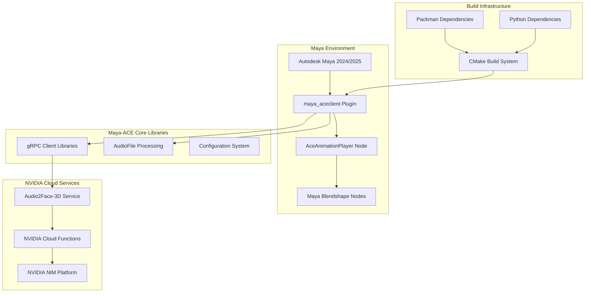
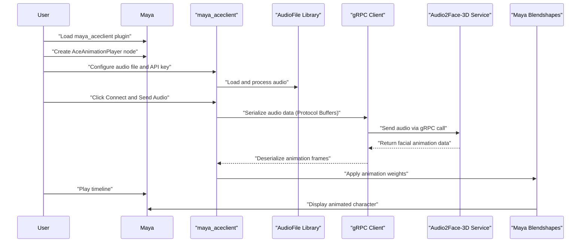
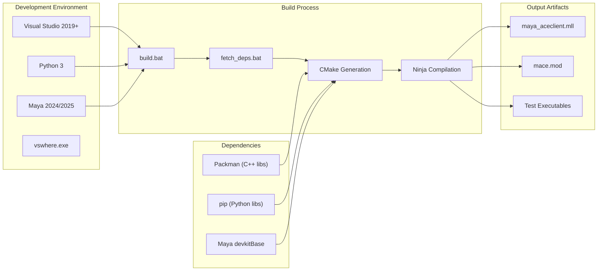

<!-- source: DeepWiki mcp.deepwiki.com · repo NVIDIA/Maya-ACE · page 1 Overview · fetched 2026-10-26 -->

# Overview

Relevant source files

The following files were used as context for generating this wiki page:

- [CONTRIBUTING.md](CONTRIBUTING.md)
- [LICENSE.txt](LICENSE.txt)
- [README.md](README.md)

## Purpose and Scope

This document provides a comprehensive overview of Maya-ACE, covering its architecture, core components, and integration patterns. Maya-ACE serves as a reference implementation for integrating NVIDIA's Audio2Face-3D service with Autodesk Maya through a native plugin architecture.

For step-by-step setup instructions, see [Getting Started](#2). For detailed build procedures, see [Building and Testing](#4.1). For technical specifications on supported audio formats, see [Audio Specifications](#5.1).

## What is Maya-ACE

Maya-ACE is a reference client implementation that enables Maya users to access NVIDIA's ACE Audio2Face-3D service for generating high-quality, audio-driven facial animations. The system consists of a Maya plugin (`maya_aceclient`), gRPC-based service communication, and integration with Maya's native blendshape animation system.

The core workflow involves sending audio data to NVIDIA's cloud-based Audio2Face-3D service and receiving facial animation data that drives character blendshapes in real-time or batch processing modes.

**Sources:** [README.md:3-16](), [README.md:43-50]()

## System Architecture Overview

Maya-ACE implements a plugin-based architecture that extends Maya's functionality while maintaining clean separation between presentation, business logic, and external service integration.

### High-Level Component Architecture

This architecture demonstrates the plugin's role as a bridge between Maya's native systems and NVIDIA's cloud-based AI services, using industry-standard gRPC communication protocols.

**Sources:** [README.md:7-16](), [README.md:20-42]()

## Core Components and Integration Points

### Maya Plugin Integration

The `maya_aceclient` plugin integrates with Maya through several key mechanisms:

| Component | Purpose | Maya Integration |
|-----------|---------|------------------|
| `AceAnimationPlayer` | Core animation node | Extends Maya's DG node system |
| gRPC Client | Service communication | Handles external API calls |
| AudioFile Library | Audio processing | Loads and processes audio data |
| Blendshape Connectors | Animation output | Connects to Maya blendshape nodes |

### Service Communication Flow

This sequence illustrates the end-to-end data flow from audio input to character animation, highlighting the plugin's role in orchestrating communication between Maya and NVIDIA's services.

**Sources:** [README.md:22-28](), [README.md:35-38]()

## Development and Deployment Model

### Build System Architecture

Maya-ACE uses a comprehensive build system that manages both C++ and Python dependencies:

The build system emphasizes reproducibility and cross-platform compatibility while managing complex dependency relationships between Maya SDK, gRPC libraries, and audio processing components.

**Sources:** [README.md:68-71]()

### Licensing and Contribution Model

Maya-ACE operates under an MIT license with a maintainer-led development model. The project encourages forking and adaptation while maintaining centralized development by NVIDIA's team.

| Aspect | Details |
|--------|---------|
| License | MIT License with NVIDIA copyright |
| Contribution Model | Maintainer-led, forks encouraged |
| External Contributions | Not currently accepting direct PRs |
| Support | NVIDIA Enterprise Support for customers |

**Sources:** [LICENSE.txt:1-22](), [CONTRIBUTING.md:1-18](), [README.md:47-50]()

## Integration with NVIDIA Ecosystem

Maya-ACE serves as an entry point into NVIDIA's broader digital human technology ecosystem, providing pathways to more advanced platforms:

- **NVIDIA NIM Platform**: Cloud-based AI inference services
- **Kairos Unreal Engine Integration**: Real-time rendering and interaction
- **Tokkio SDK**: Interactive avatar virtual assistant development
- **ACE Suite**: Comprehensive digital human development tools

This positioning makes Maya-ACE both a standalone tool and a stepping stone for more complex digital human applications.

**Sources:** [README.md:30-34](), [README.md:43-50]()

---

