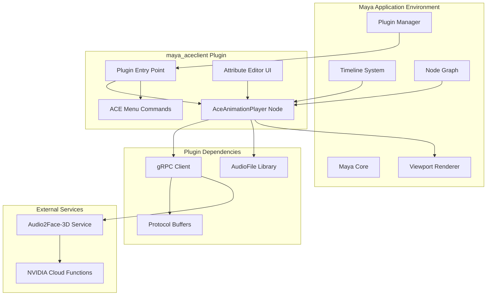
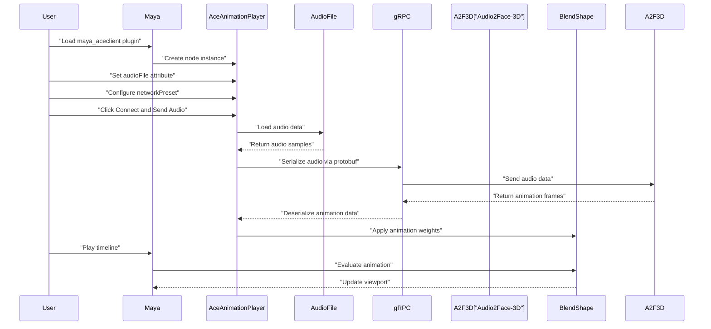

<!-- source: DeepWiki mcp.deepwiki.com · repo NVIDIA/Maya-ACE · page 2 Getting Started · fetched 2026-10-26 -->

# Getting Started

Relevant source files

The following files were used as context for generating this wiki page:

- [deps/README.md](deps/README.md)
- [docs/gettingstarted.md](docs/gettingstarted.md)

This page provides a comprehensive guide to setting up and using Maya-ACE, covering initial configuration, basic usage patterns, and core workflows. It focuses on the technical aspects of the plugin system and integration with NVIDIA's Audio2Face-3D service.

For detailed build instructions and development environment setup, see [Building and Testing](#4.1). For information about sample projects and character assets, see [Sample Projects](#5.2).

## Prerequisites

Maya-ACE requires the following components to be properly installed and configured:

| Component | Requirement | Purpose |
|-----------|-------------|---------|
| Autodesk Maya | 2024 or 2025 | Host application for the plugin |
| NVCF API Key | Valid API key from NVIDIA | Authentication for Audio2Face-3D service |
| Maya devkitBase | Located in `deps/` directory | SDK for Maya plugin development |
| Plugin Package | `mace` module package | Core Maya-ACE functionality |

### API Key Setup

The system requires an `NVCF_API_KEY` environment variable containing a valid API key from NVIDIA's Audio2Face-3D service. This key authenticates requests to the cloud-based facial animation service.

**Sources:** [docs/gettingstarted.md:5-11]()

### Plugin Installation

The `mace` package must be installed as a Maya module by copying its contents to a Maya module path. The package structure includes the compiled plugin binary (`maya_aceclient`) and associated configuration files.

**Sources:** [docs/gettingstarted.md:13-17]()

## System Architecture Overview

### Plugin Integration Architecture

**Sources:** [docs/gettingstarted.md:29](), [docs/gettingstarted.md:92]()

### Data Flow and Processing Pipeline

**Sources:** [docs/gettingstarted.md:55-63](), [docs/gettingstarted.md:124-127]()

## Quick Start Workflow

### Initial Setup

1. **Load Plugin**: In Maya, load the `maya_aceclient` plugin through the Plugin Manager
2. **Open Sample Scene**: Load the provided sample scene containing pre-configured characters
3. **Configure Timeline**: Set framerate to 30fps and disable cached playback for initial testing

The sample scene includes pre-configured `AceAnimationPlayer1` node and character meshes with ARKit-compatible blendshapes.

**Sources:** [docs/gettingstarted.md:29](), [docs/gettingstarted.md:33-39]()

### Audio Configuration

The system processes audio through the `AudioFile` library and requires proper audio import into Maya's timeline:

1. **Import Audio**: Use Maya's audio import functionality to add audio files to the scene
2. **Set Timeline Audio**: Assign the imported audio to the Time Slider sound
3. **Adjust Timeline Range**: Match the timeline range to the audio duration

**Sources:** [docs/gettingstarted.md:41-44]()

### AceAnimationPlayer Configuration

The `AceAnimationPlayer` node serves as the central component for facial animation processing:

#### Core Attributes

| Attribute | Purpose | Configuration |
|-----------|---------|---------------|
| `audioFile` | Audio source selection | Choose from imported Maya audio files |
| `networkPreset` | Service endpoint configuration | Predefined NVCF service endpoints |
| `apiKey` | Authentication | NVCF API key (from environment variable) |
| `functionId` | Model selection | Specific Audio2Face-3D model ID |

#### Connection Process

1. **Select Node**: Choose `AceAnimationPlayer1` in the outliner (disable "DAG Objects only" if needed)
2. **Open Attribute Editor**: Access the node's attributes through the Attribute Editor
3. **Set Audio File**: Select the appropriate audio file from the dropdown menu
4. **Configure Network**: Choose a network preset or manually set endpoint details
5. **Execute Connection**: Click "Connect and Send Audio" button

The status indicator changes to green upon successful connection and data transfer.

**Sources:** [docs/gettingstarted.md:48-61](), [docs/gettingstarted.md:113-127]()

## Character Connection Workflow

### Automatic Connection via Menu

The plugin provides menu commands for connecting `AceAnimationPlayer` nodes to character meshes:

1. **New Connection**: Select target mesh, then use "ACE → Attach a new Animation Player"
2. **Existing Connection**: Select both `AceAnimationPlayer` node and target mesh, then use "ACE → Connect an existing Animation Player"

This workflow automatically establishes connections between the animation player and character blendshapes.

**Sources:** [docs/gettingstarted.md:103-104](), [docs/gettingstarted.md:134-136]()

### Blendshape Requirements

The system expects ARKit-compatible blendshape names and ordering. Character meshes must have proper blendshape nodes with standardized naming conventions for optimal compatibility.

**Sources:** [docs/gettingstarted.md:67-74]()

## Service Modes

### Standard Animation Generation

The default mode processes audio through NVIDIA's Audio2Face-3D service and returns complete animation sequences. This mode is suitable for batch processing and final animation generation.

### Interactive Authoring Mode

For users with ACE Early Access, the authoring service provides real-time parameter adjustment and immediate visual feedback:

1. **Set Client Type**: Configure `clientType` attribute to "Authoring"
2. **Use Authoring Function ID**: Select appropriate authoring-specific function ID
3. **Interactive Session**: Parameters can be adjusted in real-time with immediate visual updates

**Sources:** [docs/gettingstarted.md:156-172]()

## Troubleshooting Common Issues

### Plugin Loading

- Ensure `maya_aceclient` plugin is properly loaded through Maya's Plugin Manager
- Verify that the `mace` module is correctly installed in Maya's module path

### Network Connectivity

- Confirm `NVCF_API_KEY` environment variable is set with a valid API key
- Check network connectivity to NVIDIA's cloud services
- Verify function ID matches the intended Audio2Face-3D model

### Animation Playback

- Disable cached playback during initial testing
- Ensure timeline settings match audio duration and framerate requirements
- Verify blendshape connections are properly established

**Sources:** [docs/gettingstarted.md:37-39](), [deps/README.md:1-4]()

---

