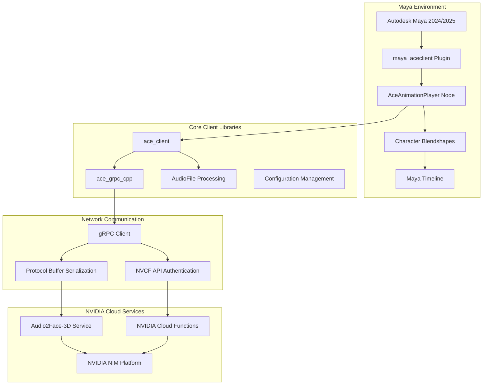
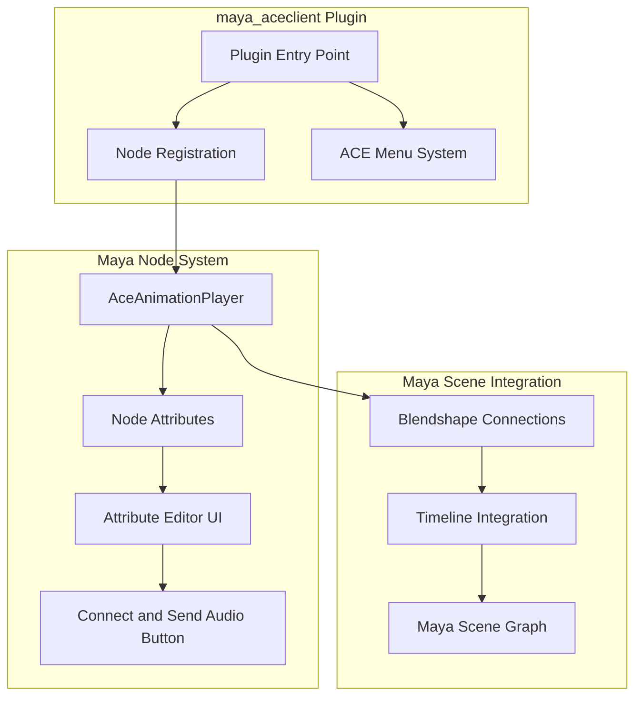
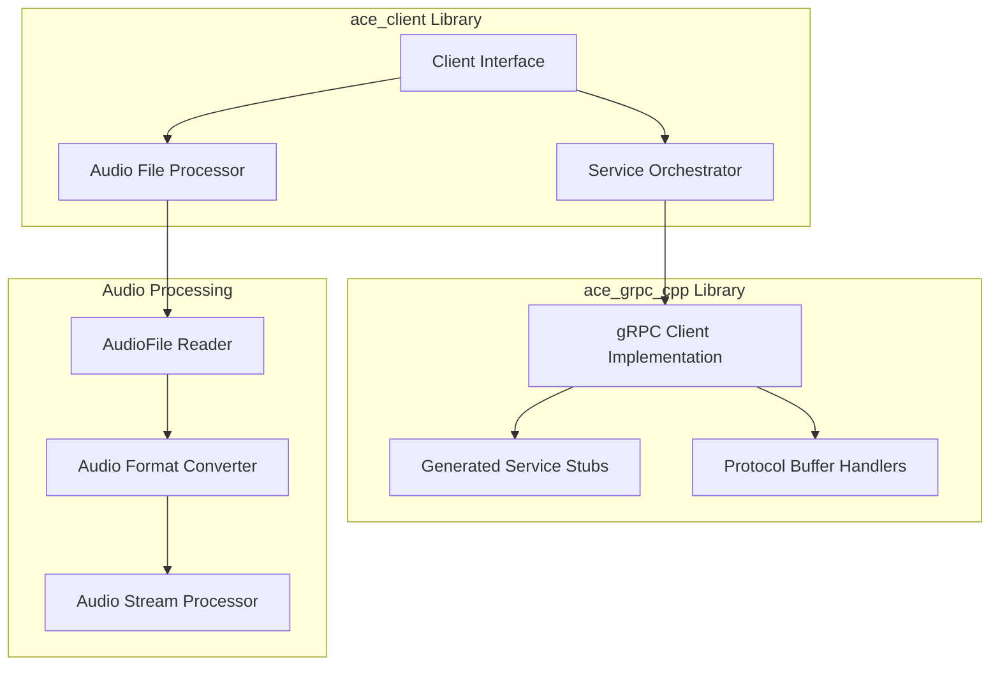
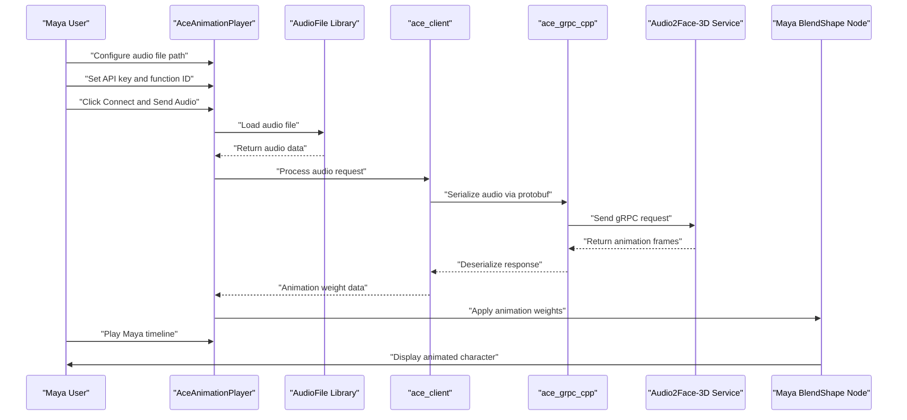
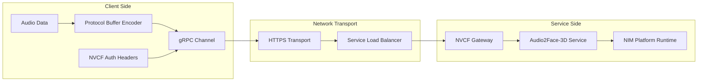
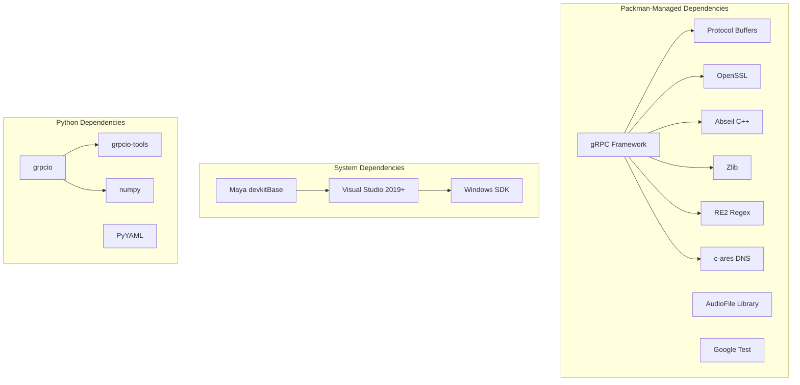

<!-- source: DeepWiki mcp.deepwiki.com · repo NVIDIA/Maya-ACE · page 3 Architecture · fetched 2026-10-26 -->

# Architecture

Relevant source files

The following files were used as context for generating this wiki page:

- [CMakeLists.txt](CMakeLists.txt)
- [README.md](README.md)

This document provides a comprehensive overview of Maya-ACE's system architecture, including its core components, data flow patterns, and build system organization. It details how the Maya plugin integrates with NVIDIA's Audio2Face-3D service through gRPC communication and how the various subsystems interact to provide audio-driven facial animation capabilities.

For information about building and testing the system, see [Building and Testing](#4.1). For dependency-specific details, see [Dependency Management](#3.2) and [C++ Libraries](#3.3).

## System Overview

Maya-ACE implements a plugin-based architecture that extends Autodesk Maya with cloud-based facial animation capabilities. The system consists of four primary architectural layers: the Maya integration layer, the core client libraries, the network communication layer, and the external service integration.

### High-Level Component Architecture

Sources: [CMakeLists.txt:1-27](), [README.md:1-74]()

## Component Architecture

### Maya Plugin Layer

The Maya plugin layer provides the primary user interface and Maya scene integration through native Maya nodes and UI elements.

Sources: [CMakeLists.txt:18](), [README.md:35-37]()

### Core Client Libraries

The core libraries handle audio processing, gRPC communication, and service orchestration.

Sources: [CMakeLists.txt:14-16](), [README.md:71]()

## Data Flow Architecture

### Audio-to-Animation Pipeline

The following diagram illustrates how audio data flows through the system to generate facial animation data that drives Maya blendshapes.

Sources: [README.md:22-24](), [CMakeLists.txt:14-16]()

### Network Communication Flow

Sources: [README.md:15-16](), [CMakeLists.txt:16-20]()

## Build and Dependency Architecture

### CMake Build System Organization

The build system uses CMake with modular find packages and a hierarchical source organization.

```mermaid
graph TD
    subgraph BuildSystem["Build System"]
        RootCMake["CMakeLists.txt (root)"]
        CompilerSettings["compiler_settings.cmake"]
        FindModules["cmake/modules/ Find*.cmake"]
        VersionConfig["source/VERSION.md"]
    end
    
    subgraph Dependencies["External Dependencies"]
        PackmanDeps["Packman Dependencies"]
        AbslDep["find_package(Absl)"]
        AudiofileDep["find_package(Audiofile)"]
        GrpcDep["find_package(Grpc)"]
        GtestDep["find_package(Gtest)"]
        MayaDep["find_package(Maya)"]
        OpensslDep["find_package(Openssl)"]
        ProtobufDep["find_package(Protobuf)"]
        PythonDepsDep["find_package(PythonDeps)"]
    end
    
    subgraph SourceTargets["Source Targets"]
        SourceDir["add_subdirectory(source)"]
        TestsDir["add_subdirectory(tests)"]
        OutputPlugin["plugins/mace.mod"]
    end
    
    RootCMake --> CompilerSettings
    RootCMake --> FindModules
    RootCMake --> VersionConfig
    
    FindModules --> AbslDep
    FindModules --> AudiofileDep
    FindModules --> GrpcDep
    FindModules --> GtestDep
    FindModules --> MayaDep
    FindModules --> OpensslDep
    FindModules --> ProtobufDep
    FindModules --> PythonDepsDep
    
    PackmanDeps --> AbslDep
    PackmanDeps --> AudiofileDep
    PackmanDeps --> GrpcDep
    
    RootCMake --> SourceDir
    RootCMake --> TestsDir
    VersionConfig --> OutputPlugin
```

Sources: [CMakeLists.txt:1-27]()

### Dependency Resolution Chain

Sources: [CMakeLists.txt:13-23]()

---

