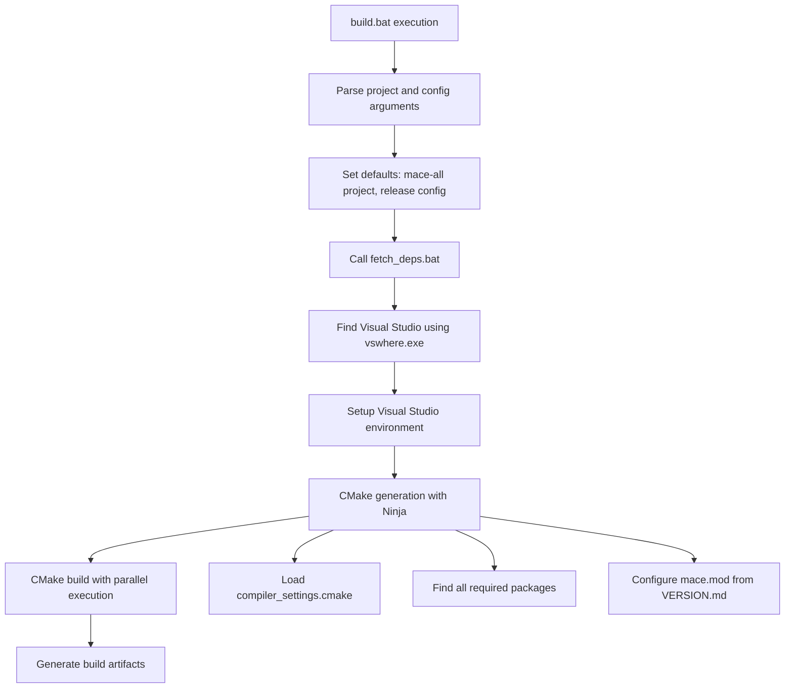
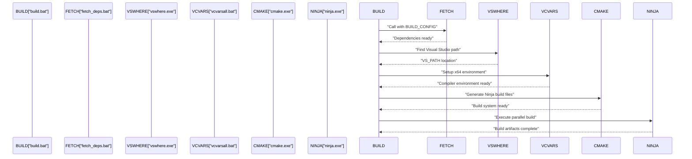

<!-- source: DeepWiki mcp.deepwiki.com · repo NVIDIA/Maya-ACE · page 3.1 Build System · fetched 2026-10-26 -->

# Build System

<details>
<summary>Relevant source files</summary>

The following files were used as context for generating this wiki page:

- [CMakeLists.txt](CMakeLists.txt)
- [build.bat](build.bat)
- [cmake/compiler_settings.cmake](cmake/compiler_settings.cmake)

</details>


This document describes Maya-ACE's CMake-based build system, which handles compilation of the Maya plugin, test executables, and associated build artifacts. The build system manages complex dependencies including Maya SDK integration, gRPC libraries, and Windows-specific toolchain configuration.

For information about dependency management and external libraries, see [Dependency Management](#3.2). For C++ library details, see [C++ Libraries](#3.3).

## Build Architecture Overview

Maya-ACE uses a CMake-based build system with Windows batch script automation. The system integrates with Visual Studio toolchain and manages output artifacts in a structured directory layout.

### Build Process Flow



Sources: [build.bat:1-37](), [CMakeLists.txt:1-27]()

### CMake Configuration Structure

```mermaid
graph TD
    ROOT_CMAKE["CMakeLists.txt"] --> MODULE_PATH["Set CMAKE_MODULE_PATH"]
    ROOT_CMAKE --> COMPILER_SETTINGS["Include compiler_settings.cmake"]
    ROOT_CMAKE --> VERSION_READ["Read VERSION.md"]
    ROOT_CMAKE --> MOD_CONFIG["Configure mace.mod.in"]
    
    ROOT_CMAKE --> FIND_PACKAGES["Find Package Dependencies"]
    FIND_PACKAGES --> ABSL["find_package(Absl)"]
    FIND_PACKAGES --> AUDIOFILE["find_package(Audiofile)"]
    FIND_PACKAGES --> CARES["find_package(Cares)"]
    FIND_PACKAGES --> GRPC["find_package(Grpc)"]
    FIND_PACKAGES --> GTEST["find_package(Gtest)"]
    FIND_PACKAGES --> MAYA["find_package(Maya)"]
    FIND_PACKAGES --> OPENSSL["find_package(Openssl)"]
    FIND_PACKAGES --> PROTOBUF["find_package(Protobuf)"]
    FIND_PACKAGES --> RE2["find_package(Re2)"]
    FIND_PACKAGES --> ZLIB["find_package(Zlib)"]
    FIND_PACKAGES --> PYTHON_DEPS["find_package(PythonDeps)"]
    
    ROOT_CMAKE --> ADD_SUBDIRS["Add Subdirectories"]
    ADD_SUBDIRS --> SOURCE_DIR["add_subdirectory(source)"]
    ADD_SUBDIRS --> TESTS_DIR["add_subdirectory(tests)"]
```



Sources: [CMakeLists.txt:5-26]()

## Build Script Components

### Main Build Script

The `build.bat` script serves as the primary entry point for building Maya-ACE. It handles argument parsing, environment setup, and orchestrates the complete build process.

| Parameter | Default | Description |
|-----------|---------|-------------|
| Project | `mace-all` | Target project to build |
| Config | `release` | Build configuration (release/debug) |

Key operations:
- Sets `BUILD_DIR` to `_build` directory
- Configures CMake and Ninja paths from build dependencies
- Calls `fetch_deps.bat` to ensure dependencies are available
- Uses `vswhere.exe` to locate Visual Studio installation
- Initializes Visual Studio development environment via `vcvarsall.bat`
- Executes CMake generation with Ninja generator
- Performs parallel build execution

Sources: [build.bat:1-37]()

### Environment Configuration

The build system automatically configures the development environment:



Sources: [build.bat:22-37]()

## Compiler Configuration

### C++ Standard and Flags

The `compiler_settings.cmake` file establishes compilation parameters for the entire project:

- **C++ Standard**: C++17 with requirement enforcement
- **Debug Flags**: `/Zi` (debug info), `/Od` (disable optimization)
- **Release Flags**: `/O2` (optimize for speed)
- **MSVC Options**: `/MP` (multi-processor compilation), `/EHsc` (exception handling)
- **Linker Configuration**: Ignores missing PDB warnings (`/ignore:4099`)

Sources: [cmake/compiler_settings.cmake:1-18]()

### Output Directory Structure

Build artifacts are organized in a platform-specific hierarchy:

```
_build/
└── windows-x86_64/
    ├── release/
    │   ├── bin/           # Executables and DLLs
    │   └── plugins/       # Maya plugin files
    └── debug/
        ├── bin/
        └── plugins/
```

The output directory configuration is managed through CMake variables:
- `OUTPUT_DIR`: `${CMAKE_BINARY_DIR}/windows-x86_64/${CMAKE_BUILD_TYPE}`
- `CMAKE_ARCHIVE_OUTPUT_DIRECTORY`: `${OUTPUT_DIR}/bin`
- `CMAKE_LIBRARY_OUTPUT_DIRECTORY`: `${OUTPUT_DIR}/bin`
- `CMAKE_RUNTIME_OUTPUT_DIRECTORY`: `${OUTPUT_DIR}/bin`

Sources: [cmake/compiler_settings.cmake:20-25]()

## Package Discovery

Maya-ACE's build system relies on custom CMake find modules to locate required dependencies. Each `find_package()` call corresponds to a Find module in the `cmake/modules/` directory.

### Core Dependencies

| Package | Purpose | Find Module |
|---------|---------|-------------|
| `Maya` | Maya SDK integration | `FindMaya.cmake` |
| `Grpc` | gRPC communication framework | `FindGrpc.cmake` |
| `Protobuf` | Protocol buffer serialization | `FindProtobuf.cmake` |
| `Audiofile` | Audio file processing | `FindAudiofile.cmake` |
| `Gtest` | Unit testing framework | `FindGtest.cmake` |

### Supporting Libraries

| Package | Purpose |
|---------|---------|
| `Absl` | Abseil C++ library |
| `Cares` | DNS resolution library |
| `Openssl` | Cryptographic functions |
| `Re2` | Regular expression library |
| `Zlib` | Compression library |
| `PythonDeps` | Python package dependencies |

Sources: [CMakeLists.txt:13-23]()

## Version and Module Configuration

The build system generates the Maya module file (`mace.mod`) from a template during CMake configuration. This process reads the version from `VERSION.md` and substitutes it into the module template:

```cmake
file(READ ${CMAKE_SOURCE_DIR}/source/VERSION.md MACE_VERSION)
string(STRIP ${MACE_VERSION} MACE_VERSION)
configure_file(${CMAKE_SOURCE_DIR}/source/mace.mod.in ${OUTPUT_DIR}/plugins/mace.mod @ONLY)
```

The configured module file enables Maya to locate and load the ACE plugin with proper version identification.

Sources: [CMakeLists.txt:9-11]()

## Build Targets

The project structure includes two primary build targets through subdirectory inclusion:

- **Source Targets**: Defined in `source/` subdirectory, containing the main Maya plugin and core libraries
- **Test Targets**: Defined in `tests/` subdirectory, containing unit tests and integration tests

The `mace-all` project builds all targets by default, while individual targets can be specified during build invocation.

Sources: [CMakeLists.txt:25-26](), [build.bat:9-12]()

---

