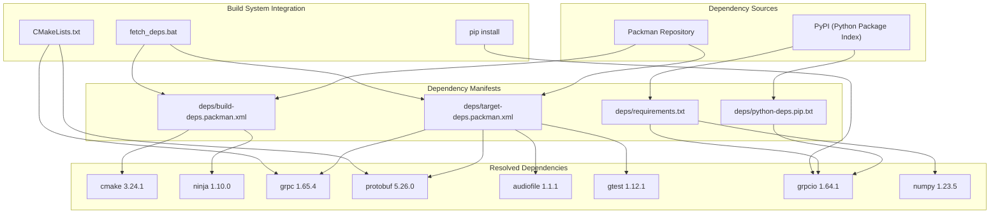
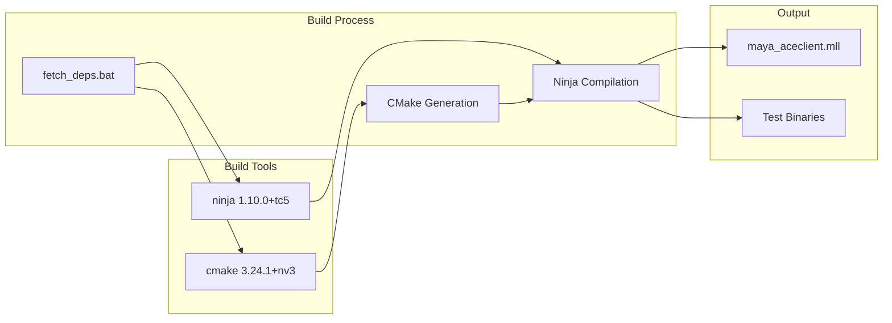
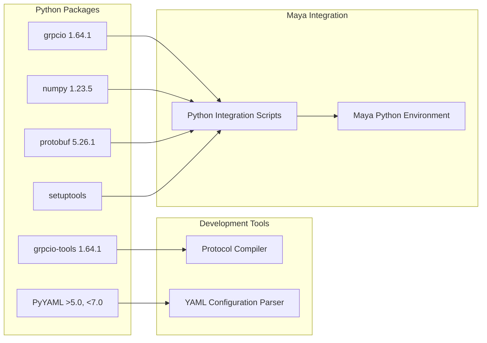
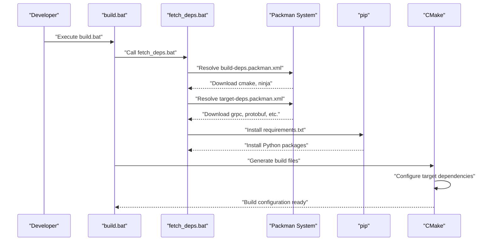

<!-- source: DeepWiki mcp.deepwiki.com · repo NVIDIA/Maya-ACE · page 3.2 Dependency Management · fetched 2026-10-26 -->

# Dependency Management

<details>
<summary>Relevant source files</summary>

The following files were used as context for generating this wiki page:

- [deps/build-deps.packman.xml](deps/build-deps.packman.xml)
- [deps/python-deps.pip.txt](deps/python-deps.pip.txt)
- [deps/requirements.txt](deps/requirements.txt)
- [deps/target-deps.packman.xml](deps/target-deps.packman.xml)

</details>


## Purpose and Scope

This document describes Maya-ACE's dependency management system, which handles external library dependencies required for building and running the Maya plugin. The system uses two primary package managers: Packman for C++ libraries and pip for Python packages. For information about the CMake build configuration that consumes these dependencies, see [Build System](#3.1). For details about individual C++ library integration, see [C++ Libraries](#3.3).

## Dependency Management Architecture

Maya-ACE employs a dual dependency management strategy to handle both native C++ libraries and Python packages required for the gRPC communication with NVIDIA's Audio2Face-3D service.

### Dependency Management Overview



Sources: [deps/build-deps.packman.xml:1-8](), [deps/target-deps.packman.xml:1-45](), [deps/python-deps.pip.txt:1-4](), [deps/requirements.txt:1-6]()

## Build Dependencies

Build dependencies are tools required during the compilation process but not linked into the final Maya plugin. These are managed through [deps/build-deps.packman.xml:1-8]().

### Build Dependency Specification

| Dependency | Version | Platform | Purpose |
|------------|---------|----------|---------|
| `cmake` | 3.24.1+nv3 | windows-x86_64 | Build system generator |
| `ninja` | 1.10.0+tc5 | windows-x86_64 | Build execution engine |



Sources: [deps/build-deps.packman.xml:2-7]()

## Target Dependencies

Target dependencies are C++ libraries that are linked into the final Maya plugin executable. These are specified in [deps/target-deps.packman.xml:1-45]() and organized by functionality.

### Core Communication Libraries

The gRPC communication stack forms the foundation for Audio2Face-3D service integration:

| Library | Version | Configuration | Purpose |
|---------|---------|---------------|---------|
| `grpc` | 1.65.4-dev.5295 | static | gRPC framework for service communication |
| `protobuf` | 5.26.0-1 | static | Protocol buffer serialization |
| `abseil` | 20240116.1-0 | static | Google's C++ common libraries |
| `openssl` | 3.0.15-0 | static | SSL/TLS cryptographic library |
| `c-ares` | 1.32.1-dev.5180 | dynamic | DNS resolution library |
| `re2` | 20230301-0 | dynamic | Regular expression library |
| `zlib` | 1.3.1-0 | static | Compression library |

### Audio Processing Libraries

| Library | Version | Purpose |
|---------|---------|---------|
| `audiofile` | 1.1.1-0 | Audio file reading and processing |

### Testing Framework

| Library | Version | Configuration | Purpose |
|---------|---------|---------------|---------|
| `gtest` | 1.12.1-pic | platform-dependent | Google Test framework for unit testing |

```mermaid
graph TB
    subgraph "gRPC Communication Stack"
        GRPC_LIB["grpc 1.65.4"]
        PROTOBUF_LIB["protobuf 5.26.0"]
        ABSEIL_LIB["abseil 20240116.1"]
        OPENSSL_LIB["openssl 3.0.15"]
        CARES_LIB["c-ares 1.32.1"]
        RE2_LIB["re2 20230301"]
        ZLIB_LIB["zlib 1.3.1"]
    end
    
    subgraph "Audio Processing"
        AUDIOFILE_LIB["audiofile 1.1.1"]
    end
    
    subgraph "Testing"
        GTEST_LIB["gtest 1.12.1"]
    end
    
    subgraph "Maya Plugin"
        MAYA_ACECLIENT["maya_aceclient.mll"]
    end
    
    GRPC_LIB --> PROTOBUF_LIB
    GRPC_LIB --> ABSEIL_LIB
    GRPC_LIB --> OPENSSL_LIB
    GRPC_LIB --> CARES_LIB
    GRPC_LIB --> RE2_LIB
    GRPC_LIB --> ZLIB_LIB
    
    GRPC_LIB --> MAYA_ACECLIENT
    AUDIOFILE_LIB --> MAYA_ACECLIENT
    GTEST_LIB --> "Test Executables"
```

Sources: [deps/target-deps.packman.xml:16-38](), [deps/target-deps.packman.xml:8-10](), [deps/target-deps.packman.xml:3-6]()

## Python Dependencies

Python dependencies support development tooling and provide Python bindings for gRPC communication. Maya-ACE manages Python packages through two mechanisms:

### Development Dependencies

Specified in [deps/python-deps.pip.txt:1-4]():

```
PyYAML<7.0, >5.0
```

This provides YAML parsing capabilities with license compatibility constraints noted in the file header.

### Runtime Python Dependencies

Specified in [deps/requirements.txt:1-6]() with exact version pins:

| Package | Version | Purpose |
|---------|---------|---------|
| `setuptools` | latest | Python package building tools |
| `grpcio` | 1.64.1 | Python gRPC runtime |
| `grpcio-tools` | 1.64.1 | Python gRPC development tools |
| `numpy` | 1.23.5 | Numerical computing library |
| `protobuf` | 5.26.1 | Python Protocol Buffers library |

### Python Package Integration



Sources: [deps/requirements.txt:1-6](), [deps/python-deps.pip.txt:3]()

## Dependency Resolution Process

The dependency resolution follows a specific sequence managed by the build system:

### Resolution Workflow



### Dependency Linking Strategy

The resolved dependencies are linked into the build through platform-specific configurations:

| Platform | Configuration | Link Type | Dependencies |
|----------|---------------|-----------|--------------|
| windows-x86_64 | Debug/Release | static | grpc, protobuf, openssl, zlib, abseil |
| windows-x86_64 | Debug/Release | dynamic | c-ares, re2 |
| linux-x86_64 | Debug/Release | pic-no-abi-cxx11 | gtest (Linux-specific build) |

Sources: [deps/target-deps.packman.xml:4-5](), [deps/target-deps.packman.xml:13-38]()

## License Compliance

Maya-ACE enforces license compatibility through dependency selection. The [deps/python-deps.pip.txt:1]() header explicitly states: "please make sure that the license is compatible with Maya-ACE (i.e. avoid GPL/LGPL)". 

A dedicated license checking dependency is included in [deps/target-deps.packman.xml:40-43]():

```xml
<!-- For license checking -->
<dependency name="pyyaml" linkPath="../_build/target-deps/python-packages/${config}">
  <package name="pyyaml" version="5.3.1" platforms="windows-x86_64" />
</dependency>
```

This ensures that PyYAML, used for configuration parsing, maintains license compatibility with the overall project.

Sources: [deps/python-deps.pip.txt:1](), [deps/target-deps.packman.xml:40-43]()

---

