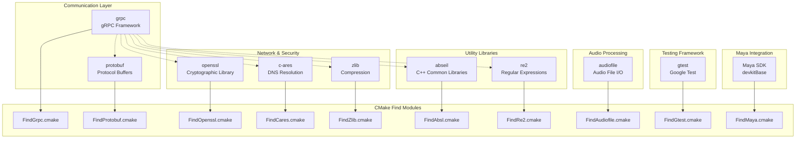
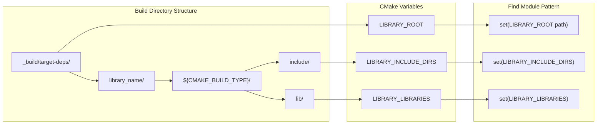

<!-- source: DeepWiki mcp.deepwiki.com · repo NVIDIA/Maya-ACE · page 3.3 C++ Libraries · fetched 2026-10-26 -->

# C++ Libraries

Relevant source files

The following files were used as context for generating this wiki page:

- [cmake/modules/FindAbsl.cmake](cmake/modules/FindAbsl.cmake)
- [cmake/modules/FindAudiofile.cmake](cmake/modules/FindAudiofile.cmake)
- [cmake/modules/FindCares.cmake](cmake/modules/FindCares.cmake)
- [cmake/modules/FindGrpc.cmake](cmake/modules/FindGrpc.cmake)
- [cmake/modules/FindGtest.cmake](cmake/modules/FindGtest.cmake)
- [cmake/modules/FindMaya.cmake](cmake/modules/FindMaya.cmake)
- [cmake/modules/FindOpenssl.cmake](cmake/modules/FindOpenssl.cmake)
- [cmake/modules/FindProtobuf.cmake](cmake/modules/FindProtobuf.cmake)
- [cmake/modules/FindPythonDeps.cmake](cmake/modules/FindPythonDeps.cmake)
- [cmake/modules/FindRe2.cmake](cmake/modules/FindRe2.cmake)
- [cmake/modules/FindZlib.cmake](cmake/modules/FindZlib.cmake)

This document provides detailed documentation of all C++ library dependencies used by Maya-ACE and their integration through CMake Find modules. These libraries form the core foundation for Maya-ACE's functionality, including gRPC communication, audio processing, and Maya plugin integration.

For information about the overall build system that manages these libraries, see [Build System](#3.1). For dependency management using Packman, see [Dependency Management](#3.2).

## Library Architecture Overview

Maya-ACE relies on a comprehensive set of C++ libraries that are organized into functional categories and managed through custom CMake Find modules.

**Sources:** [cmake/modules/FindGrpc.cmake:1-3](), [cmake/modules/FindProtobuf.cmake:1-3](), [cmake/modules/FindOpenssl.cmake:1-3](), [cmake/modules/FindCares.cmake:1-3](), [cmake/modules/FindZlib.cmake:1-3](), [cmake/modules/FindAbsl.cmake:1-3](), [cmake/modules/FindRe2.cmake:1-3](), [cmake/modules/FindAudiofile.cmake:1-2](), [cmake/modules/FindGtest.cmake:1-3](), [cmake/modules/FindMaya.cmake:1-3]()

## CMake Find Module Architecture

The CMake Find modules follow a consistent pattern for locating and configuring library dependencies, using the Packman-managed build directory structure.

**Sources:** [cmake/modules/FindGrpc.cmake:1-3](), [cmake/modules/FindAbsl.cmake:1-3](), [cmake/modules/FindOpenssl.cmake:1-3]()

## Core Communication Libraries

### gRPC Framework
The `grpc` library provides the foundational RPC framework for communicating with NVIDIA's Audio2Face-3D service.

| Property | Value |
|----------|-------|
| **CMake Module** | `FindGrpc.cmake` |
| **Root Path** | `_build/target-deps/grpc/${CMAKE_BUILD_TYPE}` |
| **Include Directory** | `${GRPC_ROOT}/include` |
| **Library Directory** | `${GRPC_ROOT}/lib` |
| **Purpose** | Remote procedure call framework for service communication |

**Sources:** [cmake/modules/FindGrpc.cmake:1-3]()

### Protocol Buffers
The `protobuf` library handles serialization and deserialization of structured data for gRPC communication.

| Property | Value |
|----------|-------|
| **CMake Module** | `FindProtobuf.cmake` |
| **Root Path** | `_build/target-deps/protobuf/${CMAKE_BUILD_TYPE}` |
| **Include Directory** | `${PROTOBUF_ROOT}/include` |
| **Library Directory** | `${PROTOBUF_ROOT}/lib` |
| **Purpose** | Data serialization for gRPC message exchange |

**Sources:** [cmake/modules/FindProtobuf.cmake:1-3]()

## Network and Security Libraries

### OpenSSL
The `openssl` library provides cryptographic functionality and secure transport layer support for gRPC connections.

| Property | Value |
|----------|-------|
| **CMake Module** | `FindOpenssl.cmake` |
| **Root Path** | `_build/target-deps/openssl/${CMAKE_BUILD_TYPE}` |
| **Include Directory** | `${OPENSSL_ROOT}/include` |
| **Library Directory** | `${OPENSSL_ROOT}/lib` |
| **Purpose** | SSL/TLS encryption and cryptographic operations |

**Sources:** [cmake/modules/FindOpenssl.cmake:1-3]()

### c-ares DNS Resolution
The `c-ares` library provides asynchronous DNS resolution capabilities required by gRPC.

| Property | Value |
|----------|-------|
| **CMake Module** | `FindCares.cmake` |
| **Root Path** | `_build/target-deps/c-ares/${CMAKE_BUILD_TYPE}` |
| **Include Directory** | `${CARES_ROOT}/include` |
| **Library Directory** | `${CARES_ROOT}/lib` |
| **Purpose** | Asynchronous DNS resolution for network connections |

**Sources:** [cmake/modules/FindCares.cmake:1-3]()

### Zlib Compression
The `zlib` library handles data compression for efficient network communication.

| Property | Value |
|----------|-------|
| **CMake Module** | `FindZlib.cmake` |
| **Root Path** | `_build/target-deps/zlib/${CMAKE_BUILD_TYPE}` |
| **Include Directory** | `${ZLIB_ROOT}/include` |
| **Library Directory** | `${ZLIB_ROOT}/lib` |
| **Purpose** | Data compression for gRPC message transport |

**Sources:** [cmake/modules/FindZlib.cmake:1-3]()

## Utility Libraries

### Abseil C++ Common Libraries
The `abseil` library provides Google's collection of C++ utility classes and functions used throughout the gRPC stack.

| Property | Value |
|----------|-------|
| **CMake Module** | `FindAbsl.cmake` |
| **Root Path** | `_build/target-deps/abseil/${CMAKE_BUILD_TYPE}` |
| **Include Directory** | `${ABSL_ROOT}/include` |
| **Library Directory** | `${ABSL_ROOT}/lib` |
| **Purpose** | C++ utility functions and containers for gRPC |

**Sources:** [cmake/modules/FindAbsl.cmake:1-3]()

### RE2 Regular Expression Engine
The `re2` library provides efficient regular expression processing capabilities.

| Property | Value |
|----------|-------|
| **CMake Module** | `FindRe2.cmake` |
| **Root Path** | `_build/target-deps/re2/${CMAKE_BUILD_TYPE}` |
| **Include Directory** | `${RE2_ROOT}/include` |
| **Library Directory** | `${RE2_ROOT}/lib` |
| **Purpose** | Regular expression processing for gRPC |

**Sources:** [cmake/modules/FindRe2.cmake:1-3]()

## Audio Processing Library

### AudioFile
The `audiofile` library handles audio file I/O operations for processing audio data before transmission to the Audio2Face-3D service.

| Property | Value |
|----------|-------|
| **CMake Module** | `FindAudiofile.cmake` |
| **Root Path** | `_build/target-deps/audiofile` |
| **Include Directory** | `${AUDIOFILE_ROOT}/include` |
| **Purpose** | Audio file reading and processing |

Note: AudioFile does not follow the build-type directory pattern used by other libraries.

**Sources:** [cmake/modules/FindAudiofile.cmake:1-2]()

## Testing Framework

### Google Test
The `gtest` library provides the unit testing framework for Maya-ACE's test suite.

| Property | Value |
|----------|-------|
| **CMake Module** | `FindGtest.cmake` |
| **Root Path** | `_build/target-deps/gtest/${CMAKE_BUILD_TYPE}` |
| **Include Directory** | `${GTEST_ROOT}/include` |
| **Library Directory** | `${GTEST_ROOT}/lib` |
| **Purpose** | Unit testing framework |

**Sources:** [cmake/modules/FindGtest.cmake:1-3]()

## Maya Integration

### Maya SDK
The Maya SDK integration provides access to Maya's API for plugin development.

| Property | Value |
|----------|-------|
| **CMake Module** | `FindMaya.cmake` |
| **Active Version** | Maya 2024 |
| **Root Path** | `deps/devkitBase` |
| **Include Directory** | `${MAYA2024_ROOT}/include` |
| **Library Directory** | `${MAYA2024_ROOT}/lib` |
| **Purpose** | Maya plugin API and development toolkit |

The Maya Find module includes commented-out configurations for Maya 2025, 2023, and 2022 versions, indicating support for multiple Maya versions in the codebase structure.

**Sources:** [cmake/modules/FindMaya.cmake:1-16]()

## Python Dependencies Integration

### Python Dependencies Root
The `FindPythonDeps.cmake` module establishes the root path for Python package installations used by the build system.

| Property | Value |
|----------|-------|
| **CMake Module** | `FindPythonDeps.cmake` |
| **Root Path** | `_build/python-deps` |
| **Purpose** | Python package installation root for build tools |

**Sources:** [cmake/modules/FindPythonDeps.cmake:1-2]()

---

