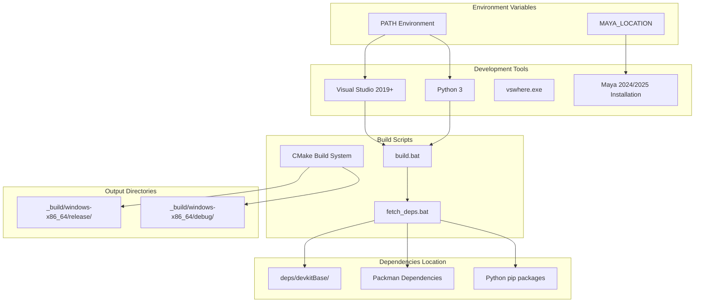
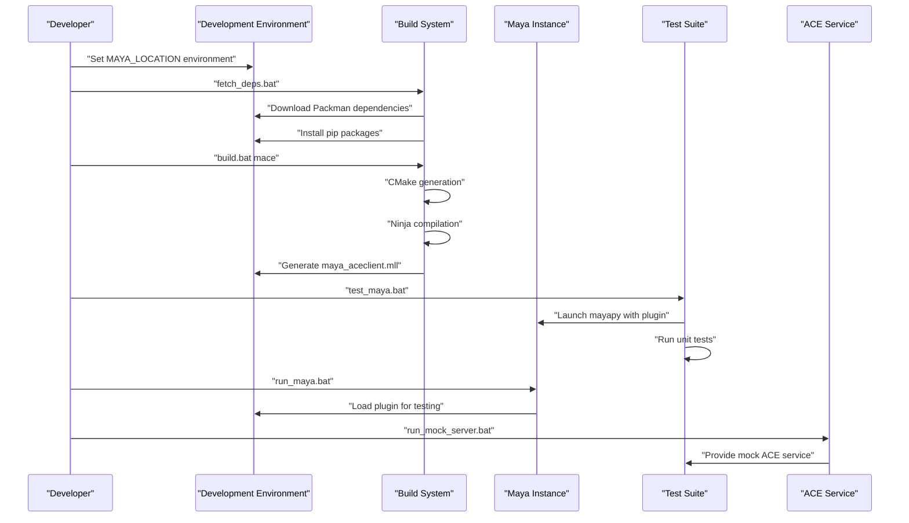
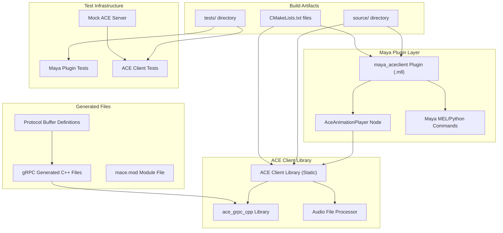
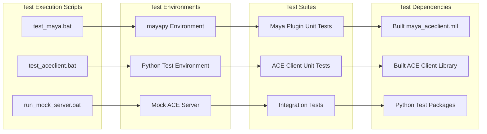
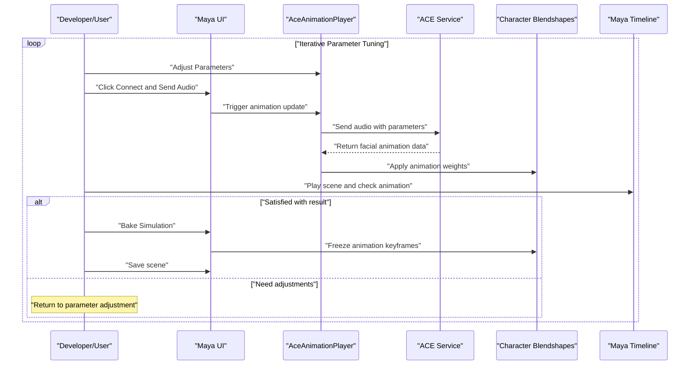

<!-- source: DeepWiki mcp.deepwiki.com · repo NVIDIA/Maya-ACE · page 4 Development Guide · fetched 2026-10-26 -->

# Development Guide

Relevant source files

The following files were used as context for generating this wiki page:

- [docs/bestpractices.md](docs/bestpractices.md)
- [docs/buildandtest.md](docs/buildandtest.md)

This document provides a comprehensive guide for developers working with or extending Maya-ACE. It covers the development environment setup, core workflows, key code components, and testing strategies needed to effectively develop and maintain the Maya-ACE plugin system.

This guide focuses on the development aspects of Maya-ACE. For detailed build instructions and testing procedures, see [Building and Testing](#4.1). For recommended workflows and animation techniques, see [Best Practices](#4.2). For code formatting and style guidelines, see [Code Standards](#4.3).

## Development Environment Overview

Maya-ACE requires a comprehensive development environment that includes Maya SDK integration, C++ build tools, Python environment, and external service connectivity. The development setup supports both the Maya plugin development and the underlying ACE client library development.

### Development Environment Architecture

Sources: [docs/buildandtest.md:5-30]()

## Core Development Workflows

The Maya-ACE development process follows several key workflows depending on the type of development work being performed. Understanding these workflows is essential for efficient development.

### Primary Development Workflow

Sources: [docs/buildandtest.md:33-81]()

## Key Code Components

Maya-ACE consists of several key code components that developers need to understand. These components work together to provide the complete plugin functionality within Maya's architecture.

### Core Component Architecture

Sources: [docs/buildandtest.md:31-97]()

## Testing Strategy

Maya-ACE implements a comprehensive testing strategy that covers both the Maya plugin functionality and the underlying ACE client library. The testing approach supports both unit testing and integration testing with mock services.

### Testing Component Flow

Sources: [docs/buildandtest.md:44-81](), [docs/buildandtest.md:87-97]()

## Development Workflow Implementation

The iterative development workflow for Maya-ACE follows a parameter-tuning approach that requires multiple iterations to achieve optimal results. This workflow is central to how developers and users interact with the system.

### Parameter Tuning and Animation Workflow

Sources: [docs/bestpractices.md:3-14]()

## Blendshape Connection System

Maya-ACE implements a sophisticated blendshape connection system that supports both complete ARKit blendshape sets and partial/custom blendshape configurations. This system is crucial for developers working with different character rigs.

### Blendshape Matching and Connection Process

| Component | Function | ARKit Compliance |
|-----------|----------|------------------|
| `AceAnimationPlayer` | Manages 52 blendshape outputs | Full ARKit BlendShape Locations |
| `Output Weights` | Dynamic blendshape name updates | Case-insensitive matching |
| `Connect existing Animation Player` | Name-based connection system | Partial set support |
| `Blendshape Node` | Target Maya blendshape deformers | User-defined naming |

The connection process follows these rules:
- Blendshape names must correspond to ARKit face locations
- Names are matched case-insensitively  
- Partial blendshape sets are supported through name-based matching
- The `AceAnimationPlayer` automatically updates its output weights based on received animations

Sources: [docs/bestpractices.md:33-54]()

## Quick Start for Developers

For developers new to Maya-ACE, follow this sequence to get started:

1. **Environment Setup**: Install Visual Studio 2019+, Python 3, and Maya 2024/2025
2. **Maya SDK**: Download and place Maya devkitBase in `deps/devkitBase/`
3. **Environment Variables**: Set `MAYA_LOCATION` to Maya installation directory
4. **Dependencies**: Run `fetch_deps.bat` to download all required dependencies
5. **Build**: Execute `build.bat mace` to compile the plugin
6. **Test**: Run `test_maya.bat` to verify the build works correctly
7. **Development**: Use `run_maya.bat` to launch Maya with the plugin loaded

For detailed instructions on each step, see [Building and Testing](#4.1).

For recommended development workflows and animation optimization techniques, see [Best Practices](#4.2).

For code formatting standards and development environment configuration, see [Code Standards](#4.3).

## Related Resources

- **Architecture Overview**: For system architecture details, see [Architecture](#3)
- **Build System Details**: For CMake configuration and build scripts, see [Build System](#3.1)  
- **Dependency Management**: For Packman and pip dependency details, see [Dependency Management](#3.2)
- **Audio Specifications**: For technical audio requirements, see [Audio Specifications](#5.1)
- **Sample Projects**: For example implementations, see [Sample Projects](#5.2)

Sources: [docs/buildandtest.md:1-97](), [docs/bestpractices.md:1-54]()

---

