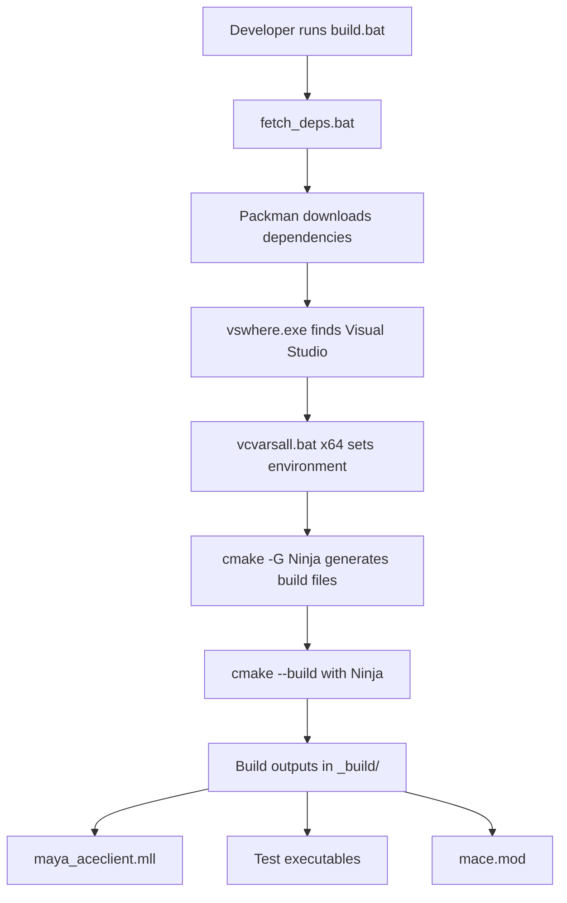
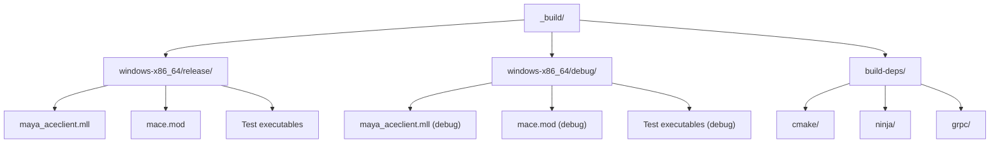
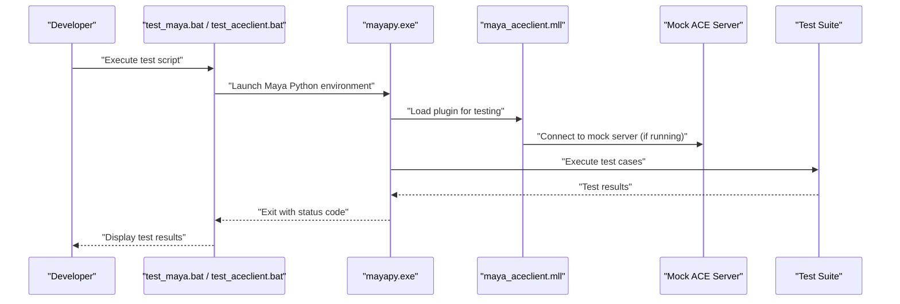
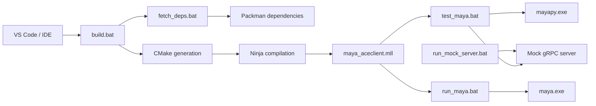

<!-- source: DeepWiki mcp.deepwiki.com · repo NVIDIA/Maya-ACE · page 4.1 Building and Testing · fetched 2026-10-26 -->

# Building and Testing

<details>
<summary>Relevant source files</summary>

The following files were used as context for generating this wiki page:

- [build.bat](build.bat)
- [docs/buildandtest.md](docs/buildandtest.md)

</details>


This document provides comprehensive instructions for building Maya-ACE from source, running the test suite, and setting up a development environment. It covers the CMake-based build system, dependency management, and testing procedures for both the Maya plugin and ACE client library.

For information about the underlying build system architecture and CMake configuration, see [Build System](#3.1). For dependency management details, see [Dependency Management](#3.2).

## Prerequisites

Maya-ACE requires specific development tools and Maya SDK components to build successfully.

### Required Build Tools

The following tools must be installed and accessible in your PATH:

| Tool | Version | Purpose |
|------|---------|---------|
| Visual Studio | 2019+ | C++ compilation with MSBuild |
| Python | 3.x | Build scripts and testing |
| vswhere.exe | Latest | Visual Studio detection |

### Maya Development Kit

The Maya devkit is required for plugin compilation and must be located at the correct path structure:

```
./deps/devkitBase/
├── cmake/
├── devkit/
├── include/
├── lib/
└── mkspecs/
```

Download the Maya devkit from the Autodesk developer website and extract it to `deps/devkitBase`.

### Environment Variables

Set the `MAYA_LOCATION` environment variable to Maya's installation directory for testing:

```powershell
# Windows PowerShell
$ENV:MAYA_LOCATION="C:\Program Files\Autodesk\Maya2024"

# Windows Command Prompt  
SET "MAYA_LOCATION=C:\Program Files\Autodesk\Maya2024"
```

**Build Process Flow**



Sources: [build.bat:1-37](), [docs/buildandtest.md:33-42]()

## Build System

The build process uses a two-stage approach with dependency fetching followed by compilation.

### Dependency Fetching

Dependencies are managed through Packman and must be fetched before building:

```powershell
# Fetch release dependencies
.\fetch_deps.bat

# Fetch debug dependencies  
.\fetch_deps.bat debug
```

The `fetch_deps.bat` script downloads all required C++ libraries and build tools to the `_build/build-deps/` directory.

### Main Build Process

The primary build script supports multiple projects and configurations:

```powershell
# Build all projects (default: mace-all) in release mode
.\build.bat

# Build specific project
.\build.bat mace

# Build with debug configuration
.\build.bat mace debug
```

The build script performs these operations:
1. Sets `BUILD_DIR` to `_build` [build.bat:5]()
2. Configures CMake and Ninja paths [build.bat:6-7]()
3. Detects Visual Studio installation using `vswhere.exe` [build.bat:25]()
4. Initializes Visual Studio environment with `vcvarsall.bat` [build.bat:34]()
5. Generates build files with CMake Ninja generator [build.bat:36]()
6. Executes parallel build with Ninja [build.bat:37]()

### Build Targets

| Target | Purpose | Output |
|--------|---------|---------|
| `mace` | Maya plugin only | `maya_aceclient.mll` |
| `mace-all` | All components | Plugin + tests + utilities |
| `tests-aceclient` | ACE client tests only | Test executables |

**Build Artifact Structure**



Sources: [build.bat:1-37](), [docs/buildandtest.md:35-42]()

## Testing Framework

Maya-ACE includes comprehensive testing for both Maya plugin functionality and ACE client library operations.

### Maya Plugin Tests

Maya plugin tests run within the Maya Python environment using `mayapy`:

```powershell
# Run all Maya tests
.\test_maya.bat

# Run specific test pattern
.\test_maya.bat -k test_plugin

# Run with custom Maya version
$ENV:MAYA_LOCATION="C:\Program Files\Autodesk\Maya2025"
.\test_maya.bat
```

The `test_maya.bat` script loads the Maya Python environment and executes plugin tests that verify:
- Plugin loading and initialization
- `AceAnimationPlayer` node creation and configuration
- Audio file processing functionality
- gRPC client communication

### ACE Client Library Tests

The ACE client library has separate unit tests that run independently of Maya:

```powershell
# Build and run ACE client tests
.\build.bat tests-aceclient
.\test_aceclient.bat
```

These tests validate:
- gRPC client functionality
- Protocol buffer serialization/deserialization
- Audio processing pipeline
- Error handling and recovery

### Mock Server Testing

A mock ACE server is available for testing without requiring access to NVIDIA cloud services:

```powershell
# Start mock server (requires fetch_deps.bat first)
.\run_mock_server.bat
```

The mock server simulates ACE service responses and enables:
- Offline development and testing
- CI/CD pipeline validation
- Network communication testing

**Test Execution Flow**



Sources: [docs/buildandtest.md:44-54](), [docs/buildandtest.md:77-81](), [docs/buildandtest.md:87-92]()

## Development Environment

### Maya Development Session

Launch Maya with the Maya-ACE plugin loaded for interactive development:

```powershell
.\run_maya.bat
```

This script:
- Sets up the Maya module path to include the built plugin
- Loads Maya with the ACE plugin available
- Configures the development environment for testing

### Build Configuration Management

The build system supports multiple configurations simultaneously:

| Configuration | Build Path | Use Case |
|---------------|------------|----------|
| `release` | `_build/windows-x86_64/release/` | Production builds |
| `debug` | `_build/windows-x86_64/debug/` | Development and debugging |

Switch between configurations by specifying the build type:

```powershell
# Build release version
.\build.bat mace release

# Build debug version  
.\build.bat mace debug
```

### Development Workflow

The typical development workflow follows this pattern:

1. **Setup**: Run `fetch_deps.bat` once to download dependencies
2. **Build**: Use `build.bat mace` to compile the plugin
3. **Test**: Execute `test_maya.bat` to validate changes
4. **Debug**: Launch `run_maya.bat` for interactive testing
5. **Iterate**: Repeat build-test cycle as needed

**Development Environment Setup**



Sources: [docs/buildandtest.md:70-74](), [docs/buildandtest.md:77-81](), [build.bat:1-37]()

### Troubleshooting

Common build issues and solutions:

| Issue | Cause | Solution |
|-------|-------|----------|
| CMake not found | Dependencies not fetched | Run `fetch_deps.bat` |
| Visual Studio not detected | vswhere.exe not in PATH | Install Visual Studio 2019+ |
| Maya devkit missing | devkitBase not in deps/ | Download and extract Maya devkit |
| Plugin load failure | MAYA_LOCATION not set | Set environment variable |

The build system provides detailed logging in `_build/vsdevcmd.trace.txt` for Visual Studio environment setup diagnostics.

Sources: [build.bat:28-31](), [build.bat:34](), [docs/buildandtest.md:12-30]()

---

