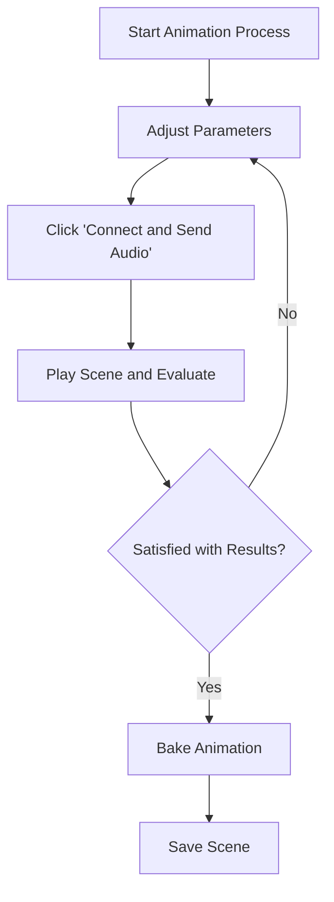
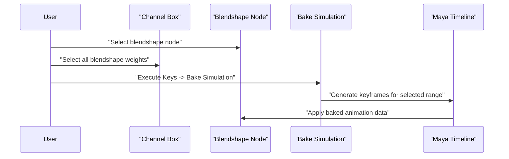
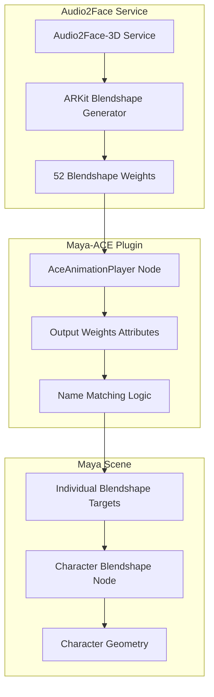
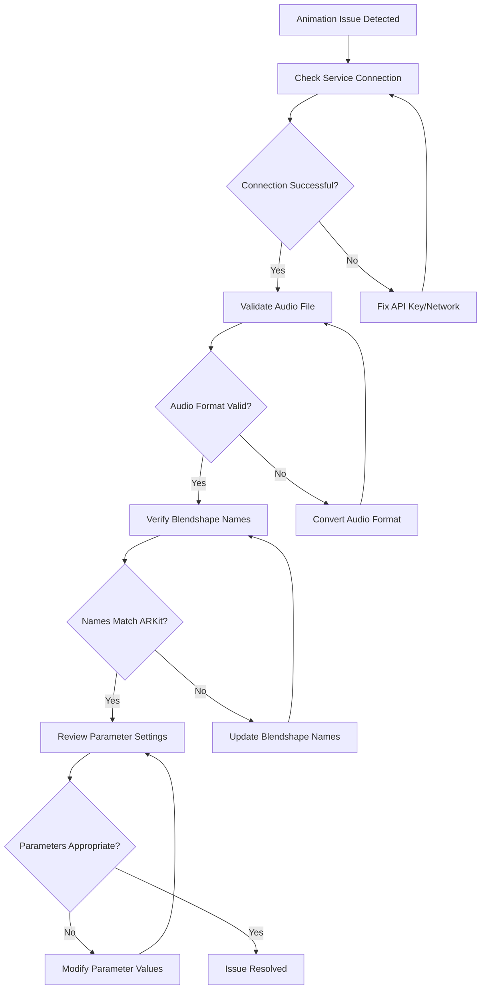

<!-- source: DeepWiki mcp.deepwiki.com · repo NVIDIA/Maya-ACE · page 4.2 Best Practices · fetched 2026-10-26 -->

# Best Practices

Relevant source files

The following files were used as context for generating this wiki page:

- [docs/bestpractices.md](docs/bestpractices.md)

This document provides recommended workflows, animation techniques, and optimization strategies for using Maya-ACE effectively in production environments. It covers iterative development processes, parameter tuning approaches, animation management, and blendshape integration strategies.

For technical specifications about audio formats and requirements, see [Audio Specifications](#5.1). For sample project implementations, see [Sample Projects](#5.2).

## Iterative Workflow Process

Maya-ACE is designed around an iterative refinement process where users progressively adjust parameters and evaluate results until achieving optimal facial animation quality. This approach is essential due to the complex nature of audio-to-facial-animation mapping.

### Core Workflow Steps

The recommended workflow follows these sequential steps:

1. **Parameter Adjustment** - Modify audio processing and animation parameters
2. **Animation Update** - Execute the `Connect and Send Audio` operation
3. **Result Evaluation** - Play the scene and review animation quality with audio
4. **Iteration** - Repeat steps 1-3 until satisfactory results are achieved
5. **Animation Baking** - Freeze the animation data into keyframes
6. **Scene Persistence** - Save the completed scene file

**Workflow Process Diagram**

Sources: [docs/bestpractices.md:3-14]()

### Parameter Optimization Strategy

Parameter tuning requires systematic experimentation to achieve optimal results. The Audio2Face-3D service provides multiple configuration options that significantly impact animation quality and style.

| Parameter Category | Impact on Animation | Optimization Approach |
|-------------------|-------------------|---------------------|
| Audio Processing | Signal clarity and feature extraction | Start with default values, adjust based on audio quality |
| Emotion Intensity | Overall expressiveness | Gradually increase until natural-looking |
| Facial Region Weights | Specific area emphasis | Fine-tune based on character requirements |
| Temporal Smoothing | Animation fluidity | Balance responsiveness with smoothness |

For detailed parameter documentation, refer to the [NVIDIA ACE Parameter Tuning Guide](https://docs.nvidia.com/ace/latest/modules/a2f-docs/text/param_tuning.html).

Sources: [docs/bestpractices.md:17-22]()

## Animation Management and Persistence

### Animation Baking Process

Maya-ACE generates procedural animation data that must be converted to keyframes for reliable playback and editing. The baking process uses Maya's native `Bake Simulation` functionality.

**Animation Baking Sequence**

#### Baking Procedure

1. **Node Selection** - Select the target blendshape node in the scene
2. **Weight Selection** - Highlight all relevant blendshape weights in the Channel Box
3. **Bake Execution** - Navigate to Animation Layout menu → Keys → Bake Simulation
4. **Range Configuration** - Specify the time range for baking in the dialog
5. **Keyframe Generation** - Execute the baking operation to create keyframes

The baked animation becomes part of the Maya scene and can be further edited using standard animation tools.

Sources: [docs/bestpractices.md:23-32]()

## Blendshape Connection Strategies

### ARKit Blendshape Integration

Maya-ACE generates facial animations using 52 predefined blendshape names based on ARKit's Face Anchor BlendShape Locations specification. Proper management of these names and their mapping order is critical for successful animation application.

**Blendshape Connection Architecture**

### Name-Based Connection Rules

The `AceAnimationPlayer` node automatically matches blendshape targets using these criteria:

- **ARKit Compliance** - Blendshape names must correspond to ARKit face locations
- **Case Insensitivity** - Name matching ignores character case differences
- **Partial Support** - Custom or incomplete blendshape sets are supported
- **Automatic Updates** - Output weights update dynamically upon receiving service data

### Connection Implementation Steps

1. **Animation Receipt** - Complete the animation download process to populate `Output Weights`
2. **Node Selection** - Select both the `AceAnimationPlayer` node and target blendshape node
3. **Menu Execution** - Navigate to `Connect existing Animation Player` → `ACE`
4. **Automatic Matching** - The system performs name-based connection automatically

This process supports both complete ARKit blendshape sets and partial implementations based on character requirements.

Sources: [docs/bestpractices.md:33-54]()

## Performance Optimization

### Network Communication Efficiency

Maya-ACE utilizes gRPC with Protocol Buffers for service communication, which provides several optimization opportunities:

| Optimization Area | Recommendation | Implementation |
|------------------|----------------|----------------|
| Audio File Size | Use compressed formats when possible | Convert to supported formats before processing |
| Batch Processing | Process multiple animations in sequence | Group similar parameter sets together |
| Network Presets | Use predefined configurations | Leverage tested parameter combinations |
| Connection Reuse | Maintain persistent connections | Avoid frequent reconnection overhead |

### Memory Management

Large audio files and extended animation sequences can impact Maya's performance:

- **Audio Preprocessing** - Process audio files to appropriate length and quality
- **Timeline Management** - Limit playback range to necessary frames
- **Node Cleanup** - Remove unused `AceAnimationPlayer` nodes after baking
- **Scene Organization** - Group related animation nodes for efficient management

## Error Handling and Troubleshooting

### Common Connection Issues

When service communication fails, verify these components:

1. **API Key Validation** - Ensure NVCF API key is correctly configured
2. **Network Connectivity** - Confirm internet access and firewall settings
3. **Service Availability** - Check NVIDIA service status and endpoints
4. **Audio File Format** - Verify audio file meets specification requirements

### Animation Quality Issues

Poor animation results typically stem from:

- **Parameter Mismatch** - Inappropriate settings for the audio content type
- **Blendshape Incompatibility** - Missing or incorrectly named blendshape targets
- **Audio Quality** - Low-quality or incompatible audio input
- **Character Topology** - Mesh geometry incompatible with ARKit standards

### Diagnostic Workflow

**Troubleshooting Decision Tree**

Sources: [docs/bestpractices.md:1-54]()

---

