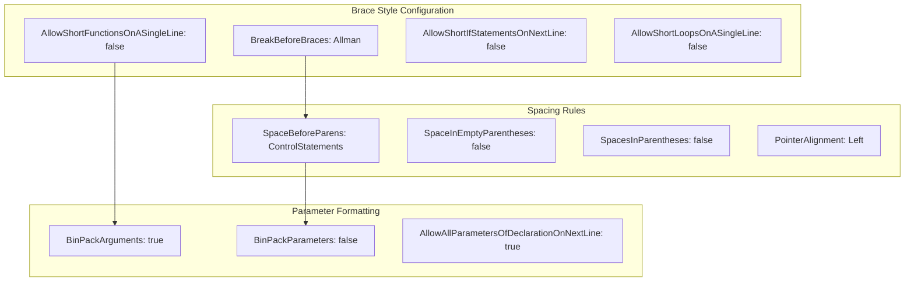
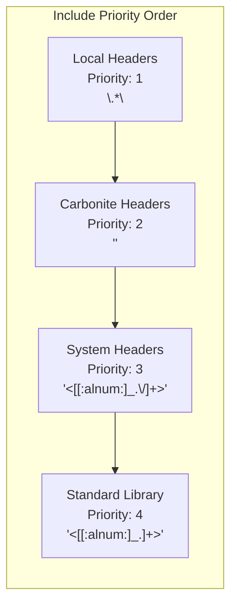
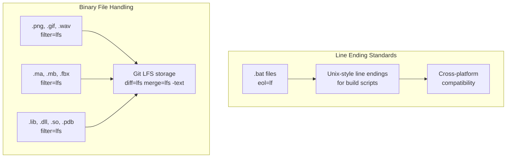
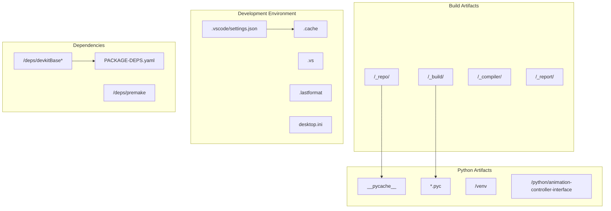
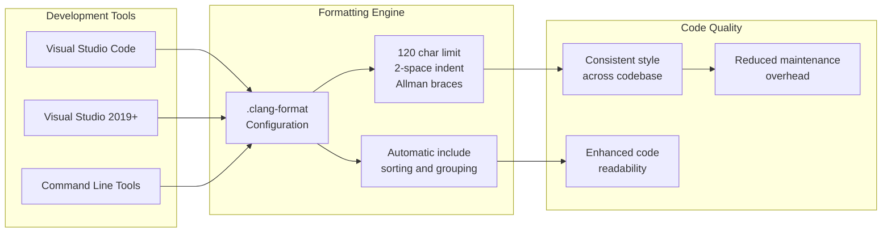

<!-- source: DeepWiki mcp.deepwiki.com · repo NVIDIA/Maya-ACE · page 4.3 Code Standards · fetched 2026-10-26 -->

# Code Standards

Relevant source files

The following files were used as context for generating this wiki page:

- [.clang-format](.clang-format)
- [.gitattributes](.gitattributes)
- [.gitignore](.gitignore)

This document defines the code formatting, style guidelines, and development environment configuration standards for Maya-ACE. These standards ensure consistent, readable, and maintainable code across all components of the system, including C++ plugins, Python scripts, CMake build files, and project assets.

For information about building and testing workflows, see [Building and Testing](#4.1). For development best practices and optimization strategies, see [Best Practices](#4.2).

## Code Formatting Standards

### C++ Code Style

Maya-ACE uses clang-format for automated C++ code formatting with a comprehensive configuration that enforces consistent style across the entire codebase.

#### Core Formatting Rules

The C++ formatting standards are defined in the project's clang-format configuration:

| Setting | Value | Purpose |
|---------|-------|---------|
| `ColumnLimit` | 120 | Maximum line length for readability |
| `IndentWidth` | 2 | Consistent indentation spacing |
| `TabWidth` | 2 | Tab width when tabs are encountered |
| `UseTab` | Never | Always use spaces for indentation |
| `Standard` | Cpp17 | Target C++17 language standard |

#### Brace and Spacing Configuration

**Sources:** [.clang-format:18](), [.clang-format:22](), [.clang-format:33](), [.clang-format:56](), [.clang-format:58]()

#### Include Organization

The project enforces a specific include order with automatic sorting and grouping:

**Sources:** [.clang-format:34-44]()

### Template and Constructor Formatting

The configuration enforces specific rules for complex C++ constructs:

| Rule | Setting | Impact |
|------|---------|--------|
| `AlwaysBreakTemplateDeclarations` | true | Template declarations always break before parameters |
| `ConstructorInitializerAllOnOneLineOrOnePerLine` | true | Constructor initializers are formatted consistently |
| `ConstructorInitializerIndentWidth` | 4 | Specific indentation for constructor initializers |
| `AccessModifierOffset` | -4 | Access modifiers are outdented from class body |

**Sources:** [.clang-format:14](), [.clang-format:24-25](), [.clang-format:1]()

## File Handling Standards

### Line Ending Configuration

Maya-ACE enforces consistent line endings across different file types to ensure cross-platform compatibility:

**Sources:** [.gitattributes:1](), [.gitattributes:2-11]()

### Asset and Binary File Management

Large binary files are managed through Git LFS to maintain repository performance:

| File Type | Extensions | LFS Configuration |
|-----------|------------|-------------------|
| Media Assets | `.png`, `.gif`, `.wav` | `filter=lfs diff=lfs merge=lfs -text` |
| Maya Assets | `.ma`, `.mb`, `.fbx` | `filter=lfs diff=lfs merge=lfs -text` |
| Binary Libraries | `.lib`, `.dll`, `.so`, `.pdb` | `filter=lfs diff=lfs merge=lfs -text` |

**Sources:** [.gitattributes:2-11]()

## Version Control Standards

### Ignored Files and Directories

The project maintains a comprehensive `.gitignore` configuration to exclude build artifacts, dependencies, and development environment files:

**Sources:** [.gitignore:1-20]()

### Development Environment Exclusions

The `.gitignore` configuration ensures that personal development environment settings and temporary files do not interfere with the shared codebase:

| Category | Files/Patterns | Purpose |
|----------|----------------|---------|
| Build System | `/_build/`, `/_repo/`, `/_compiler/` | Exclude generated build artifacts |
| Python | `*.pyc`, `__pycache__`, `/venv` | Exclude Python bytecode and virtual environments |
| IDE Settings | `.vscode/settings.json`, `.vs` | Exclude personal IDE configurations |
| Dependencies | `/deps/devkitBase*`, `PACKAGE-DEPS.yaml` | Exclude downloaded dependencies |

**Sources:** [.gitignore:3-6](), [.gitignore:1-2](), [.gitignore:9-13](), [.gitignore:16-19]()

## Development Environment Configuration

### Code Formatting Integration

The clang-format configuration integrates with common development environments to provide automated formatting:

**Sources:** [.clang-format:1-69]()

### Recommended Workflow Integration

For optimal development experience, configure your environment to automatically apply formatting standards:

1. **Pre-commit Formatting**: Configure your IDE to run clang-format on save
2. **Build Integration**: The CMake build system can be configured to verify formatting compliance
3. **CI/CD Integration**: Automated formatting checks can be integrated into continuous integration workflows

The formatting configuration supports modern C++17 features and is optimized for the specific needs of Maya plugin development and gRPC service integration.

**Sources:** [.clang-format:65]()

---

