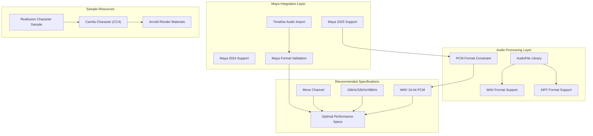
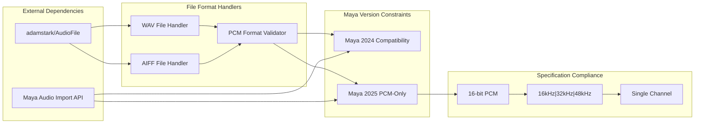
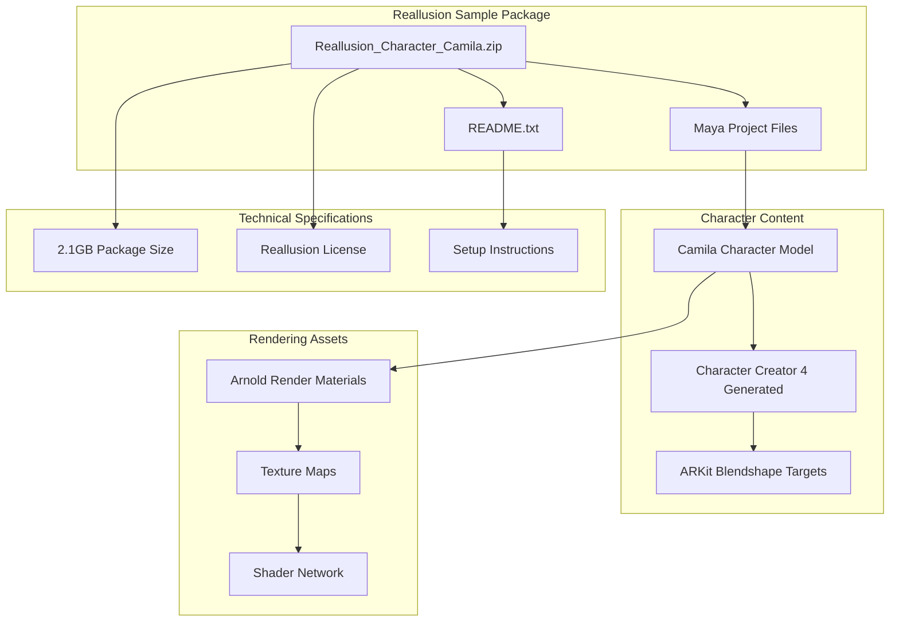

<!-- source: DeepWiki mcp.deepwiki.com · repo NVIDIA/Maya-ACE · page 5 Reference · fetched 2026-10-26 -->

# Reference

Relevant source files

The following files were used as context for generating this wiki page:

- [docs/additionals.md](docs/additionals.md)
- [docs/reallusionsample.md](docs/reallusionsample.md)

This section provides technical reference materials, specifications, and additional resources for Maya-ACE development and usage. It serves as a comprehensive guide to system constraints, file format requirements, sample projects, and compatibility information.

For step-by-step development instructions, see [Development Guide](#4). For architectural details, see [Architecture](#3).

## Overview

The reference materials are organized into the following categories:

| Category | Description | Section |
|----------|-------------|---------|
| Audio Specifications | Technical requirements for audio files, supported formats, and Maya compatibility constraints | [Audio Specifications](#5.1) |
| Sample Projects | Documentation of provided sample projects and setup instructions | [Sample Projects](#5.2) |

## Technical Specifications Summary

Maya-ACE integrates multiple technical systems with specific requirements and constraints. The following diagram illustrates the key technical specifications and their relationships:

**Maya-ACE Technical Specification Overview**

Sources: [docs/additionals.md:1-21](), [docs/reallusionsample.md:1-13]()

## Audio System Integration

The following diagram shows how audio specifications relate to specific code components and libraries:

**Audio Processing Code Entity Relationships**

Sources: [docs/additionals.md:4-9](), [docs/additionals.md:15-20]()

## Compatibility Matrix

The following table summarizes the compatibility requirements across different Maya versions:

| Component | Maya 2024 | Maya 2025 | Notes |
|-----------|-----------|-----------|--------|
| Audio File Library | AudioFile library | AudioFile library | External dependency |
| WAV Support | Full WAV support | PCM WAV only | Format constraint |
| AIFF Support | Full AIFF support | PCM AIFF only | Format constraint |
| Bit Depth | Variable | 16-bit PCM recommended | Performance optimization |
| Sample Rate | Variable | 16/32/48 kHz recommended | Maya timeline compatibility |
| Channel Count | Multi-channel | Mono recommended | Processing efficiency |

Sources: [docs/additionals.md:7-9](), [docs/additionals.md:15-20]()

## Sample Resource Specifications

Maya-ACE includes access to professional-grade sample content for testing and demonstration purposes:

**Sample Project Structure**

Sources: [docs/reallusionsample.md:3-10]()

## Resource Locations

| Resource Type | Location | Size | Description |
|---------------|----------|------|-------------|
| Sample Character | Reallusion Download | ~2.1GB | Complete Maya project with Camila character |
| Documentation | README.txt | - | Setup instructions included in sample |
| License Agreement | Sample archive | - | Reallusion license terms |
| Character Assets | Maya project files | - | CC4-generated character with materials |

## External References

- [AudioFile Library Documentation](https://github.com/adamstark/AudioFile)
- [Maya Audio File Format Support](https://help.autodesk.com/view/MAYAUL/2024/ENU/?guid=GUID-CF2B0358-6946-4C9D-9F8C-A783921CAECC)
- [Reallusion Character Creator](https://www.reallusion.com)

Sources: [docs/additionals.md:4-5](), [docs/reallusionsample.md:3]()

---

