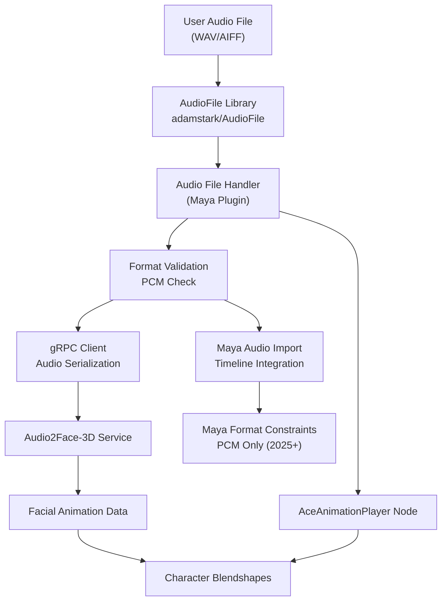
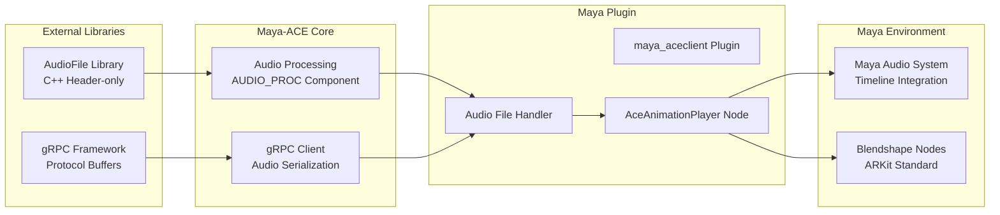
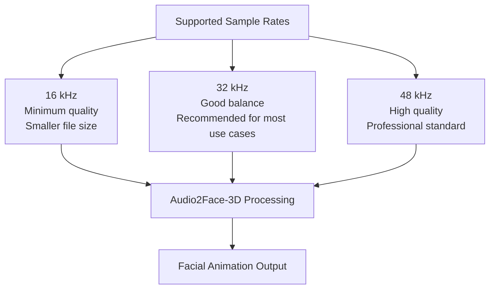

<!-- source: DeepWiki mcp.deepwiki.com · repo NVIDIA/Maya-ACE · page 5.1 Audio Specifications · fetched 2026-10-26 -->

# Audio Specifications

Relevant source files

The following files were used as context for generating this wiki page:

- [docs/additionals.md](docs/additionals.md)

This document provides technical specifications for audio file requirements, supported formats, and compatibility constraints when using Maya-ACE. It covers the integration between the AudioFile library, Maya's audio system constraints, and the NVIDIA Audio2Face-3D service requirements.

For information about building and configuring the development environment, see [Building and Testing](#4.1). For sample projects that demonstrate audio usage, see [Sample Projects](#5.2).

## Audio Processing Architecture

Maya-ACE implements a multi-layered audio processing system that bridges external audio libraries with Maya's native audio constraints and NVIDIA's cloud services.

### Audio Processing Flow

**Sources:** [docs/additionals.md:1-21]()

### Library Integration Architecture

**Sources:** [docs/additionals.md:1-21]()

## Supported Audio Formats

### AudioFile Library Capabilities

The Maya-ACE system uses the AudioFile library to handle audio file reading, which provides support for:

| Format | Extension | Support Level |
|--------|-----------|---------------|
| WAV | `.wav` | Full support |
| AIFF | `.aiff`, `.aif` | Full support |

The AudioFile library handles various encoding formats within these containers, but Maya's constraints further limit acceptable formats.

**Sources:** [docs/additionals.md:4-5]()

### Maya Compatibility Constraints

Maya imposes additional format restrictions that must be satisfied for successful audio import:

| Maya Version | Supported Formats | Notes |
|--------------|-------------------|-------|
| Maya 2024 | PCM, compressed formats | Various encodings supported |
| Maya 2025+ | **PCM only** | Compressed formats no longer supported |

**Sources:** [docs/additionals.md:7-9]()

## Recommended Audio Specifications

For optimal compatibility across Maya versions and reliable processing with the Audio2Face-3D service, use the following specifications:

### Primary Specifications

| Parameter | Recommended Value | Notes |
|-----------|-------------------|-------|
| **File Format** | WAV | Best compatibility with both AudioFile library and Maya |
| **Data Format** | 16-bit PCM | Required for Maya 2025+, universally supported |
| **Sample Rate** | 16 kHz, 32 kHz, or 48 kHz | Optimal for speech processing |
| **Channels** | Mono (1 channel) | Sufficient for facial animation generation |

### Sample Rate Considerations

**Sources:** [docs/additionals.md:11-20]()

## Technical Implementation Details

### Audio File Validation Process

The Maya-ACE plugin implements a validation pipeline to ensure audio compatibility:

1. **Format Detection**: AudioFile library identifies container format (WAV/AIFF)
2. **Encoding Validation**: Verify PCM encoding for Maya 2025+ compatibility
3. **Parameter Check**: Confirm sample rate and channel configuration
4. **Maya Import Test**: Validate successful import into Maya timeline

### Error Handling

Common audio format issues and their resolutions:

| Issue | Cause | Resolution |
|-------|-------|------------|
| Import failure in Maya 2025 | Non-PCM encoding | Convert to 16-bit PCM WAV |
| Poor animation quality | Low sample rate | Use 32 kHz or 48 kHz |
| Large file size | High sample rate/bit depth | Balance quality vs. size needs |
| Stereo channel issues | Multi-channel audio | Convert to mono |

**Sources:** [docs/additionals.md:1-21]()

## Integration with NVIDIA Services

### Audio Data Transmission

The validated audio data is serialized using Protocol Buffers and transmitted to the Audio2Face-3D service via gRPC. The service expects audio in specific formats that align with the recommended specifications above.

### Service Compatibility

| Service Component | Audio Requirements |
|-------------------|-------------------|
| Audio2Face-3D Service | PCM audio, mono preferred |
| gRPC Serialization | Binary audio data |
| Protocol Buffers | Structured audio metadata |

**Sources:** [docs/additionals.md:1-21]()

---

