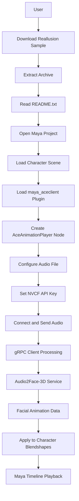
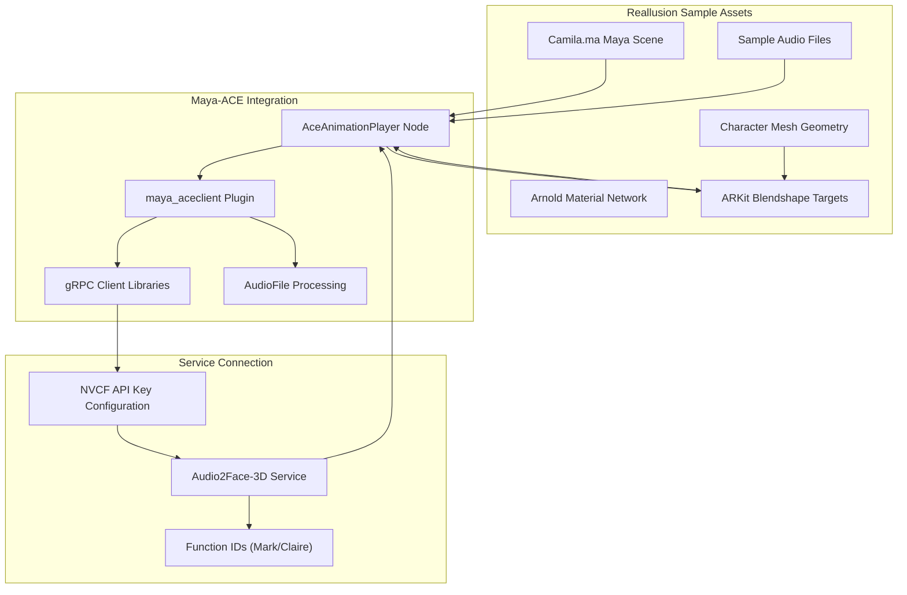
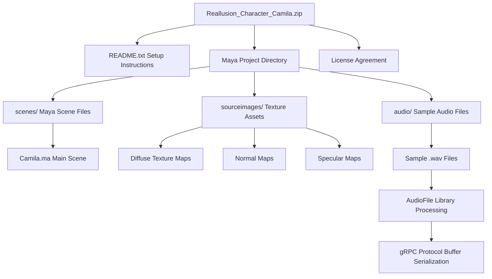
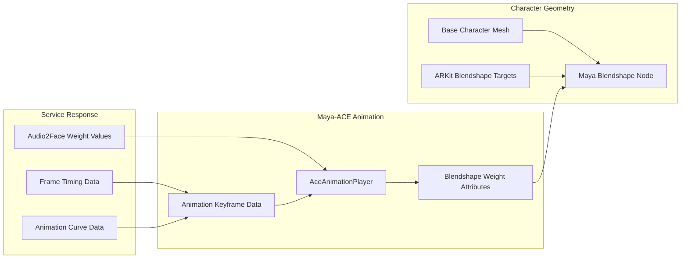

<!-- source: DeepWiki mcp.deepwiki.com · repo NVIDIA/Maya-ACE · page 5.2 Sample Projects · fetched 2026-10-26 -->

# Sample Projects

Relevant source files

The following files were used as context for generating this wiki page:

- [docs/reallusionsample.md](docs/reallusionsample.md)

This document provides information about sample projects available for Maya-ACE, including character assets, setup instructions, and integration examples. These projects demonstrate practical implementations of the Maya-ACE workflow and serve as reference implementations for users getting started with the system.

For information about audio file specifications and format requirements, see [Audio Specifications](#5.1). For development environment setup and building instructions, see [Building and Testing](#4.1).

## Overview

Sample projects for Maya-ACE provide pre-configured Maya scenes with characters, audio files, and setup configurations that demonstrate the complete Audio2Face-3D workflow. These projects showcase different aspects of the system including character preparation, blendshape mapping, and service integration.

## Available Sample Projects

### Reallusion Character Sample

The primary sample project is provided by Reallusion and features a high-quality character asset optimized for Maya-ACE integration. This sample demonstrates professional-grade character setup with proper blendshape configurations for facial animation.

| Property | Details |
|----------|---------|
| **Character Name** | Camila |
| **Source** | Character Creator 4 |
| **File Size** | ~2.1GB |
| **Materials** | Arnold render-ready |
| **License** | Reallusion license agreement |

**Sample Project Workflow**

**Sample Project Integration Architecture**

Sources: [docs/reallusionsample.md:1-13]()

### Setup Instructions

The Reallusion sample includes comprehensive setup documentation within the downloaded archive. The key setup steps involve:

1. **Project Extraction**: Extract the downloaded archive to a local directory
2. **Maya Project Setup**: Open the provided Maya project file
3. **Plugin Loading**: Ensure the `maya_aceclient` plugin is loaded
4. **Node Configuration**: Create and configure the `AceAnimationPlayer` node
5. **Service Connection**: Configure NVCF API credentials for service access

**Sample Project File Structure**

Sources: [docs/reallusionsample.md:3-8]()

## Character Specifications

The Reallusion character sample demonstrates industry-standard character preparation for facial animation workflows:

| Specification | Details |
|---------------|---------|
| **Blendshape Standard** | ARKit compatible targets |
| **Polygon Count** | Production-ready mesh density |
| **UV Mapping** | Non-overlapping UV layout |
| **Material System** | Arnold Material Network |
| **Bone Structure** | Standard facial rig hierarchy |

**Character Blendshape Integration**

Sources: [docs/reallusionsample.md:5-6]()

## Usage Notes

### Disclaimer and Licensing

The Reallusion sample project is provided under Reallusion's licensing terms. Users must comply with the license agreement included in the sample archive. This includes restrictions on redistribution and commercial usage of the character assets.

### Performance Considerations

The sample character is designed for production workflows and includes high-resolution textures and detailed geometry. Users should consider performance implications when working with the sample, particularly when:

- Running on systems with limited GPU memory
- Working with multiple character instances
- Using high-resolution render settings

### Extending the Sample

The Reallusion sample serves as a foundation for understanding Maya-ACE workflows. Users can extend the sample by:

- Adding custom audio files for different animation scenarios
- Modifying blendshape weights for stylized animation results
- Integrating additional characters using similar setup procedures
- Experimenting with different NVCF function IDs and service parameters

Sources: [docs/reallusionsample.md:7-8](), [docs/reallusionsample.md:10-12]()