# Page: Overview

# Overview

<details>
<summary>Relevant source files</summary>

The following files were used as context for generating this wiki page:

- [CONTRIBUTING.md](CONTRIBUTING.md)
- [LICENSE.txt](LICENSE.txt)
- [README.md](README.md)

</details>


## Purpose and Scope

This document provides a comprehensive overview of Maya-ACE, covering its architecture, core components, and integration patterns. Maya-ACE serves as a reference implementation for integrating NVIDIA's Audio2Face-3D service with Autodesk Maya through a native plugin architecture.

For step-by-step setup instructions, see [Getting Started](#2). For detailed build procedures, see [Building and Testing](#4.1). For technical specifications on supported audio formats, see [Audio Specifications](#5.1).

## What is Maya-ACE

Maya-ACE is a reference client implementation that enables Maya users to access NVIDIA's ACE Audio2Face-3D service for generating high-quality, audio-driven facial animations. The system consists of a Maya plugin (`maya_aceclient`), gRPC-based service communication, and integration with Maya's native blendshape animation system.

The core workflow involves sending audio data to NVIDIA's cloud-based Audio2Face-3D service and receiving facial animation data that drives character blendshapes in real-time or batch processing modes.

**Sources:** [README.md:3-16](), [README.md:43-50]()

## System Architecture Overview

Maya-ACE implements a plugin-based architecture that extends Maya's functionality while maintaining clean separation between presentation, business logic, and external service integration.

### High-Level Component Architecture

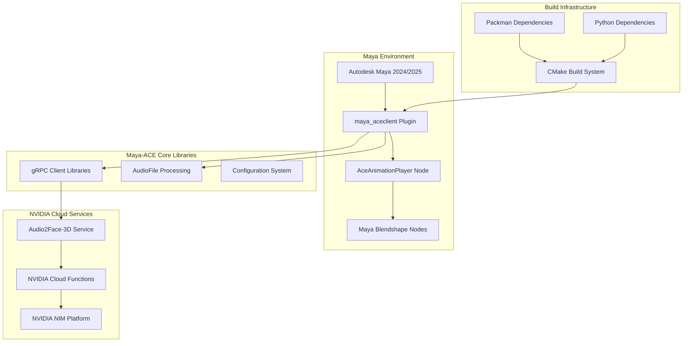

This architecture demonstrates the plugin's role as a bridge between Maya's native systems and NVIDIA's cloud-based AI services, using industry-standard gRPC communication protocols.

**Sources:** [README.md:7-16](), [README.md:20-42]()

## Core Components and Integration Points

### Maya Plugin Integration

The `maya_aceclient` plugin integrates with Maya through several key mechanisms:

| Component | Purpose | Maya Integration |
|-----------|---------|------------------|
| `AceAnimationPlayer` | Core animation node | Extends Maya's DG node system |
| gRPC Client | Service communication | Handles external API calls |
| AudioFile Library | Audio processing | Loads and processes audio data |
| Blendshape Connectors | Animation output | Connects to Maya blendshape nodes |

### Service Communication Flow

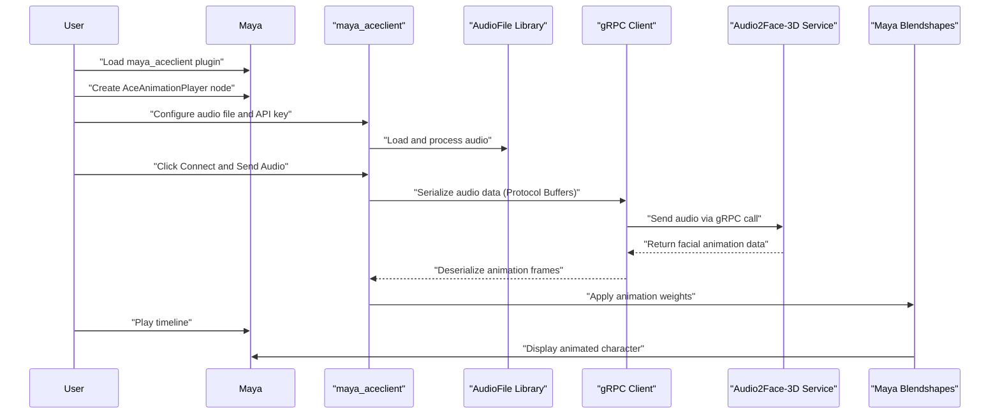

This sequence illustrates the end-to-end data flow from audio input to character animation, highlighting the plugin's role in orchestrating communication between Maya and NVIDIA's services.

**Sources:** [README.md:22-28](), [README.md:35-38]()

## Development and Deployment Model

### Build System Architecture

Maya-ACE uses a comprehensive build system that manages both C++ and Python dependencies:

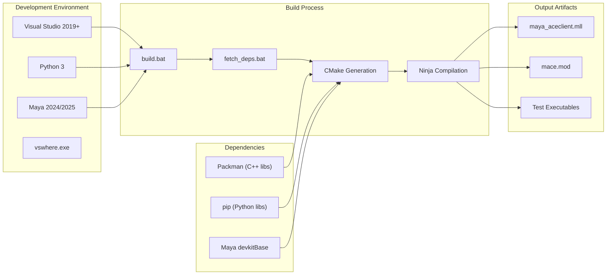

The build system emphasizes reproducibility and cross-platform compatibility while managing complex dependency relationships between Maya SDK, gRPC libraries, and audio processing components.

**Sources:** [README.md:68-71]()

### Licensing and Contribution Model

Maya-ACE operates under an MIT license with a maintainer-led development model. The project encourages forking and adaptation while maintaining centralized development by NVIDIA's team.

| Aspect | Details |
|--------|---------|
| License | MIT License with NVIDIA copyright |
| Contribution Model | Maintainer-led, forks encouraged |
| External Contributions | Not currently accepting direct PRs |
| Support | NVIDIA Enterprise Support for customers |

**Sources:** [LICENSE.txt:1-22](), [CONTRIBUTING.md:1-18](), [README.md:47-50]()

## Integration with NVIDIA Ecosystem

Maya-ACE serves as an entry point into NVIDIA's broader digital human technology ecosystem, providing pathways to more advanced platforms:

- **NVIDIA NIM Platform**: Cloud-based AI inference services
- **Kairos Unreal Engine Integration**: Real-time rendering and interaction
- **Tokkio SDK**: Interactive avatar virtual assistant development
- **ACE Suite**: Comprehensive digital human development tools

This positioning makes Maya-ACE both a standalone tool and a stepping stone for more complex digital human applications.

**Sources:** [README.md:30-34](), [README.md:43-50]()

---

# Page: Getting Started

# Getting Started

<details>
<summary>Relevant source files</summary>

The following files were used as context for generating this wiki page:

- [deps/README.md](deps/README.md)
- [docs/gettingstarted.md](docs/gettingstarted.md)

</details>


This page provides a comprehensive guide to setting up and using Maya-ACE, covering initial configuration, basic usage patterns, and core workflows. It focuses on the technical aspects of the plugin system and integration with NVIDIA's Audio2Face-3D service.

For detailed build instructions and development environment setup, see [Building and Testing](#4.1). For information about sample projects and character assets, see [Sample Projects](#5.2).

## Prerequisites

Maya-ACE requires the following components to be properly installed and configured:

| Component | Requirement | Purpose |
|-----------|-------------|---------|
| Autodesk Maya | 2024 or 2025 | Host application for the plugin |
| NVCF API Key | Valid API key from NVIDIA | Authentication for Audio2Face-3D service |
| Maya devkitBase | Located in `deps/` directory | SDK for Maya plugin development |
| Plugin Package | `mace` module package | Core Maya-ACE functionality |

### API Key Setup

The system requires an `NVCF_API_KEY` environment variable containing a valid API key from NVIDIA's Audio2Face-3D service. This key authenticates requests to the cloud-based facial animation service.

**Sources:** [docs/gettingstarted.md:5-11]()

### Plugin Installation

The `mace` package must be installed as a Maya module by copying its contents to a Maya module path. The package structure includes the compiled plugin binary (`maya_aceclient`) and associated configuration files.

**Sources:** [docs/gettingstarted.md:13-17]()

## System Architecture Overview

### Plugin Integration Architecture

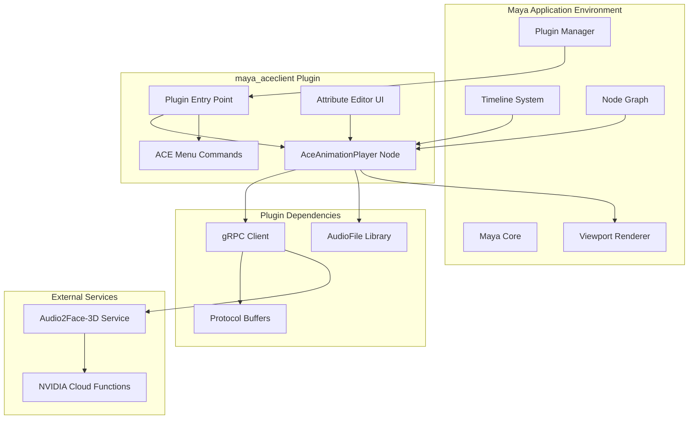

**Sources:** [docs/gettingstarted.md:29](), [docs/gettingstarted.md:92]()

### Data Flow and Processing Pipeline

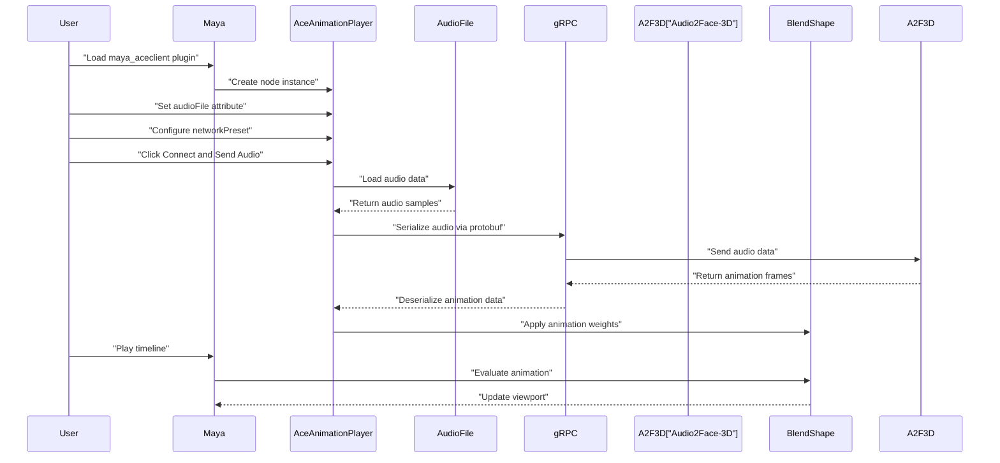

**Sources:** [docs/gettingstarted.md:55-63](), [docs/gettingstarted.md:124-127]()

## Quick Start Workflow

### Initial Setup

1. **Load Plugin**: In Maya, load the `maya_aceclient` plugin through the Plugin Manager
2. **Open Sample Scene**: Load the provided sample scene containing pre-configured characters
3. **Configure Timeline**: Set framerate to 30fps and disable cached playback for initial testing

The sample scene includes pre-configured `AceAnimationPlayer1` node and character meshes with ARKit-compatible blendshapes.

**Sources:** [docs/gettingstarted.md:29](), [docs/gettingstarted.md:33-39]()

### Audio Configuration

The system processes audio through the `AudioFile` library and requires proper audio import into Maya's timeline:

1. **Import Audio**: Use Maya's audio import functionality to add audio files to the scene
2. **Set Timeline Audio**: Assign the imported audio to the Time Slider sound
3. **Adjust Timeline Range**: Match the timeline range to the audio duration

**Sources:** [docs/gettingstarted.md:41-44]()

### AceAnimationPlayer Configuration

The `AceAnimationPlayer` node serves as the central component for facial animation processing:

#### Core Attributes

| Attribute | Purpose | Configuration |
|-----------|---------|---------------|
| `audioFile` | Audio source selection | Choose from imported Maya audio files |
| `networkPreset` | Service endpoint configuration | Predefined NVCF service endpoints |
| `apiKey` | Authentication | NVCF API key (from environment variable) |
| `functionId` | Model selection | Specific Audio2Face-3D model ID |

#### Connection Process

1. **Select Node**: Choose `AceAnimationPlayer1` in the outliner (disable "DAG Objects only" if needed)
2. **Open Attribute Editor**: Access the node's attributes through the Attribute Editor
3. **Set Audio File**: Select the appropriate audio file from the dropdown menu
4. **Configure Network**: Choose a network preset or manually set endpoint details
5. **Execute Connection**: Click "Connect and Send Audio" button

The status indicator changes to green upon successful connection and data transfer.

**Sources:** [docs/gettingstarted.md:48-61](), [docs/gettingstarted.md:113-127]()

## Character Connection Workflow

### Automatic Connection via Menu

The plugin provides menu commands for connecting `AceAnimationPlayer` nodes to character meshes:

1. **New Connection**: Select target mesh, then use "ACE → Attach a new Animation Player"
2. **Existing Connection**: Select both `AceAnimationPlayer` node and target mesh, then use "ACE → Connect an existing Animation Player"

This workflow automatically establishes connections between the animation player and character blendshapes.

**Sources:** [docs/gettingstarted.md:103-104](), [docs/gettingstarted.md:134-136]()

### Blendshape Requirements

The system expects ARKit-compatible blendshape names and ordering. Character meshes must have proper blendshape nodes with standardized naming conventions for optimal compatibility.

**Sources:** [docs/gettingstarted.md:67-74]()

## Service Modes

### Standard Animation Generation

The default mode processes audio through NVIDIA's Audio2Face-3D service and returns complete animation sequences. This mode is suitable for batch processing and final animation generation.

### Interactive Authoring Mode

For users with ACE Early Access, the authoring service provides real-time parameter adjustment and immediate visual feedback:

1. **Set Client Type**: Configure `clientType` attribute to "Authoring"
2. **Use Authoring Function ID**: Select appropriate authoring-specific function ID
3. **Interactive Session**: Parameters can be adjusted in real-time with immediate visual updates

**Sources:** [docs/gettingstarted.md:156-172]()

## Troubleshooting Common Issues

### Plugin Loading

- Ensure `maya_aceclient` plugin is properly loaded through Maya's Plugin Manager
- Verify that the `mace` module is correctly installed in Maya's module path

### Network Connectivity

- Confirm `NVCF_API_KEY` environment variable is set with a valid API key
- Check network connectivity to NVIDIA's cloud services
- Verify function ID matches the intended Audio2Face-3D model

### Animation Playback

- Disable cached playback during initial testing
- Ensure timeline settings match audio duration and framerate requirements
- Verify blendshape connections are properly established

**Sources:** [docs/gettingstarted.md:37-39](), [deps/README.md:1-4]()

---

# Page: Architecture

# Architecture

<details>
<summary>Relevant source files</summary>

The following files were used as context for generating this wiki page:

- [CMakeLists.txt](CMakeLists.txt)
- [README.md](README.md)

</details>


This document provides a comprehensive overview of Maya-ACE's system architecture, including its core components, data flow patterns, and build system organization. It details how the Maya plugin integrates with NVIDIA's Audio2Face-3D service through gRPC communication and how the various subsystems interact to provide audio-driven facial animation capabilities.

For information about building and testing the system, see [Building and Testing](#4.1). For dependency-specific details, see [Dependency Management](#3.2) and [C++ Libraries](#3.3).

## System Overview

Maya-ACE implements a plugin-based architecture that extends Autodesk Maya with cloud-based facial animation capabilities. The system consists of four primary architectural layers: the Maya integration layer, the core client libraries, the network communication layer, and the external service integration.

### High-Level Component Architecture

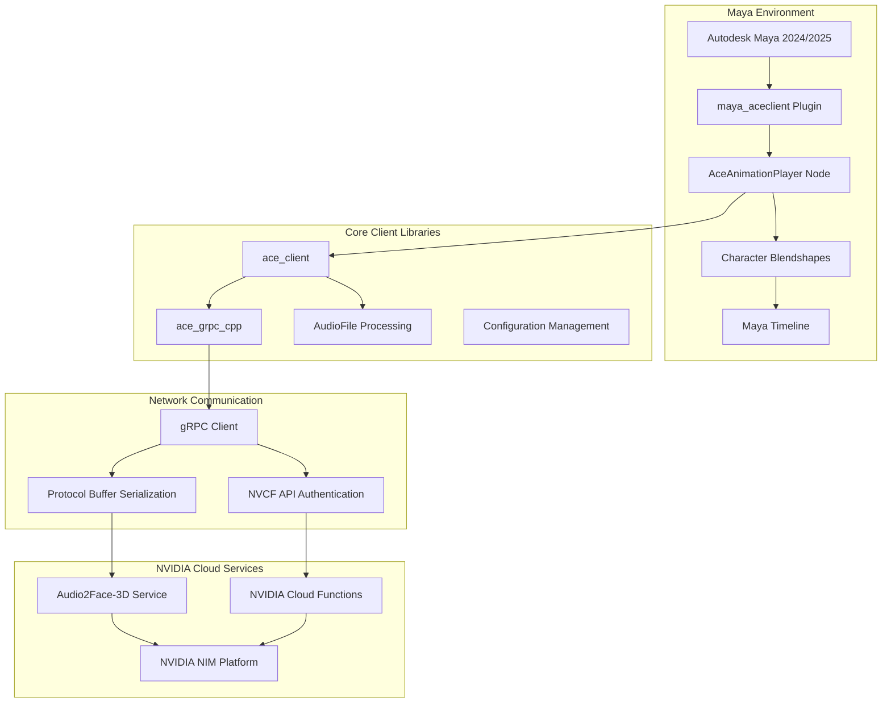

Sources: [CMakeLists.txt:1-27](), [README.md:1-74]()

## Component Architecture

### Maya Plugin Layer

The Maya plugin layer provides the primary user interface and Maya scene integration through native Maya nodes and UI elements.

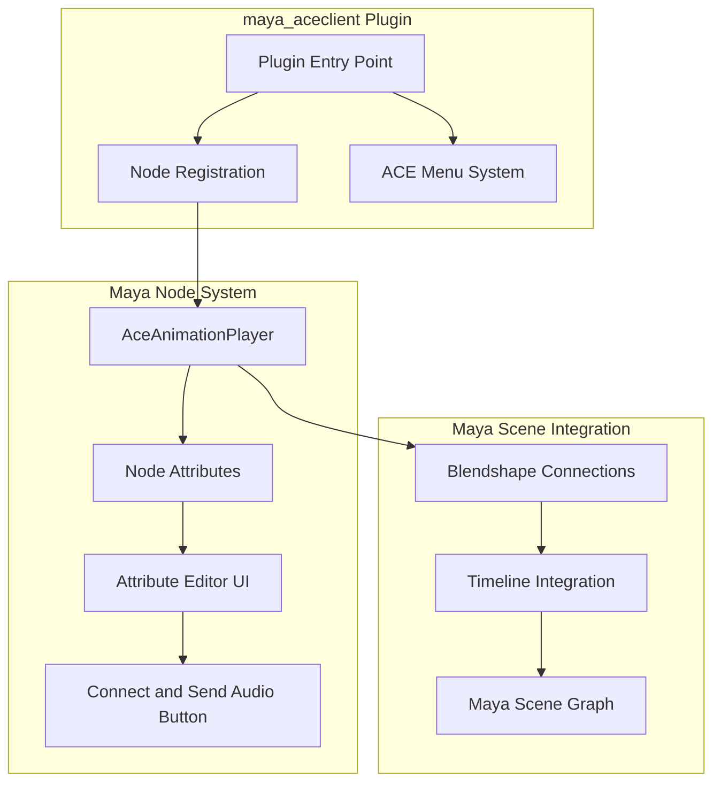

Sources: [CMakeLists.txt:18](), [README.md:35-37]()

### Core Client Libraries

The core libraries handle audio processing, gRPC communication, and service orchestration.

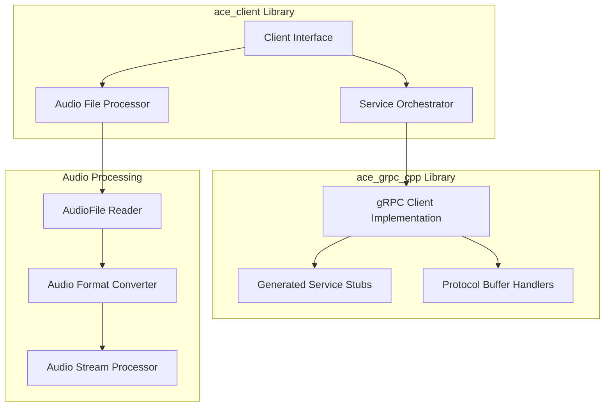

Sources: [CMakeLists.txt:14-16](), [README.md:71]()

## Data Flow Architecture

### Audio-to-Animation Pipeline

The following diagram illustrates how audio data flows through the system to generate facial animation data that drives Maya blendshapes.

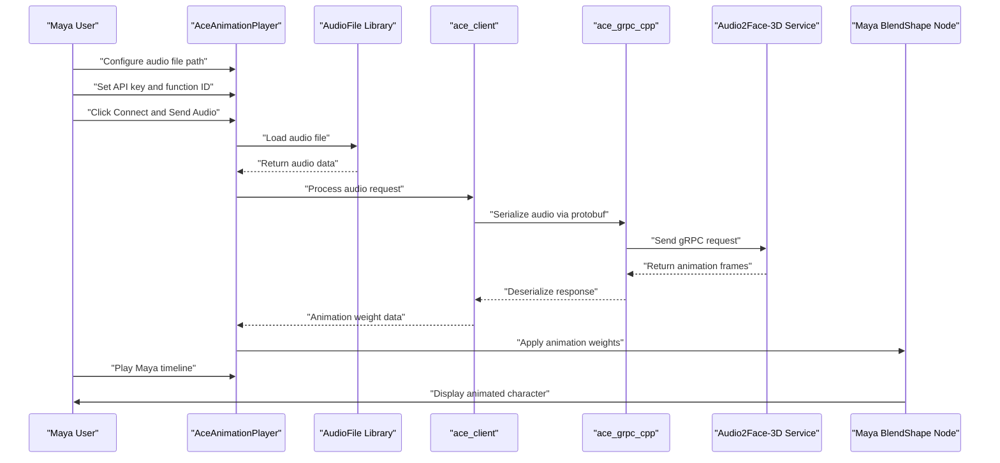

Sources: [README.md:22-24](), [CMakeLists.txt:14-16]()

### Network Communication Flow

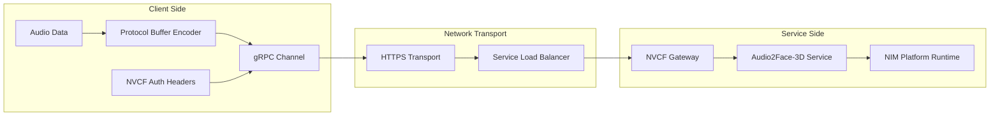

Sources: [README.md:15-16](), [CMakeLists.txt:16-20]()

## Build and Dependency Architecture

### CMake Build System Organization

The build system uses CMake with modular find packages and a hierarchical source organization.

```mermaid
graph TD
    subgraph BuildSystem["Build System"]
        RootCMake["CMakeLists.txt (root)"]
        CompilerSettings["compiler_settings.cmake"]
        FindModules["cmake/modules/ Find*.cmake"]
        VersionConfig["source/VERSION.md"]
    end
    
    subgraph Dependencies["External Dependencies"]
        PackmanDeps["Packman Dependencies"]
        AbslDep["find_package(Absl)"]
        AudiofileDep["find_package(Audiofile)"]
        GrpcDep["find_package(Grpc)"]
        GtestDep["find_package(Gtest)"]
        MayaDep["find_package(Maya)"]
        OpensslDep["find_package(Openssl)"]
        ProtobufDep["find_package(Protobuf)"]
        PythonDepsDep["find_package(PythonDeps)"]
    end
    
    subgraph SourceTargets["Source Targets"]
        SourceDir["add_subdirectory(source)"]
        TestsDir["add_subdirectory(tests)"]
        OutputPlugin["plugins/mace.mod"]
    end
    
    RootCMake --> CompilerSettings
    RootCMake --> FindModules
    RootCMake --> VersionConfig
    
    FindModules --> AbslDep
    FindModules --> AudiofileDep
    FindModules --> GrpcDep
    FindModules --> GtestDep
    FindModules --> MayaDep
    FindModules --> OpensslDep
    FindModules --> ProtobufDep
    FindModules --> PythonDepsDep
    
    PackmanDeps --> AbslDep
    PackmanDeps --> AudiofileDep
    PackmanDeps --> GrpcDep
    
    RootCMake --> SourceDir
    RootCMake --> TestsDir
    VersionConfig --> OutputPlugin
```

Sources: [CMakeLists.txt:1-27]()

### Dependency Resolution Chain

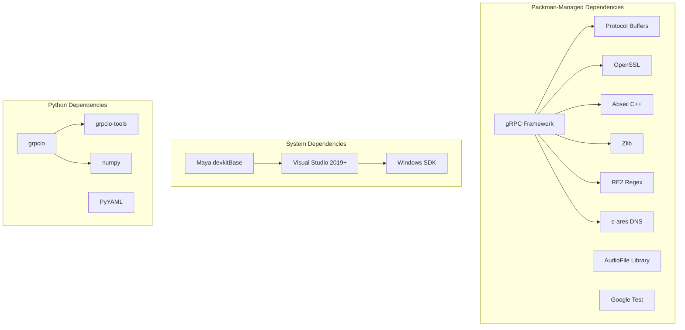

Sources: [CMakeLists.txt:13-23]()

---

# Page: Build System

# Build System

<details>
<summary>Relevant source files</summary>

The following files were used as context for generating this wiki page:

- [CMakeLists.txt](CMakeLists.txt)
- [build.bat](build.bat)
- [cmake/compiler_settings.cmake](cmake/compiler_settings.cmake)

</details>


This document describes Maya-ACE's CMake-based build system, which handles compilation of the Maya plugin, test executables, and associated build artifacts. The build system manages complex dependencies including Maya SDK integration, gRPC libraries, and Windows-specific toolchain configuration.

For information about dependency management and external libraries, see [Dependency Management](#3.2). For C++ library details, see [C++ Libraries](#3.3).

## Build Architecture Overview

Maya-ACE uses a CMake-based build system with Windows batch script automation. The system integrates with Visual Studio toolchain and manages output artifacts in a structured directory layout.

### Build Process Flow

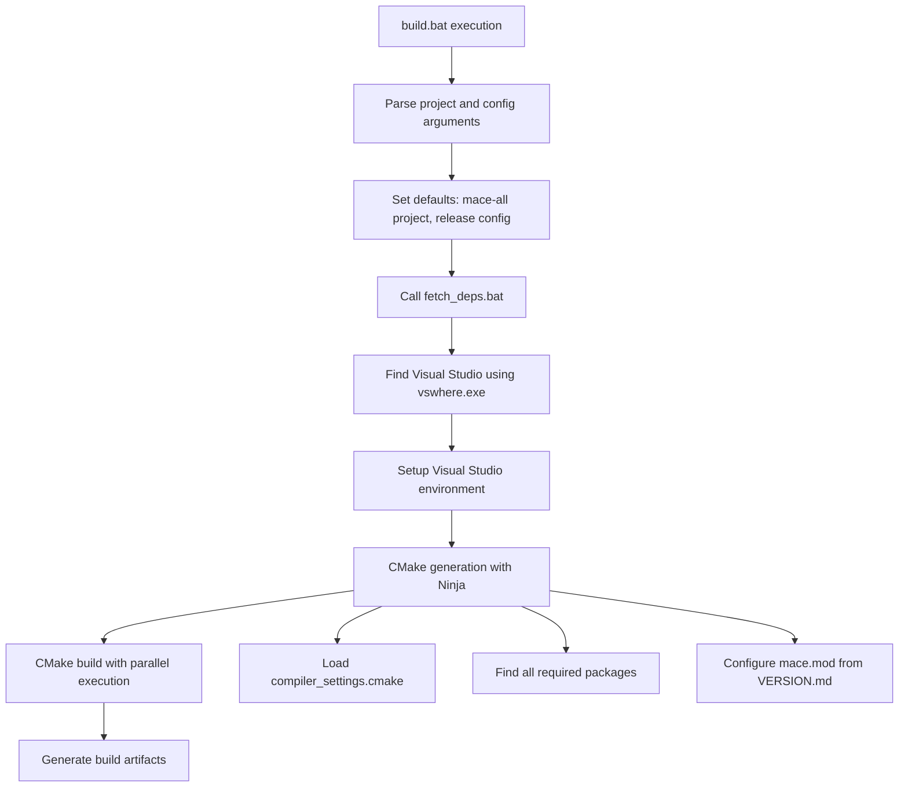

Sources: [build.bat:1-37](), [CMakeLists.txt:1-27]()

### CMake Configuration Structure

```mermaid
graph TD
    ROOT_CMAKE["CMakeLists.txt"] --> MODULE_PATH["Set CMAKE_MODULE_PATH"]
    ROOT_CMAKE --> COMPILER_SETTINGS["Include compiler_settings.cmake"]
    ROOT_CMAKE --> VERSION_READ["Read VERSION.md"]
    ROOT_CMAKE --> MOD_CONFIG["Configure mace.mod.in"]
    
    ROOT_CMAKE --> FIND_PACKAGES["Find Package Dependencies"]
    FIND_PACKAGES --> ABSL["find_package(Absl)"]
    FIND_PACKAGES --> AUDIOFILE["find_package(Audiofile)"]
    FIND_PACKAGES --> CARES["find_package(Cares)"]
    FIND_PACKAGES --> GRPC["find_package(Grpc)"]
    FIND_PACKAGES --> GTEST["find_package(Gtest)"]
    FIND_PACKAGES --> MAYA["find_package(Maya)"]
    FIND_PACKAGES --> OPENSSL["find_package(Openssl)"]
    FIND_PACKAGES --> PROTOBUF["find_package(Protobuf)"]
    FIND_PACKAGES --> RE2["find_package(Re2)"]
    FIND_PACKAGES --> ZLIB["find_package(Zlib)"]
    FIND_PACKAGES --> PYTHON_DEPS["find_package(PythonDeps)"]
    
    ROOT_CMAKE --> ADD_SUBDIRS["Add Subdirectories"]
    ADD_SUBDIRS --> SOURCE_DIR["add_subdirectory(source)"]
    ADD_SUBDIRS --> TESTS_DIR["add_subdirectory(tests)"]
```

Sources: [CMakeLists.txt:5-26]()

## Build Script Components

### Main Build Script

The `build.bat` script serves as the primary entry point for building Maya-ACE. It handles argument parsing, environment setup, and orchestrates the complete build process.

| Parameter | Default | Description |
|-----------|---------|-------------|
| Project | `mace-all` | Target project to build |
| Config | `release` | Build configuration (release/debug) |

Key operations:
- Sets `BUILD_DIR` to `_build` directory
- Configures CMake and Ninja paths from build dependencies
- Calls `fetch_deps.bat` to ensure dependencies are available
- Uses `vswhere.exe` to locate Visual Studio installation
- Initializes Visual Studio development environment via `vcvarsall.bat`
- Executes CMake generation with Ninja generator
- Performs parallel build execution

Sources: [build.bat:1-37]()

### Environment Configuration

The build system automatically configures the development environment:

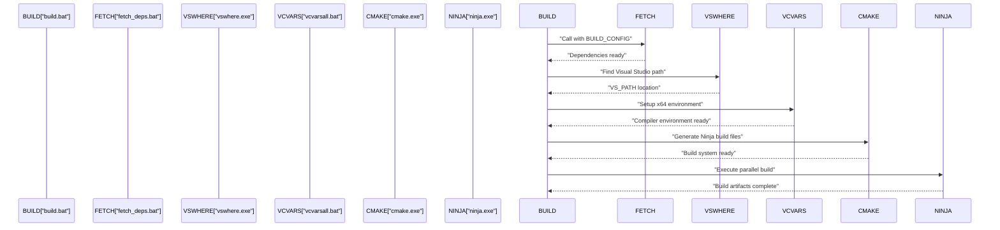

Sources: [build.bat:22-37]()

## Compiler Configuration

### C++ Standard and Flags

The `compiler_settings.cmake` file establishes compilation parameters for the entire project:

- **C++ Standard**: C++17 with requirement enforcement
- **Debug Flags**: `/Zi` (debug info), `/Od` (disable optimization)
- **Release Flags**: `/O2` (optimize for speed)
- **MSVC Options**: `/MP` (multi-processor compilation), `/EHsc` (exception handling)
- **Linker Configuration**: Ignores missing PDB warnings (`/ignore:4099`)

Sources: [cmake/compiler_settings.cmake:1-18]()

### Output Directory Structure

Build artifacts are organized in a platform-specific hierarchy:

```
_build/
└── windows-x86_64/
    ├── release/
    │   ├── bin/           # Executables and DLLs
    │   └── plugins/       # Maya plugin files
    └── debug/
        ├── bin/
        └── plugins/
```

The output directory configuration is managed through CMake variables:
- `OUTPUT_DIR`: `${CMAKE_BINARY_DIR}/windows-x86_64/${CMAKE_BUILD_TYPE}`
- `CMAKE_ARCHIVE_OUTPUT_DIRECTORY`: `${OUTPUT_DIR}/bin`
- `CMAKE_LIBRARY_OUTPUT_DIRECTORY`: `${OUTPUT_DIR}/bin`
- `CMAKE_RUNTIME_OUTPUT_DIRECTORY`: `${OUTPUT_DIR}/bin`

Sources: [cmake/compiler_settings.cmake:20-25]()

## Package Discovery

Maya-ACE's build system relies on custom CMake find modules to locate required dependencies. Each `find_package()` call corresponds to a Find module in the `cmake/modules/` directory.

### Core Dependencies

| Package | Purpose | Find Module |
|---------|---------|-------------|
| `Maya` | Maya SDK integration | `FindMaya.cmake` |
| `Grpc` | gRPC communication framework | `FindGrpc.cmake` |
| `Protobuf` | Protocol buffer serialization | `FindProtobuf.cmake` |
| `Audiofile` | Audio file processing | `FindAudiofile.cmake` |
| `Gtest` | Unit testing framework | `FindGtest.cmake` |

### Supporting Libraries

| Package | Purpose |
|---------|---------|
| `Absl` | Abseil C++ library |
| `Cares` | DNS resolution library |
| `Openssl` | Cryptographic functions |
| `Re2` | Regular expression library |
| `Zlib` | Compression library |
| `PythonDeps` | Python package dependencies |

Sources: [CMakeLists.txt:13-23]()

## Version and Module Configuration

The build system generates the Maya module file (`mace.mod`) from a template during CMake configuration. This process reads the version from `VERSION.md` and substitutes it into the module template:

```cmake
file(READ ${CMAKE_SOURCE_DIR}/source/VERSION.md MACE_VERSION)
string(STRIP ${MACE_VERSION} MACE_VERSION)
configure_file(${CMAKE_SOURCE_DIR}/source/mace.mod.in ${OUTPUT_DIR}/plugins/mace.mod @ONLY)
```

The configured module file enables Maya to locate and load the ACE plugin with proper version identification.

Sources: [CMakeLists.txt:9-11]()

## Build Targets

The project structure includes two primary build targets through subdirectory inclusion:

- **Source Targets**: Defined in `source/` subdirectory, containing the main Maya plugin and core libraries
- **Test Targets**: Defined in `tests/` subdirectory, containing unit tests and integration tests

The `mace-all` project builds all targets by default, while individual targets can be specified during build invocation.

Sources: [CMakeLists.txt:25-26](), [build.bat:9-12]()

---

# Page: Dependency Management

# Dependency Management

<details>
<summary>Relevant source files</summary>

The following files were used as context for generating this wiki page:

- [deps/build-deps.packman.xml](deps/build-deps.packman.xml)
- [deps/python-deps.pip.txt](deps/python-deps.pip.txt)
- [deps/requirements.txt](deps/requirements.txt)
- [deps/target-deps.packman.xml](deps/target-deps.packman.xml)

</details>


## Purpose and Scope

This document describes Maya-ACE's dependency management system, which handles external library dependencies required for building and running the Maya plugin. The system uses two primary package managers: Packman for C++ libraries and pip for Python packages. For information about the CMake build configuration that consumes these dependencies, see [Build System](#3.1). For details about individual C++ library integration, see [C++ Libraries](#3.3).

## Dependency Management Architecture

Maya-ACE employs a dual dependency management strategy to handle both native C++ libraries and Python packages required for the gRPC communication with NVIDIA's Audio2Face-3D service.

### Dependency Management Overview

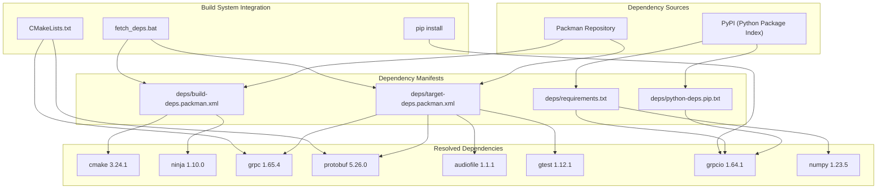

Sources: [deps/build-deps.packman.xml:1-8](), [deps/target-deps.packman.xml:1-45](), [deps/python-deps.pip.txt:1-4](), [deps/requirements.txt:1-6]()

## Build Dependencies

Build dependencies are tools required during the compilation process but not linked into the final Maya plugin. These are managed through [deps/build-deps.packman.xml:1-8]().

### Build Dependency Specification

| Dependency | Version | Platform | Purpose |
|------------|---------|----------|---------|
| `cmake` | 3.24.1+nv3 | windows-x86_64 | Build system generator |
| `ninja` | 1.10.0+tc5 | windows-x86_64 | Build execution engine |

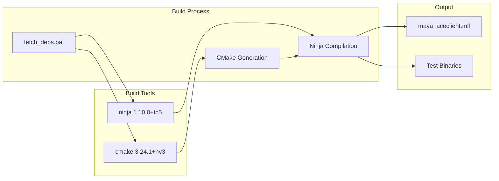

Sources: [deps/build-deps.packman.xml:2-7]()

## Target Dependencies

Target dependencies are C++ libraries that are linked into the final Maya plugin executable. These are specified in [deps/target-deps.packman.xml:1-45]() and organized by functionality.

### Core Communication Libraries

The gRPC communication stack forms the foundation for Audio2Face-3D service integration:

| Library | Version | Configuration | Purpose |
|---------|---------|---------------|---------|
| `grpc` | 1.65.4-dev.5295 | static | gRPC framework for service communication |
| `protobuf` | 5.26.0-1 | static | Protocol buffer serialization |
| `abseil` | 20240116.1-0 | static | Google's C++ common libraries |
| `openssl` | 3.0.15-0 | static | SSL/TLS cryptographic library |
| `c-ares` | 1.32.1-dev.5180 | dynamic | DNS resolution library |
| `re2` | 20230301-0 | dynamic | Regular expression library |
| `zlib` | 1.3.1-0 | static | Compression library |

### Audio Processing Libraries

| Library | Version | Purpose |
|---------|---------|---------|
| `audiofile` | 1.1.1-0 | Audio file reading and processing |

### Testing Framework

| Library | Version | Configuration | Purpose |
|---------|---------|---------------|---------|
| `gtest` | 1.12.1-pic | platform-dependent | Google Test framework for unit testing |

```mermaid
graph TB
    subgraph "gRPC Communication Stack"
        GRPC_LIB["grpc 1.65.4"]
        PROTOBUF_LIB["protobuf 5.26.0"]
        ABSEIL_LIB["abseil 20240116.1"]
        OPENSSL_LIB["openssl 3.0.15"]
        CARES_LIB["c-ares 1.32.1"]
        RE2_LIB["re2 20230301"]
        ZLIB_LIB["zlib 1.3.1"]
    end
    
    subgraph "Audio Processing"
        AUDIOFILE_LIB["audiofile 1.1.1"]
    end
    
    subgraph "Testing"
        GTEST_LIB["gtest 1.12.1"]
    end
    
    subgraph "Maya Plugin"
        MAYA_ACECLIENT["maya_aceclient.mll"]
    end
    
    GRPC_LIB --> PROTOBUF_LIB
    GRPC_LIB --> ABSEIL_LIB
    GRPC_LIB --> OPENSSL_LIB
    GRPC_LIB --> CARES_LIB
    GRPC_LIB --> RE2_LIB
    GRPC_LIB --> ZLIB_LIB
    
    GRPC_LIB --> MAYA_ACECLIENT
    AUDIOFILE_LIB --> MAYA_ACECLIENT
    GTEST_LIB --> "Test Executables"
```

Sources: [deps/target-deps.packman.xml:16-38](), [deps/target-deps.packman.xml:8-10](), [deps/target-deps.packman.xml:3-6]()

## Python Dependencies

Python dependencies support development tooling and provide Python bindings for gRPC communication. Maya-ACE manages Python packages through two mechanisms:

### Development Dependencies

Specified in [deps/python-deps.pip.txt:1-4]():

```
PyYAML<7.0, >5.0
```

This provides YAML parsing capabilities with license compatibility constraints noted in the file header.

### Runtime Python Dependencies

Specified in [deps/requirements.txt:1-6]() with exact version pins:

| Package | Version | Purpose |
|---------|---------|---------|
| `setuptools` | latest | Python package building tools |
| `grpcio` | 1.64.1 | Python gRPC runtime |
| `grpcio-tools` | 1.64.1 | Python gRPC development tools |
| `numpy` | 1.23.5 | Numerical computing library |
| `protobuf` | 5.26.1 | Python Protocol Buffers library |

### Python Package Integration

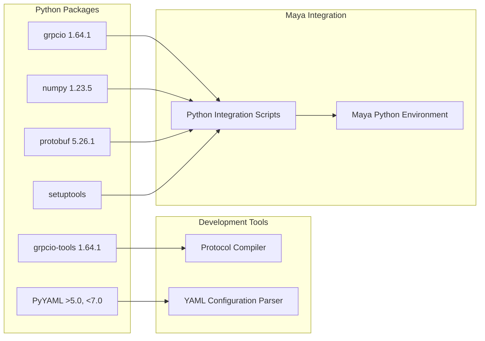

Sources: [deps/requirements.txt:1-6](), [deps/python-deps.pip.txt:3]()

## Dependency Resolution Process

The dependency resolution follows a specific sequence managed by the build system:

### Resolution Workflow

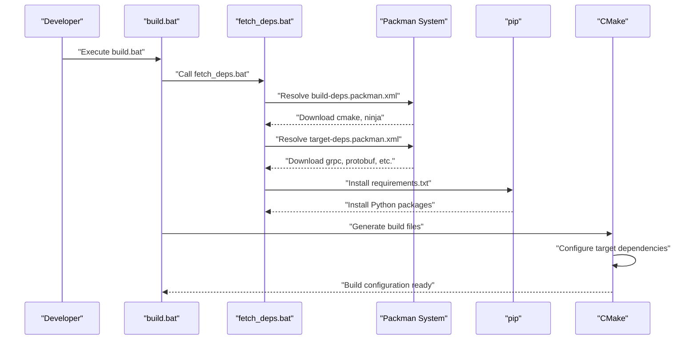

### Dependency Linking Strategy

The resolved dependencies are linked into the build through platform-specific configurations:

| Platform | Configuration | Link Type | Dependencies |
|----------|---------------|-----------|--------------|
| windows-x86_64 | Debug/Release | static | grpc, protobuf, openssl, zlib, abseil |
| windows-x86_64 | Debug/Release | dynamic | c-ares, re2 |
| linux-x86_64 | Debug/Release | pic-no-abi-cxx11 | gtest (Linux-specific build) |

Sources: [deps/target-deps.packman.xml:4-5](), [deps/target-deps.packman.xml:13-38]()

## License Compliance

Maya-ACE enforces license compatibility through dependency selection. The [deps/python-deps.pip.txt:1]() header explicitly states: "please make sure that the license is compatible with Maya-ACE (i.e. avoid GPL/LGPL)". 

A dedicated license checking dependency is included in [deps/target-deps.packman.xml:40-43]():

```xml
<!-- For license checking -->
<dependency name="pyyaml" linkPath="../_build/target-deps/python-packages/${config}">
  <package name="pyyaml" version="5.3.1" platforms="windows-x86_64" />
</dependency>
```

This ensures that PyYAML, used for configuration parsing, maintains license compatibility with the overall project.

Sources: [deps/python-deps.pip.txt:1](), [deps/target-deps.packman.xml:40-43]()

---

# Page: C++ Libraries

# C++ Libraries

<details>
<summary>Relevant source files</summary>

The following files were used as context for generating this wiki page:

- [cmake/modules/FindAbsl.cmake](cmake/modules/FindAbsl.cmake)
- [cmake/modules/FindAudiofile.cmake](cmake/modules/FindAudiofile.cmake)
- [cmake/modules/FindCares.cmake](cmake/modules/FindCares.cmake)
- [cmake/modules/FindGrpc.cmake](cmake/modules/FindGrpc.cmake)
- [cmake/modules/FindGtest.cmake](cmake/modules/FindGtest.cmake)
- [cmake/modules/FindMaya.cmake](cmake/modules/FindMaya.cmake)
- [cmake/modules/FindOpenssl.cmake](cmake/modules/FindOpenssl.cmake)
- [cmake/modules/FindProtobuf.cmake](cmake/modules/FindProtobuf.cmake)
- [cmake/modules/FindPythonDeps.cmake](cmake/modules/FindPythonDeps.cmake)
- [cmake/modules/FindRe2.cmake](cmake/modules/FindRe2.cmake)
- [cmake/modules/FindZlib.cmake](cmake/modules/FindZlib.cmake)

</details>


This document provides detailed documentation of all C++ library dependencies used by Maya-ACE and their integration through CMake Find modules. These libraries form the core foundation for Maya-ACE's functionality, including gRPC communication, audio processing, and Maya plugin integration.

For information about the overall build system that manages these libraries, see [Build System](#3.1). For dependency management using Packman, see [Dependency Management](#3.2).

## Library Architecture Overview

Maya-ACE relies on a comprehensive set of C++ libraries that are organized into functional categories and managed through custom CMake Find modules.

```mermaid
graph TB
    subgraph "Communication Layer"
        GRPC["grpc<br/>gRPC Framework"]
        PROTOBUF["protobuf<br/>Protocol Buffers"]
    end
    
    subgraph "Network & Security"
        OPENSSL["openssl<br/>Cryptographic Library"]
        CARES["c-ares<br/>DNS Resolution"]
        ZLIB["zlib<br/>Compression"]
    end
    
    subgraph "Utility Libraries"
        ABSL["abseil<br/>C++ Common Libraries"]
        RE2["re2<br/>Regular Expressions"]
    end
    
    subgraph "Audio Processing"
        AUDIOFILE["audiofile<br/>Audio File I/O"]
    end
    
    subgraph "Testing Framework"
        GTEST["gtest<br/>Google Test"]
    end
    
    subgraph "Maya Integration"
        MAYA["Maya SDK<br/>devkitBase"]
    end
    
    subgraph "CMake Find Modules"
        FIND_GRPC["FindGrpc.cmake"]
        FIND_PROTOBUF["FindProtobuf.cmake"]
        FIND_OPENSSL["FindOpenssl.cmake"]
        FIND_CARES["FindCares.cmake"]
        FIND_ZLIB["FindZlib.cmake"]
        FIND_ABSL["FindAbsl.cmake"]
        FIND_RE2["FindRe2.cmake"]
        FIND_AUDIOFILE["FindAudiofile.cmake"]
        FIND_GTEST["FindGtest.cmake"]
        FIND_MAYA["FindMaya.cmake"]
    end
    
    GRPC --> FIND_GRPC
    PROTOBUF --> FIND_PROTOBUF
    OPENSSL --> FIND_OPENSSL
    CARES --> FIND_CARES
    ZLIB --> FIND_ZLIB
    ABSL --> FIND_ABSL
    RE2 --> FIND_RE2
    AUDIOFILE --> FIND_AUDIOFILE
    GTEST --> FIND_GTEST
    MAYA --> FIND_MAYA
    
    GRPC -.-> PROTOBUF
    GRPC -.-> OPENSSL
    GRPC -.-> CARES
    GRPC -.-> ZLIB
    GRPC -.-> ABSL
    GRPC -.-> RE2
```

**Sources:** [cmake/modules/FindGrpc.cmake:1-3](), [cmake/modules/FindProtobuf.cmake:1-3](), [cmake/modules/FindOpenssl.cmake:1-3](), [cmake/modules/FindCares.cmake:1-3](), [cmake/modules/FindZlib.cmake:1-3](), [cmake/modules/FindAbsl.cmake:1-3](), [cmake/modules/FindRe2.cmake:1-3](), [cmake/modules/FindAudiofile.cmake:1-2](), [cmake/modules/FindGtest.cmake:1-3](), [cmake/modules/FindMaya.cmake:1-3]()

## CMake Find Module Architecture

The CMake Find modules follow a consistent pattern for locating and configuring library dependencies, using the Packman-managed build directory structure.

```mermaid
graph LR
    subgraph "Build Directory Structure"
        BUILD_DIR["_build/target-deps/"]
        LIBRARY_DIR["library_name/"]
        BUILD_TYPE["${CMAKE_BUILD_TYPE}/"]
        INCLUDE["include/"]
        LIB["lib/"]
    end
    
    subgraph "CMake Variables"
        ROOT_VAR["LIBRARY_ROOT"]
        INCLUDE_VAR["LIBRARY_INCLUDE_DIRS"] 
        LIB_VAR["LIBRARY_LIBRARIES"]
    end
    
    subgraph "Find Module Pattern"
        SET_ROOT["set(LIBRARY_ROOT path)"]
        SET_INCLUDE["set(LIBRARY_INCLUDE_DIRS)"]
        SET_LIB["set(LIBRARY_LIBRARIES)"]
    end
    
    BUILD_DIR --> LIBRARY_DIR
    LIBRARY_DIR --> BUILD_TYPE
    BUILD_TYPE --> INCLUDE
    BUILD_TYPE --> LIB
    
    BUILD_DIR --> ROOT_VAR
    INCLUDE --> INCLUDE_VAR
    LIB --> LIB_VAR
    
    ROOT_VAR --> SET_ROOT
    INCLUDE_VAR --> SET_INCLUDE
    LIB_VAR --> SET_LIB
```

**Sources:** [cmake/modules/FindGrpc.cmake:1-3](), [cmake/modules/FindAbsl.cmake:1-3](), [cmake/modules/FindOpenssl.cmake:1-3]()

## Core Communication Libraries

### gRPC Framework
The `grpc` library provides the foundational RPC framework for communicating with NVIDIA's Audio2Face-3D service.

| Property | Value |
|----------|-------|
| **CMake Module** | `FindGrpc.cmake` |
| **Root Path** | `_build/target-deps/grpc/${CMAKE_BUILD_TYPE}` |
| **Include Directory** | `${GRPC_ROOT}/include` |
| **Library Directory** | `${GRPC_ROOT}/lib` |
| **Purpose** | Remote procedure call framework for service communication |

**Sources:** [cmake/modules/FindGrpc.cmake:1-3]()

### Protocol Buffers
The `protobuf` library handles serialization and deserialization of structured data for gRPC communication.

| Property | Value |
|----------|-------|
| **CMake Module** | `FindProtobuf.cmake` |
| **Root Path** | `_build/target-deps/protobuf/${CMAKE_BUILD_TYPE}` |
| **Include Directory** | `${PROTOBUF_ROOT}/include` |
| **Library Directory** | `${PROTOBUF_ROOT}/lib` |
| **Purpose** | Data serialization for gRPC message exchange |

**Sources:** [cmake/modules/FindProtobuf.cmake:1-3]()

## Network and Security Libraries

### OpenSSL
The `openssl` library provides cryptographic functionality and secure transport layer support for gRPC connections.

| Property | Value |
|----------|-------|
| **CMake Module** | `FindOpenssl.cmake` |
| **Root Path** | `_build/target-deps/openssl/${CMAKE_BUILD_TYPE}` |
| **Include Directory** | `${OPENSSL_ROOT}/include` |
| **Library Directory** | `${OPENSSL_ROOT}/lib` |
| **Purpose** | SSL/TLS encryption and cryptographic operations |

**Sources:** [cmake/modules/FindOpenssl.cmake:1-3]()

### c-ares DNS Resolution
The `c-ares` library provides asynchronous DNS resolution capabilities required by gRPC.

| Property | Value |
|----------|-------|
| **CMake Module** | `FindCares.cmake` |
| **Root Path** | `_build/target-deps/c-ares/${CMAKE_BUILD_TYPE}` |
| **Include Directory** | `${CARES_ROOT}/include` |
| **Library Directory** | `${CARES_ROOT}/lib` |
| **Purpose** | Asynchronous DNS resolution for network connections |

**Sources:** [cmake/modules/FindCares.cmake:1-3]()

### Zlib Compression
The `zlib` library handles data compression for efficient network communication.

| Property | Value |
|----------|-------|
| **CMake Module** | `FindZlib.cmake` |
| **Root Path** | `_build/target-deps/zlib/${CMAKE_BUILD_TYPE}` |
| **Include Directory** | `${ZLIB_ROOT}/include` |
| **Library Directory** | `${ZLIB_ROOT}/lib` |
| **Purpose** | Data compression for gRPC message transport |

**Sources:** [cmake/modules/FindZlib.cmake:1-3]()

## Utility Libraries

### Abseil C++ Common Libraries
The `abseil` library provides Google's collection of C++ utility classes and functions used throughout the gRPC stack.

| Property | Value |
|----------|-------|
| **CMake Module** | `FindAbsl.cmake` |
| **Root Path** | `_build/target-deps/abseil/${CMAKE_BUILD_TYPE}` |
| **Include Directory** | `${ABSL_ROOT}/include` |
| **Library Directory** | `${ABSL_ROOT}/lib` |
| **Purpose** | C++ utility functions and containers for gRPC |

**Sources:** [cmake/modules/FindAbsl.cmake:1-3]()

### RE2 Regular Expression Engine
The `re2` library provides efficient regular expression processing capabilities.

| Property | Value |
|----------|-------|
| **CMake Module** | `FindRe2.cmake` |
| **Root Path** | `_build/target-deps/re2/${CMAKE_BUILD_TYPE}` |
| **Include Directory** | `${RE2_ROOT}/include` |
| **Library Directory** | `${RE2_ROOT}/lib` |
| **Purpose** | Regular expression processing for gRPC |

**Sources:** [cmake/modules/FindRe2.cmake:1-3]()

## Audio Processing Library

### AudioFile
The `audiofile` library handles audio file I/O operations for processing audio data before transmission to the Audio2Face-3D service.

| Property | Value |
|----------|-------|
| **CMake Module** | `FindAudiofile.cmake` |
| **Root Path** | `_build/target-deps/audiofile` |
| **Include Directory** | `${AUDIOFILE_ROOT}/include` |
| **Purpose** | Audio file reading and processing |

Note: AudioFile does not follow the build-type directory pattern used by other libraries.

**Sources:** [cmake/modules/FindAudiofile.cmake:1-2]()

## Testing Framework

### Google Test
The `gtest` library provides the unit testing framework for Maya-ACE's test suite.

| Property | Value |
|----------|-------|
| **CMake Module** | `FindGtest.cmake` |
| **Root Path** | `_build/target-deps/gtest/${CMAKE_BUILD_TYPE}` |
| **Include Directory** | `${GTEST_ROOT}/include` |
| **Library Directory** | `${GTEST_ROOT}/lib` |
| **Purpose** | Unit testing framework |

**Sources:** [cmake/modules/FindGtest.cmake:1-3]()

## Maya Integration

### Maya SDK
The Maya SDK integration provides access to Maya's API for plugin development.

| Property | Value |
|----------|-------|
| **CMake Module** | `FindMaya.cmake` |
| **Active Version** | Maya 2024 |
| **Root Path** | `deps/devkitBase` |
| **Include Directory** | `${MAYA2024_ROOT}/include` |
| **Library Directory** | `${MAYA2024_ROOT}/lib` |
| **Purpose** | Maya plugin API and development toolkit |

The Maya Find module includes commented-out configurations for Maya 2025, 2023, and 2022 versions, indicating support for multiple Maya versions in the codebase structure.

**Sources:** [cmake/modules/FindMaya.cmake:1-16]()

## Python Dependencies Integration

### Python Dependencies Root
The `FindPythonDeps.cmake` module establishes the root path for Python package installations used by the build system.

| Property | Value |
|----------|-------|
| **CMake Module** | `FindPythonDeps.cmake` |
| **Root Path** | `_build/python-deps` |
| **Purpose** | Python package installation root for build tools |

**Sources:** [cmake/modules/FindPythonDeps.cmake:1-2]()

---

# Page: Development Guide

# Development Guide

<details>
<summary>Relevant source files</summary>

The following files were used as context for generating this wiki page:

- [docs/bestpractices.md](docs/bestpractices.md)
- [docs/buildandtest.md](docs/buildandtest.md)

</details>


This document provides a comprehensive guide for developers working with or extending Maya-ACE. It covers the development environment setup, core workflows, key code components, and testing strategies needed to effectively develop and maintain the Maya-ACE plugin system.

This guide focuses on the development aspects of Maya-ACE. For detailed build instructions and testing procedures, see [Building and Testing](#4.1). For recommended workflows and animation techniques, see [Best Practices](#4.2). For code formatting and style guidelines, see [Code Standards](#4.3).

## Development Environment Overview

Maya-ACE requires a comprehensive development environment that includes Maya SDK integration, C++ build tools, Python environment, and external service connectivity. The development setup supports both the Maya plugin development and the underlying ACE client library development.

### Development Environment Architecture

```mermaid
graph TB
    subgraph "Development Tools"
        VS["Visual Studio 2019+"]
        PYTHON["Python 3"]
        VSWHERE["vswhere.exe"]
        MAYAINSTALL["Maya 2024/2025 Installation"]
    end
    
    subgraph "Environment Variables"
        MAYA_LOCATION["MAYA_LOCATION"]
        PATH_ENV["PATH Environment"]
    end
    
    subgraph "Dependencies Location"
        DEVKIT["deps/devkitBase/"]
        PACKMAN_DEPS["Packman Dependencies"]
        PIP_DEPS["Python pip packages"]
    end
    
    subgraph "Build Scripts"
        FETCH_DEPS["fetch_deps.bat"]
        BUILD_BAT["build.bat"]
        CMAKE_SYSTEM["CMake Build System"]
    end
    
    subgraph "Output Directories"
        BUILD_DIR["_build/windows-x86_64/release/"]
        DEBUG_DIR["_build/windows-x86_64/debug/"]
    end
    
    VS --> BUILD_BAT
    PYTHON --> BUILD_BAT  
    MAYA_LOCATION --> MAYAINSTALL
    PATH_ENV --> VS
    PATH_ENV --> PYTHON
    
    BUILD_BAT --> FETCH_DEPS
    FETCH_DEPS --> DEVKIT
    FETCH_DEPS --> PACKMAN_DEPS
    FETCH_DEPS --> PIP_DEPS
    
    CMAKE_SYSTEM --> BUILD_DIR
    CMAKE_SYSTEM --> DEBUG_DIR
```

Sources: [docs/buildandtest.md:5-30]()

## Core Development Workflows

The Maya-ACE development process follows several key workflows depending on the type of development work being performed. Understanding these workflows is essential for efficient development.

### Primary Development Workflow

```mermaid
sequenceDiagram
    participant Dev as "Developer"
    participant Env as "Development Environment"
    participant Build as "Build System"
    participant Maya as "Maya Instance"
    participant Tests as "Test Suite"
    participant ACE as "ACE Service"
    
    Dev->>Env: "Set MAYA_LOCATION environment"
    Dev->>Build: "fetch_deps.bat"
    Build->>Env: "Download Packman dependencies"
    Build->>Env: "Install pip packages"
    
    Dev->>Build: "build.bat mace"
    Build->>Build: "CMake generation"
    Build->>Build: "Ninja compilation"
    Build->>Env: "Generate maya_aceclient.mll"
    
    Dev->>Tests: "test_maya.bat"
    Tests->>Maya: "Launch mayapy with plugin"
    Tests->>Tests: "Run unit tests"
    
    Dev->>Maya: "run_maya.bat"
    Maya->>Env: "Load plugin for testing"
    
    Dev->>ACE: "run_mock_server.bat"
    ACE->>Tests: "Provide mock ACE service"
```

Sources: [docs/buildandtest.md:33-81]()

## Key Code Components

Maya-ACE consists of several key code components that developers need to understand. These components work together to provide the complete plugin functionality within Maya's architecture.

### Core Component Architecture

```mermaid
graph TB
    subgraph "Maya Plugin Layer"
        MAYA_PLUGIN["maya_aceclient Plugin (.mll)"]
        ACE_ANIMATION_PLAYER["AceAnimationPlayer Node"]
        MAYA_COMMANDS["Maya MEL/Python Commands"]
    end
    
    subgraph "ACE Client Library"
        ACE_CLIENT["ACE Client Library (Static)"]
        GRPC_CPP["ace_grpc_cpp Library"]
        AUDIO_PROCESSOR["Audio File Processor"]
    end
    
    subgraph "Build Artifacts"
        SOURCE_DIR["source/ directory"]
        TESTS_DIR["tests/ directory"]
        CMAKE_FILES["CMakeLists.txt files"]
    end
    
    subgraph "Generated Files"
        GRPC_GENERATED["gRPC Generated C++ Files"]
        PROTOBUF_FILES["Protocol Buffer Definitions"]
        MOD_FILE["mace.mod Module File"]
    end
    
    subgraph "Test Infrastructure"
        MAYA_TESTS["Maya Plugin Tests"]
        CLIENT_TESTS["ACE Client Tests"]
        MOCK_SERVER["Mock ACE Server"]
    end
    
    MAYA_PLUGIN --> ACE_ANIMATION_PLAYER
    MAYA_PLUGIN --> MAYA_COMMANDS
    ACE_ANIMATION_PLAYER --> ACE_CLIENT
    ACE_CLIENT --> GRPC_CPP
    ACE_CLIENT --> AUDIO_PROCESSOR
    
    SOURCE_DIR --> MAYA_PLUGIN
    SOURCE_DIR --> ACE_CLIENT
    CMAKE_FILES --> MAYA_PLUGIN
    CMAKE_FILES --> ACE_CLIENT
    
    GRPC_GENERATED --> GRPC_CPP
    PROTOBUF_FILES --> GRPC_GENERATED
    
    TESTS_DIR --> MAYA_TESTS
    TESTS_DIR --> CLIENT_TESTS
    MOCK_SERVER --> CLIENT_TESTS
```

Sources: [docs/buildandtest.md:31-97]()

## Testing Strategy

Maya-ACE implements a comprehensive testing strategy that covers both the Maya plugin functionality and the underlying ACE client library. The testing approach supports both unit testing and integration testing with mock services.

### Testing Component Flow

```mermaid
graph LR
    subgraph "Test Execution Scripts"
        TEST_MAYA["test_maya.bat"]
        TEST_CLIENT["test_aceclient.bat"]
        RUN_MOCK["run_mock_server.bat"]
    end
    
    subgraph "Test Environments"
        MAYAPY["mayapy Environment"]
        PYTHON_ENV["Python Test Environment"]
        MOCK_ACE["Mock ACE Server"]
    end
    
    subgraph "Test Suites"
        MAYA_UNIT_TESTS["Maya Plugin Unit Tests"]
        CLIENT_UNIT_TESTS["ACE Client Unit Tests"]
        INTEGRATION_TESTS["Integration Tests"]
    end
    
    subgraph "Test Dependencies"
        BUILT_PLUGIN["Built maya_aceclient.mll"]
        BUILT_CLIENT["Built ACE Client Library"]
        PIP_PACKAGES["Python Test Packages"]
    end
    
    TEST_MAYA --> MAYAPY
    TEST_CLIENT --> PYTHON_ENV
    RUN_MOCK --> MOCK_ACE
    
    MAYAPY --> MAYA_UNIT_TESTS
    PYTHON_ENV --> CLIENT_UNIT_TESTS
    MOCK_ACE --> INTEGRATION_TESTS
    
    MAYA_UNIT_TESTS --> BUILT_PLUGIN
    CLIENT_UNIT_TESTS --> BUILT_CLIENT
    INTEGRATION_TESTS --> PIP_PACKAGES
```

Sources: [docs/buildandtest.md:44-81](), [docs/buildandtest.md:87-97]()

## Development Workflow Implementation

The iterative development workflow for Maya-ACE follows a parameter-tuning approach that requires multiple iterations to achieve optimal results. This workflow is central to how developers and users interact with the system.

### Parameter Tuning and Animation Workflow

```mermaid
sequenceDiagram
    participant Dev as "Developer/User"
    participant UI as "Maya UI"
    participant Player as "AceAnimationPlayer"
    participant Service as "ACE Service"
    participant Blendshape as "Character Blendshapes"
    participant Timeline as "Maya Timeline"
    
    loop "Iterative Parameter Tuning"
        Dev->>Player: "Adjust Parameters"
        Dev->>UI: "Click Connect and Send Audio"
        UI->>Player: "Trigger animation update"
        Player->>Service: "Send audio with parameters"
        Service-->>Player: "Return facial animation data"
        Player->>Blendshape: "Apply animation weights"
        Dev->>Timeline: "Play scene and check animation"
        
        alt "Satisfied with result"
            Dev->>UI: "Bake Simulation"
            UI->>Blendshape: "Freeze animation keyframes"
            Dev->>UI: "Save scene"
        else "Need adjustments"
            Note over Dev: "Return to parameter adjustment"
        end
    end
```

Sources: [docs/bestpractices.md:3-14]()

## Blendshape Connection System

Maya-ACE implements a sophisticated blendshape connection system that supports both complete ARKit blendshape sets and partial/custom blendshape configurations. This system is crucial for developers working with different character rigs.

### Blendshape Matching and Connection Process

| Component | Function | ARKit Compliance |
|-----------|----------|------------------|
| `AceAnimationPlayer` | Manages 52 blendshape outputs | Full ARKit BlendShape Locations |
| `Output Weights` | Dynamic blendshape name updates | Case-insensitive matching |
| `Connect existing Animation Player` | Name-based connection system | Partial set support |
| `Blendshape Node` | Target Maya blendshape deformers | User-defined naming |

The connection process follows these rules:
- Blendshape names must correspond to ARKit face locations
- Names are matched case-insensitively  
- Partial blendshape sets are supported through name-based matching
- The `AceAnimationPlayer` automatically updates its output weights based on received animations

Sources: [docs/bestpractices.md:33-54]()

## Quick Start for Developers

For developers new to Maya-ACE, follow this sequence to get started:

1. **Environment Setup**: Install Visual Studio 2019+, Python 3, and Maya 2024/2025
2. **Maya SDK**: Download and place Maya devkitBase in `deps/devkitBase/`
3. **Environment Variables**: Set `MAYA_LOCATION` to Maya installation directory
4. **Dependencies**: Run `fetch_deps.bat` to download all required dependencies
5. **Build**: Execute `build.bat mace` to compile the plugin
6. **Test**: Run `test_maya.bat` to verify the build works correctly
7. **Development**: Use `run_maya.bat` to launch Maya with the plugin loaded

For detailed instructions on each step, see [Building and Testing](#4.1).

For recommended development workflows and animation optimization techniques, see [Best Practices](#4.2).

For code formatting standards and development environment configuration, see [Code Standards](#4.3).

## Related Resources

- **Architecture Overview**: For system architecture details, see [Architecture](#3)
- **Build System Details**: For CMake configuration and build scripts, see [Build System](#3.1)  
- **Dependency Management**: For Packman and pip dependency details, see [Dependency Management](#3.2)
- **Audio Specifications**: For technical audio requirements, see [Audio Specifications](#5.1)
- **Sample Projects**: For example implementations, see [Sample Projects](#5.2)

Sources: [docs/buildandtest.md:1-97](), [docs/bestpractices.md:1-54]()

---

# Page: Building and Testing

# Building and Testing

<details>
<summary>Relevant source files</summary>

The following files were used as context for generating this wiki page:

- [build.bat](build.bat)
- [docs/buildandtest.md](docs/buildandtest.md)

</details>


This document provides comprehensive instructions for building Maya-ACE from source, running the test suite, and setting up a development environment. It covers the CMake-based build system, dependency management, and testing procedures for both the Maya plugin and ACE client library.

For information about the underlying build system architecture and CMake configuration, see [Build System](#3.1). For dependency management details, see [Dependency Management](#3.2).

## Prerequisites

Maya-ACE requires specific development tools and Maya SDK components to build successfully.

### Required Build Tools

The following tools must be installed and accessible in your PATH:

| Tool | Version | Purpose |
|------|---------|---------|
| Visual Studio | 2019+ | C++ compilation with MSBuild |
| Python | 3.x | Build scripts and testing |
| vswhere.exe | Latest | Visual Studio detection |

### Maya Development Kit

The Maya devkit is required for plugin compilation and must be located at the correct path structure:

```
./deps/devkitBase/
├── cmake/
├── devkit/
├── include/
├── lib/
└── mkspecs/
```

Download the Maya devkit from the Autodesk developer website and extract it to `deps/devkitBase`.

### Environment Variables

Set the `MAYA_LOCATION` environment variable to Maya's installation directory for testing:

```powershell
# Windows PowerShell
$ENV:MAYA_LOCATION="C:\Program Files\Autodesk\Maya2024"

# Windows Command Prompt  
SET "MAYA_LOCATION=C:\Program Files\Autodesk\Maya2024"
```

**Build Process Flow**

```mermaid
flowchart TD
    START["Developer runs build.bat"] --> FETCH["fetch_deps.bat"]
    FETCH --> PACKMAN["Packman downloads dependencies"]
    PACKMAN --> VSWHERE["vswhere.exe finds Visual Studio"]
    VSWHERE --> VCVARS["vcvarsall.bat x64 sets environment"]
    VCVARS --> CMAKE_GEN["cmake -G Ninja generates build files"]
    CMAKE_GEN --> NINJA_BUILD["cmake --build with Ninja"]
    NINJA_BUILD --> OUTPUTS["Build outputs in _build/"]
    
    OUTPUTS --> PLUGIN["maya_aceclient.mll"]
    OUTPUTS --> TESTS["Test executables"]
    OUTPUTS --> MOD_FILE["mace.mod"]
```

Sources: [build.bat:1-37](), [docs/buildandtest.md:33-42]()

## Build System

The build process uses a two-stage approach with dependency fetching followed by compilation.

### Dependency Fetching

Dependencies are managed through Packman and must be fetched before building:

```powershell
# Fetch release dependencies
.\fetch_deps.bat

# Fetch debug dependencies  
.\fetch_deps.bat debug
```

The `fetch_deps.bat` script downloads all required C++ libraries and build tools to the `_build/build-deps/` directory.

### Main Build Process

The primary build script supports multiple projects and configurations:

```powershell
# Build all projects (default: mace-all) in release mode
.\build.bat

# Build specific project
.\build.bat mace

# Build with debug configuration
.\build.bat mace debug
```

The build script performs these operations:
1. Sets `BUILD_DIR` to `_build` [build.bat:5]()
2. Configures CMake and Ninja paths [build.bat:6-7]()
3. Detects Visual Studio installation using `vswhere.exe` [build.bat:25]()
4. Initializes Visual Studio environment with `vcvarsall.bat` [build.bat:34]()
5. Generates build files with CMake Ninja generator [build.bat:36]()
6. Executes parallel build with Ninja [build.bat:37]()

### Build Targets

| Target | Purpose | Output |
|--------|---------|---------|
| `mace` | Maya plugin only | `maya_aceclient.mll` |
| `mace-all` | All components | Plugin + tests + utilities |
| `tests-aceclient` | ACE client tests only | Test executables |

**Build Artifact Structure**

```mermaid
graph TB
    BUILD_DIR["_build/"] --> RELEASE["windows-x86_64/release/"]
    BUILD_DIR --> DEBUG["windows-x86_64/debug/"]
    BUILD_DIR --> DEPS["build-deps/"]
    
    RELEASE --> PLUGIN_REL["maya_aceclient.mll"]
    RELEASE --> MOD_REL["mace.mod"]
    RELEASE --> TESTS_REL["Test executables"]
    
    DEBUG --> PLUGIN_DBG["maya_aceclient.mll (debug)"]
    DEBUG --> MOD_DBG["mace.mod (debug)"]
    DEBUG --> TESTS_DBG["Test executables (debug)"]
    
    DEPS --> CMAKE_DEPS["cmake/"]
    DEPS --> NINJA_DEPS["ninja/"]
    DEPS --> GRPC_DEPS["grpc/"]
```

Sources: [build.bat:1-37](), [docs/buildandtest.md:35-42]()

## Testing Framework

Maya-ACE includes comprehensive testing for both Maya plugin functionality and ACE client library operations.

### Maya Plugin Tests

Maya plugin tests run within the Maya Python environment using `mayapy`:

```powershell
# Run all Maya tests
.\test_maya.bat

# Run specific test pattern
.\test_maya.bat -k test_plugin

# Run with custom Maya version
$ENV:MAYA_LOCATION="C:\Program Files\Autodesk\Maya2025"
.\test_maya.bat
```

The `test_maya.bat` script loads the Maya Python environment and executes plugin tests that verify:
- Plugin loading and initialization
- `AceAnimationPlayer` node creation and configuration
- Audio file processing functionality
- gRPC client communication

### ACE Client Library Tests

The ACE client library has separate unit tests that run independently of Maya:

```powershell
# Build and run ACE client tests
.\build.bat tests-aceclient
.\test_aceclient.bat
```

These tests validate:
- gRPC client functionality
- Protocol buffer serialization/deserialization
- Audio processing pipeline
- Error handling and recovery

### Mock Server Testing

A mock ACE server is available for testing without requiring access to NVIDIA cloud services:

```powershell
# Start mock server (requires fetch_deps.bat first)
.\run_mock_server.bat
```

The mock server simulates ACE service responses and enables:
- Offline development and testing
- CI/CD pipeline validation
- Network communication testing

**Test Execution Flow**

```mermaid
sequenceDiagram
    participant DEV as "Developer"
    participant TEST_SCRIPT as "test_maya.bat / test_aceclient.bat"
    participant MAYAPY as "mayapy.exe"
    participant PLUGIN as "maya_aceclient.mll"
    participant MOCK as "Mock ACE Server"
    participant TESTS as "Test Suite"
    
    DEV->>TEST_SCRIPT: "Execute test script"
    TEST_SCRIPT->>MAYAPY: "Launch Maya Python environment"
    MAYAPY->>PLUGIN: "Load plugin for testing"
    PLUGIN->>MOCK: "Connect to mock server (if running)"
    MAYAPY->>TESTS: "Execute test cases"
    TESTS-->>MAYAPY: "Test results"
    MAYAPY-->>TEST_SCRIPT: "Exit with status code"
    TEST_SCRIPT-->>DEV: "Display test results"
```

Sources: [docs/buildandtest.md:44-54](), [docs/buildandtest.md:77-81](), [docs/buildandtest.md:87-92]()

## Development Environment

### Maya Development Session

Launch Maya with the Maya-ACE plugin loaded for interactive development:

```powershell
.\run_maya.bat
```

This script:
- Sets up the Maya module path to include the built plugin
- Loads Maya with the ACE plugin available
- Configures the development environment for testing

### Build Configuration Management

The build system supports multiple configurations simultaneously:

| Configuration | Build Path | Use Case |
|---------------|------------|----------|
| `release` | `_build/windows-x86_64/release/` | Production builds |
| `debug` | `_build/windows-x86_64/debug/` | Development and debugging |

Switch between configurations by specifying the build type:

```powershell
# Build release version
.\build.bat mace release

# Build debug version  
.\build.bat mace debug
```

### Development Workflow

The typical development workflow follows this pattern:

1. **Setup**: Run `fetch_deps.bat` once to download dependencies
2. **Build**: Use `build.bat mace` to compile the plugin
3. **Test**: Execute `test_maya.bat` to validate changes
4. **Debug**: Launch `run_maya.bat` for interactive testing
5. **Iterate**: Repeat build-test cycle as needed

**Development Environment Setup**

```mermaid
graph LR
    VSCODE["VS Code / IDE"] --> BUILD_BAT["build.bat"]
    BUILD_BAT --> FETCH_DEPS["fetch_deps.bat"]
    FETCH_DEPS --> PACKMAN_DEPS["Packman dependencies"]
    
    BUILD_BAT --> CMAKE_GEN["CMake generation"]
    CMAKE_GEN --> NINJA_COMPILE["Ninja compilation"]
    NINJA_COMPILE --> PLUGIN_OUTPUT["maya_aceclient.mll"]
    
    PLUGIN_OUTPUT --> TEST_MAYA["test_maya.bat"]
    PLUGIN_OUTPUT --> RUN_MAYA["run_maya.bat"]
    
    TEST_MAYA --> MAYAPY["mayapy.exe"]
    RUN_MAYA --> MAYA_EXE["maya.exe"]
    
    MOCK_SERVER["run_mock_server.bat"] --> GRPC_MOCK["Mock gRPC server"]
    TEST_MAYA --> GRPC_MOCK
```

Sources: [docs/buildandtest.md:70-74](), [docs/buildandtest.md:77-81](), [build.bat:1-37]()

### Troubleshooting

Common build issues and solutions:

| Issue | Cause | Solution |
|-------|-------|----------|
| CMake not found | Dependencies not fetched | Run `fetch_deps.bat` |
| Visual Studio not detected | vswhere.exe not in PATH | Install Visual Studio 2019+ |
| Maya devkit missing | devkitBase not in deps/ | Download and extract Maya devkit |
| Plugin load failure | MAYA_LOCATION not set | Set environment variable |

The build system provides detailed logging in `_build/vsdevcmd.trace.txt` for Visual Studio environment setup diagnostics.

Sources: [build.bat:28-31](), [build.bat:34](), [docs/buildandtest.md:12-30]()

---

# Page: Best Practices

# Best Practices

<details>
<summary>Relevant source files</summary>

The following files were used as context for generating this wiki page:

- [docs/bestpractices.md](docs/bestpractices.md)

</details>


This document provides recommended workflows, animation techniques, and optimization strategies for using Maya-ACE effectively in production environments. It covers iterative development processes, parameter tuning approaches, animation management, and blendshape integration strategies.

For technical specifications about audio formats and requirements, see [Audio Specifications](#5.1). For sample project implementations, see [Sample Projects](#5.2).

## Iterative Workflow Process

Maya-ACE is designed around an iterative refinement process where users progressively adjust parameters and evaluate results until achieving optimal facial animation quality. This approach is essential due to the complex nature of audio-to-facial-animation mapping.

### Core Workflow Steps

The recommended workflow follows these sequential steps:

1. **Parameter Adjustment** - Modify audio processing and animation parameters
2. **Animation Update** - Execute the `Connect and Send Audio` operation
3. **Result Evaluation** - Play the scene and review animation quality with audio
4. **Iteration** - Repeat steps 1-3 until satisfactory results are achieved
5. **Animation Baking** - Freeze the animation data into keyframes
6. **Scene Persistence** - Save the completed scene file

```mermaid
graph TD
    START["Start Animation Process"]
    ADJUST["Adjust Parameters"]
    CONNECT["Click 'Connect and Send Audio'"]
    PLAY["Play Scene and Evaluate"]
    SATISFIED{"Satisfied with Results?"}
    BAKE["Bake Animation"]
    SAVE["Save Scene"]
    
    START --> ADJUST
    ADJUST --> CONNECT
    CONNECT --> PLAY
    PLAY --> SATISFIED
    SATISFIED -->|No| ADJUST
    SATISFIED -->|Yes| BAKE
    BAKE --> SAVE
```

**Workflow Process Diagram**

Sources: [docs/bestpractices.md:3-14]()

### Parameter Optimization Strategy

Parameter tuning requires systematic experimentation to achieve optimal results. The Audio2Face-3D service provides multiple configuration options that significantly impact animation quality and style.

| Parameter Category | Impact on Animation | Optimization Approach |
|-------------------|-------------------|---------------------|
| Audio Processing | Signal clarity and feature extraction | Start with default values, adjust based on audio quality |
| Emotion Intensity | Overall expressiveness | Gradually increase until natural-looking |
| Facial Region Weights | Specific area emphasis | Fine-tune based on character requirements |
| Temporal Smoothing | Animation fluidity | Balance responsiveness with smoothness |

For detailed parameter documentation, refer to the [NVIDIA ACE Parameter Tuning Guide](https://docs.nvidia.com/ace/latest/modules/a2f-docs/text/param_tuning.html).

Sources: [docs/bestpractices.md:17-22]()

## Animation Management and Persistence

### Animation Baking Process

Maya-ACE generates procedural animation data that must be converted to keyframes for reliable playback and editing. The baking process uses Maya's native `Bake Simulation` functionality.

```mermaid
sequenceDiagram
    participant User
    participant ChannelBox as "Channel Box"
    participant BlendshapeNode as "Blendshape Node"
    participant BakeSimulation as "Bake Simulation"
    participant Timeline as "Maya Timeline"
    
    User->>BlendshapeNode: "Select blendshape node"
    User->>ChannelBox: "Select all blendshape weights"
    User->>BakeSimulation: "Execute Keys -> Bake Simulation"
    BakeSimulation->>Timeline: "Generate keyframes for selected range"
    Timeline->>BlendshapeNode: "Apply baked animation data"
```

**Animation Baking Sequence**

#### Baking Procedure

1. **Node Selection** - Select the target blendshape node in the scene
2. **Weight Selection** - Highlight all relevant blendshape weights in the Channel Box
3. **Bake Execution** - Navigate to Animation Layout menu → Keys → Bake Simulation
4. **Range Configuration** - Specify the time range for baking in the dialog
5. **Keyframe Generation** - Execute the baking operation to create keyframes

The baked animation becomes part of the Maya scene and can be further edited using standard animation tools.

Sources: [docs/bestpractices.md:23-32]()

## Blendshape Connection Strategies

### ARKit Blendshape Integration

Maya-ACE generates facial animations using 52 predefined blendshape names based on ARKit's Face Anchor BlendShape Locations specification. Proper management of these names and their mapping order is critical for successful animation application.

```mermaid
graph TB
    subgraph "Audio2Face Service"
        A2F_SERVICE["Audio2Face-3D Service"]
        BLENDSHAPE_GEN["ARKit Blendshape Generator"]
        WEIGHT_OUTPUT["52 Blendshape Weights"]
    end
    
    subgraph "Maya-ACE Plugin"
        ACE_PLAYER["AceAnimationPlayer Node"]
        OUTPUT_WEIGHTS["Output Weights Attributes"]
        CONNECTION_LOGIC["Name Matching Logic"]
    end
    
    subgraph "Maya Scene"
        BLENDSHAPE_NODE["Character Blendshape Node"]
        BLENDSHAPE_TARGETS["Individual Blendshape Targets"]
        CHARACTER_MESH["Character Geometry"]
    end
    
    A2F_SERVICE --> BLENDSHAPE_GEN
    BLENDSHAPE_GEN --> WEIGHT_OUTPUT
    WEIGHT_OUTPUT --> ACE_PLAYER
    ACE_PLAYER --> OUTPUT_WEIGHTS
    OUTPUT_WEIGHTS --> CONNECTION_LOGIC
    CONNECTION_LOGIC --> BLENDSHAPE_TARGETS
    BLENDSHAPE_TARGETS --> BLENDSHAPE_NODE
    BLENDSHAPE_NODE --> CHARACTER_MESH
```

**Blendshape Connection Architecture**

### Name-Based Connection Rules

The `AceAnimationPlayer` node automatically matches blendshape targets using these criteria:

- **ARKit Compliance** - Blendshape names must correspond to ARKit face locations
- **Case Insensitivity** - Name matching ignores character case differences
- **Partial Support** - Custom or incomplete blendshape sets are supported
- **Automatic Updates** - Output weights update dynamically upon receiving service data

### Connection Implementation Steps

1. **Animation Receipt** - Complete the animation download process to populate `Output Weights`
2. **Node Selection** - Select both the `AceAnimationPlayer` node and target blendshape node
3. **Menu Execution** - Navigate to `Connect existing Animation Player` → `ACE`
4. **Automatic Matching** - The system performs name-based connection automatically

This process supports both complete ARKit blendshape sets and partial implementations based on character requirements.

Sources: [docs/bestpractices.md:33-54]()

## Performance Optimization

### Network Communication Efficiency

Maya-ACE utilizes gRPC with Protocol Buffers for service communication, which provides several optimization opportunities:

| Optimization Area | Recommendation | Implementation |
|------------------|----------------|----------------|
| Audio File Size | Use compressed formats when possible | Convert to supported formats before processing |
| Batch Processing | Process multiple animations in sequence | Group similar parameter sets together |
| Network Presets | Use predefined configurations | Leverage tested parameter combinations |
| Connection Reuse | Maintain persistent connections | Avoid frequent reconnection overhead |

### Memory Management

Large audio files and extended animation sequences can impact Maya's performance:

- **Audio Preprocessing** - Process audio files to appropriate length and quality
- **Timeline Management** - Limit playback range to necessary frames
- **Node Cleanup** - Remove unused `AceAnimationPlayer` nodes after baking
- **Scene Organization** - Group related animation nodes for efficient management

## Error Handling and Troubleshooting

### Common Connection Issues

When service communication fails, verify these components:

1. **API Key Validation** - Ensure NVCF API key is correctly configured
2. **Network Connectivity** - Confirm internet access and firewall settings
3. **Service Availability** - Check NVIDIA service status and endpoints
4. **Audio File Format** - Verify audio file meets specification requirements

### Animation Quality Issues

Poor animation results typically stem from:

- **Parameter Mismatch** - Inappropriate settings for the audio content type
- **Blendshape Incompatibility** - Missing or incorrectly named blendshape targets
- **Audio Quality** - Low-quality or incompatible audio input
- **Character Topology** - Mesh geometry incompatible with ARKit standards

### Diagnostic Workflow

```mermaid
flowchart TD
    ISSUE["Animation Issue Detected"]
    CHECK_CONNECTION["Check Service Connection"]
    CONNECTION_OK{"Connection Successful?"}
    CHECK_AUDIO["Validate Audio File"]
    AUDIO_OK{"Audio Format Valid?"}
    CHECK_BLENDSHAPES["Verify Blendshape Names"]
    BLENDSHAPES_OK{"Names Match ARKit?"}
    CHECK_PARAMETERS["Review Parameter Settings"]
    PARAMETERS_OK{"Parameters Appropriate?"}
    SUCCESS["Issue Resolved"]
    
    ISSUE --> CHECK_CONNECTION
    CHECK_CONNECTION --> CONNECTION_OK
    CONNECTION_OK -->|No| FIX_CONNECTION["Fix API Key/Network"]
    CONNECTION_OK -->|Yes| CHECK_AUDIO
    FIX_CONNECTION --> CHECK_CONNECTION
    
    CHECK_AUDIO --> AUDIO_OK
    AUDIO_OK -->|No| FIX_AUDIO["Convert Audio Format"]
    AUDIO_OK -->|Yes| CHECK_BLENDSHAPES
    FIX_AUDIO --> CHECK_AUDIO
    
    CHECK_BLENDSHAPES --> BLENDSHAPES_OK
    BLENDSHAPES_OK -->|No| FIX_BLENDSHAPES["Update Blendshape Names"]
    BLENDSHAPES_OK -->|Yes| CHECK_PARAMETERS
    FIX_BLENDSHAPES --> CHECK_BLENDSHAPES
    
    CHECK_PARAMETERS --> PARAMETERS_OK
    PARAMETERS_OK -->|No| ADJUST_PARAMETERS["Modify Parameter Values"]
    PARAMETERS_OK -->|Yes| SUCCESS
    ADJUST_PARAMETERS --> CHECK_PARAMETERS
```

**Troubleshooting Decision Tree**

Sources: [docs/bestpractices.md:1-54]()

---

# Page: Code Standards

# Code Standards

<details>
<summary>Relevant source files</summary>

The following files were used as context for generating this wiki page:

- [.clang-format](.clang-format)
- [.gitattributes](.gitattributes)
- [.gitignore](.gitignore)

</details>


This document defines the code formatting, style guidelines, and development environment configuration standards for Maya-ACE. These standards ensure consistent, readable, and maintainable code across all components of the system, including C++ plugins, Python scripts, CMake build files, and project assets.

For information about building and testing workflows, see [Building and Testing](#4.1). For development best practices and optimization strategies, see [Best Practices](#4.2).

## Code Formatting Standards

### C++ Code Style

Maya-ACE uses clang-format for automated C++ code formatting with a comprehensive configuration that enforces consistent style across the entire codebase.

#### Core Formatting Rules

The C++ formatting standards are defined in the project's clang-format configuration:

| Setting | Value | Purpose |
|---------|-------|---------|
| `ColumnLimit` | 120 | Maximum line length for readability |
| `IndentWidth` | 2 | Consistent indentation spacing |
| `TabWidth` | 2 | Tab width when tabs are encountered |
| `UseTab` | Never | Always use spaces for indentation |
| `Standard` | Cpp17 | Target C++17 language standard |

#### Brace and Spacing Configuration

```mermaid
graph TD
    subgraph "Brace Style Configuration"
        BreakBeforeBraces["BreakBeforeBraces: Allman"]
        AllowShortFunctions["AllowShortFunctionsOnASingleLine: false"]
        AllowShortIf["AllowShortIfStatementsOnNextLine: false"]
        AllowShortLoops["AllowShortLoopsOnASingleLine: false"]
    end
    
    subgraph "Spacing Rules"
        SpaceBeforeParens["SpaceBeforeParens: ControlStatements"]
        SpaceInEmptyParens["SpaceInEmptyParentheses: false"]
        SpacesInParens["SpacesInParentheses: false"]
        PointerAlignment["PointerAlignment: Left"]
    end
    
    subgraph "Parameter Formatting"
        BinPackArgs["BinPackArguments: true"]
        BinPackParams["BinPackParameters: false"]
        AllowAllParams["AllowAllParametersOfDeclarationOnNextLine: true"]
    end
    
    BreakBeforeBraces --> SpaceBeforeParens
    AllowShortFunctions --> BinPackArgs
    SpaceBeforeParens --> BinPackParams
```

**Sources:** [.clang-format:18](), [.clang-format:22](), [.clang-format:33](), [.clang-format:56](), [.clang-format:58]()

#### Include Organization

The project enforces a specific include order with automatic sorting and grouping:

```mermaid
graph LR
    subgraph "Include Priority Order"
        Local["Local Headers<br/>Priority: 1<br/>\".*\""]
        Carb["Carbonite Headers<br/>Priority: 2<br/>'<carb/.+>'"]
        System["System Headers<br/>Priority: 3<br/>'<[[:alnum:]_.\/]+>'"]
        Standard["Standard Library<br/>Priority: 4<br/>'<[[:alnum:]_.]+>'"]
    end
    
    Local --> Carb
    Carb --> System
    System --> Standard
```

**Sources:** [.clang-format:34-44]()

### Template and Constructor Formatting

The configuration enforces specific rules for complex C++ constructs:

| Rule | Setting | Impact |
|------|---------|--------|
| `AlwaysBreakTemplateDeclarations` | true | Template declarations always break before parameters |
| `ConstructorInitializerAllOnOneLineOrOnePerLine` | true | Constructor initializers are formatted consistently |
| `ConstructorInitializerIndentWidth` | 4 | Specific indentation for constructor initializers |
| `AccessModifierOffset` | -4 | Access modifiers are outdented from class body |

**Sources:** [.clang-format:14](), [.clang-format:24-25](), [.clang-format:1]()

## File Handling Standards

### Line Ending Configuration

Maya-ACE enforces consistent line endings across different file types to ensure cross-platform compatibility:

```mermaid
graph TD
    subgraph "Line Ending Standards"
        BatchFiles[".bat files<br/>eol=lf"]
        UnixStyle["Unix-style line endings<br/>for build scripts"]
        CrossPlatform["Cross-platform<br/>compatibility"]
    end
    
    subgraph "Binary File Handling"
        MediaFiles[".png, .gif, .wav<br/>filter=lfs"]
        MayaFiles[".ma, .mb, .fbx<br/>filter=lfs"]
        BinaryLibs[".lib, .dll, .so, .pdb<br/>filter=lfs"]
        GitLFS["Git LFS storage<br/>diff=lfs merge=lfs -text"]
    end
    
    BatchFiles --> UnixStyle
    UnixStyle --> CrossPlatform
    
    MediaFiles --> GitLFS
    MayaFiles --> GitLFS
    BinaryLibs --> GitLFS
```

**Sources:** [.gitattributes:1](), [.gitattributes:2-11]()

### Asset and Binary File Management

Large binary files are managed through Git LFS to maintain repository performance:

| File Type | Extensions | LFS Configuration |
|-----------|------------|-------------------|
| Media Assets | `.png`, `.gif`, `.wav` | `filter=lfs diff=lfs merge=lfs -text` |
| Maya Assets | `.ma`, `.mb`, `.fbx` | `filter=lfs diff=lfs merge=lfs -text` |
| Binary Libraries | `.lib`, `.dll`, `.so`, `.pdb` | `filter=lfs diff=lfs merge=lfs -text` |

**Sources:** [.gitattributes:2-11]()

## Version Control Standards

### Ignored Files and Directories

The project maintains a comprehensive `.gitignore` configuration to exclude build artifacts, dependencies, and development environment files:

```mermaid
graph TD
    subgraph "Build Artifacts"
        BuildDir["/_build/"]
        RepoDir["/_repo/"]
        CompilerDir["/_compiler/"]
        ReportDir["/_report/"]
    end
    
    subgraph "Python Artifacts"
        PyCache["__pycache__"]
        PycFiles["*.pyc"]
        VirtualEnv["/venv"]
        AnimController["/python/animation-controller-interface"]
    end
    
    subgraph "Development Environment"
        VSCode[".vscode/settings.json"]
        VisualStudio[".vs"]
        Cache[".cache"]
        LastFormat[".lastformat"]
        DesktopIni["desktop.ini"]
    end
    
    subgraph "Dependencies"
        DevKit["/deps/devkitBase*"]
        Premake["/deps/premake"]
        PackageDeps["PACKAGE-DEPS.yaml"]
    end
    
    BuildDir --> PycFiles
    RepoDir --> PyCache
    VSCode --> Cache
    DevKit --> PackageDeps
```

**Sources:** [.gitignore:1-20]()

### Development Environment Exclusions

The `.gitignore` configuration ensures that personal development environment settings and temporary files do not interfere with the shared codebase:

| Category | Files/Patterns | Purpose |
|----------|----------------|---------|
| Build System | `/_build/`, `/_repo/`, `/_compiler/` | Exclude generated build artifacts |
| Python | `*.pyc`, `__pycache__`, `/venv` | Exclude Python bytecode and virtual environments |
| IDE Settings | `.vscode/settings.json`, `.vs` | Exclude personal IDE configurations |
| Dependencies | `/deps/devkitBase*`, `PACKAGE-DEPS.yaml` | Exclude downloaded dependencies |

**Sources:** [.gitignore:3-6](), [.gitignore:1-2](), [.gitignore:9-13](), [.gitignore:16-19]()

## Development Environment Configuration

### Code Formatting Integration

The clang-format configuration integrates with common development environments to provide automated formatting:

```mermaid
graph LR
    subgraph "Development Tools"
        VSCode["Visual Studio Code"]
        VisualStudio["Visual Studio 2019+"]
        CommandLine["Command Line Tools"]
    end
    
    subgraph "Formatting Engine"
        ClangFormat[".clang-format<br/>Configuration"]
        FormatRules["120 char limit<br/>2-space indent<br/>Allman braces"]
        IncludeSort["Automatic include<br/>sorting and grouping"]
    end
    
    subgraph "Code Quality"
        Consistency["Consistent style<br/>across codebase"]
        Readability["Enhanced code<br/>readability"]
        Maintenance["Reduced maintenance<br/>overhead"]
    end
    
    VSCode --> ClangFormat
    VisualStudio --> ClangFormat
    CommandLine --> ClangFormat
    
    ClangFormat --> FormatRules
    ClangFormat --> IncludeSort
    
    FormatRules --> Consistency
    IncludeSort --> Readability
    Consistency --> Maintenance
```

**Sources:** [.clang-format:1-69]()

### Recommended Workflow Integration

For optimal development experience, configure your environment to automatically apply formatting standards:

1. **Pre-commit Formatting**: Configure your IDE to run clang-format on save
2. **Build Integration**: The CMake build system can be configured to verify formatting compliance
3. **CI/CD Integration**: Automated formatting checks can be integrated into continuous integration workflows

The formatting configuration supports modern C++17 features and is optimized for the specific needs of Maya plugin development and gRPC service integration.

**Sources:** [.clang-format:65]()

---

# Page: Reference

# Reference

<details>
<summary>Relevant source files</summary>

The following files were used as context for generating this wiki page:

- [docs/additionals.md](docs/additionals.md)
- [docs/reallusionsample.md](docs/reallusionsample.md)

</details>


This section provides technical reference materials, specifications, and additional resources for Maya-ACE development and usage. It serves as a comprehensive guide to system constraints, file format requirements, sample projects, and compatibility information.

For step-by-step development instructions, see [Development Guide](#4). For architectural details, see [Architecture](#3).

## Overview

The reference materials are organized into the following categories:

| Category | Description | Section |
|----------|-------------|---------|
| Audio Specifications | Technical requirements for audio files, supported formats, and Maya compatibility constraints | [Audio Specifications](#5.1) |
| Sample Projects | Documentation of provided sample projects and setup instructions | [Sample Projects](#5.2) |

## Technical Specifications Summary

Maya-ACE integrates multiple technical systems with specific requirements and constraints. The following diagram illustrates the key technical specifications and their relationships:

**Maya-ACE Technical Specification Overview**

```mermaid
graph TB
    subgraph "Audio Processing Layer"
        AudioFile["AudioFile Library"]
        WAV_Support["WAV Format Support"]
        AIFF_Support["AIFF Format Support"]
        PCM_Constraint["PCM Format Constraint"]
    end
    
    subgraph "Maya Integration Layer"
        Maya2024["Maya 2024 Support"]
        Maya2025["Maya 2025 Support"]
        Timeline_Import["Timeline Audio Import"]
        Format_Validation["Maya Format Validation"]
    end
    
    subgraph "Recommended Specifications"
        WAV_16bit["WAV 16-bit PCM"]
        SampleRates["16kHz/32kHz/48kHz"]
        MonoChannel["Mono Channel"]
        OptimalSpecs["Optimal Performance Specs"]
    end
    
    subgraph "Sample Resources"
        ReallusionSample["Reallusion Character Sample"]
        CamilaCharacter["Camila Character (CC4)"]
        ArnoldMaterials["Arnold Render Materials"]
    end
    
    AudioFile --> WAV_Support
    AudioFile --> AIFF_Support
    Maya2025 --> PCM_Constraint
    Timeline_Import --> Format_Validation
    
    WAV_16bit --> OptimalSpecs
    SampleRates --> OptimalSpecs
    MonoChannel --> OptimalSpecs
    
    ReallusionSample --> CamilaCharacter
    CamilaCharacter --> ArnoldMaterials
    
    PCM_Constraint --> WAV_16bit
    Format_Validation --> OptimalSpecs
```

Sources: [docs/additionals.md:1-21](), [docs/reallusionsample.md:1-13]()

## Audio System Integration

The following diagram shows how audio specifications relate to specific code components and libraries:

**Audio Processing Code Entity Relationships**

```mermaid
graph LR
    subgraph "External Dependencies"
        AudioFileLib["adamstark/AudioFile"]
        MayaAudioAPI["Maya Audio Import API"]
    end
    
    subgraph "File Format Handlers"
        WAVHandler["WAV File Handler"]
        AIFFHandler["AIFF File Handler"]
        PCMValidator["PCM Format Validator"]
    end
    
    subgraph "Maya Version Constraints"
        Maya2024Compat["Maya 2024 Compatibility"]
        Maya2025PCM["Maya 2025 PCM-Only"]
    end
    
    subgraph "Specification Compliance"
        SixteenBitPCM["16-bit PCM"]
        SampleRateSupport["16kHz|32kHz|48kHz"]
        MonoChannelSupport["Single Channel"]
    end
    
    AudioFileLib --> WAVHandler
    AudioFileLib --> AIFFHandler
    
    WAVHandler --> PCMValidator
    AIFFHandler --> PCMValidator
    
    PCMValidator --> Maya2024Compat
    PCMValidator --> Maya2025PCM
    
    Maya2025PCM --> SixteenBitPCM
    SixteenBitPCM --> SampleRateSupport
    SampleRateSupport --> MonoChannelSupport
    
    MayaAudioAPI --> Maya2024Compat
    MayaAudioAPI --> Maya2025PCM
```

Sources: [docs/additionals.md:4-9](), [docs/additionals.md:15-20]()

## Compatibility Matrix

The following table summarizes the compatibility requirements across different Maya versions:

| Component | Maya 2024 | Maya 2025 | Notes |
|-----------|-----------|-----------|--------|
| Audio File Library | AudioFile library | AudioFile library | External dependency |
| WAV Support | Full WAV support | PCM WAV only | Format constraint |
| AIFF Support | Full AIFF support | PCM AIFF only | Format constraint |
| Bit Depth | Variable | 16-bit PCM recommended | Performance optimization |
| Sample Rate | Variable | 16/32/48 kHz recommended | Maya timeline compatibility |
| Channel Count | Multi-channel | Mono recommended | Processing efficiency |

Sources: [docs/additionals.md:7-9](), [docs/additionals.md:15-20]()

## Sample Resource Specifications

Maya-ACE includes access to professional-grade sample content for testing and demonstration purposes:

**Sample Project Structure**

```mermaid
graph TB
    subgraph "Reallusion Sample Package"
        ZipArchive["Reallusion_Character_Camila.zip"]
        ReadmeFile["README.txt"]
        MayaProject["Maya Project Files"]
    end
    
    subgraph "Character Content"
        CamilaCharacter["Camila Character Model"]
        CC4Generated["Character Creator 4 Generated"]
        BlendshapeTargets["ARKit Blendshape Targets"]
    end
    
    subgraph "Rendering Assets"
        ArnoldMaterials["Arnold Render Materials"]
        TextureMaps["Texture Maps"]
        ShaderNetwork["Shader Network"]
    end
    
    subgraph "Technical Specifications"
        FileSize["2.1GB Package Size"]
        LicenseAgreement["Reallusion License"]
        SetupInstructions["Setup Instructions"]
    end
    
    ZipArchive --> ReadmeFile
    ZipArchive --> MayaProject
    
    MayaProject --> CamilaCharacter
    CamilaCharacter --> CC4Generated
    CC4Generated --> BlendshapeTargets
    
    CamilaCharacter --> ArnoldMaterials
    ArnoldMaterials --> TextureMaps
    TextureMaps --> ShaderNetwork
    
    ReadmeFile --> SetupInstructions
    ZipArchive --> FileSize
    ZipArchive --> LicenseAgreement
```

Sources: [docs/reallusionsample.md:3-10]()

## Resource Locations

| Resource Type | Location | Size | Description |
|---------------|----------|------|-------------|
| Sample Character | Reallusion Download | ~2.1GB | Complete Maya project with Camila character |
| Documentation | README.txt | - | Setup instructions included in sample |
| License Agreement | Sample archive | - | Reallusion license terms |
| Character Assets | Maya project files | - | CC4-generated character with materials |

## External References

- [AudioFile Library Documentation](https://github.com/adamstark/AudioFile)
- [Maya Audio File Format Support](https://help.autodesk.com/view/MAYAUL/2024/ENU/?guid=GUID-CF2B0358-6946-4C9D-9F8C-A783921CAECC)
- [Reallusion Character Creator](https://www.reallusion.com)

Sources: [docs/additionals.md:4-5](), [docs/reallusionsample.md:3]()

---

# Page: Audio Specifications

# Audio Specifications

<details>
<summary>Relevant source files</summary>

The following files were used as context for generating this wiki page:

- [docs/additionals.md](docs/additionals.md)

</details>


This document provides technical specifications for audio file requirements, supported formats, and compatibility constraints when using Maya-ACE. It covers the integration between the AudioFile library, Maya's audio system constraints, and the NVIDIA Audio2Face-3D service requirements.

For information about building and configuring the development environment, see [Building and Testing](#4.1). For sample projects that demonstrate audio usage, see [Sample Projects](#5.2).

## Audio Processing Architecture

Maya-ACE implements a multi-layered audio processing system that bridges external audio libraries with Maya's native audio constraints and NVIDIA's cloud services.

### Audio Processing Flow

```mermaid
graph TD
    INPUT["User Audio File<br/>(WAV/AIFF)"] --> AUDIOFILE["AudioFile Library<br/>adamstark/AudioFile"]
    AUDIOFILE --> AUDIO_HANDLER["Audio File Handler<br/>(Maya Plugin)"]
    AUDIO_HANDLER --> VALIDATION["Format Validation<br/>PCM Check"]
    VALIDATION --> GRPC_CLIENT["gRPC Client<br/>Audio Serialization"]
    GRPC_CLIENT --> ACE_SERVICE["Audio2Face-3D Service"]
    
    VALIDATION --> MAYA_IMPORT["Maya Audio Import<br/>Timeline Integration"]
    MAYA_IMPORT --> MAYA_CONSTRAINTS["Maya Format Constraints<br/>PCM Only (2025+)"]
    
    ACE_SERVICE --> ANIMATION_DATA["Facial Animation Data"]
    ANIMATION_DATA --> BLENDSHAPES["Character Blendshapes"]
    
    AUDIO_HANDLER --> ACE_PLAYER["AceAnimationPlayer Node"]
    ACE_PLAYER --> BLENDSHAPES
```

**Sources:** [docs/additionals.md:1-21]()

### Library Integration Architecture

```mermaid
graph LR
    subgraph "External Libraries"
        AUDIOFILE_LIB["AudioFile Library<br/>C++ Header-only"]
        GRPC_LIB["gRPC Framework<br/>Protocol Buffers"]
    end
    
    subgraph "Maya-ACE Core"
        AUDIO_PROC["Audio Processing<br/>AUDIO_PROC Component"]
        GRPC_CLIENT["gRPC Client<br/>Audio Serialization"]
    end
    
    subgraph "Maya Plugin"
        PLUGIN["maya_aceclient Plugin"]
        AUDIO_HANDLER["Audio File Handler"]
        ACE_PLAYER["AceAnimationPlayer Node"]
    end
    
    subgraph "Maya Environment"
        MAYA_AUDIO["Maya Audio System<br/>Timeline Integration"]
        BLENDSHAPE_NODES["Blendshape Nodes<br/>ARKit Standard"]
    end
    
    AUDIOFILE_LIB --> AUDIO_PROC
    GRPC_LIB --> GRPC_CLIENT
    AUDIO_PROC --> AUDIO_HANDLER
    GRPC_CLIENT --> AUDIO_HANDLER
    AUDIO_HANDLER --> ACE_PLAYER
    ACE_PLAYER --> MAYA_AUDIO
    ACE_PLAYER --> BLENDSHAPE_NODES
```

**Sources:** [docs/additionals.md:1-21]()

## Supported Audio Formats

### AudioFile Library Capabilities

The Maya-ACE system uses the AudioFile library to handle audio file reading, which provides support for:

| Format | Extension | Support Level |
|--------|-----------|---------------|
| WAV | `.wav` | Full support |
| AIFF | `.aiff`, `.aif` | Full support |

The AudioFile library handles various encoding formats within these containers, but Maya's constraints further limit acceptable formats.

**Sources:** [docs/additionals.md:4-5]()

### Maya Compatibility Constraints

Maya imposes additional format restrictions that must be satisfied for successful audio import:

| Maya Version | Supported Formats | Notes |
|--------------|-------------------|-------|
| Maya 2024 | PCM, compressed formats | Various encodings supported |
| Maya 2025+ | **PCM only** | Compressed formats no longer supported |

**Sources:** [docs/additionals.md:7-9]()

## Recommended Audio Specifications

For optimal compatibility across Maya versions and reliable processing with the Audio2Face-3D service, use the following specifications:

### Primary Specifications

| Parameter | Recommended Value | Notes |
|-----------|-------------------|-------|
| **File Format** | WAV | Best compatibility with both AudioFile library and Maya |
| **Data Format** | 16-bit PCM | Required for Maya 2025+, universally supported |
| **Sample Rate** | 16 kHz, 32 kHz, or 48 kHz | Optimal for speech processing |
| **Channels** | Mono (1 channel) | Sufficient for facial animation generation |

### Sample Rate Considerations

```mermaid
graph TB
    SAMPLE_RATES["Supported Sample Rates"]
    
    SAMPLE_RATES --> SR_16["16 kHz<br/>Minimum quality<br/>Smaller file size"]
    SAMPLE_RATES --> SR_32["32 kHz<br/>Good balance<br/>Recommended for most use cases"]
    SAMPLE_RATES --> SR_48["48 kHz<br/>High quality<br/>Professional standard"]
    
    SR_16 --> PROCESSING["Audio2Face-3D Processing"]
    SR_32 --> PROCESSING
    SR_48 --> PROCESSING
    
    PROCESSING --> ANIMATION["Facial Animation Output"]
```

**Sources:** [docs/additionals.md:11-20]()

## Technical Implementation Details

### Audio File Validation Process

The Maya-ACE plugin implements a validation pipeline to ensure audio compatibility:

1. **Format Detection**: AudioFile library identifies container format (WAV/AIFF)
2. **Encoding Validation**: Verify PCM encoding for Maya 2025+ compatibility
3. **Parameter Check**: Confirm sample rate and channel configuration
4. **Maya Import Test**: Validate successful import into Maya timeline

### Error Handling

Common audio format issues and their resolutions:

| Issue | Cause | Resolution |
|-------|-------|------------|
| Import failure in Maya 2025 | Non-PCM encoding | Convert to 16-bit PCM WAV |
| Poor animation quality | Low sample rate | Use 32 kHz or 48 kHz |
| Large file size | High sample rate/bit depth | Balance quality vs. size needs |
| Stereo channel issues | Multi-channel audio | Convert to mono |

**Sources:** [docs/additionals.md:1-21]()

## Integration with NVIDIA Services

### Audio Data Transmission

The validated audio data is serialized using Protocol Buffers and transmitted to the Audio2Face-3D service via gRPC. The service expects audio in specific formats that align with the recommended specifications above.

### Service Compatibility

| Service Component | Audio Requirements |
|-------------------|-------------------|
| Audio2Face-3D Service | PCM audio, mono preferred |
| gRPC Serialization | Binary audio data |
| Protocol Buffers | Structured audio metadata |

**Sources:** [docs/additionals.md:1-21]()

---

# Page: Sample Projects

# Sample Projects

<details>
<summary>Relevant source files</summary>

The following files were used as context for generating this wiki page:

- [docs/reallusionsample.md](docs/reallusionsample.md)

</details>


This document provides information about sample projects available for Maya-ACE, including character assets, setup instructions, and integration examples. These projects demonstrate practical implementations of the Maya-ACE workflow and serve as reference implementations for users getting started with the system.

For information about audio file specifications and format requirements, see [Audio Specifications](#5.1). For development environment setup and building instructions, see [Building and Testing](#4.1).

## Overview

Sample projects for Maya-ACE provide pre-configured Maya scenes with characters, audio files, and setup configurations that demonstrate the complete Audio2Face-3D workflow. These projects showcase different aspects of the system including character preparation, blendshape mapping, and service integration.

## Available Sample Projects

### Reallusion Character Sample

The primary sample project is provided by Reallusion and features a high-quality character asset optimized for Maya-ACE integration. This sample demonstrates professional-grade character setup with proper blendshape configurations for facial animation.

| Property | Details |
|----------|---------|
| **Character Name** | Camila |
| **Source** | Character Creator 4 |
| **File Size** | ~2.1GB |
| **Materials** | Arnold render-ready |
| **License** | Reallusion license agreement |

**Sample Project Workflow**
```mermaid
graph TD
    USER[User] --> DOWNLOAD["Download Reallusion Sample"]
    DOWNLOAD --> EXTRACT["Extract Archive"]
    EXTRACT --> README["Read README.txt"]
    README --> MAYA_OPEN["Open Maya Project"]
    
    MAYA_OPEN --> SCENE_LOAD["Load Character Scene"]
    SCENE_LOAD --> PLUGIN_LOAD["Load maya_aceclient Plugin"]
    PLUGIN_LOAD --> ACE_NODE["Create AceAnimationPlayer Node"]
    
    ACE_NODE --> CONFIG_AUDIO["Configure Audio File"]
    CONFIG_AUDIO --> CONFIG_API["Set NVCF API Key"]
    CONFIG_API --> CONNECT["Connect and Send Audio"]
    
    CONNECT --> GRPC_CLIENT["gRPC Client Processing"]
    GRPC_CLIENT --> AUDIO2FACE["Audio2Face-3D Service"]
    AUDIO2FACE --> ANIMATION_DATA["Facial Animation Data"]
    ANIMATION_DATA --> BLENDSHAPES["Apply to Character Blendshapes"]
    BLENDSHAPES --> PLAYBACK["Maya Timeline Playback"]
```

**Sample Project Integration Architecture**
```mermaid
graph TB
    subgraph "Reallusion Sample Assets"
        CAMILA_SCENE["Camila.ma Maya Scene"]
        CAMILA_MESH["Character Mesh Geometry"]
        ARNOLD_MATERIALS["Arnold Material Network"]
        BLENDSHAPE_TARGETS["ARKit Blendshape Targets"]
        SAMPLE_AUDIO["Sample Audio Files"]
    end
    
    subgraph "Maya-ACE Integration"
        ACE_ANIMATION_PLAYER["AceAnimationPlayer Node"]
        MAYA_ACECLIENT["maya_aceclient Plugin"]
        GRPC_CLIENT_LIB["gRPC Client Libraries"]
        AUDIOFILE_LIB["AudioFile Processing"]
    end
    
    subgraph "Service Connection"
        NVCF_API["NVCF API Key Configuration"]
        AUDIO2FACE_SERVICE["Audio2Face-3D Service"]
        FUNCTION_IDS["Function IDs (Mark/Claire)"]
    end
    
    CAMILA_SCENE --> ACE_ANIMATION_PLAYER
    CAMILA_MESH --> BLENDSHAPE_TARGETS
    BLENDSHAPE_TARGETS --> ACE_ANIMATION_PLAYER
    SAMPLE_AUDIO --> ACE_ANIMATION_PLAYER
    
    ACE_ANIMATION_PLAYER --> MAYA_ACECLIENT
    MAYA_ACECLIENT --> GRPC_CLIENT_LIB
    MAYA_ACECLIENT --> AUDIOFILE_LIB
    
    GRPC_CLIENT_LIB --> NVCF_API
    NVCF_API --> AUDIO2FACE_SERVICE
    AUDIO2FACE_SERVICE --> FUNCTION_IDS
    
    AUDIO2FACE_SERVICE --> ACE_ANIMATION_PLAYER
    ACE_ANIMATION_PLAYER --> BLENDSHAPE_TARGETS
```

Sources: [docs/reallusionsample.md:1-13]()

### Setup Instructions

The Reallusion sample includes comprehensive setup documentation within the downloaded archive. The key setup steps involve:

1. **Project Extraction**: Extract the downloaded archive to a local directory
2. **Maya Project Setup**: Open the provided Maya project file
3. **Plugin Loading**: Ensure the `maya_aceclient` plugin is loaded
4. **Node Configuration**: Create and configure the `AceAnimationPlayer` node
5. **Service Connection**: Configure NVCF API credentials for service access

**Sample Project File Structure**
```mermaid
graph TD
    ARCHIVE["Reallusion_Character_Camila.zip"] --> README["README.txt Setup Instructions"]
    ARCHIVE --> PROJECT_DIR["Maya Project Directory"]
    ARCHIVE --> LICENSE["License Agreement"]
    
    PROJECT_DIR --> SCENES["scenes/ Maya Scene Files"]
    PROJECT_DIR --> SOURCEIMAGES["sourceimages/ Texture Assets"]
    PROJECT_DIR --> AUDIO_SAMPLES["audio/ Sample Audio Files"]
    
    SCENES --> CAMILA_MA["Camila.ma Main Scene"]
    SOURCEIMAGES --> DIFFUSE_MAPS["Diffuse Texture Maps"]
    SOURCEIMAGES --> NORMAL_MAPS["Normal Maps"]
    SOURCEIMAGES --> SPEC_MAPS["Specular Maps"]
    
    AUDIO_SAMPLES --> SAMPLE_WAV["Sample .wav Files"]
    SAMPLE_WAV --> AUDIOFILE_PROCESSING["AudioFile Library Processing"]
    AUDIOFILE_PROCESSING --> GRPC_SERIALIZATION["gRPC Protocol Buffer Serialization"]
```

Sources: [docs/reallusionsample.md:3-8]()

## Character Specifications

The Reallusion character sample demonstrates industry-standard character preparation for facial animation workflows:

| Specification | Details |
|---------------|---------|
| **Blendshape Standard** | ARKit compatible targets |
| **Polygon Count** | Production-ready mesh density |
| **UV Mapping** | Non-overlapping UV layout |
| **Material System** | Arnold Material Network |
| **Bone Structure** | Standard facial rig hierarchy |

**Character Blendshape Integration**
```mermaid
graph LR
    subgraph "Character Geometry"
        BASE_MESH["Base Character Mesh"]
        BLENDSHAPE_NODE["Maya Blendshape Node"]
        ARKIT_TARGETS["ARKit Blendshape Targets"]
    end
    
    subgraph "Maya-ACE Animation"
        ACE_PLAYER["AceAnimationPlayer"]
        WEIGHT_ATTRIBUTES["Blendshape Weight Attributes"]
        KEYFRAME_DATA["Animation Keyframe Data"]
    end
    
    subgraph "Service Response"
        AUDIO2FACE_WEIGHTS["Audio2Face Weight Values"]
        FRAME_TIMING["Frame Timing Data"]
        ANIMATION_CURVES["Animation Curve Data"]
    end
    
    BASE_MESH --> BLENDSHAPE_NODE
    ARKIT_TARGETS --> BLENDSHAPE_NODE
    
    ACE_PLAYER --> WEIGHT_ATTRIBUTES
    WEIGHT_ATTRIBUTES --> BLENDSHAPE_NODE
    
    AUDIO2FACE_WEIGHTS --> ACE_PLAYER
    FRAME_TIMING --> KEYFRAME_DATA
    ANIMATION_CURVES --> KEYFRAME_DATA
    KEYFRAME_DATA --> ACE_PLAYER
```

Sources: [docs/reallusionsample.md:5-6]()

## Usage Notes

### Disclaimer and Licensing

The Reallusion sample project is provided under Reallusion's licensing terms. Users must comply with the license agreement included in the sample archive. This includes restrictions on redistribution and commercial usage of the character assets.

### Performance Considerations

The sample character is designed for production workflows and includes high-resolution textures and detailed geometry. Users should consider performance implications when working with the sample, particularly when:

- Running on systems with limited GPU memory
- Working with multiple character instances
- Using high-resolution render settings

### Extending the Sample

The Reallusion sample serves as a foundation for understanding Maya-ACE workflows. Users can extend the sample by:

- Adding custom audio files for different animation scenarios
- Modifying blendshape weights for stylized animation results
- Integrating additional characters using similar setup procedures
- Experimenting with different NVCF function IDs and service parameters

Sources: [docs/reallusionsample.md:7-8](), [docs/reallusionsample.md:10-12]()