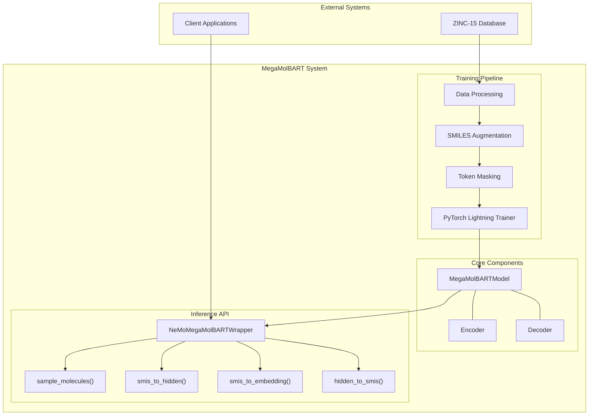
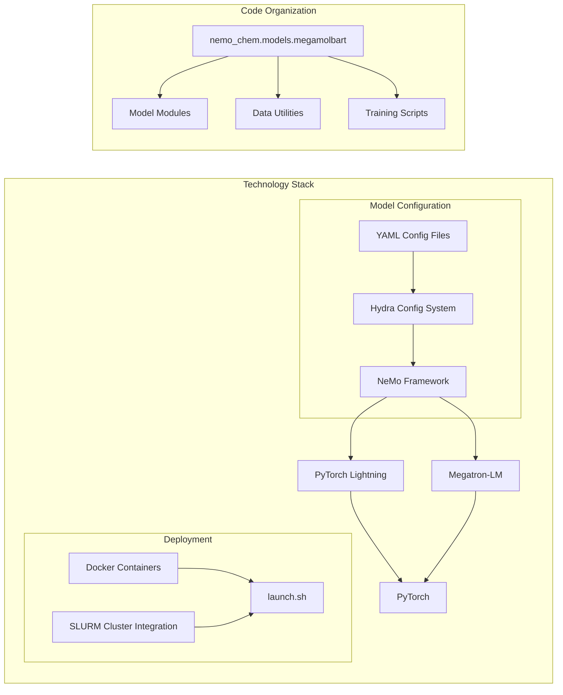

<!-- source: DeepWiki mcp.deepwiki.com · repo NVIDIA/MegaMolBART · page 1 Overview · fetched 2026-10-26 -->

# Overview

<details>
<summary>Relevant source files</summary>

The following files were used as context for generating this wiki page:

- [.gitignore](.gitignore)
- [QUICKSTART.md](QUICKSTART.md)
- [README.md](README.md)
- [docs/ngc/base_image.md](docs/ngc/base_image.md)
- [docs/ngc/cmds](docs/ngc/cmds)
- [docs/ngc/model.md](docs/ngc/model.md)
- [docs/ngc/overview.md](docs/ngc/overview.md)
- [docs/ngc/requirements.md](docs/ngc/requirements.md)
- [nemo_chem/package_info.py](nemo_chem/package_info.py)
- [setup.py](setup.py)
- [tests/data/test/metadata.txt](tests/data/test/metadata.txt)
- [tests/data/test/x000.csv](tests/data/test/x000.csv)

</details>


MegaMolBART is a deep learning model for small molecule drug discovery and cheminformatics based on SMILES (Simplified Molecular Input Line Entry System) strings. It leverages NVIDIA's NeMo-Megatron framework, which is designed for the development of large transformer models. This overview introduces the system's purpose, architecture, and key components as implemented in the MegaMolBART repository. For detailed installation instructions, see [Installation and Setup](#1.2).

## Purpose and Applications

MegaMolBART addresses several challenges in computational chemistry:

- **Molecule representation learning**: Learning meaningful vector representations of chemical compounds
- **Molecule generation**: Creating novel molecules with desired properties
- **Chemical space exploration**: Enabling navigation of the vast space of possible molecules

The model's encoder can provide embeddings for use in downstream predictive models, while the encoder-decoder architecture together enables generation of new molecular structures.

Sources: [README.md:3-9](), [docs/ngc/model.md:1-4]()

## System Architecture

MegaMolBART employs a transformer-based architecture with the following components:



**Model Architecture Diagram**

The architecture is based on BART (Bidirectional and Auto-Regressive Transformer), which consists of a bidirectional encoder and an autoregressive decoder. During training, the model learns to reconstruct SMILES strings from partially masked or corrupted inputs.

Sources: [README.md:5-7](), [docs/ngc/model.md:5-7]()

## Implementation Framework

MegaMolBART is implemented using:



**Implementation Framework Diagram**

The system leverages:
- **NeMo**: Provides a framework for building, training, and fine-tuning neural modules
- **PyTorch Lightning**: Handles training loop organization and distributed training
- **Megatron-LM**: Enables efficient model parallelism for large transformer models
- **Hydra**: Manages configuration hierarchies and parameter overrides
- **Docker**: Ensures consistent environments across development, training, and inference

Sources: [README.md:7-9](), [QUICKSTART.md:11-20]()

## Key Components

### Model Variants

MegaMolBART offers multiple model configurations to suit different computational budgets:

| Configuration | Layers | Hidden Size | Attention Heads | Typical GPU Requirements |
|---------------|--------|-------------|-----------------|--------------------------|
| XSmall        | 2      | 256         | 4               | 1 GPU                   |
| Small         | 6      | 512         | 8               | 8+ GPUs                 |
| Large         | 8      | 1024        | 16              | 64+ GPUs                |
| XLarge        | *Larger than Large* | | | |

### Data Processing Pipeline

The data processing pipeline includes:
1. **Data acquisition**: Downloading from ZINC-15 database
2. **Filtering**: Removing molecules exceeding 512 characters
3. **Train/validation/test splitting**: 99% / 0.5% / 0.5% split
4. **Data augmentation**: Masking and SMILES randomization
5. **Tokenization**: Converting SMILES strings to token sequences

### Training System

Training is managed through configuration files and scripts that:
- Define model architecture parameters
- Configure optimization hyperparameters
- Specify data processing steps
- Support distributed training across multiple GPUs and nodes

### Inference System

The model's inference capabilities include:
- Sampling new molecules from the learned distribution
- Converting SMILES strings to vector embeddings
- Generating molecules similar to a given input

Sources: [README.md:96-101](), [docs/ngc/model.md:19-25]()

## Getting Started

MegaMolBART is provided as a Docker container for ease of use:

```bash
# For Docker version 19.03 or later
docker run \
    --gpus all \
    --rm \
    -p 8888:8888 \
    nvcr.io/nvidia/clara/megamolbart_v0.2:0.2.0
```

The `launch.sh` script simplifies container management for development, data processing, training, and inference. For detailed usage, see the [Installation and Setup](#1.2) section.

Sources: [README.md:16-36](), [QUICKSTART.md:22-53]()

---

