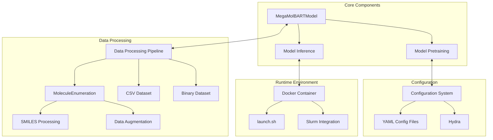
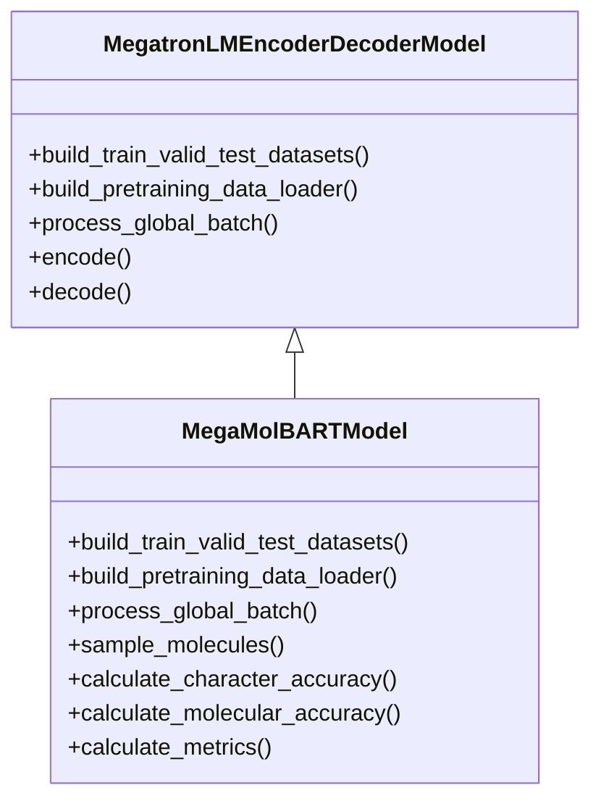
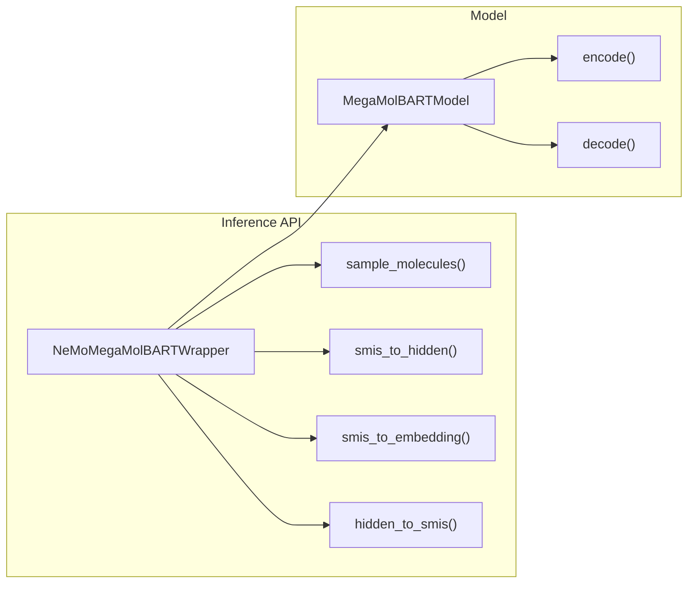
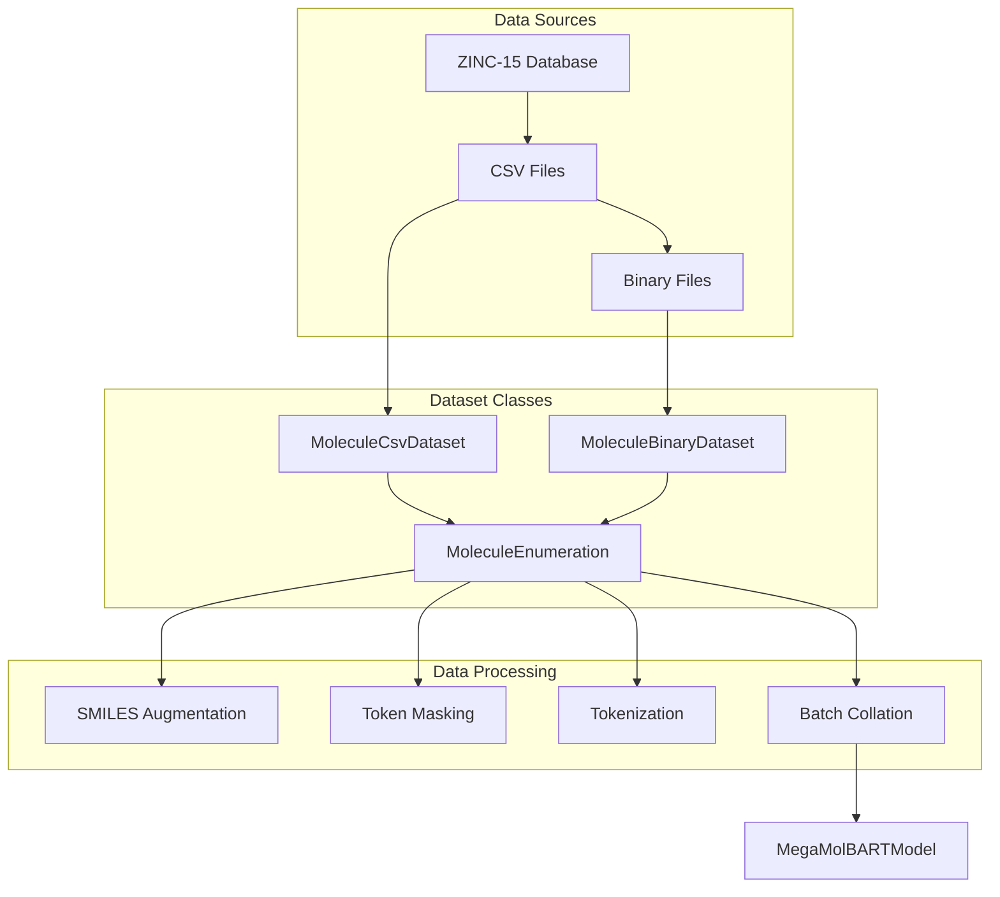
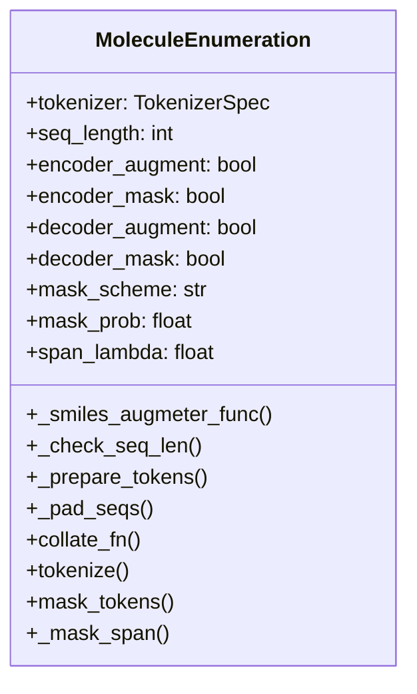
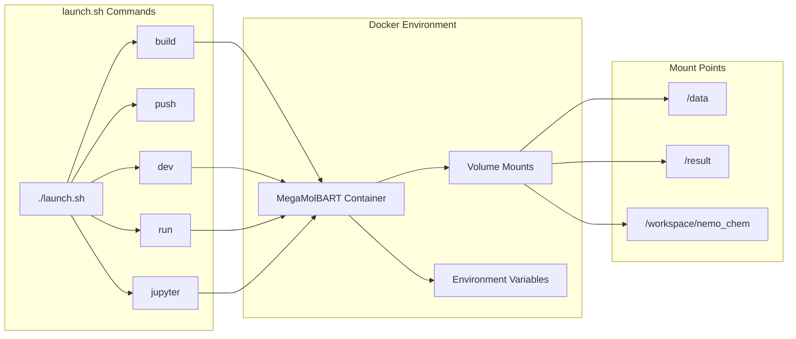
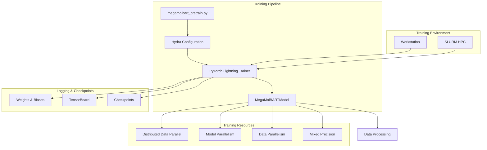
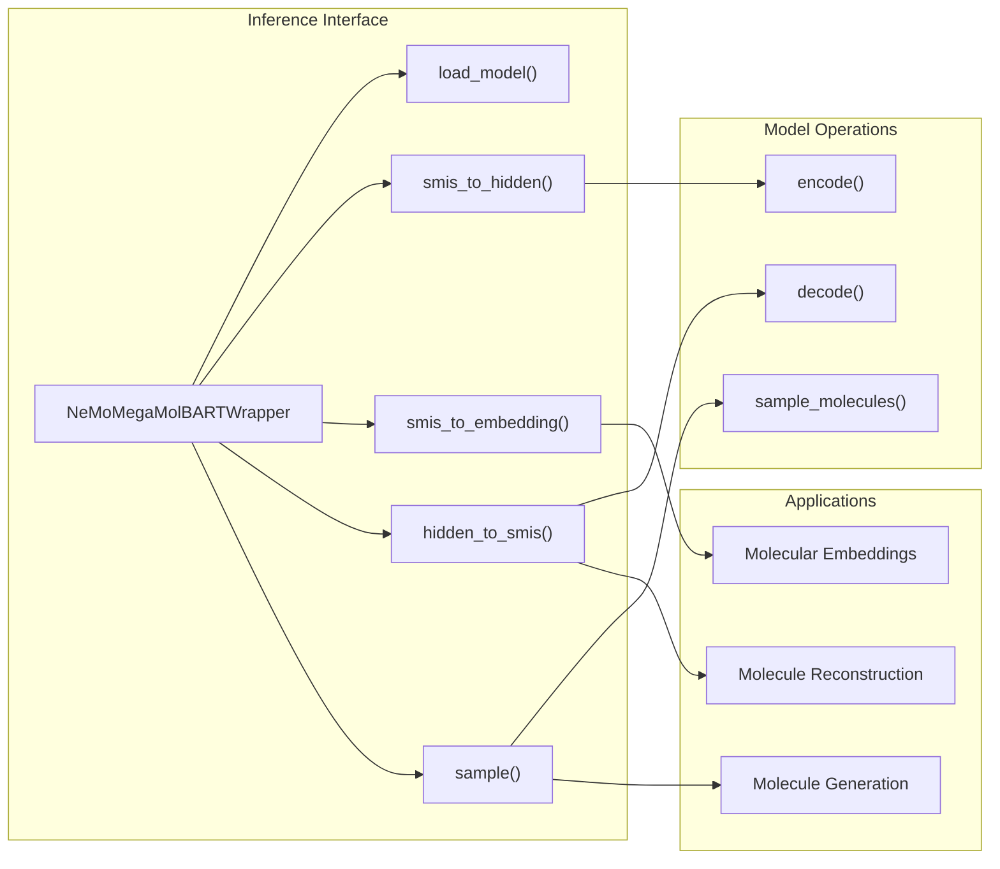
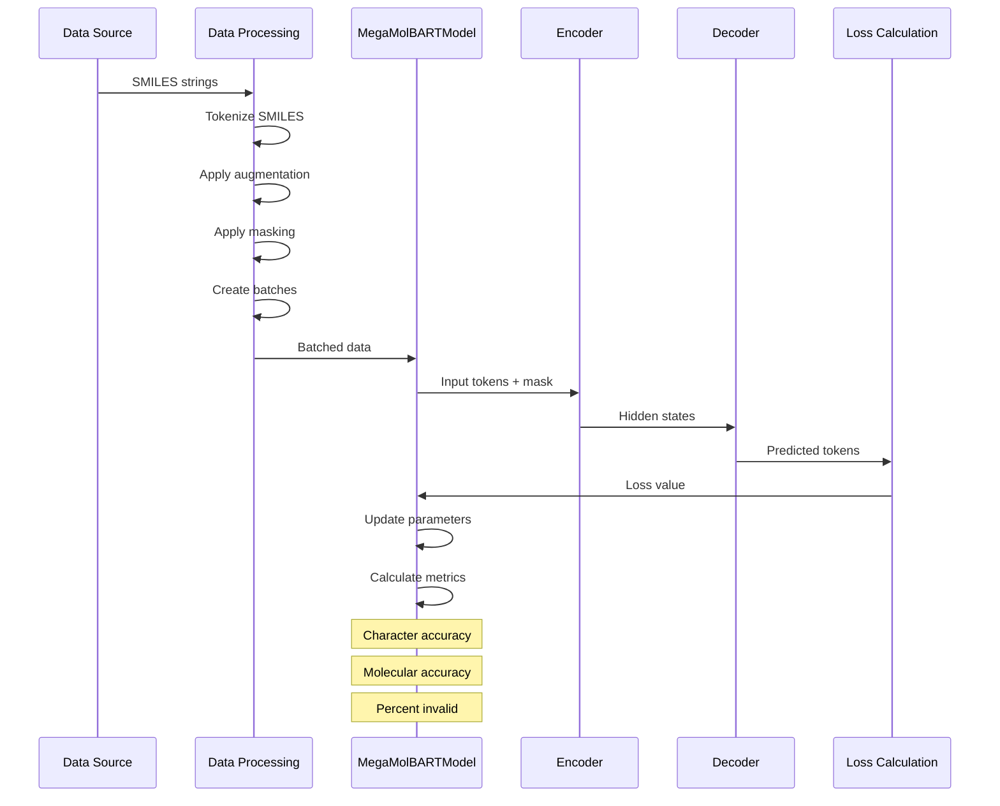

<!-- source: DeepWiki mcp.deepwiki.com · repo NVIDIA/MegaMolBART · page 1.1 System Architecture · fetched 2026-10-26 -->

# System Architecture

Relevant source files

The following files were used as context for generating this wiki page:

- [.dockerignore](.dockerignore)
- [.gitignore](.gitignore)
- [QUICKSTART.md](QUICKSTART.md)
- [README.md](README.md)
- [docs/ngc/base_image.md](docs/ngc/base_image.md)
- [docs/ngc/cmds](docs/ngc/cmds)
- [docs/ngc/model.md](docs/ngc/model.md)
- [docs/ngc/overview.md](docs/ngc/overview.md)
- [docs/ngc/requirements.md](docs/ngc/requirements.md)
- [examples/chem/conf/infer.yaml](examples/chem/conf/infer.yaml)
- [examples/chem/conf/megamolbart_pretrain_base.yaml](examples/chem/conf/megamolbart_pretrain_base.yaml)
- [examples/chem/megamolbart_eval.py](examples/chem/megamolbart_eval.py)
- [examples/chem/shell/megamolbart_pretrain_quick.sh](examples/chem/shell/megamolbart_pretrain_quick.sh)
- [launch.sh](launch.sh)
- [nemo_chem/data/augment.py](nemo_chem/data/augment.py)
- [nemo_chem/data/csv_dataset.py](nemo_chem/data/csv_dataset.py)
- [nemo_chem/data/preprocess/preprocess.py](nemo_chem/data/preprocess/preprocess.py)
- [nemo_chem/data/utils.py](nemo_chem/data/utils.py)
- [nemo_chem/models/megamolbart/__init__.py](nemo_chem/models/megamolbart/__init__.py)
- [nemo_chem/models/megamolbart/infer.py](nemo_chem/models/megamolbart/infer.py)
- [nemo_chem/models/megamolbart/megamolbart_model.py](nemo_chem/models/megamolbart/megamolbart_model.py)
- [nemo_chem/utils/__init__.py](nemo_chem/utils/__init__.py)
- [setup/Dockerfile](setup/Dockerfile)
- [setup/conda/env.yml](setup/conda/env.yml)
- [setup/config_model.sh](setup/config_model.sh)
- [setup/entrypoint.sh](setup/entrypoint.sh)
- [tests/data/test/metadata.txt](tests/data/test/metadata.txt)
- [tests/data/test/x000.csv](tests/data/test/x000.csv)
- [tests/pre_train_model_test.py](tests/pre_train_model_test.py)
- [tests/test_inference.py](tests/test_inference.py)

This page provides a comprehensive overview of the MegaMolBART system architecture, explaining the key components, their responsibilities, and how they interact. MegaMolBART is a deep learning framework for molecular representation learning and generation using transformer-based models operating on SMILES strings (Simplified Molecular Input Line Entry System - a text representation of molecules).

For more details on using and installing the system, see [Installation and Setup](#1.2).

## High-Level Architecture Overview

The MegaMolBART system consists of several core subsystems working together to enable molecular representation learning, processing, and generation.

### Overall System Architecture

Sources: [launch.sh:1-405](), [nemo_chem/models/megamolbart/megamolbart_model.py:1-330](), [examples/chem/conf/megamolbart_pretrain_base.yaml:1-144](), [nemo_chem/data/augment.py:1-278]()

## Core Components

### MegaMolBARTModel

At the heart of the system is the `MegaMolBARTModel` class, which inherits from NeMo's `MegatronLMEncoderDecoderModel`. This class represents a transformer-based encoder-decoder architecture specialized for molecular representation learning.

Key responsibilities of the MegaMolBARTModel:
- Loads and processes molecular data (SMILES strings)
- Manages the encoder-decoder transformer architecture
- Provides methods for training and inference
- Calculates metrics like character accuracy and molecular accuracy
- Offers molecule sampling and generation capabilities

Sources: [nemo_chem/models/megamolbart/megamolbart_model.py:37-329]()

### NeMoMegaMolBARTWrapper

For inference, the system provides the `NeMoMegaMolBARTWrapper` class, which wraps the model and provides simplified APIs for inference operations.

Key functionality:
- Converting SMILES strings to hidden representations
- Converting hidden representations back to SMILES strings
- Generating new molecules via sampling
- Computing embeddings for molecules

Sources: [nemo_chem/models/megamolbart/infer.py:1-213](), [tests/test_inference.py:1-107]()

## Data Processing System

The data pipeline is a crucial component of MegaMolBART, responsible for processing SMILES strings, tokenizing them, applying augmentations, and preparing batches for training or inference.

Key components:
- **MoleculeEnumeration**: Handles SMILES augmentation, tokenization, masking, and batch preparation
- **Dataset Classes**: Support different data formats (CSV, binary)
- **Data Augmentation**: Random SMILES, masking schemes
- **Batch Collation**: Prepares data batches with proper masking and padding

The system supports two main data formats:
1. **CSV Format**: Direct processing of SMILES strings
2. **Binary Format**: Pre-processed data for faster loading

Sources: [nemo_chem/data/augment.py:1-278](), [nemo_chem/data/csv_dataset.py:1-85](), [nemo_chem/data/utils.py:1-134](), [nemo_chem/data/preprocess/preprocess.py:1-216]()

### MoleculeEnumeration

The `MoleculeEnumeration` class is central to data processing:

This class handles:
- SMILES string augmentation (randomization)
- Tokenization of SMILES strings
- Token masking for pretraining (BART-style)
- Sequence padding and batch preparation
- Encoder/decoder input preparation

Sources: [nemo_chem/data/augment.py:31-278]()

## Configuration System

MegaMolBART uses a hierarchical configuration system based on YAML files and Hydra.

```mermaid
flowchart TB
    subgraph "Configuration System"
        BASE["megamolbart_pretrain_base.yaml"]
        XS["xsmall_span_aug.yaml"]
        SM["small_span_aug.yaml"]
        LG["large_span_aug.yaml"]
        XL["xlarge_span_aug.yaml"]
        
        BASE --> XS
        BASE --> SM
        BASE --> LG
        BASE --> XL
    end
    
    subgraph "Configuration Categories"
        M_CFG["Model Configuration"]
        T_CFG["Training Configuration"]
        D_CFG["Data Configuration"]
        E_CFG["Experiment Configuration"]
        
        BASE --> M_CFG
        BASE --> T_CFG
        BASE --> D_CFG
        BASE --> E_CFG
    end
    
    subgraph "Model Parameters"
        LAYERS["num_layers"]
        HIDDEN["hidden_size"]
        HEADS["num_attention_heads"]
        FF["ffn_hidden_size"]
        SEQ["seq_length"]
        
        M_CFG --> LAYERS
        M_CFG --> HIDDEN
        M_CFG --> HEADS
        M_CFG --> FF
        M_CFG --> SEQ
    end
    
    subgraph "Training Parameters"
        BATCH["global_batch_size"]
        MICRO["micro_batch_size"]
        OPT["optimizer"]
        SCHED["scheduler"]
        PREC["precision"]
        
        T_CFG --> BATCH
        T_CFG --> MICRO
        T_CFG --> OPT
        T_CFG --> SCHED
        T_CFG --> PREC
    end
    
    subgraph "Data Parameters"
        PATH["dataset_path"]
        FORMAT["dataset_format"]
        MASK_PROB["mask_prob"]
        SPAN["span_lambda"]
        AUG_ENC["encoder_augment"]
        
        D_CFG --> PATH
        D_CFG --> FORMAT
        D_CFG --> MASK_PROB
        D_CFG --> SPAN
        D_CFG --> AUG_ENC
    end
```

Main configuration files:
- `megamolbart_pretrain_base.yaml`: Base configuration with defaults
- Model-specific configurations:
  - `xsmall_span_aug.yaml`: Extra small model (2 layers, 256 hidden size)
  - `small_span_aug.yaml`: Small model (6 layers, 512 hidden size)
  - `large_span_aug.yaml`: Large model (8 layers, 1024 hidden size)

The configuration system allows for:
- Model architecture configuration
- Training hyperparameters
- Data processing options
- Experiment tracking configuration

Sources: [examples/chem/conf/megamolbart_pretrain_base.yaml:1-144](), [README.md:96-101]()

## Deployment and Runtime Environment

MegaMolBART is designed to be run in a containerized environment, with the `launch.sh` script providing a unified interface for all operations.

The `launch.sh` script provides:
- Container building and management
- Development environment setup
- Training and inference execution
- Jupyter notebook integration
- Environment configuration via `.env` file

Sources: [launch.sh:1-405](), [setup/Dockerfile:1-76](), [QUICKSTART.md:1-198]()

## Training System

The training system coordinates the model, data processing, and configuration to enable efficient pretraining of MegaMolBART models.

Key training components:
- PyTorch Lightning for training management
- NeMo extensions for Megatron-LM integration
- Distributed training support (DDP, model parallelism)
- Mixed precision training
- Logging and checkpoint management

Sources: [examples/chem/shell/megamolbart_pretrain_quick.sh:1-131](), [QUICKSTART.md:57-140]()

## Inference System

The inference system provides interfaces for using pretrained MegaMolBART models for various tasks.

Key inference capabilities:
- Loading pretrained models
- Converting SMILES to hidden representations
- Converting hidden representations to SMILES
- Sampling molecules from latent space
- Computing molecular embeddings

Sources: [nemo_chem/models/megamolbart/infer.py:1-213](), [examples/chem/conf/infer.yaml:1-35](), [tests/test_inference.py:1-107]()

## Dataflow During Training

This diagram illustrates the flow of data during the training process:

Sources: [nemo_chem/models/megamolbart/megamolbart_model.py:60-204](), [nemo_chem/data/augment.py:143-196]()

## Model Size Configurations

MegaMolBART supports multiple model size configurations to accommodate different computational resources:

| Configuration | Layers | Hidden Size | Attention Heads | Parameters | Recommended GPUs |
|---------------|--------|-------------|----------------|------------|-----------------|
| XSmall        | 2      | 256         | 4              | ~10M       | 1-8             |
| Small         | 6      | 512         | 8              | ~100M      | 8-64            |
| Large         | 8      | 1024        | 16             | ~500M      | 64+             |
| XLarge        | 12     | 1280        | 20             | ~1.5B      | 128+            |

Sources: [README.md:96-101](), [examples/chem/conf/megamolbart_pretrain_base.yaml:43-48]()

## Conclusion

The MegaMolBART system architecture provides a comprehensive framework for molecular representation learning and generation. It combines the power of transformer-based models with specialized components for molecular data processing and analysis. The modular design allows for flexible configuration and deployment across various computing environments, from single workstations to large HPC clusters.

The architecture leverages NVIDIA's NeMo-Megatron framework to enable efficient large-scale training while providing simplified interfaces for inference and application development. The SMILES-based approach makes it directly applicable to a wide range of molecular discovery and drug development workflows.

Sources: [README.md:1-182](), [nemo_chem/models/megamolbart/megamolbart_model.py:1-330]()

---

