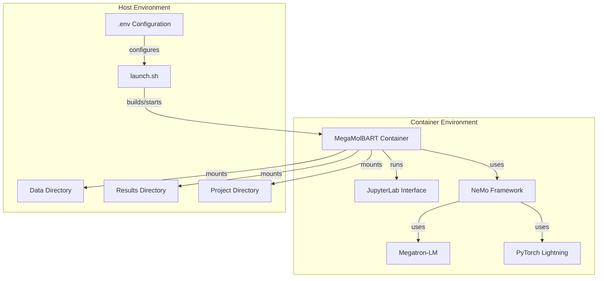
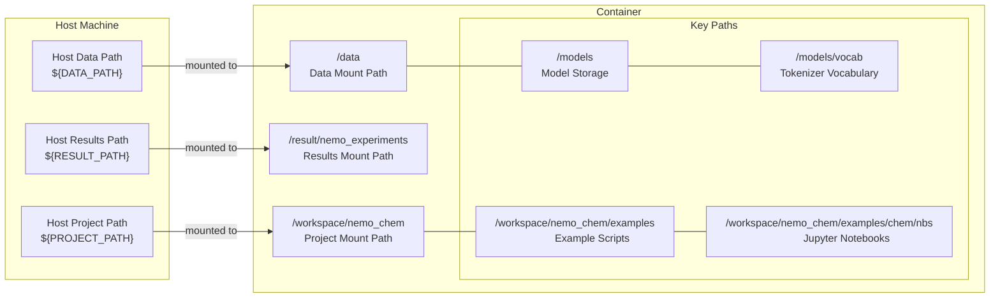
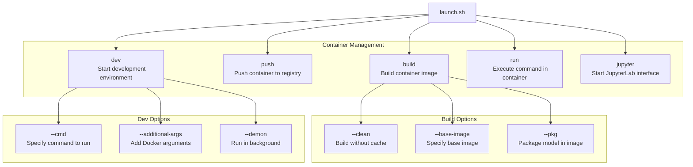

<!-- source: DeepWiki mcp.deepwiki.com · repo NVIDIA/MegaMolBART · page 1.2 Installation and Setup · fetched 2026-10-26 -->

# Installation and Setup

<details>
<summary>Relevant source files</summary>

The following files were used as context for generating this wiki page:

- [.dockerignore](.dockerignore)
- [.gitignore](.gitignore)
- [QUICKSTART.md](QUICKSTART.md)
- [README.md](README.md)
- [docs/ngc/base_image.md](docs/ngc/base_image.md)
- [docs/ngc/cmds](docs/ngc/cmds)
- [docs/ngc/model.md](docs/ngc/model.md)
- [docs/ngc/overview.md](docs/ngc/overview.md)
- [docs/ngc/requirements.md](docs/ngc/requirements.md)
- [examples/chem/conf/infer.yaml](examples/chem/conf/infer.yaml)
- [examples/chem/megamolbart_eval.py](examples/chem/megamolbart_eval.py)
- [launch.sh](launch.sh)
- [nemo_chem/models/megamolbart/__init__.py](nemo_chem/models/megamolbart/__init__.py)
- [nemo_chem/models/megamolbart/infer.py](nemo_chem/models/megamolbart/infer.py)
- [nemo_chem/package_info.py](nemo_chem/package_info.py)
- [setup.py](setup.py)
- [setup/Dockerfile](setup/Dockerfile)
- [setup/conda/env.yml](setup/conda/env.yml)
- [setup/config_model.sh](setup/config_model.sh)
- [setup/entrypoint.sh](setup/entrypoint.sh)
- [tests/data/test/metadata.txt](tests/data/test/metadata.txt)
- [tests/data/test/x000.csv](tests/data/test/x000.csv)
- [tests/pre_train_model_test.py](tests/pre_train_model_test.py)
- [tests/test_inference.py](tests/test_inference.py)

</details>


This document provides detailed instructions for installing and setting up the MegaMolBART system. It covers how to configure your environment, use the provided Docker containers, and prepare the system for development, training, or inference tasks. For information about the model architecture and theoretical foundations, see [Model Architecture](#2).

## 1. Overview

MegaMolBART is deployed primarily through Docker containers, which provide a consistent environment across different computing platforms. This approach ensures that all dependencies are correctly installed and configured. The system offers several setup options:

1. Using the pre-built NGC container (recommended)
2. Building a custom container from source
3. Setting up a development environment

The repository provides a comprehensive `launch.sh` script that handles container management, volume mounting, and environment configuration.

Sources: [launch.sh:1-405](), [README.md:16-37](), [QUICKSTART.md:11-14]()

## 2. Prerequisites

### 2.1 Hardware Requirements

MegaMolBART requires:
- NVIDIA GPU with at least 8GB memory
- CUDA-compatible driver installed
- Sufficient disk space for data, models, and results

### 2.2 Software Requirements

- Linux operating system
- Docker (version 19.03+ recommended for native GPU support)
- NVIDIA Container Toolkit (for older Docker versions)

Sources: [docs/ngc/requirements.md:1-10]()

## 3. Container Setup

### 3.1 Using the Pre-built NGC Container (Recommended)

The simplest way to get started is by using the pre-built container from NVIDIA NGC:

```bash
# For Docker version 19.03 or later
docker run \
    --gpus all \
    --rm \
    -p 8888:8888 \
    nvcr.io/nvidia/clara/megamolbart_v0.2:0.2.0

# For Docker version 19.02 or older
docker run \
    --runtime nvidia \
    --rm \
    -p 8888:8888 \
    nvcr.io/nvidia/clara/megamolbart_v0.2:0.2.0
```

This command starts the container and exposes the JupyterLab interface on port 8888.

Sources: [README.md:22-36](), [docs/ngc/overview.md:9-24]()

### 3.2 Setup with the Launch Script

For more advanced usage, the repository provides a `launch.sh` script that handles container operations. When first executed, it will create a template `.env` file if one doesn't exist.

```bash
# Create .env file with defaults
./launch.sh

# Build the container (only needed if not using NGC pre-built container)
./launch.sh build

# Start development environment
./launch.sh dev
```

### 3.3 Container Architecture



Sources: [launch.sh:127-170](), [README.md:42-70](), [setup/Dockerfile:1-77]()

## 4. Environment Configuration

### 4.1 The .env File

The `.env` file contains environment variables that configure the container behavior. When `launch.sh` is first run, it creates a template `.env` file with defaults. You should modify this file to match your environment.

Example `.env` file:

```
# Docker Image used for training, inference, and development
MEGAMOLBART_CONT=nvcr.io/nvidia/clara/megamolbart:0.2.0

# Path to Source code
PROJECT_PATH=/home/user/Projects/github/MegaMolBART/

# Path to data and results file
DATA_PATH=/data/bionemo/data/
RESULT_PATH=/data/bionemo/results/

# HOST port for jupyter lab web interface
JUPYTER_PORT=8888

# Docker image repository configuration
REGISTRY_USER=$oauthtoken
REGISTRY=NotSpecified
REGISTRY_ACCESS_TOKEN=NotSpecified

# wandb API key. https://wandb.ai/
WANDB_API_KEY=NotSpecified

# GITHUB configuration only required for building image
GITHUB_ACCESS_TOKEN=INSERT_GITHUB_ACCESS_TOKEN_HERE
GITHUB_BRANCH=main
```

Sources: [launch.sh:84-124](), [README.md:46-71]()

### 4.2 Directory Structure and Volume Mounting



The MegaMolBART container uses three main volume mounts:

1. **Data Path**: Mounted to `/data` in the container - stores datasets for training and inference
2. **Result Path**: Mounted to `/result/nemo_experiments` - stores training outputs, logs, and checkpoints
3. **Project Path**: Mounted to `/workspace/nemo_chem` - contains the MegaMolBART code

Sources: [launch.sh:127-170](), [QUICKSTART.md:15-20]()

## 5. Using the Launch Script

The `launch.sh` script is the primary interface for managing MegaMolBART containers. It provides several commands for different operations.

### 5.1 Launch Script Commands



### 5.2 Command Examples

**Building a Container:**
```bash
./launch.sh build                       # Basic build
./launch.sh build --clean               # Build without cache
./launch.sh build --base-image my_base  # Build with custom base image
```

**Development Environment:**
```bash
./launch.sh dev                               # Start shell in container
./launch.sh dev --cmd python script.py        # Run specific command
./launch.sh dev --additional-args "--gpus 2"  # Pass additional args to Docker
```

**Training or Inference:**
```bash
./launch.sh run python path/to/script.py  # Run script in container
```

**JupyterLab Interface:**
```bash
./launch.sh jupyter  # Start JupyterLab on the configured port
```

Sources: [launch.sh:26-83](), [launch.sh:305-348](), [launch.sh:380-404]()

## 6. Operating Modes

### 6.1 Development Mode

Development mode mounts the source code directory and provides an interactive shell:

```bash
./launch.sh dev
```

Inside the container, you can install development code and recompile components:

```bash
cd /workspace/nemo_chem && \
pip install -e . && \
bash setup/recompile_megatron_helper.sh
```

Sources: [QUICKSTART.md:142-177](), [README.md:79-88]()

### 6.2 Running Inference

To run inference with a pre-trained model:

1. Add `MODEL_PATH` in your `.env` file pointing to the directory containing model files
2. Update the inference configuration in `examples/chem/conf/infer.yaml` to point to your model file
3. Start the development container:

```bash
./launch.sh dev
```

4. Run inference tests:

```bash
pytest --log-cli-level=10 tests/test_inference.py
```

The `NeMoMegaMolBARTWrapper` class provides the main API for inference operations:

```python
from nemo_chem.models.megamolbart import NeMoMegaMolBARTWrapper

# Initialize the wrapper with a model configuration
wrapper = NeMoMegaMolBARTWrapper(model_cfg=cfg)

# Generate molecule embeddings
embeddings = wrapper.smis_to_embedding(smiles_list)

# Sample new molecules
samples = wrapper.sample(smiles_list, num_samples=10)
```

Sources: [README.md:162-176](), [nemo_chem/models/megamolbart/infer.py:1-212](), [tests/test_inference.py:1-106](), [examples/chem/conf/infer.yaml:1-34]()

### 6.3 Training Mode

For training, you can use the pre-built scripts provided in the repository:

1. Configure your data path in the `.env` file
2. Use the appropriate script for your environment:

**For workstations:**
```bash
./launch.sh run python /workspace/nemo_chem/examples/chem/megamolbart_pretrain.py \
    --config-path=conf \
    --config-name=megamolbart_pretrain_xsmall_span_aug
```

**For SLURM clusters:**
There are SLURM scripts available in the `examples/chem/slurm` directory.

Sources: [QUICKSTART.md:57-97](), [QUICKSTART.md:101-140]()

### 6.4 JupyterLab Interface

To start the JupyterLab interface:

```bash
./launch.sh jupyter
```

This starts JupyterLab on the port specified in your `.env` file (default 8888). You can access it by opening http://localhost:8888 in your browser.

Sources: [launch.sh:369-379](), [README.md:16-39]()

## 7. Troubleshooting

### 7.1 Docker Issues

- **GPU not available**: Ensure the NVIDIA driver is installed and the NVIDIA Container Toolkit is correctly configured
- **Permission denied**: Try running with `sudo` or add your user to the docker group
- **Volume mount issues**: Check that the paths in your `.env` file exist and are absolute paths

### 7.2 Container Build Failures

- **GitHub access token issues**: For custom builds, ensure your GitHub token has the correct permissions
- **Network failures**: Check your internet connection and proxy settings
- **Base image not found**: Verify the base image reference in `setup/Dockerfile`

### 7.3 Common Runtime Errors

- **Out of memory errors**: Reduce batch size or model size in the configuration
- **Missing data**: Ensure the data path is correctly set and contains the expected files
- **Model loading failures**: Verify the model path in your inference configuration

Sources: [README.md:72-78](), [setup/Dockerfile:1-77]()

---

