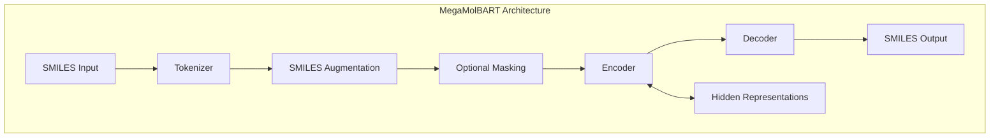
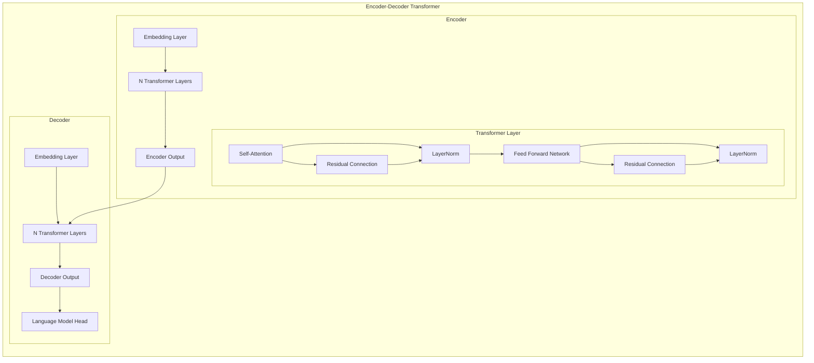
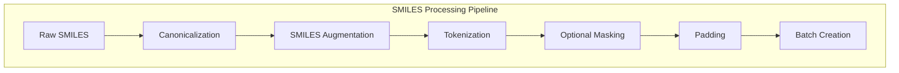
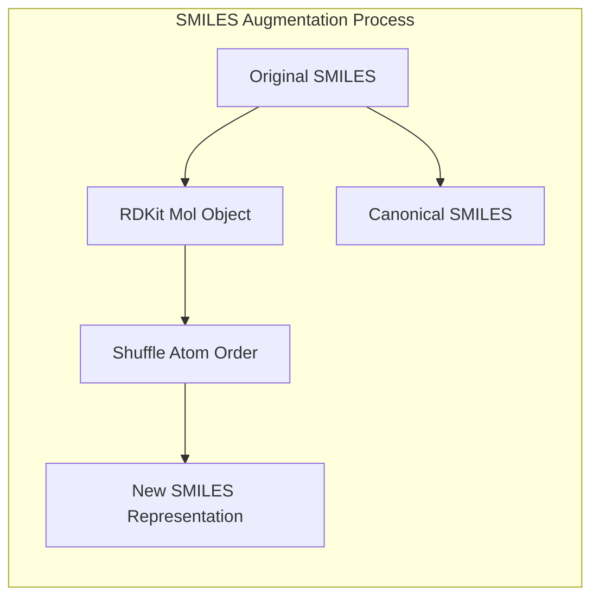
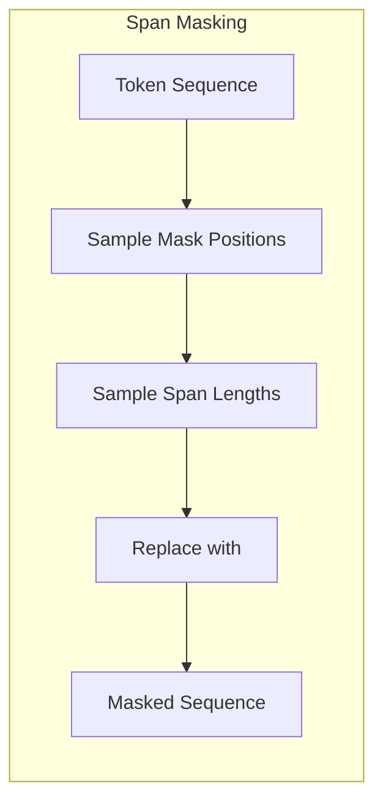
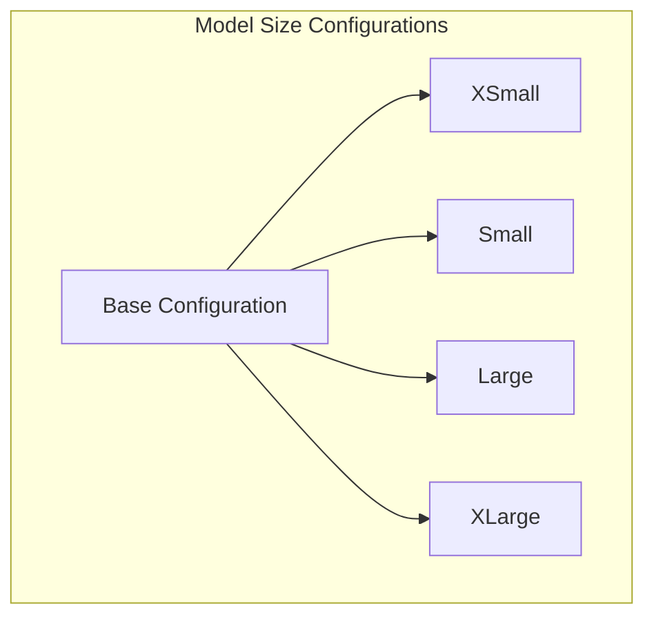
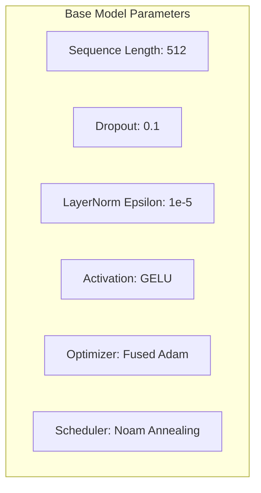
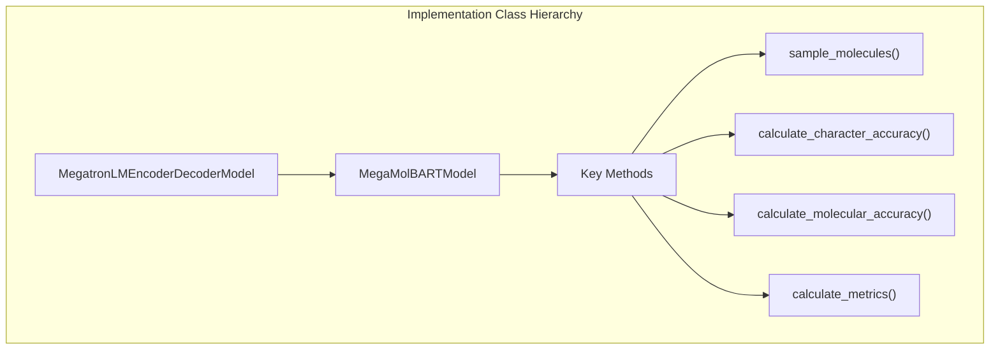

<!-- source: DeepWiki mcp.deepwiki.com · repo NVIDIA/MegaMolBART · page 2 Model Architecture · fetched 2026-10-26 -->

# Model Architecture

Relevant source files

The following files were used as context for generating this wiki page:

- [examples/chem/conf/megamolbart_pretrain_base.yaml](examples/chem/conf/megamolbart_pretrain_base.yaml)
- [examples/chem/megamolbart_pretrain.py](examples/chem/megamolbart_pretrain.py)
- [examples/chem/shell/megamolbart_pretrain_quick.sh](examples/chem/shell/megamolbart_pretrain_quick.sh)
- [nemo_chem/data/augment.py](nemo_chem/data/augment.py)
- [nemo_chem/data/csv_dataset.py](nemo_chem/data/csv_dataset.py)
- [nemo_chem/data/preprocess/preprocess.py](nemo_chem/data/preprocess/preprocess.py)
- [nemo_chem/data/utils.py](nemo_chem/data/utils.py)
- [nemo_chem/models/megamolbart/megamolbart_model.py](nemo_chem/models/megamolbart/megamolbart_model.py)
- [nemo_chem/utils/__init__.py](nemo_chem/utils/__init__.py)

This document describes the architecture of the MegaMolBART model, a transformer-based encoder-decoder model specialized for learning molecular representations from SMILES strings. For information about training the model, see [Training System](#3), and for inference details, see [Inference System](#4).

## Overview of MegaMolBART Architecture

MegaMolBART is an encoder-decoder transformer model based on NVIDIA's Megatron-LM framework, designed specifically for molecular representation learning. It processes SMILES (Simplified Molecular Input Line Entry System) strings, which are a linear text notation for representing molecular structures.

The model follows a BART-like (Bidirectional and Auto-Regressive Transformer) architecture and is pre-trained using masked language modeling techniques adapted for molecular representations. By learning to reconstruct molecules from corrupted inputs, MegaMolBART develops powerful chemical understanding that can be applied to various downstream tasks.

Sources: [nemo_chem/models/megamolbart/megamolbart_model.py:37-45](), [examples/chem/conf/megamolbart_pretrain_base.yaml:36-66]()

## Encoder-Decoder Design

MegaMolBART implements a transformer-based encoder-decoder architecture that inherits from NVIDIA's `MegatronLMEncoderDecoderModel`. This design enables the model to effectively process and generate SMILES strings representing molecular structures.

Sources: [nemo_chem/models/megamolbart/megamolbart_model.py:37-45](), [examples/chem/conf/megamolbart_pretrain_base.yaml:36-66]()

### Key Components

1. **Encoder**: 
   - Processes input SMILES strings (either original or masked/corrupted)
   - Consists of N transformer layers with self-attention mechanisms
   - Outputs contextualized representations of the input

2. **Decoder**:
   - Generates output SMILES strings autoregressively
   - Also consists of N transformer layers
   - Takes encoder representations as input through cross-attention

3. **Shared Parameters**:
   - Word embeddings can be shared between encoder and decoder
   - The decoder's output embedding layer can optionally share weights with the language model head

4. **Architecture Configuration**:
   - Configurable number of layers, hidden size, and attention heads
   - Supports various activation functions: gelu, geglu, swiglu, reglu
   - Implements different normalization types: layernorm, rmsnorm

Sources: [examples/chem/conf/megamolbart_pretrain_base.yaml:36-66]()

## SMILES Processing

The processing of SMILES strings is a critical component of the MegaMolBART architecture, involving several key steps to prepare molecular data for the model.

Sources: [nemo_chem/data/augment.py:31-45](), [nemo_chem/data/augment.py:143-196]()

### SMILES Representation and Tokenization

MegaMolBART uses a specialized tokenizer for SMILES strings that understands chemical syntax. The tokenization process:

1. Converts SMILES strings into token sequences
2. Adds special tokens like `<bos>` (beginning of sequence), `<eos>` (end of sequence), and `<pad>` (padding)
3. Handles chemical tokens appropriately for molecular structures

### SMILES Augmentation

To improve generalization, MegaMolBART employs SMILES augmentation techniques:

1. **Atom order randomization**: 
   - Shuffles the atom ordering in the molecular graph
   - Generates alternative but chemically equivalent SMILES representations
   - Helps the model learn invariant molecular representations

2. **Canonicalization**: 
   - Option to convert all input SMILES to a canonical form
   - Ensures consistency in molecular representation

Sources: [nemo_chem/data/augment.py:51-81]()

### Masking Strategies

MegaMolBART uses masking during pre-training as part of its self-supervised learning approach. The primary masking strategy is span masking:

1. **Span Masking**:
   - Masks continuous spans of tokens rather than individual tokens
   - Span lengths are sampled from a Poisson distribution (λ = span_lambda parameter)
   - Default span_lambda is 3.0, meaning average span length is 3 tokens
   - Default mask probability is 0.15, meaning 15% of tokens are masked

The masking process is applied to encoder inputs when `encoder_mask` is enabled.

Sources: [nemo_chem/data/augment.py:199-232](), [nemo_chem/data/augment.py:241-264]()

## Model Configurations

MegaMolBART comes in multiple size configurations, allowing users to balance model capacity against computational requirements.

Each configuration specifies different hyperparameters:

| Configuration | Layers | Hidden Size | Attention Heads | Typical Hardware |
|---------------|--------|-------------|----------------|------------------|
| XSmall        | 2      | 256         | 4              | Single GPU       |
| Small         | 6      | 512         | 8              | 8 GPUs           |
| Large         | 8      | 1024        | 16             | 64 GPUs (8×8)    |
| XLarge        | 12+    | 1536+       | 24+            | 64+ GPUs         |

The base configuration for all models specifies common parameters:

Sources: [examples/chem/conf/megamolbart_pretrain_base.yaml:36-66]()

## Implementation Details

MegaMolBART is implemented using PyTorch and NVIDIA's NeMo framework. Key implementation classes and their roles:

Sources: [nemo_chem/models/megamolbart/megamolbart_model.py:37-204]()

### Core Model Class

The `MegaMolBARTModel` class inherits from `MegatronLMEncoderDecoderModel` and implements molecular-specific functionality:

1. **Data Handling**:
   - Builds training, validation, and test datasets
   - Implements collate functions for batching
   - Processes molecular data for the model

2. **Molecule Generation**:
   - `sample_molecules()` method for generating molecules from encoder states
   - Autoregressive sampling of token sequences
   - Conversion of predicted tokens back to SMILES strings

3. **Evaluation Metrics**:
   - Character-level accuracy (token prediction)
   - Molecule-level accuracy (complete SMILES accuracy)
   - Invalid molecule percentage tracking

Sources: [nemo_chem/models/megamolbart/megamolbart_model.py:205-240](), [nemo_chem/models/megamolbart/megamolbart_model.py:240-306]()

### Optimization and Training

MegaMolBART uses several optimization techniques:

1. **Mixed Precision Training**:
   - Support for FP16 and BF16 precision
   - Uses NVIDIA Apex for mixed-precision optimization

2. **Distributed Training**:
   - Data Parallel (DP) training
   - Model Parallel (MP) training for larger models
   - NLPDDPPlugin for efficient distributed training

3. **Learning Rate Scheduling**:
   - Noam Annealing schedule (warmup followed by decay)
   - Configurable warmup steps and minimum learning rate

Sources: [examples/chem/megamolbart_pretrain.py:41-89](), [examples/chem/conf/megamolbart_pretrain_base.yaml:96-110]()

## Pretraining Objective

MegaMolBART's pretraining objective is to reconstruct original SMILES strings from corrupted inputs. This is implemented as:

1. Input SMILES strings are tokenized and optionally augmented
2. Spans of tokens are masked in the encoder input
3. The model learns to predict the original tokens in the decoder
4. Training loss is calculated on token predictions versus actual tokens
5. Evaluation metrics track both token-level and molecule-level accuracy

This pretraining approach enables the model to develop a robust understanding of molecular structures and chemical properties, making it effective for downstream tasks in molecular machine learning.

Sources: [nemo_chem/models/megamolbart/megamolbart_model.py:307-326]()

---

