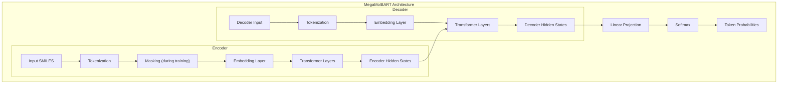
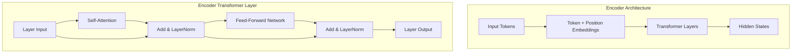
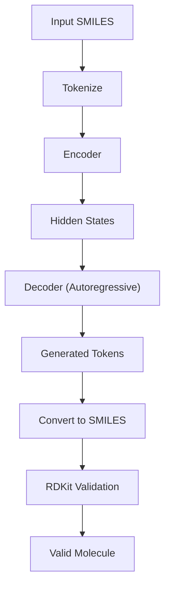

<!-- source: DeepWiki mcp.deepwiki.com · repo NVIDIA/MegaMolBART · page 2.1 Encoder-Decoder Design · fetched 2026-10-26 -->

# Encoder-Decoder Design

<details>
<summary>Relevant source files</summary>

The following files were used as context for generating this wiki page:

- [examples/chem/conf/megamolbart_pretrain_base.yaml](examples/chem/conf/megamolbart_pretrain_base.yaml)
- [examples/chem/megamolbart_pretrain.py](examples/chem/megamolbart_pretrain.py)
- [examples/chem/shell/megamolbart_pretrain_quick.sh](examples/chem/shell/megamolbart_pretrain_quick.sh)
- [nemo_chem/data/augment.py](nemo_chem/data/augment.py)
- [nemo_chem/data/csv_dataset.py](nemo_chem/data/csv_dataset.py)
- [nemo_chem/data/preprocess/preprocess.py](nemo_chem/data/preprocess/preprocess.py)
- [nemo_chem/data/utils.py](nemo_chem/data/utils.py)
- [nemo_chem/models/megamolbart/megamolbart_model.py](nemo_chem/models/megamolbart/megamolbart_model.py)
- [nemo_chem/utils/__init__.py](nemo_chem/utils/__init__.py)

</details>


## Purpose and Scope

This page documents the transformer-based encoder-decoder architecture used in MegaMolBART for molecular representation learning and generation. The encoder-decoder design is the fundamental architecture that enables the model to process SMILES string representations of molecules, encode them into latent representations, and decode them back to SMILES strings or generate new molecules. This architecture supports both pre-training tasks and downstream applications like molecule generation.

For information about how SMILES strings are processed before entering the model, see [SMILES Processing](#2.2). For details on specific model size configurations and parameters, see [Model Configurations](#2.3).

## Architecture Overview

MegaMolBART implements a transformer-based encoder-decoder architecture derived from the BART (Bidirectional and Auto-Regressive Transformers) model. The implementation extends NeMo's MegatronLMEncoderDecoderModel class.



Sources: [nemo_chem/models/megamolbart/megamolbart_model.py:37-46]()

## Encoder Component

The encoder processes tokenized SMILES strings and transforms them into a contextual representation. During pre-training, input SMILES are masked according to a specific masking strategy.



Key encoder features:
- Each transformer layer contains self-attention mechanisms that learn relationships between tokens in the input sequence
- Uses LayerNorm for normalization and GELU activation functions
- Position embeddings help capture the sequential nature of SMILES strings
- Bidirectional attention allows tokens to attend to the full context in both directions

Sources: [examples/chem/conf/megamolbart_pretrain_base.yaml:36-64]()

## Decoder Component

The decoder autogressively generates SMILES strings. It contains two types of attention mechanisms in each layer:
1. Masked self-attention that attends only to previous tokens (for autoregressive generation)
2. Cross-attention that attends to the encoder's outputs

```mermaid
flowchart TD
    subgraph "Decoder Architecture"
        Input["Input Tokens"] --> Embed["Token + Position Embeddings"]
        Embed --> Layers["Transformer Layers"]
        EncoderStates["Encoder Hidden States"] --> Layers
        Layers --> Hidden["Hidden States"]
        Hidden --> Projection["Linear Projection to Vocabulary"]
    end
    
    subgraph "Decoder Transformer Layer"
        LayerIn["Layer Input"] --> MaskedAtt["Masked Self-Attention"]
        MaskedAtt --> AddNorm1["Add & LayerNorm"]
        LayerIn --> AddNorm1
        AddNorm1 --> CrossAtt["Cross-Attention to Encoder"]
        CrossAtt --> AddNorm2["Add & LayerNorm"]
        AddNorm1 --> AddNorm2
        AddNorm2 --> FFN["Feed-Forward Network"]
        FFN --> AddNorm3["Add & LayerNorm"]
        AddNorm2 --> AddNorm3
        AddNorm3 --> LayerOut["Layer Output"]
    end
```



During inference, the decoder samples tokens one at a time:

```python
def sample_molecules(self, tokens_enc, enc_mask, hidden_states=None):
    # Decode encoder hidden state to tokens
    predicted_tokens_ids, log_probs = self.decode(tokens_enc,
                                                  enc_mask,
                                                  self._cfg.max_position_embeddings,
                                                  enc_output=hidden_states)
    # ... processing and conversion to SMILES ...
    return sampled_smiles
```

Sources: [nemo_chem/models/megamolbart/megamolbart_model.py:205-238]()

## Data Flow During Training

During training, MegaMolBART follows these steps for processing molecule data:

```mermaid
flowchart LR
    SMILES["SMILES String"] --> Augment["SMILES Augmentation"]
    Augment --> SpanMask["Span Masking"]
    SpanMask --> Tokenize["Tokenization"]
    Tokenize --> Encode["Encoder Processing"]
    Encode --> HiddenStates["Hidden States"]
    HiddenStates --> Decode["Decoder Processing"]
    Decode --> Predict["Token Prediction"]
    Predict --> Loss["Cross-Entropy Loss"]
```



### Masking Strategy

MegaMolBART uses a span masking approach where continuous spans of tokens are masked according to these parameters:

| Parameter | Function |
|-----------|----------|
| `mask_scheme` | Type of masking (span) |
| `mask_prob` | Probability of masking a token (default: 0.1) |
| `span_lambda` | Poisson distribution parameter for span length (default: 3.0) |

During training, the encoder input has spans of tokens replaced with a mask token, while the decoder learns to predict the original tokens.

Sources: [nemo_chem/data/augment.py:211-266]()

## Inference Process

During inference, MegaMolBART can generate molecules in several ways:



The model includes metrics to evaluate generation quality:

1. Character accuracy - token-level accuracy of predictions
2. Molecular accuracy - complete molecule accuracy after canonicalization
3. Percent invalid - percentage of generated molecules that are invalid according to RDKit

```python
def calculate_metrics(self, token_logits, loss_mask, labels, tokens_enc, enc_mask, target_smiles, batch_idx=None, log_char=False, log_mol=False):
    """Calculate metrics for character accuracy, molecular accuracy, and invalid molecules"""
    character_accuracy = self.calculate_character_accuracy(token_logits, loss_mask, labels, batch_idx, log=log_char)
    molecular_accuracy, percent_invalid = self.calculate_molecular_accuracy(tokens_enc, enc_mask, target_smiles, batch_idx, log=log_mol)
    metrics = {'character_accuracy': character_accuracy,
              'molecular_accuracy': molecular_accuracy,
              'percent_invalid': percent_invalid}
    return metrics
```

Sources: [nemo_chem/models/megamolbart/megamolbart_model.py:307-326]()

## Implementation Details

### Key Classes

The encoder-decoder architecture is implemented through several key classes:

1. `MegaMolBARTModel` - Main model class inheriting from MegatronLMEncoderDecoderModel
2. `MoleculeEnumeration` - Handles SMILES augmentation and masking for training

### Configuration Parameters

The architecture is highly configurable through YAML configuration files. Key parameters include:

| Parameter | Description | Default Value |
|-----------|-------------|---------------|
| `seq_length` | Maximum sequence length | 512 |
| `hidden_size` | Dimension of hidden layers | 768 (base) |
| `num_layers` | Number of transformer layers | 3 (base) |
| `num_attention_heads` | Number of attention heads | 12 (base) |
| `ffn_hidden_size` | Feed-forward network size | 4 × hidden_size |
| `encoder_arch` | Encoder architecture type | transformer |
| `decoder_arch` | Decoder architecture type | transformer |
| `activation` | Activation function | gelu |
| `share_word_embeddings` | Whether to share encoder/decoder embeddings | True |

Sources: [examples/chem/conf/megamolbart_pretrain_base.yaml:36-66]()

### Model Scaling

MegaMolBART can be scaled to different sizes by adjusting key architectural parameters:

| Model Size | Layers | Hidden Size | Attention Heads |
|------------|--------|-------------|-----------------|
| XSmall     | 2      | 256         | 4               |
| Small      | 6      | 512         | 8               |
| Large      | 8      | 1024        | 16              |
| XLarge     | 12+    | 1536+       | 16+             |

The scaling of these parameters follows best practices from transformer-based language models like BERT and GPT.

Sources: [examples/chem/conf/megamolbart_pretrain_base.yaml:36-66]()

## Integration with MegaMolBART System

The encoder-decoder architecture integrates with the overall MegaMolBART system as follows:

```mermaid
flowchart TD
    subgraph "Training Pipeline"
        MoleculeData["SMILES Data"] --> Preprocessing["Data Preprocessing"]
        Preprocessing --> DataAugmentation["SMILES Augmentation"]
        DataAugmentation --> MaskingModule["Span Masking"]
        MaskingModule --> BatchFormation["Batch Formation"]
        BatchFormation --> EncoderDecoder["Encoder-Decoder Model"]
        EncoderDecoder --> TrainingLoss["Loss Calculation"]
        TrainingLoss --> Optimization["Parameter Optimization"]
    end
    
    subgraph "Inference Pipeline"
        InputSMILES["Input SMILES"] --> Tokenizer["SMILES Tokenizer"]
        Tokenizer --> EncoderInference["Encoder"]
        EncoderInference --> Representation["Molecular Representation"]
        Representation --> DecoderInference["Decoder"]
        DecoderInference --> SMILESOutput["Generated SMILES"]
        SMILESOutput --> Validation["Molecular Validation"]
    end
```



This architecture enables MegaMolBART to effectively learn molecular representations during pre-training and generate valid molecules during inference.

Sources: [nemo_chem/models/megamolbart/megamolbart_model.py:37-329](), [nemo_chem/data/augment.py:31-277]()

---

