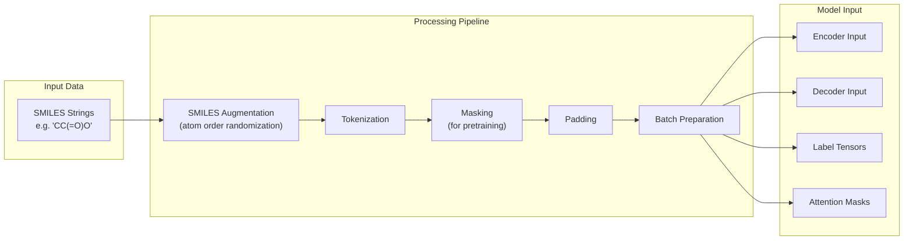
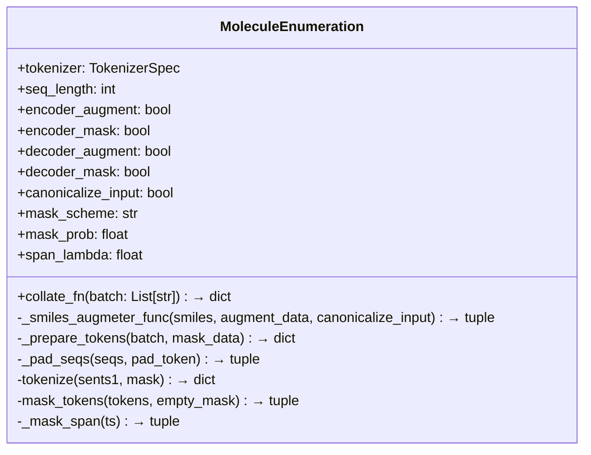
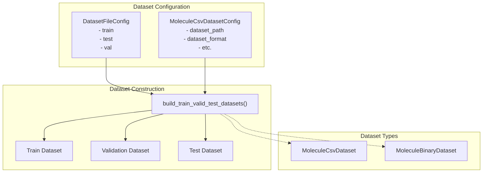
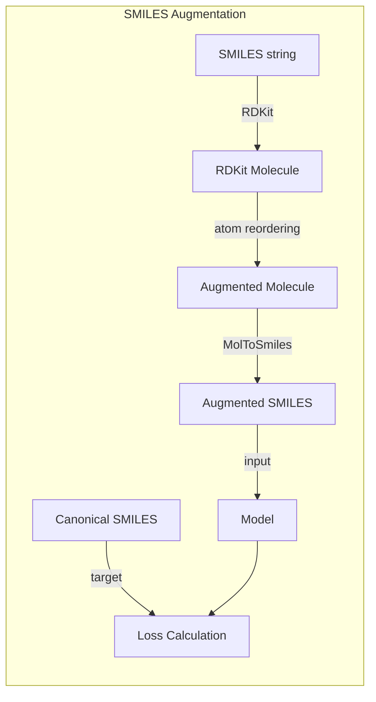
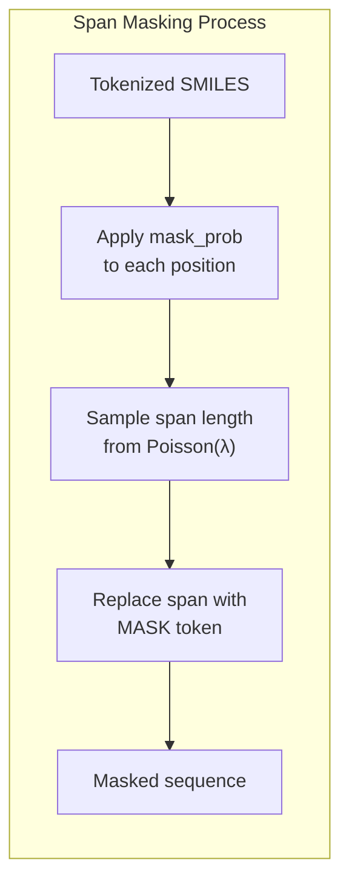
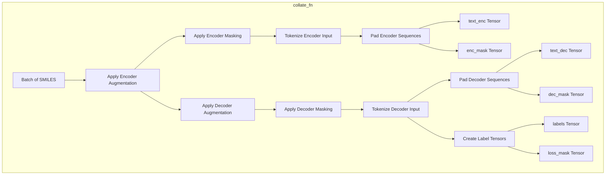
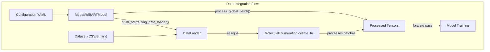

<!-- source: DeepWiki mcp.deepwiki.com · repo NVIDIA/MegaMolBART · page 2.2 SMILES Processing · fetched 2026-10-26 -->

# SMILES Processing

Relevant source files

The following files were used as context for generating this wiki page:

- [examples/chem/conf/megamolbart_pretrain_base.yaml](examples/chem/conf/megamolbart_pretrain_base.yaml)
- [examples/chem/conf/megamolbart_pretrain_large_span_aug.yaml](examples/chem/conf/megamolbart_pretrain_large_span_aug.yaml)
- [examples/chem/conf/megamolbart_pretrain_small_span_aug.yaml](examples/chem/conf/megamolbart_pretrain_small_span_aug.yaml)
- [examples/chem/conf/megamolbart_pretrain_xsmall_span_aug.yaml](examples/chem/conf/megamolbart_pretrain_xsmall_span_aug.yaml)
- [examples/chem/shell/megamolbart_pretrain_quick.sh](examples/chem/shell/megamolbart_pretrain_quick.sh)
- [nemo_chem/data/augment.py](nemo_chem/data/augment.py)
- [nemo_chem/data/csv_dataset.py](nemo_chem/data/csv_dataset.py)
- [nemo_chem/data/preprocess/preprocess.py](nemo_chem/data/preprocess/preprocess.py)
- [nemo_chem/data/utils.py](nemo_chem/data/utils.py)
- [nemo_chem/models/megamolbart/megamolbart_model.py](nemo_chem/models/megamolbart/megamolbart_model.py)
- [nemo_chem/utils/__init__.py](nemo_chem/utils/__init__.py)

This document describes how MegaMolBART processes SMILES (Simplified Molecular-Input Line-Entry System) strings for molecular representation learning. The processing pipeline includes data loading, tokenization, augmentation, masking, and preparation of tensors for the encoder-decoder architecture. For information about the general encoder-decoder design, see [Encoder-Decoder Design](#2.1).

## Overview of SMILES Processing

SMILES strings are text-based representations of molecules that encode their structure in a compact format. MegaMolBART processes these strings through a series of steps to prepare them for training the transformer-based model.

### SMILES Processing Pipeline

Sources:
- [nemo_chem/data/augment.py:31-141]()
- [nemo_chem/models/megamolbart/megamolbart_model.py:37-105]()

## MoleculeEnumeration Class

The central component for SMILES processing is the `MoleculeEnumeration` class, which handles all steps from raw SMILES to model-ready tensors.

Sources:
- [nemo_chem/data/augment.py:31-45]()

## SMILES Data Loading

The system supports loading SMILES data from both CSV and binary formats. The dataset construction is handled by specialized dataset classes.

Sources:
- [nemo_chem/data/utils.py:97-133]()
- [nemo_chem/data/csv_dataset.py:38-84]()

## SMILES Augmentation

SMILES augmentation is a key technique for improving model robustness by creating variations of the same molecule through different atom ordering.

### Augmentation Process

The augmentation is performed using RDKit's atom reordering functionality:

1. Convert input SMILES to RDKit molecule object
2. Shuffle atom ordering randomly 
3. Convert back to SMILES string (non-canonical)
4. Use canonical SMILES as ground truth target

Sources:
- [nemo_chem/data/augment.py:51-81]()

### Configuration Options

Augmentation can be configured separately for encoder and decoder:

- `encoder_augment`: Whether to augment SMILES for encoder input (typically True)
- `decoder_augment`: Whether to augment SMILES for decoder input
- `canonicalize_input`: Whether to canonicalize input SMILES

Sources:
- [examples/chem/conf/megamolbart_pretrain_base.yaml:82-85]()

## SMILES Tokenization and Masking

Tokenization converts SMILES strings into token IDs, and masking is applied for pretraining objectives.

### Masking Schemes

The primary masking scheme is span masking, where consecutive tokens are masked based on a Poisson distribution:

Masking configuration parameters:
- `mask_scheme`: Type of masking to use (currently 'span')
- `mask_prob`: Probability of masking a token
- `span_lambda`: Expected span length (λ for Poisson distribution)

Sources:
- [nemo_chem/data/augment.py:212-264]()
- [examples/chem/conf/megamolbart_pretrain_base.yaml:86-88]()

## Batch Preparation

The `collate_fn` method in `MoleculeEnumeration` prepares batches for model training:

The `collate_fn` method returns a dictionary with the following tensors:
- `text_enc`: Token IDs for encoder input
- `enc_mask`: Mask for encoder input (1=active, 0=padding)
- `text_dec`: Token IDs for decoder input (starts with BOS token)
- `dec_mask`: Mask for decoder input
- `labels`: Target token IDs for loss calculation
- `loss_mask`: Mask for loss calculation (1=active, 0=ignore)
- `target_smiles`: Original canonical SMILES strings for evaluation

Sources:
- [nemo_chem/data/augment.py:143-196]()

## End-to-End SMILES Processing Example

Below is an example of SMILES processing from raw data to model input:

1. Start with raw SMILES: `CC(=O)O` (acetic acid)
2. Apply augmentation: `O(C)C=O` (non-canonical representation)
3. Tokenize: `['O', '(', 'C', ')', 'C', '=', 'O']`
4. Apply masking: `['O', '(', 'C', ')', '[MASK]', '=', 'O']`
5. Convert to IDs: `[27, 7, 13, 8, 1, 21, 27]` (example IDs)
6. Pad sequence: `[27, 7, 13, 8, 1, 21, 27, 0, 0, ...]`
7. Create attention mask: `[1, 1, 1, 1, 1, 1, 1, 0, 0, ...]`

## Model Integration

The SMILES processing pipeline is integrated with the MegaMolBARTModel class through the `build_pretraining_data_loader` method, which configures the dataloader with the appropriate collate function.

Sources:
- [nemo_chem/models/megamolbart/megamolbart_model.py:90-115]()
- [nemo_chem/models/megamolbart/megamolbart_model.py:117-132]()

## Configuration Parameters

The SMILES processing pipeline can be customized through configuration parameters in the YAML files:

| Parameter | Description | Default Value |
|-----------|-------------|---------------|
| `encoder_augment` | Apply augmentation to encoder input | True |
| `encoder_mask` | Apply masking to encoder input | True |
| `decoder_augment` | Apply augmentation to decoder input | True |
| `decoder_mask` | Apply masking to decoder input | False |
| `mask_scheme` | Masking scheme | "span" |
| `mask_prob` | Probability of masking a token | 0.1 |
| `span_lambda` | Expected span length | 3.0 |
| `canonicalize_input` | Canonicalize input SMILES | True |
| `seq_length` | Maximum sequence length | 512 |
| `dataset_format` | Dataset format (csv/bin) | "csv" |

Sources:
- [examples/chem/conf/megamolbart_pretrain_base.yaml:42-94]()

## Evaluation Metrics

The SMILES processing influences the metrics used for model evaluation:

1. **Character Accuracy**: Accuracy at the token level (percentage of correctly predicted tokens)
2. **Molecular Accuracy**: Percentage of molecules that are correctly reconstructed after canonicalization
3. **Percent Invalid**: Percentage of generated SMILES that cannot be parsed into valid molecules

Sources:
- [nemo_chem/models/megamolbart/megamolbart_model.py:240-326]()

## Conclusion

The SMILES processing pipeline in MegaMolBART provides a robust framework for handling molecular data. By combining augmentation, tokenization, and masking, it creates a rich pretraining environment that enables the model to learn meaningful molecular representations. The configurable nature of the pipeline allows for experimentation with different processing strategies to optimize model performance.

---

