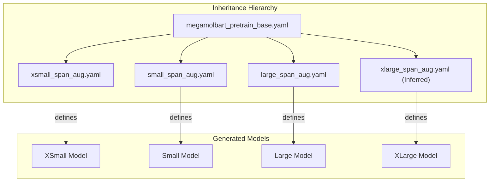
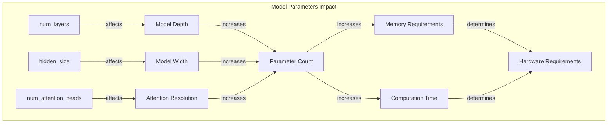
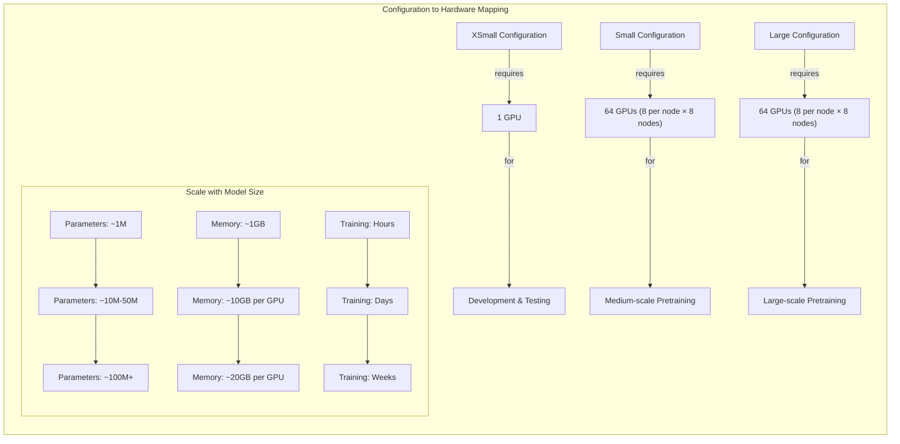

<!-- source: DeepWiki mcp.deepwiki.com · repo NVIDIA/MegaMolBART · page 2.3 Model Configurations · fetched 2026-10-26 -->

# Model Configurations

<details>
<summary>Relevant source files</summary>

The following files were used as context for generating this wiki page:

- [examples/chem/conf/megamolbart_pretrain_large_span_aug.yaml](examples/chem/conf/megamolbart_pretrain_large_span_aug.yaml)
- [examples/chem/conf/megamolbart_pretrain_small_span_aug.yaml](examples/chem/conf/megamolbart_pretrain_small_span_aug.yaml)
- [examples/chem/conf/megamolbart_pretrain_xsmall_span_aug.yaml](examples/chem/conf/megamolbart_pretrain_xsmall_span_aug.yaml)

</details>


This page details the various size configurations of the MegaMolBART model, including XSmall, Small, and Large variants. It provides information about each configuration's architecture parameters and computing resource requirements. For information about the overall encoder-decoder architecture, see [Encoder-Decoder Design](#2.1). For details on how to configure the training process, see [Training Configuration](#3.2).

## Configuration System Overview

MegaMolBART uses a hierarchical YAML-based configuration system powered by Hydra to define different model sizes. All model configurations inherit from a base configuration file and override specific parameters to define different model scales.



Sources: [examples/chem/conf/megamolbart_pretrain_xsmall_span_aug.yaml:1-4](), [examples/chem/conf/megamolbart_pretrain_small_span_aug.yaml:1-4](), [examples/chem/conf/megamolbart_pretrain_large_span_aug.yaml:1-4]()

## Model Size Comparison

The following table compares the key architectural parameters across different MegaMolBART model configurations:

| Configuration | Layers | Hidden Size | Attention Heads | Devices | Nodes | Total GPUs | Primary Use Case |
|---------------|--------|-------------|-----------------|---------|-------|------------|-----------------|
| XSmall        | 2      | 256         | 4               | 1       | 1     | 1          | Development, testing, small-scale experiments |
| Small         | 6      | 512         | 8               | 8       | 8     | 64         | Medium-scale pretraining, fine-tuning |
| Large         | 8      | 1024        | 16              | 8       | 8     | 64         | Large-scale pretraining for production models |

Sources: [examples/chem/conf/megamolbart_pretrain_xsmall_span_aug.yaml](), [examples/chem/conf/megamolbart_pretrain_small_span_aug.yaml](), [examples/chem/conf/megamolbart_pretrain_large_span_aug.yaml]()

## Configuration Parameters

The key parameters that define each model configuration include:

### Architecture Parameters

- **num_layers**: Number of transformer encoder and decoder layers
- **hidden_size**: Dimension of the model's hidden representations
- **num_attention_heads**: Number of attention heads in multi-head attention mechanisms

### Hardware Parameters

- **devices**: Number of GPUs per node
- **num_nodes**: Number of compute nodes



Sources: [examples/chem/conf/megamolbart_pretrain_xsmall_span_aug.yaml:10-13](), [examples/chem/conf/megamolbart_pretrain_small_span_aug.yaml:10-13](), [examples/chem/conf/megamolbart_pretrain_large_span_aug.yaml:10-13]()

## Detailed Configuration Descriptions

### XSmall Configuration

The XSmall configuration is designed for development, testing, and quick experiments on limited hardware resources.

```yaml
model:
  name: xsmall_span_aug
  # model architecture
  num_layers: 2
  hidden_size: 256
  num_attention_heads: 4

trainer:
  devices: 1
  num_nodes: 1
```

Key features:
- Minimal transformer architecture with only 2 layers
- Small hidden size of 256 dimensions
- Can run on a single GPU
- Fastest training and inference times
- Smallest memory footprint

Sources: [examples/chem/conf/megamolbart_pretrain_xsmall_span_aug.yaml:4-13]()

### Small Configuration

The Small configuration offers a balance between model capacity and computational requirements, suitable for medium-scale pretraining and fine-tuning tasks.

```yaml
model:
  name: small_span_aug
  # model architecture
  num_layers: 6
  hidden_size: 512
  num_attention_heads: 8

trainer:
  devices: 8
  num_nodes: 8
```

Key features:
- Moderately deep transformer with 6 layers
- Medium hidden size of 512 dimensions
- Requires distributed training (64 GPUs across 8 nodes)
- Good balance between performance and computational cost

Sources: [examples/chem/conf/megamolbart_pretrain_small_span_aug.yaml:4-13]()

### Large Configuration

The Large configuration is designed for production-grade models with high capacity, suitable for large-scale pretraining on extensive molecular datasets.

```yaml
model:
  name: large_span_aug
  # model architecture
  num_layers: 8
  hidden_size: 1024
  num_attention_heads: 16

trainer:
  devices: 8
  num_nodes: 8
```

Key features:
- Deep transformer with 8 layers
- Large hidden size of 1024 dimensions
- Highest parameter count among the configurations
- Requires substantial computational resources (64 GPUs across 8 nodes)
- Highest capacity for learning complex molecular patterns

Sources: [examples/chem/conf/megamolbart_pretrain_large_span_aug.yaml:4-13]()

## Hardware Requirements and Scaling

The configuration YAML files define not only the model architecture but also the required hardware resources. This ensures that the training system can properly distribute the workload across available GPUs.



Sources: [examples/chem/conf/megamolbart_pretrain_xsmall_span_aug.yaml:4-6](), [examples/chem/conf/megamolbart_pretrain_small_span_aug.yaml:4-6](), [examples/chem/conf/megamolbart_pretrain_large_span_aug.yaml:4-6]()

## Configuration Selection Guidelines

When choosing a MegaMolBART configuration, consider the following factors:

1. **Available Hardware Resources**: Select a configuration that matches your available computing infrastructure.
   - XSmall: Single GPU workstation
   - Small/Large: Multi-node GPU cluster with high-speed interconnect

2. **Use Case Requirements**:
   - Development and testing: XSmall
   - Research experimentation: Small
   - Production-grade models: Large

3. **Dataset Size**:
   - Small datasets (~thousands of molecules): XSmall may be sufficient
   - Medium datasets (~millions of molecules): Small recommended
   - Large datasets (~tens of millions of molecules): Large recommended

The modular configuration system allows researchers and developers to easily create custom configurations by modifying the existing YAML files and adjusting the key parameters according to their specific requirements.

---

