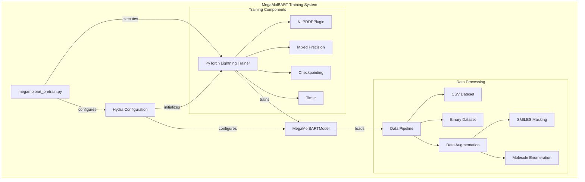
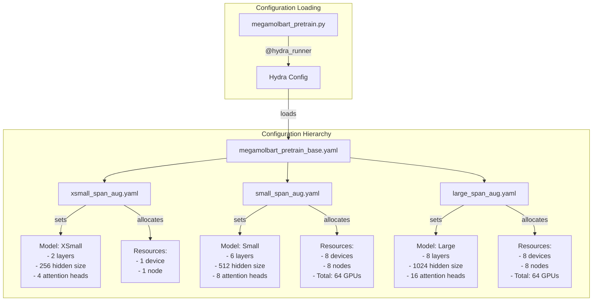
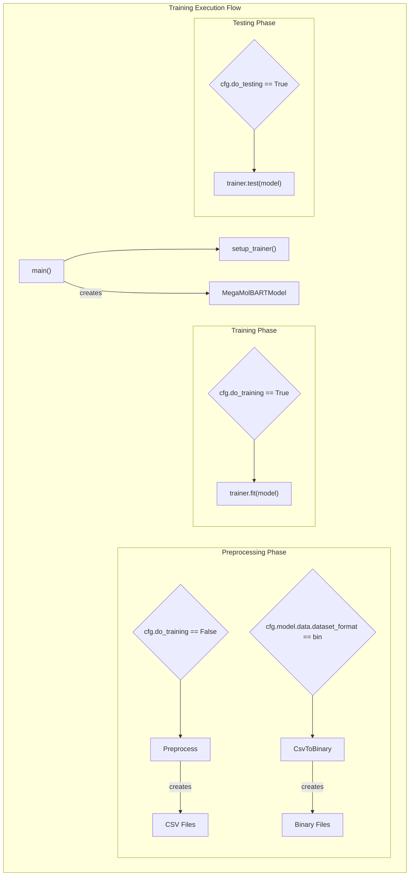
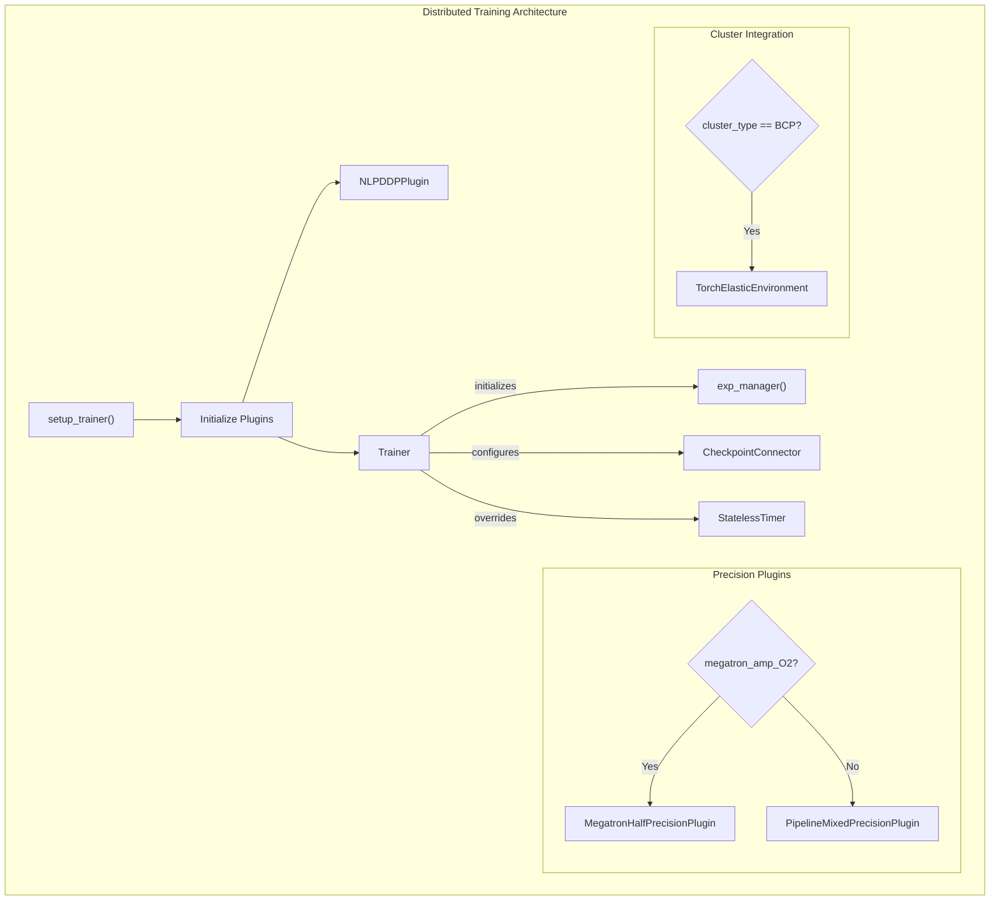
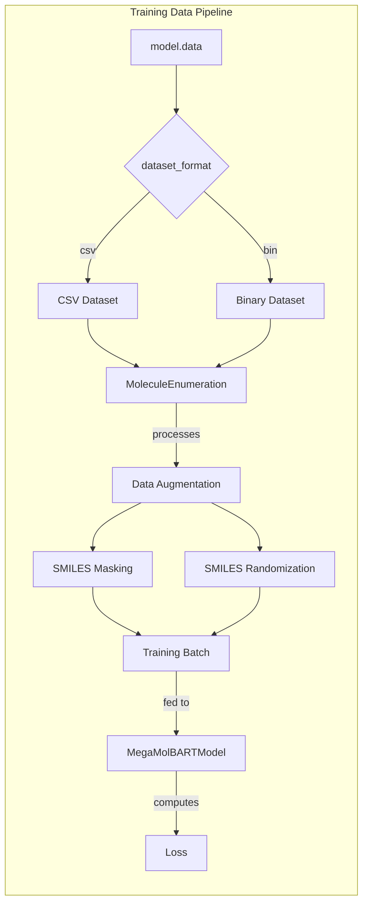
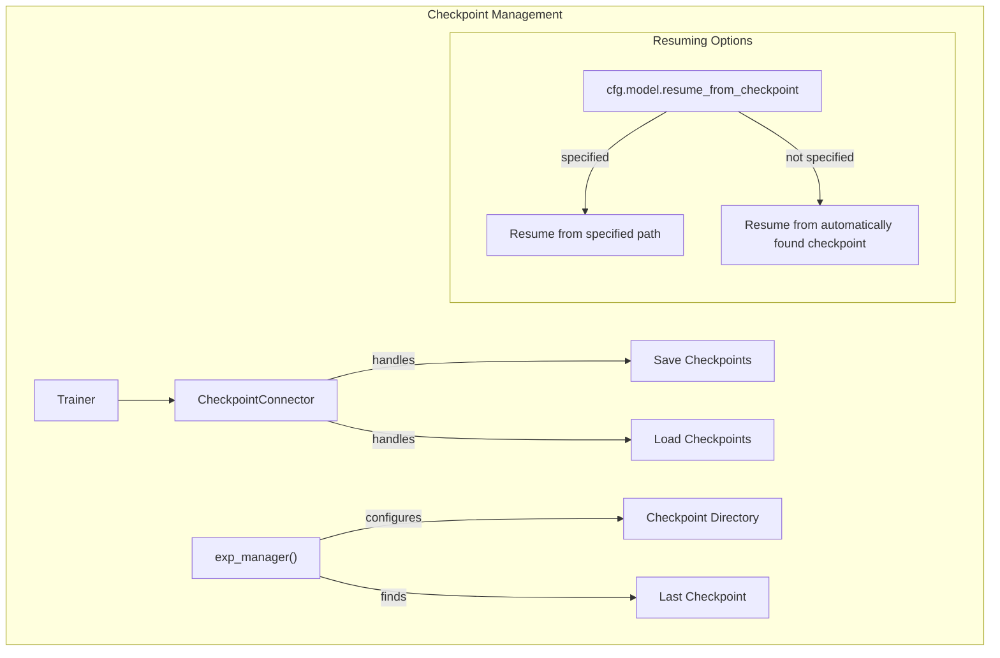

<!-- source: DeepWiki mcp.deepwiki.com · repo NVIDIA/MegaMolBART · page 3 Training System · fetched 2026-10-26 -->

# Training System

<details>
<summary>Relevant source files</summary>

The following files were used as context for generating this wiki page:

- [examples/chem/conf/megamolbart_pretrain_large_span_aug.yaml](examples/chem/conf/megamolbart_pretrain_large_span_aug.yaml)
- [examples/chem/conf/megamolbart_pretrain_small_span_aug.yaml](examples/chem/conf/megamolbart_pretrain_small_span_aug.yaml)
- [examples/chem/conf/megamolbart_pretrain_xsmall_span_aug.yaml](examples/chem/conf/megamolbart_pretrain_xsmall_span_aug.yaml)
- [examples/chem/megamolbart_pretrain.py](examples/chem/megamolbart_pretrain.py)

</details>


The MegaMolBART Training System provides a comprehensive framework for pretraining transformer-based molecular representation models. This document describes how to configure and execute training runs for MegaMolBART models, from single-GPU experiments to large-scale distributed training across multiple nodes.

For details on the model architecture itself, see [Model Architecture](#2), and for inference usage, see [Inference System](#4).

## Training System Overview

The MegaMolBART training system is built on PyTorch Lightning with specialized plugins for distributed training at scale. It supports data parallelism, mixed precision training, and checkpoint management.



Sources: [examples/chem/megamolbart_pretrain.py:41-89](), [examples/chem/megamolbart_pretrain.py:92-102]()

## Configuration System

The training system uses a hierarchical configuration approach based on Hydra. Configuration files define model architecture, training parameters, and hardware resource allocation.



Sources: [examples/chem/conf/megamolbart_pretrain_xsmall_span_aug.yaml:1-13](), [examples/chem/conf/megamolbart_pretrain_small_span_aug.yaml:1-14](), [examples/chem/conf/megamolbart_pretrain_large_span_aug.yaml:1-14](), [examples/chem/megamolbart_pretrain.py:92]()

## Training Workflow

The MegaMolBART training workflow consists of data preprocessing, model initialization, training, and optional testing.



Sources: [examples/chem/megamolbart_pretrain.py:92-135](), [examples/chem/megamolbart_pretrain.py:108-131]()

## Training Process Configuration

The training system can be configured through YAML files, with the most important settings shown below:

| Configuration Category | Key Parameters | Description |
|------------------------|----------------|-------------|
| Model Architecture | `num_layers`, `hidden_size`, `num_attention_heads` | Defines the size and capacity of the model |
| Training Resources | `trainer.devices`, `trainer.num_nodes` | Specifies GPU distribution |
| Precision | `trainer.precision` | Controls numerical precision (16, bf16, 32) |
| Training Control | `do_training`, `do_testing` | Toggles training and testing phases |
| Data Processing | `model.data.*` | Controls dataset configuration |

Sources: [examples/chem/conf/megamolbart_pretrain_xsmall_span_aug.yaml:1-13](), [examples/chem/conf/megamolbart_pretrain_small_span_aug.yaml:1-14](), [examples/chem/conf/megamolbart_pretrain_large_span_aug.yaml:1-14]()

## Distributed Training Setup

MegaMolBART supports large-scale distributed training using PyTorch Lightning's distributed training capabilities with specialized plugins.



Sources: [examples/chem/megamolbart_pretrain.py:41-89]()

## Data Processing During Training

During training, the data pipeline handles SMILES molecular data with several augmentation and preprocessing steps.



Sources: [examples/chem/megamolbart_pretrain.py:112-126]()

## Running Training

To launch a training job, use the `megamolbart_pretrain.py` script with the appropriate configuration file:

```bash
python examples/chem/megamolbart_pretrain.py --config-name=megamolbart_pretrain_xsmall_span_aug
```

The script supports the following operations based on configuration:

- **Data Preprocessing**: When `do_training=False`, the script prepares datasets from raw SMILES data
- **Model Training**: When `do_training=True`, the script trains the model using the prepared datasets
- **Model Testing**: When `do_testing=True`, the script evaluates the model on test data

Sources: [examples/chem/megamolbart_pretrain.py:108-131]()

## Checkpointing and Resuming

The training system includes robust checkpointing capabilities that allow training to be paused and resumed. Checkpoints are managed by PyTorch Lightning's CheckpointConnector with customizations for efficient distributed training.



Sources: [examples/chem/megamolbart_pretrain.py:66-83]()

## Model Sizes and Resource Requirements

MegaMolBART provides several pre-configured model sizes with corresponding resource requirements:

| Model Size | Layers | Hidden Size | Attention Heads | GPU Requirements |
|------------|--------|-------------|----------------|------------------|
| XSmall     | 2      | 256         | 4              | 1 device, 1 node |
| Small      | 6      | 512         | 8              | 8 devices, 8 nodes (64 GPUs) |
| Large      | 8      | 1024        | 16             | 8 devices, 8 nodes (64 GPUs) |

For smaller experimental runs, the XSmall configuration can be used on a single GPU, while the larger models are designed for multi-node distributed training environments.

Sources: [examples/chem/conf/megamolbart_pretrain_xsmall_span_aug.yaml:1-13](), [examples/chem/conf/megamolbart_pretrain_small_span_aug.yaml:1-14](), [examples/chem/conf/megamolbart_pretrain_large_span_aug.yaml:1-14]()

---

