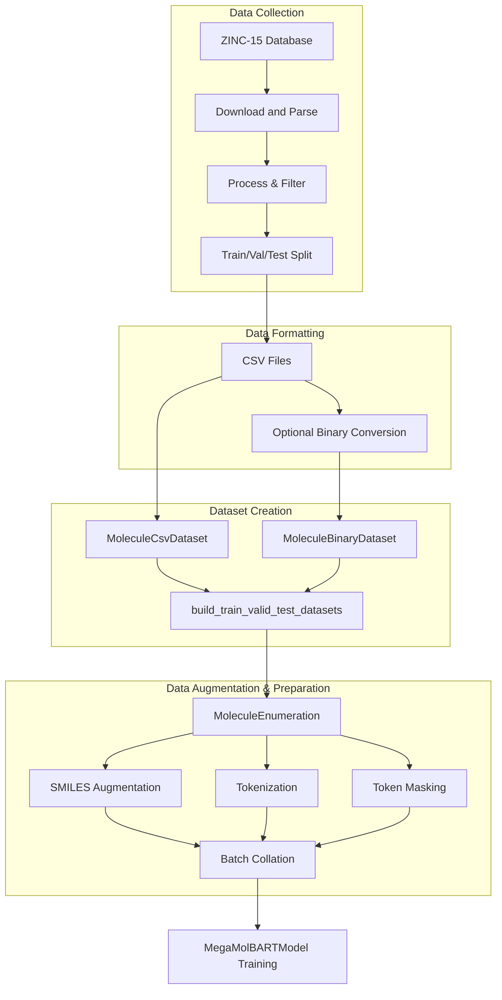
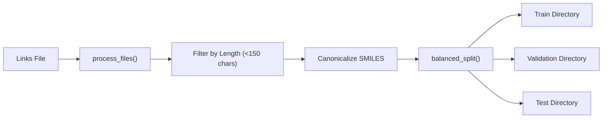
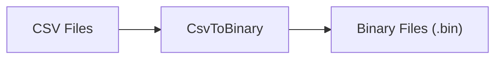
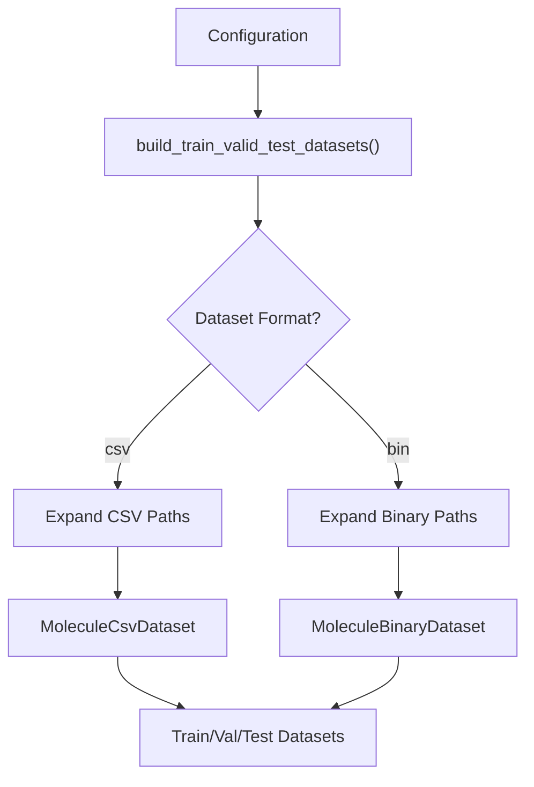
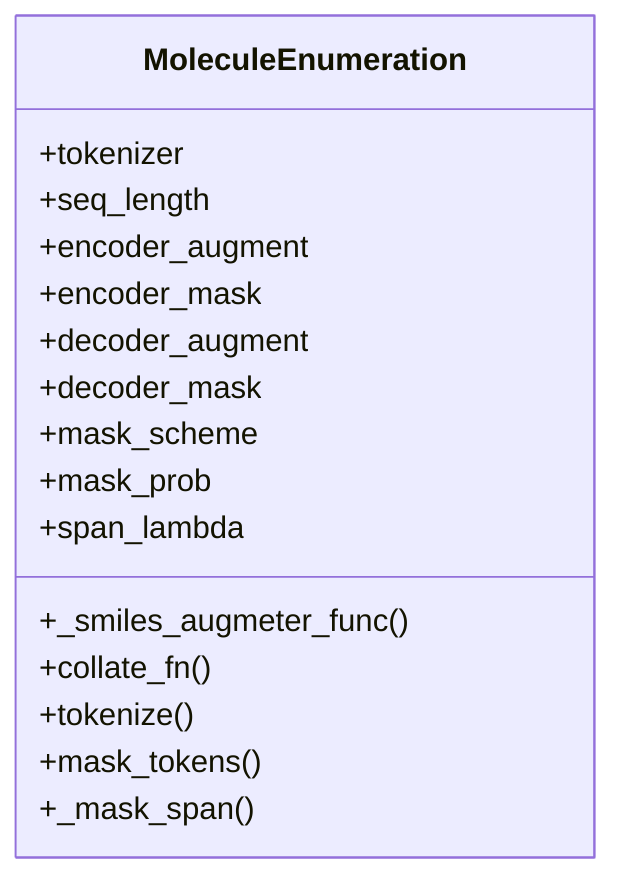
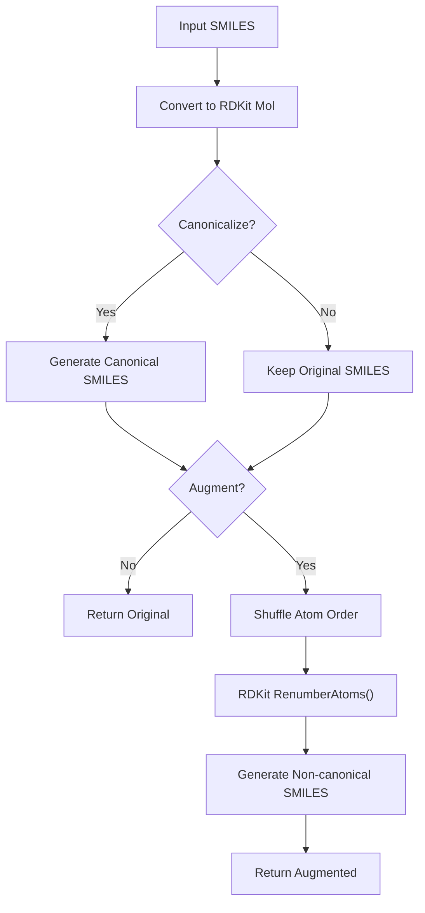
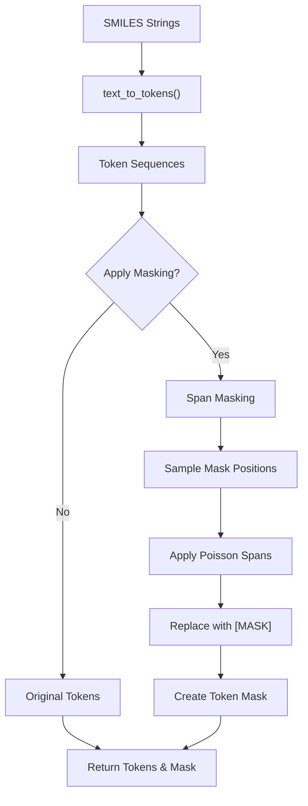
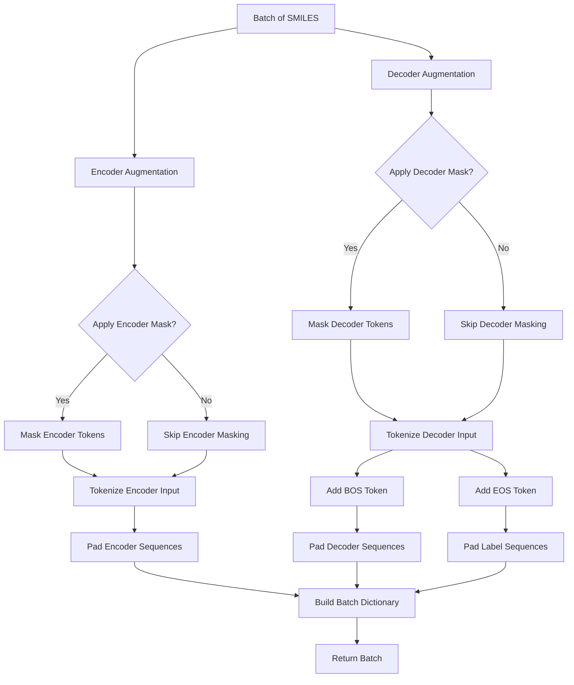
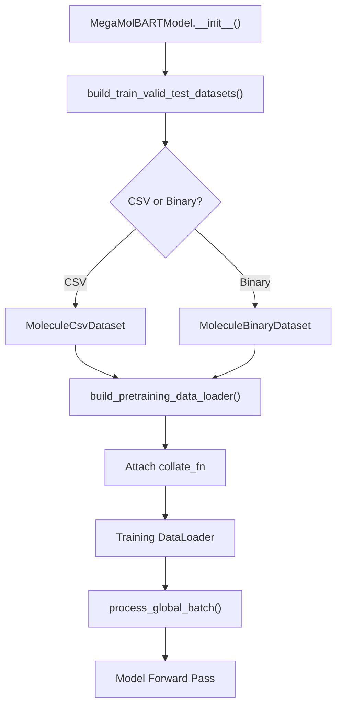

<!-- source: DeepWiki mcp.deepwiki.com · repo NVIDIA/MegaMolBART · page 3.1 Data Processing Pipeline · fetched 2026-10-26 -->

# Data Processing Pipeline

<details>
<summary>Relevant source files</summary>

The following files were used as context for generating this wiki page:

- [examples/chem/conf/megamolbart_pretrain_base.yaml](examples/chem/conf/megamolbart_pretrain_base.yaml)
- [examples/chem/megamolbart_pretrain.py](examples/chem/megamolbart_pretrain.py)
- [examples/chem/shell/megamolbart_pretrain_quick.sh](examples/chem/shell/megamolbart_pretrain_quick.sh)
- [nemo_chem/data/augment.py](nemo_chem/data/augment.py)
- [nemo_chem/data/csv_dataset.py](nemo_chem/data/csv_dataset.py)
- [nemo_chem/data/preprocess/preprocess.py](nemo_chem/data/preprocess/preprocess.py)
- [nemo_chem/data/utils.py](nemo_chem/data/utils.py)
- [nemo_chem/models/megamolbart/megamolbart_model.py](nemo_chem/models/megamolbart/megamolbart_model.py)
- [nemo_chem/utils/__init__.py](nemo_chem/utils/__init__.py)

</details>


This document details the data processing pipeline for the MegaMolBART (Molecular BART) system, covering the journey from raw molecular data to model-ready batches. The pipeline handles downloading and preprocessing SMILES strings from the ZINC-15 database, creating structured datasets, performing molecular augmentation, tokenization, masking, and preparing batches for transformer-based training.

For information about configuring the training process, see [Training Configuration](#3.2). For information about the model architecture itself, see [Model Architecture](#2).

## Pipeline Overview

The MegaMolBART data processing pipeline follows a sequential workflow that prepares molecules for pretraining:



Sources:
- [nemo_chem/data/preprocess/preprocess.py:194-216]()
- [nemo_chem/data/utils.py:96-133]()
- [nemo_chem/data/augment.py:31-48]()
- [nemo_chem/models/megamolbart/megamolbart_model.py:60-88]()

## Data Collection and Preprocessing

### ZINC-15 Data Acquisition

The data collection process begins with downloading molecular data from the ZINC-15 database, which contains commercially available compounds represented as SMILES strings.

The `Preprocess` class handles data download and filtering:



Key operations:
1. Download files in parallel from provided links
2. Filter molecules by SMILES string length (maximum 150 characters)
3. Canonicalize SMILES using RDKit
4. Split data into train (98%), validation (1%), and test (1%) sets
5. Save as CSV files with "zinc_id" and "SMILES" columns

Sources:
- [nemo_chem/data/preprocess/preprocess.py:195-215]()
- [nemo_chem/data/preprocess/preprocess.py:103-135]()
- [nemo_chem/data/preprocess/preprocess.py:165-193]()

### CSV to Binary Conversion (Optional)

For enhanced loading performance, CSV files can optionally be converted to binary format:



This conversion step is triggered when `dataset_format` is set to "bin" in the configuration. Binary format significantly improves loading speed during training.

Sources:
- [examples/chem/megamolbart_pretrain.py:112-126]()

## Dataset Creation

### Building Datasets

The dataset creation process combines preprocessed files into structured PyTorch datasets:



The `build_train_valid_test_datasets` function:
1. Expands dataset paths using braceexpand syntax (e.g., `x[000..146]` to `x000, x001, ..., x146`)
2. Verifies that all files exist
3. Creates appropriate dataset objects based on format (CSV or binary)
4. Returns train, validation, and test datasets

Sources:
- [nemo_chem/data/utils.py:96-133]()
- [nemo_chem/models/megamolbart/megamolbart_model.py:60-88]()
- [nemo_chem/data/csv_dataset.py:67-84]()

## Molecular Augmentation and Tokenization

### MoleculeEnumeration Class

The core of the data augmentation and preparation process is the `MoleculeEnumeration` class, which handles SMILES augmentation, tokenization, and masking:



Sources:
- [nemo_chem/data/augment.py:31-48]()

### SMILES Augmentation

Augmentation creates diverse but equivalent SMILES representations of the same molecule:



The augmentation process:
1. Parses SMILES into RDKit molecule
2. Optionally canonicalizes the molecule
3. For augmentation, shuffles atom order and generates a new, equivalent SMILES representation
4. Returns both augmented SMILES and canonical form as targets

Sources:
- [nemo_chem/data/augment.py:51-81]()

### Tokenization and Masking

Tokenization converts SMILES strings into token sequences, and masking prepares data for BART-style pretraining:



The masking process uses span masking by default:
1. Sample mask positions based on `mask_prob` parameter
2. For each mask position, sample span length from Poisson distribution (λ = `span_lambda`)
3. Replace tokens with mask token and track original tokens for loss calculation

Sources:
- [nemo_chem/data/augment.py:198-277]()

## Batch Preparation

### Collation Function

The `collate_fn` method prepares batches for the encoder-decoder model:



The collation process:
1. Applies augmentation to SMILES for encoder and optionally for decoder
2. Applies masking to encoder tokens (for BART-style pretraining)
3. Tokenizes and pads sequences
4. Adds special tokens (BOS to decoder input, EOS to labels)
5. Creates tensor batch with:
   - `text_enc`: Encoder input tokens
   - `enc_mask`: Encoder attention mask
   - `text_dec`: Decoder input tokens (starting with BOS)
   - `dec_mask`: Decoder attention mask
   - `labels`: Target output tokens (ending with EOS)
   - `loss_mask`: Mask for loss calculation
   - `target_smiles`: Canonical SMILES strings for evaluation

Sources:
- [nemo_chem/data/augment.py:143-196]()

## Configuration Options

The data processing pipeline is configured through the YAML configuration files:

| Parameter | Description | Default |
|-----------|-------------|---------|
| `dataset_path` | Directory for data files | `/data/zinc_csv_split` |
| `dataset_format` | Data format ("csv" or "bin") | "csv" |
| `encoder_augment` | Apply augmentation to encoder input | True |
| `encoder_mask` | Apply masking to encoder input | True |
| `decoder_augment` | Apply augmentation to decoder input | True |
| `decoder_mask` | Apply masking to decoder input | False |
| `mask_scheme` | Masking strategy | "span" |
| `mask_prob` | Probability of masking tokens | 0.1 |
| `span_lambda` | Parameter for Poisson distribution in span masking | 3.0 |
| `canonicalize_input` | Canonicalize SMILES strings | True |

Sources:
- [examples/chem/conf/megamolbart_pretrain_base.yaml:75-94]()

## Integration with Training Process

The data pipeline integrates with the model in `MegaMolBARTModel`:



The model:
1. Builds datasets during initialization
2. Creates data loaders with appropriate collation function
3. Processes batches during training

Sources:
- [nemo_chem/models/megamolbart/megamolbart_model.py:60-115]()
- [examples/chem/megamolbart_pretrain.py:92-102]()

## Running the Pipeline

To run just the data preprocessing step without training:

```bash
python megamolbart_pretrain.py --config-path=conf --config-name=megamolbart_pretrain_xsmall_span_aug do_training=False
```

This command triggers:
1. Data downloading and processing into CSV files
2. Optional conversion to binary format (if specified)

Sources:
- [examples/chem/shell/megamolbart_pretrain_quick.sh:60-64]()
- [examples/chem/megamolbart_pretrain.py:112-126]()

## Conclusion

The MegaMolBART data processing pipeline transforms raw SMILES strings into augmented, tokenized, and masked sequences suitable for training a molecular transformer model. The pipeline's modular design supports both CSV and binary data formats, with configurable augmentation and masking strategies.

This robust data pipeline is critical for effective pretraining, enabling the model to learn meaningful molecular representations from large chemical databases.

---

